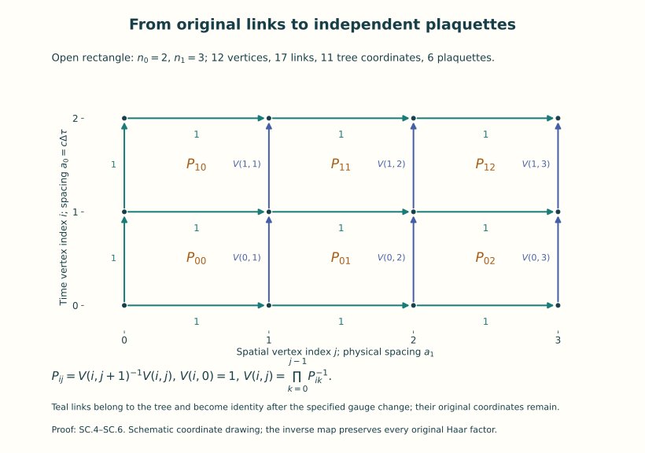
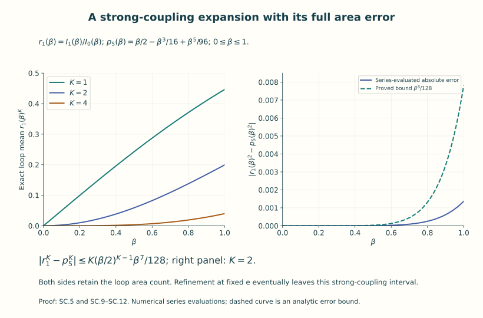
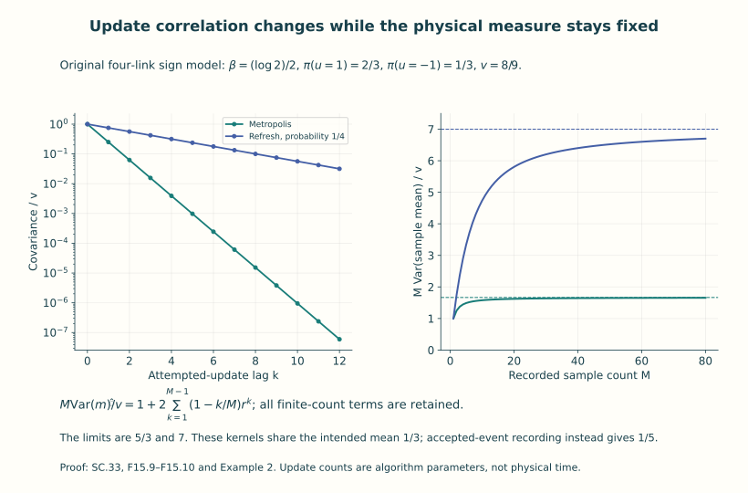

# Strong coupling, simulations and their errors

A lattice expectation is a finite integral, but an integral with many
variables can still be difficult to evaluate. Two methods are central:
expand it in a parameter, or sample its probability measure. This unit
does both in models where the answer and the errors can be proved.

We first solve an open two-dimensional \(U(1)\) lattice exactly. Its link
variables admit an explicit change to tree and plaquette coordinates.
That gives a Wilson-loop area formula, a strong-coupling expansion with
a remainder, and a separate estimate for fine spacings. Periodic
boundaries add a global constraint that can also be calculated exactly.
An explicit embedding relates the action to a restricted four-dimensional
\(SU(N)\) configuration and identifies the resulting measure map.

We then construct a Metropolis sampler for the original compact finite
lattice measure and prove its stationary law, convergence and finite
sample bounds. Exact rejection sampling in the solved model makes the
effects of correlated updates visible. The final calculation combines
the sampling and spacing estimates for one specified observable.

Read [lattice gauge theory](../yang-mills-on-a-lattice.html) first.
The group measures, loop orientation, Wilson action and physical units
are those of Unit 14. The required probability arguments—expectations,
variance, covariance, total variation and finite failure bounds—are
introduced through the calculations below. Familiarity with convergent
series and finite geometric sums is enough for the opening example.

A Monte Carlo update index counts attempted changes to a configuration.
It is different from the Euclidean time coordinate in the configuration.
We retain the full action and its constants throughout, so each error
bound refers to its actual probability measure, coupling, geometry and
observable.

By the end, you can evaluate an exact loop expectation, identify the
domain of an expansion, implement the specified sampling rule, keep its
rejections, and calculate how sampling, volume and spacing affect a
chosen expectation.

## 1. The retained action and the two-dimensional parameter

On the four-dimensional rectangular lattice of F14, retain

\[
 S_a=\frac{2\hbar}{g_{\rm YM}^2}
 \sum_{j,\mu<\nu}\frac{a_0a_1a_2a_3}{a_\mu^2a_\nu^2}
 \left[N-\operatorname{Re}\operatorname{tr}P_{\mu\nu}(j)\right],
 \quad a_\mu=L_\mu/n_\mu,
 \quad a_0=c\Delta\tau.
 \tag{SC.1}
\]

Every link goes from its source fibre to its target fibre. Along a path
\((e_1,\ldots,e_m)\), its transport is \(U_{e_m}\cdots U_{e_1}\); the active lattice gauge map is
\(U_e\mapsto h_{\rm target}U_eh_{\rm source}^{-1}\). In particular the positively oriented plaquette
with steps +0,+1,−0,−1 has

\[
P_{01}(i,j)=U_1(i,j)^{-1}U_0(i,j+1)^{-1}U_1(i+1,j)U_0(i,j).
\]

Each undirected link is integrated once with Haar probability. Reversed
links are their inverses, not new integration variables.

For the explicitly solvable two-dimensional model, fix \(c,\hbar>0\),
spacings \(a_0=c\Delta\tau>0\) and \(a_1>0\), and integers \(n_0,n_1\geq1\). Its open rectangle
has vertices (i,j), \(0\leq i\leq n_0\), \(0\leq j\leq n_1\), and all nearest-neighbor links.
All boundary links are integrated; “open” here does not mean fixed
boundary holonomy. Its physical lengths are \(L_0=n_0a_0,\ L_1=n_1a_1\),
Euclidean time duration \(L_0/c\), plaquette area \(q=a_0a_1\) and number \(P=n_0n_1\).
Take \(G=U(1)\) in its one-dimensional defining representation. Put

\[
 U_e=e^{i\theta_e},\qquad d\mu(U_e)=\frac{d\theta_e}{2\pi},
 \quad S_2=\hbar\sum_p\beta_p(1-\cos\phi_p),
 \quad P_p=e^{i\phi_p}.
 \tag{SC.2}
\]

The angles are elements of \(\mathbb R/(2\pi\mathbb Z)\); no selected real branch is used in
products. Parameters \(\beta_p\geq0\) are dimensionless. For a homogeneous model
write \(\beta_p=\beta\). A two-dimensional continuum comparison fixes a distinct
coupling \(e>0\) of units length⁻¹ and chooses

\[
 \beta=\frac{2}{e^2q},\qquad
 S_{E,2}[A]=\frac{\hbar}{2e^2}\int
       \sum_{\mu,\nu=0}^1\kappa(F_{\mu\nu},F_{\mu\nu})d^2x
       =\frac{\hbar}{e^2}\int\kappa(F_{01},F_{01})d^2x.
 \tag{SC.3}
\]

Here \(\kappa(X,Y)=-\operatorname{tr}(XY)\) on the original skew-Hermitian \(U(1)\) algebra. The coefficient is justified with its complete finite-spacing error below.
In physical time, \(d^2x=c\,d\tau\,dx^1\) and
\(F_{\tau1}=cF_{01}\). Thus the final action is
\(\hbar(e^2c)^{-1}\int\kappa(F_{\tau1},F_{\tau1})d\tau dx^1\).
The parameter e is not set equal to the dimensionless \(g_{\rm YM}\) of SC.1;
Section 5 proves their exact relation for one specified restriction.

The coefficient can be checked with an actual error bound. Take a fixed
\(C^3\), skew-Hermitian \(U(1)\) connection on a neighbourhood of the
closed two-dimensional rectangle, and use its actual edge transports.
Put \(h=\max(a_0,a_1)\), \(h\leq h_0\). Define the derivative bounds
and constants of F14 (L.11)–(L.15) on this rectangle, with the coordinate
indices ranging over \(0,1\), and with defining matrix size \(N=1\).
Those local proofs apply to each face without a periodicity assumption.
For its centre \(x_p\) they give

\[
 1-\operatorname{Re}P_p
   =\frac{q^2}{2}\kappa(F_{01}(x_p),F_{01}(x_p))+R_p,
 \qquad |R_p|\leq q^2h^2C_W.
 \tag{F15.1}
\]

Thus the leading term is accompanied by its remainder. The coefficient
\(\beta=2/(e^2q)\) multiplies this expression by exactly
\(2\hbar/(e^2q)\). Summing over all cells gives
\(\hbar/e^2\) times the midpoint quadrature of the original curvature
square, with error at most \(2\hbar L_0L_1h^2C_W/e^2\).
For a one-dimensional interval of length \(a\), Taylor's theorem at its
centre, the zero integral of the linear term and a bound \(B_q\) on the
second derivative give midpoint error at most
\(B_q\int_{-a/2}^{a/2}t^2/2\,dt=B_qa^3/24\).
Apply this successively in the two coordinates; the other positive
integration or quadrature factor has its exact interval length. The
two-dimensional quadrature error is at most
\(B_qL_0L_1(a_0^2+a_1^2)/24\). Consequently

\[
 |S_2(U[A])-S_{E,2}[A]|
 \leq\frac{\hbar}{e^2}L_0L_1h^2
                      \left(2C_W+\frac{B_q}{12}\right).
 \tag{F15.2}
\]

The fixed connection, rectangle, coupling and physical constants remain
explicit. This comparison proves the coefficient in (SC.3), including
the ordered curvature contraction, without asserting an exact finite
plaquette equality to its leading curvature term.

## 2. The exact link-to-plaquette probability map

Choose the tree consisting of every horizontal link and the vertical
links in the leftmost column. It has \((n_0+1)n_1+n_0=|V|-1\) links. It is
connected and has no cycle: each vertex first travels horizontally to
the leftmost column and then vertically to the root (0,0). Starting
with \(h_{\rm root}=1\), define each next h by \(h_{\rm target}=h_{\rm source}U_e^{-1}\) along its
tree path. The gauge map then sets every tree link to 1. For a reversed
tree step the same equation with \(U_e^{-1}\) gives the required inverse rule.

Retain the original tree variables as coordinates. Conditional on their
values, every remaining link is multiplied by a known left and right
phase; this is a translation of its Haar angle and preserves Haar
probability. Thus changing from all links to the original tree variables
and the remaining gauge-transformed vertical links preserves product
measure. Let the latter be \(V(i,j)\), with \(V(i,0)=1\). The plaquette formula
is now \(P_{ij}=V(i,j+1)^{-1}V(i,j)\), so the inverse coordinate map is

\[
 V(i,j)=\prod_{k=0}^{j-1}P_{ik}^{-1},\qquad
 \prod_{e}d\mu(U_e)=
 \prod_{e\in\text{tree}}d\mu(U_e)\prod_{p}d\mu(P_p).
 \tag{SC.4}
\]

For the measure identity, replace \(V(i,1)\), then \(V(i,2)\), and so on by
\(P_{i0},P_{i1},\ldots\); at each step the current variable is inverted and translated
by a known earlier phase. Both operations preserve \(d\theta/(2\pi)\). Fubini
proves the displayed product identity, including its inverse map.
The tree variables have total measure one. No infinite gauge volume
has been suppressed, and the common vertex phase acts trivially.

Figure 1. The actual tree choice in (SC.4), for \(n_0=2,n_1=3\).
The coordinate drawing is schematic; \(a_0=c\Delta\tau\) and \(a_1\)
keep their physical values. Eleven original tree variables and six
plaquette variables give all seventeen original link coordinates.

Define, for integer m and real \(\beta\geq0\),

\[
 I_m(\beta)=\int_0^{2\pi}e^{\beta\cos\phi}e^{im\phi}
                  \frac{d\phi}{2\pi}
 =\sum_{r=0}^{\infty}
       \frac{(\beta/2)^{2r+|m|}}{r!(r+|m|)!},
 \qquad r_m(\beta)=\frac{I_m(\beta)}{I_0(\beta)}.
 \tag{SC.5}
\]

Expand the two exponentials of \((\beta/2)e^{i\phi}\) and \((\beta/2)e^{-i\phi}\); the
absolute majorant is \(e^\beta\), and angle integration keeps just the terms
whose total Fourier exponent is zero. This proves the series, the
legitimate interchange and \(I_{-m}=I_m\). In particular \(I_0\geq1\); every \(I_m\) is
positive for \(\beta>0\); \(r_0=1\); and at \(\beta=0\) all nonzero \(r_m\) vanish. For \(m\ne0\),
\(I_0-I_m\) is the integral of \(e^{\beta\cos\phi}(1-\cos m\phi)\), strictly positive.

SC.4 evaluates the partition and the exact probability law:

\[
 Z_{\rm open}=\prod_p e^{-\beta_p}I_0(\beta_p),\qquad
 d\nu_{\rm plaquette}=
 \prod_p\frac{e^{\beta_p\cos\phi_p}}{I_0(\beta_p)}
                          \frac{d\phi_p}{2\pi}.
 \tag{SC.6}
\]

In particular the additive constants \(\beta_p\) in \(S_2\) are retained in Z.
Under this measure the plaquettes are independent. Sampling these phases
and independent uniform original tree variables, then applying the exact
inverse of SC.4 and the tree gauge transformation, samples the original
link measure, including its gauge coordinates.

For a simple positively oriented rectangular contour C enclosing \(K\geq1\)
plaquettes, cancellation of the internal link factors gives
\(U_C=\prod_{p\text{ inside }C}P_p\). This is an equality in \(U(1)\),
not merely an equality of expectations. Thus

\[
 \mathbb E(U_C^m)=\prod_{p\text{ inside }C}r_m(\beta_p),\qquad
 W_K:=\mathbb E(\operatorname{Re}U_C)=r_1(\beta)^K,
 \quad A=Kq.
 \tag{SC.7}
\]

The empty contour has value 1. A reversed contour complex-conjugates
the variable; all its displayed expectations agree by \(\phi\mapsto-\phi\). Every
bounded observable of a fixed set of plaquettes has exactly the same
law when the surrounding open rectangle is enlarged with the same
parameters on those plaquettes. This proves zero finite-volume error
for these open-boundary observables, not an assumed thermodynamic limit.

For \(\beta>0\) put

\[
 \sigma_q(\beta)=-\frac{\log r_1(\beta)}q>0,
 \quad W_K=e^{-\sigma_q A},\qquad
 V_W(R):=-\frac{\hbar}{\mathcal T}\log W_K
       =\hbar c\,\sigma_q R,\quad A=c\mathcal T R.
 \tag{SC.8}
\]

Here R is an integer multiple of \(a_1\) and the loop time \(\mathcal T\)
is an integer multiple of \(\Delta\tau\). Equality holds for every such loop and
every larger open rectangle, so its large-time logarithmic rate has
exactly this value. The area coefficient \(\sigma_q\) has units length⁻²;
\(\hbar c\sigma_q\) has units energy/length. \(V_W\) is the specified Wilson-loop rate;
no unconstructed charged-sector Hamiltonian is used to redefine it.
At \(\beta=0\) every nonempty loop mean is zero and its finite logarithm is
undefined; the extended value \(\sigma_q=+\infty\) may be used only with that meaning.

## 3. Strong-coupling expansion with an actual remainder

Let \(0\leq\beta\leq1\), put \(x=\beta^2/4\), and write
\(A_0(x)=\sum_{r\geq0}x^r/(r!)^2\) and \(A_1(x)=\sum_{r\geq0}x^r/[r!(r+1)!]\). Then
\(r_1=(\beta/2)A_1/A_0\) and \(A_0\geq1\). The first three coefficients of
\(A_1-(1-x/2+x^2/3)A_0\) are zero. For \(x\leq1/4\) its remaining absolute sum is
at most

\[
 x^3e^x\left(\frac1{144}+\frac1{36}+\frac18+\frac13\right)
       =\frac{71}{144}e^x x^3\le\frac{71}{108}x^3<x^3.
 \tag{SC.9}
\]

For example the \(A_0\) tail from degree n is bounded by
\(x^ne^x/(n!)^2\), since \((n+r)!\geq n!r!\) and one of the two r! factors can
be dropped in an upper bound. The \(A_1\) tail from degree n is at most
\(x^ne^x/[n!(n+1)!]\). Apply these with \(n=3,3,2,1\) to the four terms.
The final bound uses \(e^x\leq\sum_{r\geq0}x^r=(1-x)^{-1}\leq4/3\). Dividing by \(A_0\)
therefore proves the explicit expansion

\[
 p_5(\beta)=\frac\beta2-\frac{\beta^3}{16}
                         +\frac{\beta^5}{96},\qquad
 |r_1(\beta)-p_5(\beta)|\le\frac{\beta^7}{128},
 \quad 0\le r_1(\beta),p_5(\beta)\le\frac\beta2.
 \tag{SC.10}
\]

The last bounds follow from \(A_1\leq A_0\) term by term and
\(0<1-\beta^2/8+\beta^4/48\leq1\) when \(0\leq\beta\leq1\). The difference-of-powers identity,
with every K retained, gives

\[
 |W_K-p_5(\beta)^K|
       \le K(\beta/2)^{K-1}\frac{\beta^7}{128}.
 \tag{SC.11}
\]

At \(\beta=0\) interpret the \(K=1\) zero-th power as 1; both sides are zero.
For positive \(\beta\) this bounds the error relative to the leading
\((\beta/2)^K\) by \(K\beta^6/64\). It is an actual area-dependent remainder and does
not assume convergence of an uncomputed cluster expansion.

There is also a logarithmic form. Set \(y=2r_1/\beta-1\). SC.10 gives
\(|y+\beta^2/8|\leq7\beta^4/192\) and \(|y|\leq31\beta^2/192<1\). The convergent logarithm
series, or integration of \(t/(1+t)\), yields
\(|-\log(1+y)+y|\leq y^2/[2(1-|y|)]\). Since
\(7/192+(31/192)^2/[2(1-31/192)]<1/16\),

\[
 \left|q\sigma_q-\log(2/\beta)-\frac{\beta^2}{8}\right|
                         \le\frac{\beta^4}{16},
                  \qquad 0<\beta\le1.
 \tag{SC.12}
\]

This is the proved strong-coupling regime. For SC.3 it is \(e^2q\geq2\);
at fixed e a refinement \(q\to0\) eventually leaves it. The exact formula
SC.7 remains true at every finite \(\beta\), and Section 6 proves a separate
large-\(\beta\) estimate for that other limit.

Figure 2. Numerical evaluations of the exact convergent series (SC.5)
and the polynomial (SC.10), with the proved area-dependent remainder
(SC.11). The right-hand bound is deterministic approximation error,
with no statistical confidence interpretation. All displayed couplings
belong to the proved interval \(0\leq\beta\leq1\).

## 4. Periodic boundaries and the finite-volume correction

Now use a two-dimensional periodic rectangle, \(n_0,n_1\geq2\), \(P=n_0n_1\),
with the same link labels and plaquette orientation as F14. All links,
including the two winding directions, remain integrated. Expand each
Boltzmann factor into the absolutely summable Fourier series
\(e^{-\beta}\sum_{m\in\mathbb Z}I_m(\beta)P_p^m\). Integration of any link phase is zero unless its
total integer exponent is zero. With no insertion this says that the
integers on its two adjacent faces agree. The dual face graph is
connected, so every face integer equals one common integer m. Hence

\[
 Z_{\rm tor}=e^{-\beta P}\sum_{m\in\mathbb Z}I_m(\beta)^P,
 \quad
 W_{K,P}^{\rm tor}=
 \frac{\sum_{m\in\mathbb Z}r_{m-1}(\beta)^K r_m(\beta)^{P-K}}
      {\sum_{m\in\mathbb Z}r_m(\beta)^P}.
 \tag{SC.13}
\]

For the second formula insert the product of the K faces of a
contractible rectangle. The link conditions say that the face integers
plus 1 on the inserted region are constant; thus the two exponents
are m−1 and m. No quotient by a winding holonomy was made. The Fourier
interchanges follow from the finite product of the majorants \(e^\beta\).
For \(K=0\) the ratio is 1; for \(K=P\) it is also 1, since every link cancels
in the product of all plaquettes. The following comparison assumes
\(1\leq K<P\). At \(\beta=0\) its value is zero, just as in the open model.

For \(0<\beta\leq1\) set \(\rho=\beta/2\leq1/2\). The factorial inequality
\((r+m)!\geq m!r!\) proves, term by term in SC.5,
\(0<r_m\le\rho^{|m|}/|m|!\le\rho^{|m|}\).
The \(m=0\) term in the numerator of SC.13 is \(r_1^K\). For \(m\geq1\) the other
terms are bounded by \(\rho^{mP-K}\), and for \(m\leq-1\) by \(\rho^{|m|P+K}\).
The denominator is 1 plus a number between zero and
\(2\rho^P/(1-\rho^P)\). Consequently

\[
 |W_{K,P}^{\rm tor}-r_1^K|
 \le\frac{\rho^{P-K}+3\rho^{P+K}}{1-\rho^P},
            \qquad 1\le K<P,\quad 0<\beta\le1.
 \tag{SC.14}
\]

To see the quotient estimate explicitly, write its numerator \(r_1^K+R\)
and denominator \(1+d\). Then the difference is \((R-r_1^Kd)/(1+d)\);
use \(R\geq0,\ d\geq0\) and the preceding sums. The complement area \((P-K)q\)
is retained in the first exponent. This proves a finite-volume bound,
including the global periodic flux constraint, rather than borrowing a
mass-dependent finite-volume assertion from another theory.

A less sharp bound holds for every fixed \(\beta>0\). The one-plaquette density
\(e^{\beta\cos\phi}/I_0\) is at least \(\epsilon_\beta=e^{-2\beta}\), since \(I_0\leq e^\beta\). Splitting off
this uniform density gives \(|r_m|\leq\eta_\beta=1-\epsilon_\beta\) for \(m\ne0\). Also the absolute
Fourier series at \(\phi=0\) gives
\(C_\beta:=\sum_{m\ne0}r_m=e^\beta/I_0(\beta)-1<\infty\).
The same numerator/denominator argument yields

\[
 |W_{K,P}^{\rm tor}-r_1^K|
       \le C_\beta\bigl(\eta_\beta^{P-K-1}
                              +\eta_\beta^{P-1}\bigr).
 \tag{SC.15}
\]

This tends to zero as the complement grows at fixed \(\beta,K\). Its constants
are explicitly not uniform as \(\beta\to\infty\). A loop winding once around a
periodic direction instead has mean zero: multiply every link of one
transverse cut by a common \(z\in U(1)\). Each plaquette has two cancelling
cut factors, whereas that loop acquires z. Haar and the action are
unchanged; its expectation equals z times itself for every z. Such a
loop is not described by an enclosed plaquette area formula.

## 5. The precise action map into the four-dimensional question

For \(N\geq2\) define the injective group map
\(\iota(z)=\operatorname{diag}(z,z^{-1},1,\ldots,1)\in SU(N)\).
It preserves multiplication and inversion, and

\[
 W_N(\iota(e^{i\phi}))=2(1-\cos\phi),\qquad
 \kappa_{SU(N)}(\iota_*X,\iota_*Y)=2\kappa_{U(1)}(X,Y).
 \tag{SC.16}
\]

Both equalities follow by the displayed diagonal entries. On a periodic
four-dimensional lattice, copy a two-dimensional (0,1)-link configuration
identically to every (2,3) slice through \(\iota\) and set every 2- and 3-link
to the identity. The map intertwines two-dimensional \(U(1)\) vertex gauge
maps with their similarly copied \(SU(N)\) maps. All mixed and (2,3)
plaquettes are identity. Every (0,1) plaquette is \(\iota(P_2)\) and occurs
\(n_2n_3\) times. The exact restricted action is therefore

\[
 \left.\frac{S_a}{\hbar}\right|_{\iota\text{ and copies}}
   =\frac{4L_2L_3}{g_{\rm YM}^2q}\sum_p(1-\cos\phi_p)
   =\frac{2}{e^2q}\sum_p(1-\cos\phi_p),
 \qquad e^2=\frac{g_{\rm YM}^2}{2L_2L_3}.
 \tag{SC.17}
\]

This proves an actual relation preserving the original actions, defining
traces, orientations, spacings and couplings. For an embedded loop,
\(\operatorname{tr}_{SU(N)}U_C=(N-2)+U_C^{U(1)}+(U_C^{U(1)})^{-1}\). Thus its restricted
trace expectation is \((N-2)+2W_K\) in the open model, or the corresponding
periodic value in SC.13. The divided trace would be this expression/N;
it has not replaced the original trace.

The measure map is different and can be proved precisely. Pushforward
of the two-dimensional Haar/product weighted measure is supported on
the copied configurations, where all transverse links equal identity.
Each identity singleton has Haar measure zero in \(SU(N)\): in a positive-
dimensional smooth group chart the Haar volume has a smooth positive
density relative to Lebesgue measure, and a singleton has zero volume.
F14 constructs this Haar measure. The four-dimensional product Haar
measure, and its bounded positive Wilson density, therefore give the
entire restricted configuration set measure zero. Its restricted
pushforward and the full four-dimensional Wilson probability are
mutually singular. This proof identifies exactly what the action
embedding preserves and what its measure does; it is not a claim that
the models have no mathematical relation.

In isotropic four-dimensional SC.1 the coefficient of \(W_N\) is
\(2/g_{\rm YM}^2\), and the coefficient of \(1-\operatorname{Re}\operatorname{tr}/N\) is \(2N/g_{\rm YM}^2\). Making \(g_{\rm YM}\)
small sends both to infinity. The proved strong-coupling bound SC.12
instead assumes the two-dimensional coefficient \(\beta\leq1\). Neither the
measure restriction nor that bound supplies a uniform four-dimensional
continuum confinement or spectral-gap estimate.

## 6. A quantitative spacing limit for the actual Wilson model

We now prove the other regime directly from the same \(I_0,I_1\), retaining
the Wilson weight. Let \(\beta\geq1\) and let expectation in this paragraph use
the one-plaquette probability in SC.6. Put \(u(\theta)=1-\cos\theta\) on \([-\pi,\pi]\),
\(\delta=\mathbb Eu=1-r_1\) and \(\alpha=2/\pi^2\). Concavity of sin on \([0,\pi/2]\) gives
\(\sin t\geq2t/\pi\) there, while integrating \(|\sin t|\leq|t|\) gives

\[
 \alpha\theta^2\le u(\theta)\le\theta^2/2.
 \tag{SC.18}
\]

The first follows also from \(u=2\sin^2(\theta/2)\). These inequalities are
global on that interval. The density after removing \(e^\beta\) is \(e^{-\beta u}\)
divided by its probability-Haar integral. Integrating just
\(|\theta|\leq\beta^{-1/2}\) proves the denominator is at least
\(e^{-1/2}/(\pi\sqrt\beta)\). Extending an upper bound for its \(u^2\) numerator to R
therefore gives

\[
 \mathbb E u^2\le\frac{C_0}{\beta^2},\qquad
 C_0=\frac{3\sqrt\pi\,e^{1/2}}{32\alpha^{5/2}}.
 \tag{SC.19}
\]

Indeed its numerator is at most
\((8\pi)^{-1}\int_{\mathbb R}\theta^4e^{-\alpha\beta\theta^2}d\theta
=3\sqrt\pi/[32\pi(\alpha\beta)^{5/2}]\).
The Gaussian integral is obtained by squaring and polar coordinates;
two integrations by parts give its fourth moment. Thus the bound
uses an ordinary convergent integral, not a formal saddle expansion.

Periodicity makes the integral of
\(\partial_\theta[\sin\theta\,e^{\beta\cos\theta}]\) zero. Hence \(\mathbb E\sin^2\theta=r_1/\beta\). Since
\(\sin^2\theta=2u-u^2\), this is the exact relation

\[
 \delta=\frac{1+\beta\mathbb E u^2}{2\beta+1},\qquad
 \left|\delta-\frac1{2\beta}\right|
          \le\frac{C_0/2+1/4}{\beta^2}.
 \tag{SC.20}
\]

If \(\beta\geq B_0:=\max(2,C_0)\), this also gives \(0\leq\delta\leq1/\beta\leq1/2\). Integration of
\(t/(1-t)\) from zero to \(\delta\) proves
\(0\leq-\log(1-\delta)-\delta\leq\delta^2/[2(1-\delta)]\leq\beta^{-2}\). With \(D=C_0/2+5/4\) we obtain

\[
 \left|-\log r_1(\beta)-\frac1{2\beta}\right|
             \le\frac D{\beta^2},\qquad \beta\ge B_0.
 \tag{SC.21}
\]

All constants have been given. No large-\(\beta\) series was used as an
unproved asymptotic provider.

Fix \(e>0\) and a physical rectangle of spatial length R and Euclidean
time duration \(\mathcal T\), with \(A=c\mathcal T R\). Choose any
integer refinements \(a_0=c\mathcal T/m_0,\ a_1=R/m_1\),
\(K=m_0m_1=A/q\), and use a surrounding open lattice. With \(\beta=2/(e^2q)\),
SC.21 proves

\[
 \left|\sigma_q-\frac{e^2}{4}\right|
        \le\frac{D e^4q}{4},\qquad
 \left|W_{A/q}-e^{-e^2A/4}\right|
        \le\frac{D e^4Aq}{4},
       \quad q\le\frac{2}{e^2B_0}.
 \tag{SC.22}
\]

The exponent difference is at most \(De^4Aq/4\); for nonnegative exponents
x,y the fundamental theorem gives \(|e^{-x}-e^{-y}|\leq|x-y|\). This proves the
second inequality and convergence. A relative-error bound is
\(\exp(De^4Aq/4)-1\). In physical units the Wilson rate differs from
\(\hbar ce^2R/4\) by at most \(\hbar cRDe^4q/4\). This is a proved continuum limit of
these specified loop expectations. It does not by itself construct a
continuum probability measure or reconstruct a Hamiltonian.

For an allowed spacing sequence, the computable closed interval
\([\sigma_q-De^4q/4,\sigma_q+De^4q/4]\)
contains \(e^2/4\). This is an error-controlled extrapolation; its hypotheses
include the fixed original coupling trajectory \(\beta=2/(e^2q)\), the open
boundary convention and the represented physical area.

## 7. Exact finite data do not determine an unspecified extrapolation

Fix a finite list of sampled positive plaquette areas \(q_1,\ldots,q_s\) from
represented refinements, and retain all their physical units. For \(q\geq0\)
define dimensionless functions

\[
 H(q)=\prod_{j=1}^s(1-q/q_j)^2,\qquad
 F(q)=\frac{H(q)}{1+H(q)},\qquad
 e_A(q)^2=e^2,\quad e_B(q)^2=e^2[1+\zeta F(q)],
 \quad\zeta>0.
 \tag{SC.23}
\]

They are continuous, indeed real analytic on the real line, since the
denominator is positive. They satisfy \(0\leq F<1\), \(F(q_j)=0\) and \(F(0)=1/2\).
Use the actual Wilson family SC.2 in both cases, with
\(\beta_A(q)=2/[e_A(q)^2q]\) and \(\beta_B(q)=2/[e_B(q)^2q]\) for \(q>0\). At every sampled
\(q_j\) the complete actions and all finite-lattice probability measures
coincide, for any represented box and contour. Consequently no amount
of sampling at those spacings distinguishes the two families.

For \(q\to0\), both \(\beta\)'s tend to infinity and both couplings stay between
\(e^2\) and \(e^2(1+\zeta)\). The proof of SC.22 applies pointwise with e replaced
by \(e_A(q)\) or \(e_B(q)\); its error tends to zero uniformly because the
fourth powers are bounded. Continuity of \(e_A(q)^2,e_B(q)^2\) gives the
different limits, at every fixed \(A>0\),

\[
 W_A^{\rm limit}=e^{-e^2A/4},\qquad
 W_B^{\rm limit}=e^{-e^2(1+\zeta/2)A/4}.
 \tag{SC.24}
\]

This is a counterexample inside explicit positive Wilson lattice
families, not a collection of invented noisy data. Its cause is the
unspecified coupling trajectory. It does not contradict the unique
limit and explicit error when the fixed-e hypothesis of SC.22 is
imposed. In particular small statistical error at finitely many
spacings cannot replace that mathematical hypothesis or its proof.

## 8. A correct compact-lattice Monte Carlo chain with a finite bound

Return temporarily to any finite lattice of F14, with a closed compact
matrix Lie group \(G\subset U(N)\), Haar probability \(\mu\) on all integrated links, and
finitely many specified plaquette words. Let

\[
 V(U)=S(U)/\hbar=\sum_p\beta_p W_N(P_p(U)),\quad
 0\le V\le B:=2N\sum_p\beta_p,
 \quad w=e^{-V},\quad Z=\int w\,d\mu,
 \quad\pi(dU)=Z^{-1}w(U)\mu(dU).
 \tag{SC.25}
\]

Here every \(\beta_p\geq0\) is fixed, including its actual expression from SC.1
where relevant. F14 proves Haar probability; the finite-product
integrals and \(e^{-B}\leq w\leq1\) give \(e^{-B}\leq Z\leq1\). These statements include finite
groups with their probability counting measure, as well as continuous
compact groups. The state space has finite dimension as a manifold,
not finitely many states when G is continuous.

At U propose an entirely new Y with distribution \(\mu\), independently,
and accept it with probability
\(a(U,Y)=\min(1,w(Y)/w(U))\), otherwise keep U. The resulting Markov
kernel is

\[
 K(U,dY)=a(U,Y)\mu(dY)
       +\left[1-\int a(U,Y)\mu(dY)\right]\delta_U(dY).
 \tag{SC.26}
\]

Every factor is measurable, the bracket is nonnegative and each row
has mass one. The accepted part of \(\pi(dU)K(U,dY)\) is
\(Z^{-1}\min(w(U),w(Y))\mu(dU)\mu(dY)\), symmetric in U,Y. Its rejected part
is supported on the diagonal and is also symmetric. This proves
detailed balance, and integration in U proves \(\pi K=\pi\).

There is an explicit uniform lower bound. Since \(w(U)\leq1\) and \(w(Y)\leq1\),
\(a(U,Y)\geq w(Y)\), in either branch of the minimum. Thus

\[
 K(U,dY)\ge Z\pi(dY)\ge\epsilon\pi(dY),\qquad
 \epsilon=e^{-B},\quad r=1-\epsilon.
 \tag{SC.27}
\]

If \(B=0\), \(K=\Pi\), the independent Haar kernel, and take \(r=0\) directly.
Otherwise write \(K=\epsilon\Pi+rR\), where \(\Pi(U,\cdot)=\pi\) and
\(R=(K-\epsilon\Pi)/r\) is a probability kernel. Stationarity gives \(\pi R=\pi\);
\(R\Pi=\Pi\) and \(\Pi R=\Pi\). Multiplication of these identities proves
\(K^n=(1-r^n)\Pi+r^nR^n\) for every \(n\geq0\). With total variation defined as
\(\sup_A|\nu(A)-\nu'(A)|\), a difference of probability measures has norm at
most one, hence

\[
 \|\nu K^n-\pi\|_{\rm TV}\le r^n
 \quad\hbox{for every starting probability }\nu.
 \tag{SC.28}
\]

For invariance uniqueness apply this to an invariant \(\nu\) and take \(n\to\infty\).
This proves sampling correctness and a convergence rate for the actual
specified algorithm, including every coupling and volume in B. The
bound may be expensive at large B; it is finite and has not assumed a
volume-independent mixing rate.

Let f be a real bounded observable taking values in [a,b], set
\(d=b-a,\ m=\pi f\) and \(v=\pi(f-m)^2\). A probability kernel preserving \(\pi\) is an
\(L^2(\pi)\) contraction: pointwise Cauchy–Schwarz gives \(|Rf|^2\leq R|f|^2\) and
integration uses \(\pi R=\pi\). For centered f, \(K^kf=r^kR^kf\). In a
stationary chain this proves
\(|\operatorname{Cov}(f(X_0),f(X_k))|\leq vr^k\). Expanding the square of the sample sum
therefore proves, for \(M\geq1\),

\[
 \operatorname{Var}_{\pi}\left(\frac1M\sum_{i=1}^M f(X_i)\right)
 \le\frac vM\left[1+2\sum_{k=1}^{M-1}(1-k/M)r^k\right]
 \le\frac vM\frac{2-\epsilon}{\epsilon},\qquad
 v\le\frac{d^2}{4}.
 \tag{SC.29}
\]

For the last variance bound, \(\mathbb E[(f-a)(b-f)]\geq0\) gives
\(v\leq(m-a)(b-m)\leq d^2/4\). Chebyshev's inequality here needs no limit theorem:
the integral of the squared error over \(\{|\mathrm{error}|\geq t\}\) is at least \(t^2\)
times its probability, so that probability is at most \(\mathrm{variance}/t^2\).

For an arbitrary starting distribution discard \(b_0\geq0\) transitions and
average \(f(X_{b_0+1}),\ldots,f(X_{b_0+M})\). Conditional on \(X_{b_0}\), the law of the
entire subsequent finite path is a Markov kernel. Integrating an event
probability, which lies in [0,1], cannot increase total variation.
Indeed \(h\in[0,1]\) has \(h=\int_0^1\mathbf1_{\{h>t\}}dt\), so the assertion follows by
integrating the defining event bound for total variation.
SC.28 thus bounds its difference from the stationary path law by \(r^{b_0}\).
For every \(t>0\),

\[
 \mathbb P\{|\widehat m-m|\ge t\}
    \le r^{b_0}+\frac{v(2-\epsilon)}{M\epsilon t^2},
 \qquad
 |\mathbb E\widehat m-m|
    \le\frac{d\,r^{b_0+1}(1-r^M)}{M\epsilon}.
 \tag{SC.30}
\]

The bias bound follows by applying \(|\nu K^nf-\pi f|\leq dr^n\) to each time
and summing the finite geometric series. At \(r=0\) its numerator is zero;
the chain is already independent after one step. The MSE is also at
most \(v(2-\epsilon)/(M\epsilon)+d^2r^{b_0}\), because the squared error is bounded by \(d^2\)
and the same path-law comparison applies. For example choose \(b_0\) so
\(r^{b_0}\leq\alpha/2\) and \(M\geq2v(2-\epsilon)/(\epsilon\alpha t^2)\) to obtain failure probability at most
\(\alpha\). These are explicit choices, with \(B=0\) handled directly.

### Stronger sampling statements from the same kernel

The same splitting also controls complex loop observables and gives
almost-sure convergence. Here are the complete additional arguments.
Keep \(K=\epsilon\Pi+rR\), \(r=1-\epsilon\), and its original invariant
probability \(\pi\). Let \(f\) be real with range of length \(d\), or
complex with \(|f|\leq M_f\), in which case put \(d=2M_f\). Set
\(m=\pi f\), \(g=f-m\), \(v=\pi|g|^2\), and
\(d_0=\|\nu-\pi\|_{\rm TV}\) for the actual initial law \(\nu\).
Then \(|g|\leq d\) and \(v\leq d^2/4\). The real case follows from
the midpoint variance bound; the complex case follows from
\(v=\pi|f|^2-|m|^2\leq M_f^2\).

For this paragraph define the mean beginning at the explicit index
\(b\geq0\) by \(\bar f_{b,M}=M^{-1}\sum_{j=0}^{M-1}f(X_{b+j})\).
The earlier convention in (SC.30) is obtained by taking \(b=b_0+1\).
Define the finite sums

\[
 V_M(r)=\frac{M+2\sum_{k=1}^{M-1}(M-k)r^k}{M^2},\qquad
 C_M(r)=\sum_{j=0}^{M-1}(1+4j)r^j
             \leq\frac{1+3r}{(1-r)^2}.
 \tag{F15.3}
\]

The bound comes from extending a nonnegative sum and summing
\(\sum r^j=(1-r)^{-1}\) and \(\sum j r^j=r/(1-r)^2\).
The latter identity follows by summing the pairs \(1\leq k\leq j\).
The total-variation argument of (SC.28), applied to the initial
difference itself, gives \(\|\nu K^n-\pi\|_{\rm TV}\leq d_0r^n\).
For a complex test function, rotate its expectation difference to be
real and nonnegative; the real part of the rotated observable has range
at most \(d\). This proves the same bias estimate as for real variables.
The following full second-moment bound includes the initial bias:

\[
 \begin{aligned}
 |\mathbb E_\nu\bar f_{b,M}-m|
 &\leq\frac{d d_0r^b(1-r^M)}{M\epsilon},\\
 \mathbb E_\nu|\bar f_{b,M}-m|^2
 &\leq vV_M(r)+\frac{d^2d_0r^b C_M(r)}{M^2}\\
 &\leq\frac{d^2(2-\epsilon)}{4M\epsilon}
          +\frac{d^2d_0r^b(4-3\epsilon)}{M^2\epsilon^2}.
 \end{aligned}
 \tag{F15.4}
\]

To prove the second line, expand the squared modulus. At stationarity,
the lag term is \(\langle g,K^k g\rangle\), whose modulus is at most
\(v r^k\) by the \(L^2\) contraction proof above. This yields
\(v V_M(r)\). For \(0\leq i<j<M\), conditional expectation gives the
actual nonstationary term
\(r^{j-i}(\nu K^{b+i})(\bar g R^{j-i}g)\).
The real part of the test function in parentheses lies in
\([-d^2,d^2]\). Its difference from the stationary term is therefore
at most \(2d^2d_0r^{b+j}\). The diagonal discrepancy is at most
\(d^2d_0r^{b+i}\), since \(|g|^2\in[0,d^2]\).
For each second index \(j\), there are \(j\) off-diagonal pairs, each
counted twice in the real square expansion. Summing gives exactly the
\(C_M\) term. Finally (SC.29)'s finite-sum bound gives
\(V_M(r)\leq(2-\epsilon)/(M\epsilon)\), proving the last line.
For \(r=0\), use \(0^0=1\) at the integer zero exponent: only a
possible initial diagonal term remains. All later centered terms vanish.
The bias line follows by summing the individual-time bounds.

Integrating over the event \(|\bar f_{b,M}-m|\geq t\) divides the
second moment in (F15.4) by \(t^2\) to give a finite failure bound.
It also proves a strong law for every fixed \(b\). The right side is
at most \(C_1/M+C_2/M^2\) with fixed finite constants. At sample counts
\(M=k^2\), the probabilities of error at least \(1/\ell\) have finite
sum for every positive integer \(\ell\). The probability of any such
error after index \(k_0\) is at most the tail of that sum, tending to
zero. Therefore only finitely many such errors occur with probability
one. Intersecting these events over \(\ell\) proves convergence along
the square counts. If \(k^2\leq M<(k+1)^2\), boundedness gives

\[
 |\bar f_{b,M}-m|
 \leq\frac{k^2}{M}|\bar f_{b,k^2}-m|
                   +d\frac{2k+1}{k^2}\longrightarrow0.
 \tag{F15.5}
\]

This proves convergence of the full sequence, without importing an
ergodic theorem. It does not change the deterministic sample-count
hypotheses of the finite-confidence estimate.

There is also a precise reason to retain rejected proposals. Let
\(a(U)=\int a(U,Y)\mu(dY)\geq Z>0\). If only accepted proposal events
are recorded, their kernel and invariant probability are

\[
 J(U,dY)=\frac{a(U,Y)\mu(dY)}{a(U)},\qquad
 \widetilde\pi(dU)=\frac{a(U)\pi(dU)}{\int a\,d\pi}.
 \tag{F15.6}
\]

Their joint measure is the symmetric accepted part of
\(\pi(dU)K(U,dY)\), divided by \(\int a\,d\pi\). This proves
detailed balance and stationarity for the displayed different law.
Accepted self-proposals count as accepted events here; deleting every
unchanged observable value would define yet another algorithm. Example 2
below computes the change in the expectation explicitly.

The Markov index counts proposed configuration updates. It is not the
Euclidean physical time \(\tau\), the spacing \(\Delta\tau\), or the spectral evolution
time appearing in F14. All c,\(\hbar\) and spacings enter this sampler through
the fixed lattice action parameters and the specified observable.

## 9. Exact sampling and autocorrelation in the solved example

SC.6 allows a more efficient exact sampler for the open \(U(1)\) rectangle.
For one plaquette propose \(\Theta\) uniform in \([0,2\pi)\), independently propose
V uniform in [0,1], and accept precisely when
\(V\leq\exp[\beta(\cos\Theta-1)]\). Its success probability and accepted-angle law are

\[
 z_\beta=e^{-\beta}I_0(\beta)>0,
 \qquad \mathbb P(\Theta\in d\phi\mid\text{accepted})
       =\frac{e^{\beta\cos\phi}}{I_0(\beta)}\frac{d\phi}{2\pi}.
 \tag{SC.31}
\]

Integrate the indicator over V to prove both identities. Repeating
independent trials, the probability of no success in k proposals is
\((1-z_\beta)^k\), which tends to zero. The first accepted angle has the same
law because its possible success times sum the geometric series.
The expected number of proposals is
\(\sum_{k\geq0}(1-z_\beta)^k=1/z_\beta=e^\beta/I_0\leq e^\beta\leq e^{2\beta}\). Independent repetition for every
plaquette gives SC.6 exactly. SC.4 supplies the full original link
configuration, with additional independent uniform tree variables.
At \(\beta=0\) every proposal succeeds. All claims are exact probability
statements for ideal independent uniform inputs; finite-precision
random-number implementation errors are not included implicitly.

A deterministic runtime cap can also be proved without changing the
conditional sample law. For H fresh homogeneous P-plaquette vectors,
cap every individual angle at J proposals. The probability of any
unfinished angle is at most \(HP(1-z_\beta)^J\) by the union bound. Thus for
\(0<\zeta_{\rm run}<1\) and \(z_\beta<1\) choose the integer
\(J\geq\max(1,\lceil\log(HP/\zeta_{\rm run})/[-\log(1-z_\beta)]\rceil)\); if \(z_\beta=1\) take \(J=1\).
The joint probability of a first success at trial j with its angle in
A is \((1-z_\beta)^{j-1}z_\beta\pi_\beta(A)\), by independence of the proposal pairs.
It factors into the geometric count law and the accepted-angle law.
Counts are therefore independent of accepted angles, also across all
independent arrays. Conditional on every capped draw succeeding, the
requested outputs still have exactly the desired independent law.
An unfinished draw is reported as failure. The total failure budget
is the sampling failure probability plus \(\zeta_{\rm run}\). For a lazy chain of
M updates it is enough to pre-generate M+1 exact configurations for
the initial state and every possible refresh, using \(H=M+1\) here.

For a K-plaquette loop put \(f=\operatorname{Re}U_C\). SC.7 and
\(\cos^2\theta=(1+\cos2\theta)/2\) give its exact mean and variance

\[
 m=r_1^K,\qquad v_K=\frac{1+r_2^K}{2}-r_1^{2K}.
 \tag{SC.32}
\]

This is positive for finite \(\beta\) and \(K\geq1\): the angle law has positive
density, and cos of their sum is nonconstant on an open set. In
particular \(v_K=1/2\) at \(\beta=0\). Independent configurations give variance
\(v_K/M\), with zero initial bias when initialized by SC.31.

To expose autocorrelation exactly, choose \(0<\gamma\leq1\). At every update,
with probability \(\gamma\) draw a completely new exact configuration as above;
otherwise retain the current one. This is the kernel
\(K_\gamma=(1-\gamma)I+\gamma\Pi\). Its kth power is
\((1-\gamma)^kI+[1-(1-\gamma)^k]\Pi\), by direct multiplication. Started with its
exact stationary law, its covariance is therefore precisely
\(v_K(1-\gamma)^k\). For \(r_\gamma=1-\gamma\) the sample-mean variance is

\[
 \operatorname{Var}\widehat m
 =\frac{v_K}{M^2}\left[M+
   2\frac{(M-1)r_\gamma-Mr_\gamma^2+r_\gamma^{M+1}}
                  {(1-r_\gamma)^2}\right]
 \le\frac{v_K}{M}\frac{2-\gamma}{\gamma}.
 \tag{SC.33}
\]

The numerator comes from the finite sum
\(\sum_{k=1}^{M-1}(M-k)r_\gamma^k\), obtained by differentiating a finite geometric
sum or multiplying it by \((1-r_\gamma)^2\). The formula includes \(M=1\) and \(\gamma=1\)
without a singular denominator. The conventional integrated
autocorrelation time in update units is
\(\tau_{\rm int}=1/2+\sum_{k\geq1}r_\gamma^k=(2-\gamma)/(2\gamma)\). Thus the variance inflation is at
most \(2\tau_{\rm int}\), and approaches that value as M grows. These time units
remain update counts, not physical seconds.

Chebyshev now gives the directly usable rule

\[
 M\ge\frac{v_K(2-\gamma)}{\gamma\alpha t^2}
 \quad\Longrightarrow\quad
 \mathbb P\{|\widehat m-r_1^K|\ge t\}\le\alpha.
 \tag{SC.34}
\]

Here \(v_K\) is exactly computable from SC.5; using \(v_K\leq1\) gives a bound
without computing it. Choosing \(\gamma=1\) recovers exact independent samples.
For small loop means, an absolute error t need not be a useful relative
error: replacing t by \(\eta r_1^K\) in this rule retains the explicit area
dependence and the cost of estimating a small Wilson expectation.

## 10. Combining the errors without interchanging their meanings

The proved error components for the same represented loop are:

| Component | Exact object and bound |
|---|---|
| Statistical sampling | For independent exact configurations, variance \(v_K/M\) and Chebyshev as in SC.32–SC.34. |
| Autocorrelation | The off-diagonal covariance terms are exactly \(v_K(1-\gamma)^k\) in the refresh example, with full finite-M contribution SC.33. |
| Initial-distribution bias | Zero after the exact initialization SC.31; for arbitrary initial states the independently proved bounds are SC.28–SC.30. |
| Finite volume and boundary convention | Zero under open-rectangle enlargement for contained plaquette observables; periodic comparison is SC.13 with SC.14 or SC.15. |
| Lattice spacing | At fixed e and represented physical A, the actual Wilson loop error is at most \(De^4Aq/4\) when \(q\leq2/(e^2B_0)\). |
| Extrapolation assumptions | SC.22 supplies a guaranteed interval under its fixed trajectory; SC.23–SC.24 prove that exact finite data alone do not choose that trajectory. |

For example use the open model, exact stationary initialization, a
refresh probability \(\gamma\), and a mesh satisfying SC.22. On the event in
SC.34 the triangle inequality gives

\[
 |\widehat m-e^{-e^2A/4}|
       \le t+\frac{De^4Aq}{4},
 \qquad \mathbb P(\text{this bound fails})\le\alpha.
 \tag{SC.35}
\]

Given tolerances \(t>0\) and \(t_{\rm lat}>0\), choose a represented refinement with
\(q\leq\min(2/(e^2B_0),4t_{\rm lat}/(De^4A))\), and M as in SC.34. This proves a
complete quantitative calculation with finite sampling work and total
error at most \(t+t_{\rm lat}\). With the deterministic cap just proved, its
failure probability is at most \(\alpha+\zeta_{\rm run}\) and its maximum number of
angle proposals is HPJ. For a periodic simulation, add the applicable
explicit finite-volume bound and use its actual stationary mean and
variance bound; SC.30 supplies the finite-lattice sampling guarantee.
Each triangle-inequality term refers to an actual measure or parameter
map already proved, not a proposed future estimate.

## 11. Original source comparison and exact corrections

Rajan Gupta, *Introduction to Lattice QCD*,
[arXiv:hep-lat/9807028v1](https://arxiv.org/abs/hep-lat/9807028v1),
provides the standard source context. Its exact original author version,
bounded reading and receiving comparisons are recorded in
[the lesson provenance](../src/YM-F15-provenance.json).

The source's `chap-confine.tex`, subsection `ss:Scoupling`, describes
minimal plaquette tilings and an area law, but its omitted corrections
are not a proved remainder usable here. SC.4–SC.12 instead prove an
exact two-dimensional law and its explicit error. The source uses a
conventional divided-trace coefficient \(\beta_{\rm src}=2N/g_{\rm YM}^2\) in the isotropic
four-dimensional model; our SC.1 keeps the original \(W_N\) and coefficient
\(2/g_{\rm YM}^2\). The two-dimensional \(\beta\) in SC.2–SC.3 is separately defined,
and the action restriction is exactly SC.16–SC.17.

There are concrete source defects worth recording because copying its
group integrals would change an actual calculation. Its equation
`eq:SCintegrals` gives 1/N for the N-factor \(SU(N)\) invariant integral.
The exact formula is instead

\[
 \int_{SU(N)} U_{i_1j_1}\cdots U_{i_Nj_N}\,d\mu(U)
       =\frac1{N!}\epsilon_{i_1\cdots i_N}
                       \epsilon_{j_1\cdots j_N}.
 \tag{SC.36}
\]

Here is a full proof. Left invariance makes the tensor in the i indices
invariant. A determinant-one diagonal phase matrix shows a nonzero
component must have each of the N indices appearing equally often;
with N slots each appears once. For \(a\ne b\), apply the infinitesimal
skew matrix \(E_{ab}-E_{ba}\) to the invariant tensor and inspect a component
with two a indices and no b index. Its two possible original components,
differing by interchanging a,b, have sum zero. Thus the tensor is
alternating and is a scalar multiple of \(\epsilon\) in its left indices.
Right invariance gives the same statement in the j indices. Finally
writing that scalar as \(a_N\),

\[
1=\int\det U\,d\mu(U)
 =\sum_\sigma\operatorname{sgn}(\sigma)
       \int U_{1\sigma(1)}\cdots U_{N\sigma(N)}\,d\mu(U)
 =N!a_N.
\]

This proves SC.36. In particular the source coefficient fails for
\(N=3\), where its contraction would give 2 instead of 1.

Its blanket displayed integral of two unstarred matrix entries being
zero also excludes an actual \(SU(2)\) case: SC.36 gives
\(\int U_{11}U_{22}=1/2\). Thus no such zero formula is used without its group and
tensor-degree exception. The source's displayed leading loop factor
\(\beta^{RT}/(2N^2)\) also fails to raise its stated per-plaquette denominator
to the area power. Its next string-tension expression itself indicates
the intended area power. We do not use that unbounded nonabelian
expansion as a theorem; the complete abelian area calculation is SC.7.
Finally, its statements \(M=-4\log u\) and \(\sigma=-\log u\) give \(M/\sqrt\sigma=4\sqrt{-\log u}\),
not the subsequent numerical ratio 4. This is an algebraic correction,
not a calculation of an actual four-dimensional glueball mass.

The source's `chap-errors.tex` supplies the useful distinctions between
sampling, volume, spacing and extrapolation errors. Its historical
discussion of measured decorrelation times and a simple energy landscape
is not imported as a theorem about an algorithm. SC.25–SC.34 establish
correctness and error bounds for the actual kernels specified here.
Likewise the source's quoted mass-dependent volume estimates are not
substituted for SC.13–SC.15, and its historical numerical values are not
treated as current data. In its `eq:wloops1` physical units are suppressed;
the receiving logarithmic rate keeps \(\hbar\) and c exactly as in SC.8.

All proved results concern the stated finite lattice measures, exact
probability algorithms, two-dimensional loop limits and explicit maps.
There is no claim of a four-dimensional continuum Yang–Mills measure,
confinement theorem or mass gap, and no novelty claim.

## Worked examples

### Example 1. A loop estimate with explicit sampling work

Take the open \(U(1)\) model with two plaquettes, both inside the loop,
and \(\beta=1/2\). Its exact mean is \(m=r_1(1/2)^2\). Substituting
into the strong-coupling polynomial and its area remainder gives

\[
 p_5(1/2)=\frac{745}{3072},\qquad
 \left|m-\left(\frac{745}{3072}\right)^2\right|
          \leq\frac1{32768}.
 \tag{F15.7}
\]

Indeed the one-plaquette error is at most \(1/16384\), and both
\(r_1,p_5\) lie in \([0,1/4]\). The difference of their squares is
therefore at most \(2(1/4)/16384\).

Now generate \(M=200000\) independent exact two-plaquette samples by
(SC.31). Their loop observable lies in \([-1,1]\), so its variance is
at most one. At tolerance \(t=1/100\), Chebyshev gives failure
probability at most \(1/(Mt^2)=1/20\). There are \(2M=400000\)
angle draws. Their acceptance probability obeys
\(z_{1/2}=e^{-1/2}I_0(1/2)\geq e^{-1/2}\geq1/2\): the last
inequality follows from the exponential series bound
\(e^{1/2}\leq\sum_{j\geq0}(1/2)^j=2\).
Cap each draw at \(J=26\) proposals. Then

\[
 \mathbb P(\text{any unfinished draw})
    \leq\frac{400000}{2^{26}}<\frac1{100},\qquad
 \text{angle proposals}\leq400000\cdot26=10400000.
 \tag{F15.8}
\]

Conditional on all draws finishing, the output law is unchanged by the
proved independence of accepted angles and trial counts. The probability
of either runtime failure or an error larger than \(1/100\) is at most
\(1/100+1/20=3/50\). Relative to the explicit polynomial value in
(F15.7), a successful estimate has error at most
\(1/100+1/32768\) with that same failure budget. These are conservative
finite guarantees for ideal independent uniform proposals. No observed
sample variance or unproved stopping rule was used.

### Example 2. What happens when rejected steps are removed

Take a square with four original links in
\(G=\{1,-1\}\subset U(1)\), all integrated with Haar probability.
Set \(\beta=(\log2)/2\). There are sixteen link configurations.
Eight have plaquette \(u=1\) and weight one; eight have \(u=-1\) and
weight \(1/2\). The original partition and plaquette distribution are
therefore \(Z=3/4\) and \(\pi=(2/3,1/3)\), respectively.
This distribution is the pushforward of the full link measure, with
all sixteen configurations retained in its construction.

A fresh product-Haar link proposal has each plaquette sign with
probability \(1/2\). Acceptance depends only on that sign and the
current sign. Consequently projection to \(u\) intertwines the full
link sampler with the exact two-state kernel

\[
 K=\begin{pmatrix}3/4&1/4\\1/2&1/2\end{pmatrix},\qquad
 \pi=(2/3,1/3),\qquad
 \mathbb E_\pi u=1/3,\quad \operatorname{Var}_\pi u=8/9.
 \tag{F15.9}
\]

For example the transition from positive to negative sign proposes a
negative sign with probability \(1/2\) and accepts it with probability
\(1/2\), giving \(1/4\). The reverse transition has probability
\(1/2\). The diagonal entries include rejections. Direct multiplication
gives \(\pi K=\pi\), and the off-diagonal detailed-balance weights
are both \(1/6\).

The acceptance probabilities are \(a(1)=3/4\), \(a(-1)=1\).
Keeping only accepted events gives instead

\[
 J=\begin{pmatrix}2/3&1/3\\1/2&1/2\end{pmatrix},\qquad
 \widetilde\pi=(3/5,2/5),\qquad
 \mathbb E_{\widetilde\pi}u=1/5.
 \tag{F15.10}
\]

These entries divide the accepted proposal probabilities by their row
acceptance probabilities. Formula (F15.6) gives the weights
\(((3/4)(2/3),1(1/3))=(1/2,1/3)\), whose sum is \(5/6\), proving
the displayed invariant law. Direct multiplication verifies it again.
The change from \(1/3\) to \(1/5\) is an actual bias in the observable,
not a change in the intended Wilson action.

There is an exact covariance check too. The centered observable has
values \(g=(2/3,-4/3)\), and multiplication gives \(Kg=g/4\).
For a stationary original chain its lag covariance is therefore
\((8/9)4^{-k}\). Its integrated autocorrelation time in the convention
of (SC.33) is \(1/2+\sum_{k\geq1}4^{-k}=5/6\); the limiting variance
inflation is \(5/3\). These are counts of attempted updates.

Figure 3. Example 2's original Metropolis kernel compared with independent
refresh at probability \(\gamma=1/4\), keeping the same stationary
measure and observable. The displayed ratios use the actual variance
\(v=8/9\). The variance curve uses the full finite sample-count formula;
the horizontal limits are \(5/3\) and \(7\). Update counts do not
measure physical Euclidean time.

### Example 3. Choosing spacing and sample count together

Fix the two-dimensional coupling \(e>0\), take a physical square loop
of length sides \(L_0=R=1/e\), and hence physical time
\(\mathcal T=1/(ce)\) and area \(A=1/e^2\). Use \(n\) cells in
each direction, so \(q=1/(e^2n^2)\), \(K=n^2\) and \(\beta=2n^2\).
The constants \(B_0,D\) are exactly those proved in (SC.19)–(SC.21).
The target loop expectation is \(e^{-1/4}\), and the proved spacing
error is at most \(D/(4n^2)\) when \(2n^2\geq B_0\).

For total tolerance \(\varepsilon>0\), failure probability
\(0<\alpha<1\), and refresh probability \(0<\gamma\leq1\), choose
integers satisfying

\[
 n\geq\max\left(1,\left\lceil\sqrt{B_0/2}\right\rceil,
                    \left\lceil\sqrt{D/(2\varepsilon)}\right\rceil\right),
 \qquad
 M\geq\max\left(1,
       \left\lceil\frac{4(2-\gamma)}{\gamma\alpha\varepsilon^2}
       \right\rceil\right).
 \tag{F15.11}
\]

The spacing error is then at most \(\varepsilon/2\). Start the refresh
chain with an exact sample and set its sampling tolerance to
\(\varepsilon/2\); (SC.34) with \(v_K\leq1\) gives failure probability
at most \(\alpha\). The triangle inequality proves total error at most
\(\varepsilon\). A runtime cap can be added with its separate failure
budget as in Example 1. Refining the mesh changes \(\beta\), whereas
changing \(\gamma\) leaves the physical measure fixed; the two choices
enter different proved terms.

## Exercises

1. At \(\beta=1/2\), find an explicit polynomial approximation and
   error for a three-plaquette loop in the open model.
2. At \(\beta=1/2\), compare a two-plaquette contractible loop on a
   periodic \(3\times4\) lattice with the same loop on an open lattice.
   Evaluate the full rational upper bound in (SC.14).
3. Prove that the mean of any nonzero integer power of a once-winding
   \(U(1)\) loop vanishes on the periodic lattice. State which measure
   symmetry is used and why the area formula for a contractible loop
   does not give this expectation.
4. Evaluate \(\int_{SU(3)}U_{11}U_{22}U_{33}\,d\mu\) and
   \(\int_{SU(3)}U_{11}U_{21}U_{33}\,d\mu\). Check the determinant
   contraction and compare \(\int_{SU(2)}U_{11}U_{22}\,d\mu\).
5. Verify both stationary laws in Example 2. Starting at positive
   plaquette sign, calculate the expected sign after \(k\) original
   Metropolis updates and its initial-distribution bias.
6. For the exact refresh chain with \(\gamma=1/4\), find the variance
   of the mean of four stationary observations in terms of the exact
   observable variance \(v_K\). Compute both autocorrelation-time
   conventions and the limiting variance inflation.
7. Request one hundred independent configurations of six plaquettes
   each, all with \(\beta=1/2\). Give a deterministic per-angle
   rejection cap and total proposal count with runtime failure at most
   \(1/100\), using only the bound \(z_{1/2}\geq1/2\). Explain the
   conditional output law.
8. In (SC.23) use sampled areas \(q_1=A/4,q_2=A/16\),
   \(e^2A=1\) and \(\zeta=2\). Prove that every observable at the
   two sampled spacings agrees between the two families, and compute
   their distinct limiting loop expectations.

## Complete solutions

### Solution 1

The one-plaquette polynomial is still \(745/3072\). For \(K=3\),
the difference-of-powers bound in (SC.11) is
\(3(1/4)^2(1/16384)=3/262144\). Therefore

\[
 \left|r_1(1/2)^3-\left(\frac{745}{3072}\right)^3\right|
           \leq\frac3{262144}.
 \tag{F15.12}
\]

All three plaquettes are inside the contour; the surrounding open
rectangle can be enlarged without changing this law. This error is
relative to the full degree-five polynomial raised to the third power,
not to the leading term alone.

### Solution 2

Here \(P=12\), \(K=2\), \(\rho=1/4\). Keep all terms of (SC.14):

\[
 \left|W_{2,12}^{\rm tor}-r_1(1/2)^2\right|
 \leq\frac{4^{-10}+3\cdot4^{-14}}{1-4^{-12}}
       =\frac{259}{268435440}.
 \tag{F15.13}
\]

To verify the last value, multiply numerator and denominator by
\(4^{14}\). The numerator becomes \(4^4+3=259\), and the denominator
is \(4^{14}-4^2=268435440\). This is a boundary and volume comparison
for the exact means. A sampling error, if present, must be added
separately with its own probability bound.

### Solution 3

Let \(C\) wind once around direction zero and let \(m\ne0\) be an
integer. Multiply every positively oriented zero-direction link on one
fixed transverse cut by \(z\in U(1)\). Each plaquette contains either
no cut link or two such links with opposite exponents, so its group
element and weight are unchanged. Haar translation preserves the
product measure. The once-winding loop crosses the cut with algebraic
number one and hence acquires \(z\). Thus
\(\mathbb E U_C^m=z^m\mathbb E U_C^m\) for every \(z\). Choose
\(z\) with \(z^m\ne1\) to conclude the expectation is zero. Reversing
the loop changes the algebraic crossing number to minus one and gives
the same conclusion. A contractible plaquette boundary has crossing
number zero; the product-of-enclosed-faces identity in (SC.7) concerns
that different, explicitly specified contour.

### Solution 4

Formula (SC.36) gives

\[
 \int_{SU(3)}U_{11}U_{22}U_{33}\,d\mu=\frac16,
 \qquad
 \int_{SU(3)}U_{11}U_{21}U_{33}\,d\mu=0,
 \qquad
 \int_{SU(2)}U_{11}U_{22}\,d\mu=\frac12.
 \tag{F15.14}
\]

The second integral has repeated column index one, so its alternating
column tensor vanishes. In the \(SU(3)\) determinant expansion the term
for a column permutation \(\sigma\) has integral
\(\operatorname{sgn}(\sigma)/6\). Its determinant coefficient is
another \(\operatorname{sgn}(\sigma)\), giving \(1/6\) from each of
six permutations and total one, as required by \(\det U=1\).
The \(SU(2)\) value shows why a blanket zero rule for two unstarred entries
would fail for that group.

### Solution 5

For \(K\), the first component of \((2/3,1/3)K\) is
\((2/3)(3/4)+(1/3)(1/2)=2/3\), and the second is its complement.
For \(J\), the first component of \((3/5,2/5)J\) is
\((3/5)(2/3)+(2/5)(1/2)=3/5\), and again the second is the complement.
Since \(K\) preserves constants and sends the centered sign
\(g=(2/3,-4/3)\) to \(g/4\), induction gives

\[
 \mathbb E[u(X_k)\mid u(X_0)=1]
      =\frac13+\frac23\,4^{-k},\qquad k\geq0.
 \tag{F15.15}
\]

The initial-distribution bias is the second term. At \(k=0\) this
recovers the initial sign exactly, and it tends to the intended mean
\(1/3\). Recording only accepted events would instead converge to
\(1/5\), as shown by the second stationary law.

### Solution 6

Here \(r_\gamma=3/4\). The three lag contributions for four observations
are \(3(3/4)\), \(2(3/4)^2\), and \((3/4)^3\). Hence

\[
 \operatorname{Var}\widehat m
 =\frac{v_K}{16}\left[4+
      2\left(\frac94+\frac98+\frac{27}{64}\right)\right]
 =\frac{371}{512}v_K.
 \tag{F15.16}
\]

The half convention is
\(\tau_{\rm int}=1/2+\sum_{k\geq1}(3/4)^k=1/2+3=7/2\).
The full convention is twice this, namely seven. The limiting ratio of
the mean variance to \(v_K/M\) is seven by (SC.33), whereas the exact
four-sample ratio is \(371/128\). Keeping the finite correction explains
their different values. These statements apply when \(v_K>0\), which
holds for the specified nonempty loop at finite coupling. A constant
observable would have zero variance and an undefined covariance ratio.

### Solution 7

There are six hundred requested angles. With \(J=16\), the union bound
and \(1-z_{1/2}\leq1/2\) give
\(\mathbb P(\text{failure})\leq600/2^{16}<1/100\), because
\(60000<65536\). At most \(600\cdot16=9600\) angle proposals are made.
The event that all draws finish depends only on their success counts.
For each draw its accepted angle is independent of that count by the
factorization in (SC.31), and the arrays for different draws are
independent. Conditioning on success therefore retains the exact
six-hundred-angle product law. Uniform tree coordinates can then be
drawn independently and mapped back to the full original links.

### Solution 8

The dimensionless function is
\(H(q)=(1-4q/A)^2(1-16q/A)^2\). It vanishes at both sampled areas
and has value one at zero. Therefore \(F=H/(1+H)\) vanishes at each
sampled area and has value \(1/2\) at zero. Both families have exactly
the same coefficient \(\beta\), full action and probability law at
each sampled spacing, so every bounded observable and every joint
sampling distribution there agrees. Their limiting squared couplings
are instead \(e^2\) and \(2e^2\). The proved loop limit (SC.22) gives

\[
 W_A^{\rm limit}=e^{-1/4},\qquad
 W_B^{\rm limit}=e^{-1/2}.
 \tag{F15.17}
\]

The labels A and B here name the two families, while the physical area
in \(e^2A=1\) retains its earlier meaning. A fixed coupling trajectory
would remove this particular ambiguity; the example proves why finite
data alone do not supply that missing specification.

## Sources and next step

Rajan Gupta's [Introduction to Lattice QCD,
arXiv:hep-lat/9807028v1](https://arxiv.org/abs/hep-lat/9807028v1)
provides the historical source context for strong-coupling and error
analysis. Its original formulas are compared and its relevant defects
corrected in Section 11. [The lesson provenance](../src/YM-F15-provenance.json)
records the exact author-source version and bounded reading. Every
estimate used in the present calculations has its proof in this lesson.
Historical numerical claims have not been treated as current measurements.

The next unit studies what physical Euclidean correlations reveal about
energies, masses, gaps and confinement. The update correlations computed
here remain properties of their explicitly specified sampling algorithms.
