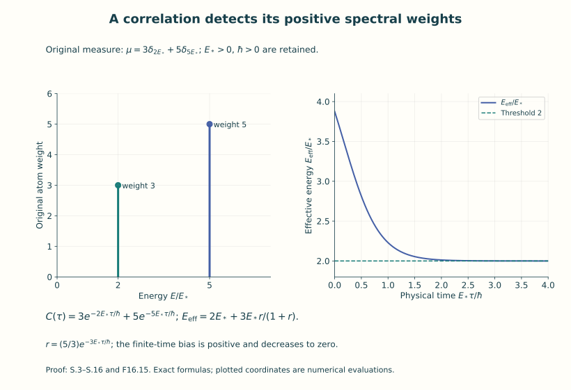
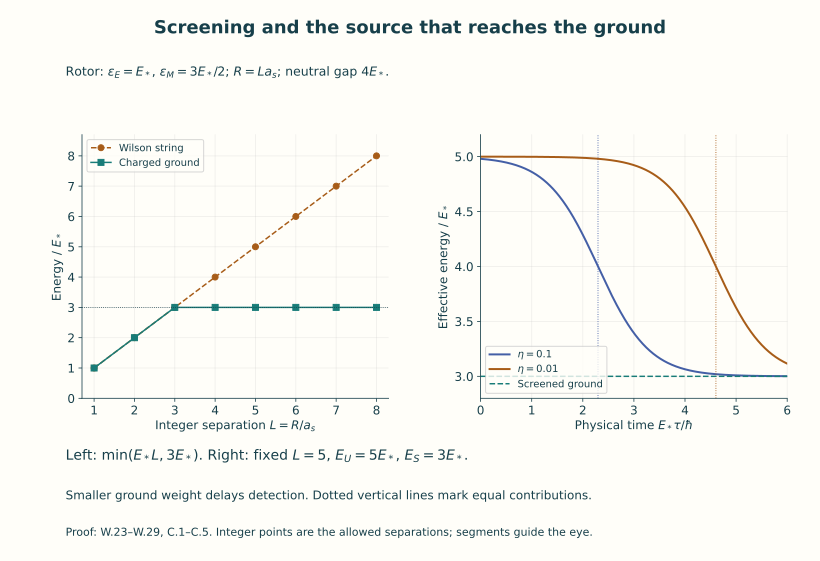
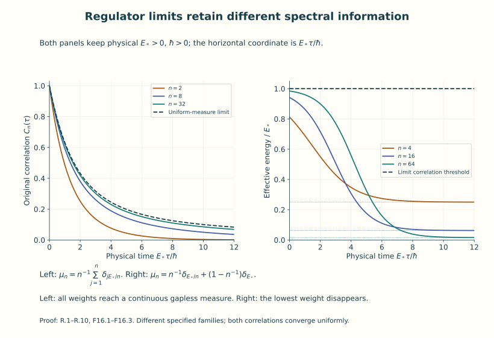

# Spectra, mass gaps and confinement

A quantum system has a Hamiltonian, a state and observables. Its
Hamiltonian specifies energy. A correlation measures how a particular
observable's state changes under propagation. To recover energies from
that measurement, we need the map from the observable to its spectral
weights. This lesson constructs that map in the systems already proved
in Units 11 and 14, then calculates exactly what its long-time decay
does and does not determine.

We first define a spectral measure as the distribution of a vector's
squared norm among energy sets. We then remove the entire vacuum
projection, prove the decay criterion for a gap, and compute the
finite-time bias of energy estimators. The free scalar field provides
a continuous spectrum with all physical constants and Fourier factors.

Static sources add another question: how much energy does a specified
pair of external charges require at a given separation? An actual
lattice integral will become an operator between charge sectors. Exact
gauge–matter models then show how screening and observable overlap enter
that calculation. Finally, explicit regulator sequences show how gaps,
spectral weights and physical time steps behave under limits.

Use Units 11–15 for Hilbert spaces, the free field, gauge projection,
positive lattice transfer and finite-lattice measures. The energy
representations used below are constructed there or explicitly here.
The measure arguments, limiting estimates and additional models have
complete proofs in this lesson. These examples teach established
spectral and gauge mechanisms; they do not assert a solution of the
four-dimensional Yang–Mills problem.

Keep three objects in view:

| Object | Exact question answered |
|---|---|
| Full neutral excitation spectrum | Is every nonvacuum state separated from zero energy by one positive number? |
| An observable's positive spectral measure | What is the least energy with nonzero weight in the state this observable creates? |
| A static charge sector and source insertion | What is its ground energy, and which of its energies does that particular insertion reach? |

The maps and examples below relate all three. By the end, you can
calculate an observed threshold, retain the vacuum and boundary terms,
test a static-energy extraction, and identify precisely what survives
a given regulator limit.

## Part I. Spectral measures and observable thresholds

## 1. Actual spectral representations and operator domains

**SP.1.** The inner product is conjugate-linear in its first entry. Keep physical time \(\tau\) in seconds, length \(x^0=c\tau\), \(c>0\), and \(\hbar>0\). In the F14 physical Hilbert space the transfer operator has the complete eigenbasis proved in T.17, with \(0<\lambda_j\leq1\), and

\[
 E_j=-\frac{\hbar}{\Delta\tau}\log\lambda_j,
 \quad E_0=\min_j E_j,
 \quad \epsilon_j=E_j-E_0,
 \quad \widehat H=H-E_0I,
 \quad \widehat T=T/\lambda_0=e^{-\Delta\tau\widehat H/\hbar}.
\tag{S.1}
\]

Its domain is \(\sum_j\epsilon_j^2|v_j|^2<\infty\). The unshifted partition is still \(Z_N=\lambda_0^N\operatorname{Tr}\widehat T^N\); no constant in the Wilson action is lost. For the finite F11 oscillator regulator the original absolute energy is \(\sum_r\hbar\omega_r(\nu_r+1/2)\), and its ground subtraction is exactly \(E_{0,N}=\frac12\sum_r\hbar\omega_r\). QF.33 proves why this scalar has no finite ultraviolet limit. F11's continuum free Hamiltonian is the separately defined relative-energy operator QF.35, not an asserted finite value of that divergent scalar.

**SP.2.** A single construction covers the spectral calculations used here. From this paragraph onward \(H\) denotes the relative-energy operator, so in the F14 application it is exactly \(\widehat H\) of S.1 and its energy multipliers are \(\epsilon_j\); the absolute operator and partition factor remain as recorded in S.1. Take a countable orthogonal sum of \(L^2(X_a,\nu_a)\), with real measurable finite energy functions \(e_a\geq0\), and, where required, the symmetric subspace of a multiparticle sector. Multiplication by an energy function invariant under permutations preserves that symmetric subspace. Define

\[
 (H v)_a=e_av_a,
 \quad D(H)=\{v:\sum_a\int e_a^2|v_a|^2d\nu_a<\infty\},
 \qquad (P(B)v)_a=1_{\{e_a\in B\}}v_a
\tag{S.2}
\]

for Borel \(B\subset[0,\infty)\). QF.2's multiplication proof gives self-adjointness on this exact domain: truncate energy to prove density; test the adjoint on bounded-energy sets to identify its image; then square integrability gives precisely the displayed domain. Direct integration gives \(P(B)^*=P(B)=P(B)^2\), \(P(B)P(C)=P(B\cap C)\), and \(P([0,\infty))=I\). For disjoint \(B_n\), the squared norm of the remainder after the first \(N\) sets is the integral of \(|v|^2\) over their remaining union, which tends to zero. Thus this is a countably additive projection-valued measure in the strong operator topology. On a symmetric sector the same proof works because every multiplier preserves symmetry.

For a measurable complex function \(f\), its multiplier \(f(H)\) has domain \(\sum_a\int |f(e_a)|^2|v_a|^2<\infty\). For bounded \(f\), it is bounded everywhere with norm at most \(\sup|f|\). In particular \(e^{-\tau H/\hbar}\) is a self-adjoint contraction for \(\tau\geq0\), has the semigroup law, and is strongly continuous by dominated convergence. The unitary \(e^{-itH/\hbar}\) is strongly continuous for the same reason. Its derivative on \(D(H)\) is \(-iH/\hbar\), since \(|(e^{-ite/\hbar}-1)/t|\leq e/\hbar\). All uses of spectral measure below have this proved representation: F14 uses counting measure on its eigenbasis; F11 uses its occupation basis or its actual momentum multiplication sectors; the additional examples specify their measure spaces explicitly. A general spectral theorem for an unspecified quantum theory is not being assumed.

**SP.3.** Define, for \(v,w\in\mathcal H\),

\[
 \mu_{v,w}(B)=\langle v,P(B)w\rangle,
 \quad \mu_v=\mu_{v,v},
 \quad \mu_v(B)=\|P(B)v\|^2,
 \quad \mu_v([0,\infty))=\|v\|^2.
\tag{S.3}
\]

This is explicitly the pushforward of \(\sum_a\overline v_aw_a\,d\nu_a\) under the energies. Cauchy–Schwarz gives its finite total variation at most \(\|v\|\|w\|\). Consequently

\[
 \langle v,f(H)w\rangle=\int f(E)d\mu_{v,w}(E)
\tag{S.4}
\]

for bounded measurable \(f\), by first checking indicators, then simple functions, then bounded pointwise approximation and dominated convergence. In particular

\[
 C_v(\tau)=\langle v,e^{-\tau H/\hbar}v\rangle
           =\int_{[0,\infty)}e^{-\tau E/\hbar}d\mu_v(E).
\tag{S.5}
\]

For \(v\ne0\), \(C_v(\tau)>0\) at every finite \(\tau\geq0\). A cross correlation \(\mu_{v,w}\) need not be positive; positivity and effective-energy conclusions below apply to the same-vector or positive matrix combination, not to an arbitrary signed cross correlation. For several vectors, \(\sum_{r,s}\overline z_r\mu_{v_r,v_s}(B)z_s=\|P(B)\sum_s z_sv_s\|^2\geq0\), proving the exact matrix version.

## 2. Vacuum and observable dependence

**SP.4.** Let \(P_0=P(\{0\})\) and choose any unit \(\Omega\in\operatorname{ran}P_0\). This choice is available in the massive F11 free models, its independently constructed infinite-volume massless Fock model, and F14. It is unavailable for the full massless periodic scalar: its retained Schrödinger zero coordinate has no normalizable ground state (QF.25–QF.26 and QF.32). No vacuum formula here is applied to that system.

Let \(O\) be a linear operator with \(\Omega\in D(O)\), and put \(v=O\Omega\). Boundedness of \(O\) is sufficient, not necessary. Define its Euclidean two-point form by \(\langle O\Omega,e^{-\tau H/\hbar}O\Omega\rangle\). This form exists even when a literal product \(O^*e^{-\tau H/\hbar}O\) has not been assigned a common operator domain. If \(e^{-\tau H/\hbar}O\Omega\in D(O^*)\), it equals the corresponding product matrix element. The exact decomposition is

\[
 C_O(\tau)=\|P_0O\Omega\|^2+
 \langle v_\perp,e^{-\tau H/\hbar}v_\perp\rangle,
 \quad v_\perp=(I-P_0)O\Omega.
\tag{S.6}
\]

Orthogonality and commutation of the projections prove it. Dominated convergence proves the second term tends to zero, including when positive spectrum accumulates at zero.

If the vacuum is simple, \(P_0=|\Omega\rangle\langle\Omega|\), then \(v_\perp=(O-\langle\Omega,O\Omega\rangle I)\Omega\), so subtracting the squared vacuum expectation removes the whole constant. With degenerate vacuum the scalar subtraction removes only the component along \(\Omega\). For an exact example on \(\mathbb C^3\), let \(H=\operatorname{diag}(0,0,D)\), \(D>0\), \(\Omega=e_0\), and let the bounded self-adjoint \(O\) have \(Oe_0=e_1+e_2\), \(Oe_1=Oe_2=e_0\). Then \(\langle O\rangle=0\), but

\[
 C_O(\tau)=1+e^{-D\tau/\hbar},
 \qquad C_O^{\rm full\ vacuum\ subtraction}(\tau)=e^{-D\tau/\hbar}.
\tag{S.7}
\]

This proves the need to specify the vacuum projection. A mixed vacuum density matrix \(\rho_0=\sum_r p_r|\Omega_r\rangle\langle\Omega_r|\), with \(p_r\geq0\), \(\sum p_r=1\), gives the same statements after summing their finite positive measures, provided \(\sum p_r\|O\Omega_r\|^2<\infty\). Its removed constant is \(\sum p_r\|P_0O\Omega_r\|^2\), not generally \(|\operatorname{Tr}\rho_0O|^2\).

**SP.5.** A gap \(D>0\) above the full vacuum space means \(P((0,D))=0\). In the representations S.2 this is equivalent to

\[
 \langle v,Hv\rangle\geq D\|v\|^2
 \quad(v\in D(H),\ P_0v=0),
\tag{S.8}
\]

and also to \(C_v(\tau)\leq\|v\|^2e^{-D\tau/\hbar}\) for all \(v\perp\operatorname{ran}P_0\), \(\tau\geq0\). The forward implications follow by integrating the energy inequalities. Conversely, a nonzero projection onto an interval \((0,a]\), \(a<D\), supplies a nonzero bounded-energy vector in \(D(H)\) violating S.8 and a correlation at least \(\|v\|^2e^{-a\tau/\hbar}\), violating the decay bound for \(\tau>0\). The intervals \((0,D)\) are the countable union of such intervals. The infimum of positive spectral support is allowed to be zero; if the excited space is zero, there is no finite first excitation and its threshold infimum is \(+\infty\) by the empty-set convention.

**SP.6.** Specify a unital algebra \(\mathcal A\) of bounded observables. The energy space it can probe from the chosen vacuum, after full vacuum subtraction, is

\[
 \mathcal K_{\mathcal A}=\overline{\operatorname{span}}
 \{P(B)(I-P_0)A\Omega:A\in\mathcal A,\ B\text{ Borel}\}.
\tag{S.9}
\]

This is a reducing subspace: every \(P(C)\) preserves the displayed span and its closure, and, being self-adjoint, preserves its orthogonal complement. Its least spectral support is the infimum of the nonzero measures' thresholds. To prove that assertion, an interval is annihilated on the generating vectors exactly when their positive measures give it zero mass; then it is annihilated on the closed span, and the converse is immediate. Thus one observable detects its own measure, not every sector of the Hilbert space.

For an explicit finite example take \(H=\operatorname{diag}(0,d,D)\), \(0<d<D\), \(\Omega=e_0\). Let \(\mathcal A\) consist of arbitrary matrices on \(\operatorname{span}(e_0,e_2)\) and scalars on \(\mathbb Ce_1\). This is a unital star algebra. Its excited receiving space is \(\mathbb Ce_2\), with threshold \(D\), although the full gap is \(d\). The smaller gap is recovered by adding \(|e_1\rangle\langle e_0|+|e_0\rangle\langle e_1|\). If the vectors \((I-P_0)A\Omega\) span densely in the full excited space and a common exponential bound with the same \(D\) holds for every linear combination of them, boundedness of the semigroup passes that bound to the closure; SP.5 then proves the full gap. A separate positive rate for each observable, without a uniform lower bound, has no such consequence.

## 3. Exact threshold extraction and finite-time bias

**SP.7.** Let \(\mu\) be any nonzero finite positive Borel measure on \([0,\infty)\), realized if desired by \(\mathbb C\Omega\oplus L^2(\mu)\), with \(H\Omega=0\) and \(Hf(E)=Ef(E)\). Define

\[
 b=\inf\operatorname{supp}\mu,
 \quad C(\tau)=\int e^{-\tau E/\hbar}d\mu(E),
 \quad \widetilde C(\tau)=C(\tau)/C(0).
\tag{S.10}
\]

The support is nonempty and \(0\leq b<\infty\): some bounded interval has positive mass; its support has a point by the countable basis of intervals. Every \(\eta>0\) satisfies \(m_\eta=\mu([b,b+\eta])>0\). Therefore

\[
 m_\eta e^{-(b+\eta)\tau/\hbar}
 \leq C(\tau)\leq C(0)e^{-b\tau/\hbar},
 \qquad
 \boxed{\lim_{\tau\to\infty}-\frac{\hbar}{\tau}
                  \log\widetilde C(\tau)=b.}
\tag{S.11}
\]

Taking logarithms, dividing by \(\tau\), and then letting \(\eta\downarrow0\) proves the limit. The ratio makes the logarithm dimensionless. This argument includes a continuous threshold with no atom and an infinite discrete spectrum. If \(\mu=0\), the correlation is identically zero and no threshold can be extracted from it. After full vacuum subtraction the measure has no atom at zero, but its support can still have infimum zero.

**SP.8.** At \(\tau>0\), all derivatives exist:

\[
 (-\hbar)^r C^{(r)}(\tau)=\int E^r e^{-\tau E/\hbar}d\mu(E),\quad r\in\mathbb N_0.
\tag{S.12}
\]

For differentiation near a fixed positive \(\tau\), the integrand is bounded by a constant times \(E^re^{-\tau E/(2\hbar)}\), which is bounded on \([0,\infty)\) and hence integrable against finite \(\mu\). At \(\tau=0\) the corresponding moment need not exist. Put

\[
 d\mu_\tau(E)=C(\tau)^{-1}e^{-\tau E/\hbar}d\mu(E),
 \quad E_{\rm eff}(\tau)=-\hbar\frac{d}{d\tau}\log C(\tau).
\]

Then exact differentiation gives

\[
 E_{\rm eff}(\tau)=\int E\,d\mu_\tau\geq b,
 \qquad E_{\rm eff}'(\tau)=-\frac1\hbar
 \left(\int E^2d\mu_\tau-(\int E\,d\mu_\tau)^2\right)\leq0.
\tag{S.13}
\]

Thus \(\log C\) is convex. The limiting effective energy equals \(b\): its monotone finite limit \(L\geq b\) exists, and
\(-\hbar\log(C(\tau)/C(\tau_0))=\int_{\tau_0}^\tau E_{\rm eff}(s)ds\).
The average of a function tending to \(L\) tends to \(L\); S.11 makes the same average tend to \(b\). This supplies the equality without assuming an atom at the threshold. Equality in S.13 at one time means zero variance, hence \(\mu\) is concentrated at one energy, since the tilting density is strictly positive.

**SP.9.** At an actual lattice time step \(a_\tau>0\), define

\[
 E_{\rm eff}^{(a_\tau)}(\tau)
 =-\frac{\hbar}{a_\tau}\log\frac{C(\tau+a_\tau)}{C(\tau)}.
\tag{S.14}
\]

For \(\tau>0\), this is the average of S.13 over \([\tau,\tau+a_\tau]\); therefore

\[
 b\leq E_{\rm eff}(\tau+a_\tau)
 \leq E_{\rm eff}^{(a_\tau)}(\tau)
 \leq E_{\rm eff}(\tau),
\tag{S.15}
\]

it decreases in \(\tau\), and its limit is \(b\). The definition remains valid at \(\tau=0\) by continuity of \(C\); the derivative at zero is not required. Equivalently \(C(\tau+a_\tau)^2\leq C(\tau)C(\tau+2a_\tau)\), by Cauchy–Schwarz applied to \(e^{-\tau E/(2\hbar)}\) and \(e^{-(\tau+2a_\tau)E/(2\hbar)}\). This proves the discrete monotonicity directly.

**SP.10.** For two actual energies \(b\geq0\), \(b+d\), \(d>0\), and positive weights \(A,B\),

\[
 \mu=A\delta_b+B\delta_{b+d},\quad
 C(\tau)=Ae^{-b\tau/\hbar}(1+r(\tau)),
 \quad r(\tau)=(B/A)e^{-d\tau/\hbar},
\]

\[
 E_{\rm eff}=b+\frac{d r}{1+r},\qquad
 E_{\rm eff}^{(a_\tau)}=b+\frac{\hbar}{a_\tau}
 \log\frac{1+r}{1+r e^{-d a_\tau/\hbar}}.
\tag{S.16}
\]

Both formulas follow by differentiation or direct division. The exact bias above \(b\) is \(dr/(1+r)\), and the error below \(b+d\) is \(d/(1+r)\). A large \(B/A\) therefore permits a long apparent plateau near the higher energy, until times of order \(\hbar\log(B/A)/d\). If \(A=0\), the lower energy is absent from this measure and cannot be extracted at any time. This is a distinction between support and small nonzero weight, not a numerical convention.

**SP.11.** A continuous example retains its threshold even though it has no threshold eigenvector. Let \(b\geq0\), \(E_s>0\), \(\nu>0\), and

\[
 d\mu(E)=\frac{(E-b)^{\nu-1}e^{-(E-b)/E_s}}
                    {\Gamma(\nu)E_s^\nu}1_{E>b}\,dE,
 \quad\Gamma(\nu)=\int_0^\infty x^{\nu-1}e^{-x}dx.
\]

The integral converges at zero because \(\nu>0\) and at infinity by exponential decay. Substitution gives total mass one and

\[
 C(\tau)=e^{-b\tau/\hbar}(1+E_s\tau/\hbar)^{-\nu},
 \qquad E_{\rm eff}=b+\frac{\nu E_s}{1+E_s\tau/\hbar},
\tag{S.17}
\]

\[
 E_{\rm eff}^{(a_\tau)}=b+\frac{\nu\hbar}{a_\tau}
 \log\frac{1+E_s(\tau+a_\tau)/\hbar}{1+E_s\tau/\hbar}.
\]

Realize it on \(\mathbb C\Omega\oplus L^2(\mu)\), with the multiplication Hamiltonian and bounded self-adjoint
\(O=|1\rangle\langle\Omega|+|\Omega\rangle\langle1|\), where \(1\in L^2(\mu)\) has norm one. Then \(O\Omega=1\), \(\langle O\rangle=0\), \(\|O\|=1\), and these are its exact correlations. When \(b=0\), the vacuum is still a simple eigenvector, because \(\mu(\{0\})=0\), but it is not separated from excited spectrum.

Figure 1. The actual measure of Exercise 2, with weights \(3,5\) at
energies \(2E_*,5E_*\). The right axis displays the energy in units of
the retained \(E_*>0\), and time in units \(\hbar/E_*\). The lower
energy is the threshold; the positive finite-time bias is exactly
(S.16). Both original atom weights remain in the measure.

## 4. What finite temporal extent changes

**SP.12.** For F14 let \(\epsilon_j\) and \(\psi_j\) be S.1's relative eigenvalues and vectors, with their full multiplicities. For bounded \(O\) and integers \(0\leq n\leq N\), the actual periodic correlation is

\[
 C_{N,O}(n)=
 \frac{\operatorname{Tr}(\widehat T^{N-n}O^*\widehat T^nO)}
 {\operatorname{Tr}\widehat T^N}
 =\frac{\sum_{i,j}e^{-(N-n)\Delta\tau\epsilon_i/\hbar}
 e^{-n\Delta\tau\epsilon_j/\hbar}
 |\langle\psi_j,O\psi_i\rangle|^2}
 {\sum_i e^{-N\Delta\tau\epsilon_i/\hbar}}.
\tag{S.18}
\]

Insert the basis into the trace. The nonnegative double series exists; for \(0<n<N\) both positive powers are trace class and the sum is bounded by \(\|O\|^2\operatorname{Tr}\widehat T^{N-n}\). At endpoints use \(\|O\|^2\operatorname{Tr}\widehat T^N\) with the suitable cyclic expression. These bounds or the rank-one trace proof in T.16 justify the expansion. This is a sum of transitions from thermal initial states, not the single-vacuum measure S.5. The physical extent is \(\mathcal T=N\Delta\tau\), inverse thermal energy \(\beta_{\rm therm}=\mathcal T/\hbar\), and Euclidean length \(c\mathcal T\).

For fixed \(n\) and \(N\to\infty\), a simple vacuum gives S.5 for \(O\Omega\). Indeed the denominator tends to one, since the excited terms are dominated by the summable eigenvalues of one fixed positive transfer power and tend individually to zero. In the numerator, the \(i=0\) part is the vacuum expression; for \(i>0\), its sum is at most \(\|O\|^2\sum_{i>0}e^{-(N-n)\Delta\tau\epsilon_i/\hbar}\), which tends to zero. With vacuum multiplicity \(d_0<\infty\), the same argument gives the equal mixture of the \(d_0\) vacuum vectors. It does not select a particular one.

**SP.13.** On the two-level system \(H=\operatorname{diag}(0,D)\), \(O=\begin{pmatrix}0&1\\1&0\end{pmatrix}\), the exact finite-extent answer at \(0\leq\tau\leq\mathcal T\) is

\[
 C_{\mathcal T}(\tau)=
 \frac{e^{-D\tau/\hbar}+e^{-D(\mathcal T-\tau)/\hbar}}
      {1+e^{-D\mathcal T/\hbar}},
 \quad -\hbar\partial_\tau\log C_{\mathcal T}
 =D\tanh\!\left(\frac{D(\mathcal T/2-\tau)}{\hbar}\right).
\tag{S.19}
\]

The two possible matrix entries give the two exponentials. Differentiation proves the second formula. The slope vanishes at the midpoint and becomes negative after it, although the system has gap \(D\). A vacuum large-time decay fit therefore cannot be applied across a fixed periodic midpoint. No negative excitation energy is implied.

## 5. The free field, momentum and physical mass

**SP.14.** Keep F11's original neutral real restriction of F07:

\[
 S[\phi]=\hbar\int\left\{c^{-1}(\partial_t\phi)^2
 -c|\nabla\phi|^2-c(mc/\hbar)^2\phi^2\right\}dt\,d^3x,
 \quad \alpha=2\hbar/c,
\]

\[
 \epsilon(k)=\hbar\omega(k)=\sqrt{\hbar^2c^2|k|^2+m^2c^4},
 \quad\mathfrak h=L^2(\mathbb R^3,d^3k),
 \quad \widetilde f(k)=(2\pi)^{-3/2}\int e^{-ik\cdot x}f(x)d^3x.
\tag{S.20}
\]

For a real Schwartz spatial test \(f\), \(\phi(f)\Omega=h_f\) in the one-particle sector, where
\(h_f(k)=\sqrt{\hbar/(2\alpha\omega(k))}\widetilde f(k)\).
QF.28–QF.43 prove this operator and its vacuum domain, including \(m=0\). Its exact Euclidean form is therefore

\[
 C_f(\tau)=\frac{\hbar}{2\alpha}\int_{\mathbb R^3}
 \frac{|\widetilde f(k)|^2}{\omega(k)}e^{-\tau\epsilon(k)/\hbar}d^3k,
 \quad
 \mu_f(B)=\frac{\hbar}{2\alpha}\int_{\epsilon(k)\in B}
                  \frac{|\widetilde f(k)|^2}{\omega(k)}d^3k.
\tag{S.21}
\]

The same measure gives the real-time matrix coefficient by replacing the exponential with \(e^{-itE/\hbar}\). This is an exact identity for this constructed free representation. For complex \(z\) with \(\operatorname{Re}z>0\), \(\int e^{-zE/\hbar}d\mu_f\) is holomorphic by the dominated derivative bounds in SP.8; dominated convergence gives its imaginary-axis boundary values. This does not construct a map between unspecified interacting Euclidean and Lorentzian theories.

**SP.15.** The threshold of S.21 is the essential infimum of \(\epsilon(k)\) where \(h_f\ne0\). If every ball about \(k=0\) contains a positive-measure part on which \(h_f\ne0\), it is \(mc^2\). A test with Fourier support bounded away from zero has a larger one-particle energy threshold. In a finite massive torus the real constant mode \(f=e_0=V^{-1/2}\) has

\[
 \phi(f)=q_0,
 \quad C_{q_0}(\tau)=\frac{\hbar}{2\alpha\omega_0}e^{-\omega_0\tau},
 \quad \omega_0=mc^2/\hbar.
\tag{S.22}
\]

This follows from the oscillator vacuum ladder coefficient in QF.23. The unbounded \(q_0\) has the vacuum in its domain. At \(m=0\) that periodic oscillator frequency is zero and its ground-state construction does not exist; one must use the actual zero-mode free particle, not S.22.

For a momentum eigenmode in the massive box, the energy is \(\sqrt{c^2|p|^2+m^2c^4}\), \(p=\hbar k_n\). Thus dividing a measured energy by \(c^2\) gives the particle's rest mass only at \(p=0\); at known nonzero momentum the mass is \(c^{-2}\sqrt{E^2-c^2|p|^2}\) for this mass shell. In infinite volume the exact one-particle threshold \(mc^2\) is not an energy eigenvalue: each level set is a sphere or a point of Lebesgue measure zero. Nevertheless the invariant mass multiplier \(c^{-2}\sqrt{\epsilon(k)^2-c^2|\hbar k|^2}\) is exactly \(m\) on the whole one-particle space. QF.37–QF.38 prove the full multiparticle statement. A finite lattice Hamiltonian without a proved relativistic dispersion relation supplies energy gaps, not by itself a rest-mass identification.

The conversion factors are explicit:

\[
 e^{-E\tau/\hbar}=e^{-(E/(\hbar c))x^0},
 \quad \text{angular-frequency threshold }E/\hbar,
 \quad \text{inverse temporal-length scale }E/(\hbar c),
 \quad m=E/c^2\text{ at a rest threshold}.
\tag{S.23}
\]

**SP.16.** A full continuous example uses an actual spatial length \(\ell>0\):

\[
 f_\ell(x)=(2\pi\ell^2)^{-3/2}e^{-|x|^2/(2\ell^2)},
 \quad \widetilde f_\ell(k)=(2\pi)^{-3/2}e^{-\ell^2|k|^2/2}.
\]

The Gaussian Fourier identity was proved in QF.1. Put \(M=mc^2\), \(a=\ell^2/(\hbar^2c^2)\), and \(A=(4\pi^2\alpha\hbar c^3)^{-1}\). Polar coordinates followed by
\(k=\sqrt{E^2-M^2}/(\hbar c)\), \(dk/dE=E/(\hbar^2c^2k)\), give every factor in

\[
 \boxed{d\mu_{f_\ell}(E)=A\sqrt{E^2-M^2}\,
       e^{-a(E^2-M^2)}1_{E>M}\,dE.}
\tag{S.24}
\]

This is a finite measure, with no atom at threshold. For \(M>0\), set \(E=M+\hbar u/\tau\). Then

\[
 C_{f_\ell}(\tau)=A e^{-M\tau/\hbar}(\hbar/\tau)^{3/2}
 \int_0^\infty \sqrt{u}\sqrt{2M+\hbar u/\tau}
 e^{-u}e^{-a(2M\hbar u/\tau+\hbar^2u^2/\tau^2)}du.
\]

For \(\tau\geq\tau_0>0\), the integrand is bounded by
\(\sqrt u\sqrt{2M+\hbar u/\tau_0}e^{-u}\), an integrable function. Dominated convergence, and the same argument with an extra factor \(u\), prove

\[
 C_{f_\ell}(\tau)\sim A\sqrt{2M}\Gamma(3/2)(\hbar/\tau)^{3/2}e^{-M\tau/\hbar},
 \quad E_{\rm eff}(\tau)=M+\frac{3\hbar}{2\tau}+o(\tau^{-1}).
\tag{S.25}
\]

Here \(\Gamma(3/2)=\sqrt\pi/2\), from the Gaussian integral and integration by parts; the ratio \(\Gamma(5/2)/\Gamma(3/2)=3/2\) gives the bias. Thus an exactly massive free particle can have a non-single-exponential smeared correlator.

For \(M=0\), the exact density is \(AEe^{-aE^2}\). With \(b=\tau/\hbar\), completing the square gives

\[
 C_{f_\ell}(\tau)=A\left\{\frac1{2a}
 -\frac{b\sqrt\pi}{4a^{3/2}}e^{b^2/(4a)}
           \operatorname{erfc}\!\left(\frac b{2\sqrt a}\right)\right\},
 \quad \operatorname{erfc}(z)=\frac2{\sqrt\pi}\int_z^\infty e^{-s^2}ds.
\tag{S.26}
\]

Indeed first integrate \(J(b)=\int_0^\infty e^{-aE^2-bE}dE\) by the substitution \(s=\sqrt aE+b/(2\sqrt a)\), then use \(-J'(b)\). Differentiation is dominated. Rescaling \(E=\hbar u/\tau\) gives directly
\(C\sim A\hbar^2/\tau^2\) and \(E_{\rm eff}=2\hbar/\tau+o(\tau^{-1})\), since \(\int ue^{-u}=1\), \(\int u^2e^{-u}=2\). This gapless correlation belongs to the independently constructed infinite-volume massless vacuum of F11.

**SP.17.** Observable symmetry changes the threshold even in the same massive free theory. On the finite-particle domain put \(O_f=\phi(f)^2-\|h_f\|^2I\). The vacuum lies in its domain: successive creation and annihilation of the fixed \(L^2\) vector give finite sector norms. QF.29 gives

\[
 O_f\Omega=\sqrt2\,h_f\otimes h_f,
 \quad \mu_{O_f}=2\mu_f*\mu_f,
 \quad C_{O_f}(\tau)=2C_f(\tau)^2.
\tag{S.27}
\]

The tensor is already symmetric. The two-particle energy is the sum of the two one-particle energies; Tonelli gives the convolution and product formula, including the factor two. If \(\mu_f\) has threshold \(mc^2\), this measure has threshold \(2mc^2\): it has no support below that number, and the product of two positive masses in every threshold neighbourhood gives positive convolution mass just above it. For bounded observables commuting with number parity \((-1)^N\), the vacuum orbit lies in the even sector. Conversely bounded rank-one operators between the vacuum and any even vector commute with parity; their star algebra reaches the entire even sector. Hence S.9 gives excited threshold \(2mc^2\) for that algebra, whereas the full algebra has \(mc^2\). This proves the role of selection rules without changing the Hamiltonian or its physical units.

## 6. Bounded literature comparison

**SP.18.** Rajan Gupta, *Introduction to Lattice QCD*, [arXiv:hep-lat/9807028v1](https://arxiv.org/abs/hep-lat/9807028v1), original author TeX `chap-intro.tex`, lines 539–584, describes a source, Euclidean propagation and a sink, followed by a sum over states in `eq:2point` and its lowest coupled state. SP.3–SP.13 supply the exact finite-measure, domain, vacuum and time-boundary statements needed here. The source's \(e^{-Et}\) has physical dictionary \(t_{\rm source}=c\tau\), \(E_{\rm source}=E/(\hbar c)\) when its time has length unit, so the exponent is exactly \(E\tau/\hbar\); in lattice integer time it is equivalently \(n\Delta\tau E/\hbar\). Its \(1/(2E_n)\) belongs to its state/field normalization, and is not an additional universal factor for an orthonormal finite-volume eigenbasis. In the actual F11 field it is accounted for by the full kernel \(\hbar/(2\alpha\omega)\) and the exact Fourier measure in S.21. The state-weight pushforward, not a copied numerical prefactor, is the receiving map.

The original `chap-corr.tex`, lines 292–307, discusses two masses contributing to one effective plateau. S.16 gives the complete elementary two-energy mechanism with its amplitudes and crossover time; no chiral perturbation calculation from that paragraph is being imported. F11's retained Fewster–Rejzner source comparison QF.47–QF.49 is an already proved provider comparison, not new reading of that paper in this task. The lesson provenance records actual source coverage, archives and hashes. These bounded comparisons do not claim a review of all spectral or confinement literature.

## Part II. Static sources and confinement comparisons

## 1. The open chain and its charge sectors

**WP.1.** Fix integers \(M\geq1\), vertices \(0,1,\ldots,M\), and edges \(l:l-1\to l\), \(1\leq l\leq M\). Set \(a_s>0\), positions \(x_l=la_s\), temporal step \(\Delta\tau>0\), and \(c,\hbar>0\). A link is \(U_l=e^{i\theta_l}\in U(1)\), with reversed link \(U_l^{-1}\). Configuration and Hilbert spaces are

\[
 \mathcal Q=U(1)^M,\qquad dU=\prod_{l=1}^M\frac{d\theta_l}{2\pi},
 \qquad\mathcal H=L^2(\mathcal Q,dU).
\tag{W.1}
\]

Angles are read modulo \(2\pi\); no preferred angular representative is needed. The gauge group \(U(1)^{M+1}\) acts by

\[
 (h\cdot U)_l=h_lU_lh_{l-1}^{-1},
 \qquad (\mathcal U(h)f)(U)=f(h^{-1}\cdot U).
\tag{W.2}
\]

This is exactly the F14 forward-transport convention. Haar invariance proves unitarity and the product action proves the representation law. F12 Q.6–Q.8 prove the Haar measure and averaging projection; on these circles the probability measure is explicitly \(d\theta/(2\pi)\).

**WP.2.** For \(\boldsymbol n\in\mathbb Z^M\) put \(\chi_{\boldsymbol n}(U)=\prod_lU_l^{n_l}\). They are an orthonormal basis: integration gives orthogonality; the trigonometric polynomial density proved in F14 T.2–T.7 supplies completeness, or apply its coordinate-polynomial argument to the product torus. Define the integer divergence vector

\[
 d_0(\boldsymbol n)=n_1,\quad
 d_v(\boldsymbol n)=n_{v+1}-n_v\ (1\leq v<M),\quad
 d_M(\boldsymbol n)=-n_M.
\tag{W.3}
\]

Direct substitution into W.2 gives

\[
 \mathcal U(h)\chi_{\boldsymbol n}
 =\rho_{d(\boldsymbol n)}(h)\chi_{\boldsymbol n},
 \quad\rho_q(h)=\prod_{v=0}^M h_v^{q_v}.
\tag{W.4}
\]

The signs include the pullback inverse. Define

\[
 P_q=\int\overline{\rho_q(h)}\mathcal U(h)\,dh,
 \quad\mathcal H_q=\operatorname{ran}P_q.
\tag{W.5}
\]

Circle integration shows \(P_q\chi_{\boldsymbol n}=1_{d(\boldsymbol n)=q}\chi_{\boldsymbol n}\), so it is the bounded orthogonal projection onto precisely that character sector. A sector is nonzero exactly when \(\sum_vq_v=0\), and then is one-dimensional: solve successively

\[
 n_l=\sum_{v=0}^{l-1}q_v\quad(1\leq l\leq M);
\tag{W.6}
\]

the last equation is exactly the zero-sum condition. Thus the neutral physical space is \(\mathcal H_0=\mathbb C\Omega\), \(\Omega(U)=1\). The common constant gauge subgroup acts trivially on all links, and W.6 retains its compatibility condition. The external source sector can equivalently be represented by invariant vectors in \(\mathcal H\otimes\mathbb C_{-q}\), where the one-dimensional external factor transforms by \(\rho_{-q}\). The map \(f\mapsto f\otimes1\) is an isometric intertwiner from \(\mathcal H_q\) to that invariant space, since \(\rho_q\rho_{-q}=1\). Thus these sectors are exact gauge-covariant wavefunctions paired with compensating static charges.

The infinitesimal pullback generators on finite Fourier sums have eigenvalues \(\hbar d_v(\boldsymbol n)\); they are the self-adjoint diagonal operators with square-summable weighted coefficients. In \(\mathcal H_q\) they equal \(\hbar q_v\). The integer \(q_v\) labels a representation weight. No unproved conversion to a separately defined electric charge convention is inserted.

## 2. The Wilson temporal transfer and string insertion

**WP.3.** Fix \(\beta>0\) and keep the entire plaquette weight

\[
 k_\beta(e^{i\varphi})=e^{-\beta(1-\cos\varphi)},
 \quad I_n(\beta)=\int_0^{2\pi}e^{\beta\cos\varphi}e^{-in\varphi}\frac{d\varphi}{2\pi},
 \quad\lambda_n=e^{-\beta}I_n(\beta).
\tag{W.7}
\]

F14 L.22 and T.22 prove, by the full absolutely convergent exponential series,

\[
 I_n(\beta)=\sum_{r=0}^\infty
 \frac{(\beta/2)^{2r+|n|}}{r!(r+|n|)!}>0,
 \quad I_{-n}=I_n,
 \quad I_0>I_n\ (n\ne0),\quad\sum_n\lambda_n=1.
\tag{W.8}
\]

Define the bounded, positive, self-adjoint, trace-class product convolution

\[
 (Kf)(U')=\int\prod_l k_\beta(U'_lU_l^{-1})f(U)dU,
 \quad K\chi_{\boldsymbol n}=\Lambda_{\boldsymbol n}\chi_{\boldsymbol n},
 \quad\Lambda_{\boldsymbol n}=\prod_l\lambda_{n_l}>0.
\tag{W.9}
\]

The Fourier substitution gives the eigenvalues, and \(\sum_{\boldsymbol n}\Lambda_{\boldsymbol n}=1\) proves the asserted trace properties. It commutes with every \(P_q\). Write \(T_q=K|_{\mathcal H_q}\), or \(KP_q\) on the full space. Its kernel is

\[
 t_q(U',U)=\int\overline{\rho_q(h)}
 \prod_l k_\beta\!\left(U'_l(h_lU_lh_{l-1}^{-1})^{-1}\right)dh.
\tag{W.10}
\]

To verify it, insert W.5 into \(KP_q\) and change the intermediate variable from \(V\) to \(h\cdot U\); product Haar measure is unchanged. For \(q=0\), this is the actual temporal-link integral of F14 T.11 with no spatial magnetic plaquettes. For \(q\ne0\), the character factor is retained; it is not a positive scalar probability density, although \(KP_q\) is a positive operator on its projected sector.

For this exact graph, \(S=\hbar\beta\sum_{j,l}(1-\operatorname{Re}Q_{j,l})\). Its \(\beta\) is a specified positive parameter. If this transfer weight is assigned the temporal coefficient of the F14 four-dimensional anisotropic action, the dictionary is

\[
 \beta=\frac{2a_s}{g_{\rm YM}^2c\Delta\tau}.
\tag{W.11}
\]

This optional parameter matching preserves the coefficient from the original \(\kappa=-\operatorname{tr}\), full ordered curvature sums and action \(\hbar/(2g_{\rm YM}^2)\int\kappa(F_{\mu\nu},F^{\mu\nu})\). It does not turn the open chain into a four-dimensional lattice. No one-dimensional continuum coupling is silently substituted for \(g_{\rm YM}\).

**WP.4.** Fix \(0\leq r<s\leq M\), integer \(Q\), \(L=s-r\), and \(R=La_s\). Define the bounded unitary multiplication operator

\[
 (J_{r,s,Q}f)(U)=S_Q(U)f(U),
 \quad S_Q(U)=\prod_{l=r+1}^sU_l^Q,
 \quad q_v=Q\delta_{v,r}-Q\delta_{v,s}.
\tag{W.12}
\]

It has norm one and maps \(\mathcal H_p\) unitarily onto \(\mathcal H_{p+q}\): W.4 applied to the string gives \(\mathcal U(h)Jf=\rho_q(h)J\mathcal U(h)f\). In particular \(J\Omega\) is the unique unit charged state, with \(n_l=Q\) on the path and zero elsewhere. Its energy under the unshifted logarithm of W.9 is

\[
 E_{q}^{\rm abs}=-\frac{\hbar}{\Delta\tau}
 \{(M-L)\log\lambda_0+L\log\lambda_Q\},
 \quad E_0^{\rm abs}=-\frac{\hbar M}{\Delta\tau}\log\lambda_0.
\tag{W.13}
\]

Both are finite. Their difference, not either discarded scalar, is

\[
 V_Q(R)=E_q^{\rm abs}-E_0^{\rm abs}
 =\frac{\hbar L}{\Delta\tau}\log\frac{I_0(\beta)}{I_Q(\beta)}.
\tag{W.14}
\]

For \(Q\ne0\) this is positive; for \(Q=0\) it is zero. All full-space logarithms have the exact diagonal square-summability domain from S.2. The projected full-space \(KP_q\) has a kernel on other sectors, so its logarithm is used only on \(\mathcal H_q\), not assigned a finite value on those zero vectors.

**WP.5.** Let \(U_{j,l}\) be the spatial link at slice \(j\), and \(h_{j,v}\) the upward temporal link. The positively described elementary loop, spatial forward then temporal forward then spatial backward then temporal backward, is

\[
 Q_{j,l}=h_{j,l-1}^{-1}U_{j+1,l}^{-1}h_{j,l}U_{j,l}.
\tag{W.15}
\]

Its inverse is the argument in W.10 in this abelian group, so the real plaquette weight is identical. The rectangle based at \((0,r)\), following the bottom path to \((0,s)\), then upward \(n\) time steps, then backward along the top path, then downward, has charge-\(Q\) Wilson observable

\[
 \mathcal W_Q(R,n\Delta\tau)=S_Q(U_0)\overline{S_Q(U_n)}
       \prod_{j=0}^{n-1}h_{j,s}^{Q}h_{j,r}^{-Q}
 =S_Q(U_0)\overline{S_Q(U_n)}
       \prod_{j=0}^{n-1}\overline{\rho_q(h_j)}.
\tag{W.16}
\]

Every internal endpoint factor cancels under vertex gauge transformation, including the four corners; equivalently it is the ordered closed-loop product in the abelian representation \(z\mapsto z^Q\). This proves its gauge invariance with the specified orientation.

For an open time interval, integrate all endpoints with the vacuum wavefunctions \(\Omega=1\). The uninserted partition is \(Z_n=\langle\Omega,T_0^n\Omega\rangle=\lambda_0^{Mn}\). Insert W.16 in the finite product Haar integral. Integrating each temporal layer gives W.10, while the endpoint spatial factors are exactly \(J\) and \(J^*\). Therefore

\[
 \boxed{\langle\mathcal W_Q(R,n\Delta\tau)\rangle
 =\frac{\langle J\Omega,T_q^nJ\Omega\rangle}{\lambda_0^{Mn}}
 =\left(\frac{I_Q(\beta)}{I_0(\beta)}\right)^{Ln}.}
\tag{W.17}
\]

All integrals are finite integrals of bounded functions on compact groups, so Fubini is justified. No gauge volume is omitted. At \(n=0\), the path immediately retraces itself and both sides equal one.

For periodic time with \(N\geq2\) slices and \(0<n<N\), the same integration gives

\[
 Z_N=\operatorname{Tr}_{\mathcal H_0}T_0^N=\lambda_0^{MN},\qquad
 \langle\mathcal W_Q\rangle=
 \frac{\operatorname{Tr}_{\mathcal H_0}
 (T_0^{N-n}J^*T_q^nJ)}{\lambda_0^{MN}},
\tag{W.18}
\]

which equals W.17. The composition types are \(J:\mathcal H_0\to\mathcal H_q\), \(T_q:\mathcal H_q\to\mathcal H_q\), and \(J^*:\mathcal H_q\to\mathcal H_0\). For \(n=N\), top and bottom spatial links coincide and their strings cancel. The observable becomes the two oppositely charged closed temporal lines; the numerator is \(\operatorname{Tr}_{\mathcal H_q}T_q^N=\Lambda_q^N\), again yielding W.17 because that sector is one-dimensional. This proves the endpoint case separately, retaining the temporal holonomies. It does not set all periodic temporal links equal to one.

**WP.6.** Put \(a_Q=\log(I_0/I_Q)\), positive for \(Q\ne0\). The physical Euclidean area is \(\mathcal A=R(c\tau)\), \(\tau=n\Delta\tau\). W.17 says exactly

\[
 \langle\mathcal W_Q\rangle=e^{-a_Q L n}
 =e^{-\sigma_QR\tau/\hbar}=e^{-\kappa_Q\mathcal A},
 \quad\sigma_Q=\frac{\hbar a_Q}{a_s\Delta\tau},
 \quad\kappa_Q=\frac{a_Q}{a_sc\Delta\tau},
 \quad\sigma_Q=\hbar c\kappa_Q.
\tag{W.19}
\]

Thus \(\sigma_Q\) has energy per length and \(\kappa_Q\) inverse length squared. At fixed \(R\), S.11 extracts \(V_Q(R)=\sigma_QR\); it is the actual lowest charged energy because that sector has only one state. At fixed spacings and coupling, enlarge \(M\) so arbitrary separations fit. W.14 is independent of the unused edges, and tends to infinity with \(R\). This family has confinement of these external charges in the explicit sense of an unbounded separation energy, in fact an exact linear one. Its neutral Hilbert space has dimension one, so it has no nontrivial neutral excitation spectrum from which to infer a finite particle mass. Every bounded operator on that physical space is scalar and its fully vacuum-subtracted correlation is zero.

## 3. A gapped neutral system with screened static charges

**WP.7.** Add one matter rotor \(z_v=e^{i\varphi_v}\) at every chain vertex. The new configuration space is \(U(1)^M\times U(1)^{M+1}\), with product probability Haar measure. Gauge action is W.2 together with \(z_v\mapsto h_vz_v\). Fourier basis vectors are

\[
 \chi_{\boldsymbol n,\boldsymbol m}(U,z)=\prod_lU_l^{n_l}\prod_vz_v^{m_v},
 \quad\boldsymbol n\in\mathbb Z^M,\ \boldsymbol m\in\mathbb Z^{M+1},
 \quad\mathcal U(h)\chi_{n,m}=\rho_{d(n)-m}(h)\chi_{n,m}.
\tag{W.20}
\]

The last sign follows from the inverse in the pullback. Define positive energy parameters \(\varepsilon_E,\varepsilon_M>0\) and the exact Hamiltonian

\[
 H\chi_{n,m}=\left(\varepsilon_E\sum_ln_l^2+
                        \varepsilon_M\sum_vm_v^2\right)\chi_{n,m},
 \quad D(H)=\{c:\sum_{n,m}E_{n,m}^2|c_{n,m}|^2<\infty\}.
\tag{W.21}
\]

S.2 proves self-adjointness and nonnegativity. These are parameters of this newly defined rotor system, not a claim of equality to the four-dimensional Wilson Hamiltonian. If expressed as inertias, \(\varepsilon_E=\hbar^2/(2\mathcal I_E)\) and \(\varepsilon_M=\hbar^2/(2\mathcal I_M)\), with \(\mathcal I_E,\mathcal I_M>0\), retain all factors. The transfer is exactly \(e^{-\Delta\tau H/\hbar}\), commuting with gauge projections.

This transfer also has a positive finite-integral realization. For \(a=\Delta\tau\varepsilon/\hbar>0\), define the circle kernel

\[
 p_a(\theta)=\sqrt{\frac\pi a}\sum_{k\in\mathbb Z}
                       e^{-(\theta-2\pi k)^2/(4a)}.
\tag{W.22}
\]

The series and its derivatives converge uniformly on a period by Gaussian tails; it is positive. Its \(n\)-th Haar Fourier coefficient, unfolding the periods and using QF.1's Gaussian transform, is
\((2\pi)^{-1}\sqrt{\pi/a}\int_{\mathbb R}e^{-x^2/(4a)}e^{-inx}dx=e^{-an^2}\).
The constant coefficient is one. Product convolution in all link and matter angles therefore has exactly W.21's transfer eigenvalues. Averaging gauge parameters gives a finite positive neutral transfer kernel. A charged average inserts \(\overline\rho_q\), exactly as W.10. Temporal rotor arguments are \(z'_{v}(h_vz_v)^{-1}\); link arguments remain those in W.10. Inserting the same Wilson temporal characters gives the same charged-sector operator composition W.18. This proves the Wilson insertion map in an actual second transfer model, not only in an abstract list of energies.

**WP.8.** Neutral Gauss constraints are \(m=d(n)\). Its orthonormal basis is therefore indexed by \(n\in\mathbb Z^M\), with energies

\[
 E_0(n)=\varepsilon_E\sum_ln_l^2+\varepsilon_M\sum_vd_v(n)^2.
\tag{W.23}
\]

The ground state is \(\Omega=1\), of energy zero. If \(n\ne0\), then \(\sum n_l^2\geq1\), while \(d(n)\ne0\) by W.6 and \(\sum d_v=0\). A nonzero zero-sum integer vector has at least one positive and one negative entry, so its squared norm is at least two. A single link with exponent \(+1\) attains both bounds. Thus the exact neutral energy gap is

\[
 \Delta_{\rm neutral}=\varepsilon_E+2\varepsilon_M>0.
\tag{W.24}
\]

The bounded invariant dressed link \(Z_l=z_l^{-1}U_lz_{l-1}\) has Fourier indices \(n_l=1\), \(m=d(n)\). Laurent polynomials in all \(Z_l\) acting on \(\Omega\) generate every physical Fourier basis vector. Their bounded multiplication star algebra is therefore cyclic and detects the whole neutral sector, including W.24. This rules out an artificial gap caused only by a restricted observable algebra.

**WP.9.** Take unit external pair \(q_v=\delta_{v,r}-\delta_{v,s}\), with \(L=s-r\geq1\). The charged constraint is \(m=d(n)-q\). Energies in this sector are

\[
 E_q(n)=\varepsilon_E\sum_ln_l^2+
                       \varepsilon_M\sum_v(d_v(n)-q_v)^2.
\tag{W.25}
\]

If \(m=0\), W.6 forces \(n_l=1\) on the interval and zero elsewhere, with energy \(\varepsilon_E L\). If \(m\ne0\), then \(\sum m_v=0\), so \(\sum m_v^2\geq2\), giving energy at least \(2\varepsilon_M\). The choice \(n=0\), \(m=-q\) attains this latter value. These exhaustive alternatives prove the exact lowest static energy

\[
 \boxed{V_{\rm ground}(R)=\min\{\varepsilon_E R/a_s,\ 2\varepsilon_M\}.}
\tag{W.26}
\]

It saturates as separation increases, although W.24 is a positive neutral gap uniform in chain length. The screened state contains matter charges compensating the imposed sources. At equality both displayed orthogonal states are ground states; no uniqueness is asserted there. For a countably infinite chain take vertices \(\mathbb N_0\), edges \(l:l-1\to l\) for \(l\in\mathbb N\), and finite-support integer edge configurations. Use \(d_0=n_1\), \(d_v=n_{v+1}-n_v\) for \(v\geq1\); this has finite support and zero total sum. The Hilbert space with these physical Fourier configurations as an orthonormal basis and the same diagonal energy sum is a complete explicit extension: the configurations form a countable set, the diagonal domain is S.2, the same lower-bound proof gives W.24, and the charged finite-support configurations give W.26 for every finite separation. Appending zero edge exponents embeds each finite-chain basis isometrically, preserves all its divergence entries (including its former right endpoint), and intertwines its Hamiltonian with this infinite-chain diagonal operator on that embedded subspace. Hence the bounds persist in that particular constructed infinite-chain representation, without any continuum assertion.

**WP.10.** The ordinary open Wilson string \(J_{r,s,1}\Omega\) is the unscreened Fourier state \((n_{\rm string},0)\). Since W.21 is diagonal, it is an exact eigenvector and has no overlap with the screened state. No matter hopping is included in this specified rotor Hamiltonian; its conserved occupation numbers make that zero overlap exact. This is not a claim that realistic matter mixing vanishes. The vacuum-boundary Wilson rectangle therefore satisfies

\[
 C_{\rm Wilson}(R,\tau)=e^{-\varepsilon_E L\tau/\hbar}
\tag{W.27}
\]

at every transfer time. For \(\varepsilon_E L>2\varepsilon_M\), its extracted energy is strictly larger than the actual charged-sector ground energy W.26. This is a fully proved failure of extracting the ground from an insertion whose lowest-state overlap vanishes. It also shows that a Wilson area law alone, without a support/overlap statement, need not equal the separation energy in a model with dynamical matter.

Define a second bounded unitary multiplication insertion

\[
 J_{\rm screen}=z_r^{-1}z_s,
 \quad\mathcal U(h)J_{\rm screen}=\rho_q(h)J_{\rm screen}\mathcal U(h).
\tag{W.28}
\]

It sends \(\Omega\) to \((n=0,m=-q)\), and has exact correlation \(e^{-2\varepsilon_M\tau/\hbar}\). For \(J_{\rm mix}=(J_{r,s,1}+J_{\rm screen})/\sqrt2\), the vacuum output is a unit vector because the two Fourier states are orthogonal, although the multiplication operator need not be unitary. Its correlation is

\[
 C_{\rm mix}(R,\tau)=\tfrac12e^{-\varepsilon_E L\tau/\hbar}
                         +\tfrac12e^{-2\varepsilon_M\tau/\hbar}.
\tag{W.29}
\]

S.11 now extracts exactly W.26, and S.16 gives its full finite-time bias. The observable/state map, not a label attached to a loop, determines the detected static energy.

Figure 2. The specified rotor with \(\varepsilon_E=E_*\) and
\(\varepsilon_M=3E_*/2\). The left panel shows actual integer
separations \(R=La_s\); connecting segments guide the eye. The right
panel keeps \(L=5\) and compares \(\eta=1/10\) and \(1/100\) in
(C.2)–(C.3). Its energy and time axes retain \(E_*\) and \(\hbar/E_*\).
The neutral gap stays \(4E_*\). No four-dimensional spectrum is inferred.

## 4. An exact perimeter law and its transfer meaning

**WP.11.** A separate finite gauge–matter integral demonstrates a perimeter law without estimating asymptotics. Keep the same spacetime chain and site rotors \(z_{j,v}\). For every oriented spacetime edge \(e:a\to b\), set
\(X_e=z_b^{-1}U_ez_a\). This is invariant under \(U_e\mapsto h_bU_eh_a^{-1}\), \(z_a\mapsto h_az_a\). Choose \(\kappa_s,\kappa_t>0\) and action

\[
 S=\hbar\kappa_s\sum_{e\ {\rm spatial}}(1-\operatorname{Re}X_e)
   +\hbar\kappa_t\sum_{e\ {\rm temporal}}(1-\operatorname{Re}X_e).
\tag{W.30}
\]

There is no plaquette term in this newly defined model. For each fixed collection of \(z\), the change of variables \(U_e=z_bX_ez_a^{-1}\) preserves product Haar measure, by left/right invariance. Hence integration over all \(z\) contributes exactly one, and all \(X_e\) become independent under their probability densities \(k_{\kappa_s}/z_s\) or \(k_{\kappa_t}/z_t\), where

\[
 z_s=e^{-\kappa_s}I_0(\kappa_s),\quad z_t=e^{-\kappa_t}I_0(\kappa_t),
 \quad r_s=I_1(\kappa_s)/I_0(\kappa_s),\quad
 r_t=I_1(\kappa_t)/I_0(\kappa_t).
\tag{W.31}
\]

The full partition is \(z_s^{\#e_s}z_t^{\#e_t}\). A nondegenerate rectangular loop with \(L\geq1\), \(n\geq1\), distinct edges and no winding has \(2L\) spatial and \(2n\) temporal edges. Its \(z\) factors telescope, so independence gives exactly

\[
 \boxed{\langle\mathcal W_1(R,n\Delta\tau)\rangle=r_s^{2L}r_t^{2n}.}
\tag{W.32}
\]

A periodic time extent larger than \(n\) ensures distinct temporal boundary paths. The formula is not applied to the degenerate retraced loop at \(n=0\), which equals one.

**WP.12.** This integral has an explicit transfer operator. Its physical slice coordinate is \(X_l=z_l^{-1}U_lz_{l-1}\), and the map \(f(X)\mapsto f(z_l^{-1}U_lz_{l-1})\) is a unitary map from \(L^2(U(1)^M,dX)\) onto the invariant slice Hilbert space. It preserves norms by the same Haar substitution; it is onto because taking the gauge transformation \(h_v=z_v^{-1}\) sends each orbit uniquely to \(z_v=1\) with links \(X_l\). Equivalently the Fourier constraint W.20 gives precisely this basis map, proving surjectivity also for almost-everywhere classes.

With half the spatial action at each time endpoint, set

\[
 B(X)=\exp[-\tfrac12\kappa_s\sum_l(1-\operatorname{Re}X_l)],
 \quad T_0=z_t^{M+1}|B\rangle\langle B|,
 \quad \|B\|^2=z_s^M,
 \quad\lambda_0=z_t^{M+1}z_s^M,
 \quad\Omega=B/z_s^{M/2}.
\tag{W.33}
\]

Indeed each temporal invariant link integrates to \(z_t\), independently of the slice coordinates; multiplying the two half factors gives the displayed kernel. This positive self-adjoint transfer has rank one. On its positive spectral line its energy is \(-\hbar\log\lambda_0/\Delta\tau\); on its orthogonal kernel there is no finite spectral logarithm. We do not claim a Hamiltonian on the entire slice Hilbert space by silently assigning an infinite energy an operator value.

For the pair \(q_r=1,q_s=-1\), charged wavefunctions are \(z_sz_r^{-1}f(X)\). Their gauge character is \(\rho_q\) under the pullback, as in W.28. This multiplication is a unitary identification of \(L^2(dX)\) with \(\mathcal H_q\), verified either by Haar substitution or the Fourier constraints. In the charged temporal kernel, each endpoint integral has the additional \(\overline\rho_q(h)\). Write its temporal invariant angle as \(Y_v=z'_v{}^{-1}h_vz_v\). The character contributes \(\overline\rho_q(z')\rho_q(z)\overline\rho_q(Y)\); under the just-stated wavefunction identification its endpoint factors cancel. Each of the two charged vertices therefore replaces the coefficient \(z_t\) by \(e^{-\kappa_t}I_1(\kappa_t)=z_tr_t\). Thus on this identified space

\[
 T_q=r_t^2T_0,
 \quad E_q-E_0=-\frac{2\hbar}{\Delta\tau}\log r_t,
 \quad \langle\Omega,S_1(X)\Omega\rangle=r_s^L.
\tag{W.34}
\]

The last identity is the independent spatial-edge integral with density \(|B|^2/z_s^M\). The Wilson string sends the neutral vacuum to \(z_sz_r^{-1}S_1(X)\Omega\); its projection onto the sole positive charged transfer line has amplitude \(r_s^L\). For \(n\geq1\),

\[
 \lambda_0^{-n}\langle J\Omega,T_q^nJ\Omega\rangle
 =r_s^{2L}r_t^{2n},
\tag{W.35}
\]

recovering W.32 with the exact state-insertion map. Components orthogonal to that line are killed after one transfer step. The mismatch at a degenerate zero-step rectangle is therefore accounted for exactly, rather than passed off as a continuous-time limit.

For isotropic lengths \(a_s=c\Delta\tau=a\) and \(\kappa_s=\kappa_t=\kappa\), put \(b=\log(I_0(\kappa)/I_1(\kappa))>0\). Then

\[
 -\log\langle\mathcal W\rangle=(b/a)\,2(R+c\tau),
 \qquad V(R)=2\hbar b/\Delta\tau=2\hbar c b/a.
\tag{W.36}
\]

The perimeter coefficient has unit inverse length. Its two temporal sides contribute a constant source energy; the spatial perimeter term is an overlap factor and vanishes when divided by \(\tau\) at fixed \(R\). Here the static energy is independent of separation. Thus this actual perimeter law has zero asymptotic string tension, although it retains a nonzero source self-energy. The rank-one exception is stated explicitly; the finite-gap counterexample is W.21–W.26, whose full logarithm exists.

## 5. Exact scope of gap and confinement comparisons

**WP.13.** In WP.8–WP.9 the full neutral observable algebra generated by dressed links has positive gap \(\varepsilon_E+2\varepsilon_M\), while the external-charge separation energy is bounded by \(2\varepsilon_M\). Hence a neutral spectral gap does not imply unbounded static separation energy, even with a cyclic gauge-invariant observable algebra. Conversely take the pure-gauge chain W.1–W.19 and tensor it with F11's independently constructed massless scalar Fock model on \(\mathbb R^3\). The neutral Hilbert space is \(\mathbb C\Omega_{\rm chain}\otimes\mathcal F_s(L^2(\mathbb R^3))\); its relative Hamiltonian is \(I\otimes H_{\rm free}\), with the exact multiplication domain S.2 and simple vacuum \(\Omega_{\rm chain}\otimes\Omega_{\rm free}\). F11 QF.36 gives positive excitations arbitrarily near zero, and S.24–S.26 exhibit a concrete gauge-invariant neutral field correlation with threshold zero. Use the bounded observable algebra generated by bounded operators on the free Fock factor (or the specific bounded rank-one vacuum-to-wavepacket operators of SP.6). Those operators commute with the chain gauge action and detect its gaplessness. In each charged sector the total Hamiltonian is W.14's scalar static energy plus the same free Hamiltonian, so its ground energy remains W.14. The Wilson insertion is \(J\otimes I\); its correlation remains W.17 because the free vacuum factor is one. Thus that explicit product theory has a Wilson area law and unbounded static source separation energy while its neutral observable spectrum is gapless. It is a product example, not an interacting four-dimensional gauge theory.

**WP.14.** More generally the exact state insertion into any one of the charge sectors just constructed has correlation measure

\[
 \mu_{J,R}(B)=\|P_{H_q-E_0}(B)J\Omega\|^2,
 \qquad C_{J,R}(\tau)=\int e^{-E\tau/\hbar}d\mu_{J,R}(E),
\tag{W.37}
\]

with the projections given by their explicit Fourier bases. WP.4 and WP.9 have nonnegative relative energies. In the rank-one model use the positive transfer line for positive steps and the separately stated zero-step kernel component. S.11 proves that the measured static threshold is \(\inf\operatorname{supp}\mu_{J,R}\). It equals the charged ground exactly when every neighbourhood of that ground has positive insertion weight, which for a discrete isolated ground means nonzero ground projection. WP.10 proves that this condition can fail, and W.29 supplies an insertion which restores it. No spectral identity makes that nonzero overlap automatic.

An exact rectangular law \(C(R,\tau)=A(R)e^{-\sigma R\tau/\hbar}\) with \(A(R)>0\) gives extracted energy \(\sigma R\); a factor \(e^{-\mu\tau/\hbar}\) adds the source offset \(\mu\), and an arbitrary positive spatial overlap changes only \(A(R)\). These statements follow by dividing the logarithm by \(\tau\), holding \(R\) fixed. W.19 and W.36 instantiate area and perimeter cases with all units. Sending \(R\) and \(\tau\) to infinity along a chosen relation is a different limit unless its remainder is controlled; none is substituted here for the fixed-separation spectral limit.

**WP.15.** Literature comparison: Gupta, *Introduction to Lattice QCD*, [arXiv:hep-lat/9807028v1](https://arxiv.org/abs/hep-lat/9807028v1), original `chap-confine.tex`, lines 245–337, motivates rectangular Wilson loops, static sources and large-time energy extraction. Its `eq:wloops1` and the subsequent potential limit are the receiving topics. W.10–W.18 give the complete finite-integral/charged-state map, W.19 retains \(\hbar,c\), and W.25–W.29 give the exact missing-overlap issue. We do not treat the source's heuristic equality to one external-current action as an identity for arbitrary interacting expectation values, nor its historical numerical figure as a theorem. Its Cornell-potential illustration and its statement about asymptotic freedom are not used as providers here; a fixed Coulomb coefficient alone is not a calculation of coupling running. W.36 independently proves a perimeter example. All external reading is from admitted original author TeX; the original archive remains intact and the exact bounded reading is recorded in the lesson provenance. No claim of novelty is made for these standard constructions.

## Part III. Spectral measures under regulator limits

## 1. A sequence of positive finite gaps with a gapless limiting measure

**RP.1.** For each integer \(n\geq1\), set

\[
 \mathcal H_n=\mathbb C\Omega_n\oplus\mathbb C^n,
 \quad H_n\Omega_n=0,\quad H_ne_j=(jE_*/n)e_j\ (1\leq j\leq n),
 \quad v_n=n^{-1/2}\sum_{j=1}^ne_j,
 \quad O_n=|v_n\rangle\langle\Omega_n|+|\Omega_n\rangle\langle v_n|.
\tag{R.1}
\]

The finite matrix is self-adjoint and positive; \(\Omega_n\) is its unique vacuum, \(O_n\) is bounded self-adjoint with norm one and zero vacuum mean, and its excited spectral measure is

\[
 \mu_n=\frac1n\sum_{j=1}^n\delta_{jE_*/n},
 \quad \Delta_n=E_*/n>0.
\tag{R.2}
\]

For every continuous bounded test function, uniform continuity on \([0,E_*]\) makes these right-endpoint Riemann sums converge to
\(d\mu(E)=E_*^{-1}1_{[0,E_*]}dE\). This proves weak convergence as finite probability measures. Define the actual limit model
\(\mathcal H=\mathbb C\Omega\oplus L^2([0,E_*],dE/E_*)\),
\(H=0\oplus M_E\), and \(O=|1\rangle\langle\Omega|+|\Omega\rangle\langle1|\).
The domain of \(H\) is all this space because \(E\leq E_*\), and its kernel is exactly \(\mathbb C\Omega\), since the continuous measure has no atom at zero. Every interval \((0,\eta)\) has positive measure, so its excitation gap is zero.

With \(x=E_*\tau/\hbar\), the exact correlations are

\[
 C_n(\tau)=\frac1n\sum_{j=1}^ne^{-jx/n}
 =\frac{e^{-x/n}(1-e^{-x})}{n(1-e^{-x/n})}\quad(\tau>0),
 \qquad C_n(0)=1,
\tag{R.3}
\]

\[
 C(\tau)=\frac{1-e^{-x}}{x}\quad(\tau>0),\qquad C(0)=1.
\tag{R.4}
\]

The finite formula is a geometric sum. The limiting formula is its elementary integral. Both convergence at every time and uniform convergence on each bounded time interval follow from the mean-value estimate
\(|e^{-\tau E/\hbar}-e^{-\tau E'/\hbar}|\leq(T/\hbar)|E-E'|\), \(0\leq\tau\leq T\), which bounds the Riemann error by \(TE_*/(n\hbar)\). Each regulator has exponential asymptotic threshold \(E_*/n\); the limit has \(C(\tau)\sim\hbar/(E_*\tau)\) and threshold zero. A positive gap at each finite regulator therefore has no uniform positive consequence.

**RP.2.** The comparison of Hilbert spaces can be made explicit. Partition \([0,E_*]\) into \(I_{n,j}=((j-1)E_*/n,jE_*/n]\), assigning the measure-zero endpoint zero arbitrarily. Map \(e_j\mapsto\sqrt n\,1_{I_{n,j}}\) and \(\Omega_n\mapsto\Omega\). This is an isometry, since each cell has measure \(1/n\), and maps \(v_n\) exactly to the constant function one. On the full limit space define \(\widetilde H_n=0\oplus M_{e_n}\), where \(e_n(E)=jE_*/n\) on \(I_{n,j}\). It restricts on the embedded finite subspace to \(H_n\), and

\[
 \|\widetilde H_n-H\|\leq E_*/n.
\tag{R.5}
\]

Its excited spectral values are the same finite positive values, now with infinite multiplicity on cell functions. The operator-norm convergence follows pointwise from \(|e_n(E)-E|\leq E_*/n\). This proves an exact common-space relation; it does not infer a limit only from a suggestive list of energies.

## 2. A low state can lose all observable weight

**RP.3.** On \(\mathbb C^3\) with ordered basis \((\Omega,e_L,e_H)\), for \(n\geq2\) define

\[
 H_n=\operatorname{diag}(0,E_*/n,E_*),\quad
 v_n=n^{-1/2}e_L+\sqrt{1-1/n}\,e_H,\quad
 O_n=|v_n\rangle\langle\Omega|+|\Omega\rangle\langle v_n|.
\tag{R.6}
\]

The spectral measure and correlation are exactly

\[
 \mu_n=\frac1n\delta_{E_*/n}+\left(1-\frac1n\right)\delta_{E_*},
 \qquad C_n(\tau)=\frac1ne^{-E_*\tau/(n\hbar)}
 +\left(1-\frac1n\right)e^{-E_*\tau/\hbar}.
\tag{R.7}
\]

These probability measures converge weakly to \(\delta_{E_*}\), since the first term in any bounded continuous test is at most its supremum divided by \(n\). Hence \(C_n(\tau)\to e^{-E_*\tau/\hbar}\), uniformly for all \(\tau\geq0\) with error at most \(2/n\). Nevertheless their individual large-time thresholds are \(E_*/n\). Thus

\[
 \lim_{n\to\infty}\lim_{\tau\to\infty}
   -\frac\hbar\tau\log C_n(\tau)=0,
 \qquad
 \lim_{\tau\to\infty}\lim_{n\to\infty}
   -\frac\hbar\tau\log C_n(\tau)=E_*.
\tag{R.8}
\]

This is a proved failure of exchanging the threshold and regulator limits even with uniformly convergent positive correlations. Equality of the two exponential terms occurs at

\[
 \tau_n=\frac{\hbar\log(n-1)}{E_*(1-1/n)}.
\tag{R.9}
\]

For \(n=2\) it occurs at zero; for larger \(n\) the waiting time diverges. The exact effective-energy bias is S.16 with \(b=E_*/n\), \(d=E_*(1-1/n)\), \(B/A=n-1\).

The operator limits are explicit: \(H_n\to H=\operatorname{diag}(0,0,E_*)\) in norm and \(O_n\to O=|e_H\rangle\langle\Omega|+|\Omega\rangle\langle e_H|\) in norm. The full limit vacuum is two-dimensional. The vector reached by the limit observable is \(e_H\), which is orthogonal to that entire vacuum. Its measure is exactly \(\delta_{E_*}\), consistent with S.6. The vanishing low-state weight, and the new vacuum direction, are both retained in this comparison.

**RP.4.** Vanishing weight can also hide a persistent low energy without any change in the Hamiltonian or vacuum. Fix \(0<d<D\), take \(H=\operatorname{diag}(0,d,D)\) for all \(n\), and let \(v_n=n^{-1/2}e_L+\sqrt{1-1/n}\,e_H\). Then

\[
 \mu_n=n^{-1}\delta_d+(1-n^{-1})\delta_D\Longrightarrow\delta_D,
 \qquad \inf\operatorname{supp}\mu_n=d,
 \qquad\inf\operatorname{supp}\mu=D.
\tag{R.10}
\]

The full physical gap stays \(d\); the limiting observable loses that state. This is exactly the finite-dimensional mechanism behind a changing or inadequate operator family in a spectral measurement. Adding the fixed bounded operator \(|e_L\rangle\langle\Omega|+|\Omega\rangle\langle e_L|\) restores the gap measurement. No failure of self-adjointness or positivity is involved.

Figure 3. The left panel evaluates the full Riemann-sum correlations
(R.3) and their uniform-measure limit (R.4). The right panel uses the
different two-atom family (R.7) and its exact instantaneous energy.
The original scale \(E_*\) and physical time \(\tau\) determine every
axis. Equations (F16.1)–(F16.3) below prove uniform correlation bounds;
the order of threshold limits remains the one proved in (R.8).

## 3. Positive weight can escape to arbitrarily high energy

**RP.5.** Fix \(D>0\), \(E_*>0\), \(0<w<1\), and take integers \(n\) large enough that \(nE_*>D\). On \(\mathbb C^3\) define

\[
 H_n=\operatorname{diag}(0,D,nE_*),\quad
 v=\sqrt{1-w}\,e_D+\sqrt w\,e_{\rm high},
 \quad\mu_n=(1-w)\delta_D+w\delta_{nE_*}.
\tag{R.11}
\]

The vacuum and vector are fixed, and every excited gap is \(D\). For every continuous compactly supported test, the second atom eventually leaves its support, so the measures converge vaguely to \((1-w)\delta_D\). They do not converge weakly as probability measures on \([0,\infty)\): any such weak limit must have that value on all compactly supported continuous tests, which determine the measure by approximation of interval indicators with continuous ramps, but its total mass would also have to be one by testing the constant function one. The proposed finite-energy measure has mass \(1-w\), a contradiction. Equivalently the family is not tight: every compact set misses weight \(w\) for all sufficiently large \(n\).

The exact correlations are

\[
 C_n(\tau)=(1-w)e^{-D\tau/\hbar}+we^{-nE_*\tau/\hbar},
 \quad C_n(0)=1,
 \quad \lim_n C_n(\tau)=(1-w)e^{-D\tau/\hbar}\quad(\tau>0).
\tag{R.12}
\]

The function obtained by retaining the pointwise value one at zero is discontinuous there. It cannot be the correlation of a fixed unit vector under any strongly continuous contraction semigroup, because strong continuity forces \(\langle v,T(\tau)v\rangle\to\|v\|^2\). The high-energy weight has been projected away at every positive time. On the common Hilbert space,

\[
 e^{-\tau H_n/\hbar}\longrightarrow
 \operatorname{diag}(1,e^{-D\tau/\hbar},0)\quad(\tau>0),
\tag{R.13}
\]

whereas the zero-time operators remain \(I\). On the retained subspace \(\operatorname{span}(\Omega,e_D)\), the limit is the ordinary semigroup with Hamiltonian \(\operatorname{diag}(0,D)\); the projection of \(v\) there has squared norm \(1-w\), exactly the retained measure mass. This is the exact morphism which preserves the surviving data.

For nonreal \(z\), the resolvents tend to
\(\operatorname{diag}((-z)^{-1},(D-z)^{-1},0)\).
This has a nonzero kernel, so it cannot be the resolvent of a densely defined self-adjoint operator on the full original space: an inverse of \(H-z\) must be injective. Restriction to the retained subspace gives the valid resolvent. This parallels F11 QF.33's independently proved disappearance of unshifted vacuum-divergent resolvents; no scalar divergence is silently removed here.

**RP.6.** The integer transfer ratio by itself has no fixed physical energy meaning when temporal units change. Fix \(\gamma>0\), a two-level relative transfer \(\widehat T_n=\operatorname{diag}(1,e^{-\gamma})\), and \(\Delta\tau_n=n\tau_*\), \(\tau_*>0\). Its exact Hamiltonian is

\[
 H_n=\operatorname{diag}\left(0,\frac{\hbar\gamma}{n\tau_*}\right),
 \quad C_n(\tau)=e^{-\gamma\tau/(n\tau_*)}.
\tag{R.14}
\]

The dimensionless eigenvalue ratio is independent of \(n\), yet the energy gap tends to zero, and the correlation tends to one. The limiting excited atom becomes a vacuum atom; full vacuum subtraction in the limiting two-dimensional zero Hamiltonian removes it. If instead \(\Delta\tau_n=\tau_*/n\), the energy tends to infinity and RP.5's positive-time disappearance occurs for that entire vector. These are exact unit-sensitive sequences, not continuum limits of a Wilson action.

## 4. What a proved uniform bound really preserves

**RP.7.** The previous failures do not invalidate a uniform bound with controlled receiving data. Let finite positive measures \(\mu_n\) have total masses at most \(M<\infty\) and support in \([D,\infty)\), where \(D>0\) is fixed. Suppose their correlations converge at every positive time to the correlation of an actual finite positive measure \(\mu\). This is a complete theorem about these specified measures, not an assumed existence theorem for a physical model. Directly,

\[
 C_n(\tau)\leq Me^{-D\tau/\hbar}
 \quad\Longrightarrow\quad C(\tau)\leq Me^{-D\tau/\hbar}.
\tag{R.15}
\]

For any \(a<D\), positive \(\mu([0,a])=m\) would imply \(C(\tau)\geq me^{-a\tau/\hbar}\), contradicting R.15 at large time. Thus \(\mu([0,D))=0\), taking a countable increasing union of such intervals. A uniform finite physical energy lower bound therefore cannot disappear inside a nonzero finite positive receiving measure; loss of total weight can still occur as RP.5 shows. If \(\mu_n\) converge weakly as finite measures, the constant test gives convergence of their masses, and bounded continuous \(e^{-\tau E/\hbar}\) gives convergence of their correlations including zero. R.15 then applies without any additional measure construction.

To recover a full Hamiltonian gap from such statements, the limiting vectors must probe the full excited space. The exact density and common-bound argument is SP.6. A bound on one Wilson loop, one operator family which is not cyclic, or a charged sector does not by itself supply that property. W.24–W.29 prove the charged/neutral distinction in an actual gauge model, rather than leaving it as an unidentified missing comparison.

**RP.8.** The three principal effects are mathematically different and now explicitly related to their original objects. Equations (R.1)–(R.5) retain all weights but allow the positive spectral support to approach zero. Equations (R.6)–(R.10) let a low spectral component lose all observable weight, so long-time and regulator limits need not commute. Equations (R.11)–(R.13) retain positive weight at energies escaping every bounded set and identify its surviving-subspace projection, showing why zero-time continuity can fail. R.15 proves the positive transfer of a uniform physical lower bound to an existing finite receiving measure. None of these examples supplies an estimate uniform in volume, lattice spacing and coupling for four-dimensional Yang–Mills. They give exact tests that such an estimate and its limit would have to pass.

## Part IV. Small source overlap and delayed detection

**CP.1.** On an open spatial chain of spacing \(a_s>0\), put link and site rotors in product Haar Hilbert space. The Fourier energy is
\(\varepsilon_E\sum_l n_l^2+\varepsilon_M\sum_v m_v^2\), with positive energy parameters \(\varepsilon_E,\varepsilon_M\). Gauge pullback character is \(d(n)-m\), where \(d_0=n_1\), \(d_v=n_{v+1}-n_v\), \(d_M=-n_M\). For an external unit pair at \(r<s\), \(L=s-r\), define \(q_v=\delta_{v,r}-\delta_{v,s}\). The charged constraint is \(m=d(n)-q\). The string state has \(n_l=1\) on the interval and \(m=0\), energy \(E_U=\varepsilon_E L\); the screened state has \(n=0,m=-q\), energy \(E_S=2\varepsilon_M\). These are orthogonal unit Fourier states. Every other state with \(m\ne0\) has \(\sum m_v^2\geq2\), because \(m\) is a nonzero zero-sum integer vector; the only state with \(m=0\) is the string state, by the divergence recurrence. Therefore the charged ground energy is exactly \(\min(E_U,E_S)\).

Fix \(L\) with \(E_U>E_S\), and retain \(D=E_U-E_S>0\). The neutral vacuum is the constant function. The two bounded multiplication operators

\[
 J_U=\prod_{l=r+1}^sU_l,
 \qquad J_S=z_r^{-1}z_s
\tag{C.1}
\]

both transform with the same character \(\rho_q\), and send that vacuum to the string and screened states respectively. For \(0<\eta<1\), the bounded covariant operator
\(J_\eta=\sqrt{1-\eta^2}J_U+\eta J_S\)
has a unit vacuum output, since those states are orthogonal. Its spectral measure and correlation are exactly

\[
 \mu_\eta=(1-\eta^2)\delta_{E_U}+\eta^2\delta_{E_S},
 \qquad C_\eta(\tau)=(1-\eta^2)e^{-E_U\tau/\hbar}
                         +\eta^2e^{-E_S\tau/\hbar}.
\tag{C.2}
\]

This proves the actual map from the source amplitude to the measured positive spectral weights.

**CP.2.** Direct differentiation, with
\(r_\eta(\tau)=(1-\eta^2)\eta^{-2}e^{-D\tau/\hbar}\), gives

\[
 -\hbar\partial_\tau\log C_\eta
 =E_S+\frac{D r_\eta}{1+r_\eta},
 \qquad
 \tau_{\rm cross}=\frac\hbar D\log\frac{1-\eta^2}{\eta^2}.
\tag{C.3}
\]

For \(\eta<1/\sqrt2\) the crossover is positive and is exactly the time when the two contributions in C.2 agree. As \(\eta\downarrow0\), it diverges. The difference from the unscreened energy is \(D/(1+r_\eta)\), and the bias above the screened ground is \(Dr_\eta/(1+r_\eta)\). Thus all claims about the apparent plateau have explicit error formulas, not only an asymptotic label. At integer transfer times the exact step estimator is

\[
 E_S+\frac\hbar{\Delta\tau}
 \log\frac{1+r_\eta(\tau)}{1+r_\eta(\tau)e^{-D\Delta\tau/\hbar}}.
\tag{C.4}
\]

**CP.3.** For every \(\eta>0\), the large-time logarithmic rate is \(E_S\), because its coefficient \(\eta^2\) is positive. For every fixed \(\tau\), taking \(\eta\downarrow0\) gives \(e^{-E_U\tau/\hbar}\). Consequently

\[
 \lim_{\eta\downarrow0}\lim_{\tau\to\infty}
 -\frac\hbar\tau\log C_\eta(\tau)=E_S,
 \qquad
 \lim_{\tau\to\infty}\lim_{\eta\downarrow0}
 -\frac\hbar\tau\log C_\eta(\tau)=E_U.
\tag{C.5}
\]

The correlations even converge uniformly for \(\tau\geq0\), since
\(|C_\eta(\tau)-e^{-E_U\tau/\hbar}|\leq2\eta^2\).
This is the exact interaction of static screening and disappearing spectral weight. The neutral rotor gap remains \(\varepsilon_E+2\varepsilon_M\), independently of \(\eta\); changing the insertion does not change the Hamiltonian. The standard large-time source/sink and static-loop discussions in Rajan Gupta, *Introduction to Lattice QCD*, [arXiv:hep-lat/9807028v1](https://arxiv.org/abs/hep-lat/9807028v1), are the curricular comparison, with original TeX locators and bounded use recorded in SP.18 and WP.15. No novelty claim or numerical statement about QCD is made.

## Uniform errors for the actual regulator and source families

The preceding examples permit stronger error statements than bounded-time
convergence or twice the disappearing weight. These estimates keep the
original correlations and show why even a small error at every time does
not control a large-time logarithm uniformly.

In (R.1)–(R.4), retain \(E_*>0,\hbar>0,n\geq1\), physical time
\(\tau\geq0\), and \(x=E_*\tau/\hbar\). The actual continuous and discrete
correlations obey

\[
0\leq C(\tau)-C_n(\tau)
 \leq\frac{1-e^{-E_*\tau/\hbar}}{2n}
 \leq\frac{\min(1,E_*\tau/\hbar)}{2n}.
\tag{F16.1}
\]

To prove this, let \(f(E)=e^{-\tau E/\hbar}\). On every original cell
\(I_{n,j}=((j-1)E_*/n,jE_*/n]\), monotonicity gives the right-endpoint
lower rectangle. Convexity gives the upper secant: for the cell endpoints
\(a,b\) and \(E=(1-t)a+tb\), \(0\leq t\leq1\),
\(f(E)\leq(1-t)f(a)+tf(b)\). Here convexity follows from
\(f''(E)=(\tau/\hbar)^2f(E)\geq0\); integrating the monotone derivative
proves the secant inequality. Integrating that upper bound gives
\(\int_a^b f(E)dE\leq(b-a)(f(a)+f(b))/2\).
Subtract the right rectangle, divide by the original \(E_*\), and sum
all \(n\) cells. Their endpoint differences telescope to
\((1-e^{-E_*\tau/\hbar})/(2n)\). Finally
\(1-e^{-x}=\int_0^x e^{-u}du\leq\min(1,x)\).
This proves uniform convergence on the whole half-line with bound
\(1/(2n)\), including \(\tau=0\). The Hamiltonian isometry and all
spectral weights remain those of (R.1)–(R.5); no new limiting object
has replaced them.

For the next two comparisons, fix positive energies \(b,d\), a
nonnegative weight \(w\), and keep \(\hbar>0\). Define the exact difference
\(D_w(\tau)=w(e^{-b\tau/\hbar}-e^{-(b+d)\tau/\hbar})\). Then

\[
\begin{aligned}
 \tau_*&=\frac{\hbar}{d}\log\frac{b+d}{b},\\
 \sup_{\tau\geq0}D_w(\tau)
 &=w\frac{d}{b+d}\left(\frac{b}{b+d}\right)^{b/d}.
\end{aligned}
\tag{F16.2}
\]

Indeed \(D_w\geq0\), and for \(w>0\) its derivative has the sign of
\((b+d)e^{-d\tau/\hbar}-b\). That expression decreases strictly from
\(d\) to \(-b\), so it has its unique zero at the displayed time. This
proves the global maximum, since \(D_w(0)=0\) and \(D_w(\tau)\to0\) at
infinity. Substitution gives the full value in (F16.2). For \(w=0\)
the difference is identically zero and the displayed supremum remains
correct, without uniqueness of a maximizing time. If instead \(b=0\),
the exact difference is \(w(1-e^{-d\tau/\hbar})\), whose supremum is
\(w\); for \(w>0\) it is approached only at infinity. This handles the
zero-energy endpoint directly, without dividing by it.

Apply (F16.2) to the actual (R.7) difference with
\(w=1/n,\ b=E_*/n,\ d=E_*(1-1/n)\), \(n\geq2\). Every factor is fixed
by that original model, and it gives

\[
\sup_{\tau\geq0}\left|C_n(\tau)-e^{-E_*\tau/\hbar}\right|
 =\frac{n-1}{n^2}\,n^{-1/(n-1)},\qquad
 \tau_* =\frac{\hbar\log n}{E_*(1-1/n)}.
\tag{F16.3}
\]

This sharp uniform error is smaller than \(1/n\), improving the earlier
\(2/n\) estimate. The maximizing time is different from the time in
(R.9) when the two terms of \(C_n\) have equal magnitude: that time
contains \(\log(n-1)\). Both times have now been calculated for their
different, explicitly specified purposes. The noncommuting threshold
limits (R.8) remain exactly as proved.

In the original screened-source model (C.1)–(C.5), take
\(w=\eta^2,\ b=E_S=2\varepsilon_M>0,\ d=E_U-E_S>0\). The difference
from the zero-screened-amplitude correlation is nonnegative, and

\[
\sup_{\tau\geq0}\left|C_\eta(\tau)-e^{-E_U\tau/\hbar}\right|
 =\eta^2\frac{E_U-E_S}{E_U}
       \left(\frac{E_S}{E_U}\right)^{E_S/(E_U-E_S)}
 <\eta^2\qquad(0<\eta<1).
\tag{F16.4}
\]

The exact maximum follows from (F16.2); both remaining factors are
strictly between zero and one. Thus the course's \(2\eta^2\) bound
can be strengthened without any new assumption. The maximizing time
is \(\hbar\log(E_U/E_S)/(E_U-E_S)\), independent of the nonzero amplitude.
In contrast, the equal-contribution time (C.3) depends on \(\eta\) and
diverges as \(\eta\downarrow0\). Uniformly small correlation error and
delayed ground-energy detection therefore coexist in the same proved
gauge model. These are elementary consequences of the displayed
families, with no novelty claim.

### Complete minimizers, source domains and zero separation

The integer proof also determines every state at the neutral gap.
Equality in (W.23)'s lower bound requires simultaneously
\(\sum_l n_l^2=1\) and \(\sum_vd_v(n)^2=2\), because both energy
coefficients are strictly positive. The first requirement forces
\(n=\pm e_l\), and each such vector has divergence
\(\pm(\delta_{l-1}-\delta_l)\), including the endpoint links.
Consequently

\[
\operatorname{ran}P_{\{\Delta_{\rm neutral}\}}
 =\operatorname{span}\{\chi_{\pm e_l,\pm d(e_l)}:1\leq l\leq M\},
\qquad
\dim\operatorname{ran}P_{\{\Delta_{\rm neutral}\}}=2M.
\tag{F16.5}
\]

For a unit pair at distinct \(r,s\), let \(\sigma_l=1\) on \(r<l\leq s\)
and zero elsewhere. If \(m=0\), the recurrence (W.6) forces
\(n=\sigma\). If \(m\ne0\) and \(n\ne0\), the same integer bounds give
\(E_q(n)\geq\varepsilon_E+2\varepsilon_M>2\varepsilon_M\).
Thus the charged ground states are exactly the string alone when
\(\varepsilon_E L<2\varepsilon_M\), the screened state alone when
\(\varepsilon_E L>2\varepsilon_M\), and their two-dimensional span at
equality. No further ground flow is possible.

Here is the full sector map, including its operator domain. For any
integer vertex vector \(p\), matter allows the unitary Fourier map
\(W_p:\ell^2(\mathbb Z^M)\to\mathcal H_p\),
\(W_pe_n=\chi_{n,d(n)-p}\). Its images form precisely the orthonormal
basis selected by the Haar projection, proving both isometry and
surjectivity. The source insertions obey

\[
J_{\rm screen}W_pe_n=W_{p+q}e_n,\qquad
J_{r,s,1}W_pe_n=W_{p+q}e_{n+\sigma}.
\tag{F16.6}
\]

The matter index is unchanged in the second identity because
\(d(n+\sigma)-(p+q)=d(n)-p\); in the first it decreases by \(q\).
For the Wilson shift,

\[
E_{p+q}(n+\sigma)\leq2E_p(n)+2\varepsilon_E L,\qquad
E_p(n)\leq2E_{p+q}(n+\sigma)+2\varepsilon_E L.
\]

These follow from \(\|n+\sigma\|^2\leq2\|n\|^2+2L\) and the inverse
shift, keeping the matter norm. Squaring, and using
\((u+v)^2\leq2u^2+2v^2\), proves equivalence of the two weighted
\(\ell^2\) domain conditions in (W.21). For the screened insertion
use \(\|m-q\|^2\leq2\|m\|^2+2\|q\|^2\) and its inverse; the additive
constant is \(4\varepsilon_M\), since \(\|q\|^2=2\).
Both insertions therefore carry the full Hamiltonian domain onto the
target domain. Their gauge covariance does not say that they preserve
energy: the exact energy changes from the neutral sector are

\[
E_q(n+\sigma)-E_0(n)=\varepsilon_E(2n\cdot\sigma+L),\qquad
E_q(n)-E_0(n)=\varepsilon_M(2-2d(n)\cdot q).
\]

For \(E_U>E_S>0\), retain \(D=E_U-E_S\),
\(0<\eta<1\), and \(A_\eta=(1-\eta^2)/\eta^2\) from (C.2)–(C.4).
For a specified energy error \(0<\delta<D\), the exact continuous-slope
and finite-step accuracy conditions are

\[
\begin{aligned}
E_{\rm eff}(\tau)-E_S\leq\delta
&\ \Longleftrightarrow\
\tau\geq\max\left(0,\frac{\hbar}{D}
           \log\frac{A_\eta(D-\delta)}{\delta}\right),\\
E_{\rm eff}^{(\Delta\tau)}(\tau)-E_S\leq\delta
&\ \Longleftrightarrow\
\tau\geq\max\left(0,\frac{\hbar}{D}\log
 \frac{A_\eta(1-e^{-(D-\delta)\Delta\tau/\hbar})}
      {e^{\delta\Delta\tau/\hbar}-1}\right)
\qquad(\tau\geq0).
\end{aligned}
\tag{F16.7}
\]

The first equivalence solves \(Dr/(1+r)\leq\delta\), giving
\(r\leq\delta/(D-\delta)\), then substitutes
\(r=A_\eta e^{-D\tau/\hbar}\). For the second put
\(b=e^{\delta\Delta\tau/\hbar}>1\) and
\(z=e^{-D\Delta\tau/\hbar}\). Since \(bz<1\),
\((1+r)/(1+zr)\leq b\) is equivalent to
\(r\leq(b-1)/(1-bz)\). Substitution gives the displayed threshold.
At sampled transfer times the first permitted index is the ceiling
of that nonnegative threshold divided by \(\Delta\tau\).
For \(\eta=0\) only the string remains; for \(\eta=1\) only the screened
state remains. At \(E_U=E_S\) every unit mixture has one exponential,
so no formula dividing by \(D\) is applied.

The original pair assumed \(r<s\). At coincident locations \(r=s\),
the actual vector \(q\) is zero, the string is empty, and

\[
J_{r,r,1}=I=J_{\rm screen},\qquad
J_{\rm mix}\Omega=\sqrt2\,\Omega,\qquad
\langle J_{\rm mix}\Omega,e^{-\tau H_0/\hbar}
       J_{\rm mix}\Omega\rangle=2.
\tag{F16.8}
\]

The two source states are now identical. Their energy is zero because
\(\varepsilon_M\|q\|^2=0\); the distinct-pair value
\(2\varepsilon_M\) no longer applies. For general coefficients \(a,b\),
the output is \((a+b)\Omega\) and its correlation is \(|a+b|^2\).
Dividing a nonzero output by its norm gives correlation one; when
\(a+b=0\), no state is created. If the graph itself has zero edges,
its only matter coordinate is \(z_0\). Sector \(q_0\) consists of
\(z_0^{-q_0}\), with energy \(\varepsilon_Mq_0^2\). Its neutral
space has only the vacuum, so (F16.5) and the finite neutral gap
are asserted only for the original \(M\geq1\).

## Worked examples

### Example 1. A measured threshold above the actual gap

Fix an energy \(E_*>0\), keep \(\hbar>0\), and take

\[
H=\operatorname{diag}(0,E_*,4E_*),\qquad
\Omega=e_0,\qquad
O=\begin{pmatrix}0&0&1\\0&0&0\\1&0&0\end{pmatrix}.
\tag{F16.9}
\]

The three coordinate vectors are an orthonormal energy basis. Thus
\(P_0=|e_0\rangle\langle e_0|\), \(O\Omega=e_2\), and the observable
has zero vacuum mean. Its spectral measure is \(\delta_{4E_*}\),
so its correlation is \(e^{-4E_*\tau/\hbar}\). Both its continuous
slope and every positive finite-step estimator equal \(4E_*\).
Nevertheless the full excited space contains \(e_1\), of energy \(E_*\);
the actual gap is \(E_*\).

The algebra of arbitrary matrices on \(\operatorname{span}(e_0,e_2)\)
and scalar matrices on \(\mathbb Ce_1\) is closed under addition,
multiplication and adjoint and contains the identity. Every vector
it creates from \(\Omega\) lies in the first subspace. Its excited
receiving space is exactly \(\mathbb Ce_2\), since \(O\) reaches \(e_2\).
Adjoining \(L=|e_1\rangle\langle e_0|+|e_0\rangle\langle e_1|\)
adds the correlation \(e^{-E_*\tau/\hbar}\); the vacuum, \(L\Omega\)
and \(O\Omega\) now span the whole space. The difference between the
two measured thresholds is therefore proved by the actual observable
maps, with the Hamiltonian unchanged.

### Example 2. How long a small screened overlap takes to show itself

Use the rotor model (W.20)–(W.29) with \(M=8\),
\(\varepsilon_E=E_*>0\), \(\varepsilon_M=3E_*/2\), and sources
at \(r=1,s=6\). Their separation is \(R=5a_s\). The full integer
minimization gives

\[
\Delta_{\rm neutral}=4E_*,\qquad
E_U=5E_*,\qquad E_S=3E_*,\qquad
V_{\rm ground}(5a_s)=3E_*.
\tag{F16.10}
\]

There are sixteen neutral states at the first excitation, by (F16.5).
The Wilson insertion creates the string eigenvector of energy \(5E_*\)
and has zero overlap with the screened ground. Choose instead
\(J_\eta=\sqrt{1-\eta^2}J_U+\eta J_S\), with \(\eta=1/10\).
Its unit vacuum output has weights \(99/100\) and \(1/100\), so

\[
\begin{aligned}
C_\eta(\tau)&=\frac{99}{100}e^{-5E_*\tau/\hbar}
                  +\frac1{100}e^{-3E_*\tau/\hbar},\\
r(\tau)&=99e^{-2E_*\tau/\hbar},\qquad
\tau_{\rm cross}=\frac{\hbar}{2E_*}\log99,\\
E_{\rm eff}(\tau)-3E_*&=\frac{2E_*r(\tau)}{1+r(\tau)}.
\end{aligned}
\tag{F16.11}
\]

The threshold is \(3E_*\), because its weight is positive.
To make the instantaneous bias at most \(E_*/10\), solve
\(2r/(1+r)\leq1/10\). This is exactly \(r\leq1/19\), hence
\(\tau\geq\hbar\log1881/(2E_*)\).

For the actual temporal spacing \(\Delta\tau=\hbar/(2E_*)\), the
first allowed instantaneous-slope sample satisfying that condition
is \(n=\lceil\log1881\rceil=8\). The integer value can be certified
without rounding: the exponential series gives
\(27/10<e<11/4\). The lower bound follows from its terms through
degree four, whose sum is \(65/24\); the tail from degree five is
at most \((1/120)\sum_{j\geq0}6^{-j}=1/100\), proving the upper
bound. Direct integer powers give
\((11/4)^7<1881<(27/10)^8\), so \(7<\log1881<8\).
The finite-step estimator is at most the instantaneous slope at its
left endpoint, by (S.15), and at least the ground energy. Thus the
same eighth sample also guarantees finite-step error at most \(E_*/10\).
Its exact minimum index, if needed, follows from the second line of
(F16.7). These indices count physical transfer steps, with their
specified \(\Delta\tau\).

### Example 3. One transfer matrix, different physical time steps

Take F14's original two-state kernel at \(\beta=(\log2)/2\).
Its factor \(e^{-2\beta}\) is \(1/2\), so in the two point-value
coordinates

\[
T=\frac12\begin{pmatrix}1&1/2\\1/2&1\end{pmatrix},\qquad
\lambda_0=\frac34,\quad\lambda_1=\frac14,\qquad
\frac{\lambda_1}{\lambda_0}=\frac13.
\tag{F16.12}
\]

The probability inner product gives weight \(1/2\) to each coordinate.
The orthonormal eigenvectors are \((1,1)\) and \((1,-1)\).
The original absolute energies are
\(-\hbar\log(3/4)/\Delta\tau\) and
\(-\hbar\log(1/4)/\Delta\tau\), and the unshifted \(N\)-slice
partition is \((3/4)^N+(1/4)^N\). They remain part of this model.
Subtracting the displayed ground energy gives the exact excitation
energy \(\hbar\log3/\Delta\tau\).

Fix a physical time \(\tau_*>0\). Assigning the same matrix to
the two sequences of actual temporal spacings gives

\[
\begin{aligned}
\Delta\tau_n=\tau_*/n&:\quad
 D_n=\frac{n\hbar\log3}{\tau_*},
 &C_n(\tau)&=e^{-n(\log3)\tau/\tau_*},\\
\Delta\tau_n=n\tau_*&:\quad
 D_n=\frac{\hbar\log3}{n\tau_*},
 &C_n(\tau)&=e^{-(\log3)\tau/(n\tau_*)}.
\end{aligned}
\tag{F16.13}
\]

Here the observable multiplies point values by \(1,-1\); it sends the
vacuum eigenvector to the unit excited eigenvector. Each correlation
therefore has exactly the displayed unit spectral weight. In the
first sequence the positive-time correlation tends to zero while its
zero-time value stays one. In the second it tends to one and the
excited state becomes a new zero-energy vector. The same dimensionless
ratio \(1/3\) has thus led to two different physical limits, with all
time units, absolute energies and state maps retained.

## Exercises

1. On \(\mathbb C^3\), take \(H=\operatorname{diag}(0,0,5E_*)\),
   \(\Omega=e_0\), and self-adjoint \(O\) defined by
   \(Oe_0=2e_1+3e_2,\ Oe_1=2e_0,\ Oe_2=3e_0\).
   Find its measure, the result of scalar vacuum subtraction, the
   result of full vacuum subtraction, and the detected threshold in
   each case.
2. Let \(\mu=3\delta_{2E_*}+5\delta_{5E_*}\). Calculate its correlation,
   continuous effective energy and actual finite-step energy at
   \(\Delta\tau=\hbar/E_*\). Find the exact continuous-slope time
   needed for error at most \(E_*/10\) above the threshold.
3. For the two-level system (S.19), take \(D=2E_*\) and
   \(\mathcal T=6\hbar/E_*\). Calculate its correlation and
   logarithmic slope at the physical midpoint, and its slopes at
   \(\tau=2\hbar/E_*\) and \(4\hbar/E_*\). State the actual gap.
4. For the massless Gaussian spatial smear (S.24), retain
   \(\alpha=2\hbar/c\), \(a=\ell^2/(\hbar^2c^2)\) and
   \(A=(4\pi^2\alpha\hbar c^3)^{-1}\). Calculate \(C_f(0)\),
   the measure for \(\phi(f)^2-\|h_f\|^2I\), and the leading
   large-time correlation and effective energy for that observable.
5. In the pure-link chain, take \(M=5,r=1,s=4,Q=1,\beta>0\).
   Retain arbitrary \(\Delta\tau,a_s,c,\hbar>0\). Calculate the
   full periodic partition for \(N\geq2\), the absolute charged
   energy, the static energy difference, and the area coefficient
   and string tension. Determine the neutral excitation space.
6. In the rotor model take \(M=4,\varepsilon_E=2E_*\),
   \(\varepsilon_M=3E_*\), \(r=0,s=4\). Find the neutral gap and
   its multiplicity, the charged ground and both source energies.
   Calculate the equal-mixture correlation and the source crossover
   for \(\eta=1/10\). Determine what changes at \(r=0,s=3\).
7. In (R.6)–(R.9), use \(n=2\). Find the exact maximum, over all
   \(\tau\geq0\), of the correlation difference from
   \(e^{-E_*\tau/\hbar}\), and its maximizing time. Compare that
   time with the equal-contribution time. Then determine both
   iterated threshold limits for the full sequence.
8. For integers \(n\geq2\), take
   \(H_n=\operatorname{diag}(0,E_*,nE_*)\) and
   \(v=\sqrt{2/3}\,e_1+\sqrt{1/3}\,e_2\).
   Find the correlation limit at zero and at positive times,
   the retained-subspace projection, and the resolvent limit
   at a nonreal \(z\). Prove why the full-space limits cannot
   be the claimed continuous semigroup and self-adjoint resolvent.

## Complete solutions

### Solution 1

The vacuum projection is \(P_0=\operatorname{diag}(1,1,0)\).
The vector \(O\Omega=2e_1+3e_2\) has squared weights \(4,9\), so

\[
\mu_{O\Omega}=4\delta_0+9\delta_{5E_*},\qquad
C_O(\tau)=4+9e^{-5E_*\tau/\hbar},\qquad
C_{(I-P_0)O\Omega}(\tau)=9e^{-5E_*\tau/\hbar}.
\tag{F16.14}
\]

Its scalar vacuum mean is \(\langle e_0,Oe_0\rangle=0\), so scalar
subtraction changes nothing and leaves threshold zero. The full
projection removes \(2e_1\) and leaves \(3e_2\). Its threshold is
\(5E_*\): dividing that last correlation by its zero-time value
gives \(e^{-5E_*\tau/\hbar}\), whose logarithmic rate is \(5E_*\).
The original factor nine remains the squared norm of the reached
excited vector.

### Solution 2

The measure is finite positive with mass eight. Direct integration
and differentiation give

\[
\begin{aligned}
C(\tau)&=3e^{-2E_*\tau/\hbar}+5e^{-5E_*\tau/\hbar},\\
r(\tau)&=\frac53e^{-3E_*\tau/\hbar},\\
E_{\rm eff}(\tau)&=2E_*+\frac{3E_*r(\tau)}{1+r(\tau)},\\
E_{\rm eff}^{(\hbar/E_*)}(\tau)
 &=2E_*+E_*\log\frac{1+r(\tau)}{1+e^{-3}r(\tau)}.
\end{aligned}
\tag{F16.15}
\]

For the step formula divide \(C(\tau+\hbar/E_*)\) by \(C(\tau)\);
the leading factor is \(e^{-2}\), and the relative upper weight
acquires \(e^{-3}\). The continuous error condition is
\(3r/(1+r)\leq1/10\), or \(r\leq1/29\). It is therefore exactly

\[
\tau\geq\frac{\hbar}{3E_*}\log(145/3).
\]

This lower bound is positive. The finite-step bias is at most the
continuous bias at the same left endpoint, as can also be checked
by averaging the strictly decreasing continuous expression.
The threshold is \(2E_*\), because the lower atom has positive
weight three; the total mass eight is retained in the original
correlation and cancels only in a correlation ratio.

### Solution 3

The exact periodic correlation includes both propagation directions:

\[
C_{\mathcal T}(\tau)=
\frac{e^{-2E_*\tau/\hbar}+e^{-2E_*(6\hbar/E_*-\tau)/\hbar}}
     {1+e^{-12}},\qquad
C_{\mathcal T}(3\hbar/E_*)=\frac{2e^{-6}}{1+e^{-12}}.
\tag{F16.16}
\]

At the midpoint the two terms have equal magnitude and opposite
derivatives, so the logarithmic slope is zero. Substituting the
other times into (S.19) gives \(2E_*\tanh2\) at \(2\hbar/E_*\)
and \(-2E_*\tanh2\) at \(4\hbar/E_*\). The Hamiltonian still has
exact eigenvalues \(0,2E_*\), hence gap \(2E_*\). The sign change
comes from the finite periodic trace; it is not a negative
excitation energy.

### Solution 4

At mass zero the one-field measure is
\(d\mu_f(E)=AEe^{-aE^2}1_{E>0}dE\). With the exact original
constants, substitution \(u=aE^2\) gives

\[
C_f(0)=\frac{A}{2a}
 =\frac{\hbar}{8\pi^2\alpha c\ell^2}
 =\frac1{16\pi^2\ell^2},\qquad
\mu_{O_f}=2\mu_f*\mu_f,\qquad C_{O_f}=2C_f^2.
\tag{F16.17}
\]

The convolution assertion follows from
\(O_f\Omega=\sqrt2\,h_f\otimes h_f\): its energy is the sum of
the two original one-particle energies, and integration of the
product squared norm gives the factor two and the convolution.
In particular the full density is

\[
d\mu_{O_f}(E)=
2A^2\left[\int_0^E u(E-u)e^{-a[u^2+(E-u)^2]}du\right]
1_{E>0}\,dE.
\]

All constants and both exponential factors remain in this density.
From the rescaling \(E=\hbar u/\tau\) in \(C_f\), dominated
convergence gives \(C_f(\tau)\sim A\hbar^2/\tau^2\) and
\(E_{{\rm eff},f}(\tau)=2\hbar/\tau+o(\tau^{-1})\).
The dominating functions are \(ue^{-u}\) and \(u^2e^{-u}\)
for the denominator and its first moment, respectively.
Therefore \(C_{O_f}(\tau)\sim2A^2\hbar^4/\tau^4\), while exact
differentiation of \(2C_f^2\) gives
\(E_{{\rm eff},O_f}=2E_{{\rm eff},f}
=4\hbar/\tau+o(\tau^{-1})\). Every interval just above zero
has positive convolution mass. The threshold remains zero.

### Solution 5

Write \(\lambda_j=e^{-\beta}I_j(\beta)\) as in (W.7). The
neutral space is \(\mathbb C\Omega\), whose transfer eigenvalue
is \(\lambda_0^5\), so \(Z_N=\lambda_0^{5N}\). The charged
state has exponent one on exactly three links and zero on the
other two. Hence

\[
\begin{aligned}
E_q^{\rm abs}&=-\frac{\hbar}{\Delta\tau}
                 (2\log\lambda_0+3\log\lambda_1),\\
E_0^{\rm abs}&=-\frac{5\hbar}{\Delta\tau}\log\lambda_0,\\
V_1(3a_s)&=\frac{3\hbar}{\Delta\tau}
                     \log\frac{I_0(\beta)}{I_1(\beta)},\\
\sigma_1&=\frac{\hbar}{a_s\Delta\tau}
                     \log\frac{I_0(\beta)}{I_1(\beta)},\qquad
\kappa_1=\frac1{a_sc\Delta\tau}
                     \log\frac{I_0(\beta)}{I_1(\beta)}.
\end{aligned}
\tag{F16.18}
\]

Thus \(\sigma_1=\hbar c\kappa_1\).
The exact rectangle has expectation
\((I_1/I_0)^{3n}=e^{-\kappa_1(3a_s)c(n\Delta\tau)}\).
The neutral divergence recurrence forces every link exponent
to zero, so its excited space is the zero space. It supplies
no nontrivial neutral particle threshold. All full partition
and absolute-energy factors have remained explicit.

### Solution 6

The exact neutral gap is \(2E_*+2(3E_*)=8E_*\).
Its first eigenspace has dimension \(2M=8\), with the
single-link flows \(\pm e_l\). At separation four links,
\(E_U=8E_*\), \(E_S=6E_*\); the charged ground is the unique
screened state of energy \(6E_*\). Consequently

\[
\begin{aligned}
C_{\rm mix}(\tau)&=\tfrac12e^{-8E_*\tau/\hbar}
                         +\tfrac12e^{-6E_*\tau/\hbar},\\
C_{1/10}(\tau)&=\tfrac{99}{100}e^{-8E_*\tau/\hbar}
                         +\tfrac1{100}e^{-6E_*\tau/\hbar},\\
\tau_{\rm cross}&=\frac{\hbar}{2E_*}\log99.
\end{aligned}
\tag{F16.19}
\]

The two state vectors are orthogonal characters. The ordinary
Wilson string still detects \(8E_*\), while both mixtures
detect \(6E_*\) at large time. At \(r=0,s=3\), the string energy
is \(6E_*\), equal to the screened energy. Their span is exactly
the two-dimensional ground space, by the complete minimizer
classification. Every unit mixture then has correlation
\(e^{-6E_*\tau/\hbar}\). There is no positive energy difference
to divide by in a crossover formula. The neutral Hamiltonian
and its eight first-excited states are unchanged.

### Solution 7

Set \(x=E_*\tau/\hbar\). At \(n=2\),

\[
C_2(\tau)=\tfrac12e^{-x/2}+\tfrac12e^{-x},\qquad
C_2(\tau)-e^{-x}=\tfrac12(e^{-x/2}-e^{-x}),\qquad
\sup_{\tau\geq0}|C_2(\tau)-e^{-x}|=\frac18.
\tag{F16.20}
\]

Differentiating the difference with respect to \(x\) gives
\(-e^{-x/2}/4+e^{-x}/2\). It vanishes exactly when
\(e^{-x/2}=1/2\), hence at
\(\tau=2\hbar\log2/E_*\). Its sign is positive before this time
and negative after, and substitution gives \(1/8\).
The two original terms of \(C_2\) instead have equal magnitude
at \(\tau=0\), since their coefficients are equal. These are
different questions about the same function.

For every \(n\), the lower positive atom in (R.7) is \(E_*/n\)
with weight \(1/n\). Factoring its exponential shows that the
large-time logarithmic rate is \(E_*/n\); letting \(n\to\infty\)
then gives zero. At fixed \(\tau\), the term of weight \(1/n\)
vanishes and the other term tends to \(e^{-E_*\tau/\hbar}\).
Its large-time rate is \(E_*\). Thus the two iterated limits
are respectively zero and \(E_*\), despite the proved uniform
correlation convergence.

### Solution 8

The actual measure is
\((2/3)\delta_{E_*}+(1/3)\delta_{nE_*}\). Therefore

\[
\begin{aligned}
C_n(\tau)&=\tfrac23e^{-E_*\tau/\hbar}
                     +\tfrac13e^{-nE_*\tau/\hbar},\qquad C_n(0)=1,\\
\lim_{n\to\infty}C_n(\tau)&=\tfrac23e^{-E_*\tau/\hbar}
                                      \quad(\tau>0),\\
P_{\rm retained}&=\operatorname{diag}(1,1,0),\qquad
\|P_{\rm retained}v\|^2=\tfrac23,\\
\lim_{n\to\infty}(H_n-z)^{-1}
 &=\operatorname{diag}\left((-z)^{-1},(E_*-z)^{-1},0\right).
\end{aligned}
\tag{F16.21}
\]

All limits follow entry by entry, hence also in matrix operator
norm. Retaining the value one at zero makes the correlation
discontinuous, since its positive-time limit tends to \(2/3\).
A strongly continuous semigroup satisfies \(T(\tau)v\to v\),
so Cauchy–Schwarz forces
\(\langle v,T(\tau)v\rangle\to\|v\|^2=1\). This excludes that
full-space interpretation. The displayed resolvent limit
annihilates \(e_2\), while the inverse of \(H-z\) for a
self-adjoint \(H\) and nonreal \(z\) is injective. This excludes
the corresponding full-space resolvent interpretation.

On \(\operatorname{span}(e_0,e_1)\), the actual Hamiltonian
\(\operatorname{diag}(0,E_*)\) has a continuous semigroup and
the first two resolvent entries above. The projected vector
has squared norm \(2/3\), which gives precisely the retained
correlation at all times, including zero. Its nonzero
excitation threshold stays \(E_*\). This is the exact map
from the original model to its surviving data.

## Sources and next step

Rajan Gupta, *Introduction to Lattice QCD*,
[arXiv:hep-lat/9807028v1](https://arxiv.org/abs/hep-lat/9807028v1),
provides the original source/sink and Wilson-loop context compared
in SP.18 and WP.15. The [lesson provenance](../src/YM-F16-provenance.json)
records the exact author version, bounded reading and receiving maps.
Units 11, 12 and 14 provide the complete earlier free-field,
gauge-projection and finite-transfer constructions used here.
The comparisons concern established mechanisms and specified models,
with no novelty claim.

We now know how to read energies from an actual state and Hamiltonian,
and what can go wrong in a regulator limit. Unit 17 constructs the
Euclidean-to-Hilbert-space map in a fully specified continuum example,
including its positivity, state, field and semigroup.
