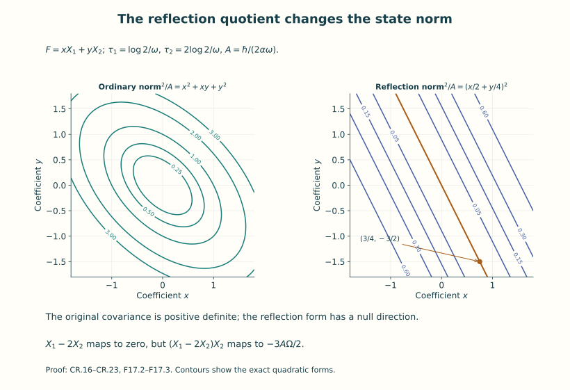
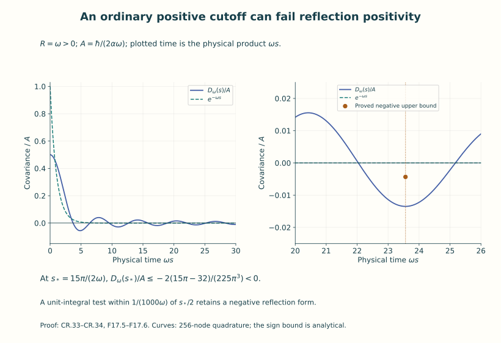
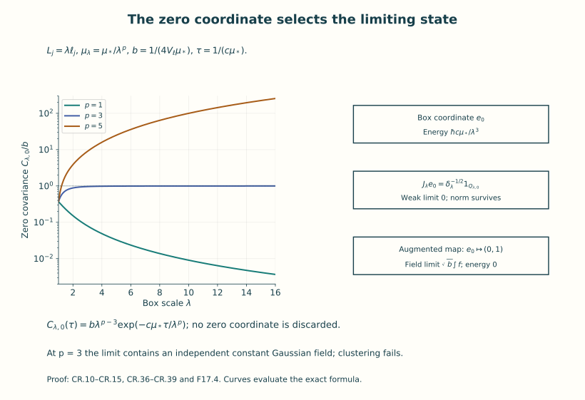

# Continuum limits and reconstruction

A finite regulator gives finitely many degrees of freedom, or a specified
cutoff on them. A continuum theory needs a state, observables and dynamics
after the regulator is removed. Matching a few numerical values does not
define those objects. This lesson constructs them, starting with the
original free scalar field from Unit 11.

The route has four steps. First construct an actual Gaussian random
distribution and its correlations. Then calculate regulator limits,
including the spatially constant coordinate. Next build a Hilbert space
from the Euclidean correlations and identify its fields and Hamiltonian.
Finally compare the finite and continuum states by explicit maps.

The free field is a complete worked construction within the broader
subject of quantum field theory. Its formulas let us prove reflection
positivity, the spectral condition, locality and clustering directly.
They also give examples in which one property survives a limit while
another fails. These calculations teach the content of the continuum
problem; the interacting Yang–Mills problem remains the subject of the
next unit.

Read Units 11 and 16 first. They provide the oscillator, Fock space,
operator domains and spectral measures used here. Physical time remains
measured in time units, with its conversion to a length coordinate shown
at every change of convention. The original action coefficient, vacuum
energy, zero coordinate and Fourier factors are retained.

| Construction | What it supplies |
|---|---|
| Gaussian covariance and random distribution | A probability law and all its smeared correlations |
| Reflection-positive quotient | A Hilbert space with its vacuum and an explicit state map |
| Positive-time translations | A strongly continuous semigroup and its actual generator domain |
| Boundary and ordered field maps | Operators representing the Euclidean observables |
| Momentum-cell isometries | A comparison of regulated states, fields and dynamics with the limit |

By the end you can carry out these steps in the free theory, calculate a
limit that retains an additional zero-energy sector, and test the precise
positivity and spectral statements made by a proposed regulator.

The QF equation labels below refer to the complete derivation in
[Unit 11](../oscillators-and-free-quantum-fields.html). The spectral
comparison uses [Unit 16](../spectra-mass-gaps-confinement.html).

## 1. Coordinates, factors and the covariance

Let \(c>0\), \(\hbar>0\) and \(m\ge0\).
Physical Lorentzian and Euclidean times are t and τ, in time units. Their length
coordinates are \(y^0=ct\) and \(x^0=c\tau\); spatial coordinates are unchanged.
Set

\[
\begin{gathered}
\mu=mc/\hbar,\quad \alpha=2\hbar/c,\quad
\kappa(k)=\sqrt{|k|^2+\mu^2},\quad\omega(k)=c\kappa(k),\\
S[\phi]=\frac\alpha2\int dt\,d^3x\,
 \{(\partial_t\phi)^2-c^2|\nabla\phi|^2-c^2\mu^2\phi^2\},\qquad
\Pi=\alpha\partial_t\phi,\\
S_E[\phi]=\frac\alpha2\int d\tau\,d^3x\,
 \{(\partial_\tau\phi)^2+c^2|\nabla\phi|^2+c^2\mu^2\phi^2\}
 =\hbar\int d^4x\,\{ |\nabla_4\phi|^2+\mu^2\phi^2\}.
\tag{CR.1}
\end{gathered}
\]

The second equality uses both \(d\tau=dx^0/c\) and
\(\partial_\tau=c\partial_{x^0}\). It retains the original action:
no extra one-half is inserted into its last integral. QF.12 proves the
Lorentzian action and momentum map. The displayed Euclidean quadratic form
defines the covariance below. There is no assertion that a typical random
distribution has a finite classical action.

Use the spatial unitary Fourier transform
\(\widetilde f(k)=(2\pi)^{-3/2}\int e^{-ik\cdot x}f(x)d^3x\).
The full, nonunitary physical Euclidean transform is
\(f^\flat(\xi,k)=\int e^{-i\xi\tau-ik\cdot x}f(\tau,x)d\tau d^3x\).
In length coordinates the nonunitary transform is
\(F^\flat(p)=\int e^{-ip\cdot x}F(x)d^4x\), and the unitary
four-dimensional transform is \(\mathcal F_4F=(2\pi)^{-2}F^\flat\).
The test-density map is

\[
F(x^0,x)=c^{-1}f(x^0/c,x),\quad
\int F(x^0,x)\phi(x^0,x)d^4x=\int f(\tau,x)\phi(\tau,x)d\tau d^3x,
\quad F^\flat(p^0,k)=f^\flat(cp^0,k).
\tag{CR.2}
\]

The covariance inner products are first defined on real Schwartz
space and extended sesquilinearly to its complexification. They are

\[
\begin{aligned}
C_\mu(f,g)&=\frac\hbar\alpha\int\frac{d\xi\,d^3k}{(2\pi)^4}
 \frac{\overline{f^\flat(\xi,k)}g^\flat(\xi,k)}{\xi^2+\omega(k)^2},\\
C_\mu^E(F,G)&=\frac12\int\frac{d^4p}{(2\pi)^4}
 \frac{\overline{F^\flat(p)}G^\flat(p)}{|p|^2+\mu^2},\\
C_\mu(\tau,x)&=\int\frac{d^3k}{(2\pi)^3}
 \frac\hbar{2\alpha\omega(k)}e^{-\omega(k)|\tau|+ik\cdot x}
 =\int\frac{d^3k}{(2\pi)^3}\frac{e^{-c\kappa(k)|\tau|+ik\cdot x}}{4\kappa(k)}.
\tag{CR.3}
\end{aligned}
\]

For complex Gaussian products use their symmetric bilinear versions
\(B_\mu(f,g)=C_\mu(\overline f,g)\) and
\(B_\mu^E(F,G)=C_\mu^E(\overline F,G)\). These agree with C on
real tests. This distinction fixes all conjugations in moments;
reflection inner products continue to use the sesquilinear C.
The first and second forms agree under CR.2: substitute ξ=cp⁰ and
\(\hbar/\alpha=c/2\). The elementary inverse transform used in the
third identity follows, without a contour prescription, by transforming
\(e^{-a|s|}\): its integral is
\((a+i\xi)^{-1}+(a-i\xi)^{-1}=2a/(a^2+\xi^2)\) for a>0.
Fourier inversion gives \(\int e^{i\xi s}(\xi^2+a^2)^{-1}d\xi/(2\pi)
=e^{-a|s|}/(2a)\). At m=0 this applies for almost every k; Tonelli
and the estimates below justify the resulting distributional identity.

These formulas identify the inverse quadratic form exactly:
the Hessian of \(S_E/\hbar\) in length coordinates is
\(2(-\Delta_4+\mu^2)\), and its Fourier inverse is the multiplier
\(1/[2(|p|^2+\mu^2)]\). The form is positive, real on real tests,
symmetric there, and nondegenerate: its positive multiplier is nonzero
almost everywhere. At μ=0, \(|p|^{-2}\) is locally integrable in four
dimensions, since its radial integral is proportional to
\(\int_0^1r\,dr\). Thus there is no restriction such as
\(\int F=0\) on the continuum Schwartz test space.

For a useful quantitative continuity bound choose an arbitrary retained
reference length ℓ>0. Splitting momentum at |p|=1/ℓ and using
\(\|\mathcal F_4F\|_\infty\le(2\pi)^{-2}\|F\|_1\) gives, uniformly
for μ≥0,

\[
0\le C_\mu^E(F,F)\le C_0^E(F,F)
\le\frac{\ell^2}{2}\|F\|_2^2+
 \frac1{32\pi^2\ell^2}\|F\|_1^2
\le\frac{\ell^2}{2}\|F\|_2^2+
 \frac{\ell^2}{192}\|(1+|x|^2/\ell^2)^2F\|_2^2.
\tag{CR.4}
\]

Indeed \(\int_{|p|<1/\ell}|p|^{-2}d^4p=\pi^2/\ell^2\), and
\(\int(1+|x|^2/\ell^2)^{-4}d^4x=\pi^2\ell^4/6\).
Cauchy–Schwarz for the positive Fourier form proves its two-test
continuity. Its precise Hilbert form domain inside L² is
\(\{F:\int |\mathcal F_4F|^2/(|p|^2+\mu^2)<\infty\}\).
For μ>0 this contains every L² function; for μ=0 it is an actual
infrared condition. Schwartz functions satisfy it by CR.4.

The covariance has field-square unit \(\mathsf L^{-2}\), as
\([\phi]=\mathsf L^{-1}\), \([\mu]=[k]=\mathsf L^{-1}\),
\([\omega]=\mathsf T^{-1}\) and \([\alpha]=[\hbar]/[c]\).
Point evaluation is not defined: the equal-time variance would contain
\(\int d^3k/[(2\pi)^3\,4\kappa(k)]\), which diverges quadratically
at large |k|. Every subsequent field is a distribution or a smeared operator.

## 2. An actual Gaussian random tempered distribution

This paragraph constructs the probability space rather than using the symbol
\(e^{-S_E/\hbar}D\phi\) as a measure. On \(\mathbb R^4\), take the real
tensor Hermite basis \(h_\nu^\ell\), \(\nu\in\mathbb N_0^4\), obtained
from QF.3–QF.10 with oscillator length ℓ in each coordinate. Its completeness
follows by four successive applications of one-dimensional completeness and
Fubini. Put \(\lambda_\nu=1+|\nu|\). The operator
\(A_\ell=1+\frac12(-\ell^2\Delta+|x|^2/\ell^2-4)\) has
\(A_\ell h_\nu^\ell=\lambda_\nu h_\nu^\ell\).
Coordinate multiplication and differentiation are the two sums/differences
of the exact Hermite ladder maps. A word of d such operations has L² norm
at most a constant depending on d and ℓ times
\(\lambda_\nu^{d/2}\). In particular
\(\|(1+|x|^2/\ell^2)^2h_\nu^\ell\|_2\le B\lambda_\nu^2\)
with the explicit sufficient value B=1057, independent of ν.
Indeed a word of d dimensionless coordinate multiplications has
at most 2ᵈ ladder paths, each bounded by
\(((|\nu|+d)/2)^{d/2}\). Thus words of lengths two and four have
bounds \(4\lambda_\nu\) and \(64\lambda_\nu^2\).
Expanding \((1+\sum_{j=1}^4(x_j/\ell)^2)^2\) gives
\(1+2\cdot4\cdot4+16\cdot64=1057\) times \(\lambda_\nu^2\).

For every Schwartz F, integrations by parts and Parseval give
\(\sum_\nu\lambda_\nu^{2r}|\langle h_\nu^\ell,F\rangle|^2
=\|A_\ell^rF\|_2^2<\infty\) for all nonnegative integers r.
Conversely this rapid coefficient decrease implies convergence of the
Hermite series in the Schwartz topology. Here is the estimate needed for
that assertion. In four dimensions Fourier Cauchy–Schwarz gives
\(\|v\|_\infty\le b_\ell\|(1-\ell^2\Delta)^2v\|_2\), because
\(\int(1+\ell^2|p|^2)^{-4}d^4p<\infty\).
Apply it to \(x^a\partial^b v\); its finitely many derivative terms
are ladder words. The bound in the preceding paragraph and
Cauchy–Schwarz in ν, with an additional power greater than 2,
bound every Schwartz seminorm of a Hermite tail by a tail of one
of the displayed weighted coefficient sums. The number of ν with
|ν|=j is \(\binom{j+3}{3}\); hence
\(\sum_\nu\lambda_\nu^{-s}<\infty\) exactly when s>4.
This proves the asserted convergence and all continuity uses below.

Let \(T_\mu\) be the Fourier multiplier
\([2(|p|^2+\mu^2)]^{-1/2}\), from Schwartz functions into real L².
On a countable product of independent N(0,1) variables \((Z_j)\),
choose any real orthonormal basis \((e_j)\) of L² and define
\(W(v)=L^2(\mathbb P)\text{-}\lim_M\sum_{j\le M}Z_j\langle e_j,v\rangle\).
The limit exists, since the squared norm of every tail is the squared
L² coefficient tail. Its covariance is \(\langle v,w\rangle\);
finite joint characteristic functions follow from the finite Gaussian
ones by L² convergence and \(|e^{ia}-e^{ib}|\le|a-b|\).
Define \(Y_\nu=W(T_\mu h_\nu^\ell)\). CR.4 and the ladder bound give
\(\mathbb E|Y_\nu|^2\le B_\ell\lambda_\nu^4\), for a finite,
explicitly bounded constant \(B_\ell=\ell^2(1/2+B^2/192)\).
Thus for any fixed s>8,

\[
\mathbb E\sum_\nu\lambda_\nu^{-s}|Y_\nu|^2<\infty,
\qquad
\Phi(F)=\sum_\nu Y_\nu\langle h_\nu^\ell,F\rangle,
\qquad
|\Phi(F)|\le
 \Big(\sum_\nu\lambda_\nu^{-s}|Y_\nu|^2\Big)^{1/2}
 \Big(\sum_\nu\lambda_\nu^s|\langle h_\nu^\ell,F\rangle|^2\Big)^{1/2}.
\tag{CR.5}
\]

Tonelli implies that the first random sum is finite almost surely.
On that single full-measure event, the last bound defines a continuous
real linear functional on the entire real Schwartz space. Thus Φ is an
actual random tempered distribution. Its coordinates are measurable;
equivalently it is the pushforward of the product probability measure to
the cylinder σ-algebra on \(\mathcal S'(\mathbb R^4)\). The weighted
coefficient Hilbert-space realization in CR.5 also supplies a separable
measurable realization, without any measurability choice for individual
tests. Schwartz convergence of the Hermite expansion and continuity of
T imply that the series equals \(W(T_\mu F)\) in L² probability.
Consequently

\[
\mathbb E e^{i\Phi(F)}=e^{-C_\mu^E(F,F)/2},\qquad
\mathbb E\Phi(F)\Phi(G)=C_\mu^E(F,G)\quad(F,G\text{ real}).
\tag{CR.6}
\]

This construction retains the massless zero-momentum integrability in
CR.4; it neither imposes a spatial average constraint nor introduces a
nonexistent point oscillator at one Lebesgue-null momentum.

Differentiating the finite joint Gaussian generating function proves
the moments: odd moments vanish, while

\[
S_{2r}(F_1,\ldots,F_{2r})=
\sum_{P\text{ a pairing of }\{1,\ldots,2r\}}
 \prod_{\{i,j\}\in P}B_\mu^E(F_i,F_j),\qquad S_0=1.
\tag{CR.7}
\]

No interchange of an infinite random series with arbitrary powers is
needed: each finite family is already jointly Gaussian by CR.6.
There are \((2r-1)!!\) pairings, so the absolute value of CR.7 is
bounded by \((2r-1)!!\prod_i C_\mu^E(F_i,F_i)^{1/2}\).
These are tempered n-point distributions, not only multilinear forms
on products. For a Schwartz test on \((\mathbb R^4)^{2r}\), each
pairing is the tensor product of r covariance distributions in disjoint
coordinate pairs, followed by a permutation. In Fourier coordinates
it is the integral of the transformed test at paired momenta p,−p
with weights \(\prod[2(p_j^2+\mu^2)]^{-1}\) and the corresponding
\((2\pi)^{-4r}\) factors. That integral is absolutely convergent:
the linear paired-momentum inclusion is injective, Schwartz decay
controls infinity in all r variables, and every origin contributes
the locally integrable four-dimensional factor \(|p_j|^{-2}\).
The same estimates by a finite Schwartz seminorm prove continuity.

## The countably many Gaussian coordinates on one probability space

The independent coordinates used in (CR.5) can all be constructed on the
single probability space \(([0,1),\mathcal B,du)\). This supplies the
countable probability space used in the construction explicitly.
For \(i\ge1\) define

\[
b_i(u)=\lfloor2^iu\rfloor-2\lfloor2^{i-1}u\rfloor,\qquad
U_j(u)=\sum_{r=0}^{\infty}2^{-r-1}b_{\,2^j(2r+1)}(u)
\quad(j=0,1,\ldots).
\tag{F17.1}
\]

Each digit is zero or one and is measurable. Every positive integer has
a unique form \(2^j(2r+1)\), so the coordinates use disjoint digit sets.
For the first \(M\) binary digits, each prescribed string occupies a
half-open interval of length \(2^{-M}\). Summing these lengths over the
unprescribed digits proves that any \(d\) prescribed distinct digits
have probability \(2^{-d}\). Thus every finite selection of digits is
independent.

For any finite collection of \(U_j\), truncate each of its series after
\(R\) digits. The truncated coordinates are independent and uniform on
\(\{0,2^{-R},\ldots,1-2^{-R}\}\); their errors are at most \(2^{-R}\).
For \(0\le a_j\le1\), sandwich the event that every full coordinate is
at most \(a_j\) between the corresponding truncated events with
thresholds \(a_j-2^{-R}\) and \(a_j\). Their probabilities tend to
\(\prod_j a_j\). This proves the joint uniform distribution and
independence of every finite subfamily. In particular each event
\(U_j\in\{0,1\}\) has probability zero, and their countable union is null.

Let
\(\mathcal G(x)=(2\pi)^{-1/2}\int_{-\infty}^x e^{-v^2/2}\,dv\).
The Gaussian integral proved in Unit 11 shows that \(\mathcal G\) is
continuous, strictly increasing and has limits zero and one. Set
\(Z_j=\mathcal G^{-1}(U_j)\) off the preceding null set, and assign zero
on that set. Then
\(\mathbb P(Z_j\le x_j\text{ for all selected }j)=\prod_j\mathcal G(x_j)\).
This proves the required independent \(N(0,1)\) coordinates on an
explicit probability space. It changes none of the covariance,
Hermite coefficients or physical factors in (CR.5).

## 3. Finite spatial regulator and its correlation limits

Retain all box lengths \(L_j>0\), volume \(V=L_1L_2L_3\), momenta
\(k_n=(2\pi n_1/L_1,2\pi n_2/L_2,2\pi n_3/L_3)\), and the symmetric
rectangular set \(\Lambda_N=\{n:|n_j|\le N_j\}\) containing zero.
For m>0 the exact finite oscillator vacuum of QF.13–QF.23 gives

\[
C_{L,N,\mu}(\tau,x)=\frac1V\sum_{n\in\Lambda_N}
 \frac\hbar{2\alpha\omega_n}e^{-\omega_n|\tau|+ik_n\cdot x},
\quad\omega_n=c\sqrt{|k_n|^2+\mu^2},
\quad E_{0,L,N}=\frac12\sum_{n\in\Lambda_N}\hbar\omega_n.
\tag{CR.8}
\]

To prove it directly, each real coordinate satisfies
\(q=\sqrt{\hbar/(2\alpha\omega)}(a+a^*)\).
The ground-state matrix element
\(\langle\Omega,q e^{-s(H^{\rm abs}-E_0)/\hbar}q\Omega\rangle
=\hbar e^{-s\omega}/(2\alpha\omega)\) follows from its sole
one-particle intermediate vector. Summing the real cosine/sine and
zero-mode basis products QF.13 yields CR.8. Repeated ladder contractions
give CR.7 with this covariance. Alternatively the Gaussian measure of
Section 2 in one time dimension for each of the finitely many positive
oscillators has the same moments. They therefore specify the same
finite regulator correlations.

The absolute vacuum energy remains in the transfer operator:
\(e^{-sH^{\rm abs}/\hbar}=e^{-sE_{0,L,N}/\hbar}
e^{-sH^{\rm rel}/\hbar}\). A vacuum-normalized matrix element
divides by \(\langle\Omega,e^{-sH^{\rm abs}/\hbar}\Omega\rangle
=e^{-sE_{0,L,N}/\hbar}\); this exact ratio gives the relative
operator in CR.8. The scalar is not assigned zero as an absolute
energy. At cutoff removal the sum diverges as proved in QF.33.
This is why the reconstructed vacuum Hamiltonian is the relative one.

For a spacetime Schwartz test f, periodize only space:
\(f_L(\tau,x)=\sum_{j\in\mathbb Z^3}f(\tau,x+jL)\), where
\(jL=(j_1L_1,j_2L_2,j_3L_3)\). Schwartz estimates give convergence
with all derivatives on compact time sets, and its Fourier integral
over one box equals the nonperiodic transform at k_n. Therefore

\[
C_{L,N,\mu}(f_L,g_L)=\frac\hbar{\alpha V}
 \sum_{n\in\Lambda_N}\int\frac{d\xi}{2\pi}
 \frac{\overline{f^\flat(\xi,k_n)}g^\flat(\xi,k_n)}{\xi^2+c^2(|k_n|^2+\mu^2)}.
\tag{CR.9}
\]

At fixed positive μ and fixed L, taking every N_j to infinity is
justified by absolute convergence: bound the ξ integral by a constant
times \((1+\ell|k_n|)^{-M}/\sqrt{|k_n|^2+\mu^2}\) for any M, using
\(\int d\xi/(2\pi)(\xi^2+a^2)^{-1}=1/(2a)\).
The same proof applies at μ=0 to the explicitly restricted nonzero
mode sum. Its missing zero coordinate is treated in Section 4.

For an explicit infinite-volume route take
\(L_j=\lambda\ell_j\), with fixed \(\ell_j>0\) and λ→∞.
After removing the Fourier cutoff, CR.9 converges to CR.3. For μ>0
this is the Riemann-sum theorem, which can be proved here by cutting
off a large momentum cube, using uniform continuity on it, and
bounding the tails by the displayed rapidly decreasing majorant.
The cell volume is \((2\pi)^3/V\), so the exact replacement is
\(V^{-1}\sum_n\longrightarrow\int d^3k/(2\pi)^3\).

For μ=0, omit n=0 only in this nonzero-mode sector. The ξ integral
in CR.9 has the uniform small-k bound \(A/|k|\), with A controlled
by Schwartz seminorms. Let
\(a_- =\min_j 2\pi/\ell_j>0\),
\(a_+=\max_j 2\pi/\ell_j\). Then
\(a_-|n|/\lambda\le|k_n|\le a_+|n|/\lambda\).
There are at most B(j+1)² lattice points with j≤|n|<j+1:
surround them by disjoint unit cubes and compare volumes of the
annulus enlarged by √3. Consequently, for \(0<\varepsilon\le1/\ell\),

\[
\frac1V\sum_{0<|k_n|<\varepsilon}\frac1{|k_n|}
\le B_{\ell_1,\ell_2,\ell_3}\varepsilon^2
\quad\text{whenever the sum is nonempty},\qquad
\int_{|k|<\varepsilon}\frac{d^3k}{|k|}=2\pi\varepsilon^2.
\tag{CR.10}
\]

Indeed the sum is at most a constant times
\(\lambda^{-2}\sum_{1\le j\le\lambda\varepsilon/a_-}(j+1)^2/j\),
which is bounded by a constant times ε² when its upper endpoint
is at least a positive constant; finitely small shells are absorbed
in the same bound. Empty sums cause no difficulty. Remove that
small ball, apply the preceding Riemann argument, then let ε↓0.
This proves the massless convergence with its actual infrared bound.
It also proves convergence of all nonzero-mode sums if μ=μ_λ↓0:
on the complement of the ball the integrands converge uniformly,
and \((|k|^2+\mu_\lambda^2)^{-1/2}\le|k|^{-1}\) supplies the
same omitted-ball estimate. At fixed infinite volume, μ↓0 in CR.3
follows by dominated convergence from CR.4.

All these limits hold in the tempered-distribution sense. For the
two-point kernel pair the transformed general test with momenta
(p,−p), then use the same estimates. For each n-point pairing the
momenta occur in disjoint pairs and the restricted Schwartz transform
decays in all independent momentum variables. Products of the
one-variable majorants prove the multi-Riemann and dominated-limit
steps. There are finitely many pairings. This proves convergence of
every S_n on every Schwartz n-variable test, beyond convergence on
simple tensor products. The Gaussian characteristic functions converge
for every finite family of tests by CR.6 and polarization. These are
the precise correlation and finite-dimensional-law limits asserted
here; an unspecified topology of probability-measure convergence is
not being substituted for them.

An entirely finite regularization is also available on a Euclidean
four-torus of length sides \(B_0,B_1,B_2,B_3\): for μ>0 and a symmetric
finite Fourier set \(\Lambda\subset\mathbb Z^4\), the covariance is
\(\sum_{n\in\Lambda}e^{ip_n\cdot(x-y)}/[2B_0B_1B_2B_3(p_n^2+\mu^2)]\),
\(p_{n,j}=2\pi n_j/B_j\). The real sine/cosine coordinates have
Gaussian density proportional to
\(\exp[-\sum_r(p_r^2+\mu^2)q_r^2]\), with variance
\(1/[2(p_r^2+\mu^2)]\); the zero coordinate is included and has
variance \(1/(2\mu^2)\). Orthogonality proves this is exactly CR.1's
finite quadratic form. Cutoff removal followed by homothetic
four-volume expansion converges to CR.3 by the same Riemann argument.
This regulator gives ordinary positive covariance. Section 9 proves
why a time Fourier cutoff does not automatically give reflection positivity.
For μ=0 its constant four-torus coordinate instead has quadratic
coefficient zero: the putative factor \(\int_{\mathbb R}e^0dq_0\)
is infinite. Its massive contribution to the covariance kernel is
\(1/[2B_0B_1B_2B_3\mu^2]\). Removing that coordinate defines
the projected mean-zero Gaussian subsystem, whereas the original
finite regulator has no normalized full Gaussian measure at μ=0.
The noncompact physical-time treatment of that original degree
of freedom is the Schrödinger construction in the next section.

## 4. The periodic massless zero coordinate and joint limits

At m=0 the finite box has the original coordinate \(q_0\in\mathbb R\),
momentum \(p_0=-i\hbar\partial_{q_0}\), and

\[
\mathcal H_0=L^2(\mathbb R,dq_0),\qquad
H_0=p_0^2/(2\alpha),\qquad
D(H_0)=\{\psi:p^2\widehat\psi(p)\in L^2(dp)\},\qquad
\phi_0(t,x)=V^{-1/2}(q_0+t p_0/\alpha).
\tag{CR.11}
\]

The momentum transform uses \((2\pi\hbar)^{-1/2}e^{-ipq/\hbar}\).
Multiplication by p²/(2α) is self-adjoint on this maximal domain:
its nonreal resolvents are the bounded reciprocal multipliers, and
the adjoint condition tested on compact momentum sets gives the same
domain. Its spectrum is [0,∞), and p=0 is a null set, so there is
no normalizable zero-energy eigenvector. These facts also follow
from the complete proof QF.24–QF.26. The nonzero oscillator Fock
factor is tensored with this Schrödinger factor.

A spatially mean-zero test at each τ annihilates this coordinate.
On that restricted test space the nonzero-mode covariance is well
defined, stationary and reflection positive by Section 5. It is the
state of the nonzero-mode subsystem. A translation-invariant Gaussian
vacuum covariance of the full finite box cannot be obtained by putting
\(\omega_0=0\) into CR.8: its variance diverges. More intrinsically,
a ground state for the full Hamiltonian would be supported on p=0
and the nonzero-mode vacuum, a null spectral set in the Schrödinger
factor. Thus such a vector does not exist. This statement does not
exclude other nonstationary states of the full original system.

The zero-coordinate Euclidean dynamics is nevertheless exact:

\[
k_s(q,q')=\sqrt{\frac\alpha{2\pi\hbar s}}
 \exp\left[-\frac{\alpha(q-q')^2}{2\hbar s}\right],\quad s>0,
\qquad(e^{-sH_0/\hbar}\psi)(q)=\int k_s(q,q')\psi(q')dq'.
\tag{CR.12}
\]

Fourier transformation turns the right side into multiplication by
\(e^{-sp^2/(2\alpha\hbar)}\), proving the formula, its contraction
property, strong continuity, and its generator/domain. Completing
the square in \(\int k_s(q,z)k_t(z,q')dz\) gives exactly
\(k_{s+t}(q,q')\), including its square-root prefactor. Its integral
in q′ is one, so it is also the transition kernel of the free
Gaussian coordinate with increment variance \(\hbar s/\alpha\).

For an actual finite-time reflection-positive measure keep a width
\(\sigma^2>0\) of unit \([q_0]^2=\mathsf L\), set
\(\psi_\sigma(q)=(2\pi\sigma^2)^{-1/4}e^{-q^2/(4\sigma^2)}\), and
fix T>0. At ordered times −T=τ₀<⋯<τ_j=T the joint density is

\[
Z_T^{-1}\psi_\sigma(q_0)
 \prod_{i=1}^j k_{\tau_i-\tau_{i-1}}(q_i,q_{i-1})
 \psi_\sigma(q_j)\prod_{i=0}^j dq_i,
\quad
Z_T=\langle\psi_\sigma,e^{-2TH_0/\hbar}\psi_\sigma\rangle>0.
\tag{CR.13}
\]

The semigroup identity proves normalization and consistency under
deleting interior times. These finite Gaussian densities specify
all cylinder observables used here; no path-measure existence theorem
is needed for this finite-time Schrödinger reconstruction. Allow
bounded cylinder functions and finite polynomial cylinder functions;
all their required integrals exist by the Gaussian density.
For such a function F supported in [0,T), integrate
the positive half of CR.13 with its endpoint ψ, holding q(0)=q
fixed, to obtain v_F(q). Reflection and kernel symmetry give exactly
\(\mathbb E\overline{F\circ\theta}\,G=Z_T^{-1}\int\overline{v_F(q)}v_G(q)dq\).
This proves reflection positivity. Bounded functions of q(0) give
\(v_F(q)=F(q)(e^{-TH_0/\hbar}\psi_\sigma)(q)\); the last factor
is strictly positive everywhere by CR.12. Truncating any L² target
where that factor is bounded below proves density of these vectors.
The quotient therefore completes to the full Schrödinger L² space.
This finite-boundary state is not claimed to be a stationary vacuum.

For a transparent infinite-volume limit retain instead the Lorentzian
initial vector ψσ at time zero, tensor the nonzero-mode vacuum. Direct
Gaussian integration and \(p=-i\hbar\partial_q\) give
\(\langle q^2\rangle=\sigma^2\),
\(\langle p^2\rangle=\hbar^2/(4\sigma^2)\),
\(\langle qp\rangle=i\hbar/2\),
\(\langle pq\rangle=-i\hbar/2\). Thus

\[
\langle\phi_0(t,x)\phi_0(s,y)\rangle
=\frac1V\left\{\sigma^2+\frac{ts\hbar^2}{4\alpha^2\sigma^2}
                  +\frac{i\hbar(s-t)}{2\alpha}\right\}.
\tag{CR.14}
\]

On every fixed finite time interval this tends to zero as V→∞,
also after Schwartz spacetime smearing (time moments are finite).
All higher zero-coordinate moments follow by differentiating its
Gaussian characteristic function for linear q,p combinations;
commuting them into their original order supplies the same pair
contractions. Every term containing at least one such contraction
vanishes in the limit. Together with CR.10 this proves convergence
of all full-field vacuum-factor/Schrödinger-state Wightman moments
to the continuum massless moments of Section 7. No finite-box zero
coordinate was deleted: its exact contribution was evaluated.

There is a second, instructive family entirely within massive box
vacua. Let \(L_j=\lambda\ell_j\), \(V_\ell=\ell_1\ell_2\ell_3\),
and μλ↓0. The zero-mode covariance is

\[
C_{\lambda,0}(\tau,x)=\frac1{4\lambda^3V_\ell\mu_\lambda}
 e^{-c\mu_\lambda|\tau|}.
\tag{CR.15}
\]

The nonzero modes converge to the continuum massless covariance
by CR.10. If \(V\mu_\lambda\to\infty\), the zero mode vanishes.
If \(\mu_\lambda=\mu_*/\lambda^3\) with a fixed inverse length
\(\mu_*>0\), the zero mode tends to the positive constant
\(b=1/(4V_\ell\mu_*)\). The limiting field is exactly
\(\Phi_0+Z\), where \(Z\sim N(0,b)\) is an independent real
constant field: its covariance and every Wick moment are the
computed limits. If \(V\mu_\lambda\to0\), take a nonnegative
Schwartz test of nonzero integral; dominated convergence for its
double time integral in CR.15 makes its variance diverge. There is
then no finite covariance distribution limit on the full test space.
These are three different precise infrared limits of the same
original family, rather than an unspecified exchange of limits.

For the constant-field limit the OS one-particle map becomes
\(f\mapsto(K_0f,\sqrt b\int f)\) into
\(L^2(d^3k)\oplus\mathbb C\), and the positive-time generator is
\(\hbar\omega\oplus0\). To prove density of its range, choose
\(f_R(\tau,x)=\eta(\tau)R^{-3}\chi(x/R)\) with smooth compact
positive-time η, Schwartz χ, and both integrals one. Its constant
component is √b. Since
\(\widetilde{R^{-3}\chi(\cdot/R)}(k)=\widetilde\chi(Rk)\),
the massless formula in Section 5 gives
\(\|K_0f_R\|^2\le (4R^2)^{-1}\int |\widetilde\chi(u)|^2/|u|\,d^3u\).
Thus the pure constant direction lies in the range closure; subtract
it, and the density proved in Section 5 supplies the other summand.
The reconstructed Hilbert space is its full symmetric Fock space,
and every excitation in the extra one-dimensional mode has zero
energy. Vacuum uniqueness fails; clustering also fails because
the two-point constant b persists at arbitrary spatial separation.
Ordinary positivity and reflection positivity nevertheless hold.

## 5. Reflection-positive quotient and the Fock state map

Let \(\theta f(\tau,x)=f(-\tau,x)\), and use positive-time tests
\(\mathcal S_+=C_c^\infty((0,\infty)\times\mathbb R^3)\), with their
complex span. Spatial Schwartz tests with compact time support give
the same completion. Define

\[
r(k)=\sqrt{\frac\hbar{2\alpha\omega(k)}}=\frac1{2\sqrt{\kappa(k)}},
\qquad
(Kf)(k)=r(k)\int_0^\infty e^{-\omega(k)\tau}\widetilde{f(\tau,\cdot)}(k)d\tau.
\tag{CR.16}
\]

The exact two-point reflection form is

\[
C_\mu(\theta f,g)=\langle Kf,Kg\rangle_{L^2(d^3k)}\ge0\quad(f=g).
\tag{CR.17}
\]

Indeed \(|-\tau-\sigma|=\tau+\sigma\) on the supports, and
the factor \((2\pi)^{-3}\) from CR.3 becomes the two unitary
spatial transforms. The possible massless factor r² is proportional
to |k|⁻¹ and is locally integrable; compact positive times and
Schwartz spatial decay control infinity. This justifies Fubini and
proves continuity in these test topologies.

The range of K is dense. Fix a nonnegative nonzero smooth η supported
in a positive time interval. For f(τ,x)=η(τ)g(x),
\(Kf=a_\eta(k)\widetilde g(k)\), where
\(a_\eta=r\int e^{-\omega\tau}\eta(\tau)d\tau>0\) almost
everywhere. If v∈L² is orthogonal to all these kernels for Schwartz
g, then \(\overline v a_\eta\) is the zero tempered distribution.
It is locally integrable, by Cauchy–Schwarz and local integrability
of aη², and at infinity has exponential decay times at most an
L² function. Thus it is zero almost everywhere, and v=0. Compact
spatial tests suffice by cutoff approximation in the estimates for K.

Define Gaussian Wick polynomials by coefficient differentiation of
\(\exp[\Phi(f)-B_\mu(f,f)/2]\), starting with real f and then
complex-linearly polarizing. For
\(:\Phi(f_1)\cdots\Phi(f_n):\) this subtracts every internal
Gaussian contraction with its exact coefficient. The finite
Gaussian exponential identity gives

\[
\begin{aligned}
\mathbb E\,\overline{(:\Phi(f_1)\cdots\Phi(f_n):)\circ\theta}
 :\Phi(g_1)\cdots\Phi(g_q):
&=0 &&(n\ne q),\\
&=\sum_{\pi\in\mathfrak S_n}\prod_{j=1}^n
 \langle Kf_j,Kg_{\pi(j)}\rangle &&(n=q).
\tag{CR.18}
\end{aligned}
\]

To check every coefficient, the expectation of the two Wick
generating exponentials is
\(\exp[\sum_{i,j}u_i v_j C_\mu(\theta f_i,g_j)]\).
The coefficient with each u and v occurring once must choose a
bijection, giving exactly the displayed permutations; if their
counts differ there is no such monomial. Complex tests follow by
multilinearity and conjugation in the first entry.

Let \(\mathcal P_+\) be the complex polynomial algebra generated by
the positive-time smeared random fields. Each polynomial is a
finite sum of Wick polynomials, because their leading terms are
the original monomials and their lower-degree terms are finite.
The following map is therefore specified on a spanning family:

\[
\begin{aligned}
\mathcal U_0: \mathcal P_+&\longrightarrow\mathcal F_s(L^2(d^3k)),\\
1&\longmapsto\Omega,\\
:\Phi(f_1)\cdots\Phi(f_n):&\longmapsto
 a^*(Kf_1)\cdots a^*(Kf_n)\Omega
 =\sqrt{n!}\,S_n(Kf_1\otimes\cdots\otimes Kf_n).
\tag{CR.19}
\end{aligned}
\]

QF.28's contractions, or the n! terms in S_n, show that the
inner products of these images are exactly CR.18. In particular,
any polynomial relation holding in the Gaussian L² space has
zero image: its reflection form with itself is zero by
Cauchy–Schwarz in that L² space and the measure's reflection
invariance. Hence the map is well defined. It proves positivity
of the full polynomial reflection form, not merely of CR.17.
Its null space is exactly
\(\mathcal N=\{P:\mathbb E\overline{P\circ\theta}P=0\}\).
CR.18 and dense range of K show that the image is dense in every
symmetric tensor sector and then in the full Fock direct sum.
Consequently

\[
\mathcal H_{\rm OS}=\overline{\mathcal P_+/\mathcal N},\qquad
\mathcal U:\mathcal H_{\rm OS}\overset{\rm unitary}{\longrightarrow}
\mathcal F_s(L^2(d^3k)),\qquad\mathcal U[1]=\Omega.
\tag{CR.20}
\]

This explicitly constructs the quotient, its null vectors, its
completion, its vacuum and its state map. It is a proof for this
Gaussian field, independent of a general reconstruction theorem.

Figure 1. The oscillator in Example 1 retains its variance
\(A=\hbar/(2\alpha\omega)\) and the physical times
\(\log2/\omega,2\log2/\omega\). The contours are the exact two
quadratic forms in (F17.2). The null direction and its nonzero bulk
product are proved in (F17.3); the boundary observable map follows.

## 6. Positive-time dynamics, boundaries and ordered observables

For s≥0 translate the positive-time tests to the future:
\(f_s(\tau,x)=f(\tau-s,x)\). Then
\(Kf_s=e^{-s\omega}Kf\). Gaussian translation invariance preserves
the Wick subtractions. Thus the polynomial translation descends to
the quotient, where it is the contraction

\[
T_s=\mathcal U^{-1}\Gamma_s(e^{-s\omega})\mathcal U
=\mathcal U^{-1}e^{-sH/\hbar}\mathcal U,
\quad(H\Psi)_n=\Big(\sum_{j=1}^n\hbar\omega(k_j)\Big)\Psi_n,
\quad D(H)=\Big\{\Psi:\sum_n\|\textstyle\sum_j\hbar\omega(k_j)\Psi_n\|_2^2<\infty\Big\}.
\tag{CR.21}
\]

Multiplication proves the semigroup identity, contraction property,
and strong continuity by dominated convergence in each sector and
then the direct sum. The generator is the displayed self-adjoint
H: the difference quotient converges to −H/ℏ exactly on its domain.
For necessity, Fatou applied to its squared multiplier gives the
weighted-domain condition. For sufficiency use
\(|(e^{-sE/\hbar}-1)/s|\le E/\hbar\) and dominated convergence.
The nonreal reciprocal multipliers prove self-adjointness just as
in CR.11. This is exactly the original Unit 11 relative Hamiltonian
QF.35, including the action and energy units.

For s>0 the semigroup maps the entire Hilbert space into every
energy-power domain, because
\(\sup_{E\ge0}E^p e^{-sE/\hbar}=(p\hbar/(es))^p\) for p≥1.
Its positive-time polynomial image is a core for every fixed
H-power. To verify this, truncate first the sector sum and then
the momenta in each sector to bounded annuli; these truncations
converge in the weighted graph norm by dominated convergence.
On the bounded product region the energy multiplier is bounded.
Rectangle step functions, and then finite sums of products of
smooth compact one-variable functions, are dense there; smoothing
their indicators proves the latter assertion. Symmetrize these
products. Each compact smooth momentum factor away from zero is
exactly a K image: divide it by the strictly positive smooth
weight aη from Section 5 and inverse Fourier transform the
result. This gives spatial Schwartz tests with compact positive
time support. Spatial cutoff approximation converges in every
fixed ω-weighted norm by the defining integrals and rapid decay,
so compact spacetime tests have the same graph-core property.

For a real spatial Schwartz g, take nonnegative positive-time
approximate identities \(\eta_\varepsilon\) of integral one
supported in (0,ε), and \(f_\varepsilon=\eta_\varepsilon g\).
Then \(Kf_\varepsilon\to r\widetilde g\) in L² and in every
polynomial ω-weighted L² norm, by dominated convergence. The
massless origin contributes \(|k|^{-1}\), which is integrable.
In fact \(0\le1-e^{-\omega\tau}\le\omega\tau\) gives the
quantitative bound
\(\|\omega^j(Kf_\varepsilon-r\widetilde g)\|_2
\le\varepsilon\|\omega^{j+1}r\widetilde g\|_2\).
The boundary field transported to Fock space is therefore

\[
\phi(0,g)=a(r\widetilde g)+a^*(r\widetilde g),\qquad
\Pi(0,g)=a(i\alpha\omega r\widetilde g)+a^*(i\alpha\omega r\widetilde g).
\tag{CR.22}
\]

The second formula is the Lorentzian time derivative times α,
not an unlabelled Euclidean derivative. QF.30 proves convergence
of these smeared operators on D(N¹ᐟ²) whenever their kernels
converge. Their real closures are self-adjoint by the full
one-mode factorization proof following QF.31. Their necessary and
sufficient spatial kernel conditions are precisely
\(\int|\widetilde g|^2/\omega<\infty\) for φ and
\(\int\omega|\widetilde g|^2<\infty\) for Π, already necessary
on Ω. Every Schwartz test satisfies them, also at m=0.
The massless condition does exclude some L² tests: with an arbitrary
retained inverse length \(\kappa_*>0\), the function
\(\widetilde g(k)=(\kappa_*/|k|)1_{0<|k|<\kappa_*}\)
is in L²(d³k), but \(\int|\widetilde g|^2/\omega\) diverges
logarithmically at zero. This is a neighbourhood condition, not
removal of a point of zero measure.

The observable map is stronger than a one-particle correspondence.
If 0<τ₁<⋯<τ_n and g_j are spatial real Schwartz tests, the ordinary,
not Wick-ordered, Euclidean product has quotient vector

\[
\mathcal U[\Phi(\tau_1,g_1)\cdots\Phi(\tau_n,g_n)]
=e^{-\tau_1H/\hbar}\phi(0,g_1)
 e^{-(\tau_2-\tau_1)H/\hbar}\phi(0,g_2)\cdots
 e^{-(\tau_n-\tau_{n-1})H/\hbar}\phi(0,g_n)\Omega.
\tag{CR.23}
\]

Here time-slice fields denote the L² Gaussian limits of time-smears;
the equal-time spatial covariance is finite for these g_j, so the
limits exist and all finite moments converge by Wick's formula.
To prove CR.23, expand the right side by QF.28. Each creation
surviving to the left has vector \(e^{-\tau_j\omega}r\widetilde g_j\).
Each annihilation at τ_i contracting a later creation at τ_j gives
\(\langle r\widetilde g_i,e^{-(\tau_j-\tau_i)\omega}r\widetilde g_j\rangle\),
exactly the Euclidean internal contraction from CR.3. Moving every
annihilation to the right enumerates all disjoint partial pairings
once by the CCR. Wick expansion of the left side gives the identical
partial pairings and the remaining creation vectors through CR.19.
This proves the formula with all ordering, contractions and factors.
All intermediate vectors lie in finite sectors with kernels in all
ω-power domains; the contraction and creation bounds QF.30 justify
every operation. Integration gives the formula for time-smeared
ordered supports as well.

For completeness a boundary multiplication operator can be defined
directly on a dense polynomial class before transport: adjoin the
time-zero random variable Φ(0,g) to positive-time polynomials, and
multiply there. Its image is exactly φ(0,g) acting on their images.
For a Wick monomial the elementary Wick multiplication identity is
the higher-degree Wick monomial plus
\(\sum_j C_\mu((0,g),f_j)\) times the Wick product with f_j removed.
The contraction equals \(\langle r\widetilde g,Kf_j\rangle\).
These are exactly the creation and annihilation terms in QF.28.
It follows in particular that this boundary multiplication preserves
the null space on this domain and descends to the stated operator.
The state, positive-time dynamics and boundary observables have
therefore all been reconstructed by explicit maps.

Bulk multiplication is not asserted to act on this quotient. Its
null space is generally not a multiplication ideal. For a nonzero
real \(h\in C_c^\infty((0,\infty)\times\mathbb R^3)\), let
\(f=[-\partial_\tau^2+c^2(-\Delta+\mu^2)]h\). Integrating twice
in time in CR.16, with zero endpoint terms, gives Kf=0. But the
ordinary covariance, from its exact inverse multiplier CR.3, is
\(C_\mu(f,h)=(\hbar/\alpha)\int h^2>0\). Wick expansion therefore
gives \(\mathcal U[\Phi(f)\Phi(h)]=C_\mu(f,h)\Omega\ne0\), although
\([\Phi(f)]=0\). The boundary map just proved, and the ordered map
CR.23, are the actual observable constructions; replacing them by
arbitrary bulk multiplication would be false.

## 7. Lorentzian distributions, the mass shell and the spectrum

Write y=(ct,x), and use the Lorentz pairing
\(p\cdot y=p^0y^0-k\cdot x\), whose numerical metric is (+−−−).
The original Unit 7 metric has the opposite sign, while the original
positive kinetic action in CR.1 is unchanged; QF.47–QF.49 prove this
coordinate/signature comparison. Define

\[
\begin{gathered}
H_\mu^+=\{p=(\kappa(k),k):k\in\mathbb R^3,\ \kappa(k)>0\},\quad
d\rho_\mu(p)=\frac{d^3k}{(2\pi)^3\,2\kappa(k)},\\
\mathfrak h_{\rm cov}=L^2(H_\mu^+,d\rho_\mu),\quad
(Jv)(k)=\frac{v(\kappa(k),k)}{\sqrt{(2\pi)^3\,2\kappa(k)}},\quad
J:\mathfrak h_{\rm cov}\longrightarrow L^2(d^3k),\\
F^+(p)=\int e^{ip\cdot y}F(y)d^4y,\quad
b_F(p)=2^{-1/2}F^+(p)|_{H_\mu^+},\quad
\phi_M(F)=a(Jb_{\overline F})+a^*(Jb_F).
\tag{CR.24}
\end{gathered}
\]

J is unitary by direct integration, with inverse multiplication by
its reciprocal on the corresponding weighted space. At μ=0 the
excluded shell origin has measure zero; it is not a periodic zero
oscillator. The map \(F\mapsto b_F\) is continuous from Schwartz
space into the intersection of all κ-power L² domains: at infinity
its Fourier restriction decreases faster than every inverse power,
and near the massless origin its measure has radial factor r dr.
The complex-linear field formula retains the conjugate test in
the annihilation term, because annihilation is antilinear.
For real F it is the real Segal field. With
\(F(y^0,x)=c^{-1}f(y^0/c,x)\), its J kernel is

\[
(Jb_F)(k)=\sqrt{\frac\hbar{2\alpha\omega(k)}}(2\pi)^{-3/2}
 \int e^{i\omega(k)t-ik\cdot x}f(t,x)dt\,d^3x.
\tag{CR.25}
\]

This is exactly QF.45, where that provider's spatial hat is
nonunitary and its tilde is unitary. No Fourier factor occurs twice.
The preceding Euclidean density map and this Lorentzian density map
both retain their time Jacobian c.

On the dense common domain \(\mathscr D\) of finite creation
products with kernels in \(\bigcap_{j\ge0}D(\omega^j)\), all
fields in CR.24 preserve the domain, satisfy
\(\phi_M(F)^*\supset\phi_M(\overline F)\) for the restrictions,
and solve \(\phi_M((\partial_{y^0}^2-\Delta+\mu^2)F)=0\).
The last identity follows because the Fourier multiplier vanishes
on the mass shell; the first two follow from QF.28–QF.30. The norm
bound for a field on a vector supported in sectors ≤n is at most
\(2\sqrt{n+1}\max(\|Jb_F\|,\|Jb_{\bar F}\|)\|\Psi\|\).
Thus all matrix elements define tempered distributions on this
actual invariant domain, and real smears have the self-adjoint
closures proved after QF.31. This is an operator-valued
distribution, not an operator at a spacetime point.

The vacuum two-point distribution, with its complete measure, is

\[
\begin{aligned}
W_{2,\mu}(y-z)&=\frac12\int_{H_\mu^+}d\rho_\mu(p)
                    e^{-ip\cdot(y-z)}
 =\int\frac{d^3k}{(2\pi)^3\,4\kappa(k)}
      e^{-i\kappa(k)(y^0-z^0)+ik\cdot(x-x')},\\
W_{2,\mu}(F,G)&=\frac12\int d\rho_\mu(p)F^+(-p)G^+(p).
\tag{CR.26}
\end{aligned}
\]

The first formula follows by contracting the annihilation in the
left field with the creation in the right field. Moving
annihilations successively to the right proves every higher
Wightman function: odd ones vanish; for 2r entries sum over all
pairings, putting W₂(y_i−y_j) in each pair with i<j. The proof
enumerates each pairing once by choosing the partner of the first
annihilation, then continuing with the remaining entries. Absolute
convergence as a tempered n-distribution follows by restricting a
Schwartz transform to the injective map of paired on-shell momenta;
each measure has at most polynomial growth at infinity and radial
r dr at the massless origin. This also proves massive-to-massless
and the box limits asserted after CR.14, with the same small-|k|
bound CR.10 and Schwartz time-transform decay. Hilbert positivity
is exact:
\(\sum_{i,j}\overline{z_i}z_j\langle\Omega,A_i^*A_j\Omega\rangle
=\|\sum_jz_jA_j\Omega\|^2\ge0\) for polynomial fields on
\(\mathscr D\). All moments are normalized by W₀=1.

The measure dρ is Lorentz invariant. Indeed it is precisely
\((2\pi)^{-3}\theta(p^0)\delta((p^0)^2-|k|^2-\mu^2)d^4p\)
integrated in p⁰: the positive root has derivative 2κ. Proper
orthochronous Lorentz transformations preserve the quadratic form,
the future sheet and four-dimensional volume. For μ=0 the origin
does not affect this change-of-variables identity; establish it
first on compact sets away from the origin and exhaust using
the locally finite positive measure. Therefore

\[
(u(a,\Lambda)v)(p)=e^{ip\cdot a}v(\Lambda^{-1}p),\qquad
U(a,\Lambda)=\Gamma_s(Ju(a,\Lambda)J^{-1})
\tag{CR.27}
\]

is a unitary representation of the proper orthochronous Poincaré
group. Direct substitution gives its group law
\((a,\Lambda)(b,M)=(a+\Lambda b,\Lambda M)\).
It is strongly continuous: first use uniform continuity on
compact shell sets away from the origin for continuous compactly
supported v, with a slightly larger compact majorant; these v
are dense by truncation and mollification on the k coordinates.
Unitarity then extends continuity to all v. Tensor products,
finite-sector truncation and unitarity prove the Fock assertion.
The common domain \(\mathscr D\) is invariant because
\((\Lambda p)^0\le B_\Lambda p^0\) on the forward cone and
the inverse inequality holds with Λ⁻¹; thus all κ-weighted norms
are preserved up to finite constants. Creation intertwining in
QF.28 and the change of variables
\(F_{a,\Lambda}(y)=F(\Lambda^{-1}(y-a))\) prove
\(U(a,\Lambda)\phi_M(F)U(a,\Lambda)^{-1}=\phi_M(F_{a,\Lambda})\).
The vacuum Ω is invariant.

The joint translation spectral projections can be written without
an abstract existence assumption: on the n-particle sector set

\[
(E(B)\Psi)_n(k_1,\ldots,k_n)
 =1_B\Big(\sum_{j=1}^n(\kappa(k_j),k_j)\Big)\Psi_n,
\quad P^0_{\rm length}=H/(\hbar c),\quad
\boldsymbol P_{\rm physical}=\hbar\sum_j k_j.
\tag{CR.28}
\]

On the vacuum sector the sum is zero. Indicator multiplication
gives countable additivity in the strong topology by dominated
convergence, orthogonality of disjoint projections and E(total)=I.
Its Fourier integral is CR.27's translation representation.
Every shell momentum lies in the closed forward cone, and that
cone is closed under sums by \(|\sum k_j|\le\sum|k_j|\le\sum\kappa(k_j)\).
Thus the joint spectral support lies in that cone; physical
energy-momentum is \((H/c,\boldsymbol P)\), with an overall ℏ
relative to its inverse-length labels.

This also proves the distributional Wightman spectrum condition
with its orientation. Put \(\zeta_j=y_j-y_{j+1}\).
For a pairing (i,l) with i<l, the exponent
\(-ip\cdot(y_i-y_l)\) equals
\(-ip\cdot\sum_{j=i}^{l-1}\zeta_j\).
Therefore the coefficient of −iζ_j is the sum of all forward
shell momenta whose pairs cross the cut j. Its value lies in the
closed forward cone, including the possible empty sum zero.
Integrating these positive spectral measures and summing the
finitely many pairings proves that the Fourier support in the
difference variables has precisely this forward-cone containment
when the inverse Fourier exponential is \(e^{-i\sum q_j\zeta_j}\).
This argument fixes the sometimes ambiguous sign convention.

The vacuum is cyclic. The range of b_F is dense on the mass shell:
every smooth compactly supported shell function with support away
from the massless origin is the restriction of a Schwartz spacetime
Fourier function. In the k chart choose that compact function v(k)
and a smooth compact η with η(0)=1, and set
\(G(p^0,k)=v(k)\eta(p^0-\kappa(k))\); multiply by a spatial
cutoff equal to one on supp v, so G is smooth compact in all
four variables. Its inverse Fourier transform is Schwartz.
Such v are dense, as above. Wick subtraction of the vacuum
contractions in products of fields gives every finite creation
product with these kernels. Their span is dense in Fock space.
No Reeh–Schlieder assertion for an individual bounded region is
required or inferred here.

The Hamiltonian spectrum, derived directly from its multiplier, is

\[
\sigma(H)=\begin{cases}\{0\}\cup[mc^2,\infty),&m>0,\\
[0,\infty),&m=0,\end{cases}
\qquad \ker H=\mathbb C\Omega.
\tag{CR.29}
\]

For completeness: the n-particle multiplier is at least nmc².
For any E≥nmc² choose a normalized one-particle packet supported
where \(|\hbar\omega-E/n|<\delta/n\); its symmetric n-fold
tensor is an approximate eigenvector with error <δ. Every such
shell neighbourhood has positive Lebesgue measure, even at the
threshold. The reciprocal multiplication operator is bounded
outside the indicated closed ranges. Direct-sum resolvents have
a uniform distance-to-spectrum bound, proving there are no
additional spectral values. Every nonvacuum sector has strictly
positive energy almost everywhere, including at m=0, proving
the kernel claim. Exact energy levels are null sets by fixing
all momenta but one and observing that a sphere has zero measure;
Fubini excludes extra energy eigenvalues. The massless vacuum
is unique but not isolated. QF.37–QF.38 retain in addition the
full invariant-mass operator and spectrum; this proof makes no
interacting mass claim.

## 8. Locality, Euclidean invariance, clustering and analytic relation

The commutator computed from CR.26 is

\[
[\phi_M(y),\phi_M(z)]=-\frac i2 E_\mu(y-z)I,\qquad
E_\mu(s,x)=\int\frac{d^3k}{(2\pi)^3}
 \frac{\sin(\kappa(k)s)}{\kappa(k)}e^{ik\cdot x},
\quad E_\mu(0,x)=0,\quad\partial_sE_\mu(0,x)=\delta^3(x).
\tag{CR.30}
\]

The factor follows from \((e^{-i\kappa s}-e^{i\kappa s})/(4\kappa)
=-i\sin(\kappa s)/(2\kappa)\). At equal physical time,
\([\phi(t,f),\Pi(t,g)]=i\hbar\int fg\,I\), because differentiation
in the second time brings c and \(\alpha c/2=\hbar\).
Thus the causal commutator retains the original canonical coefficient.

Here is a finite-propagation proof of the support assertion used for
locality. For smooth compact initial data the Fourier solution of
\(u_{ss}-\Delta u+\mu^2u=0\) is
\(\widehat u(s,k)=\cos(\kappa s)\widehat u(0,k)
+\sin(\kappa s)\widehat u_s(0,k)/\kappa\).
All coefficients are smooth functions of |k|², including μ=0,
and their derivatives have polynomial bounds, so u is smooth and
rapidly decreasing on bounded s intervals. Define
\(e=(u_s^2+|\nabla u|^2+\mu^2u^2)/2\). Direct differentiation gives
\(\partial_se=\nabla\cdot(u_s\nabla u)\).
For data supported in the ball of radius R and s≥0,
differentiation of the exterior integral gives

\[
\frac d{ds}\int_{|x|>R+s}e(s,x)d^3x
=-\int_{|x|=R+s}(e+u_s\partial_ru)dA\le0,
\quad e+u_s\partial_ru
=\tfrac12(u_s+\partial_ru)^2+
 \tfrac12|\nabla_{\rm tan}u|^2+\tfrac12\mu^2u^2\ge0.
\tag{CR.31}
\]

Rapid decay removes the boundary at infinity. The integral starts
at zero, so it remains zero. For μ>0 this forces u=0 outside the
cone; for μ=0 it forces its spatial gradient and time derivative
zero there, and decay makes its spatial constant zero. Time reversal
proves the negative-s assertion. Approximate a delta initial
velocity by smooth unit-integral functions supported in radius ε.
Their solutions have support |x|≤|s|+ε. Their Fourier formulas
converge in tempered distributions to Eμ, by the Schwartz test
bound on the sine multiplier. A distributional limit vanishes on
every test supported outside the limiting closed cone: its compact
support has positive distance from that cone, so every sufficiently
small ε pairing is zero. Thus
\(\operatorname{supp}E_\mu\subset\{|x|\le|s|\}\).
CR.30 consequently gives zero commutator for spacelike separated
test supports, on the actual common domain. Finite polynomial
products commute between such regions by the product commutator
identity. This proves scalar-field locality with physical speed c.

The Euclidean distribution is invariant under all translations
and orthogonal transformations in the length coordinates: its
Fourier multiplier depends only on |p|² and d⁴p is invariant.
Change variables in CR.3, then apply Wick's formula to every
pairing. This proves Euclidean invariance and permutation symmetry
of all S_n. The Gaussian measure itself is invariant on cylinder
events because all its finite characteristic functions agree.
Reflection positivity, including for all planes obtained by
Euclidean rotations and translations, follows from CR.18 and
this invariance. The finite spatial cutoff has only its stated
translation/spatial symmetries; full Euclidean invariance is a
property of the continuum covariance just proved.

Both Euclidean and Lorentzian polynomial correlations cluster
under large spatial translations of one group of Schwartz tests.
Every cross two-point contraction is the Fourier transform at
the spatial displacement a of an L¹(k) function: integrate the
two time tests first and use the bound
\(B_M(1+\ell|k|)^{-M}/\kappa(k)\), integrable also at μ=0.
That Fourier transform tends to zero as |a|→∞. To verify this
last fact, approximate any L¹ function by a smooth compact
function in L¹; its Fourier transform error is at most that norm.
For the compact smooth approximant, integrate once along a/|a|;
the bound is \(|a|^{-1}\|\nabla v\|_1\), uniformly in direction.
Then let the approximation error tend to zero. In Wick's finite
pairing sum, every term joining the two groups therefore vanishes.
The remaining pairings are exactly the product of the separate
moments. This proves clustering, and records its failure for
CR.15's additional constant Gaussian mode.

The Euclidean/Lorentzian relation is an actual analytic kernel
identity. For the two-point function, replace the physical time
difference t by \(t-is\), s>0. Then

\[
W_{2,\mu}(t-is,x)=\int\frac{d^3k}{(2\pi)^3}
 \frac\hbar{2\alpha\omega(k)}e^{-i\omega(k)t-\omega(k)s+ik\cdot x},
\quad W_{2,\mu}(-is,x)=C_\mu(s,x).
\tag{CR.32}
\]

For s>0 the exponential controls every ultraviolet derivative;
the massless infrared factor remains integrable. On compact
subsets of s>0, dominated convergence permits complex
differentiation, proving holomorphy rather than merely a formal
substitution. The boundary s↓0 exists as the tempered W₂
distribution by Schwartz domination. More generally insert
complex successive time differences with negative imaginary
parts in the ordered Wightman pairing formula. Each pair spans
a sum of such differences and hence has a strictly negative
imaginary time component; the same estimates give a holomorphic
function after spatial smearing, and its boundary is the
ordered Wightman distribution. At pure imaginary times it is
the Euclidean ordered covariance product, in the matching order.
Equivalently CR.23 replaces every unitary propagation factor by
its exact positive-time semigroup. Permutation symmetry of S_n
supplies all Euclidean time orderings; the Wightman ordering is
retained and not silently symmetrized.

For complex length displacements z=x−iv with v strictly in the
forward cone, the estimate
\(p\cdot v\ge(v^0-|\boldsymbol v|)\kappa(k)>0\) on the shell
gives the same holomorphy with all four complex coordinates.
This proves the corresponding ordered tube analyticity for the
free n-point kernels. Boundary values against Schwartz tests
follow by dominated convergence of their mass-shell measures.
No general analytic continuation or reconstruction theorem is
being invoked without its hypotheses and proof.

## 9. Which positivity survives a limit, and what positivity does not imply

Ordinary positivity and reflection positivity are different forms.
For ordinary covariance positivity the tests are arbitrary f and
the form is C(f,f). For reflection positivity the arguments are
θf and f, with f supported at positive time. At every finite
spatial Fourier cutoff CR.8, the latter form is the finite sum
\(\sum_{n\in\Lambda_N}|K_nf|^2\), with

\[
K_nf=V^{-1/2}\sqrt{\hbar/(2\alpha\omega_n)}
\int_0^\infty e^{-\omega_n\tau}\int_{\mathbb T_L^3}e^{-ik_nx}f(\tau,x)d^3x d\tau
\]

.
The Gaussian Wick argument CR.18 therefore proves full polynomial
reflection positivity at that regulator. Every coefficient,
including n=0 for m>0, is retained.

If a sequence of such covariance distributions converges on every
fixed Schwartz test pair, then for any fixed finite list f_i and
complex z_i,
\(\sum\bar z_i z_j C(\theta f_i,f_j)\) is the limit of its
nonnegative approximating values. Thus it remains nonnegative.
For full polynomial forms one needs the corresponding finite list
of n-point pairings; their convergence has been proved above,
or follows for Gaussian polynomials from the finite Wick sums.
The same reasoning proves ordinary positivity. This is an exact
closedness statement for the particular tested forms. It does not
assert that any positive covariance has reflection positivity.

A counterexample is an actual oscillator with frequency ω>0,
inertia α and action constant ℏ, regularized by a sharp time
frequency cutoff R>0. Its covariance is

\[
D_R(s)=\frac\hbar\alpha\int_{-R}^R\frac{d\xi}{2\pi}
 \frac{e^{i\xi s}}{\xi^2+\omega^2}
=\frac\hbar{\pi\alpha}\int_0^R\frac{\cos(\xi s)}{\xi^2+\omega^2}d\xi.
\tag{CR.33}
\]

The spectral multiplier is nonnegative, so its ordinary covariance
is positive and is the covariance of a Gaussian process, by the
same isonormal construction as Section 2 (in one dimension its
band-limited kernel even has finite point variance). Put
\(v(\xi)=(\xi^2+\omega^2)^{-1}\). Twice integrating by parts,
using v′(0)=0, gives the exact identity

\[
\frac{\pi\alpha}{\hbar}D_R(s)
=\frac{v(R)\sin(Rs)}s+\frac{v'(R)\cos(Rs)}{s^2}
 -\frac1{s^2}\int_0^Rv''(\xi)\cos(\xi s)d\xi,
\quad v''(\xi)=\frac{6\xi^2-2\omega^2}{(\xi^2+\omega^2)^3}.
\tag{CR.34}
\]

The bound
\(B=R(6R^2+2\omega^2)/\omega^6\ge\int_0^R|v''(\xi)|d\xi\)
is finite and keeps every scale. Choose an integer j≥0 large
enough that \(s_j=(4j+3)\pi/(2R)>B/v(R)\). Then sin(Rs_j)=−1
and cos(Rs_j)=0, so
\(D_R(s_j)\le(\hbar/(\pi\alpha))[-v(R)/s_j+B/s_j^2]<0\).
Take a nonnegative smooth unit-integral test supported in an
arbitrarily small interval about τ=s_j/2>0. Its reflection form
converges to D_R(s_j) by continuity of the kernel. For a sufficiently
small interval the form is negative. Thus this perfectly positive
ordinary Gaussian cutoff fails reflection positivity. The example
applies to any retained massive spatial oscillator of the field;
put all other mode tests to zero. A spatial cutoff and a time
frequency cutoff cannot be exchanged in a positivity argument.

As R→∞, this same one-dimensional covariance tends distributionally
to \(\hbar e^{-\omega|s|}/(2\alpha\omega)\), by dominated
convergence of its Fourier multiplier against Schwartz transforms.
The limit is reflection positive by the rank-one positive-time
form. Thus approximating reflection positivity is a sufficient
way to pass it to a limit, but is not a necessary property of
every possible approximation to a reflection-positive target.

Nor does positivity prove a mass gap. For any sequence m_j>0
with m_j↓0, CR.4 and CR.7 prove convergence of every Euclidean
correlation distribution to the massless ones. Both ordinary and
reflection positivity survive, while the exact gaps from CR.29
are m_jc² and tend to zero; the limiting Hamiltonian has spectrum
[0,∞) and a nonisolated vacuum. The second example CR.15 even
has a positive, reflection-positive, Euclidean-invariant limit
with extra zero-energy states and no clustering. Its explicit
constant-mode reconstruction identifies the defect rather than
calling the limit a vacuum theory with an assumed unique vacuum.

There is also an error-controlled positive example. Fix a positive
physical mass \(m_*>0\) and take \(m_j\to m_*\), all
\(m_j\ge m_*/2\). On the common momentum Fock space the exact
sector multipliers satisfy
\(E_n^{(j)}\ge n m_*c^2/2\). The Euclidean triangle inequality
applied to \((\hbar c k,mc^2)\) also gives
\(|E_n^{(j)}-E_n^{(*)}|\le nc^2|m_j-m_*|\). Hence for Ψ∈D(N),

\[
\|(e^{-sH_j/\hbar}-e^{-sH_*/\hbar})\Psi\|
\le sc^2|m_j-m_*|\|N\Psi\|/\hbar
\]

, by the Lipschitz
bound for \(e^{-sE/\hbar}\) on E≥0. Moreover
\(\|e^{-sH_j/\hbar}\Psi\|\le e^{-s m_*c^2/(2\hbar)}\|\Psi\|\)
for every Ψ⊥Ω. Pointwise multiplier convergence, the bound by one,
and sector truncation prove strong semigroup convergence to the
mass-m_* Hamiltonian. The estimate passes to the limit with the
same positive exponent. Directly CR.29 gives its sharper gap m_*c².
A spectral vector in (0,m_*c²/2) would contradict the passed
estimate, so this example also verifies the spectral interpretation
of the uniform bound. By comparison, the massless sequence and
the constant-mode sequence lack the corresponding uniform estimate
or unique-vacuum property, as their exact multipliers show.

Figure 2. The original cutoff is \(R=\omega\), with variance scale
\(A=\hbar/(2\alpha\omega)\) and physical time \(s\). The curves are
numerical evaluations of the full integral (CR.33); the negative
upper bound is the analytical calculation (F17.5). Equation (F17.6)
proves that a smooth positive-time test still has a negative
reflection form. Ordinary covariance positivity remains as proved.

## 10. Axiom statements and what this construction proves

For clarity, the following are definitions of the usual scalar
Euclidean requirements as used in this lesson, not an invocation
of an unproved general theorem. A Schwinger family consists of
tempered distributions S_n on n copies of Euclidean space, with
S₀=1, real-field conjugation, Euclidean covariance, permutation
symmetry, and positivity of the reflected positive-time polynomial
form. A vacuum version adds clustering. Reconstruction treatments
also impose specified regularity or growth conditions; the one
actually available here is the explicit Gaussian bound following
CR.7, with all n dependence \((2r-1)!!\) retained and the
Schwartz seminorm CR.4. The precise choice of an axiom system
and its further technical growth assumptions belongs to the
statement of a general theorem, which this proof does not claim.
Ordinary probabilistic positivity is separately verified by CR.5–CR.7.

For scalar Wightman data the requirements used here are: a Hilbert
space with positive inner product; a strongly continuous unitary
proper orthochronous Poincaré representation; an invariant unit
vacuum, unique among translation-invariant vectors, cyclic for
the polynomial fields; an invariant dense common domain for a
Hermitian scalar operator-valued tempered distribution; covariance
under that representation; joint translation spectrum in the
closed forward cone; and vanishing commutators for spacelike
separated test supports. These definitions do not include an
energy gap. Section 7 constructs the Hilbert space, domain,
representation, cyclic vacuum, distribution, covariance and
spectral projections. CR.29 proves uniqueness (translation
invariance in particular implies H=0); CR.30–CR.31 prove locality.
Section 8 proves clustering and the analytic relation explicitly.
The field equation is an additional proved free-field property,
not a general Wightman axiom.

If local polynomial algebras are desired, for an open region O
take the unital star algebra on \(\mathscr D\) generated by
\(\phi_M(F)\) with smooth compact F supported in O, with star
given by test conjugation and reversed product order. The
representation identifies algebraically equal operators on this
common invariant domain. Inclusion of test supports proves
isotony, CR.27 maps the algebra of O to that of \(a+\Lambda O\),
and CR.30 proves commutation
for spacelike separated regions. This gives the exact observable
map compatible with the source's local-algebra formulation.
No time-slice theorem, von Neumann algebra classification or
Reeh–Schlieder theorem is asserted without a separate proof.

The Yang–Mills continuum problem would require the corresponding
interacting correlations or measure, their positivity and
covariance, the reconstruction maps on those data, and the
required spectral estimate. None is supplied by a free Gaussian
example, a finite lattice measure or the word “reconstruction.”
Here every reconstruction step is an explicit map on the actual
free data, so the example shows exactly what those steps mean
while leaving no purported interacting theorem in its place.

## 11. Original-author source comparison and corrections

Christopher J. Fewster and Kasia Rejzner,
*Algebraic Quantum Field Theory — an introduction*,
[arXiv:1904.04051v2](https://arxiv.org/abs/1904.04051v2), supplies the
original-author comparison. The original source TeX was read at the
bounded ranges recorded in the lesson provenance. Its free mass-shell
formulas, Fock representation and spectrum-condition definition are
the comparison inputs. The complete operator-domain proofs used here
are in Unit 11 and the receiving arguments above. No PDF or omitted
source proof is used as a substitute for those arguments.

The source field χ has kinetic action coefficient 1/2 in its
length-time coordinates and units. The exact original-field
dictionary, already proved in QF.47–QF.49 and retained here, is

\[
\chi(y)=\sqrt2\,\phi(t,x),\quad y^0=ct,\quad
m_{\rm source}=mc/\hbar=\mu,\quad
\pi_{\rm source}=\Pi/(\sqrt2\hbar),\quad
H_{\rm source}=H/(\hbar c),\quad
G(y)=F(y^0/c,x)/(\sqrt2 c).
\tag{CR.35}
\]

In the last expression F is a physical-time test for the original
field; G is the source-field test. Thus \(\int G\chi\,d^4y
=\int F\phi\,dt\,d^3x\). The source's mass-shell measure is
exactly dρ in CR.24, its annihilator distribution satisfies
\(a_{\rm source}(k)=(2\pi)^{3/2}a(k)\), and J with its Fock
lift gives the unitary intertwiner. Tensor inner products prove
the Fock lift is unitary, and QF.28's contractions prove that it
intertwines every creation and annihilation operator on their
full squared-output domains. The working original φ is never
replaced by χ in the covariance or in the reconstruction.

Two source defects encountered in the actual read ranges are
recorded rather than propagated. In the unitary-implementation
proof near author-source line 1133, the cross inner product is
printed with A in both slots. The correct calculation is

\[
\langle U[A],U[B]\rangle=\omega(\alpha(A)^*\alpha(B))
=\omega(\alpha(A^*B))=\omega(A^*B)
\]

.
This is a typographical repair; CR.27 independently constructs
the required representation.

The sentence near line 1168 claiming that the usual thermal
states also obey that source's positive-energy spectrum condition
is mathematically false for finite inverse temperature. Its own
displayed thermal two-point function near lines 1081–1085 contains
both the forward-shell weight \((1-e^{-\beta\kappa})^{-1}\)
and the backward-shell weight \((e^{\beta\kappa}-1)^{-1}>0\).
Here β has the source's inverse-energy-in-source-units value;
for a physical inverse energy \(\beta_E>0\),
\(\beta\kappa=\beta_E\hbar c\kappa=\beta_E\hbar\omega\).
Choose a smooth Fourier test supported in a small neighbourhood
of a backward-shell point away from the origin and disjoint from
the forward shell. The backward term is strictly positive for
a nonzero restriction, whereas the forward term is zero. Thus
the translation spectral distribution has backward support.
Any Hilbert representation whose translation spectral projections
lay entirely in the forward cone would give zero for that test,
by its spectral integral, a contradiction. This proves the
correction directly from the retained source formula. The source's
vacuum example and its spectrum-condition definition remain valid;
no thermal spectrum claim is used in this lesson.

These calculations concern the free theory and standard examples.
They make no novelty claim and no conclusion about a quantum
Yang–Mills continuum measure, confinement or mass gap.

## 12. An explicit map from box modes into continuum states

The correlation limits above also admit a concrete Hilbert-space
comparison. This paragraph strengthens the receiving map without
inferring any spectrum by the closing of box mode spacing.
For \(L_j=\lambda\ell_j\), λ≥1, partition momentum space into
the half-open rectangular cells

\[
Q_{\lambda,n}=\prod_{j=1}^3
 [k_{n,j}-\pi/L_j,k_{n,j}+\pi/L_j),\qquad
\delta_\lambda=|Q_{\lambda,n}|=\frac{(2\pi)^3}{V},\qquad
J_\lambda e_n=\delta_\lambda^{-1/2}1_{Q_{\lambda,n}}.
\tag{CR.36}
\]

Disjoint cells and their exact volume prove that
\(J_\lambda:\ell^2(\mathbb Z^3)\to L^2(d^3k)\) is an
isometry. Its adjoint takes the integral on each cell divided
by \(\sqrt{\delta_\lambda}\); hence
\(P_\lambda=J_\lambda J_\lambda^*\) is the orthogonal
projection to cellwise constant functions, acting by cell averages.
For a continuous compactly supported function these averages
converge in L² by uniform continuity and a uniformly bounded
enlargement of its support. Density and the projection norm one
give \(P_\lambda\to I\) strongly on all L². The same conclusion
holds for the projection Pλ,N to the cells with
\(N_j(\lambda)=\lceil\lambda^2\rceil\), since their union
eventually contains each compact set. This is a specified
simultaneous cutoff/volume route; no order of two unnamed limits
is left implicit.

For a physical Lorentzian spacetime Schwartz test f, its exact
finite-mode creation kernel is

\[
u_{\lambda,n}(f)=\frac{r(k_n)}{\sqrt V}
 \int e^{i\omega_n t-ik_n\cdot x}f(t,x)dt\,d^3x,
\quad
(J_\lambda u_\lambda(f))(k)
=\frac{r(k_n)}{(2\pi)^{3/2}}
 \int e^{i\omega_n t-ik_n\cdot x}f(t,x)dt\,d^3x
\quad(k\in Q_{\lambda,n}).
\tag{CR.37}
\]

Thus the comparison is precisely a sampled version of CR.25,
with the volume and Fourier cell factors retained. For fixed
m>0 the cutoff kernels converge in L² to the continuum h_f.
On a compact momentum set this follows from uniform continuity
of the sampled expression. Tails are bounded uniformly in λ
by their rapidly decreasing estimates and the unit-cell volume
comparison used in CR.10. More explicitly the squared kernel
has bound \(A_M(1+\ell|k_n|)^{-M}/\kappa(k_n)\);
outside |k_n|>R, lattice shells give a bound by a constant
times \(\int_{R-d_\lambda}^\infty r(1+\ell r)^{-M}dr\),
once R exceeds twice the maximum cell diameter dλ. For M>2
this tends to zero uniformly as R→∞. Here
\(d_\lambda=(\sum_j(2\pi/L_j)^2)^{1/2}\) is retained.

For m=0 the nonzero-mode kernel is extended by zero on Qλ,0.
On any annulus the same uniform-continuity argument applies,
and the omitted ball estimate CR.10 controls both the sampled
norm and the continuum norm by a constant times ε². Therefore
the same L² convergence holds. This reasoning also gives all
fixed ω-power norms and positive-time K kernels, with the
corresponding extra polynomial weights. In particular the
simultaneous cutoff N_j=⌈λ²⌉ loses only cells with
\(|k_n|>a_-\lambda\), where \(a_-=\min_j2\pi/\ell_j\);
the just-proved tail estimate makes their contribution tend
to zero. It proves the simultaneous version of Section 3's
massive and nonzero-mode massless correlation limits.

Every isometry Jλ has the Fock isometry
\(\Gamma_s(J_\lambda)=\bigoplus_nJ_\lambda^{\otimes n}\)
on symmetric tensors, with the identity on the vacuum. The
tensor inner product proves it is an isometry; the formula
QF.28 gives exactly

\[
\Gamma_s(J_\lambda)\phi_{L,N}(f)
=\{a(J_\lambda u_{\lambda,N}(\overline f))
       +a^*(J_\lambda u_{\lambda,N}(f))\}\Gamma_s(J_\lambda)
\tag{CR.38}
\]

on its finite-particle domain, with the identical contraction
rule for the adjoint kernels. Here the source space is the
retained finite-mode space, so Jλ is restricted to it. The
right field is defined on the common continuum Fock space.
By QF.30 and CR.37 it converges strongly on D(N¹ᐟ²) to φ_M(f).
Finite products converge on each fixed finite-particle cutoff:
expand the telescoping product difference and apply the
creation/annihilation bound at each intermediate sector. Thus
the vacuum vector, polynomial states and smeared observables
have actual comparison maps, not only matching scalar moments.

The time semigroups have an equally exact comparison. For m>0,
put \(\epsilon_\lambda(k)=\hbar\omega(k_n)\) on Qλ,n.
Then on the one-particle space

\[
J_{\lambda,N}e^{-s h_{L,N}/\hbar}J_{\lambda,N}^*
=e^{-s\epsilon_\lambda/\hbar}P_{\lambda,N}
\longrightarrow e^{-s\epsilon/\hbar}\quad\text{strongly},
\qquad
\Gamma_s(J_{\lambda,N})e^{-sH_{L,N}^{\rm rel}/\hbar}
 \Gamma_s(J_{\lambda,N})^*
\longrightarrow e^{-sH/\hbar}.
\tag{CR.39}
\]

The first limit holds for s≥0. To prove it, note
\(|\epsilon_\lambda(k)-\epsilon(k)|\le\hbar c d_\lambda/2\)
from the Euclidean norm inequality for \((k,\mu)\).
The exponential multipliers thus converge pointwise and are
bounded by one, while Pλ,N converges strongly. Split their
product difference into these two errors. Symmetric tensor
products of the resulting contractions converge strongly on
elementary tensors by a telescoping sum, hence on each sector;
finite-sector approximation proves the second limit. The same
argument works for the massless nonzero-mode space, since
removing Qλ,0 still gives strongly convergent projections and
the positive-mode energies have the same multiplier estimate.
It does not change the separately retained Schrödinger factor.
For absolute finite Hamiltonians the left side has the additional
exact scalar \(e^{-sE_{0,L,N}/\hbar}\); CR.8 records it and
the normalized correlations remove it by the specified ratio.

The constant-mode path in CR.15 shows precisely why these Hilbert
maps have a limit defect if its zero contribution is retained
with nonvanishing norm. For \(\mu_\lambda=\mu_*/\lambda^3\),
the zero part of CR.37 has squared norm tending to
\(b|\int f|^2\) but is supported in Qλ,0, a cell shrinking
to zero volume. It converges weakly to zero: its pairing with
any v∈L² is bounded by its bounded norm times
\(\|1_{Q_{\lambda,0}}v\|_2\to0\).
For tests of nonzero integral it cannot converge strongly,
because its norm does not vanish. The nonzero modes do converge
strongly by the uniform infrared proof after CR.10. The missing
norm is exactly the extra one-dimensional summand
\(\sqrt b\int f\) constructed after CR.15. Adding that
summand gives the correct limiting state map and the zero-energy
Fock factor. This identifies the full relation between the
finite boxes, the standard continuum representation, and the
alternative constant-field limit.

Figure 3. The left panel evaluates the full formula (F17.4) at the
stated physical time. The right panel compares the zero-coordinate
images on the \(p=3\) route. The original cell vector has norm one
and tends weakly to zero; the extra coordinate retains the missing
field norm. The receiving state and its zero energy are proved
after (CR.15) and in the explicit augmented comparison below.

## Exact comparisons of the limiting state spaces

## LM.1. Original parameters, spaces and the actual mode map

Keep physical \(c,\hbar>0\), \(\alpha=2\hbar/c\), three physical reference lengths \(\ell_j>0\), \(V_\ell=\ell_1\ell_2\ell_3\), and inverse length \(\mu_*>0\). For dimensionless \(\lambda\geq1\), set

\[
 L_j=\lambda\ell_j,\quad V_\lambda=\lambda^3V_\ell,\quad
 \mu_\lambda=\mu_*/\lambda^3,\quad m_\lambda=\hbar\mu_\lambda/c,\quad
 k_{\lambda,n,j}=\frac{2\pi n_j}{L_j},\quad
 \kappa_\lambda(k)=\sqrt{|k|^2+\mu_\lambda^2},\quad
 \omega_\lambda(k)=c\kappa_\lambda(k).
 \tag{LM.1}
\]

The original action is
\(\frac\alpha2\int dt\,d^3x[(\partial_t\phi)^2-c^2|\nabla\phi|^2-c^2\mu_\lambda^2\phi^2]\), and \(\Pi=\alpha\partial_t\phi\). These are exactly CR.1. Every box here has positive mass and its actual oscillator zero mode. We never replace that box mode by a massless periodic vacuum, which does not exist.

Let

\[
 Q_{\lambda,n}=\prod_{j=1}^3
 [k_{\lambda,n,j}-\pi/L_j,k_{\lambda,n,j}+\pi/L_j),\quad
 \delta_\lambda=\frac{(2\pi)^3}{V_\lambda},\quad
 d_\lambda=\left(\sum_{j=1}^3(2\pi/L_j)^2\right)^{1/2},\quad
 j_{\lambda,n}=\delta_\lambda^{-1/2}1_{Q_{\lambda,n}}.
 \tag{LM.2}
\]

These half-open cells partition \(\mathbb R^3\); all have volume \(\delta_\lambda\). Thus the \(j_{\lambda,n}\) form an orthonormal family. The source one-particle space is \(\mathfrak h_\lambda=\ell^2(\mathbb Z^3)\), with basis \(e_n\). The receiving space and augmented map are

\[
 \mathfrak k=L^2(\mathbb R^3,d^3k)\oplus\mathbb C,\quad e_\bullet=(0,1),\qquad
 \widehat J_\lambda e_0=e_\bullet,\qquad
 \widehat J_\lambda e_n=(j_{\lambda,n},0)\quad(n\ne0).
 \tag{LM.3}
\]

This is an isometry by orthogonality; it keeps exactly the original nonzero cells and assigns the original zero coordinate a separate receiving direction.

We use both the full map and its restriction \(\widehat J_{\lambda,N}\) to
\(\mathfrak h_{\lambda,N}=\ell^2(\Lambda_\lambda)\), where

\[
 N_j(\lambda)=\lceil\lambda^2\rceil,\qquad
 \Lambda_\lambda=\{n:|n_j|\leq N_j(\lambda),\ j=1,2,3\}.
\]

The label \(N\) always means this specified simultaneous cutoff unless a finite cutoff is explicitly fixed.

## LM.2. Adjoints, projections and their strong limits

For \((v,z)\in\mathfrak k\), the zero component of \(\widehat J_\lambda^*(v,z)\) is \(z\); its \(n\ne0\) component is \(\delta_\lambda^{-1/2}\int_{Q_{\lambda,n}}v(k)d^3k\). Hence

\[
 \widehat P_{\lambda,N}:=\widehat J_{\lambda,N}\widehat J_{\lambda,N}^*
 =
 \left(\sum_{\substack{n\in\Lambda_\lambda\\n\ne0}}
       |j_{\lambda,n}\rangle\langle j_{\lambda,n}|\right)\oplus I_{\mathbb C},
 \qquad \widehat P_{\lambda,N}\longrightarrow I_{\mathfrak k}
 \quad\hbox{strongly}.
 \tag{LM.4}
\]

The sum acts by cell averages on the indicated cells and by zero elsewhere. To prove its limit, the ordinary full cell projection \(P_\lambda\) converges strongly to \(I\): continuous compactly supported functions converge under averaging by uniform continuity and a uniformly bounded support enlargement; those functions are dense in \(L^2\), and \(\|P_\lambda\|\leq1\). The cutoff omits no fixed compact set once \(\lambda\) is large, since \(N_j/\lambda\to\infty\). Finally the removed rank-one projection \(p_{\lambda,0}=|j_{\lambda,0}\rangle\langle j_{\lambda,0}|\) satisfies
\(\|p_{\lambda,0}v\|\leq\|1_{Q_{\lambda,0}}v\|\to0\), by absolute continuity of the \(L^2\) integral as \(\delta_\lambda\to0\). The added component in (LM.4) is already the identity. These arguments also prove the full-space version without the cutoff.

On symmetric Fock spaces, write
\(\widehat{\mathcal J}_{\lambda,N}=\Gamma_s(\widehat J_{\lambda,N})\).
The vacuum component is the identity and the \(r\)-particle component is \(\widehat J_{\lambda,N}^{\otimes r}\) restricted to symmetric tensors. Tensor inner products prove isometry, and

\[
 \widehat{\mathcal J}_{\lambda,N}\widehat{\mathcal J}_{\lambda,N}^*
       =\Gamma_s(\widehat P_{\lambda,N})\longrightarrow I
       \quad\hbox{strongly on }\mathcal F_s(\mathfrak k).
 \tag{LM.5}
\]

For a finite elementary tensor, telescope the \(r\) factors in (LM.4); boundedness by one extends convergence to its tensor sector. A finite-sector truncation with uniformly bounded contractions then proves (LM.5) on the whole direct sum.

## LM.3. Exact Lorentzian and positive-time kernels

For a physical-time Schwartz density \(f(t,x)\), put
\(\mathcal T f(\omega,k)=\int e^{i\omega t-ik\cdot x}f(t,x)dt\,d^3x\).
Periodizing \(f\) spatially in the box preserves these Fourier coefficients: summing its absolutely convergent translates and translating each integral gives exactly \(\mathcal T f(\omega,k_{\lambda,n})\). Therefore the actual finite-mode creation kernel is

\[
 u_{\lambda,n}(f)=
 \frac1{\sqrt{V_\lambda}}\sqrt{\frac{\hbar}{2\alpha\omega_\lambda(k_{\lambda,n})}}
       \mathcal T f(\omega_\lambda(k_{\lambda,n}),k_{\lambda,n})
 =\frac{\mathcal T f(c\kappa_\lambda(k_{\lambda,n}),k_{\lambda,n})}
       {2\sqrt{V_\lambda\kappa_\lambda(k_{\lambda,n})}}.
 \tag{LM.6}
\]

For positive-time Euclidean tests \(f\in C_c^\infty((0,\infty)\times\mathbb R^3)\), or compact positive-time support with Schwartz spatial dependence, replace \(\mathcal T f\) by

\[
 \mathcal Lf(\omega,k)=
 \int_0^\infty e^{-\omega\tau-ik\cdot x}f(\tau,x)d\tau\,d^3x.
\]

Call the resulting sequence \(K_\lambda f\). It is CR.16's box version, with the same \(V_\lambda^{-1/2}\) and \(\hbar/(2\alpha\omega)\) factors.

With \(b=1/(4V_\ell\mu_*)>0\), the zero coordinate has the exact, \(\lambda\)-independent prefactor

\[
 u_{\lambda,0}(f)=\sqrt b\,\mathcal T f(c\mu_\lambda,0)
 \longrightarrow \sqrt b\int f(t,x)dt\,d^3x,\qquad
 (K_\lambda f)_0=\sqrt b\,\mathcal Lf(c\mu_\lambda,0)
 \longrightarrow \sqrt b\int f(\tau,x)d\tau\,d^3x.
 \tag{LM.7}
\]

Indeed \(V_\lambda\mu_\lambda=V_\ell\mu_*\); dominated convergence applies to the phase or decaying exponential. The variance unit of \(b\) is length\(^{-2}\). No \((2\pi)^{-3/2}\) occurs in this isolated box coefficient.

Define the continuum receiving kernels

\[
 h_{0,f}(k)=\frac{\mathcal T f(c|k|,k)}{2(2\pi)^{3/2}\sqrt{|k|}},\quad
 K_0f(k)=\frac{\mathcal Lf(c|k|,k)}{2(2\pi)^{3/2}\sqrt{|k|}},\quad
 \widehat h_f=(h_{0,f},\sqrt b\int f),\quad
 \widehat Kf=(K_0f,\sqrt b\int f).
 \tag{LM.8}
\]

The value at the single momentum origin is immaterial to \(L^2(d^3k)\), while the separate added coordinate is retained. If \(y^0=ct\) and \(F(y^0,x)=c^{-1}f(y^0/c,x)\), then \(\mathcal T f(c|k|,k)=F^+(|k|,k)\), so (LM.8) is precisely CR.24–CR.25, with its \(2^{-1/2}\) shell factor and measure \(d^3k/[(2\pi)^3\,2|k|]\). Also \(\int Fd^4y=\int fdt\,d^3x\); the constant mode keeps that same time Jacobian.

## LM.4. Full kernel convergence with an explicit infrared bound

Let \(a_j=2\pi/\ell_j\), \(a_-=\min_j a_j>0\), and \(A=a_1a_2a_3=(2\pi)^3/V_\ell\). For every \(\lambda\geq1,\varepsilon>0\),

\[
 \delta_\lambda\sum_{0<|k_{\lambda,n}|<\varepsilon}
       \frac1{|k_{\lambda,n}|}
 \leq \frac{26A}{a_-^3}\varepsilon^2,\qquad
 \int_{|k|<\varepsilon}\frac{d^3k}{|k|}=2\pi\varepsilon^2.
 \tag{LM.9}
\]

To prove the sum, group integer vectors by \(q=\|n\|_\infty\geq1\). The shell contains \((2q+1)^3-(2q-1)^3=24q^2+2\) vectors, and \(|k_{\lambda,n}|\geq a_-q/\lambda\). Only \(q<\lambda\varepsilon/a_-\) can occur. With \(J=\lfloor\lambda\varepsilon/a_-\rfloor\), enlarging the strict range to \(q\leq J\) gives, for \(J\geq1\),

\[
 \frac{A}{a_-\lambda^2}\sum_{q=1}^J(24q+2/q)
 \leq\frac{A}{a_-\lambda^2}[12J(J+1)+2J]
 \leq\frac{26A}{a_-\lambda^2}J^2
 \leq\frac{26A}{a_-^3}\varepsilon^2.
\]

For \(J=0\) the sum is empty. This proof retains anisotropic box lengths and all cell factors.

For either transform in LM.3, its absolute value is at most \(\|f\|_1\), and
\(\kappa_\lambda(k_{\lambda,n})^{-1}\leq|k_{\lambda,n}|^{-1}\) when \(n\ne0\). Thus the squared sampled nonzero kernel on those cells has bound
\(\|f\|_1^2[26/(4V_\ell a_-^3)]\varepsilon^2\), uniformly in \(\lambda\). The continuum small-ball squared norm is at most
\(\|f\|_1^2\varepsilon^2/(16\pi^2)\). A cell with centre in a ball lies within its \(d_\lambda/2\) enlargement, so these bounds also control spatially cut-off cellwise functions by changing the radius to \(\varepsilon+d_\lambda/2\).

On a compact annulus, \(\kappa_\lambda(k_{\lambda,n})\to|k|\) uniformly for \(k\in Q_{\lambda,n}\), since

\[
 |\kappa_\lambda(k_{\lambda,n})-|k||
 \leq |k_{\lambda,n}-k|+\mu_\lambda
 \leq d_\lambda/2+\mu_\lambda.
 \tag{LM.10}
\]

The transforms are uniformly continuous on the relevant compact set, so sampled and continuum kernels converge uniformly there. For the tails, Schwartz decay gives, for every \(M\), a uniform numerator bound \(C_M(1+\ell|k_{\lambda,n}|)^{-M}\), for any fixed reference length \(\ell>0\). For Euclidean kernels this follows by spatial integration by parts and \(e^{-\omega\tau}\leq1\); for Lorentzian kernels it follows from spacetime Schwartz decay, uniformly for \(0\leq\mu_\lambda\leq\mu_*\). Once \(R>2d_1\), points in a cell centred outside \(|k_{\lambda,n}|>R\) have comparable radial size. Replace its sampled radial bound by a fixed multiple of the corresponding radial function on the whole cell. Summing the exact cell integrals bounds its squared tail by a constant times
\(\int_{R-d_1}^\infty r(1+\ell r)^{-M}dr\). For \(M>2\) this tends to zero uniformly in \(\lambda\).

These three regions prove

\[
 \widehat J_{\lambda,N}u_{\lambda,N}(f)\longrightarrow\widehat h_f,\qquad
 \widehat J_{\lambda,N}K_{\lambda,N}f\longrightarrow\widehat Kf
 \quad\hbox{in }\mathfrak k.
 \tag{LM.11}
\]

The cutoff loses only centres with \(|k_{\lambda,n}|>a_-\lambda\), because \(N_j\geq\lambda^2\); the tail estimate therefore proves this very simultaneous route. The same argument works without cutoff.

All fixed energy-power graph norms also converge. Let

\[
 h_\infty=(\hbar c|k|)\oplus0,\qquad
 D(h_\infty)=\{(v,z):|k|v\in L^2,\ z\in\mathbb C\}.
 \tag{LM.12}
\]

For each integer \(p\geq0\), (LM.11) holds after applying \(h_\infty^p\), with \(p=0\) meaning the identity on both summands. On an annulus the extra multiplier is continuous and bounded; at infinity it is absorbed by a higher Schwartz exponent; near zero it is bounded by \((\hbar c(\varepsilon+d_\lambda/2))^p\) on the sampled cells. For \(p\geq1\), the added component is exactly zero after multiplication. These arguments give the actual common smooth energy domain \(\mathfrak k_\infty=\bigcap_{p\geq0}D(h_\infty^p)\).

## LM.5. Field domains, exact intertwining and polynomial states

Use \(\mathcal F_s(\mathfrak k)\), with the number operator \(N\) counting both summands. On the finite-particle domain define creation and annihilation by symmetrized insertion and first-coordinate contraction as in QF.28. Their direct tensor estimates give

\[
 \|a(v)\Psi\|\leq\|v\|\|N^{1/2}\Psi\|,\qquad
 \|a^*(v)\Psi\|\leq\|v\|\|(N+1)^{1/2}\Psi\|.
 \tag{LM.13}
\]

The proof is Cauchy–Schwarz for contraction, together with
\([a(v),a^*(v)]=\|v\|^2I\), obtained by separating the contraction of the newly inserted factor from the old factors. Truncation extends these estimates to \(D(N^{1/2})\). They are sufficient common domains, not an assertion that every one-mode field has that maximal domain.

Put \(\widehat u_{\lambda,f}=\widehat J_{\lambda,N}u_{\lambda,N}(f)\) and

\[
 \widehat\phi_\lambda(f)=a(\widehat u_{\lambda,\bar f})+
       a^*(\widehat u_{\lambda,f}),\qquad
 \widehat\phi(f)=a(\widehat h_{\bar f})+a^*(\widehat h_f).
 \tag{LM.14}
\]

Annihilation is antilinear in its kernel; therefore these are complex-linear in \(f\), with the original conjugate test in the annihilation term. On the finite source domain, insertion and contraction prove the exact map

\[
 \widehat{\mathcal J}_{\lambda,N}\phi_{\lambda,N}(f)
       =\widehat\phi_\lambda(f)\widehat{\mathcal J}_{\lambda,N}.
 \tag{LM.15}
\]

Indeed an isometry preserves every contraction inner product and commutes with every tensor permutation. The finite box's real-field mode reality is already encoded by this conjugate-test formula and the independent complex mode annihilators of QF.20/QF.28; no \(n\) or \(-n\) mode is discarded or independently identified here.

By (LM.11) and (LM.13), for \(\Psi\in D(N^{1/2})\),

\[
 \|(\widehat\phi_\lambda(f)-\widehat\phi(f))\Psi\|
 \leq
 \|\widehat u_{\lambda,\bar f}-\widehat h_{\bar f}\|\|N^{1/2}\Psi\|
 +\|\widehat u_{\lambda,f}-\widehat h_f\|\|(N+1)^{1/2}\Psi\|
 \longrightarrow0.
 \tag{LM.16}
\]

On sectors at most \(q\), the norm of each such field as a map into sectors at most \(q+1\) is bounded by
\(\sqrt{q+1}(\|\widehat u_{\lambda,\bar f}\|+\|\widehat u_{\lambda,f}\|)\), uniformly in \(\lambda\). Telescoping a product of \(r\) fields, using (LM.16) and these bounds at every intermediate particle cutoff, proves convergence of every finite product on every fixed finite-particle vector. In particular

\[
 \widehat{\mathcal J}_{\lambda,N}
    \phi_{\lambda,N}(f_1)\cdots\phi_{\lambda,N}(f_r)\Omega_\lambda
 \longrightarrow \widehat\phi(f_1)\cdots\widehat\phi(f_r)\Omega.
 \tag{LM.17}
\]

The same proof gives convergence of mixed polynomial matrix elements and all vacuum moments. Replacing fields by creation operators gives all Wick polynomial state limits. The dense invariant domain consisting of finite creation products of vectors in \(\mathfrak k_\infty\) is preserved by these smeared limiting fields and by the time dynamics below; graph convergence in LM.4 verifies the smooth-kernel condition. These polynomial-state limits hold in every fixed power graph norm of \(H_\infty=d\Gamma(h_\infty)\): on a creation product, \(H_\infty^p\) is the finite multinomial sum obtained by assigning a nonnegative power of \(h_\infty\) to each kernel with total power \(p\). The insertion estimates and LM.4 pass each term to the limit. Annihilations first produce finitely many scalar contractions, whose convergence follows from the kernel norms. Real smears have the self-adjoint Segal-field closure: split the one direction of their kernel from its orthogonal complement, use the Hermite position-operator core proved in the retained QF.1–QF.10, and tensor with finite occupation vectors, precisely the full provider after QF.31.

For Euclidean positive-time polynomial states the exact OS map is, on Wick products,

\[
 :\Phi(f_1)\cdots\Phi(f_r):
       \longmapsto a^*(\widehat Kf_1)\cdots a^*(\widehat Kf_r)\Omega.
 \tag{LM.18}
\]

Its finite-box analogue uses \(\widehat J_{\lambda,N}K_{\lambda,N}f\), hence converges by (LM.11). For completeness, Gaussian Wick exponentials have cross expectation
\(\exp[\sum_{i,j}\bar z_iw_j\langle\widehat Kf_i,\widehat Kg_j\rangle]\).
Selecting each source variable once gives exactly the sum over \(r!\) pairings, which is also the inner product of the creation products in (LM.18). Thus the null-space quotient is respected. Unordered polynomial states follow by adding their finitely many internal covariance contractions. CR.15 gives convergence of these original contractions, including the constant \(b\); it is also immediate for the zero term from (LM.7), and for the nonzero terms from the small-ball and tail estimates in LM.4 applied to their double-time formula.

The range of \(\widehat K\) is dense. Choose smooth positive-time \(\eta\) and Schwartz \(\chi\) with integrals one and \(\eta\geq0\), and let \(f_R(\tau,x)=\eta(\tau)R^{-3}\chi(x/R)\), with dimensionless \(R\to\infty\). Its second component is \(\sqrt b\), whereas
\(\|K_0f_R\|^2\leq(4R^2)^{-1}\int|\widetilde\chi(u)|^2/|u|\,d^3u\to0\).
Thus the added direction is in the range closure. Subtract that direction. For a fixed nonnegative nonzero \(\eta\), \(K_0(\eta g)=a_\eta(k)\widetilde g(k)\) with \(a_\eta(k)>0\) almost everywhere; a vector orthogonal to all these kernels has \(\bar v a_\eta=0\) as a distribution and therefore vanishes almost everywhere. Local integrability follows by Cauchy–Schwarz and \(|k|^{-1}\) integrability; decay follows from the positive time support. Spatial compact tests follow by cutoff. This proves density and hence that the OS completion is the full \(\mathcal F_s(\mathfrak k)\).

## LM.6. The constant Gaussian factor and the exact limiting energy domain

Splitting an orthonormal basis of \(\mathfrak k\) into a basis of \(L^2(d^3k)\) and \(e_\bullet\), the occupation basis gives the explicit unitary

\[
 \mathcal F_s(\mathfrak k)\simeq
 \mathcal F_s(L^2(d^3k))\otimes\mathcal F_s(\mathbb C),\qquad
 |\boldsymbol\nu,q\rangle\longmapsto|\boldsymbol\nu\rangle\otimes|q\rangle.
 \tag{LM.19}
\]

All norms equal one by the creation/contraction formula, and these bases are complete because symmetric elementary basis tensors span every sector.

Let \(d\gamma_b(z)=(2\pi b)^{-1/2}e^{-z^2/(2b)}dz\), and let \(\mathrm{He}_q\) be the polynomials determined by
\(e^{ux-u^2/2}=\sum_{q\geq0}\mathrm{He}_q(x)u^q/q!\).
Gaussian integration of two such series gives \(e^{uv}\), so \(\mathrm{He}_q(z/\sqrt b)/\sqrt{q!}\) are orthonormal in \(L^2(\gamma_b)\). They are complete: if \(v\) is orthogonal to them, it is orthogonal to all monomials. The function
\(\int v(z)e^{wz}d\gamma_b(z)\) is entire in complex \(w\), by Cauchy–Schwarz against Gaussian exponential moments uniformly on compact \(w\)-sets; every derivative at zero vanishes. It is zero everywhere. On imaginary \(w\) this is the Fourier transform of the integrable density \(v\,d\gamma_b/dz\); its vanishing implies that density is zero, by convolution with Gaussian approximate identities and Fourier inversion. Hence \(v=0\).

Thus the unitary \(G_b:|q\rangle\mapsto\mathrm{He}_q(z/\sqrt b)/\sqrt{q!}\) sends the one-mode vacuum to \(1\). Differentiating the generating series gives the recurrence
\(x\mathrm{He}_q(x)=\mathrm{He}_{q+1}(x)+q\mathrm{He}_{q-1}(x)\).
Consequently \(G_b[\sqrt b(a_\bullet+a_\bullet^*)]G_b^{-1}\) is multiplication by \(z\) on the polynomial core, with self-adjoint closure on \(\{v:zv\in L^2(\gamma_b)\}\). Completeness and the usual Gaussian Hermite position core also follow from the retained oscillator proof. In particular

\[
 \widehat\phi(f)=\phi_0(f)\otimes I+
       \left(\int f\right)I\otimes Z,\qquad Z v(z)=zv(z),
 \qquad \langle1,Z^21\rangle=b.
 \tag{LM.20}
\]

The two factors commute on their common finite polynomial core and their vacuum is a tensor product. This proves the precise field \(\Phi_0+Z\), with an independent real Gaussian constant, rather than only a covariance analogy.

In (LM.21), \(H_0\) names the continuum massless Hamiltonian
\(d\Gamma(\hbar c|k|)\) on \(\mathcal F_s(L^2(d^3k))\).
The earlier symbol \(H_0\) in (CR.11) names the single periodic
Schrödinger coordinate on \(L^2(\mathbb R,dq_0)\); its full formulas
remain in that section. The factorization (LM.19) specifies the
space and the operator meant in the present formula.

Under (LM.19), write a vector as \(\Psi_{n,q}(k_1,\ldots,k_n)\), symmetric in the \(n\) continuum momenta, \(n,q\geq0\). Then

\[
 H_\infty=d\Gamma(h_\infty)=H_0\otimes I,\quad
 (H_\infty\Psi)_{n,q}=
       \left(\sum_{j=1}^n\hbar c|k_j|\right)\Psi_{n,q},
\]

\[
 D(H_\infty)=\left\{\Psi:
 \sum_{n,q}\int\left(\sum_{j=1}^n\hbar c|k_j|\right)^2
       |\Psi_{n,q}|^2\,d^{3n}k<\infty\right\}.
 \tag{LM.21}
\]

The energy has no \(q\) contribution. The empty sum for \(n=0\) is exactly zero. Multiplication on this maximal domain is self-adjoint: testing the adjoint on bounded-energy compact-momentum subsets gives the same multiplier/domain, and the nonreal reciprocal multipliers are bounded by \(|\operatorname{Im}z|^{-1}\). Its semigroup is multiplication by the corresponding exponential; dominated convergence gives strong continuity, and Fatou plus \(|(e^{-sE/\hbar}-1)/s|\leq E/\hbar\) identifies its generator on precisely (LM.21). Its kernel is
\(\mathbb C\Omega_0\otimes\mathcal F_s(\mathbb C)\), and its spectrum is \([0,\infty)\). Positive-energy approximate eigenvectors come from massless one-particle shells, as in CR.29; every nonzero continuum-particle sector has strictly positive energy almost everywhere. The zero eigenspace is therefore exactly the stated infinite-dimensional factor. No unique-vacuum or clustering conclusion is claimed: the constant two-point term \(b\) persists under spatial separation.

## LM.7. Compressed semigroups, full domains and the time range of convergence

The source operator is \(h_\lambda e_n=\hbar c\kappa_\lambda(k_{\lambda,n})e_n\), on the maximal weighted \(\ell^2\) domain. Its finite-mode restriction \(h_{\lambda,N}\) is bounded on that one-particle space; \(H_{\lambda,N}^{\rm rel}=d\Gamma(h_{\lambda,N})\) has the occupation domain
\(\{\psi:\sum_{\boldsymbol\nu}(\sum_{n\in\Lambda_\lambda}\hbar c\kappa_\lambda(k_{\lambda,n})\nu_n)^2|\psi_{\boldsymbol\nu}|^2<\infty\}\). The full box domain is the identical formula over all finitely supported occupations. Direct multiplier adjoint testing proves self-adjointness in both cases.

On the full receiving one-particle space define

\[
 B_\lambda=M_{\epsilon_\lambda}\oplus\hbar c\mu_\lambda,\qquad
 \epsilon_\lambda(k)=\hbar c\kappa_\lambda(k_{\lambda,n})
       \quad(k\in Q_{\lambda,n}),\qquad
 D(B_\lambda)=\{(v,z):\epsilon_\lambda v\in L^2,\ z\in\mathbb C\}.
 \tag{LM.22}
\]

This explicitly assigns even the otherwise unused zero cell its original sampled energy. Equation (LM.10) shows \(D(B_\lambda)=D(h_\infty)\), since their multipliers differ by a bounded amount. The projection \(\widehat P_{\lambda,N}\) commutes with \(B_\lambda\), and the exact compressed formula is

\[
 \widehat J_{\lambda,N}e^{-s h_{\lambda,N}/\hbar}\widehat J_{\lambda,N}^*
       =e^{-sB_\lambda/\hbar}\widehat P_{\lambda,N},
 \quad
 \widehat{\mathcal J}_{\lambda,N}e^{-sH_{\lambda,N}^{\rm rel}/\hbar}
       \widehat{\mathcal J}_{\lambda,N}^*
       =\Gamma_s(e^{-sB_\lambda/\hbar}\widehat P_{\lambda,N}).
 \tag{LM.23}
\]

Both statements include \(s=0\), where the right sides are their range projections, not identities on the whole receiving space.

For \(s\in[0,S]\), \(S<\infty\), the scalar derivative of \(e^{-sx/\hbar}\) on \(x\geq0\) gives

\[
 \sup_{0\leq s\leq S}
 \|e^{-sB_\lambda/\hbar}-e^{-s h_\infty/\hbar}\|
       \leq cS(d_\lambda/2+\mu_\lambda).
 \tag{LM.24}
\]

The continuum summand uses (LM.10), and the added coordinate uses
\(1-e^{-sc\mu_\lambda}\leq sc\mu_\lambda\). Thus, for any \(v\in\mathfrak k\), the compressed one-particle difference is bounded uniformly on this time interval by the right side of (LM.24) times \(\|v\|\), plus \(\|(\widehat P_{\lambda,N}-I)v\|\). It tends to zero.

Tensor telescoping proves the corresponding locally uniform strong convergence on finite elementary tensors, contraction extends it to each sector, and a finite-sector truncation independent of \(s,\lambda\) gives

\[
 \sup_{0\leq s\leq S}
 \left\|\left[
 \widehat{\mathcal J}_{\lambda,N}e^{-sH_{\lambda,N}^{\rm rel}/\hbar}
 \widehat{\mathcal J}_{\lambda,N}^*-e^{-sH_\infty/\hbar}
 \right]\Psi\right\|\longrightarrow0
 \quad(\Psi\in\mathcal F_s(\mathfrak k)).
 \tag{LM.25}
\]

This is stronger than a merely fixed-time assertion but is not uniform on all \(s\geq0\). On the fixed one-particle vector \(e_\bullet\), the compressed difference has norm \(1-e^{-sc\mu_\lambda}\), whose supremum over \(s\geq0\) is exactly one for every \(\lambda\). Thus all-time uniform strong convergence fails for this actual limiting zero-energy mode. The range projections also preclude operator-norm convergence at \(s=0\): the orthogonal complement of their continuum range is nonzero.

The generator comparison on bounded particle sectors is explicit as well. On the common energy domain in sectors at most \(r\), multiplication and (LM.10) give
\(\|(d\Gamma(B_\lambda)-H_\infty)\Psi\|\leq r\hbar c(d_\lambda/2+\mu_\lambda)\|\Psi\|\); thus the difference extends boundedly to those whole sectors.
For an embedded polynomial state from (LM.17), \(d\Gamma(B_\lambda)\) is exactly the embedded source relative Hamiltonian. The graph-norm convergence proved after (LM.17) and this bound show that both that state and its actual embedded source energy converge to the stated limiting state and \(H_\infty\) applied to it.

The original finite vacuum energy is retained:

\[
 E_{0,\lambda,N}=\frac12\sum_{n\in\Lambda_\lambda}
       \hbar c\kappa_\lambda(k_{\lambda,n}),\qquad
 H_{\lambda,N}^{\rm abs}=H_{\lambda,N}^{\rm rel}+E_{0,\lambda,N}I.
 \tag{LM.26}
\]

Thus the absolute version of (LM.23) has the exact additional scalar \(e^{-sE_{0,\lambda,N}/\hbar}\). It tends to zero for fixed \(s>0\): even the single sequence of modes \((n,0,0)\), \(1\leq n\leq N_1\), gives

\[
 E_{0,\lambda,N}\geq
 \frac{\hbar c\,a_1}{2\lambda}\sum_{n=1}^{N_1}n
 =\frac{\hbar c\,a_1N_1(N_1+1)}{4\lambda}\longrightarrow\infty.
\]

The zero contribution \(\hbar c\mu_\lambda/2\) is included in the full sum. The limiting relative semigroup (LM.25) results from the explicitly stated finite subtraction; no finite absolute vacuum scalar is assigned to a divergent sum.

## LM.8. Exact comparison with the failed unaugmented map

Let \(J_{\lambda,N}\) be CR.36's original map including \(e_0\mapsto j_{\lambda,0}\). Define the actual bounded map

\[
 T_\lambda:\mathfrak k\to L^2(d^3k),\qquad
 T_\lambda(v,z)=(I-p_{\lambda,0})v+zj_{\lambda,0}.
 \tag{LM.27}
\]

Its adjoint is \(T_\lambda^*w=((I-p_{\lambda,0})w,\langle j_{\lambda,0},w\rangle)\); hence
\(T_\lambda T_\lambda^*=I\) and
\(T_\lambda^*T_\lambda=(I-p_{\lambda,0})\oplus I_{\mathbb C}\).
It is a contraction, isometric on \(\operatorname{Ran}\widehat P_{\lambda,N}\), and

\[
 J_{\lambda,N}=T_\lambda\widehat J_{\lambda,N}.
 \tag{LM.28}
\]

This retains the original zero cell and gives the exact relation between the two presentations.

The vectors \(j_{\lambda,0}\) converge weakly to zero because
\(|\langle j_{\lambda,0},w\rangle|\leq\|1_{Q_{\lambda,0}}w\|\to0\), but their norms are one. Let \(R:\mathfrak k\to L^2\) be \(R(v,z)=v\). Then \(T_\lambda^*\to R^*\) strongly by the adjoint formula, so \(T_\lambda\to R\) weakly. Consequently (LM.11) and isometry give, for the original sampled field kernel,

\[
 J_{\lambda,N}u_{\lambda,N}(f)\rightharpoonup h_{0,f},\qquad
 \lim_\lambda\|J_{\lambda,N}u_{\lambda,N}(f)\|^2
       =\|h_{0,f}\|^2+b|\textstyle\int f|^2.
 \tag{LM.29}
\]

For tests with nonzero integral the original map cannot converge strongly to any vector, since its unique weak limit has the strictly smaller norm. Tests with zero integral do converge strongly by the same formula and weak-plus-norm criterion.

This comparison extends to every convergent polynomial state, not only one-particle kernels. Tensor telescoping and finite-sector truncation prove
\(\Gamma_s(T_\lambda^*)\to\Gamma_s(R^*)\) strongly; these maps all have norm at most one. Thus if
\(\Psi_\lambda=\widehat{\mathcal J}_{\lambda,N}\psi_\lambda\to\Psi\)
strongly, then

\[
 \Gamma_s(J_{\lambda,N})\psi_\lambda
       =\Gamma_s(T_\lambda)\Psi_\lambda
       \rightharpoonup\Gamma_s(R)\Psi,\qquad
 \|\Gamma_s(J_{\lambda,N})\psi_\lambda\|\longrightarrow\|\Psi\|.
 \tag{LM.30}
\]

In (LM.19), \(\Gamma_s(R)\) takes the inner product with the extra-factor vacuum, so it discards exactly the \(q\geq1\) components. The precise squared norm defect is

\[
 \|\Psi\|^2-\|\Gamma_s(R)\Psi\|^2
       =\sum_{n\geq0,\ q\geq1}\|\Psi_{n,q}\|^2.
 \tag{LM.31}
\]

Therefore the unaugmented images converge strongly if and only if the limiting state has no extra-mode excitation. The necessity and sufficiency both follow from (LM.30) and the Hilbert identity for norm convergence given weak convergence. For non-Wick polynomial states, vacuum contractions involving \(b\) remain in the \(q=0\) part; (LM.30) preserves them, rather than incorrectly deleting all zero-mode contributions. This identifies the entire state-level failure and its correction.

## LM.9. Two positive masses on the same full momentum Fock space

Now fix two physical masses \(0<m_-<m_+\), independently of the preceding \(\lambda\)-route. Work on the original common \(\mathcal F_s(L^2(d^3k))\), with the same \(c,\hbar\), and define

\[
 E_m(k)=\sqrt{\hbar^2c^2|k|^2+m^2c^4},\quad
 (H_m\Psi)_n=\Big(\sum_{j=1}^nE_m(k_j)\Big)\Psi_n,\quad
 D(H_m)=\{\Psi:\sum_n\|(\sum_jE_m(k_j))\Psi_n\|^2<\infty\}.
 \tag{LM.32}
\]

The vacuum energy is zero for these explicitly relative Fock Hamiltonians. Multiplier adjoint testing proves self-adjointness on the displayed domains. Their domains in fact coincide: \(E_{m_-}(k)\leq E_{m_+}(k)\leq(m_+/m_-)E_{m_-}(k)\), since squaring the upper inequality leaves the nonnegative term \([(m_+/m_-)^2-1]\hbar^2c^2|k|^2\). Summing over particles gives the same comparison of their total multipliers and hence equivalence of the two weighted-domain conditions. Their semigroups are bounded contractions defined on the whole Fock space for physical Euclidean time \(s\geq0\); the domains need not be used to subtract those bounded operators.

Write \(a=m_-c^2>0\), \(d=m_+c^2>a\), and \(\rho=d/a=m_+/m_->1\). At \(s=0\) the semigroup difference is zero. For \(s>0\), its \(n\geq1\) sector is the nonnegative multiplier

\[
 F_n(k_1,\ldots,k_n)=
 e^{-s\sum_j E_{m_-}(k_j)/\hbar}
       -e^{-s\sum_j E_{m_+}(k_j)/\hbar}.
\]

It strictly decreases when any \(|k_j|^2\) increases. Indeed, with \(x_j=\hbar^2c^2|k_j|^2\), differentiation gives

\[
 \frac{\partial F_n}{\partial x_j}
 =-\frac{s}{2\hbar E_{m_-}(k_j)}
       e^{-s\sum_l E_{m_-}(k_l)/\hbar}
  +\frac{s}{2\hbar E_{m_+}(k_j)}
       e^{-s\sum_l E_{m_+}(k_l)/\hbar}<0.
\]

The second term is strictly smaller in absolute value than the first because both its denominator and total energy are larger. Thus the sector essential supremum is its rest-momentum value
\(e^{-sna/\hbar}-e^{-snd/\hbar}\). This is the operator norm on the symmetric sector as well: choose a unit one-particle packet supported in a sufficiently small ball about zero and take its symmetric \(n\)-fold tensor; continuity makes the multiplication value uniformly as close to its rest value as desired. The single point where the supremum occurs has measure zero and does not produce a rest eigenvector.

On the vacuum the multiplier is zero. Since the positive rest values tend to zero as \(n\to\infty\), the exact full-Fock norm is

\[
 \boxed{\ 
 \|e^{-sH_{m_-}/\hbar}-e^{-sH_{m_+}/\hbar}\|
       =\max_{n\geq1}\big(e^{-sna/\hbar}-e^{-snd/\hbar}\big)
       \quad(s>0).\ }
 \tag{LM.33}
\]

This exact maximum incorporates every particle sector; no number-operator bound replaces it.

An explicit integer rule locates the maximum. Put \(u=sa/\hbar>0\) and

\[
 \vartheta(u)=
 \frac{\log[(1-e^{-\rho u})/(1-e^{-u})]}{(\rho-1)u}>0.
 \tag{LM.34}
\]

For \(f_n=e^{-nu}-e^{-\rho nu}\), direct subtraction shows
\(f_n-f_{n+1}\geq0\) if and only if \(n\geq\vartheta(u)\).
If \(\vartheta(u)\notin\mathbb N\), the unique maximizing integer is
\(\max\{1,\lceil\vartheta(u)\rceil\}\). If \(\vartheta(u)=r\in\mathbb N\), exactly \(r,r+1\) tie. Indeed the sequence strictly increases before the first such index and strictly decreases after it; all differences are strict except the displayed equality. Equivalently one need only compare the positive integers adjacent to the continuous maximizer \(\log\rho/[(\rho-1)u]\).

## LM.10. Sharp all-time norm bound, equality and both time endpoints

For \(x\geq0\), let \(f_\rho(x)=e^{-x}-e^{-\rho x}\). Its derivative vanishes precisely at

\[
 x_*=\frac{\log\rho}{\rho-1},\qquad
 D(\rho)=f_\rho(x_*)=(\rho-1)\rho^{-\rho/(\rho-1)}.
 \tag{LM.35}
\]

The derivative is positive before \(x_*\), negative after it, and the function is zero at \(x=0\) and tends to zero at infinity. Thus the complete sharp estimate is

\[
 \boxed{\ 
 \sup_{s\geq0}
 \|e^{-sH_{m_-}/\hbar}-e^{-sH_{m_+}/\hbar}\|
       =D(\rho),\qquad
 s_*=\frac{\hbar\log\rho}{c^2(m_+-m_-)}.\ }
 \tag{LM.36}
\]

For every fixed \(s>0\), equality with \(D(\rho)\) occurs if and only if \(s=s_*/n\) for some positive integer \(n\). Sufficiency is the \(n\)-particle value in (LM.33); necessity follows because the maximum there is attained by an integer and \(f_\rho\) has only the one continuous maximizer. Sharpness as an operator-norm statement is realized by the small-momentum packets just constructed, in that maximizing sector. It is not attained on a nonzero vector: in every sector the strictly maximal multiplier set is a Lebesgue-null rest-momentum set, and the vacuum multiplier is zero.

At equal positive masses define \(D(1)=0\); the two Hamiltonians and semigroups coincide and the norm is zero for every \(s\geq0\). The formula extends continuously because

\[
 \lim_{\rho\downarrow1}\frac{D(\rho)}{\rho-1}=e^{-1}.
\]

For unequal masses, the norm is exactly zero at \(s=0\), tends to zero as \(s\to\infty\), but has right limit \(D(\rho)\) as \(s\downarrow0\). For the last assertion choose integers \(n(s)\geq1\) with \(n(s)s\to s_*\); their values tend to \(D(\rho)\), while (LM.36) is the upper bound. This endpoint discontinuity is in operator norm only; each semigroup and their difference converge strongly at \(s=0\) by the multiplier proof.

The simpler bound

\[
 D(\rho)\leq\frac{\rho-1}{e}
       =\frac{|m_+-m_-|}{e\,\min(m_-,m_+)}
 \tag{LM.37}
\]

follows from 

\[
e^{-x}-e^{-\rho x}=e^{-x}(1-e^{-(\rho-1)x})
\leq(\rho-1)xe^{-x}\leq(\rho-1)/e
\]

For distinct finite masses the first inequality is strict at every \(x>0\), so (LM.35) is the sharper value. No assumption \(m_j\geq m_*/2\) is needed to state the exact result for two positive masses.

Consequently whenever \(m_j\to m_*>0\), all sufficiently large \(m_j\) are positive and

\[
 \sup_{s\geq0}
 \|e^{-sH_{m_j}/\hbar}-e^{-sH_{m_*}/\hbar}\|\longrightarrow0.
 \tag{LM.38}
\]

This replaces the receiving paragraph's sufficient \(D(N)\) strong estimate by sharp operator-norm convergence on every Fock vector, uniformly for all nonnegative physical semigroup times. The positive gap bound remains the original rest energy \(m c^2\); all \(\hbar\) and \(c\) factors persist in \(s_*\) and the exact fixed-time norm.

The assertion is specifically about semigroups. For comparison, for distinct positive masses and any real \(t\ne0\), the same multiplication argument gives
\(\|e^{-itH_{m_-}/\hbar}-e^{-itH_{m_+}/\hbar}\|=2\).
Indeed the one-particle difference \(E_{m_+}(k)-E_{m_-}(k)\) varies continuously from \(d-a\) to zero as \(|k|\) runs from zero to infinity. In an \(n\)-particle sector with all radii equal it ranges through \((0,n(d-a)]\). Choose \(n\) large enough to include \(\pi\hbar/|t|\); a positive-volume neighbourhood then approximates opposite phases arbitrarily closely. Symmetric product packets prove sharpness. Thus (LM.38) does not silently assert an operator-norm unitary-time limit.

## Worked examples

### Example 1. A null vector is not a zero random variable

Keep one original oscillator with inertia \(\alpha=2\hbar/c\),
frequency \(\omega>0\), and
\(A=\hbar/(2\alpha\omega)\). Its Euclidean covariance is
\(A e^{-\omega|\tau-\sigma|}\). The absolute Hamiltonian has ground
energy \(\hbar\omega/2\); dividing a vacuum matrix element by its vacuum
propagation factor gives the relative propagation used here.
Take \(\tau_1=\log2/\omega\), \(\tau_2=2\log2/\omega\), and write
\(X_i=\Phi(\tau_i)\). The ordinary covariance and the reflection Gram
matrix are respectively

\[
\bigl(\mathbb E X_iX_j\bigr)_{i,j=1}^2
=A\begin{pmatrix}1&1/2\\1/2&1\end{pmatrix},\qquad
\bigl(\mathbb E \Phi(-\tau_i)\Phi(\tau_j)\bigr)_{i,j=1}^2
=A\begin{pmatrix}1/4&1/8\\1/8&1/16\end{pmatrix}.
\tag{F17.2}
\]

The second matrix uses the same oscillator at the displayed reflected
and positive times. Both matrices follow
by substituting the time differences or sums into the original
covariance.

Let \(F=X_1-2X_2\). Its ordinary squared norm is \(3A>0\), but its
reflection squared norm is zero: its one-particle image is
\(\sqrt A(1/2-2/4)=0\). Multiplication by \(X_2\) gives the quotient
vector

\[
\mathcal U[FX_2]=-\frac{3A}{2}\Omega,\qquad
\|[FX_2]\|_{\rm OS}^2=\frac{9A^2}{4}.
\tag{F17.3}
\]

Indeed the Wick-ordered two-particle term contains the zero vector
\(KF\), while the ordinary contraction is
\(\mathbb E FX_2=A/2-2A=-3A/2\). The quotient identifies \(F\)
with zero without identifying its bulk product with zero. Boundary
multiplication has the proved different behavior: its contraction
with \(F\) is \(A/2-2A/4=0\). This is the concrete content of the
observable maps in (CR.22)–(CR.23).

### Example 2. Three routes through the same zero coordinate

Retain \(L_j=\lambda\ell_j\), \(V_\ell=\ell_1\ell_2\ell_3\) and a
positive inverse length \(\mu_*\). Choose
\(\mu_\lambda=\mu_*/\lambda^p\), with \(p>0\).
The original physical mass is \(m_\lambda=\hbar\mu_\lambda/c\).
The zero-coordinate covariance is exactly

\[
C_{\lambda,0}(\tau,x)=
\frac{\lambda^{p-3}}{4V_\ell\mu_*}
\exp\!\left(-\frac{c\mu_*|\tau|}{\lambda^p}\right).
\tag{F17.4}
\]

For \(p=1\) it tends to zero; for \(p=3\) it tends to
\(b=1/(4V_\ell\mu_*)\); for \(p=5\) it diverges at each fixed time.
The nonzero modes have the same massless limit in all three cases
by (CR.10). At \(p=3\) the full field is the massless field plus an
independent constant Gaussian coordinate of variance \(b\). Its extra
Fock factor has zero Hamiltonian. At \(p=5\), smearing with a nonnegative
test of nonzero integral still gives divergent variance, so pointwise
notation is not hiding a finite distributional limit.

All finite massive boxes in this example have a positive gap
\(\hbar c\mu_\lambda\). At \(p=1\) the limiting massless vacuum is
unique. At \(p=3\) the added constant sector produces more zero-energy
states. The gap values alone do not distinguish these states; the
computed covariance and the exact receiving map do.

### Example 3. A negative reflection test with all scales retained

In (CR.33) take the time-frequency cutoff \(R=\omega\).
Then \(v(R)=1/(2\omega^2)\) and the stated bound is
\(B=8/\omega^3\). At \(s_*=15\pi/(2\omega)\), (CR.34) gives

\[
D_\omega(s_*)\le
-\frac{\hbar(15\pi-32)}{225\pi^3\alpha\omega}<0,\qquad
|D_\omega'(s)|\le\frac{\hbar\log2}{2\pi\alpha}.
\tag{F17.5}
\]

The first inequality substitutes \(\sin(15\pi/2)=-1\) and
\(\cos(15\pi/2)=0\), retaining the integral remainder. The second
follows by differentiating the finite integral and evaluating
\(\int_0^\omega \xi/(\xi^2+\omega^2)\,d\xi=(\log2)/2\).

Choose any nonnegative smooth test \(f\) of integral one supported
within \(\varepsilon=1/(1000\omega)\) of \(s_*/2\). Its support lies
strictly at positive time. On the double support,
\(|\tau+\sigma-s_*|\le2\varepsilon\), so

\[
\int f(\tau)f(\sigma)D_\omega(\tau+\sigma)\,d\tau\,d\sigma
\le -\frac{\hbar(15\pi-32)}{225\pi^3\alpha\omega}
       +\frac{\hbar\log2}{1000\pi\alpha\omega}<0.
\tag{F17.6}
\]

For the last strict sign it is enough that
\(1000(15\pi-32)>225\pi^2\log2\).
Indeed \(\pi>3\), \(\pi<4\) and \(\log2<1\) bound the left side below
by \(13000\) and the right side above by \(3600\).
These elementary bounds follow from
\(\pi/4=\int_0^1(1+x^2)^{-1}dx\): the upper bound uses the integrand
less than one; for the lower bound integrate
\(1-x^2+x^4-x^6+x^8-x^{10}+x^{12}-x^{14}\), whose integral exceeds
\(3/4\), and whose omitted remainder is \(x^{16}/(1+x^2)>0\).
Also \(\log2=\int_1^2x^{-1}dx<1\).
Thus the smoothed reflection test is explicitly negative, although
the ordinary covariance is positive.

## Exercises

1. Keep a real test amplitude \(q\), a time \(T>0\), and a length
   \(\ell>0\). For
   \(f(\tau,x)=q e^{-\tau^2/T^2-|x|^2/\ell^2}\), compute the exact
   length-coordinate test and both nonunitary Fourier transforms.
   At \(\mu=0\) and \(cT=\ell\), evaluate its covariance.
2. In the Hermite construction choose \(s=9\). Prove an explicit finite
   bound for the expectation of
   \(\sum_\nu(1+|\nu|)^{-9}|Y_\nu|^2\), retaining the original
   \(B_\ell=\ell^2(1/2+1057^2/192)\). Give a probability bound for this
   sum and a deterministic Schwartz seminorm that controls each sample.
3. For the oscillator of Example 1 at one positive time \(\tau\),
   calculate the quotient vectors of \(\Phi(\tau)^2\) and
   \(\Phi(\tau)^4\), and their reflection norms. Identify the vacuum
   contribution and the energy reached by the Wick square.
4. For the full zero-coordinate Schrödinger system (CR.11), calculate
   \(e^{-TH_0/\hbar}\psi_\sigma\), the boundary factor \(Z_T\) in
   (CR.13), and the variance of \(q(0)\) in that finite-time measure.
5. For a massive box-cell map with a finite cutoff containing zero,
   prove that \(P_{\lambda,N}\to I\) strongly along the stated route
   but \(\|P_{\lambda,N}-I\|=1\) for every regulator. Calculate the
   exact operator-norm distance between the compressed heat semigroup
   and its continuum target. Treat the massless nonzero-mode version.
6. Let \(h\) be a nonzero real compact positive-time test and
   \(f=[-\partial_\tau^2+c^2(-\Delta+\mu^2)]h\).
   For every integer \(r\ge1\), calculate
   \(\mathcal U[\Phi(f)\Phi(h)^r]\). Use the answer to test whether
   the reflection null space is a bulk multiplication ideal.
7. In the constant-field limit of Example 2, find two linearly
   independent zero-energy vectors orthogonal to the vacuum.
   Compute their norms and show directly how clustering fails.
8. On the same full momentum Fock space take
   \(m_j=m_*(1+1/j)\), \(m_*>0\), \(j\ge1\).
   Find the gap, the exact supremum over all physical times of the
   difference between the two heat semigroups, and a bound tending
   to zero. Prove sharpness as an operator statement.

## Complete solutions

### Solution 1

The test-density map and the one-dimensional Gaussian integral give

\[
\begin{aligned}
F(x^0,x)&=\frac qc
 e^{-(x^0)^2/(cT)^2-|x|^2/\ell^2},\\
f^\flat(\xi,k)&=q\pi^2T\ell^3
 e^{-T^2\xi^2/4-\ell^2|k|^2/4},\\
F^\flat(p^0,k)&=q\pi^2T\ell^3
 e^{-c^2T^2(p^0)^2/4-\ell^2|k|^2/4}
=f^\flat(cp^0,k).
\end{aligned}
\tag{F17.7}
\]

The factor \(c^{-1}\) in the test cancels the length-time integration
Jacobian. When \(cT=\ell\), substitution into the original covariance
gives

\[
C_0^E(F,F)
=\frac{q^2T^2\ell^6}{32}
  \int_{\mathbb R^4}\frac{e^{-\ell^2|p|^2/2}}{|p|^2}\,d^4p
=\frac{q^2\pi^2T^2\ell^4}{16}
=\frac{q^2\pi^2\ell^6}{16c^2}.
\tag{F17.8}
\]

The radial integral is
\(2\pi^2\int_0^\infty r e^{-\ell^2r^2/2}dr=2\pi^2/\ell^2\).
In particular the source action's factor two in its Hessian is still
present in the covariance prefactor \(1/2\).

### Solution 2

Put \(\lambda_\nu=1+|\nu|\) and
\(Q=\sum_\nu\lambda_\nu^{-9}|Y_\nu|^2\).
The proved bound in (CR.5) gives

\[
\mathbb E Q\le
B_\ell\sum_{n=1}^\infty
\frac{n(n+1)(n+2)}{6n^5}
\le B_\ell\sum_{n=1}^\infty\frac1{n^2}
\le2B_\ell,\qquad
\mathbb P(Q>R)\le\frac{2B_\ell}{R}\quad(R>0).
\tag{F17.9}
\]

The middle inequality uses
\(6n^2-(n+1)(n+2)=(n-1)(5n+2)\ge0\).
The last series bound follows from
\(\sum_{n=2}^\infty n^{-2}\le\int_1^\infty x^{-2}dx=1\).
The probability inequality follows by integrating
\(R1_{\{Q>R\}}\le Q\).

For a sample with \(Q<\infty\), weighted Cauchy–Schwarz gives

\[
|\Phi(F)|\le Q^{1/2}
\left(\sum_\nu\lambda_\nu^9|\langle h_\nu^\ell,F\rangle|^2\right)^{1/2}
\le Q^{1/2}\|A_\ell^5F\|_2.
\tag{F17.10}
\]

The last inequality uses \(\lambda_\nu^9\le\lambda_\nu^{10}\).
The differential operator \(A_\ell^5\) is a finite sum of derivatives
with polynomial coefficients, so its \(L^2\) norm is a continuous
Schwartz seminorm. The bound holds simultaneously for all tests on
one event of probability one, exactly as required for a random
tempered distribution.

### Solution 3

Let \(e\) be the unit one-particle vector,
\(u=\sqrt A e^{-\omega\tau}e\), and
\(b^*=a^*(u)\). Internal contractions use the ordinary same-time
variance \(A\). Wick expansion therefore gives

\[
\begin{aligned}
\mathcal U[\Phi(\tau)^2]&=(b^*)^2\Omega+A\Omega,\\
\mathcal U[\Phi(\tau)^4]&=(b^*)^4\Omega+6A(b^*)^2\Omega+3A^2\Omega,\\
\|[\Phi(\tau)^2]\|_{\rm OS}^2&=A^2+2A^2e^{-4\omega\tau},\\
\|[\Phi(\tau)^4]\|_{\rm OS}^2
&=9A^4+72A^4e^{-4\omega\tau}+24A^4e^{-8\omega\tau}.
\end{aligned}
\tag{F17.11}
\]

There are six choices of one internal pair and three complete
pairings among four indices. Different particle sectors are
orthogonal, and
\(\|(a^*(u))^n\Omega\|^2=n!\|u\|^{2n}\), proving every coefficient
in the norms. Subtracting \(A\) from the square removes its whole
vacuum component. Its remaining two-particle vector has relative
energy \(2\hbar\omega\).

### Solution 4

Set \(a_T=1+\hbar T/(2\alpha\sigma^2)\). Completing the square in
the convolution with (CR.12) gives

\[
\begin{aligned}
(e^{-TH_0/\hbar}\psi_\sigma)(q)
&=(2\pi\sigma^2)^{-1/4}a_T^{-1/2}
  e^{-q^2/(4\sigma^2a_T)},\\
Z_T&=\|e^{-TH_0/\hbar}\psi_\sigma\|_2^2=a_T^{-1/2},\\
\operatorname{Var}(q(0))&=\sigma^2a_T
=\sigma^2+\frac{\hbar T}{2\alpha}.
\end{aligned}
\tag{F17.12}
\]

To check the prefactor directly, the exponent before integration is
\(-\alpha(q-q')^2/(2\hbar T)-(q')^2/(4\sigma^2)\).
Its quadratic coefficient in \(q'\) is
\((2\alpha\sigma^2+\hbar T)/(4\hbar T\sigma^2)\).
The Gaussian integral with that coefficient gives exactly
\(a_T^{-1/2}\); its remaining exponent is the displayed one.
Squaring and integrating in \(q\) gives \(Z_T\).
Reflection gluing makes the time-zero density the squared evolved
wavefunction divided by \(Z_T\), a centered Gaussian of the variance
shown. It depends on \(T\); it is a finite-boundary state, while the
original free coordinate has no normalizable vacuum.

### Solution 5

The average of a continuous compactly supported function over its cell
differs from its values by its modulus of continuity at the cell
diameter. The finite selected cells eventually contain its support.
Integrating over a fixed bounded enlargement of that support proves
the strong convergence on such functions. Density and the projection
norm bound one extend it to every \(L^2\) function.

Inside the zero cell choose a nonzero function whose integral is zero,
for example the difference of indicators of two subsets of equal
positive volume. Divide by its \(L^2\) norm. The projection annihilates
it. Thus \(\|I-P_{\lambda,N}\|\ge1\); the reverse inequality holds for
every orthogonal projection.

Write
\(A_{\lambda,N}(s)=J_{\lambda,N}e^{-sh_{L,N}/\hbar}J_{\lambda,N}^*\)
and \(B(s)=e^{-s\epsilon/\hbar}\), \(s\ge0\). For \(m>0\), both
operators are positive and at most \(e^{-smc^2/\hbar}I\).
Consequently their difference lies between
\(-e^{-smc^2/\hbar}I\) and \(e^{-smc^2/\hbar}I\).
To obtain the opposite bound on its norm, choose the preceding
mean-zero unit vector supported in an arbitrarily small ball about
zero inside the zero cell. Then \(A_{\lambda,N}(s)v=0\), while
\(\|B(s)v\|\) approaches \(e^{-smc^2/\hbar}\), by continuity of
the energy at zero. Hence

\[
\|A_{\lambda,N}(s)-B(s)\|=e^{-smc^2/\hbar},
\qquad
\|\Gamma_s(J_{\lambda,N})e^{-sH_{L,N}^{\rm rel}/\hbar}
\Gamma_s(J_{\lambda,N})^*-e^{-sH/\hbar}\|
=e^{-smc^2/\hbar}.
\tag{F17.13}
\]

Here the subscript on \(\Gamma_s\) denotes symmetric Fock space,
as in (CR.39). For the second equality the vacuum terms agree
exactly. On their orthogonal complement both positive operators
are bounded by the same displayed scalar; the one-particle
vectors just constructed prove sharpness.

For the massless nonzero-mode system, every function supported in the
omitted zero cell is annihilated by the compressed operator.
Concentrating such a unit vector near zero makes the continuum
semigroup norm approach one. Positivity and the contraction bound
give the reverse inequality, so both distances are exactly one.
Thus the strong limits proved in (CR.39) cannot be upgraded to
operator-norm convergence by this compression. This statement
retains the actual maps and identifies their precise approximation
property.

### Solution 6

Twice integrating by parts gives \(Kf=0\). The covariance's inverse
multiplier gives
\(d=C_\mu(f,h)=(\hbar/\alpha)\int h^2>0\).
Expand the ordinary product into partial Wick pairings. A term where
the \(f\) index remains unpaired has a creation factor \(Kf=0\).
Every other term pairs that index with one of the \(r\) copies of
\(h\). Each of those choices contributes \(d\), followed by the
complete partial-pairing expansion of the \(r-1\) remaining copies.
Thus

\[
\mathcal U[\Phi(f)\Phi(h)^r]
=r\,\frac{\hbar}{\alpha}\!\left(\int h^2\right)
 \mathcal U[\Phi(h)^{r-1}]
\quad(r\ge1).
\tag{F17.14}
\]

At \(r=1\) the right side is the nonzero vector \(d\Omega\).
This disproves the ideal property for bulk multiplication by the
specific computed product. The boundary map still descends, by its
proved contraction identity in Section 6; no failure of that map
follows from this bulk example.

### Solution 7

In the extra one-dimensional one-particle space let \(e_z\) have norm
one and write \(Z=\sqrt b(a(e_z)+a^*(e_z))\). Its vacuum variance is
\(b\). The two vectors are

\[
Z\Omega=\sqrt b\,a^*(e_z)\Omega,\qquad
(Z^2-b)\Omega=b(a^*(e_z))^2\Omega,\qquad
\|Z\Omega\|^2=b,\quad
\|(Z^2-b)\Omega\|^2=2b^2.
\tag{F17.15}
\]

They lie in different particle sectors, so are mutually orthogonal
and orthogonal to the vacuum. The added one-particle energy is zero;
the sum-energy Hamiltonian therefore annihilates both and, in fact,
its entire extra Fock factor.

For two real spacetime tests \(f,g\), the constant field contributes
\(b(\int f)(\int g)\) to their covariance at every relative spatial
translation. Choose both integrals one. The massless-field
contribution tends to zero by the proved clustering estimate, but
this contribution stays \(b>0\). Both one-point means vanish, so
the limiting two-point value is different from their product.
This proves failure of clustering and also identifies the states
responsible for it.

### Solution 8

The exact gap is \(m_jc^2=m_*c^2(1+1/j)\), which tends to
\(m_*c^2>0\). Put \(r=m_j/m_*=1+1/j\).
For each momentum, the Euclidean norm formula for the energy gives
\(\epsilon_*(k)\le\epsilon_j(k)\le r\epsilon_*(k)\).
Summing preserves these inequalities in every nonvacuum sector.
Thus, if \(x=sE_*/\hbar\) for that sector's actual energy,

\[
0\le e^{-sE_*/\hbar}-e^{-sE_j/\hbar}
\le e^{-x}-e^{-rx},\qquad
\sup_{s\ge0}\|e^{-sH_j/\hbar}-e^{-sH_*/\hbar}\|
=\frac1{j+1}\left(1+\frac1j\right)^{-j}
\le\frac1{ej}.
\tag{F17.16}
\]

The scalar difference has derivative
\(-e^{-x}+re^{-rx}\), so its maximum occurs at
\(x=\log r/(r-1)\) and equals
\((1-1/r)r^{-1/(r-1)}\), giving the stated value.
For the final bound use
\(e^{-x}-e^{-(1+1/j)x}\le (x/j)e^{-x}\le1/(ej)\).

Sharpness uses one-particle unit vectors supported in successively
smaller balls about \(k=0\). At
\(s_*=\hbar\log r/[m_*c^2(r-1)]\), their multiplier differences
approach that scalar maximum, since the energies approach the two
rest energies continuously. Their norms therefore approach the
claimed supremum. The vacuum contributes zero and does not change
the operator norm. No rest-energy eigenvector is assumed.
This proves uniform convergence for all physical times on the
full Fock space, stronger here than a bound restricted to \(D(N)\).

## Reading and proof sources

The full free-field construction, every comparison, and all exercise
solutions are contained in this lesson and Unit 11. Christopher J.
Fewster and Kasia Rejzner's
[Algebraic Quantum Field Theory — an introduction, arXiv:1904.04051v2](https://arxiv.org/abs/1904.04051v2)
supplies the original-author comparison for the Fock, mass-shell and
algebraic conventions. The exact bounded TeX reading, archive identity,
two identified source corrections and receiving maps are recorded in
the lesson provenance. No whole-paper reading
or interacting existence theorem is inferred from that comparison.
