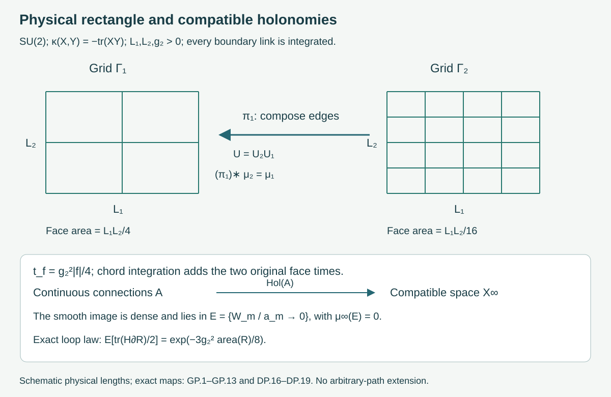
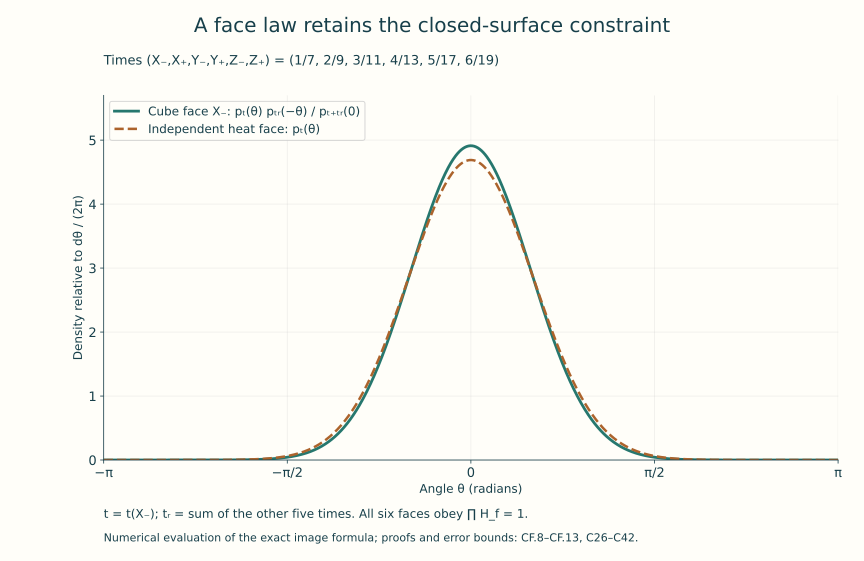
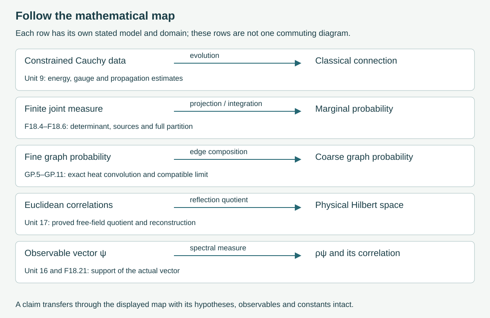

# The established research landscape and open problems

This final lesson brings together the questions developed throughout the
course. A classical solution, a quantum state, a perturbative coefficient,
a finite lattice probability and a continuum field theory each answer a
specific question. The useful next step is to calculate how the objects
are related.

We will follow those relations in complete examples. Integrating Gaussian
variables produces an exact effective action. Two-dimensional heat
measures survive subdivision and give an actual probability on compatible
holonomies. Closing a surface changes its face law through an explicit
constraint. Spectral limits show exactly which information a correlation
function retains. These calculations provide a basis for reading the
broader literature and identifying what remains to be established.

Preparation: [classical evolution](../local-and-global-classical-evolution.html),
[Euclidean geometry](../euclidean-yang-mills-instantons.html),
[renormalization](../renormalization-and-asymptotic-freedom.html),
[lattice errors](../strong-coupling-simulations-errors.html) and
[continuum reconstruction](../continuum-limits-and-reconstruction.html).
The earlier units supply the definitions and proofs used below.

The linked chapters contain the full calculations, including their
domains, constants and source comparisons:

- [SU(2) heat kernel and classical action](../two-dimensional-heat-and-action.html):
  HK.1–HK.14 and AC.1–AC.9.
- [Compatible graphs and an actual continuum probability](../two-dimensional-holonomy-probability.html):
  GP.1–GP.16, DP.1–DP.20 and CN.1–CN.5.
- [Six faces of a cube](../cube-face-holonomy-and-probability.html):
  CF.1–CF.18, including the free-boundary comparison and the separate
  Wilson calculation.
- [Integrating variables and reading formal expansions](../finite-effective-actions.html):
  the full Gaussian integral, source terms, marginal and conditional
  measures, flat-function proof and circle integration-by-parts identity.

## 1. The questions and the objects that answer them

The common geometric starting point is a connection \(A\), its curvature
\(F=dA+A\wedge A\), a compact gauge group \(G\), and an invariant positive
inner product \(\kappa\) on its skew-Hermitian Lie algebra. In four
Euclidean dimensions the course retains the full action

\[
 S_E[A]=\frac{\hbar}{2g_{\rm YM}^{\,2}}
 \int_{\mathbb R^4}\sum_{\mu=1}^4\sum_{\nu=1}^4
 \kappa(F_{\mu\nu}(x),F_{\mu\nu}(x))\,d^4x .
 \tag{F18.1}
\]

The ordered sum includes both \(F_{\mu\nu}\) and \(F_{\nu\mu}\), and its
diagonal terms vanish because \(F_{\mu\mu}=0\).
Here \(x^\mu\) has units of length, \(A_\mu\) inverse length,
\(F_{\mu\nu}\) inverse length squared, \(g_{\rm YM}\) is dimensionless,
and \(\hbar\) has units of action. These are the conventions proved
and compared in Units 7, 10 and 13. A formal expression
\(e^{-S_E[A]/\hbar}\mathcal DA\) alone does not define an infinite
dimensional probability; the actual finite and continuum constructions
below specify their integration spaces.

**Classical analysis** studies solutions of the Lorentzian Cauchy problem
and their dependence on constrained initial data. Unit 9 contains its
complete local and global evolution arguments in the stated regularity
classes, including gauge changes, energy and propagation. A theorem about
this evolution returns a map from initial data to connections. To use it
in a quantum construction one must also construct the probability or
state and the maps receiving these connections. Sections 3–4 below
construct such a map in a lower-dimensional model and calculate its
measure-theoretic image.

**Geometric gauge theory** studies the Euclidean equations, bundle
topology, gauge classes and special solutions. Unit 10 proves the
instanton, its smooth bundle over the sphere, its charge, the full action
bound and the relevant analytical operators. Self-duality is a first-order
equation on curvature. Its role in the second-order field equation follows
from the exact Hodge-star and Bianchi calculation in that unit. Passing
from a collection of such classical connections to a quantum correlation
distribution requires an additional integration construction; the
finite Gaussian example below displays what an actual integration does.

**Perturbation theory and renormalization** calculate regulated
functionals and coefficients in formal coupling expansions. Unit 13
derives the complete gauge and ghost one-loop coefficient with the
original group metric, heat coefficients and subtractions. Its
\(\kappa(T_a,T_b)=\delta_{ab}/2\), \(G=SU(N)\) convention gives

\[
 b_0=\frac{11N}{48\pi^2},\qquad
 g(\mu)=
 \frac{g_0}{\sqrt{1+2b_0g_0^2\log(\mu/\mu_0)}},\qquad
 \Lambda_{\rm tr}=\mu_0\exp\!\left[-\frac1{2b_0g_0^2}\right].
 \tag{F18.2}
\]

This is the exact solution of the stated one-loop differential equation,
with \(g_0\ne0\), \(\mu_0>0\), and domain \(\mu>\Lambda_{\rm tr}\).
The proof, initial condition and sign are RG.26–RG.29. The equation is
not asserted to be the full beta function. Its inverse-length scale
has energy scale \(\hbar c\Lambda_{\rm tr}\); a spectral gap would
require a Hamiltonian and a spectral calculation as well.

**Lattice and statistical methods** begin with finitely many compact-group
link variables, a specified density, and observables. Unit 14 constructs
the Wilson measure, positive transfer operator and Hamiltonian with its
domain. Unit 15 proves sampling and finite-error results. Their
continuum use involves a sequence of spacings, volumes and coupling
parameters, together with receiving observables and controlled errors.
The same finite partition can be approached analytically and numerically;
the quantity being approximated stays identifiable.

**Constructive quantum field theory** seeks actual measures, states and
operator theories and establishes the required limiting and reconstruction
properties. Unit 17 performs those steps for the free scalar field,
including the Gaussian distribution, reflection quotient, field domains,
locality and exact regulator maps. The present two-dimensional non-Abelian
example constructs compatible holonomy probabilities. These examples
teach different parts of the construction problem.

Stephen J. Summers's [constructive-field-theory survey,
arXiv:1203.3991v2](https://arxiv.org/abs/1203.3991v2) supplies a
broader historical reading route, particularly its Euclidean and
Yang–Mills sections. Its descriptions of earlier work retain their
2016 date. The precise finite density comparison in Section 6 below
addresses the sign printed in that source.

**Stochastic quantisation** introduces an auxiliary stochastic evolution
whose intended equilibrium describes a Euclidean measure. Its time
parameter must be distinguished by an explicit parameter map from
physical time. In the finite circle example in the effective-action
chapter, the complete identity is

\[
 \int \overline f\,Lh\,d\mu_\beta
 =-D\int\overline{f'}h'\,d\mu_\beta,\quad
 Lh=D(h''-\beta\sin\theta\,h'),\quad
 d\mu_\beta=\frac{e^{\beta\cos\theta}}{I_0(\beta)}
             \frac{d\theta}{2\pi}.
 \tag{F18.3}
\]

It holds for complex \(C^2\) periodic \(f,h\), \(D>0\), and
\(\beta\ge0\); all endpoint terms cancel by periodicity. Setting
\(f=1\) proves the stationary integration identity. The complete proof
retains the action \(\hbar\beta(1-\cos\theta)\) and its partition.
This identity concerns the displayed differential expression and
probability; a construction of a stochastic process is a further result.

Ilya Chevyrev's [*Stochastic quantisation of Yang-Mills*,
arXiv:2202.13359v2](https://arxiv.org/abs/2202.13359v2) is a
primary-author introduction to the geometric formulation and the
two- and three-dimensional programme. Its introduction treats trivial
bundles on finite tori and writes the noisy gradient equation and its
gauge adjustment. Those dimensions, spaces and auxiliary dynamics
matter. This course uses the introduction as a dated reading guide;
it imports no unproved stochastic partial-differential-equation theorem
from it. Its 2022 open-question list is not presented as a current list.

## 2. What integrating variables actually changes

Suppose dimensionless coordinates \(x\in\mathbb R^p\) and
\(y\in\mathbb R^q\) have the original action

\[
 S(x,y)=\tfrac12x^{\mathsf T}Ax+x^{\mathsf T}By+
        \tfrac12y^{\mathsf T}Cy-J_x^{\mathsf T}x-J_y^{\mathsf T}y+S_0,
 \qquad M=\begin{pmatrix}A&B\\B^{\mathsf T}&C\end{pmatrix}>0.
 \tag{F18.4}
\]

All entries of \(M,J_x,J_y,S_0\) have units of action.
The exact integration map sends this finite measure to its marginal
under the projection \((x,y)\mapsto x\). Define

\[
 K=A-BC^{-1}B^{\mathsf T},\qquad
 j=J_x-BC^{-1}J_y,\qquad
 S_x=\tfrac12x^{\mathsf T}Kx-j^{\mathsf T}x+
 S_0-\tfrac12J_y^{\mathsf T}C^{-1}J_y .
 \tag{F18.5}
\]

Completing the square gives the full formula

\[
 \int_{\mathbb R^q}e^{-S(x,y)/\hbar}\,dy
 =\frac{(2\pi\hbar)^{q/2}}{\sqrt{\det C}}\,
  e^{-S_x/\hbar}.
 \tag{F18.6}
\]

The linked [complete proof](../finite-effective-actions.html) establishes
\(C>0\), \(K>0\), the determinant identity, every Gaussian integral,
the source shift, the full partition and covariance, and consistency
of successive integrations. The prefactor is dimensionless with these
coordinate conventions and has not been discarded. An effective action
relative to \(dx\) is \(S_x-\hbar\log((2\pi\hbar)^{q/2}/\sqrt{\det C})\).

The calculation illustrates an exact coarse-observable map: expectations
of every bounded Borel \(f(x)\) are preserved when the discarded variables
are integrated. It does not say that an interacting effective action
remains quadratic. Quadratic closure here follows from the particular
action (F18.4).

There is an equally exact reason to state the scope of a formal series.
For \(E_*>0\), \(a>0\) and dimensionless real \(g\), let

\[
 f(g)=
 \begin{cases}E_*e^{-a/g^2},&g\ne0,\\0,&g=0.\end{cases}
 \tag{F18.7}
\]

The full derivative proof in the same chapter shows that \(f\) is
\(C^\infty\), every derivative at zero vanishes, and \(f(g)>0\) elsewhere.
Thus \(F\) and \(F+f\), for any smooth \(F\), have the same Taylor
coefficients at zero but different values away from zero. This is a
proved statement about functions. It does not assign either function
to the spectrum of an unspecified quantum theory.

## 3. A non-Abelian continuum construction that can be followed completely

Fix the physical rectangle
\(D=[0,L_1]\times[0,L_2]\), \(L_1,L_2>0\), group \(SU(2)\),
\(\kappa(X,Y)=-\operatorname{tr}_{\mathbb C^2}(XY)\), coupling
\(g_2>0\) of inverse-length dimension, and \(\hbar>0\).
Use the transport convention \(U'=-A(\dot\gamma)U\).
The [heat and action chapter](../two-dimensional-heat-and-action.html)
constructs Haar probability and proves, with no missing spectral
factors,

\[
 p_t(Q)=\sum_{n=0}^{\infty}(n+1)e^{-t n(n+2)/2}\chi_n(Q),\qquad
 \chi_n(e^{i\theta\sigma_3})=\frac{\sin((n+1)\theta)}{\sin\theta}.
 \tag{F18.8}
\]

The quotient has its continuous endpoint values \(n+1\) and
\((-1)^n(n+1)\). The proof gives uniform convergence for positive
times, smoothness, strict positivity, unit Haar mass, convolution
\(p_s*p_t=p_{s+t}\), and the self-adjoint generator and its domain.

For every dyadic subdivision of \(D\), integrate every link, including
boundary links, with Haar probability and assign each face \(f\) the
heat time \(t_f=g_2^2|f|/4\). Its full density is

\[
 d\mu_m(U)=\prod_{f\in\mathcal F_m}p_{g_2^2|f|/4}(P_f(U))
          \prod_{e\in\mathcal E_m}dU_e .
 \tag{F18.9}
\]

The partition is exactly one. This follows from the explicit tree
coordinate map and its Haar-preserving inverse in GP.3–GP.5,
not from an assumed independence of the original links. The
noncommuting face products retain their based-path order.
Integrating subdivision variables gives the coarser law by the
proved heat convolution and bridge density.

GP.8–GP.13 and DP.1–DP.11 construct all samples on an actual interval
probability space, then prove the resulting probability on compatible
dyadic edge configurations and their path groupoid. This includes
countably many refinements and all finite compositions and inverses
of their edges. It makes no unstated extension to arbitrary paths.
For a dyadic rectangular loop enclosing physical area \(a\), the
fundamental Wilson observable has the exact expectation

\[
 \mathbb E\!\left[\tfrac12\operatorname{tr}H_{\partial R}\right]
 =e^{-3g_2^2a/8}.
 \tag{F18.10}
\]

GP.7 proves the complete rectangular-loop marginal; character
orthogonality then yields this expression.

Figure 1. Every face shown belongs to the specified physical rectangle;
the two drawings are successive dyadic grids. The arrows are the
edge-composition projection and the actual holonomy map.
The continuum target is the compatible countable dyadic path space.
Proofs: GP.1–GP.13 and DP.16–DP.19.

Thierry Lévy's [*Yang-Mills measure on compact surfaces*,
arXiv:math/0101239v1](https://arxiv.org/abs/math/0101239v1)
provides the original-author geometric comparison. Its gauge convention
and metric are compared explicitly in the chapters. In particular, the
volume-one metric in that source is not silently identified with the
trace metric in this lesson. The broader all-path and all-surface
statements of that work are not used as unstated dependencies.

## 4. The classical field map and the regularity of the random object

For a fixed \(C^3\) connection on a neighborhood of \(D\), AC.1–AC.5
prove a complete small-face estimate and the convergence of the heat
relative action to the original two-dimensional classical action

\[
 S_2[A]=\frac{\hbar}{2g_2^2}
   \int_D\sum_{\mu,\nu=1}^2\kappa(F_{\mu\nu},F_{\mu\nu})\,d^2x
 =\frac{\hbar}{g_2^2}\int_D\kappa(F_{12},F_{12})\,d^2x .
 \tag{F18.11}
\]

Both ordered curvature terms remain in the first expression.
The full diagonal multiplier \(p_{t_m}(I)^{4^m}\) also remains in
the comparison of the original product density and its relative action.
The proof gives the actual remainder constants in terms of the
connection and its derivatives.

The companion then calculates the behavior of random shrinking loops.
For a nested dyadic face of area \(a_m=L_1L_2/4^m\), put
\(t_m=g_2^2a_m/4\) and \(W_m=2-\operatorname{Re}\operatorname{tr}H_m\).
DP.12–DP.15 prove the small-time density and estimates; in particular

\[
 \frac{W_m}{t_m}\ \Longrightarrow\ Y,\qquad
 \mathbb P(Y\in dy)=
 \frac{y^{1/2}e^{-y/2}}{\sqrt{2\pi}}\,1_{\{y>0\}}\,dy .
 \tag{F18.12}
\]

This is convergence in distribution, not an asserted almost-sure
limit. The same proof supplies quantitative small-ball and tail
estimates and the stronger almost-sure bounds recorded in DP.14–DP.15.

DP.16–DP.19 prove that the connection-to-holonomy map from all continuous
connections is continuous and injective, and that its image and every
vertex-gauge translate lie in the explicit Borel null set

\[
 \mathcal E=\{U:\ W_m(U)/a_m\longrightarrow0\}.
 \tag{F18.13}
\]

The proof uses an exact rectangular transport bound for the classical
image and the proved small-ball estimate for the probability of this
event. Nevertheless every finite edge configuration is realized by a
smooth connection, using explicit disjoint edge tubes. Thus the
smooth image is dense in the compatible configuration space and lies
in a null set. The full constructions, including the tube connection
and the reconstruction of \(A\) from small transports, are given there.
Density is a topological statement; (F18.13) calculates the actual
probability of the set receiving those smooth connections.

There is also an exact four-dimensional classical comparison.
On \(D\times T^2\), with transverse periods \(L_3,L_4>0\), pull back
a two-dimensional connection, require independence of the transverse
coordinates, and set \(A_3=A_4=0\). AC.6 evaluates every curvature
component and every volume factor. It gives (F18.1) restricted to this
class equal to (F18.11) exactly when

\[
 g_2^2=\frac{g_{\rm YM}^2}{L_3L_4}.
 \tag{F18.14}
\]

This is a proved map between classical configurations and actions.
The dyadic probability above has also been constructed, but no
pushforward identity identifies it with a four-dimensional quantum
measure.

## 5. Why the face structure matters

The [cube chapter](../cube-face-holonomy-and-probability.html) fixes
all eight vertices, twelve positive coordinate edges, six outward
oriented faces, and lengths \(L_1,L_2,L_3\). For \(U(1)\) links the
full face map has image

\[
 K_{\rm cube}=\{(H_{X_-},H_{X_+},H_{Y_-},H_{Y_+},H_{Z_-},H_{Z_+})
                 \in U(1)^6:\ \prod_fH_f=1\}.
 \tag{F18.15}
\]

CF.1–CF.6 give the integer incidence matrix, tree inverse, complete
gauge kernel \(U(1)^7\), and exact Haar pushforward onto this
five-dimensional torus. CF.3 also proves the differential curl
identity with all orientation signs and physical area factors.

Give the six faces their individual times \(t_f>0\), use
\(p_t(\theta)=\sum_{n\in\mathbb Z}e^{-tn^2}e^{in\theta}\), and let
\(T=\sum_ft_f\). The resulting face law has full partition

\[
 Z_{\mathbf t}=\sum_{n\in\mathbb Z}\prod_f e^{-t_fn^2}=p_T(0).
 \tag{F18.16}
\]

Each face marginal contains the other five faces:

\[
 d\nu_f(e^{i\theta})=
 \frac{p_{t_f}(\theta)p_{\sum_{g\ne f}t_g}(-\theta)}{p_T(0)}
 \frac{d\theta}{2\pi}.
 \tag{F18.17}
\]

CF.7–CF.13 prove positivity, convergence, every joint Fourier moment,
every proper marginal, strict pair correlations and explicit numerical
tail bounds. The six-face product is exactly one. It would have a
continuous heat density in a model with six independent heat variables.
The actual boundary map, its image and the density account for this
difference.

Figure 2. The graph evaluates the exact densities relative to
\(d\theta/(2\pi)\), with the six times listed in the figure.
The curve is a numerical evaluation of (F18.17) using the proven
Gaussian image formula; its construction does not replace the
exact series. CF.10 gives a rigorous Fourier truncation bound.

The closed cube boundary is already a two-dimensional surface.
Consequently the displayed constraint is not an exclusively
higher-dimensional effect. In a three-dimensional lattice it occurs
on the boundary of each cell. CF.15–CF.16 construct the actual
free-boundary planar graph and prove its different boundary-holonomy
map. CF.17 carries the same cube geometry through the original
Wilson factors, retaining every additive-action constant.

## 6. Reading source formulas and claims in their actual conventions

A comparison starts with the original formulas. Here is a concrete
finite-density calculation prompted by the Wilson expression printed
in Summers's Yang–Mills subsection.
For a finite lattice with \(N_f\) faces, a \(d\)-dimensional unitary
representation \(\chi\), product Haar probability \(m\), and
\(K(U)=\sum_f\operatorname{Re}\chi(P_f(U))\), write

\[
 Z_-(\beta)=\int e^{-\beta K}\,dm,\quad
 Z_+(\lambda)=\int e^{\lambda K}\,dm,\quad
 d\mu_-=\frac{e^{-\beta K}}{Z_-(\beta)}dm,\quad
 d\mu_+=\frac{e^{\lambda K}}{Z_+(\lambda)}dm .
 \tag{F18.18}
\]

For positive source coupling \(g_s\), its printed
\(A_W=g_s^{-2}K\), \(e^{-A_W}\) gives \(\beta=g_s^{-2}\).
The course's isotropic four-dimensional action is
\(S_W/\hbar=\lambda(dN_f-K)\), with \(\lambda=2/g_{\rm YM}^2\).
Its full partition is

\[
 Z_W=e^{-\lambda dN_f}Z_+(\lambda),\qquad
 \frac{d\mu_-}{d\mu_+}(U)=
 \frac{Z_+(\lambda)}{Z_-(\beta)}e^{-(\beta+\lambda)K(U)} .
 \tag{F18.19}
\]

These are exact formulas relating the two printed measures. To prove
them, unitary eigenvalues imply \(|\chi(P_f)|\le d\), hence
\(|K|\le dN_f\). Each displayed exponential is strictly positive,
bounded and integrable, and both partitions are positive.
Dividing the densities proves (F18.19); integrating any bounded
Borel observable with that multiplier proves the full expectation
map. Pulling the constant \(e^{-\lambda dN_f}\) through the integral
proves the partition formula. No sign convention is silently changed.
Unit 14's positivity proof applies to its stated Wilson factors.

For each paper, now identify the original space and field variables;
the group and representation; dimension, signature, metric, boundary
conditions and coupling; the observable and its domain; the actual
limit, with the parameters held fixed; and the proved conclusion.
Then construct the receiving map needed for the question you are asking.
Examples in this course include a pullback of connections, a holonomy
map, a Haar change of variables, a probability pushforward, an isometry
of state spaces and a spectral measure.

The course gives each approach room according to its role in learning
the subject. Its purpose is a route through foundations and major
methods, not an exhaustive bibliography. No optional research programme
has been made its organizing principle.

## 7. The four-dimensional target

The Clay Mathematics Institute's [official Yang–Mills problem
page](https://www.claymath.org/millennium/yang-mills-the-maths-gap/)
lists the problem as unsolved when checked on 10 October 2026.
The existence and positive-gap target concerns a nontrivial quantum
Yang–Mills theory on four-dimensional spacetime for a compact simple
gauge group, satisfying the required field-theoretic axioms.
The following operator statement records the gap notion used throughout
this course; it does not replace the complete problem specification.

For a constructed physical Hilbert space \(\mathcal H\), a specified
self-adjoint Hamiltonian \(H\ge0\), and vacuum projection \(P_0\),
the unique-vacuum positive-gap statement means

\[
 P_0=|\Omega\rangle\langle\Omega|,\quad H\Omega=0,\quad
 \sigma(H)\subset\{0\}\cup[\Delta_E,\infty),\qquad \Delta_E>0.
 \tag{F18.20}
\]

The corresponding mass threshold is \(\Delta_E/c^2\).
For \(\psi=(I-P_0)O\Omega\) in the domain supplied by the chosen
observable, Unit 16 proves

\[
 C_O(\tau)=\langle\psi,e^{-\tau H/\hbar}\psi\rangle
 =\int_{(0,\infty)}e^{-\tau E/\hbar}\,d\rho_\psi(E),
 \qquad \tau\ge0 .
 \tag{F18.21}
\]

A positive gap implies
\(C_O(\tau)\le\|\psi\|^2 e^{-\tau\Delta_E/\hbar}\).
Conversely, the threshold seen by a single observable is the infimum
of the support of its own \(\rho_\psi\); it does not describe states
to which that vector has no spectral weight. The exact state and
spectral maps in Units 16–17 and Example 3 below prove that point.

A proposed continuum theory therefore has to supply its state space,
observables, symmetry representation, locality, spectrum and connection
to the stated Yang–Mills dynamics. A Euclidean route additionally
supplies the correlation distributions and properties used in
reconstruction. A proof about a finite regulator, a restricted classical
ansatz, or one accessible observable has its established scope; an
extension to the target needs the corresponding mathematical
construction. The examples above exhibit several of those construction
steps in complete models.

Figure 3. The arrows name actual maps whose proofs appear in the
indicated units. Each arrow applies to its specified model and domain.
The diagram is a map of constructions taught here; it does not assert
that their different models form one commuting diagram.

## 8. Three worked examples

### Example 1. Subdivision with a physical loop energy

Let \(R,T>0\) be a spatial length and a physical Euclidean time,
and use \(x^2=c\tau\), so the rectangle has area \(RcT\).
Split it into two adjacent rectangles of areas \(a_1,a_2>0\)
with \(a_1+a_2=RcT\). The based holonomy law is the convolution
of heat laws of times \(g_2^2a_1/4\) and \(g_2^2a_2/4\).
Its time is their sum, and

\[
 \mathbb E[\chi_n(H_{\partial R})]
 =(n+1)\exp\!\left[-\frac{g_2^2RcT\,n(n+2)}8\right].
 \tag{F18.22}
\]

The full eigenvalue \(\lambda_n=n(n+2)/2\) and coefficient \(n+1\)
come from the character expansion (F18.8), not a fitted exponent.
On the class-function Hilbert space the actual self-adjoint operator
proved in AC.7 is \(H_R=(\hbar c g_2^2R/4)L\), with
domain \(D(L)\); its character energy is
\(E_n(R)=\hbar c g_2^2R\,n(n+2)/8\).
Then (F18.22) is exactly \((n+1)e^{-TE_n(R)/\hbar}\).
For \(n=1\) the fundamental trace divided by two gives (F18.10).
The parameters, Hilbert space and operator have all been specified.

### Example 2. Metric and heat-time conversion

For the trace metric on \(SU(2)\), HK.2 proves radius \(\sqrt2\)
and Riemannian volume \(V_\kappa=4\sqrt2\pi^2\).
Multiplication of the metric by \(r>0\) multiplies volume in
dimension three by \(r^{3/2}\) and the Laplacian by \(r^{-1}\).
The source's volume-one metric therefore has

\[
 \kappa_L=V_\kappa^{-2/3}\kappa,\qquad
 \Delta_L=V_\kappa^{2/3}\Delta_\kappa,\qquad
 p_s^L=p_{V_\kappa^{2/3}s/2},\qquad
 s_L=\frac{g_2^2a}{2V_\kappa^{2/3}} .
 \tag{F18.23}
\]

The volume factor follows from the determinant of \(r\) times
the three-dimensional metric; the inverse metric gives the
Laplacian factor. The source generator is \(\Delta_L/2\), so its
eigenvalue exponent equals the course exponent at the displayed
time. Haar probability stays the same probability on the group.
The complete eigenfunction comparison is HK.11 and DP.20.
For the same trace metric with only the generator changed to
\(\Delta_\kappa/2\), the separate relation would be \(s=2t\).

### Example 3. Closing gaps and vanishing spectral weight

Take \(\mathcal H=\mathbb C^3\), orthonormal basis \(e_0,e_1,e_2\),
\(E_*>0\), \(0<\varepsilon<1\), vacuum \(\Omega=e_0\), and

\[
 H_\varepsilon=\operatorname{diag}(0,\varepsilon E_*,E_*),\quad
 \psi_\varepsilon=\sqrt\varepsilon\,e_1+
                  \sqrt{1-\varepsilon}\,e_2,\quad
 O_\varepsilon=|\psi_\varepsilon\rangle\langle e_0|
             +|e_0\rangle\langle\psi_\varepsilon|.
 \tag{F18.24}
\]

These are everywhere-defined self-adjoint matrices, with
\(\|\psi_\varepsilon\|=1\), \(O_\varepsilon\Omega=\psi_\varepsilon\)
and zero vacuum expectation. Direct matrix exponentiation gives

\[
 \rho_\varepsilon=
 \varepsilon\delta_{\varepsilon E_*}+
 (1-\varepsilon)\delta_{E_*},\qquad
 C_\varepsilon(\tau)=
 \varepsilon e^{-\varepsilon E_*\tau/\hbar}
 +(1-\varepsilon)e^{-E_*\tau/\hbar}.
 \tag{F18.25}
\]

The Hamiltonian gap is \(\varepsilon E_*\). For fixed \(\tau\),
\(C_\varepsilon(\tau)\to e^{-E_*\tau/\hbar}\), and its
probability spectral measure converges weakly to \(\delta_{E_*}\):
for every bounded continuous \(h\), the term
\(\varepsilon h(\varepsilon E_*)\) tends to zero and the other
term tends to \(h(E_*)\). Simultaneously
\(H_\varepsilon\to\operatorname{diag}(0,0,E_*)\) in operator
norm, with error \(\varepsilon E_*\), while
\(\psi_\varepsilon\to e_2\).
The limiting Hamiltonian has a two-dimensional zero eigenspace,
and this limiting observable sees only energy \(E_*\).
All spaces and maps are explicit. This example makes no claim
about an interacting field theory.

## 9. Exercises

1. In (F18.4) take \(p=q=1\), \(A=3\alpha\), \(B=\alpha\),
   \(C=2\alpha\), \(\alpha>0\), and arbitrary real sources
   \(J_x,J_y\). Compute the effective action, original partition,
   marginal mean and variance, and conditional mean and variance.
2. Verify stationarity in (F18.3) and compute
   \(-\int\cos\theta\,L(\cos\theta)\,d\mu_\beta\).
   Retain the original partition factor.
3. Prove the exact character subdivision formula in Example 1
   for any finite number of positive-area pieces, and determine
   the fundamental energy and its dimensions.
4. Use (F18.19) to transport a bounded observable between the
   two source densities. On one \(SU(2)\) plaquette, prove that
   the mean trace has opposite strict signs for \(\mu_-\) and
   \(\mu_+\) when \(\beta,\lambda>0\).
5. Derive the cube's full-face-product moment and the mean
   cosine of one face, with all individual times retained.
   Compare with six independent heat variables.
6. Carry the trace-metric calculation in Example 2 through a
   general positive metric multiplier \(r\). Also compute the
   circle half-Laplacian conversion for circumference \(\ell>0\).
7. In Example 3 compute the instantaneous effective energy
   \(-\hbar\partial_\tau\log C_\varepsilon(\tau)\), its two
   iterated limits, and the time when the two correlation terms
   are equal.
8. Prove that no Borel probability on the space of continuous
   connections can be sent by the specified holonomy map to
   the constructed dyadic probability. Account for the density
   of the smooth image and the exact classical pullback (F18.14).

## 10. Full solutions

### Solution 1

The determinant is \(5\alpha^2>0\), and completing the square
gives \(K=5\alpha/2\), \(j=J_x-J_y/2\). Thus the full partial
integral is

\[
 \sqrt{\frac{\pi\hbar}{\alpha}}\,
 \exp\!\left[-\frac1\hbar
 \left(\frac{5\alpha x^2}{4}
 -(J_x-J_y/2)x+S_0-\frac{J_y^2}{4\alpha}\right)\right].
 \tag{F18.26}
\]

The effective action relative to \(dx\) includes the additional
constant \(-(\hbar/2)\log(\pi\hbar/\alpha)\).
Since

\[
 M^{-1}=\frac1{5\alpha}
 \begin{pmatrix}2&-1\\-1&3\end{pmatrix},
\]

the full original partition is

\[
 Z=\frac{2\pi\hbar}{\sqrt5\,\alpha}
 \exp\!\left[-\frac{S_0}{\hbar}
 +\frac{2J_x^2-2J_xJ_y+3J_y^2}{10\alpha\hbar}\right].
 \tag{F18.27}
\]

Multiplying the displayed inverse by \(M\) gives the identity
matrix, and substitution in the proved Gaussian integral gives
the expression. The marginal mean is
\((2J_x-J_y)/(5\alpha)\) and variance \(2\hbar/(5\alpha)\).
For fixed \(x\), the completed \(y\)-square has mean
\(J_y/(2\alpha)-x/2\) and variance \(\hbar/(2\alpha)\).
The dimensions agree: means are dimensionless, as are variances.

### Solution 2

The original density is
\(e^{-\beta(1-\cos\theta)}d\theta/(2\pi)\) with partition
\(e^{-\beta}I_0(\beta)\).
Its probability density is \(q=e^{\beta\cos\theta}/I_0(\beta)\).
Since \(q'=-\beta\sin\theta\,q\),
\((qh')'=q(h''-\beta\sin\theta h')\).
Integrating this derivative over a period gives zero; integrating
against \(\overline f\) gives (F18.3) because \(q,f,h'\) are
periodic. Put \(f=h=\cos\theta\). The result is

\[
 -\int\cos\theta\,L(\cos\theta)\,d\mu_\beta
 =D\int\sin^2\theta\,d\mu_\beta
 =\frac D2\left(1-\frac{I_2(\beta)}{I_0(\beta)}\right).
 \tag{F18.28}
\]

Here \(I_n(\beta)=\int e^{\beta\cos\theta}\cos(n\theta)
d\theta/(2\pi)\), as proved by the convergent exponential
series in CF.17. The identity \(2\sin^2\theta=1-\cos2\theta\)
gives the last equality. The integral is strictly positive
because \(D>0\), \(q>0\), and \(\sin^2\theta>0\) on a set of
positive measure.

### Solution 3

For two pieces the full ordered transport law is GP.6's chord
integration. It gives convolution with time \(t_1+t_2\) by
the heat identity. Assume the result for \(r\) pieces and
integrate the next common chord with its strictly positive
bridge density; the same identity changes the time from
\(\sum_{j=1}^rt_j\) to \(\sum_{j=1}^{r+1}t_j\).
Induction proves the finite formula for the pieces in such a
successive rectangular subdivision. For an arbitrary finite
dyadic grid, GP.7 supplies the integration order and the same
conclusion. The character integral of \(p_t\) is
\((n+1)e^{-tn(n+2)/2}\) by its proved orthogonality.
Substitute \(\sum_jt_j=g_2^2RcT/4\) to obtain (F18.22).
The fundamental energy is \(E_1(R)=3\hbar c g_2^2R/8\).
The product \(g_2^2R\) has inverse-length dimension and
\(\hbar c\) has energy times length, so \(E_1(R)\) has energy
dimension and \(TE_1(R)/\hbar\) is dimensionless.

### Solution 4

For every bounded Borel \(F\), direct substitution gives

\[
 \mathbb E_{\mu_-}F=
 \frac{Z_+(\lambda)}{Z_-(\beta)}
 \mathbb E_{\mu_+}\!\left[F e^{-(\beta+\lambda)K}\right].
 \tag{F18.29}
\]

All integrands are bounded by the finite estimate in Section 6.
On one \(SU(2)\) plaquette put \(x=\operatorname{tr}Q\in[-2,2]\).
Haar is preserved by \(Q\mapsto-Q\), which sends \(x\mapsto-x\).
Therefore
\(\int x e^{\lambda x}\,dQ=\int x\sinh(\lambda x)\,dQ>0\):
the integrand is positive whenever \(x\ne0\), and a neighborhood
of \(Q=I\) has positive Haar measure by the explicit Haar density.
Likewise \(\int x e^{-\beta x}\,dQ
=-\int x\sinh(\beta x)\,dQ<0\).
Dividing by the positive respective partitions preserves both
strict signs. This verifies the effect of the printed density
sign while keeping the original observable.

### Solution 5

CF.10 gives the complete moment

\[
 M_{\mathbf t}(k)=
 \frac{\sum_{n\in\mathbb Z}
              \exp[-\sum_f t_f(n-k_f)^2]}
      {\sum_{n\in\mathbb Z}\exp[-\sum_ft_fn^2]} .
 \tag{F18.30}
\]

For \(k_f=m\) on all faces, shifting the integer \(n\) by \(m\)
shows the ratio is one. This is also the \(m\)-th power of the
exact constraint (F18.15). For \(k_f=1\) on one face and zero
elsewhere, expanding its square and pairing \(n,-n\) gives

\[
 \mathbb E_\nu\cos\phi_f=
 e^{-t_f}\frac{1+2\sum_{n\ge1}
 e^{-(\sum_gt_g)n^2}\cosh(2nt_f)}
 {1+2\sum_{n\ge1}e^{-(\sum_gt_g)n^2}} .
 \tag{F18.31}
\]

Every \(t_g\) remains in the sum. Because \(t_f>0\), each
positive-index hyperbolic cosine exceeds one, proving the
strict inequality \(\mathbb E_\nu\cos\phi_f>e^{-t_f}\).
The strictly positive marginal density and positivity of
\(1-\cos\theta\) on a set of positive Haar measure prove that
the mean is less than one. The independent heat law instead
has single mean \(e^{-t_f}\) and full-product \(m\)-th moment
\(e^{-m^2\sum_ft_f}\). For \(m\ne0\) this is strictly less
than one.

### Solution 6

In three local coordinates, \(\det(rg)=r^3\det g\), so the
volume form is multiplied by \(r^{3/2}\).
The coordinate formula
\(\Delta_g f=(\det g)^{-1/2}
\partial_i((\det g)^{1/2}g^{ij}\partial_j f)\)
then gives \(\Delta_{rg}=r^{-1}\Delta_g\), since \(r\) is
constant. The half-Laplacian exponent is
\(-s r^{-1}\lambda_n/2\), giving \(t=s/(2r)\).
Set \(r=V_\kappa^{-2/3}\) to recover (F18.23).
On a circle of circumference \(\ell\), the metric in the
angle \(\theta\) is \((\ell/(2\pi))^2d\theta^2\).
Its Laplacian is \((2\pi/\ell)^2\partial_\theta^2\), so

\[
 t=\frac{s}{2}\left(\frac{2\pi}{\ell}\right)^2,\qquad
 s=\frac{t\ell^2}{2\pi^2}.
 \tag{F18.32}
\]

Its Riemannian measure is \((\ell/(2\pi))d\theta\), while
Haar probability is \(d\theta/(2\pi)\). Thus \(\ell=2\pi\)
gives \(s=2t\); volume-one circumference \(\ell=1\) gives
\(s=t/(2\pi^2)\). All metric and measure factors remain explicit.

### Solution 7

Differentiating the finite sum, which is positive, yields

\[
 E_{\rm eff}(\tau)=E_*
 \frac{\varepsilon^2e^{-\varepsilon E_*\tau/\hbar}
 +(1-\varepsilon)e^{-E_*\tau/\hbar}}
 {\varepsilon e^{-\varepsilon E_*\tau/\hbar}
 +(1-\varepsilon)e^{-E_*\tau/\hbar}} .
 \tag{F18.33}
\]

At fixed \(0<\varepsilon<1\), divide numerator and denominator
by \(e^{-\varepsilon E_*\tau/\hbar}\).
The other exponential tends to zero as \(\tau\to\infty\),
so the limit is \(\varepsilon E_*\).
At fixed finite \(\tau\), taking \(\varepsilon\to0\) instead
gives \(E_*\). Consequently the successive limits are zero
and \(E_*\), respectively.
Equating the two terms of \(C_\varepsilon\) gives

\[
 \tau_{\rm cross}=
 \frac{\hbar}{(1-\varepsilon)E_*}
 \log\frac{1-\varepsilon}{\varepsilon}.
 \tag{F18.34}
\]

For \(0<\varepsilon<1/2\) this time is positive. At
\(\varepsilon=1/2\) it is zero. For \(\varepsilon>1/2\)
the low-energy term already dominates at zero and for every
later time, since their ratio increases with \(\tau\);
the algebraic crossing lies at negative time.

### Solution 8

Let \(\mathcal A=C(D,\mathfrak{su}(2))^2\) with its uniform
topology and \({\rm Hol}:\mathcal A\to X_\infty\) the exact
map in DP.16. It is continuous, hence Borel measurable.
DP.18 proves
\({\rm Hol}^{-1}(\mathcal E)=\mathcal A\), while DP.15 proves
\(\mu_\infty(\mathcal E)=0\).
For any Borel probability \(\eta\) on \(\mathcal A\), its
pushforward therefore satisfies

\[
 ({\rm Hol}_*\eta)(\mathcal E)
 =\eta({\rm Hol}^{-1}(\mathcal E))=\eta(\mathcal A)=1 .
 \tag{F18.35}
\]

It cannot equal \(\mu_\infty\). DP.19 constructs smooth
connections realizing every finite edge assignment, which
proves density of the image in the finite-coordinate topology.
That topology does not change the computed masses of the
Borel set \(\mathcal E\). Finally, the pullback to \(D\times T^2\)
sets all transverse curvature components to zero and integrates
the remaining terms over transverse volume \(L_3L_4\).
It proves (F18.14) and equality of the restricted classical
actions. It supplies no probability \(\eta\) contradicting
the calculation above.

## Sources and next reading

The earlier units contain their complete source comparisons and
proof providers. This lesson adds bounded original-author TeX reading
of Lévy's graph and heat construction, Summers's Euclidean and
Yang–Mills survey, and Chevyrev's geometric and stochastic
introduction. Their exact versions, archive hashes, reading ranges,
receiving use and corrections are recorded in the
lesson provenance. All companion
arguments and the eight solutions are included in the offline edition.

A useful next reading project is to select one precise question:
regularity of a classical evolution, topology of a Euclidean solution,
a perturbative coefficient, a finite lattice observable, construction
of a continuum measure, or a spectral property of a constructed state.
Follow its definitions and maps through the original work. The course
has supplied complete examples of each type of mathematical operation
needed to begin that reading, without assigning an unproved outcome
to the four-dimensional problem.
