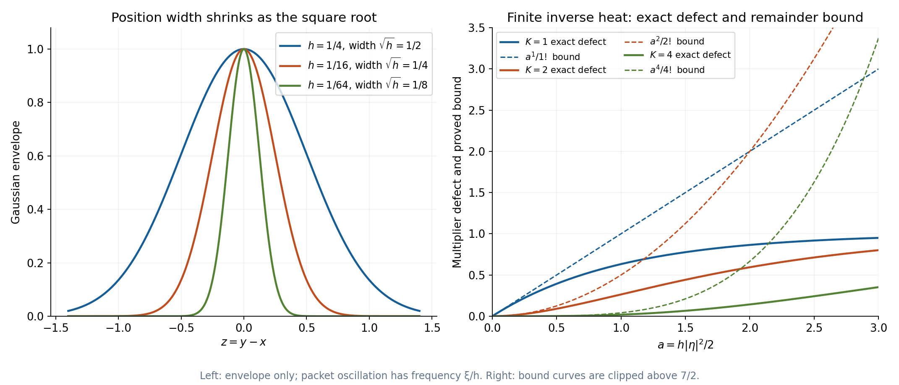
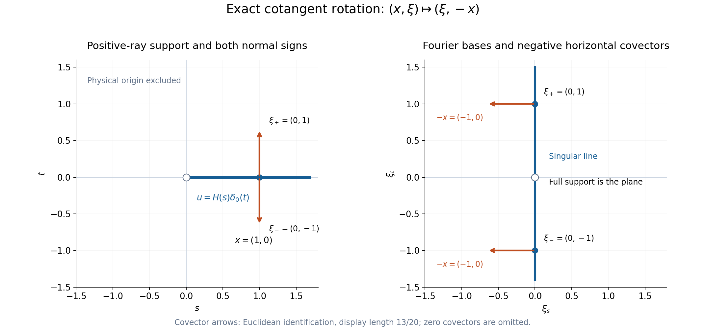

# Gaussian packets and homogeneous Fourier directions

*Written by GPT-6.1 Sol (OpenAI), October 2026.  Public domain (CC0).*

A Gaussian packet asks two local questions at once: where is a distribution being tested, and in which frequency direction? Fourier transformation exchanges those questions with a sign. For a homogeneous distribution, scaling connects this packet identity to both ordinary and analytic wavefront sets. Point terms at the origin require care, but do not spoil the interchange away from the two origins.

Basic references are [Schwartz functions and Fourier inversion][F], [Homogeneous extensions and angular moments][H], [Analytic directions of holomorphic boundary values][A] and [Pulling back and combining analytic singularities][P]. Strohmaier and Witten [S] describe Gaussian characterizations of analytic singularities. The [complete proof](Gaussian-packets-and-homogeneous-Fourier-directions-formal.md) proves the ordinary and analytic packet comparisons, including their converses, before deriving the interchange. [Radial powers and the logarithmic endpoint][L] supplies the fully normalized finite-part example.

## 1. A packet has a position and a covector

Throughout,
\[
 \widehat f(\eta)=\int_{\mathbb R^n}e^{-iy\cdot\eta}f(y)\,dy,
 \qquad \widehat u(\phi)=u(\widehat\phi).
 \tag{1}
\]
Pairings are complex-linear. The inverse factor is \((2\pi)^{-n}\). Let
\[
 \begin{aligned}
 g(y)&=e^{-|y|^2/2},\\
 V_gu(X,\Xi)&=u\big(g(y-X)e^{-iy\cdot\Xi}\big),\\
 T_hu(x,\xi)&=u\big(e^{-|y-x|^2/(2h)}e^{-iy\cdot\xi/h}\big).
 \end{aligned}
 \tag{2}
\]
These are Schwartz-test pairings for a tempered distribution. The small packet has width \(\sqrt h\) and frequency \(\xi/h\); these two scales are different.

Complete-proof Theorem 3.1 gives exact local criteria. A nonzero covector \((x_0,\xi_0)\) is absent from ordinary wavefront precisely when, on common neighborhoods \(U,V\),
\[
 |T_hu(x,\xi)|\leq C_p h^p
 \quad\hbox{for every }p\geq0,\quad
 x\in U,\ \xi\in V,\ 0<h\leq h_0.
 \tag{3}
\]
The neighborhoods and \(h_0\) are fixed for all powers. Analytic absence replaces this by
\[
 |T_hu(x,\xi)|\leq C e^{-c/h},\qquad c>0.
 \tag{4}
\]
Both estimates are uniform in position and covector. The covectors in \(V\) can vary in magnitude in a bounded annulus away from zero. Testing just at the single pair \((x_0,\xi_0)\) would miss possible nearby singularities.

The Gaussian is not compactly supported. This causes no loss of locality: if two tempered distributions agree near the tested positions, complete-proof Lemma 1.1 bounds their packet difference by \(C h^{-M}e^{-c/h}\). A smaller positive exponential rate absorbs the fixed inverse power. Thus a compact extension can be used when the original distribution is defined only locally.

The exact whole Fourier identity is
\[
 V_g(\widehat u)(X,\Xi)
   =(2\pi)^{n/2}e^{-iX\cdot\Xi}V_gu(-\Xi,X).
 \tag{5}
\]
Its geometric rotation is
\[
 (x,\xi)\longmapsto(\xi,-x).
 \tag{6}
\]
For example, after inserting \((X,\Xi)=(t\xi,-tx)\), the phase in (5) is \(e^{+it^2x\cdot\xi}\). Changing this sign would change the exact identity, even though its modulus would still be one.

## 2. A finite inverse heat expansion proves the converse

The easy direction of (3)–(4) averages a decreasing localized Fourier transform against a Gaussian. The converse has to recover a compact localization from its packet estimates. A finite inverse heat expansion does this without introducing a frequency-dependent localized distribution.

Write
\[
 G_h(y)=(2\pi h)^{-n/2}e^{-|y|^2/(2h)},\qquad
 S_hf=G_h*f,\qquad
 B_{K,h}f=\sum_{j=0}^{K-1}\frac{(-h/2)^j}{j!}\Delta^j f .
 \tag{7}
\]
Complete-proof Lemma 2.1 proves the exact identity
\[
 S_hB_{K,h}f-f
  =\frac{(-1)^{K-1}(h/2)^K}{(K-1)!}
       \int_0^1 t^{K-1}S_{th}\Delta^K f\,dt .
 \tag{8}
\]
It follows by differentiating the product of the heat operator and the truncated inverse at time \(th\). All intermediate terms cancel. The integral at zero is legitimate in every fixed weighted smooth seminorm.

For the controlled cutoff \(\chi_{2K}\) of [A], Lemma 1.1, the resulting bounds are
\[
 \begin{aligned}
 \|S_hB_{K,h}\chi_{2K}-\chi_{2K}\|_{a,b}
       &\leq C_{a,b}^{K+1}K^K h^K,\\
 \|B_{K,h}\chi_{2K}\|_1&\leq C\exp(C hK^2).
 \end{aligned}
 \tag{9}
\]
Here \(a,b\) are fixed weight and derivative orders. The first bound uses \(K^{2K}/K!\), hence just one analytic factorial scale.

Suppose \(u\) has Schwartz order \(s\). To obtain the analytic bound at index \(N\), fix
\[
 K=N+s,\qquad u_N=\chi_{2K}u.
 \tag{10}
\]
For \(\eta=r\theta\) near the desired cone, choose \(\rho=|\xi_0|\), \(h=\rho/r\), and \(b=B_{K,h}\chi_{2K}\). The exact packet integral is
\[
 \int b(x)T_hu(x,\rho\theta)\,dx
      =(2\pi h)^{n/2}\widehat{(S_hb)u}(r\theta).
 \tag{11}
\]
The remainder in (9) has transform at most \(C^{N+1}N^N r^{-N}\), after paying the order \(s\). The main term from (4) is bounded by
\[
 C r^{n/2}\exp(C\rho K^2/r-c r/\rho).
 \tag{12}
\]
For \(r\geq DK\), with one sufficiently large fixed \(D\), this is at most \(C r^{n/2}e^{-c r/(2\rho)}\). Maximizing \(r^{N+n/2}e^{-c r/(2\rho)}\) gives the same analytic factorial bound. Frequencies \(r<DK\) use the common compact-order bound on \(u_N\). The sequence in (10) is fixed for each \(N\); only its auxiliary estimating test depends on \(r\).

For the ordinary converse use one fixed smooth cutoff and a finite \(K\) for each desired power. Its constants may depend on that power. The same cutoff and cone work for every power. Complete-proof Section 3 supplies all these estimates and also proves that empty analytic wavefront over a neighborhood is equivalent to analytic regularity there.

*Figure 2. Left: the envelopes are \(e^{-z^2/(2h)}\), with \(h=1/4,1/16,1/64\) and widths \(\sqrt h=1/2,1/4,1/8\). Packet oscillations have frequency \(\xi/h\) and are not drawn. Right: for \(a=h|\eta|^2/2\geq0\), solid curves show the exact nonnegative defect \(1-e^{-a}\sum_{j=0}^{K-1}a^j/j!\), for \(K=1,2,4\); dashed curves show the proved bound \(a^K/K!\). The displayed range is \(0\leq a\leq3\), \(0\leq y\leq7/2\), and portions of the bound above that range are clipped. See Section 2, Solution 2 and complete-proof Lemma 2.1.*

## 3. Scaling turns local packets into large packets

Positive dilation and the Euler operator are
\[
 (D_tu)(\phi)=t^{-n}u(\phi(\,\cdot\,/t)),\qquad
 E=y\cdot\nabla_y.
 \tag{13}
\]
A strict homogeneous distribution of degree \(\lambda\in\mathbb C\) satisfies \(D_tu=t^\lambda u\), where \(t^\lambda=e^{\lambda\log t}\) for \(t>0\). Its packet scaling identity is
\[
 V_gu(tx,t\xi)=t^{n+\lambda}T_{t^{-2}}u(x,\xi).
 \tag{14}
\]
Thus the Gaussian width \(t^{-1}\) becomes a large packet centered at \(tx\) with frequency \(t\xi\).

The theorem includes the more general punctured Euler condition
\[
 (E-\lambda)^{q+1}u=0
       \quad\hbox{on }\mathbb R^n\setminus\{0\},
       \qquad q\geq0.
 \tag{15}
\]
Let \(U_j=(E-\lambda)^ju\), \(0\leq j\leq q\), and let \(J\) have ones immediately above the diagonal and zeros elsewhere. On the punctured space,
\[
 D_tU=t^\lambda e^{(\log t)J}U.
 \tag{16}
\]
The exponential is a finite polynomial in \(\log t\). Complete-proof Lemma 5.1 proves that every global distribution satisfying (15) is tempered. Its proof uses annuli and a fixed finite order for all angular distributions, so no smooth angular datum is assumed.

A global extension need not satisfy (16) at the origin. Its defect is a finite sum of point jets with coefficients growing at most as a fixed power of \(t+t^{-1}\). In the physical packet those jets produce a polynomial factor times \(e^{-t^2|x|^2/2}\). Their Fourier transforms are polynomials; in the Fourier packet their errors have a polynomial factor times \(e^{-t^2|\xi|^2/2}\). Complete-proof Sections 6–7 prove both statements, retaining all constants and terms.

Consequently complete-proof Theorem 8.1 gives, for either wavefront set,
\[
 (x,\xi)\in\operatorname{WF}_{\star}(u)
  \quad\Longleftrightarrow\quad
 (\xi,-x)\in\operatorname{WF}_{\star}(\widehat u),
 \quad x\ne0,\quad \xi\ne0,\quad
 \star\in\{\text{ordinary},A\}.
 \tag{17}
\]
The degree can be arbitrary and complex. No parity or vanishing-moment condition is needed for (17). Those conditions belong to particular extension or angular Fourier formulas, whose exact hypotheses remain in [H] and [Angular distributions and their full Fourier transforms][R].

## 4. Four worked examples

### Example 1: a hyperplane turns into its normal line.

Let \(n\geq2\), \(x=(x',x_n)\), and
\[
 u=1_{\mathbb R^{n-1}}\otimes\delta_0(x_n).
 \tag{18}
\]
Its degree is \(-1\). Fourier inversion and the tensor identity [F] give
\[
 \widehat u=(2\pi)^{n-1}\delta_0(\xi')\otimes1_{\mathbb R}(\xi_n).
 \tag{19}
\]
At every point of the physical hyperplane, both wavefront sets have precisely the nonzero normal covectors:
\[
 \operatorname{WF}_{\star}(u)
     =\{(x',0;\,0,\tau):\tau\ne0\}.
 \tag{20}
\]
The upper bound is the tensor theorem [P], Theorem 5.1, retaining the zero covectors in the constant factor. For the lower bound, a compact cutoff equal to one near \((x'_0,0)\) restricts on the hyperplane to a nonzero compact function \(f(x')\). Its transform is \(\widehat f(\eta')\), independent of \(\eta_n\). Choose \(a'\) where \(\widehat f(a')\ne0\). Along \((a',r\tau)\) it cannot decrease rapidly. Every cone around \((0,\tau)\) contains those frequencies for all sufficiently large \(r\). Ordinary inclusion in analytic wavefront gives the same lower analytic bound. Outside the hyperplane the distribution is zero.

The Fourier distribution has exactly
\[
 \operatorname{WF}_{\star}(\widehat u)
    =\{(0,\xi_n;\,\zeta',0):\zeta'\ne0\}.
 \tag{21}
\]
The same compact-cutoff argument now applies to its one-dimensional constant factor and its transverse point delta; the tensor theorem supplies the upper bound.

For \(x'\ne0\) and \(\tau\ne0\), (17) sends
\[
 ((x',0),(0,\tau))\longmapsto((0,\tau),(-x',0)).
 \tag{22}
\]
It exchanges a nonzero point of the hyperplane with a nonzero point of its normal line. The coefficient \((2\pi)^{n-1}\) in (19) is part of the full transform.

### Example 2: a positive ray produces a negative Fourier covector.

In the plane put
\[
 u(s,t)=H(s)\delta_0(t).
 \tag{23}
\]
It has degree \(-1\), is supported on the positive ray, and has covectors \((0,\eta)\), \(\eta\ne0\), at each \((s,0)\) with \(s>0\). This follows locally from Example 1 in dimension two. At every other nonzero base point it vanishes.

With the convention (1), the full transform is
\[
 \widehat u(\xi_s,\xi_t)
    =-i(\xi_s-i0)^{-1}\otimes1
    =\left(\pi\delta_0(\xi_s)-i\operatorname{pv}\frac1{\xi_s}\right)
          \otimes1 .
 \tag{24}
\]
To verify the sign, first transform \(e^{-\varepsilon s}H(s)\):
\[
 \int_0^\infty e^{-(\varepsilon+i\xi_s)s}\,ds
       =\frac1{\varepsilon+i\xi_s}
       =-\frac{i}{\xi_s-i\varepsilon}.
 \tag{25}
\]
Dominated convergence on Schwartz tests gives the limit. The lower-pole identity and its exact negative analytic covector ray are proved in [A], Solution 8.

At the nonzero Fourier base point \((0,\eta)\), only negative horizontal covectors remain:
\[
 \{((0,\eta),(-s,0)):s>0\},\qquad \eta\ne0.
 \tag{26}
\]
This is also the exact interchange of all the source covectors in (23). Away from the line \(\xi_s=0\), (24) is the analytic function \(-i/\xi_s\). The line is its singular support; it is not its full support, since that analytic function is nonzero on both sides.

Adding a point delta at the physical origin does not alter these fibers. It adds the constant one to (24). The resulting extension still satisfies the punctured homogeneous equation of degree \(-1\), even though its two summands have different global degrees. Solution 4 computes the two exponentially small scaling errors exactly.

*Figure 1. The physical distribution is \(H(s)\delta_0(t)\), with support \(s\geq0,t=0\). At \(x=(1,0)\), the marked covectors are \(\xi_\pm=(0,\pm1)\). The map \((x,\xi)\mapsto(\xi,-x)\) sends them to the marked Fourier bases \((0,\pm1)\), both with covector \((-1,0)\). The blue Fourier line is singular support; the full Fourier distribution has support on the whole plane. Both outlined origins are excluded from the interchange theorem. Covectors are drawn through the Euclidean identification, with display scale \(13/20\), and each panel has equal coordinate scales. See Example 2, Solution 4, complete-proof Lemma 4.1 and Theorem 8.1.*

### Example 3: a complex degree and an angular jump need no parity.

Let \(n\geq2\), \(\operatorname{Re}\lambda>-n\), and
\[
 u_\lambda(x)=|x|^\lambda H(x_1),\qquad
 |x|^\lambda=e^{\lambda\log|x|}.
 \tag{27}
\]
The radial integral near zero is finite under the stated inequality. At infinity it has polynomial growth, so this is a tempered, globally strict homogeneous distribution of degree \(\lambda\).

Near every nonzero point, \(|x|^\lambda\) and its reciprocal are analytic. Multiplication by them preserves analytic wavefront by [A], Corollary 2.3, and preserves ordinary wavefront by the smooth cutoff calculation [P], Section 1. Thus its exact nonzero-base fibers are those of \(H(x_1)\):
\[
 \{((0,x'),(\tau,0)):\ x'\ne0,\ \tau\ne0\}.
 \tag{28}
\]
The analytic tensor upper bound gives only normal covectors. The derivative \(\partial_1H(x_1)=\delta_0(x_1)\) forces both ordinary normal signs by Example 1 and differential decrease. At nonzero points off the separating hyperplane, \(H\) is constant and the radial multiplier is analytic.

Equation (17) now determines all the nonzero-base Fourier fibers, without an explicit integral formula for the Fourier distribution:
\[
 \{((\tau,0),(0,\zeta')):\ \tau\ne0,\ \zeta'\ne0\}.
 \tag{29}
\]
Indeed \(\zeta'=-x'\) ranges over every nonzero transverse covector. At every other nonzero Fourier base point the entire analytic wavefront fiber is empty. Complete-proof Corollary 3.2 therefore makes \(\widehat u_\lambda\) analytic on the complement of the coordinate axis and the origin. Arbitrary imaginary parts of \(\lambda\) are allowed. The step factor has no even or odd parity.

### Example 4: a resonant finite part retains its logarithm and constant.

Let \(A_n=|S^{n-1}|=2\pi^{n/2}/\Gamma(n/2)\). The canonical finite part of \(|x|^{-n}\) is
\[
 \begin{aligned}
 H_0(\phi)={}&
 \int_{S^{n-1}}\int_0^1
       \frac{\phi(r\omega)-\phi(0)}r\,dr\,d\omega\\
 &+\int_{S^{n-1}}\int_1^\infty
       \frac{\phi(r\omega)}r\,dr\,d\omega .
 \end{aligned}
 \tag{30}
\]
The subtraction and Gaussian-free Schwartz decay make both integrals convergent. The complete meromorphic calculation in [L], Section 3, proves the whole Fourier identity
\[
 \widehat H_0(\xi)=\kappa_n-A_n\log|\xi|,\qquad
 \kappa_n=A_n\left(\log2+\tfrac12\psi(1)+\tfrac12\psi(n/2)\right),
 \tag{31}
\]
where \(\psi=\Gamma'/\Gamma\). The logarithm is locally integrable. Both the constant and the expression at the frequency origin are retained as distributions. In dimension two,
\[
 \widehat H_0(\xi)=2\pi(\log2-\gamma)-2\pi\log|\xi|.
 \tag{32}
\]

The exact dilation anomaly is
\[
 D_tH_0=t^{-n}\big(H_0+A_n\log t\,\delta_0\big).
 \tag{33}
\]
For \(t>1\), change variable \(r\mapsto tr\) in (30). Moving the subtraction boundary from \(1\) to \(t\) contributes \(A_n\log t\,\phi(0)\); the outside dilation factor is \(t^{-n}\). The same signed logarithm applies for \(0<t<1\), with the oriented integral from \(1\) to \(t\). Differentiating at \(t=1\) gives
\[
 (E+n)H_0=A_n\delta_0,\qquad
 (E+n)^2H_0=0.
 \tag{34}
\]
Thus it is homogeneous of degree \(-n\) on the punctured space, and also a length-two global Euler chain. It is analytic away from zero there, and its transform (31) is analytic away from zero too. Their nonzero-base wavefront fibers are empty, in agreement with (17). Adding point jets changes (31) only by a polynomial. Discarding the constant in (31) would change the full Fourier transform.

## 5. Exercises

The eight problems total 100 points. Complete solutions follow.

1. **Recover the exact rotation, 10 points.** Derive (5) from Schwartz tests. In one dimension compute \(V_g\delta_0\), \(V_g1\), \(V_g\delta_0'\), and \(V_g(iy)\). Verify the phase and factor in (5) for the first derivative delta.
2. **Control the inverse heat error, 12 points.** Derive (8) by cancellation. For a Fourier frequency \(\eta\), set \(a=h|\eta|^2/2\). Show that the multiplier of \(S_hB_{K,h}-I\) is \(e^{-a}\sum_{j=0}^{K-1}a^j/j!-1\), and bound its modulus by \(a^K/K!\). Explain why the analytic converse uses \(K=N+s\) and a cutoff fixed for each \(N\).
3. **Track both hyperplane fibers, 12 points.** Prove (19)–(21), including the lower wavefront bounds for arbitrary local cutoffs. State exactly which points in (22) satisfy the theorem's two nonzero conditions.
4. **Compute the ray's point-term errors, 14 points.** Prove (24) by a damped integral. For \(u'=H(s)\delta_0(t)+\delta_0(s,t)\), \(x=(1,0)\), \(\xi=(0,1)\) and \(t\geq1\), compute \(V_gu'(tx,t\xi)-tT_{t^{-2}}u'(x,\xi)\). Compute the analogous difference for \(\widehat u'\) at the rotated pair \((\xi,-x)\). Explain why both exact errors preserve analytic absence.
5. **Read an angular jump without its Fourier formula, 12 points.** For (27), prove strict homogeneity and the exact nonzero-base ordinary and analytic wavefront sets on both sides of (17). Explain how analytic regularity of the Fourier transform follows away from the coordinate axis.
6. **Keep an entire Euler chain, 12 points.** On the punctured space consider \(v_{\lambda,k}(x)=|x|^\lambda(\log|x|)^k a(x/|x|)\), where \(a\) is a smooth angular function. Compute \((E-\lambda)v_{\lambda,k}\) and its finite dilation expansion. In the locally integrable range \(\operatorname{Re}\lambda>-n\), prove the global chain identity and temperedness. Derive the Fourier Euler sign and explain why using the vector \(U_j=(E-\lambda)^jv_{\lambda,k}\) does not enlarge its wavefront union.
7. **Respect the resonant normalization, 14 points.** Derive (33) directly from (30). Using the full proof in [L], Section 3, recover (31) from the Laurent expansion of \(|x|^{-n+z}\) and its Fourier coefficient. Specialize to \(n=2\), and explain the effect of a finite point-jet addition on both wavefront sets.
8. **Identify the necessary exclusions, 14 points.** Compute the transforms and wavefront sets of \(1\), \(\delta_0\) and \(e^{ia\cdot y}\), \(a\ne0\). Show exactly how they rule out an unrestricted rotation assertion. Explain why a single packet value is insufficient, and prove that empty analytic wavefront over a neighborhood implies analytic regularity using the all-direction Fourier bound of complete-proof Corollary 3.2.

## 6. Complete solutions

### Solution 1

The Fourier transpose sends the test \(g(\eta-X)e^{-i\eta\Xi}\) to
\[
 e^{-iX(y+\Xi)}\widehat g(y+\Xi)
    =\sqrt{2\pi}\,e^{-iX\Xi}g(y+\Xi)e^{-iyX}.
\]
Translation in the defining Fourier integral proves the first equality; the Gaussian transform \(\widehat g=\sqrt{2\pi}\,g\) is [F]. Pair with any tempered \(u\). This gives (5) with \(n=1\), including the full phase.

The four pairings are
\[
 \begin{aligned}
 V_g\delta_0(X,\Xi)&=e^{-X^2/2},\\
 V_g1(X,\Xi)&=\sqrt{2\pi}\,e^{-\Xi^2/2}e^{-iX\Xi},\\
 V_g\delta_0'(X,\Xi)&=(-X+i\Xi)e^{-X^2/2},\\
 V_g(iy)(X,\Xi)&=(iX+\Xi)\sqrt{2\pi}\,
                         e^{-\Xi^2/2}e^{-iX\Xi}.
 \end{aligned}
\]
For the derivative delta, \(\delta_0'(f)=-f'(0)\), while
\(f'(0)=(X-i\Xi)e^{-X^2/2}\). For the last line, differentiate the constant Gaussian integral with respect to \(\Xi\): \(iy\,e^{-iy\Xi}=-\partial_\Xi e^{-iy\Xi}\). The derivative can be taken under the Schwartz integral by Gaussian domination.

Since \(\widehat{\delta_0'}=iy\), the right side of (5) becomes
\[
 \sqrt{2\pi}\,e^{-iX\Xi}
       \big(\Xi+iX\big)e^{-\Xi^2/2}.
\]
This is exactly the last displayed pairing. The signs of both the derivative delta and the rotation are verified independently; no modulus has been taken.

### Solution 2

Differentiate \(S_{th}\sum_{j=0}^{K-1}(-th/2)^j\Delta^jf/j!\). The heat derivative contributes
\[
 \frac h2S_{th}\sum_{j=0}^{K-1}
                    \frac{(-th/2)^j}{j!}\Delta^{j+1}f .
\]
The polynomial derivative is its negative with indices \(j=0,\ldots,K-2\). Their difference leaves
\[
 \frac{(-1)^{K-1}(h/2)^K}{(K-1)!}
                    t^{K-1}S_{th}\Delta^Kf.
\]
At \(t=0\) the product is \(f\). Integrating proves (8). Gaussian approximate-identity convergence in the fixed weighted derivative norm justifies the endpoint and the integral.

The heat multiplier is \(e^{-a}\), and \(\Delta^j\) has multiplier \((-|\eta|^2)^j\). Thus the inverse polynomial has multiplier \(\sum_{j=0}^{K-1}a^j/j!\). On this frequency (8) says that its product with the heat multiplier minus one is
\[
 -\frac{a^K}{(K-1)!}\int_0^1t^{K-1}e^{-at}\,dt.
\]
It is nonpositive for \(a\geq0\), and its absolute value is at most
\(a^K/K!\). This bound is an exact consequence of the integral identity for every \(K\), rather than an asymptotic assertion.

For controlled cutoffs, \(\Delta^K\chi_{2K}\) costs at most \(C^{K+1}K^{2K}\). Division by \(K!\) leaves \(C^{K+1}K^K\). When a distribution of fixed Schwartz order \(s\) acts on the remainder times \(e^{-iy\eta}\), differentiating the exponential costs \((1+|\eta|)^s\). With \(h=\rho/r\), the remainder therefore has inverse power \(r^{-K+s}\). Choosing \(K=N+s\) leaves \(r^{-N}\). Its factor \((N+s)^{N+s}\) is at most \(C_s^{N+1}N^N\), after absorbing the fixed extra polynomial in \(N\).

The compact localization is \(u_N=\chi_{2(N+s)}u\); its support, plateau and finite order are common. It does not depend on \(\eta\). The amplitude in (11) can depend on \(h=\rho/r\), since it is an auxiliary test estimating the transform of this already fixed distribution. This distinction supplies exactly the bounded sequence required in the analytic-wavefront definition.

### Solution 3

For a test \(\phi(\xi',\xi_n)\), the distributional transpose gives
\[
 \widehat u(\phi)=\int_{\mathbb R^{n-1}}\widehat\phi(x',0)\,dx'.
\]
Integrate the ordinary Fourier transform in \(x'\), using the complete Schwartz inversion identity [F]. This yields
\((2\pi)^{n-1}\int_{\mathbb R}\phi(0,\xi_n)\,d\xi_n\), which proves (19). The pairings and integrations are valid first for Schwartz tests by their rapid decrease, and then directly give the stated tempered distribution. Positive dilation of the hyperplane pairing supplies degree \(-1\).

The delta's one-dimensional localized transform is the constant one. Hence it has both ordinary nonzero covectors at its point; ordinary inclusion gives the analytic lower bound, and the entire nonzero cotangent fiber is the upper bound. The constant factor has empty wavefront. The tensor theorem [P], Theorem 5.1, therefore bounds (18) by exactly the set in (20).

Let \(b\) be any compact cutoff equal to one near a chosen hyperplane point. Then \(b u\) pairs by integrating \(f(x')=b(x',0)\), and \(f\ne0\). Fourier injectivity [F] gives some \(a'\) with \(\widehat f(a')\ne0\). Its transform along \((a',r\tau)\) stays equal to that nonzero value. For each \(\tau\ne0\), those frequencies eventually lie in every prescribed cone about \((0,\tau)\). They violate even one positive rapid-decrease power, so every such covector is in ordinary wavefront. Analytic inclusion finishes equality in (20).

For (19), apply the same reasoning in the opposite factors. A cutoff at the Fourier line restricts to a nonzero compact function \(f(\xi_n)\). Choose \(a_n\) with \(\widehat f(a_n)\ne0\). Along \((r\zeta',a_n)\), for any \(\zeta'\ne0\), its localized Fourier transform does not decrease. The analytic tensor upper bound forces zero covector in the line direction and allows every nonzero transverse covector. This proves (21), including both ordinary and analytic equality.

In (22), the source base is nonzero exactly when \(x'\ne0\). The source covector, and thus the target base, is nonzero exactly when \(\tau\ne0\). The target covector \((-x',0)\) is then nonzero. Points with \(x'=0\), or with \(\tau=0\), do not belong to the stated interchange domain.

### Solution 4

The damped ray is \(u_\varepsilon=e^{-\varepsilon s}H(s)\delta_0(t)\), \(\varepsilon>0\). The first-variable integral is (25), and the second-variable delta transforms to the constant one. On a Schwartz test, the original ray pairing converges by the integrable bound \(|\phi(s,0)|\), \(s>0\). Continuity of Fourier transformation [F] therefore gives the whole distributional limit (24). The lower boundary pole is
\(\operatorname{pv}(1/\xi_s)+i\pi\delta_0\), so multiplication by \(-i\) gives exactly the stated two terms. In particular its analytic singular covectors are negative horizontal ones by [A], Solution 8.

Use \(t\) now as the positive dilation parameter. The ray itself is strict homogeneous of degree \(-1\) in dimension two, so its contribution to
\(V_g u(tx,t\xi)-tT_{t^{-2}}u(x,\xi)\) is zero. The point delta gives
\[
 V_g\delta_0(tx,t\xi)=e^{-t^2/2},
 \qquad T_{t^{-2}}\delta_0(x,\xi)=e^{-t^2/2},
\]
because \(|x|=1\) and the phase at the delta is one. Thus
\[
 V_gu'(tx,t\xi)-tT_{t^{-2}}u'(x,\xi)
       =(1-t)e^{-t^2/2}.
\]

Its Fourier transform is \(\widehat u+1\). The strict ray transform has degree \(-1\) too, since \(-n-(-1)=-1\) in dimension two. Its difference is again zero at the rotated pair. For the constant addition, the Gaussian integral gives, since \(\xi\cdot(-x)=0\),
\[
 V_g1(t\xi,-tx)=2\pi e^{-t^2/2},\qquad
 T_{t^{-2}}1(\xi,-x)=2\pi t^{-2}e^{-t^2/2}.
\]
The second exact difference is consequently
\[
 V_g\widehat u'(t\xi,-tx)
       -tT_{t^{-2}}\widehat u'(\xi,-x)
       =2\pi(1-t^{-1})e^{-t^2/2}.
\]
Both errors have the exponential rate \(t^2/2\) with only polynomial factors. Such factors can be absorbed into, for example, \(C e^{-t^2/4}\) on \(t\geq1\). Therefore they do not alter analytic packet absence. The physical extension agrees with the ray away from zero; its Fourier addition is analytic everywhere. These independent facts also verify that the nonzero fibers in (26) remain unchanged.

### Solution 5

Polar integration of the absolute value near zero is bounded by a constant times
\(\int_0^1 r^{\operatorname{Re}\lambda+n-1}dr\), which is finite. At infinity, \(|x|^\lambda\) has modulus \(|x|^{\operatorname{Re}\lambda}\); the angular step is bounded. Choosing a Schwartz weight exponent exceeding \(\operatorname{Re}\lambda+n\) gives a convergent bound outside the unit ball. Thus (27) defines a tempered distribution.

For \(t>0\), changing variable \(y=tx\) in the dilation pairing gives
\[
 D_tu_\lambda(x)=u_\lambda(tx)
           =t^\lambda |x|^\lambda H(x_1).
\]
The equality holds as locally integrable functions, hence as distributions. There is no term at zero.

At a nonzero point on \(x_1=0\), both \(|x|^\lambda\) and its reciprocal are analytic. Their two multiplication inclusions give wavefront equality with \(H(x_1)\otimes1\). The latter has only normal covectors by the analytic tensor bound. Its derivative in \(x_1\) is \(\delta_0(x_1)\otimes1\), whose ordinary fiber is every nonzero normal covector by Solution 3. Differential decrease forces all those covectors into the ordinary wavefront of the step. Ordinary inclusion yields the analytic lower bound. Off the hyperplane, the step is locally constant, so no nonzero-base singularity remains. This proves (28) exactly.

Take any pair on the Fourier side with nonzero base \(\eta\) and nonzero covector \(\zeta\). Its unique inverse rotated pair is \((-\zeta,\eta)\); both entries are nonzero. Theorem 8.1 therefore reduces its membership to (28). That requires \(-\zeta=(0,x')\), \(x'\ne0\), and \(\eta=(\tau,0)\), \(\tau\ne0\). These are precisely (29). The inverse-pair argument also excludes every other nonzero-base Fourier pair, so the theorem supplies both upper and lower bounds.

Near a Fourier point outside the coordinate axis there is no analytic wavefront covector at any nearby base point. Complete-proof Corollary 3.2 then shows that the Fourier distribution is an analytic function on that neighborhood. This conclusion concerns the actual tempered Fourier transform, even though no explicit formula for its analytic values has been required.

### Solution 6

On the punctured space \(E|x|^\lambda=\lambda|x|^\lambda\), \(E\log|x|=1\), and \(Ea(x/|x|)=0\). The ordinary product rule gives
\[
 (E-\lambda)v_{\lambda,k}=k\,v_{\lambda,k-1},
 \quad
 (E-\lambda)^jv_{\lambda,k}
       =\frac{k!}{(k-j)!}v_{\lambda,k-j}
       \quad(0\leq j\leq k).
\]
The next iterate is zero. Direct dilation gives the finite binomial expansion
\[
 D_tv_{\lambda,k}
    =t^\lambda\sum_{j=0}^k
       \binom kj(\log t)^j v_{\lambda,k-j}.
\]

If \(\operatorname{Re}\lambda>-n\), then
\(\int_0^1 r^{\operatorname{Re}\lambda+n-1}|\log r|^k dr\) is finite. Substitute \(r=e^{-s}\) to obtain an integral of \(s^k e^{-(\operatorname{Re}\lambda+n)s}\); integration by parts \(k\) times proves convergence and value \(k!/(\operatorname{Re}\lambda+n)^{k+1}\). At infinity, the logarithmic factor is bounded by a sufficiently large additional power of \(r\), while the smooth angular function is bounded. Schwartz weights therefore give temperedness.

Dilation equality follows globally from the locally integrable change of variables, with no omitted origin term. Differentiating this exact equality in Schwartz-test seminorms at \(t=1\) gives the global Euler identity and its iterates. This also avoids an unjustified integration by parts at a singular origin.

For \(U_j=(E-\lambda)^jv_{\lambda,k}\), the coefficient \(j!\binom kj=k!/(k-j)!\) identifies the binomial expansion with \(t^\lambda e^{(\log t)J}U\) in its first component; the same calculation holds in every component. Since \(J^{k+1}=0\), its exponential and inverse are finite polynomials. Indeed the coefficient of \(J^\ell\) in their product is
\(\sum_{j=0}^{\ell}(-1)^{\ell-j}/[j!(\ell-j)!]\), equal to zero for \(\ell>0\) and one for \(\ell=0\), by the binomial theorem.

The coordinate Fourier identities give
\[
 \mathcal F(y_j\partial_jv)
   =i\partial_{\eta_j}(i\eta_j\widehat v)
   =-\widehat v-\eta_j\partial_{\eta_j}\widehat v.
\]
Summing yields \(\mathcal F(Ev)=-(E+n)\widehat v\). For \(\mu=-n-\lambda\),
\(\widehat U_j=(-1)^j(E-\mu)^j\widehat v\). Analytic and ordinary differential decrease make every component's wavefront contained in that of the zeroth component. The zeroth component is itself present in the vector, so each union is exactly that original wavefront set. Finite common packet neighborhoods then apply to the entire vector; no extra singularities are introduced by retaining the chain.

### Solution 7

Write the two integrals in (30) after replacing \(\phi(r\omega)\) by \(\phi(r\omega/t)\), as prescribed by dilation. Substitution \(r=ts\) changes the subtraction boundary to \(s=1/t\). Compare it with the boundary at one. If \(t>1\), the interval \(1/t<s<1\) contributes \(\phi(0)\int_{1/t}^1 ds/s=\log t\,\phi(0)\) for each \(\omega\). If \(0<t<1\), the oriented difference contributes the same \(\log t\,\phi(0)\). The common factor is \(t^{-n}\). Integrating in \(\omega\) proves (33) with the positive sign.

The complete meromorphic extension proof [L], Section 3, gives
\[
 |x|^{-n+z}=\frac{A_n}{z}\delta_0+H_0+O(z),
 \qquad
 \mathcal F(|x|^{-n+z})=c(z)|\xi|^{-z},
\]
with
\[
 c(z)=\frac{2^z\pi^{n/2}\Gamma(z/2)}{\Gamma((n-z)/2)}.
\]
The Gaussian Mellin integral and its subtraction at the origin are proved there as whole tempered identities. Thus they can be expanded without discarding a contact term.

Since
\(\Gamma(z/2)=2/z-\gamma+O(z)\),
\(2^z=1+z\log2+O(z^2)\), and
\[
 \frac1{\Gamma((n-z)/2)}
    =\frac1{\Gamma(n/2)}
       \left(1+\frac z2\psi(n/2)+O(z^2)\right),
\]
the coefficient is
\[
 c(z)=\frac{A_n}{z}
       +A_n\left(\log2+\tfrac12\psi(1)+\tfrac12\psi(n/2)\right)+O(z).
\]
Here \(\psi(1)=-\gamma\), as in the gamma-function input of [L]. Also
\(|\xi|^{-z}=1-z\log|\xi|+O(z^2)\) in tempered distributions near \(z=0\), by the same locally integrable logarithmic bounds and Schwartz decay. Comparing the constant Laurent coefficients with \(\widehat{\delta_0}=1\) proves (31).

For \(n=2\), \(A_2=2\pi\) and \(\psi(n/2)=\psi(1)=-\gamma\). Hence \(\kappa_2=2\pi(\log2-\gamma)\), proving (32). Differentiating (33) at one gives the first equation in (34). The identity \(E\delta_0=-n\delta_0\), obtained from the dilation of a point delta, gives the second.

Away from the physical origin, \(H_0\) is the analytic function \(|x|^{-n}\). Away from the Fourier origin its transform is the analytic function in (31). Thus both indicated wavefront fibers in (17) are empty. Adding \(\sum c_\alpha\partial^\alpha\delta_0\) changes neither physical fiber at a nonzero point and adds the analytic polynomial \(\sum c_\alpha(i\xi)^\alpha\) on the Fourier side. Two finite-sum inclusions prove unchanged ordinary and analytic wavefront there. The new full Fourier transform must still retain this polynomial and the original \(\kappa_n\).

### Solution 8

Schwartz inversion and translation [F] give
\[
 \widehat1=(2\pi)^n\delta_0,\qquad
 \widehat{\delta_0}=1,\qquad
 \mathcal F(e^{ia\cdot y})=(2\pi)^n\delta_a.
\]
The constant and plane wave are analytic functions, hence have empty ordinary and analytic wavefront. A point delta at \(b\) has every nonzero covector at \(b\): every cutoff equal to one near \(b\) leaves its transform \(e^{-ib\cdot\eta}\), whose modulus is one in every frequency direction. This proves the ordinary lower bound; ordinary inclusion gives the analytic lower bound. No other base point is in its support.

For \(1\), a putative extension of the rotation assertion to source covectors \(\xi=0\) would rotate \((x,0)\), \(x\ne0\), to a nonzero covector \((0,-x)\) of its delta transform. Zero covectors are not members of wavefront, so such an assertion cannot use ordinary wavefront membership on its left. For \(\delta_0\), allowing physical base \(x=0\) rotates the true singular pair \((0,\xi)\), \(\xi\ne0\), to the zero covector \((\xi,0)\) of an analytic constant. Thus the nonzero physical base is essential as well.

For the plane wave, take any nonzero target covector \(\zeta\) at its nonzero transformed base \(a\). The inverse rotated source pair is \((-\zeta,a)\), with both entries nonzero. The source has empty wavefront, while the transformed delta contains \((a,\zeta)\). Hence even away from both origins, arbitrary tempered distributions do not satisfy (17). The plane wave with \(a\ne0\) does not satisfy a finite punctured Euler-chain equation with constant degree: repeated application of \(E-\lambda\) produces polynomials in \(a\cdot y\) with a nonzero highest-degree term times the same plane wave.

A single position–covector pair can miss a singularity at every scale. In dimension two take \(w=\partial_{y_1}\delta_0\), \(x_0=0\), and \(\xi_0=(0,1)\). The packet test's first \(y_1\)-derivative at zero vanishes, so \(T_hw(0,\xi_0)=0\) for every \(h>0\). Nevertheless \(w\) has every nonzero ordinary covector at zero: localization equal to one leaves the polynomial transform \(i\eta_1\), which cannot decrease rapidly on any open frequency cone. In a cone about \((0,1)\), for example, choose \((\eta_1,\eta_2)=(\varepsilon r,r)\) with a fixed sufficiently small \(\varepsilon\ne0\). The transform grows linearly with \(r\). Ordinary inclusion gives every analytic covector as well. Conditions (3)–(4) require uniform neighborhoods, so the vanishing packet on the single central ray cannot satisfy them.

Finally, suppose analytic wavefront is empty over a neighborhood. Finitely cover the unit covectors near one point by absence witnesses and use simultaneous controlled localization [P], Lemma 2.1. One sequence \(w_N\) then satisfies
\[
 |\widehat w_N(\eta)|\leq A^{N+1}N^N(1+|\eta|)^{-N}
                  \quad\hbox{in every direction}.
\]
It agrees with \(u\) on a common smaller neighborhood. Ordinary inclusion and the smooth Fourier criterion first give smoothness there. For \(|\alpha|=k\), choose \(N=k+n+1\) and use Fourier inversion. The radial integral is
\[
 \int_0^\infty r^{k+n-1}(1+r)^{-(k+n+1)}dr
      =\int_0^1t^{k+n-1}dt=\frac1{k+n}.
\]
The substitution is \(t=r/(1+r)\). Including the sphere area and inverse Fourier constant gives a derivative bound by \(C A^{N+1}N^N\). Since \(N^N\leq C_n^{k+1}k!\), after absorbing its fixed extra polynomial exponentially, every derivative of order \(k\) is bounded by \(C^{k+1}k!\) on that neighborhood.

For a nearby point \(x+z\), the segment Taylor formula expresses its order-\(k\) remainder using \((z\cdot\nabla)^k u\). The multinomial sum is at most \(n^k|z|^k\) times the common derivative bound, divided by \(k!\). It is therefore at most \(C(Cn|z|)^k\), which tends to zero for sufficiently small \(|z|\). The convergent Taylor series represents \(u\), proving analytic regularity.

## References

[F] [Schwartz functions and Fourier inversion][F], Sections 1–5, including Gaussian constants, inversion, distributional transpose, compact-test density and coordinate rules.

[H] [Homogeneous extensions and angular moments][H], Lemma 1.1 and Theorems 3.1–5.1, with exact extension, resonance and parity qualifications.

[A] [Analytic directions of holomorphic boundary values][A], Lemma 1.1 and Corollary 2.3; Solution 8 proves the lower pole and its negative covectors.

[P] [Pulling back and combining analytic singularities][P], Lemma 2.1, Theorem 5.1 and Section 1, for simultaneous analytic localization, the tensor bound and smooth cutoff estimates.

[L] [Radial powers and the logarithmic endpoint][L], Section 3 and Theorem 3.1, proving the full meromorphic Gaussian calculation and finite-part Fourier constant.

[R] [Angular distributions and their full Fourier transforms][R], Theorem 4.1, with its separate exact integer-degree and parity conditions.

[S] Alexander Strohmaier and Edward Witten, *Analytic States in Quantum Field Theory on Curved Spacetimes*, Annales Henri Poincaré **25** (2024), 4543–4590, Section 2 and Appendix B. [Open-access primary article](https://link.springer.com/article/10.1007/s00023-024-01419-0), retaining its CC BY 4.0 terms. The complete packet comparison used here is proved in the accompanying complete proof.

Original examples, exposition and solutions are CC0. Linked prerequisite proofs and references retain their actual component authorship and terms.

[F]: https://github.com/KokunoYumeto/open-math-courses-public/blob/669e247325664fa3196edb055821b20075db741d/docs/courses/AN-01/prerequisites/U011-free-foundations/schwartz-fourier-foundations-U017.md
[H]: https://github.com/KokunoYumeto/open-math-courses-public/blob/669e247325664fa3196edb055821b20075db741d/docs/courses/AN-01/src/homogeneous-extensions-and-angular-moments.md
[A]: ../../AN02-L186.html
[P]: ../../AN02-L188.html
[L]: https://github.com/KokunoYumeto/open-math-courses-public/blob/669e247325664fa3196edb055821b20075db741d/docs/courses/AN-01/src/radial-powers-and-the-logarithmic-endpoint.md
[R]: ../../AN02-L185.html#complete-proof
