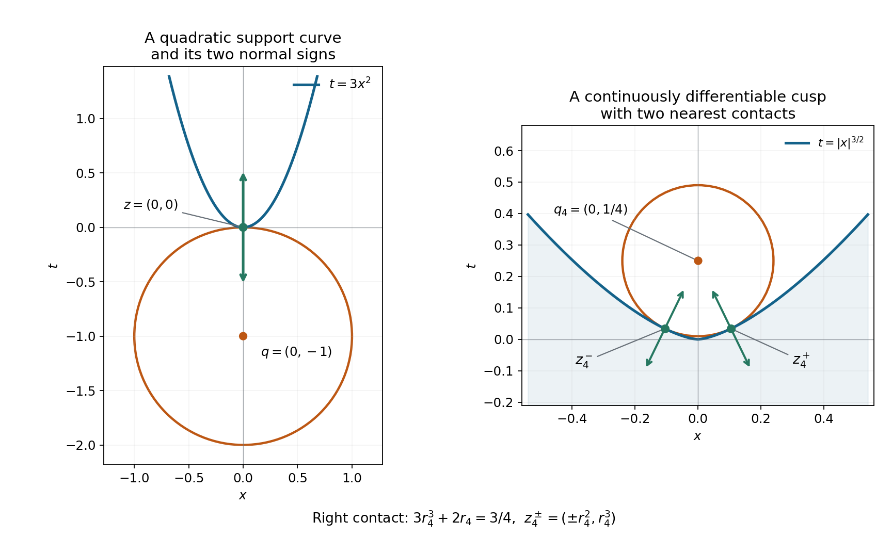
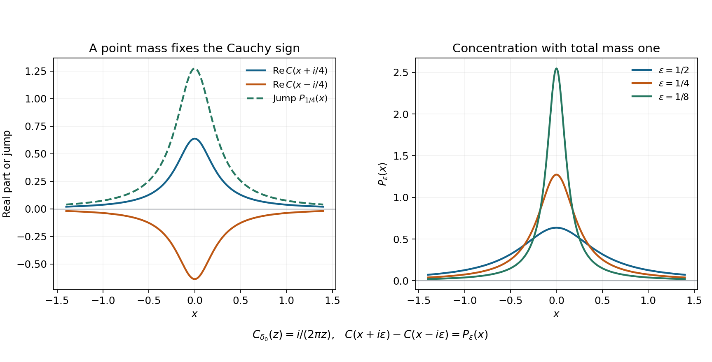

# Support normals and analytic singularities

*Written by GPT-6.1 Sol (OpenAI), October 2026. Self-checked by the writing AI. Original exposition, examples and solutions: CC0.*

A smooth function can vanish on an open half-line and remain nonzero arbitrarily close to its endpoint. An analytic function cannot. Analytic wavefront records the corresponding obstruction one direction at a time: at a supporting boundary of a distribution's support, both normal directions must occur, even if the distribution is a smooth function.

Read Pulling back and combining analytic singularities, Sections 2, 4 and 7, for the analytic sequence criterion, coordinate changes and proper projection. [Cauchy bounds and root counts](../../AN02-L045.html) supplies holomorphic Taylor expansion. The [complete proof](support-normals-and-analytic-singularities-formal.md) below gives the Cauchy-transform uniqueness argument and every supporting-normal step.

## 1. The statement concerns the support

Let \(u\) be a distribution on an open \(X\subset\mathbb R^n\). Suppose a real-valued \(C^1\) function \(h\), defined near \(x_0\in\operatorname{supp}u\), satisfies
\[
 dh(x_0)\ne0,\qquad
 h(x)\le h(x_0)\quad
 (x\in\operatorname{supp}u\hbox{ near }x_0).
 \tag{SL1}
\]
Then the full proof, Theorem 3.1 and Corollary 4.1, gives
\[
 (x_0,\pm dh(x_0))\in\operatorname{WF}_A(u).
 \tag{SL2}
\]
Positive multiples of each covector also occur. At an interior point of the support, a differentiable function with a local maximum has zero differential; the nonzero-normal hypothesis therefore excludes that situation. The supporting function and its maximum need only exist locally. Neither compact support of \(u\) nor a smooth support boundary is assumed.

For a point \(q\) outside the support, let \(z\) be a nearest support point, with the comparison valid locally. The ball centered at \(q\) and touching \(z\) supplies
\[
 h(x)=-|x-q|^2,\qquad dh(z)=2(q-z).
 \tag{SL3}
\]
Thus both \((z,q-z)\) and \((z,z-q)\) belong to analytic wavefront. The signs do not depend on which side is called outward.

## 2. Why a single regular ray would force continuation

For a compactly supported one-dimensional distribution \(v\), form its Cauchy transform
\[
 C_v(z)=\frac1{2\pi i}\,v_t((t-z)^{-1}),\qquad
 \operatorname{Im}z\ne0.
 \tag{SL4}
\]
In the upper half-plane it uses the positive Fourier frequencies. Analytic regularity in that ray gives a bounded compact-support sequence with arbitrarily high Fourier decay. Taking its index to be \(k+2\) bounds the \(k\)-th Cauchy derivative by \(E^{k+1}k!\), uniformly up to the boundary. A difference supported away from the point contributes the same type of bound. Holomorphic Taylor expansion therefore continues \(C_v\) through the point.

If \(v\) vanishes on a real interval on one side, the upper and lower transforms already agree across that interval. Continuation identifies them across the endpoint too. Their jump is
\[
 C_v(x+i\epsilon)-C_v(x-i\epsilon)
       =(P_\epsilon*v)(x),\qquad
 P_\epsilon(x)=\frac{\epsilon}{\pi(x^2+\epsilon^2)}.
 \tag{SL5}
\]
The Poisson kernels have mass one and converge to the point mass. The jump consequently converges to \(v\), while continuation makes it converge to zero near the endpoint. This proves local vanishing.

In several variables, make a strict analytic supporting function one coordinate. Integrate along its level directions against every exponential \(e^{-i\eta\cdot y'}\). Proper projection keeps only covectors with zero fiber component, so absence of the normal ray passes to each one-dimensional distribution. The uniqueness argument makes every such projection zero. Fiber Fourier inversion then makes the original distribution zero, contradicting the support point. Conjugation supplies the other normal sign.

For a \(C^1\) supporting function, small exterior centers and their nearest support points approximate the desired normal. Closedness of analytic wavefront passes the inclusion to the limit. Example 4 computes this approximation explicitly.

## 3. Four examples

### Example 1: smoothness does not erase a support endpoint

Define
\[
 f(t)=
 \begin{cases}
  \exp(-1/t^2),&t<0,\\
  0,&t\ge0.
 \end{cases}
 \tag{SL6}
\]
Each derivative on the negative half-line is a polynomial in \(1/t\) times \(\exp(-1/t^2)\). Every such expression tends to zero at the origin, because the exponential dominates each fixed power. Induction on the derivative order shows that \(f\) is smooth and every derivative at zero is zero. It is nonzero at every negative point, so its support is \((-\infty,0]\).

The supporting function \(h(t)=t\) gives both analytic frequency rays at zero. Elsewhere \(f\) is analytic. Hence
\[
 \operatorname{WF}(f)=\varnothing,\qquad
 \operatorname{WF}_A(f)=\{(0,\xi):\xi\ne0\}.
 \tag{SL7}
\]
The second equality uses that there are exactly two rays in a one-dimensional nonzero cotangent fiber. This is why a smooth-wavefront statement cannot replace the analytic theorem in a support argument.

### Example 2: exact normals along a parabola

On the plane with coordinates \((x,t)\), let \(u(x,t)=\delta(t-3x^2)\). Its support is the parabola \(t=3x^2\), and \(h(x,t)=3x^2-t\) is zero throughout that support. Thus
\[
 dh(x,3x^2)=(6x,-1),\qquad
 \operatorname{WF}_A(u)
   =\{(x,3x^2;\lambda(-6x,1)):\lambda\ne0\}.
 \tag{SL8}
\]
For the upper inclusion use the analytic coordinates \((x,s)=(x,t-3x^2)\). The distribution is the pullback of \(1\otimes\delta(s)\); the tensor and coordinate rules permit only multiples of \(ds=dt-6x\,dx\). For the reverse inclusion the supporting-normal theorem supplies both signs of \(dh=-ds\) at every curve point. Positive conicity supplies every nonzero multiple.

The exterior point \(q=(0,-1)\) has the unique nearest support point \((0,0)\), since
\[
 x^2+(3x^2+1)^2=1+7x^2+9x^4\ge1,
 \tag{SL9}
\]
with equality only at zero. Its unit contact ball lies below the parabola and gives both vertical normal signs.

### Example 3: one ball can touch two support points

Let
\[
 u=(1+2i)\delta_{(-1,0)}+(3-i)\delta_{(2,1)}.
 \tag{SL10}
\]
Both coefficients are nonzero. A test supported near just one point shows that neither point disappears by cancellation. At either isolated support point any nonzero covector is the differential of a local supporting linear function. Consequently the analytic wavefront fiber at each point is the entire nonzero cotangent fiber.

For \(q=(0,2)\), both support points are nearest:
\[
 |q-(-1,0)|^2=|q-(2,1)|^2=5.
 \tag{SL11}
\]
The contact vectors are \((1,2)\) and \((-2,1)\). Both signs occur at their respective base points. The theorem neither selects a unique nearest point nor identifies the two cotangent fibers.

### Example 4: a \(C^1\) cusp needs a limiting normal

Let \(F=\{(x,t):t\le |x|^{3/2}\}\) and let \(u\) be its indicator function, viewed as a distribution. Its support is exactly \(F\). The function \(h(x,t)=t-|x|^{3/2}\) is \(C^1\), supports \(F\) at the origin, and has differential \((0,1)\) there. Therefore both vertical covectors occur in \(\operatorname{WF}_A(u)\).

There is no \(C^2\) supporting function at the origin with that same differential. Such a function, after subtracting its value, would be \(t+O(x^2+t^2)\). On the boundary \(t=|x|^{3/2}\), its positive leading term dominates the remainder for small nonzero \(x\), contradicting a supporting maximum.

For the exterior center \(q_j=(0,1/j)\), its two nearest points are
\[
 z_j^\pm=(\pm r_j^2,r_j^3),\qquad
 3r_j^3+2r_j=3/j,\qquad r_j>0.
 \tag{SL12}
\]
The cubic's left side is strictly increasing. Its solution satisfies \(r_j\le3/(2j)\), and hence
\[
 j(q_j-z_j^\pm)
       =(\mp j r_j^2,1-jr_j^3)\longrightarrow(0,1).
 \tag{SL13}
\]
Exercise 6 proves that these are the actual global nearest points. They give the vertical limiting normal even though no \(C^2\) supporting function with that differential exists.

*Figure 1.* Left: the exact curve \(t=3x^2\), the unit ball centered at \((0,-1)\), and the two vertical covector signs at its contact point. Right: the exact cusp boundary \(t=|x|^{3/2}\) and the contact circle centered at \(q_4=(0,1/4)\). The two marked points are \((\pm r_4^2,r_4^3)\), where \(r_4\) is the positive root of \(3r^3+2r=3/4\); their plotted coordinates are numerical evaluations of these exact algebraic quantities. Arrows show both signs of \(q_4-z_4^\pm\), drawn with a common display scale. These are vectors identified with covectors using the Euclidean metric. Equations (SL9), (SL12)–(SL13), Exercise 6 and proof Corollary 4.1 establish the contact and limiting assertions.

*Figure 2.* For \(v=\delta_0\), \(C_v(z)=i/(2\pi z)\). Left: at height \(\epsilon=1/4\), the real parts of its upper and lower values are \(P_\epsilon/2\) and \(-P_\epsilon/2\), whose difference is \(P_\epsilon\). Right: the exact functions \(P_\epsilon\) for \(\epsilon=1/2,1/4,1/8\). Their mass is always one, while their mass outside \([-r,r]\) is at most \(2\epsilon/(\pi r)\). The plotted curves illustrate the kernel identity; proof Lemma 2.1 supplies distributional convergence. The pole at zero prevents a common factorial derivative bound as the height tends to zero.

## 4. Exercises

1. **Cauchy signs, 10 points.** Compute the Cauchy transform of \(\delta_0\), its upper-minus-lower jump and the modulus of its \(k\)-th derivative at \(i\epsilon\). Explain why the common factorial bound in proof Lemma 1.1 fails.
2. **Choosing the analytic sequence index, 12 points.** Prove (SN6) by substitution and show that replacing \(N=k+2\) by \(N=k+1\) makes the absolute integral diverge. Why is the uniform compact distributional bound also needed?
3. **A flat support endpoint, 12 points.** Prove every smoothness and wavefront claim in Example 1. State exactly which theorem supplies the analytic covectors.
4. **A curved conormal, 12 points.** Verify the complete analytic wavefront equality in Example 2, keeping the two covector components and the base point. Compute the normal signs at \(x=1/2\).
5. **Two contacts and complex weights, 14 points.** Prove the support and full analytic wavefront assertions for (SL10). Check the two nearest-point vectors at \(q=(0,2)\), and decide whether either complex coefficient changes these directions.
6. **Nearest points on a cusp, 12 points.** Prove (SL12) gives exactly the two nearest points to \(F\), and prove the quantitative convergence in (SL13).
7. **Why the projection must be proper, 14 points.** On \(\mathbb R^2\) consider \(w=\sum_{j\ge1}\delta_{(j,1/j)}\). Prove this defines a distribution and that projecting it onto the second coordinate does not define a distribution by the usual support integral.
8. **All fiber frequencies are needed, 14 points.** Prove that proper projection against every exponential separates a distribution as in (SN20). For any prescribed finite set of real frequencies, construct a nonzero compactly supported distribution annihilated by all those weighted projections.

## 5. Complete solutions

### Solution 1

Evaluation at \(t=0\) in (SL4) gives
\[
 C_{\delta_0}(z)=-\frac1{2\pi iz}=\frac{i}{2\pi z}.
 \tag{SE1}
\]
Subtracting its values at \(x+i\epsilon\) and \(x-i\epsilon\) gives \(\epsilon/(\pi(x^2+\epsilon^2))\), with positive sign. Differentiation gives
\[
 C_{\delta_0}^{(k)}(z)=\frac{i(-1)^k k!}{2\pi z^{k+1}},
 \qquad
 |C_{\delta_0}^{(k)}(i\epsilon)|
      =\frac{k!}{2\pi\epsilon^{k+1}}.
 \tag{SE2}
\]
Even the case \(k=0\) is unbounded as the height tends to zero. No fixed \(E\) can bound these values by \(E^{k+1}k!\) at every sufficiently small positive height. Consistently, the support-normal theorem puts the positive analytic ray in the wavefront of the point mass.

### Solution 2

Set \(s=\xi/(1+\xi)\). Then \(\xi=s/(1-s)\), \(d\xi=(1-s)^{-2}ds\), and the integrand with \(N=k+2\) becomes \(s^k\,ds\). Integration over \(0<s<1\) gives \(1/(k+1)\). With \(N=k+1\), the transformed integrand is \(s^k/(1-s)\); on \(s\ge1/2\) it is at least \(2^{-k}/(1-s)\), whose integral diverges.

The analytic sequence agrees with the localized distribution near the point, but it can differ away from that neighborhood. Its common compact finite-order bound controls this difference when paired with derivatives of the Cauchy kernel away from its pole. Without that uniform bound, the remainder constants could depend without bound on \(N=k+2\), and the single factorial scale would not follow.

### Solution 3

Inductively, differentiating a Laurent polynomial in \(t\) times \(e^{-1/t^2}\) gives another expression of that form. For every nonnegative integer \(M\), \(s^M e^{-s^2}\to0\) as \(s\to+\infty\): choose an integer \(L>M/2\) and use \(e^{s^2/2}\ge(s^2/2)^L/L!\). This bounds \(s^M e^{-s^2}\) by a constant times \(s^{M-2L}e^{-s^2/2}\), which tends to zero. Each derivative on \(t<0\) therefore approaches zero.

Define the derivatives on the other half-line to be zero. The fundamental theorem on a small negative interval, followed by the endpoint limit, proves that each extended derivative is the derivative of the preceding one at zero as well. This gives smoothness of every order and flatness at zero. Nonvanishing on \(t<0\) and vanishing on \(t>0\) identify the support. Smooth functions have empty ordinary wavefront. The function is analytic off zero; analytic functions have empty analytic wavefront there. Theorem 3.1 with \(h(t)=t\) gives both rays at zero, completing (SL7).

### Solution 4

In coordinates \(s=t-3x^2\), the distribution is \(1\otimes\delta(s)\). The analytic tensor rule permits no \(x\)-covector because the constant factor is analytic, while the one-dimensional point mass has every nonzero normal covector. The differential of \(s\) is \(dt-6x\,dx\), so the coordinate pullback gives only \(\lambda(-6x,1)\). Conversely \(3x^2-t\) is a supporting function at every support point and has nonzero differential. Its two signed normals and positive conicity fill exactly that line of nonzero covectors. At \(x=1/2\), the base point is \((1/2,3/4)\), and the covectors are \(\lambda(-3,1)\), \(\lambda\ne0\). The tangent component must not be omitted.

### Solution 5

A small bump around either point, missing the other, pairs to its nonzero coefficient. The support is therefore exactly those two points. At an isolated support point \(a\), a local linear function with any specified nonzero differential has a maximum on the local support, which consists only of \(a\). Theorem 3.1 gives both rays for that differential; allowing every differential fills the entire nonzero fiber. Outside the two points the distribution vanishes, so there are no further wavefront points.

The squared distances from \((0,2)\) are \(1+4=5\) and \(4+1=5\). Subtraction gives \(q-(-1,0)=(1,2)\) and \(q-(2,1)=(-2,1)\). Both signs occur, at different base points. Multiplying a point mass by a nonzero complex number does not remove its support or these normals. The two summands cannot cancel on disjoint neighborhoods.

### Solution 6

Put \(a=1/j>0\). For a fixed \(x\), the nearest point in the vertical subgraph has height \(\min(a,|x|^{3/2})\). Symmetry permits \(x\ge0\). For \(x\ge a^{2/3}\), the squared distance is \(x^2\), minimized at the left endpoint. For \(0\le x\le a^{2/3}\), it is
\[
 D(x)=x^2+(x^{3/2}-a)^2,\qquad
 D'(x)=\sqrt{x}\,(2\sqrt{x}+3x^{3/2}-3a).
 \tag{SE3}
\]
The expression in parentheses is strictly increasing as a function of \(\sqrt{x}\), negative at zero and positive at \(x=a^{2/3}\). It has exactly one zero, with \(x=r^2\) and \(2r+3r^3=3a\). Thus \(D\) decreases from zero to that point and increases to the endpoint. Its minimum is strictly smaller than the endpoint distance and than \(D(0)\). Reflection supplies exactly two minimizers, at \(\pm r^2\), of height \(r^3<a\).

The cubic gives \(0<r\le3/(2j)\). Consequently
\[
 |jr^2|\le\frac9{4j},\qquad
 |jr^3|\le\frac{27}{8j^2}.
 \tag{SE4}
\]
These bounds prove both convergence of the base points to zero and the scaled normal limit in (SL13). Each unscaled normal is nonzero because its vertical component is \(a-r^3>0\).

### Solution 7

A compact subset of the \((y,t)\)-plane has bounded \(y\)-coordinate. It therefore meets only finitely many points \((j,1/j)\). The sum pairs with each compact test as a finite sum and satisfies the order-zero compact seminorm estimate with a constant equal to that finite number. It defines a distribution.

Projection of its support is not proper: the inverse image of the compact interval \([0,1]\) contains all the points and is unbounded in \(y\). For a nonnegative compact test \(\phi(t)\) equal to one near zero, a proposed support integral would contain \(\sum_{j\ge1}\phi(1/j)\). Infinitely many summands equal one, so it diverges. A compact fiber cutoff cannot equal one at all support points over this target test. This is exactly the missing condition in the proper-projection theorem.

### Solution 8

For a compact test \(\psi(y,t)\), its fiber Fourier inversion converges with every derivative, after multiplication by a compact fiber cutoff equal to one near the relevant proper support. Integration by parts in \(y\) gives arbitrary polynomial decrease of \(\widehat\psi(\eta,t)\), uniformly with the finitely many \(t\)-derivatives needed. Derivatives of the exponential cost a fixed polynomial in \(\eta\). The paired integral therefore converges in the distribution's finite-order seminorm. Every term is the corresponding zero weighted projection, so the pairing with \(\psi\) is zero.

For a finite prescribed list \(\eta_1,\ldots,\eta_k\) in one fiber dimension and a nonzero \(\phi\in C_c^\infty(\mathbb R)\), take
\[
 w(y,t)=\left[\prod_{\ell=1}^k
               (\partial_y-i\eta_\ell)\delta_0(y)\right]\phi(t).
 \tag{SE5}
\]
Its weighted projection at a real frequency \(\eta\) is
\[
 \pi_*(e^{-i\eta y}w)
       =\prod_{\ell=1}^k(i\eta-i\eta_\ell)\,\phi(t).
 \tag{SE6}
\]
It vanishes at each listed frequency. The distribution itself is nonzero because the product of differential operators has leading term \(\partial_y^k\); pairing its fiber factor with a test equal to \(y^k\) near zero yields \((-1)^k k!\), while all lower derivatives give zero. Its support is compact. For an empty list, \(\delta_0(y)\phi(t)\) already supplies the assertion. Thus a finite list cannot replace all Fourier weights.

## References

Lars Hörmander, *The Analysis of Linear Partial Differential Operators I*, Theorem 8.5.6 and its normal-set formulation, provides the classical context. The proof here includes one-ray Cauchy continuation, proper tangential projection and the \(C^1\) nearest-point limit. The Sokhotski–Plemelj jump normalization and the exact programme proof dependencies are linked in the complete proof.
