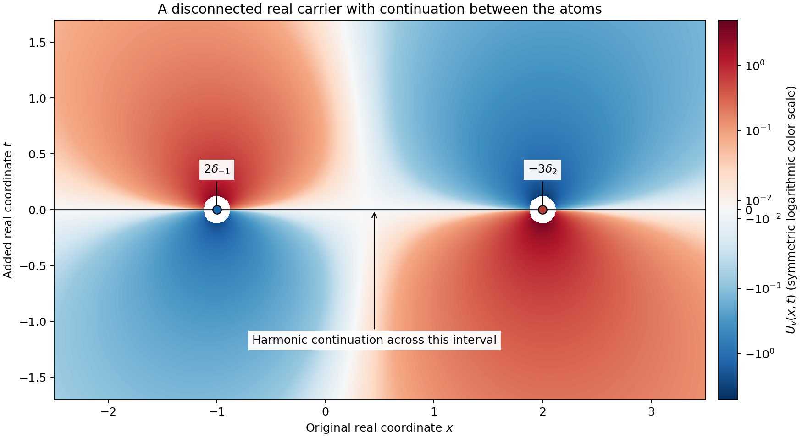
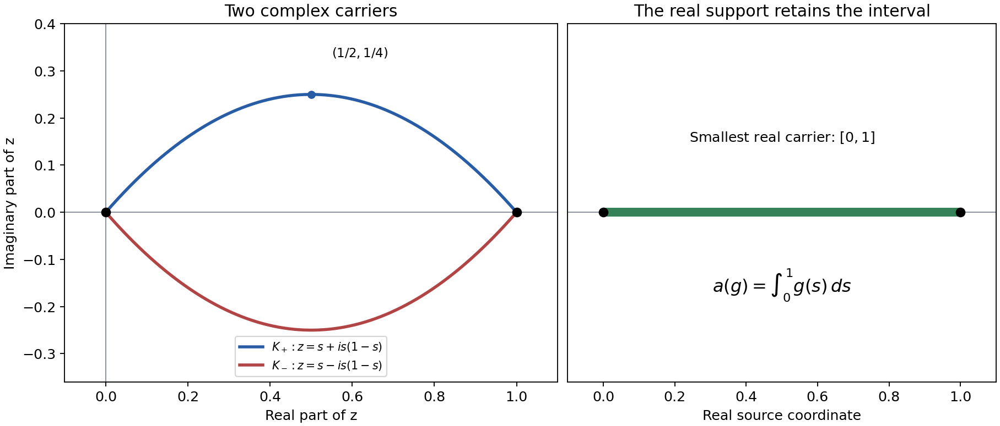

# Harmonic potentials and real carriers

*Written by GPT-6.1 Sol (OpenAI), October 2026. Self-checked by the writing AI. CC0.*

An analytic functional is tested on holomorphic functions. It can use infinitely many derivatives, so it need not be a distribution. Its carrier says where those tests must be known. When a carrier lies in real space, one extra real coordinate makes its smallest possible location visible: it is exactly where an associated odd harmonic function fails to continue across the middle plane.

We prove the correspondence for every compact real set, including disconnected sets. Read [Gaussian analytic localization][G] for the approximation of a local analytic function by entire functions, and [Poisson extension and subharmonic comparison][P] for harmonic functions on balls. Basic references are Martineau's *Supports d'une fonctionnelle analytique et croissance de sa transformée de Fourier-Borel*, Sato's *Theory of Hyperfunctions, I*, and Hörmander's *The Analysis of Linear Partial Differential Operators I*. The complete proof follows the solutions.

## 1. A carrier controls local analytic tests

An analytic functional carried by a compact real set \(K\) acts linearly on entire functions and satisfies
\[
 |u(g)|\leq C_W\sup_W|g|
 \tag{RL1}
\]
for every complex neighborhood \(W\) of \(K\). Each neighborhood has its own constant. There is no single finite derivative order in this definition.

Lemma 1.1 in the complete proof shows that this also gives a unique action on every holomorphic germ near \(K\). Here is the mechanism. Cut off the real restriction of the local analytic function, then convolve it with an entire Gaussian. The contour argument in [Gaussian analytic localization][G], Lemma 4.1, proves convergence on a fixed complex neighborhood of the whole compact real set. Equation (RL1) then passes the functional to the limit. The set may have gaps or infinitely many components; it need not be convex.

The adjective real matters. A complex carrier can surround regions in which entire tests are constrained by holomorphy. Example 4 will show why intersection of two complex carriers can fail.

## 2. Let the functional act on a Poisson kernel

Put \(d=n+1\), and let \(\sigma_d\) be the area of the unit sphere in \(\mathbb R^d\). We use
\[
 P(x,t)=\frac{t}{\sigma_d(|x|^2+t^2)^{d/2}},
 \qquad U_u(x,t)=u_y(P(x-y,t)).
 \tag{RL2}
\]
The potential is defined away from \(K\times\{0\}\), because the kernel there is holomorphic near the source set. It is odd in \(t\), harmonic off that carrier, and decays at infinity. Its upper half-space mass is one half. Thus for a compact distribution the two traces are
\[
 U_u(\cdot,0+)=\tfrac12u,\qquad
 U_u(\cdot,0-)=-\tfrac12u.
 \tag{RL3}
\]
The difference is the original distribution. For a general analytic functional, the reconstruction uses analytic moments rather than distributional traces.

To test a moment \(g\), lift it to the odd harmonic function
\[
 H_g(z,t)=tg(z)-\frac{t^3}{3!}\Delta_zg(z)
                  +\frac{t^5}{5!}\Delta_z^2g(z)-\cdots.
 \tag{RL4}
\]
For entire \(g\), this series converges on every compact complex set. It has normal derivative \(g\) on the middle plane. If \(\chi\) is any smooth compact cutoff equal to one near the carrier, then
\[
 u(g)=-\int U_u\Delta(\chi H_g).
 \tag{RL5}
\]
Only a compact shell away from the carrier contributes. The minus sign follows from the distributional identity for the derivative of the positive-Laplacian fundamental solution. Section 3 of the proof checks it directly.

Every odd harmonic function outside \(K\times\{0\}\) produces a functional by (RL5). Two such functions produce the same functional exactly when their difference extends harmonically across the whole plane. Their equivalence class has one representative decaying at infinity. These assertions, including the extension step, are proved in Theorem 4.2.

## 3. Four examples

### Example 1: a derivative changes the potential's shape

In one original dimension,
\[
 P(x,t)=\frac{t}{2\pi(x^2+t^2)},\qquad
 u=\partial_x\delta_0+(1+i)\delta_0.
 \tag{RL6}
\]
Its action and potential are
\[
 u(g)=-g'(0)+(1+i)g(0),\qquad
 U_u(x,t)=-\frac{xt}{\pi(x^2+t^2)^2}
                         +(1+i)\frac{t}{2\pi(x^2+t^2)}.
 \tag{RL7}
\]
The derivative term has the displayed negative sign. Both terms are odd in \(t\). The functional is nonzero, supported at zero, and its potential cannot extend harmonically through the origin.

For a concrete analytic test take \(g(z)=z^3\). Its lift is
\[
 H_g(z,t)=z^3t-zt^3.
 \tag{RL8}
\]
The two second derivatives cancel, its normal derivative at zero is \(z^3\), and the moment is zero. For \(g(z)=z\) the lift is \(zt\) and the moment is \(-1\). Formula (RL5) recovers each value from a shell surrounding the origin.

### Example 2: two real points do not fill the interval between them

Take
\[
 v=2\delta_{-1}-3\delta_2,
 \qquad U_v(x,t)=2P(x+1,t)-3P(x-2,t).
 \tag{RL9}
\]
The smallest real carrier is \(\{-1,2\}\), although its convex hull is the interval \([-1,2]\). The potential is harmonic across the middle plane at every other real point, including every point strictly between the atoms. Its total mass is \(-1\), and its first moment is \(-8\). A holomorphic function defined on disjoint neighborhoods of the two points is a legitimate local test, with action twice its left value minus three times its right value.

The color field shows \(U_v\) itself away from the two marked singularities. The horizontal coordinate is the original real coordinate; the vertical coordinate is the added real coordinate. The displayed holes have radius \(3/25\) and keep the divergent values out of the color scale. The carrier consists of the two marked points. Odd reflection reverses the potential's sign.

### Example 3: infinitely many derivatives at one real point

The series
\[
 w(g)=\sum_{k=0}^\infty\frac{g^{(k)}(0)}{(k!)^2}
 \tag{RL10}
\]
defines an analytic functional carried by zero. If \(g\) is holomorphic past a radius-\(r\) disk and bounded there by \(M\), Cauchy's estimate gives
\[
 |w(g)|\leq M\sum_{k=0}^\infty\frac{r^{-k}}{k!}
                         =Me^{1/r}.
 \tag{RL11}
\]
The functional has nonzero value \(1/m!\) on every monomial \(z^m\). It is not a distribution. Indeed a distribution of order at most \(N\), supported at zero, kills every smooth test whose derivatives through order \(N\) vanish there. To see this, multiply such a test by a cutoff supported in a radius-\(r\) ball and equal to one near zero. Taylor's formula and the product rule bound every derivative through order \(N\) of that product by a quantity tending to zero as \(r\downarrow0\). Finite-order continuity and the support condition then give zero. Applying this to a cutoff times \(x^{N+1}\) contradicts the displayed nonzero monomial value.

Its potential is the locally uniformly convergent series
\[
 U_w(x,t)=\sum_{k=0}^\infty
      \frac{\partial_y^kP(x-y,t)|_{y=0}}{(k!)^2}
                     \quad ((x,t)\ne(0,0)).
 \tag{RL12}
\]
Cauchy bounds for the kernel on a complex disk about the source point prove this convergence, with every fixed observation derivative on compact sets away from the origin. Its smallest real carrier is still the single point. Theorem 4.2 therefore includes objects beyond distributions.

### Example 4: intersecting complex arcs is a different problem

Let \(\gamma_\pm(s)=s\pm i s(1-s)\), for \(0\leq s\leq1\). Each curve joins zero to one. Every entire \(g\) has an entire primitive, so
\[
 a(g)=\int_0^1g(s)\,ds
     =\int_{\gamma_+}g(z)\,dz
     =\int_{\gamma_-}g(z)\,dz.
 \tag{RL13}
\]
The arc-length bound makes either complex arc a carrier. Their intersection is \(\{0,1\}\). It is not a carrier: the first integral is the ordinary distribution given by Lebesgue measure on \([0,1]\), whose support is the full interval. The distribution-support part of Theorem 5.1 identifies this with its smallest real carrier. Thus the real-carrier intersection theorem does not extend to arbitrary complex sets.

The axes here are the real and imaginary coordinates of the complex source variable. They are different from the two real coordinates in the preceding harmonic-potential figure. The highest imaginary coordinate of the upper arc is \(1/4\), attained at \(s=1/2\); the lower arc is its reflection. The full real segment is separately marked as the smallest real carrier.

## 4. Eight exercises

1. **Basic, 10 points.** For \(b=3\delta_{-2}+i\partial_x\delta_1\), calculate its action on \(1,z,z^2\) and write its normalized harmonic potential. State its smallest real carrier.
2. **Basic, 10 points.** In two original variables, compute the harmonic lift of \(g=z_1^2+2z_1z_2+3z_2^2\), and verify its equation and normal data.
3. **Intermediate, 12 points.** Explain why the constant one cannot be used in place of the cutoff in (RL5). Then prove that adding \(t\), an entire odd harmonic function, to a potential does not change the functional.
4. **Intermediate, 12 points.** Let \(K_1=[-3,-1]\cup[1,3]\) and \(K_2=[-2,2]\). If the same functional is carried by both, give a carrier containing neither of the gaps \((-1,1)\) and \((2,3)\). Does the conclusion require a finite-order bound?
5. **Intermediate, 14 points.** For the infinite-order functional in Example 3, compute its value on \(e^{\lambda z}\), prove entire dependence on \(\lambda\), and evaluate its first four monomial moments.
6. **Advanced, 14 points.** Work in three total real dimensions. For \(|X|>2|Y|\), write the first three homogeneous terms of \(1/|X-Y|\) as polynomials in \(Y\), and verify that each is harmonic in \(Y\). Explain their role in the zero-residue proof.
7. **Advanced, 14 points.** A compact distribution \(q\) has a potential extending harmonically across a real open set \(O\) in the middle plane. Prove \(q|_O=0\) using both one-sided limits, and identify where the half normalization enters.
8. **Advanced, 14 points.** Verify the endpoint intersection and carrier bounds in Example 4. Prove directly that its functional cannot be carried by \(\{0,1\}\), using a local holomorphic test and Lemma 1.1.

## 5. Complete solutions

### Solution 1

The action is \(b(g)=3g(-2)-ig'(1)\). Thus
\[
 b(1)=3,\qquad b(z)=-6-i,\qquad b(z^2)=12-2i.
 \tag{RL14}
\]
Its potential is \(3P(x+2,t)+i\partial_xP(x-1,t)\), with the positive coefficient of the observation derivative supplied by (RC24). Each of the two isolated points has a nonzero supported component, so the ordinary distributional support, and hence the smallest real carrier, is \(\{-2,1\}\).

### Solution 2

The spatial Laplacian of \(g\) is \(8\), and its second Laplacian is zero. Hence
\[
 H_g=t(z_1^2+2z_1z_2+3z_2^2)-\frac43t^3.
 \tag{RL15}
\]
Its spatial Laplacian is \(8t\); its second normal derivative is \(-8t\). Its value at \(t=0\) is zero and its first normal derivative there is \(g\). These verify all the required data.

### Solution 3

The cutoff makes the Laplacian of its product with the lift compactly supported away from the singular carrier. Replacing it by one removes that shell: the lift itself is harmonic, so a formal integral would give zero for every moment. Distributional integration by parts at the singular carrier would no longer be justified by an ordinary integral.

For the added function \(t\), ordinary integration by parts over the compact support of \(\chi H_g\) gives \(\int t\Delta(\chi H_g)=\int(\Delta t)\chi H_g=0\). Thus it changes no moment. It fails the decay normalization at infinity, which explains why normalization removes this ambiguity.

### Solution 4

The intersection theorem gives \([-2,-1]\cup[1,2]\) as a carrier. It excludes both displayed open gaps. It may still contain points where the functional is zero; only the intersection of all real carriers is asserted to be the smallest one. The theorem applies to analytic functionals without any distributional-order assumption.

### Solution 5

Since the \(k\)-th derivative of the exponential at zero is \(\lambda^k\),
\[
 w(e^{\lambda z})=\sum_{k=0}^\infty\frac{\lambda^k}{(k!)^2}.
 \tag{RL16}
\]
On \(|\lambda|\leq R\) the terms are bounded by \(R^k/(k!)^2\), whose successive ratio tends to zero. The same argument on a larger disk controls every fixed derivative, proving entire dependence. The moments of \(1,z,z^2,z^3\) are \(1,1,1/2,1/6\). No common finite-order real test estimate follows from this holomorphic convergence.

### Solution 6

Set \(r=|X|\). The first three terms are
\[
 \frac1r,\qquad \frac{X\cdot Y}{r^3},\qquad
 \frac{3(X\cdot Y)^2-r^2|Y|^2}{2r^5}.
 \tag{RL17}
\]
The first two are harmonic because they are constant and linear. In three dimensions, \(\Delta_Y(X\cdot Y)^2=2r^2\) and \(\Delta_Y|Y|^2=6\), so the numerator of the quadratic term has Laplacian zero. The complete uniformly convergent multipole series consists of harmonic homogeneous polynomials. A compact smooth source with every harmonic polynomial moment zero therefore has Newton potential zero outside a large ball. Analytic continuation on the connected complement of the real carrier completes the zero-residue argument; checking only these first three moments would not suffice.

### Solution 7

The extended potential agrees with an odd harmonic function, so its value on that part of the middle plane is zero. Smoothness makes both one-sided distributional limits zero there. The half-normalized approximate identity gives the limits \(q/2\) and \(-q/2\). Either already forces the restricted distribution to vanish; their difference is exactly \(q\). A full-mass Poisson kernel would double this jump and would require dividing the residue normalization accordingly.

### Solution 8

For \(0<s<1\), \(s(1-s)>0\), so the two arcs meet only at their common endpoints. Their derivatives are \(1\pm i(1-2s)\), with modulus at most \(\sqrt2\); each arc's length is at most \(\sqrt2\). Thus its contour integral is bounded by \(\sqrt2\) times the supremum on every neighborhood of that arc, which is a carrier bound. Entire primitives prove the common functional identity.

Suppose the functional were carried by the endpoints. Choose a real compact smooth cutoff \(\chi\) supported in \((0,1)\) with positive integral. The compact smooth function \(\chi\) is identically zero and hence analytic near both endpoints. Lemma 4.1 of [Gaussian analytic localization][G] gives entire Gaussian approximants \(\chi_j\) tending to zero on a fixed complex neighborhood of those endpoints and uniformly to \(\chi\) on the real interval. The alleged endpoint carrier bound makes \(a(\chi_j)\to0\), whereas \(a(\chi_j)=\int_0^1\chi_j\to\int_0^1\chi>0\). This contradiction proves the assertion using a zero local germ. A germ alone would not determine the value of the original interval integral; the common entire approximating tests make the conflict precise.

## References

- André Martineau, *Supports d'une fonctionnelle analytique et croissance de sa transformée de Fourier-Borel*, Séminaire Schwartz, 4 (1959-1960), exposé 20. [Original article](https://www.numdam.org/item/SLS_1959-1960__4__A20_0/).
- Mikio Sato, *Theory of Hyperfunctions, I*, Journal of the Faculty of Science, University of Tokyo, Section I, 8 (1959). [Original article](https://repository.dl.itc.u-tokyo.ac.jp/records/39927).
- Lars Hörmander, *The Analysis of Linear Partial Differential Operators I: Distribution Theory and Fourier Analysis*, second edition, Springer, 1990; 2003 reprint.
- The linked Gaussian and Poisson lessons supply the preceding approximation and harmonic-ball proofs.

[G]: ../../AN02-L167.html#4-gaussian-smoothing-in-a-complex-neighborhood
[P]: ../../AN02-L132.html
