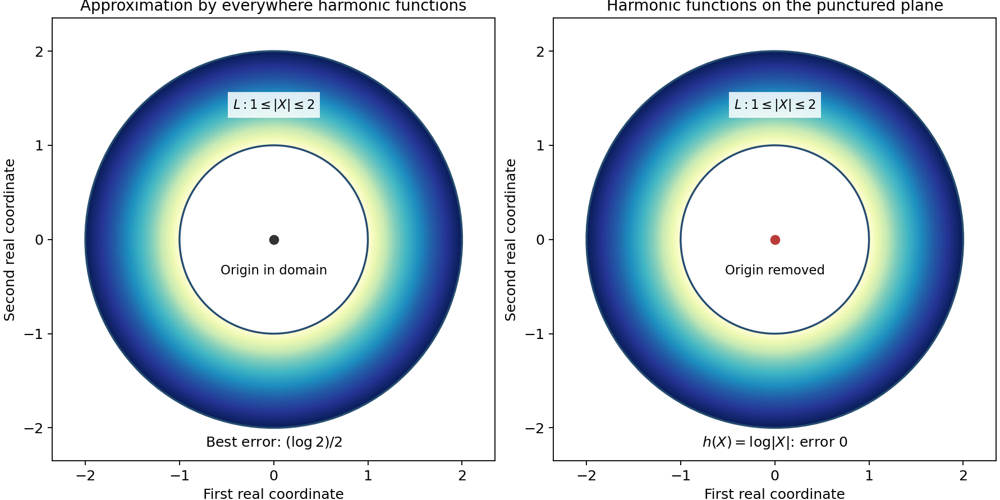
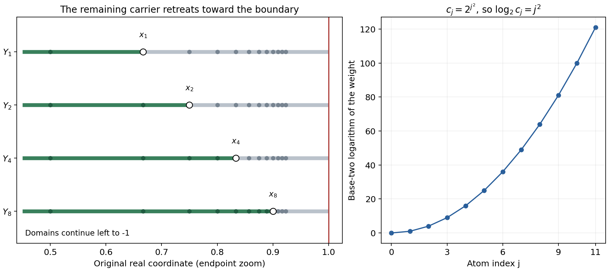

# Splitting real carriers and gluing hyperfunctions

*Written by GPT-6.1 Sol (OpenAI), October 2026.  CC0.*

An analytic functional can differentiate an analytic test infinitely many times. Multiplying that test by a smooth partition function would destroy its analyticity. To localize the functional, we first localize an associated harmonic function, then solve away the Laplace error. This lesson carries out that construction and proves that compatible local hyperfunctions glue on every open cover.

Read [Harmonic potentials and real carriers][A] for local holomorphic tests, least real carriers and harmonic reconstruction. We also use the [ball Poisson formula][P] and [Hahn–Banach separation][H]. Basic references are Sato's *Theory of Hyperfunctions, I* and *II*, Martineau's *Supports des fonctionnelles analytiques*, and Hörmander's *The Analysis of Linear Partial Differential Operators I*. All required approximation and Laplace correction arguments are proved below, after the solutions.

## 1. What restriction must do

For a compact real set \(K\), let \(\mathcal A'(K)\) be its analytic functionals, with a separate holomorphic supremum bound on every complex neighborhood. For bounded open \(X\), define
\[
 \mathcal B(X)=\mathcal A'(\overline X)/\mathcal A'(\partial X).
 \tag{HL1}
\]
Representatives differing only by a boundary-carried functional describe the same hyperfunction inside \(X\). A smaller open set must discard every component outside it, including its own boundary components.

We prove three facts that make this a local theory. First, a functional carried by a finite union of real compact sets splits into functionals on those sets. Second, a sequence whose differences retreat into decreasing compact sets has a compatible limit modulo their intersection. Third, the resulting quotient restrictions glue, first for two domains, then for a countable cover, and finally for every cover.

The statements apply to general analytic functionals. Neither a finite real derivative order nor a convex carrier is required.

## 2. The harmonic correction

Write \(X=(x,t)\in\mathbb R^{n+1}\). A compact-real-carrier functional is represented by an odd harmonic function off its carrier in the middle plane. An entire odd harmonic addition does not change it. The normalization and inverse residue formula are proved in [Harmonic potentials and real carriers][A].

Suppose its carrier is \(K_1\cup K_2\). Choose a smooth even function \(\theta\), equal to one near the first carrier away from their intersection and zero near the second. The products \(\theta U\) and \((1-\theta)U\) have the desired separated singular sets but are not harmonic. Solve
\[
 \Delta v=\Delta(\theta U)
       \quad\hbox{off }(K_1\cap K_2)\times\{0\}.
 \tag{HL2}
\]
Then \(\theta U-v\) and \((1-\theta)U+v\) are the required harmonic representatives. Theorem 2.2 proves that this smooth Laplace equation is solvable with no boundary or infinity growth assumption.

The construction of that solution uses a summable correction series. Split the smooth source into compact pieces, solve each by the fundamental kernel, then subtract harmonic functions making the tails smaller than \(2^{-j}\) together with the first \(j\) derivatives on an exhaustion. The harmonic approximants exist by Theorem 1.1. Its proof explains exactly which holes an approximation domain may contain.

## 3. Four worked examples

### Example 1: an excluded point changes harmonic approximation

In two total real dimensions, let \(L\) be the closed annulus \(1\leq|X|\leq2\), and let \(h(X)=\log|X|\) near it. An everywhere harmonic function has the same circular mean on both boundary circles. The means of \(h\) are zero and \(\log2\). Thus every everywhere harmonic \(v\) satisfies
\[
 \sup_L|h-v|\geq\frac{\log2}{2}.
 \tag{HL3}
\]
Indeed if the error is \(e\), its center value is within \(e\) of both zero and \(\log2\); the triangle inequality gives \(\log2\leq2e\). The constant \((\log2)/2\) attains this error, so the bound is exact.

If the global domain is instead \(\mathbb R^2\setminus\{0\}\), then \(h\) itself is a global harmonic function on that domain, giving zero error. The bounded hole inside \(L\) now meets the domain's complement, exactly as required by Theorem 1.1.

Both panels show the annulus with radii one and two. The left center belongs to the approximation domain; the right center is excluded. The annulus is the approximation set in both panels. The exact lower bound is established by circular means, independently of the plotted color field.

### Example 2: overlap is the precise splitting ambiguity

Let \(K_1=[-2,0]\), \(K_2=[0,3]\), and
\[
 a=2\delta_{-1}+(1+i)\delta_0-\delta_2.
 \tag{HL4}
\]
For any analytic functional \(w\) carried by zero, a split is
\[
 a_1=2\delta_{-1}+w,\qquad
 a_2=(1+i)\delta_0-\delta_2-w.
 \tag{HL5}
\]
The first term is carried by \(K_1\), the second by \(K_2\), and their sum is \(a\). The choice may include infinitely many derivatives at zero. Conversely every other split differs by just such a point-carried functional, by the real intersection theorem.

To see how boundary ambiguity disappears under restriction, take \(X=(-3,3)\), \(Y=(-1,2)\), and
\[
 b=\delta_{-3}+2\delta_{-1}+3\delta_0
                              +4\delta_1+5\delta_2+6\delta_3.
 \tag{HL6}
\]
Its class on \(X\) ignores the two outer boundary atoms. Restriction to \(Y\) also discards the atoms at \(-1\) and \(2\), leaving \(3\delta_0+4\delta_1\). Restrict once more to \((0,1)\): both remaining atoms are on its boundary, so the resulting class is zero. Direct restriction gives the same answer.

### Example 3: masses can grow arbitrarily fast toward a boundary

Let \(X=(-1,1)\), and put
\[
 x_j=1-\frac1{j+2},\qquad c_j=2^{j^2},\qquad j\geq0.
 \tag{HL7}
\]
The locally finite sum \(q=\sum_{j\geq0}c_j\delta_{x_j}\) is an ordinary distribution on \(X\): every compact test support meets only finitely many atoms. For \(m\geq1\), put
\[
 Y_m=(-1,x_m),\qquad a_m=\sum_{j<m}c_j\delta_{x_j},\qquad
 K_m=\{-1\}\cup[x_m,1].
 \tag{HL8}
\]
For \(k\geq m\), \(a_k-a_m\) is carried by \(K_m\). These compact sets decrease to \(\{-1,1\}=\partial X\). Theorem 4.1 gives one analytic functional on \([-1,1]\) whose hyperfunction restrictions are all these local sums.

There is no compact distribution on the whole real line representing the same class on \(X\). If it had order \(N\), tests supported near each isolated \(x_j\) would bound \(2^{j^2}\) by \(C(j+3)^{2N}\), as detailed in Solution 6. This is impossible. Thus a compact analytic-functional representative can exist even when no compact distributional representative does.

The representative is not obtained by applying the raw infinite sum to an entire test: that sum already diverges on the constant one. The convergent harmonic corrections in Theorem 4.1 are essential. They preserve every interior restriction while adjusting what is carried at the boundary.

The domain panel is a zoom near the accumulating endpoint. Each green interval extends leftward to \(-1\), outside the displayed window, and has an open right endpoint \(x_m\). The gray portion is \([x_m,1]\); the additional point \(-1\) of \(K_m\) is outside the zoom. Only the locations with \(0\leq j\leq11\) are shown. The other panel plots the exact values \(\log_2c_j=j^2\) for these indices. The formula and compact-test argument apply to every index.

### Example 4: local representatives retain a fundamental equation

Let \(q(x)=H(x)e^x\), so \((\partial_x-1)q=\delta_0\). Choose a smooth compact \(\chi_R=1\) near \([-R,R]\), and define
\[
 a_R(g)=\int_0^\infty\chi_R(x)e^xg(x)\,dx.
 \tag{HL9}
\]
These compact distributions are analytic functionals. Integration by parts gives
\[
 ((\partial_x-1)a_R)(g)=g(0)+
                            \int_0^\infty\chi_R'(x)e^xg(x)\,dx.
 \tag{HL10}
\]
The last term is carried outside \((-R,R)\). Two choices equal to one on that interval also differ only outside it. Restriction therefore removes the error, and the local classes glue to \(q\). The support is the closed positive half-line and the global equation holds. Corollary 6.3 uses exactly this mechanism for arbitrary compact-real-carrier analytic functionals, including functionals beyond distributions.

## 4. Eight exercises

1. **Basic, 10 points.** On the annulus \(2\leq|X|\leq5\), find the exact best uniform approximation error to \(\log|X|\) among everywhere harmonic functions, and exhibit an attaining function.
2. **Basic, 10 points.** With the domains and functional in Example 2, restrict the class instead to \((-1/2,3/2)\). Check that restricting first to \((-1,2)\) gives the same result.
3. **Intermediate, 12 points.** If two carrier splits use compact real sets \(K_1,K_2\), prove that their ambiguity is exactly \(\mathcal A'(K_1\cap K_2)\). What happens when the sets are disjoint?
4. **Intermediate, 12 points.** In the exhaustion (HG6), prove that any point of the open tubular neighborhood joins a nearest carrier point without leaving that neighborhood. Explain why every other complementary component is unbounded.
5. **Intermediate, 14 points.** Prove that the correction series in (HG9) converges with all derivatives on an arbitrary compact set, and that its Laplacian is the specified source. Include the role of the two initial terms.
6. **Advanced, 14 points.** Prove the claim in Example 3 that no compact distribution on the real line represents the same hyperfunction on \((-1,1)\). Give an explicit isolation radius and the required finite-order estimate.
7. **Advanced, 14 points.** Suppose a countable compatible family has bounded union \(X\). Explain why the compact sets in (HG23) intersect in precisely \(\partial X\), and prove that changing the glued analytic-functional representative by a boundary-carried functional changes no local class.
8. **Advanced, 14 points.** Suppose local analytic functionals \(a_V\) satisfy the support and differential hypotheses of Corollary 6.3. Prove the global support and equation assertions, including the case of a neighborhood not containing zero. Explain why no real finite-order estimate is needed.

## 5. Complete solutions

### Solution 1

The circular means of an everywhere harmonic approximant equal its center value on both circles. They must approximate \(\log2\) and \(\log5\), so the error is at least \((\log5-\log2)/2=\tfrac12\log(5/2)\). The constant \((\log2+\log5)/2=\tfrac12\log10\) attains that error throughout the annulus, because the logarithm is monotone between its endpoint values. This proves the exact optimum.

### Solution 2

The interval contains zero and one but none of the other atoms. Its restriction is therefore \(3\delta_0+4\delta_1\). First restricting to \((-1,2)\) gives that same representative; neither point is on the new boundary, so the second restriction retains both. The discarded atoms are carried outside the smaller interval, which verifies the restriction characterization directly.

### Solution 3

If \(a_1+a_2=b_1+b_2\), then \(a_1-b_1=b_2-a_2\) is carried by both compact sets. Their real intersection theorem places it in \(\mathcal A'(K_1\cap K_2)\). Conversely adding any such \(w\) to the first part and subtracting it from the second preserves their carriers and sum. If the sets are disjoint, the ambiguity space is zero and the split is unique. These arguments also apply to infinite-order point functionals on an overlap.

### Solution 4

Let \(Z\in S^\flat\) minimize distance from \(X\), which exists because the carrier is compact. On the segment \(X_s=(1-s)X+sZ\), its distance to the carrier is at most \(|X_s-Z|=(1-s)|X-Z|<1/j\). The whole segment stays in the tube and ends on the carrier. The exterior of the closed radius-\(j\) ball is connected and unbounded in total dimension at least two. Any complementary component meeting it is unbounded. A component not meeting it consists of points in the tube and therefore meets the carrier by the segment argument.

### Solution 5

Choose \(N\) with the compact set inside \(L_N\), and fix a derivative order \(m\). For \(j\geq\max(N+2,m,3)\), the \(C^m\) norm of the \(j\)-th corrected term on that compact set is bounded by \(2^{-j}\). The finitely many earlier terms are smooth there. Uniform convergence of all derivatives follows; the coordinate integral identity for derivatives identifies these limits as the derivatives of the sum. In particular the second derivatives converge locally uniformly, so the Laplacian passes through the sum. Harmonic corrections contribute zero. The compact sources telescope to \(f\) because both cutoff values are eventually one near every fixed compact set. The first two terms supply \(f_1+f_2\); omitting them would remove those source pieces.

### Solution 6

The adjacent spacing is
\[
 x_{j+1}-x_j=\frac1{(j+2)(j+3)}.
 \tag{HL11}
\]
Choose \(r_j=1/[4(j+2)(j+3)]\), and a fixed smooth bump \(\rho\) supported in \((-1,1)\) with \(\rho(0)=1\). Then \(\rho_j(x)=\rho((x-x_j)/r_j)\) is supported inside \((-1,1)\), detects only that atom, and satisfies \(\|\rho_j^{(k)}\|_\infty\leq C_kr_j^{-k}\). If a compact distribution \(T\) represented the class, injectivity of the local distribution embedding would give \(T(\rho_j)=2^{j^2}\). Its finite-order bound on one fixed compact interval containing all these supports would imply
\[
 2^{j^2}\leq C r_j^{-N}\leq C' (j+3)^{2N}.
 \tag{HL12}
\]
Taking logarithms contradicts quadratic growth against logarithmic growth. The support could include boundary terms at \(-1\) or \(1\); they pair to zero with these interior tests and do not affect the contradiction.

### Solution 7

For bounded \(X\), its closure is compact. Since \(Y_j\) increases to \(X\),
\[
 \bigcap_j(\overline X\setminus Y_j)
                    =\overline X\setminus X=\partial X.
 \tag{HL13}
\]
A boundary-carried addition is supported outside every \(X_i\), so its restriction to each is zero by (HG20). The glued class therefore remains the same. Conversely two global classes with the same local restrictions have difference supported nowhere inside \(X\); their analytic-functional representatives differ by a boundary-carried functional. This is exactly the quotient ambiguity.

### Solution 8

The support condition on differences makes their restrictions agree on each overlap, by (HG20). Theorem 6.1 gives a unique global class. On an open neighborhood disjoint from \(F\), every local representative restricts to zero; hence so does the global class. Its support is therefore contained in \(F\). Theorem 6.2 commutes \(P(D)\) with restriction. The residual \(P(D)a_V-\delta_0\) has zero restriction on \(V\), so the local equation holds. If zero is outside \(V\), the restricted Dirac functional is itself zero. The global difference vanishes on the relatively compact cover and therefore vanishes everywhere. Only analytic carrier bounds, the proved quotient restriction and gluing were used, so a finite real distributional order is unnecessary.

## References

- Mikio Sato, *Theory of Hyperfunctions, I* and *II*, Journal of the Faculty of Science, University of Tokyo, Section I, 8 (1959-1960). [Part I](https://repository.dl.itc.u-tokyo.ac.jp/records/39927), [Part II](https://repository.dl.itc.u-tokyo.ac.jp/record/39925/file_preview/jfs080207.pdf).
- André Martineau, *Supports des fonctionnelles analytiques*, Séminaire d'analyse, 5 (1962-1963), exposé 4. [Original article](https://www.numdam.org/item/SL_1962-1963__5__A4_0/).
- Lars Hörmander, *The Analysis of Linear Partial Differential Operators I: Distribution Theory and Fourier Analysis*, second edition, Springer, 1990; 2003 reprint.
- The linked preceding lessons supply the harmonic representation, least real carriers, Poisson formula and separation used here.

[A]: ../../AN02-L196.html#complete-proof
[P]: ../../AN02-L132.html#the-unit-ball-poisson-operator
[H]: ../../AN02-L042.html#from-normed-extension-to-seminorm-bounds
