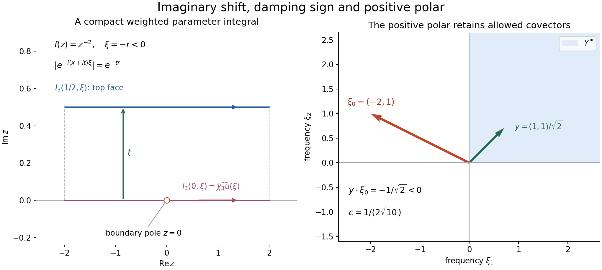
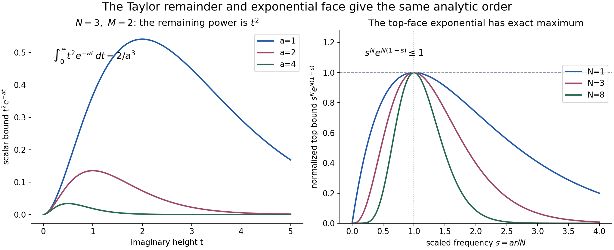

# Analytic directions of holomorphic boundary values

*Written by GPT-6.1 Sol (OpenAI), October 2026.  Public domain (CC0).*

A holomorphic function can have a singular boundary. Its imaginary directions still constrain which Fourier covectors can be singular. The sign comes from the factor \(e^{y\cdot\xi}\) in the negative-exponential Fourier transform: a shift into the tube damps covectors for which \(y\cdot\xi<0\).

Basic references are Nishiwada [N] and Strohmaier and Witten [S] for the classical boundary and bounded-sequence viewpoints. The prerequisites are the complete internal [Holomorphic boundaries in convex cones][T], for the distributional trace, and [Schwartz functions and Fourier inversion][F], for Fourier operations. The complete proof constructs the cutoff family and proves the analytic estimates, analytic differential decrease and ordinary-wavefront inclusion.

## 1. A moving cutoff keeps analytic information

A single arbitrary smooth cutoff can introduce a Fourier tail with no analytic bound. For the analytic wavefront test, use a sequence \(\chi_N\), equal to one on a common neighborhood, with a common compact support. Its low derivatives are uniformly bounded; derivatives through order \(N\) satisfy bounds of the form \((CN)^j\).

The construction is concrete. Start with a fixed cutoff \(\chi_0\), and convolve it with \(N\) nonnegative bumps, each of support radius \(d/N\) and total mass one:
\[
 \chi_N=\chi_0*\rho_N*\cdots*\rho_N.
 \tag{1}
\]
The total support expansion is \(d\), independently of \(N\). Put each high derivative on a different bump. Put any fixed number of additional derivatives on \(\chi_0\). This proves
\[
 \|\partial^{\alpha+\beta}\chi_N\|_\infty
          \leq C_\beta(CN)^{|\alpha|},\qquad |\alpha|\leq N.
 \tag{2}
\]
Putting every fixed-order derivative on \(\chi_0\) proves a bound independent of \(N\).

The analytic absence criterion requires a sequence \(u_N\), equal to \(u\) near the point, with a common compact support and a common finite distributional order, satisfying
\[
 |\widehat u_N(\xi)|
       \leq A^{N+1}N^N(1+|\xi|)^{-N}
 \tag{3}
\]
on a frequency cone. The constants in the finite-order bound are also independent of \(N\). These requirements distinguish analytic control from an arbitrary collection of Fourier estimates.

## 2. The tube direction fixes the sign

Suppose \(f\) is holomorphic on a truncated tube with imaginary directions in a nonempty open convex cone \(Y\). On each slightly larger compact real neighborhood assume
\[
 |f(x+iy)|\leq C|y|^{-M},\qquad M\geq0,
 \tag{4}
\]
uniformly for all sufficiently small nonzero \(y\in Y\). Its full cone boundary \(u\) exists by the preceding boundary theorem.

The positive polar is
\[
 Y^*=\{\xi:y\cdot\xi\geq0\text{ for every }y\in Y\}.
 \tag{5}
\]
The result is
\[
 \operatorname{WF}_A(u)\subseteq X\times(Y^*\setminus0).
 \tag{6}
\]

To understand the proof, choose a unit \(y\in Y\) with \(y\cdot\xi\leq-c|\xi|\) on the frequency cone to be excluded. For \(u_N=\chi_Nu\), extend its cutoff through the finite polynomial
\[
 E_N(x,t)=\sum_{j=0}^{N+M-1}\frac{(it)^j}{j!}D_y^j\chi_N(x).
 \tag{7}
\]
Differentiate the shifted integral of
\(f(x+ity)e^{-i(x+ity)\cdot\xi}E_N(x,t)\).
Holomorphy and compact integration by parts cancel every term except the last. Multiplying its Taylor factor by the growth (4) leaves
\[
 t^{N+M-1}t^{-M}e^{-c|\xi|t}
                  =t^{N-1}e^{-c|\xi|t}.
 \tag{8}
\]
That exponent is integrable at zero for every \(N\geq1\). Its full half-line integral is
\[
 \int_0^\infty t^{N-1}e^{-c|\xi|t}\,dt
               =\frac{(N-1)!}{(c|\xi|)^N}.
 \tag{9}
\]
The Taylor denominator is \((N+M-1)!\), so their ratio is at most one. The derivative estimate (2) gives the remaining \((CN)^N\). The fixed-height top integral has exponential decay and satisfies the same analytic bound. The complete proof also verifies the boundary limit of the moving finite test and the common distributional order.

*Figure 1. The left panel is a parameter-integral schematic for \(f(z)=z^{-2}\), imaginary direction \(y=1\), height \(\tau=1/2\), growth \(M=2\) and cutoff index \(N=3\). The cutoff is supported in \([-1,1]\); the integration window is \([-2,2]\), so endpoint terms vanish. For \(\xi=-r<0\), the phase has modulus \(e^{-tr}\). The right panel is a separate two-dimensional cone example: the shaded positive polar is the closed nonnegative quadrant, with its zero covector removed in the theorem. The green imaginary vector \(y=(1,1)/\sqrt2\) is shown under the Euclidean identification; it separates \(\xi_0=(-2,1)\) by dot product \(-1/\sqrt2\). See complete-proof Theorem 4.1 and Solutions 2–3.*

## 3. Two further consequences are proved separately

For an analytic-coefficient differential operator \(P\),
\[
 \operatorname{WF}_A(Pu)\subseteq\operatorname{WF}_A(u).
 \tag{10}
\]
Constant derivatives are handled by shifting the sequence index to absorb their Fourier powers. For multiplication by an analytic coefficient, the proof localizes that coefficient with controlled cutoffs and uses the exact convolution formula
\[
 \widehat{gu}(\xi)
       =(2\pi)^{-n}\int\widehat g(\xi-\eta)\widehat u(\eta)\,d\eta .
 \tag{11}
\]
The analytic sequence estimate handles the near frequency region. Outside it, cone separation and the controlled Fourier tail of the multiplier give the same bound. The proof retains the common finite order throughout.

The ordinary set satisfies
\[
 \operatorname{WF}(u)\subseteq\operatorname{WF}_A(u).
 \tag{12}
\]
Here choose a single smooth cutoff inside the neighborhood where every analytic sequence term equals \(u\). For each desired ordinary decay power, choose one sufficiently high sequence index. Formula (11) and cone separation give that power for the same fixed cutoff. The index may depend on the desired power; the cutoff does not.

Analytic functions have empty analytic wavefront. This follows by applying (3) directly to the controlled cutoffs for the constant function and then applying analytic multiplication. If an analytic multiplier is nowhere zero, its analytic reciprocal gives equality of the input and output analytic wavefront sets.

*Figure 2. For \(N=3,M=2\), the scalar remainder bound is \(t^2e^{-at}\), with \(a=c|\xi|>0\). The displayed rates \(1,2,4\) have full positive-half-line integrals \(2,1/4,1/32\). Extending the actual finite-height remainder integral to the half-line gives this upper bound. For the top face, \(s=ar/N\), now with \(a=c\tau\) and \(r=|\xi|\); the normalized expression \(s^Ne^{N(1-s)}\) has maximum one at \(s=1\), for every \(N\). The two panels use their separately specified positive parameters. See complete-proof equations (30)–(31) and Solution 2.*

## 4. Four worked examples

### Example 1: an upper simple pole.

Let \(b_+=(x+i0)^{-1}\), the boundary of \(1/z\) from the upper half-plane. Its exact normalized value and transform, proved in [B], are
\[
 b_+=\operatorname{pv}\frac1x-i\pi\delta_0,\qquad
 \widehat b_+=-2\pi iH(\xi).
 \tag{13}
\]
The approach cone is \(Y=(0,\infty)\), with positive polar \([0,\infty)\). The bound \(|1/(x+iy)|\leq y^{-1}\) gives (6), so only the positive covector ray at zero can remain.

It does remain. For any compact smooth \(\chi\), equal to one near zero, (11) gives
\[
 \widehat{\chi b_+}(\xi)
      =-i\int_{-\infty}^{\xi}\widehat\chi(s)\,ds
         \longrightarrow -2\pi i
                     \quad(\xi\longrightarrow+\infty).
 \tag{14}
\]
The limit is Fourier inversion at \(\chi(0)=1\). Hence that positive direction is in ordinary wavefront and, by (12), in analytic wavefront. Away from zero the boundary is the analytic function \(1/x\). Thus both sets are exactly the positive ray based at zero.

### Example 2: an upper cubic pole.

For \(b_3=(x+i0)^{-3}\), the growth exponent is \(M=3\). The same tube gives a positive-ray analytic upper bound. The exact derivative normalization is \(b_3=\frac12\partial_x^2b_+\), and
\[
 \widehat b_3=\pi i\,\xi^2H(\xi).
 \tag{15}
\]
For every cutoff equal to one near zero,
\[
 \xi^{-2}\widehat{\chi b_3}(\xi)
       \longrightarrow i\pi
                    \quad(\xi\longrightarrow+\infty).
 \tag{16}
\]
Indeed (11) gives \(\frac i2\int_{s\leq\xi}(\xi-s)^2\widehat\chi(s)\,ds\). Divide by \(\xi^2\), use the integrable majorant \(C(1+s^2)|\widehat\chi(s)|\), and apply inversion. Ordinary rapid decay is impossible on the positive ray. Thus its analytic wavefront is again exactly that ray, despite the higher boundary order.

### Example 3: a nonvanishing analytic multiplier.

In dimension one, \(e^{\lambda x}\), \(\lambda\in\mathbb R\), has an analytic reciprocal. Its multiplication therefore preserves analytic wavefront. For a second point jet,
\[
 e^{\lambda x}\delta_0''
          =\delta_0''-2\lambda\delta_0'+\lambda^2\delta_0.
 \tag{17}
\]
Both nonzero covector rays at zero remain: with a cutoff equal to one there, the leading Fourier term of \(\delta_0''\) is \(-\xi^2\), which cannot decrease rapidly. Ordinary inclusion and the reciprocal argument prove equality of analytic wavefront. At other base points both distributions are zero and hence analytic.

The nonvanishing condition matters. Multiplication by \(x\) gives \(xb_+=1\), because \(x\operatorname{pv}(1/x)=1\) and \(x\delta_0=0\). Its analytic wavefront becomes empty.

### Example 4: two independent upper poles.

Let \(f(z_1,z_2)=1/(z_1z_2)\) with \(y_1,y_2>0\). Its common boundary is \(b_+\otimes b_+\), by the tensor-product limit theorem [D], Theorem 3.1. For each
\[
 Y_c=\{y:y_1>c|y|,\ y_2>c|y|\},
              \qquad 0<c<1/\sqrt2,
 \tag{18}
\]
the growth estimate is uniform:
\(|f(x+iy)|\leq c^{-2}|y|^{-2}\).
Every direction in the open first quadrant lies in some \(Y_c\). The smaller-cone extension of the tube theorem thus gives the analytic upper bound by the closed positive frequency quadrant.

The exact global transform is
\[
 \widehat{b_+\otimes b_+}
                    =-4\pi^2H(\xi_1)H(\xi_2).
 \tag{19}
\]
At the base point \((0,0)\), every interior positive covector is in ordinary wavefront. For any cutoff \(\chi=1\) near that point, (11) gives
\[
 \widehat{\chi(b_+\otimes b_+)}(\xi)
      =-\int_{s_1\leq\xi_1,\ s_2\leq\xi_2}\widehat\chi(s)\,ds.
 \tag{20}
\]
Along any ray with both coordinates positive, this tends to \(-4\pi^2\chi(0,0)=-4\pi^2\), by dominated convergence and inversion. Closedness of ordinary wavefront includes the two positive axes as limits of interior covectors. Ordinary inclusion and the analytic upper bound therefore show that the analytic fiber at the origin is exactly the closed positive quadrant, with its zero covector removed.

The bound on the whole quadrant is not uniform in \(|y|\) as a direction reaches an edge. The known common boundary and the explicitly uniform bounds on \(Y_c\) are what justify this example.

## 5. Exercises, 100 points

1. **A controlled cutoff family, 10 points.** In dimension one take \(U=(-1/4,1/4)\), \(d=1/8\), and \(V=(-1,1)\). Choose a fixed smooth cutoff equal to one on the closed \(d\)-neighborhood of \(U\), with support in its open \(2d\)-neighborhood. Determine a common support for the convolved cutoffs, verify the plateau, and prove both high-derivative and uniform fixed-derivative bounds.
2. **The cancellation order, 12 points.** For growth exponent \(M=2\) and cutoff index \(N=3\), write the full Taylor cutoff polynomial and the exact last-term derivative of the shifted integral. Compute the scalar factorial ratio in the Fourier estimate. Also check the endpoint \(M=0,N=1\).
3. **Two separating imaginary directions, 12 points.** For the first-quadrant approach cone, find unit imaginary directions excluding \(\xi_0=(-2,1)\) and \(\zeta_0=(-1,100)\). Give an explicit positive separation constant for the first direction and compute the polar of the full quadrant.
4. **A multiplier can preserve or remove a singularity, 14 points.** Derive (17) from tests. Prove the analytic-wavefront equality for \(e^{\lambda x}\delta_0''\), and compare it with \(xb_+=1\). Identify the precise hypothesis used in the equality argument.
5. **Differential decrease has no automatic converse, 12 points.** Let \(P=x\partial_x+1\). Prove \(Pb_+=0\) and \(P\delta_0=0\), with all distributional signs. Explain why the nonempty wavefront of these inputs does not contradict (10), and compute the principal characteristic condition at zero.
6. **One cutoff for every ordinary power, 12 points.** In the proof of ordinary inclusion, take common order \(m=3\), dimension \(n=2\), and desired power \(p=4\). Choose valid sequence and Schwartz-tail orders and check the integrability exponent. Explain how the same fixed spatial cutoff serves every \(p\).
7. **The quadrant trace and its complete origin fiber, 14 points.** Prove that the boundary of \(1/(z_1z_2)\) is \(b_+\otimes b_+\) for every joint approach with \(y_1,y_2>0\). Verify the uniform growth on (18), the Fourier constant in (19), and both upper and lower bounds for the analytic fiber at \((0,0)\), including its axes.
8. **Reverse the approach sign, 14 points.** Determine the full analytic wavefront of \(b_-=(x-i0)^{-1}\). Compute the sum and difference of \(b_+\) and \(b_-\) and their wavefront fibers at zero. Explain why their sum cannot be the ordinary trace of a holomorphic function on a tube with all real imaginary directions.

## 6. Complete solutions

### Solution 1

The closed \(d\)-neighborhood of \(U\) is \([-3/8,3/8]\), and its open \(2d\)-neighborhood is \((-1/2,1/2)\). Choose \(\chi_0\) between zero and one, equal to one on the first interval and supported in the second, using ordinary smooth bumps. Let \(\rho\) have support \([-1,1]\), be nonnegative, and have integral one. Then
\[
 \rho_N(x)=8N\rho(8Nx)
\]
has support radius \(1/(8N)\). The sum of \(N\) such radii is \(1/8\). Every \(\chi_N\) is therefore supported in \([-5/8,5/8]\), which is compactly inside \(V\). For \(x\in U\), every argument of \(\chi_0\) averaged by the convolution lies in \([-3/8,3/8]\), so \(\chi_N(x)=1\).

For integers \(j\leq N\), put one derivative on each of \(j\) different factors. Each has derivative \(L^1\)-norm \(8N\|\rho'\|_1\); the others have norm one. Thus
\[
 \|\chi_N^{(j+q)}\|_\infty
        \leq\|\chi_0^{(q)}\|_\infty
                  (8N\|\rho'\|_1)^j
\]
for every fixed \(q\). Putting all derivatives of any fixed order on \(\chi_0\) instead gives
\(\|\chi_N^{(q)}\|_\infty\leq\|\chi_0^{(q)}\|_\infty\),
uniformly in \(N\). The support, plateau and both derivative bounds are verified.

### Solution 2

Here \(L=N+M-1=4\), so
\[
 E_3=\chi_3+itD_y\chi_3-\frac{t^2}{2}D_y^2\chi_3
            -\frac{it^3}{6}D_y^3\chi_3+\frac{t^4}{24}D_y^4\chi_3 .
\]
In \(\partial_tE_3-iD_yE_3\), the terms of derivative orders one through four cancel. The remaining term is \(-it^4D_y^5\chi_3/24\). Thus the shifted integral has derivative
\[
 I_3'(t,\xi)
      =-\frac{it^4}{24}\int f(x+ity)e^{-i(x+ity)\cdot\xi}
                                    D_y^5\chi_3(x)\,dx .
\]
Growth \(t^{-2}\) leaves the remainder power \(t^2=t^{N-1}\). Its half-line integral is \(2/(c|\xi|)^3\); dividing by \(4!=24\) gives ratio \(1/12\). The derivative \(D_y^5\chi_3\) puts two derivatives on the initial cutoff and one on each of three bumps. Its bound is \(C_2(C\cdot3)^3\), with the two extra derivatives in the fixed constant.

For \(M=0,N=1\), \(L=0\), \(E_1=\chi_1\), and \(I_1'=-i\int f e^{-iz\cdot\xi}D_y\chi_1\). The growth is bounded and the remainder integral is at most \(1/(c|\xi|)\). The factorial ratio is \(0!/0!=1\). There is no negative Taylor order or divergent remainder at this endpoint.

### Solution 3

For \(\xi_0=(-2,1)\), use \(y=(1,1)/\sqrt2\). Its dot product with \(\xi_0\) is \(-1/\sqrt2\), and \(|\xi_0|=\sqrt5\). Thus
\[
 y\cdot\xi_0=-\frac1{\sqrt{10}}|\xi_0|.
\]
The open cone \(y\cdot\xi<-|\xi|/(2\sqrt{10})\) contains \(\xi_0\), and \(c=1/(2\sqrt{10})\) is a valid uniform separation constant on that cone.

For \(\zeta_0=(-1,100)\), the diagonal direction would not work. Take
\[
 y'=(200,1)/\sqrt{40001}.
\]
It is a unit vector in the approach quadrant, and
\(y'\cdot\zeta_0=-100/\sqrt{40001}<0\).
A sufficiently small conic neighborhood keeps this negative with a fixed fraction of its value.

The full polar is \(\{\xi_1\geq0,\xi_2\geq0\}\). Nonnegative coordinates give nonnegative dot product with every positive \(y\). If, for example, \(\xi_1<0\), choose the positive ratio \(y_1/y_2\) large enough that \(y_1\xi_1+y_2\xi_2<0\). The other coordinate is identical. The entire approach cone supplies an intersection of directional exclusions, not just the exclusion furnished by one diagonal ray.

### Solution 4

By the complex-linear distributional derivative convention,
\[
 (e^{\lambda x}\delta_0'')(\phi)
       =\partial_x^2(e^{\lambda x}\phi)(0)
       =\phi''(0)+2\lambda\phi'(0)+\lambda^2\phi(0).
\]
Since \(\delta_0'(\phi)=-\phi'(0)\), this is
\((\delta_0''-2\lambda\delta_0'+\lambda^2\delta_0)(\phi)\),
which proves (17), including the middle minus sign.

Both \(e^{\lambda x}\) and \(e^{-\lambda x}\) are analytic. Apply analytic multiplication first to \(\delta_0''\), then to the output with the reciprocal. The two inclusions give equality. The wavefront of \(\delta_0''\) has both nonzero rays at zero: a cutoff equal to one there leaves its transform \(-\xi^2\), which has no rapid decay on either ray. Ordinary inclusion gives both analytic rays; away from zero the distribution is zero, so no other base point occurs.

For the pole, the symmetric principal-value definition gives \(x\operatorname{pv}(1/x)=1\) on tests, and \(x\delta_0=0\). Hence \(xb_+=1\), whose analytic wavefront is empty. Equality in the first argument used a locally nowhere-zero analytic multiplier and its analytic reciprocal. The multiplier \(x\) has no such reciprocal near zero.

### Solution 5

The exact boundary recurrences of [B] give
\(\partial_x b_+=-(x+i0)^{-2}\) and \(x(x+i0)^{-2}=b_+\).
Therefore \(x\partial_xb_++b_+=-b_++b_+=0\), as an equality of whole distributions.

For the point delta, evaluate
\[
 (x\delta_0')(\phi)=\delta_0'(x\phi)
           =-\partial_x(x\phi)(0)=-\phi(0).
\]
Thus \(x\delta_0'=-\delta_0\), and \(P\delta_0=0\).

The output zero distribution has empty analytic wavefront, which is indeed a subset of either input's wavefront. Differential decrease asserts this inclusion; it does not assert that an analytic output forces an analytic input. The principal symbol is proportional to \(x\xi\). At the base point zero it vanishes for every covector, so neither example is noncharacteristic there. A noncharacteristic analytic regularity theorem is a further result.

### Solution 6

The proof requires \(N>p+n=6\), so \(N=7\) is valid. On the analytic cone, the weighted source Fourier factor is bounded because \(N>p\), and the fixed weighted Schwartz transform is integrable. Its constant may contain \(A^8 7^7\), which is finite and acceptable for the chosen ordinary power four.

For the outside-cone estimate choose \(\ell>p+m+n=9\), for example \(\ell=10\). The remaining exponent is
\[
 m-\ell+p=3-10+4=-3.
\]
In dimension two, \((1+|\eta|)^{-3}\) is integrable: on dyadic shells its bound is a constant times \(2^{2j}2^{-3j}=2^{-j}\), a summable series. Cone separation supplies the factor \((1+|\xi|)^{-4}\).

For general \(p\), choose \(N=p+n+1\) and \(\ell=p+m+n+1\). Only these estimates and their constants change. The same spatial cutoff \(\chi\) has support in the common neighborhood where all \(u_N=u\), so \(\chi u_N=\chi u\) for every index. This is one ordinary localization satisfying all inverse-power estimates.

### Solution 7

The one-dimensional upper traces converge in distributions for every sequence of positive heights approaching zero. For any sequence \((y_{1,j},y_{2,j})\to(0,0)\), [D], Theorem 3.1, gives the joint tensor limit \(b_+\otimes b_+\). The analytic functions factor as a product of the two ordinary pole factors, so this is their joint boundary on every compact test. If any one scalar test pairing failed to have the full joint limit, a sequence with error bounded away from zero would contradict that sequential result. Thus every joint approach is covered.

The set \(Y_c\) is an open convex cone: each inequality \(y_j-c|y|>0\) describes an open convex cone, by the triangle inequality, and their intersection is one. It is nonempty for \(c<1/\sqrt2\), since the diagonal satisfies both inequalities. On it, \(|x_j+iy_j|\geq y_j>c|y|\), so
\[
 |f(x+iy)|\leq(y_1y_2)^{-1}<c^{-2}|y|^{-2}.
\]
Every positive-quadrant direction lies in some such cone, by choosing \(c\) below both positive normalized coordinates. Theorem 4.1 on these cones and the known common trace gives an upper analytic fiber in their intersected polars, which is the nonnegative frequency quadrant.

Fourier transformation of a tensor product factors on separated Schwartz tests; density and the continuous tensor construction extend it to all Schwartz tests. Each factor has transform \(-2\pi iH\), so their product is \(-4\pi^2H(\xi_1)H(\xi_2)\). The coefficient is negative real because \(i^2=-1\).

For an arbitrary compact cutoff equal to one near the origin, formula (11) gives (20), with coefficient \(-4\pi^2/(2\pi)^2=-1\). Along any ray with both frequency coordinates positive, its integration rectangle increases to the whole plane. The Schwartz transform is absolutely integrable, so dominated convergence gives
\[
 -\int_{\mathbb R^2}\widehat\chi(s)\,ds
              =-(2\pi)^2\chi(0,0)=-4\pi^2.
\]
Rapid decay fails in every such covector direction. The two positive axes follow by closedness of ordinary wavefront, since they are nonzero limits of interior positive covectors at the same base point. Ordinary inclusion gives the same lower analytic bound; the tube upper bound excludes every other nonzero covector. This proves the complete origin fiber. No uniform radial bound on the whole approach quadrant has been assumed.

### Solution 8

The lower approach cone is \(Y=(-\infty,0)\), whose positive polar is \((-\infty,0]\). The exact value and transform are
\[
 b_-=\operatorname{pv}\frac1x+i\pi\delta_0,\qquad
 \widehat b_-=2\pi iH(-\xi).
\]
The lower tube theorem excludes the positive covector ray. For any cutoff equal to one at zero, convolution with the negative Heaviside factor gives a nonzero limit \(2\pi i\) as \(\xi\to-\infty\), by the same Fourier-inversion calculation as Example 1. The ordinary negative ray is therefore present, and ordinary inclusion shows it is analytic. Away from zero the boundary is analytic. Its full analytic wavefront is the negative ray based at zero.

The sum and difference are
\[
 b_++b_-=2\operatorname{pv}\frac1x,\qquad
 b_+-b_-=-2\pi i\delta_0.
\]
The difference has both rays because the localized delta transform is a nonzero constant. For the sum, its localized transform is
\(-i\int\widehat\chi(s)\operatorname{sgn}(\xi-s)\,ds\).
As \(\xi\to+\infty\) it tends to \(-2\pi i\), and as \(\xi\to-\infty\) to \(2\pi i\). Dominated convergence uses \(\widehat\chi\in L^1\). Thus ordinary wavefront has both rays, and so does analytic wavefront; neither distribution has another base point.

A tube with all real imaginary directions contains an open complex neighborhood of its real base. Its ordinary trace is analytic there and has empty analytic wavefront by Corollary 2.3. The sum just computed has nonempty analytic wavefront at zero, so it cannot be such a trace on a neighborhood of zero. This conclusion does not assert a converse regularity theorem for arbitrary differential operators.

## References

[N] Kimimasa Nishiwada, *On Local Characterization of Wave Front Sets in Terms of Boundary Values of Holomorphic Functions*, Publications of the Research Institute for Mathematical Sciences **14** (1978), 309–320. [Primary article](https://www.jstage.jst.go.jp/article/kyotoms1969/14/2/14_2_309/_article/-char/en).

[S] Alexander Strohmaier and Edward Witten, *Analytic States in Quantum Field Theory on Curved Spacetimes*, Annales Henri Poincaré **25** (2024), 4543–4590, Appendix B. [Open-access primary article](https://link.springer.com/article/10.1007/s00023-024-01419-0), retaining its CC BY 4.0 terms.

[T] [Holomorphic boundaries in convex cones][T], Theorem 2.1 and its uniform finite-test estimate.

[F] [Schwartz functions and Fourier inversion][F], Sections 1–5.

[B] [Complex powers at a boundary][B], Theorem 2.1 and Corollary 3.2.

[D] [Tensor products and parameter-dependent distributions][D], Theorems 2.1, 3.1 and 4.1.

Original examples, exposition and solutions are CC0. Linked proofs retain their provenance and actual terms. Noncharacteristic analytic Euler regularity and the general analytic wavefront operation theorems remain further mathematical prerequisites.

[T]: ../prerequisites/holomorphic-boundaries-in-convex-cones.html
[F]: https://github.com/KokunoYumeto/open-math-courses-public/blob/4a02a9a0de3d65bf22315884bba61878280a88b0/docs/courses/AN-01/prerequisites/U011-free-foundations/schwartz-fourier-foundations-U017.md
[B]: https://github.com/KokunoYumeto/open-math-courses-public/blob/4a02a9a0de3d65bf22315884bba61878280a88b0/docs/courses/AN-01/src/complex-powers-at-a-boundary.md
[D]: ../prerequisites/tensor-products-and-parameters.html

## Complete proof

Holomorphic extension in an imaginary direction suppresses Fourier covectors that point against that direction. A distributional boundary limit alone does not quantify this suppression. We prove the analytic estimate by combining a compact cutoff family with a finite Taylor extension of each cutoff. The cancellation leaves an integrable remainder even when the holomorphic function grows as a negative power of its imaginary height.

The result applies in every dimension, to every nonempty open convex approach cone, and to every locally uniform polynomial growth exponent. We also prove that analytic differential operators decrease analytic wavefront, and that ordinary wavefront is contained in analytic wavefront. These are separate conclusions from the boundary-existence theorem.

Basic references are Nishiwada [N] for the classical boundary-value description, and Strohmaier and Witten [S], Appendix B, for the bounded-sequence convention. The complete Fourier operations used here are [Schwartz functions and Fourier inversion][F]. The exact boundary limit and its uniform finite-test estimate are [Holomorphic boundaries in convex cones][T], Theorem 2.1 and Corollary 2.2. We reuse that distributional result and supply all the analytic estimates below.

## 1. Analytic regularity requires a controlled sequence

Use the Fourier convention
\[
 \widehat\phi(\xi)=\int e^{-ix\cdot\xi}\phi(x)\,dx,
 \qquad \langle\widehat v,\phi\rangle=\langle v,\widehat\phi\rangle .
 \tag{1}
\]
A sequence \(v_N\) is bounded with common compact support if there are a compact set \(K\), an integer \(m\geq0\), and a constant \(B\) such that every \(v_N\) is supported in \(K\) and
\[
 |v_N(\phi)|\leq B\max_{|\alpha|\leq m}\sup_K|\partial^\alpha\phi|
                   \quad(\phi\in C^\infty(\mathbb R^n)).
 \tag{2}
\]
Compact distributions act on these smooth tests by inserting any fixed cutoff equal to one near their support. Definition (2) also gives the uniform Fourier bound
\[
 |\widehat v_N(\xi)|\leq B'(1+|\xi|)^m.
 \tag{3}
\]
Indeed apply (2) to \(e^{-ix\cdot\xi}\); its derivatives are powers of \(-i\xi\).

For \(u\in\mathcal D'(X)\), \(X\subset\mathbb R^n\) open, say that \((x_0,\xi_0)\), \(\xi_0\ne0\), is absent from \(\operatorname{WF}_A(u)\) if there are a neighborhood \(U\) of \(x_0\), an open cone \(\Gamma\) containing \(\xi_0\), a sequence as in (2) with \(v_N=u\) on \(U\), and a constant \(A\) such that
\[
 |\widehat v_N(\xi)|
       \leq A^{N+1}N^N(1+|\xi|)^{-N},
            \qquad \xi\in\Gamma,\quad N\geq1 .
 \tag{4}
\]
This is the bounded-sequence definition of analytic wavefront in Euclidean coordinates. Replacing \(1+|\xi|\) by \(|\xi|\), or \(N\) by \(N+1\), gives the same condition. For \(|\xi|\geq1\), the weights differ by at most \(2^N\); \((1+1/N)^N\leq e\). For \(|\xi|\leq1\), the common bound (3) is absorbed by increasing \(A\). Thus those conventional choices do not change the set.

For ordinary wavefront, the corresponding absence condition is a single \(\chi\in C_c^\infty(X)\), equal to one near \(x_0\), and a cone \(\Gamma\) on which \(\widehat{\chi u}\) decreases faster than every inverse power. A sequence with no common finite-order bound is insufficient for (4).

Both wavefront sets are closed and conic in the nonzero cotangent space. Every absence witness works on the product of its smaller spatial neighborhood and its frequency cone; the complement is open and invariant under positive covector scaling.

**Lemma 1.1 (cutoffs with two kinds of derivative bounds).** Given a point \(x_0\) and an open neighborhood \(V\) with compact closure in \(X\), there are a smaller neighborhood \(U\), a compact \(K\subset V\), and cutoffs \(0\leq\chi_N\leq1\) supported in \(K\), equal to one on \(U\), such that for every fixed multi-index \(\beta\),
\[
 \|\partial^{\alpha+\beta}\chi_N\|_\infty
       \leq C_\beta(CN)^{|\alpha|}
                   \quad(|\alpha|\leq N).
 \tag{5}
\]
In addition, every fixed-order derivative of \(\chi_N\) is bounded independently of \(N\).

**Proof.** Choose \(U\) and a number \(d>0\) so that the closed \(4d\)-neighborhood of \(U\) lies in \(V\). Choose \(\chi_0\in C_c^\infty(V)\), between zero and one, equal to one on the closed \(d\)-neighborhood of \(U\), with support inside its open \(2d\)-neighborhood. Its support is then at distance greater than \(d\) from \(V^c\). Choose a nonnegative smooth bump \(\rho\) supported in the unit ball and normalize its positive integral to one. Let
\[
 \rho_N(x)=(N/d)^n\rho(Nx/d),\qquad
 \chi_N=\chi_0*\underbrace{\rho_N*\cdots*\rho_N}_{N\ \mathrm{factors}} .
 \tag{6}
\]
The sum of the \(N\) support radii is \(d\). Thus all supports lie in one compact subset of \(V\), and every convolution averages only values equal to one when its final argument is in \(U\). Nonnegativity and total mass one give \(0\leq\chi_N\leq1\).

For a fixed \(\beta\), put all those derivatives on \(\chi_0\). For a multi-index \(\alpha\) with total order at most \(N\), put each of its coordinate derivatives on a different convolution factor. Differentiating under the finite compact integrals gives
\[
 \partial^{\alpha+\beta}\chi_N
       =(\partial^\beta\chi_0)*(\partial_{j_1}\rho_N)*\cdots*
         (\partial_{j_{|\alpha|}}\rho_N)*
         \rho_N*\cdots*\rho_N .
 \tag{7}
\]
Each differentiated factor has \(L^1\)-norm at most
\((N/d)\max_j\|\partial_j\rho\|_1\); each remaining factor has norm one. The elementary convolution estimate
\(\|h*g\|_\infty\leq\|h\|_\infty\|g\|_1\), applied repeatedly, proves (5). For any fixed derivative order, put every derivative on \(\chi_0\) instead; the other factors have norm one. This gives the asserted uniform low-order bounds. \(\square\)

For a unit vector \(y\), the same construction gives, for fixed \(q\),
\[
 \|D_y^{N+q}\chi_N\|_\infty\leq C_q(CN)^N,
 \qquad D_y=y\cdot\nabla.
 \tag{8}
\]
Put \(q\) directional derivatives on \(\chi_0\), and one on each of the \(N\) factors. The \(L^1\)-bound for a directional derivative is at most the sum of the coordinate bounds times \(\sum|y_j|\leq\sqrt n\). This fixes the constants in (8), uniformly over unit \(y\).

## 2. Analytic coefficients preserve the directional estimate

We first record the exact multiplication calculation. If \(v\) is a compact distribution and \(g\) is compact smooth, then
\[
 \widehat{gv}(\xi)
     =(2\pi)^{-n}\int\widehat g(\xi-\eta)\widehat v(\eta)\,d\eta .
 \tag{9}
\]
For a proof, inverse Fourier transformation of \(g\) gives
\[
 g(x)e^{-ix\cdot\xi}
       =(2\pi)^{-n}\int\widehat g(\xi-\eta)e^{-ix\cdot\eta}\,d\eta .
 \tag{10}
\]
Insert a fixed cutoff in \(x\) equal to one near \(\operatorname{supp}v\). Every \(x\)-derivative of the integrand adds a polynomial in \(\eta\), while \(\widehat g\) decreases rapidly. The integral and its tails therefore converge in every compact-test seminorm, on one common support. The finite-order bound permits applying \(v\) to the integral, proving (9) and absolute convergence. Fourier inversion and the rapid estimates used here are proved in [F], Sections 2–5.

**Lemma 2.1 (analytic cutoff multipliers).** If \(a\) is real analytic on a neighborhood of the compact set \(K\) in Lemma 1.1 and \(g_L=a\chi_L\), then
\[
 |\widehat g_L(\eta)|
       \leq C(CL)^j(1+|\eta|)^{-j}
                  \quad(0\leq j\leq L),
 \qquad
 \|\widehat g_L\|_1\leq C .
 \tag{11}
\]
The last constant is independent of \(L\).

**Proof.** Real analyticity gives on \(K\) a uniform factorial derivative bound
\(\|\partial^\beta a\|_\infty\leq A B^{|\beta|}|\beta|!\).
Here is its local justification. In a power-series neighborhood, choose a polyradius \(r>0\) for which the absolute coefficient sum is finite. Each coefficient is bounded by \(M r^{-|\gamma|}\). On the half-radius polydisk, termwise differentiation and the product identity
\[
 \sum_{\ell\geq0}\binom{\ell+b}{b}2^{-\ell}=2^{b+1}
 \tag{12}
\]
give \(|\partial^\beta a|\leq M\,2^n(2/r)^{|\beta|}\beta!\).
Identity (12) follows by differentiating the convergent geometric series \(b\) times, or by multiplying \(b+1\) copies and counting the compositions of \(\ell\). The differentiated series are absolutely convergent on each smaller polydisk. A finite such cover of \(K\) gives the stated uniform bound.

For \(|\beta|\leq L\), \(|\beta|!\leq L^{|\beta|}\). Leibniz's rule and (5) with no extra derivatives thus bound every derivative of \(g_L\) of total order \(j\leq L\) by \(C(CL)^j\). The binomial sums are absorbed by replacing \(C\) with \(B+C\). Integrate by parts \(j\) times in the unit direction \(\eta/|\eta|\); compact support leaves no boundary term. The support volume and these derivative bounds give \(|\widehat g_L(\eta)|\leq C(CL)^j|\eta|^{-j}\) for \(|\eta|\geq1\), with dimension constants absorbed in \(C\). The uniform \(L^1\)-norm of \(g_L\) handles \(|\eta|\leq1\), and replacing \(|\eta|\) by \(1+|\eta|\) only costs \(2^j\).

For the last assertion, choose one fixed derivative order greater than \(n\). The uniform low-order part of Lemma 1.1, together with the fixed derivatives of \(a\) on \(K\), gives a rapid bound of that order for \(\widehat g_L\) uniformly in \(L\), by the same integration-by-parts calculation. Its integral is finite and independent of \(L\). \(\square\)

**Theorem 2.2 (analytic multiplication).** For real analytic \(a\) on \(X\),
\[
 \operatorname{WF}_A(au)\subseteq\operatorname{WF}_A(u).
 \tag{13}
\]

**Proof.** Take the sequence \(u_L\), common order \(m\), and cone \(\Gamma\) of (2)–(4) at an absent point for \(u\). Choose cutoffs of Lemma 1.1 supported inside the neighborhood where \(u_L=u\). On a smaller neighborhood they equal one. Let \(b=m+n+2\), \(L=N+b\), and set
\[
 v_N=g_Lu_L,\qquad g_L=a\chi_L .
 \tag{14}
\]
These distributions agree with \(au\) on that smaller neighborhood. Their supports are in the fixed cutoff support. Leibniz's rule and the uniform fixed-order derivatives of \(g_L\) show that they have a common finite-order bound, independently of \(N\).

Shrink to a cone \(\Gamma'\) whose spherical closure lies inside \(\Gamma\). There is \(c>0\) such that
\[
 |\xi-\eta|\geq c(|\xi|+|\eta|)
          \quad(\xi\in\Gamma',\ \eta\notin\Gamma).
 \tag{15}
\]
Otherwise normalize a contradicting sequence by \(|\xi|+|\eta|\). Compactness gives equal nonzero limiting directions, one in the closed smaller cone and one outside the larger cone, a contradiction. Zero or unequal limiting lengths cannot make the difference zero.

Use (9) and write \(r=|\xi|\). On \(\eta\in\Gamma\), \(|\eta|\geq r/2\), (4) and the uniform \(L^1\)-bound in (11) give
\[
 \left|\int_{\mathrm{this\ region}}\widehat g_L(\xi-\eta)\widehat u_L(\eta)\,d\eta\right|
       \leq C^{L+1}L^L(1+r)^{-L}.
 \tag{16}
\]
The factor \(2^L\) from \(r/2\) is included in \(C^{L+1}\).

On the complement, either (15) applies or \(|\eta|<r/2\), which itself gives \(|\xi-\eta|\geq(r+|\eta|)/3\). Use the \(j=L\) estimate in (11) and the common polynomial bound (3). The absolute integral is at most
\[
 \begin{aligned}
 C^{L+1}L^L\int(1+r+|\eta|)^{-L}(1+|\eta|)^m\,d\eta
 &\leq C^{L+1}L^L(1+r)^{m+n-L}.
 \end{aligned}
 \tag{17}
\]
For the last estimate put \(\eta=(1+r)z\). The remaining integral is bounded by \(\int(1+|z|)^{m-b}\,dz\), a fixed finite constant, since \(L\geq b\).

For \(r\geq N\), \(L=N+b\) satisfies \(L^L\leq C_b^{N+1}N^{N+b}\): expand \((1+b/N)^{N+b}\) and bound it by a constant times \(e^b\), absorbing the finitely many small \(N\). Equation (16) is therefore at most \(C^{N+1}N^N(1+r)^{-N}\). Equation (17) has the same bound with the extra factor at most \(N^{m+n}\), because \(b=m+n+2\); this fixed polynomial is absorbed in a larger \(C^{N+1}\), using \(\log N\leq N\).

For \(r<N\), the common finite-order bound on \(v_N\) gives \(C(1+r)^m\). This also satisfies (4) with a larger constant: \((1+r)\leq N+1\leq2^N\) and \(N/(1+r)\geq1/2\). Thus all frequencies in \(\Gamma'\) satisfy the required analytic estimate. This proves (13). \(\square\)

**Corollary 2.3 (analytic differential decrease and analytic functions).** If
\(P=\sum_{|\alpha|\leq q}a_\alpha(x)\partial^\alpha\) has real analytic coefficients, then
\[
 \operatorname{WF}_A(Pu)\subseteq\operatorname{WF}_A(u).
 \tag{18}
\]
Every real analytic function has empty analytic wavefront.

**Proof.** For a constant derivative \(\partial^\alpha\), of order \(j\), use \(\partial^\alpha u_{N+j}\). The sequence has a common compact support and order at most \(m+j\). Its Fourier multiplier is \((i\xi)^\alpha\). The estimate (4) at index \(N+j\) implies the estimate at index \(N\), after increasing its constant: the extra frequency factor is absorbed by the extra \(j\) decay powers, and the remaining \(N^j\) is absorbed exponentially as in Theorem 2.2. It agrees with \(\partial^\alpha u\) on the same neighborhood. Apply Theorem 2.2 to each coefficient.

For a finite sum, intersect its finitely many neighborhoods and cones. Add the finitely many regular sequences, extend their compact supports to their finite union, and take the maximum of their finite orders. Their Fourier estimates add and are absorbed by one larger constant in (4). This proves (18).

For the constant function one, take the cutoffs \(\chi_N\). The integration-by-parts calculation of Lemma 2.1 with \(a=1,j=N\) proves (4) on all nonzero frequency directions; their zeroth-order bounds are uniform. Thus \(\operatorname{WF}_A(1)\) is empty. Theorem 2.2 applied to \(a\cdot1\) gives the assertion for any analytic function \(a\). \(\square\)

If \(a\) is analytic and nowhere zero locally, its reciprocal is analytic by the convergent geometric series in a sufficiently small power-series neighborhood. Applying Theorem 2.2 twice gives equality of the analytic wavefront sets of \(au\) and \(u\) there.

## 3. Ordinary wavefront is contained in analytic wavefront

**Theorem 3.1.** For every distribution on \(X\),
\[
 \operatorname{WF}(u)\subseteq\operatorname{WF}_A(u).
 \tag{19}
\]

**Proof.** At an analytically absent point, let \(u_N\) be the sequence in (2)–(4). Choose a fixed compact smooth \(\chi\), equal to one near the point, with support inside the neighborhood where every \(u_N=u\). Thus \(\chi u_N=\chi u\) for every \(N\). Apply (9), now with the single multiplier \(\chi\).

Fix a smaller cone \(\Gamma'\) as in (15) and any desired inverse-power order \(p\). Choose one fixed index \(N>p+n\). On \(\eta\in\Gamma\), use (4) at this index and
\[
 1+|\xi|\leq(1+|\xi-\eta|)(1+|\eta|).
 \tag{20}
\]
The weighted integral in (9) is bounded by the \(L^1\)-norm of
\((1+|\zeta|)^p\widehat\chi(\zeta)\) times the finite constant
\(\sup_{\eta\in\Gamma}(1+|\eta|)^p|\widehat u_N(\eta)|\).
Both are finite. The potentially large \(A^{N+1}N^N\) is fixed for this \(p\), which is exactly what ordinary rapid decay allows.

On \(\eta\notin\Gamma\), use (15), the common polynomial bound (3), and a rapid-decay order \(\ell>p+m+n\) for \(\widehat\chi\). The absolute integral is at most
\[
 C(1+|\xi|)^{-p}
       \int(1+|\eta|)^{m-\ell+p}\,d\eta ,
 \tag{21}
\]
which is finite. To see the factorization, both \(1+|\xi|\) and \(1+|\eta|\) are bounded by a constant times \(1+|\xi-\eta|\) on this region; distributing the exponent \(\ell\) as \(p\) and \(\ell-p\) gives (21).

Thus \(\widehat{\chi u}\) decreases with every desired order on \(\Gamma'\), using the same \(\chi\). The point is ordinarily absent. Taking complements proves (19). \(\square\)

## 4. The holomorphic tube selects the positive polar

Let \(Y\subset\mathbb R^n\) be a nonempty open convex cone, invariant under every positive dilation. Its positive polar is
\[
 Y^*=\{\xi:y\cdot\xi\geq0\text{ for every }y\in Y\}.
 \tag{22}
\]
This convention determines the sign of the conclusion.

**Theorem 4.1 (analytic wavefront of a polynomially bounded tube boundary).** Let \(f\) be holomorphic in
\[
 \{x+iy:x\in X,\ y\in Y,\ |y|<h\},
 \tag{23}
\]
and suppose every slightly larger compact real neighborhood has constants \(C\), an integer \(M\geq0\), and a positive height for which
\[
 |f(x+iy)|\leq C|y|^{-M}
 \tag{24}
\]
holds uniformly for all sufficiently small nonzero \(y\in Y\). Its full cone boundary \(u\), supplied by [T], satisfies
\[
 \operatorname{WF}_A(u)\subseteq X\times(Y^*\setminus\{0\}).
 \tag{25}
\]

**Proof.** Fix \(x_0\in X\) and \(\xi_0\notin Y^*\), \(\xi_0\ne0\). By (22), choose a unit \(y\in Y\) with \(y\cdot\xi_0<0\). A conic neighborhood \(\Gamma\) of \(\xi_0\) has, after shrinking,
\[
 y\cdot\xi\leq-c|\xi|\quad(\xi\in\Gamma)
 \tag{26}
\]
for some \(c>0\). Choose the cutoff family of Lemma 1.1 on a compact real neighborhood where (24) has one exponent \(M\). Choose a fixed height \(\tau>0\) within that bound and the tube. Set \(u_N=\chi_Nu\). The common low-order cutoff bounds and the finite order of \(u\) on that compact set prove (2) for \(u_N\).

For each \(N\geq1\), put \(L=N+M-1\geq0\) and use the finite extension
\[
 E_N(x,t)=\sum_{j=0}^{L}\frac{(it)^j}{j!}D_y^j\chi_N(x),\qquad
 I_N(t,\xi)=\int f(x+ity)e^{-i(x+ity)\cdot\xi}E_N(x,t)\,dx.
 \tag{27}
\]
All real supports stay in one fixed compact subset of \(X\). For \(t>0\), holomorphy of the product \(f(z)e^{-iz\cdot\xi}\) gives \(\partial_t=iD_y\). Compact integration by parts gives the exact cancellation
\[
 I_N'(t,\xi)
   =-\frac{i(it)^L}{L!}
       \int f(x+ity)e^{-i(x+ity)\cdot\xi}D_y^{L+1}\chi_N(x)\,dx .
 \tag{28}
\]
Only the last derivative of the Taylor polynomial survives.

For fixed \(N,\xi\), the uniform finite-test bound of [T], Theorem 2.1, makes the terms with \(t^j\), \(j\geq1\), tend to zero as \(t\downarrow0\), and its boundary limit gives
\[
 I_N(0,\xi)=\widehat u_N(\xi).
 \tag{29}
\]
This step concerns a fixed finite test family and does not use the pointwise growth estimate to multiply \(t^j\) by a possibly divergent scalar integral.

Equations (24), (26), (28) and (8) bound the integrated remainder by
\[
 \begin{aligned}
 \int_0^\tau|I_N'(t,\xi)|\,dt
 &\leq
 \frac{C(CN)^N}{(N+M-1)!}
             \int_0^\tau t^{N-1}e^{-c|\xi|t}\,dt\\
 &\leq
 C(CN)^N(c|\xi|)^{-N}
          \frac{(N-1)!}{(N+M-1)!}\\
 &\leq C(C'N)^N|\xi|^{-N}.
 \end{aligned}
 \tag{30}
\]
The scalar integral over the whole positive half-line is
\((N-1)!/(c|\xi|)^N\), by substitution and \(N-1\) integrations by parts. The factorial ratio is at most one, including \(M=0\). The precise choice \(L=N+M-1\) leaves the integrable exponent \(N-1\) and exactly \(N\) derivatives assigned to the \(N\) convolution factors.

For the top face at \(\tau\), Lemma 1.1 bounds each derivative through \(L\) by \(C_M(CN)^j\): for \(j>N\), put the extra at most \(M-1\) derivatives on \(\chi_0\). Hence
\[
 |E_N(x,\tau)|\leq C_Me^{C\tau N},\qquad
 |I_N(\tau,\xi)|\leq C e^{C\tau N}e^{-c\tau|\xi|}.
 \tag{31}
\]
For \(r>0\), \(r^N e^{-c\tau r}\) is maximized at \(r=N/(c\tau)\), with value \((N/(ec\tau))^N\), as follows by differentiating its logarithm. Thus (31) is bounded by \(C(C'N)^N|\xi|^{-N}\).

Integrate (28) from zero to \(\tau\), using (29) and the integrable majorant in (30). The two bounds give (4) on \(\Gamma\) for \(|\xi|\geq1\), after replacing \(|\xi|\) by \(1+|\xi|\) and increasing its constant. For \(|\xi|\leq1\), the common finite-order bound on \(u_N\) gives (4) as explained after its definition. Therefore \((x_0,\xi_0)\) is analytically absent.

Every covector outside \(Y^*\) has such a separating direction. This proves (25). If \(0\in Y\), openness and scaling imply \(Y=\mathbb R^n\). The tube then already contains real points, and its trace is analytic, so Corollary 2.3 gives the same conclusion, with no nonzero polar covectors. \(\square\)

The proof also gives this useful extension: if a common distributional boundary \(u\) is already known and every chosen interior direction belongs to some smaller open cone on which (24) holds uniformly, apply Theorem 4.1 on each smaller cone. Their directions cover \(Y\), so the intersection of their positive polars is \(Y^*\). The same bound (25) follows. This permits growth constants that vary as the direction approaches the edge, provided the common boundary has been established separately.

## 5. The three inputs for a contour argument

For a separated holomorphic tube contribution, Theorem 4.1 gives the positive-polar analytic-wavefront bound at every polynomial growth exponent, including zero. Corollary 2.3 applies to its analytic differential operators and to the explicitly analytic interior contributions. Theorem 3.1 then passes every resulting analytic exclusion to ordinary wavefront.

These conclusions are proved here at the exact distributional boundary and Fourier inputs stated in the introduction. Noncharacteristic analytic regularity for an Euler operator, general analytic pullback/product/projection estimates, and homogeneous Fourier-wavefront interchange are further results. Differential decrease in (18) alone does not imply those converse regularity or operation theorems.

## References

[N] Kimimasa Nishiwada, *On Local Characterization of Wave Front Sets in Terms of Boundary Values of Holomorphic Functions*, Publications of the Research Institute for Mathematical Sciences **14** (1978), 309–320. [Primary article](https://www.jstage.jst.go.jp/article/kyotoms1969/14/2/14_2_309/_article/-char/en).

[S] Alexander Strohmaier and Edward Witten, *Analytic States in Quantum Field Theory on Curved Spacetimes*, Annales Henri Poincaré **25** (2024), 4543–4590, Appendix B. [Open-access primary article](https://link.springer.com/article/10.1007/s00023-024-01419-0). Its bounded-sequence convention is named for comparison; the arguments used here are supplied above. The article retains its CC BY 4.0 terms.

[F] [Schwartz functions and Fourier inversion][F], Sections 1–5.

[T] [Holomorphic boundaries in convex cones][T], Theorem 2.1, formula (2.9), and Corollary 2.2.

Original exposition is CC0. The linked internal proofs retain their provenance and stated CC0 notices; external article prose and figures are not reproduced.

[F]: https://github.com/KokunoYumeto/open-math-courses-public/blob/4a02a9a0de3d65bf22315884bba61878280a88b0/docs/courses/AN-01/prerequisites/U011-free-foundations/schwartz-fourier-foundations-U017.md
[T]: ../prerequisites/holomorphic-boundaries-in-convex-cones.html
