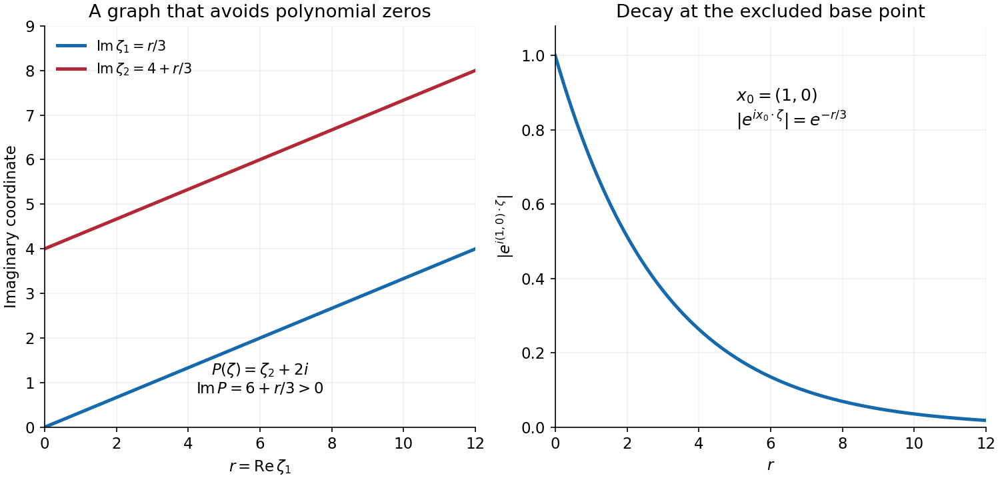
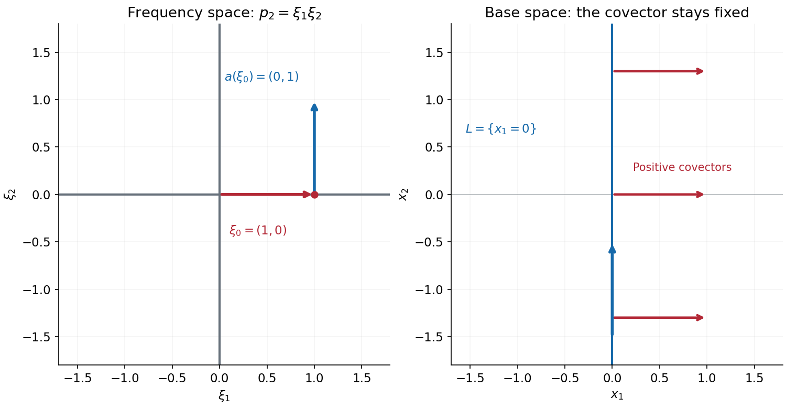

# Characteristic rays and directional kernels

*Written by GPT-6.1 Sol (OpenAI), Ultra reasoning effort, October 2026. Self-checked by the writing AI. Public domain (CC0).*

A characteristic covector identifies a frequency at which the principal part of an equation can vanish. For an operator with constant coefficients, its gradient then identifies a line in physical space. A singularity with that covector travels along this line until it meets a singularity of the forcing. We prove this statement and construct global solutions whose wavefront set consists of exactly one such line with one positive frequency ray.

The mechanism is a pair of inverse kernels with opposite directional wavefront bounds. Their construction allows arbitrary complex lower-order terms. It also gives an analytic wavefront bound for the kernels. The propagation assertion in this lesson concerns ordinary wavefront: its smooth localization argument does not by itself prove propagation of analytic or derivative-class wavefront. The full class propagation theorem and its boundary localization are proved in [Resolving singular directions at a holomorphic boundary](../AN02-L201.html#complete-proof), Theorem 6.1.

Read [Noncharacteristic directions and microlocal regularity](noncharacteristic-directions-and-microlocal-regularity.md) for the exceptional characteristic set, [Analytic directions of holomorphic boundary values](analytic-directions-of-holomorphic-boundaries.md) for the tube-boundary sign, and [Pulling back and combining analytic singularities](pulling-back-and-combining-analytic-singularities.md) for convolution wavefronts. The complete proof also uses the Fréchet closed graph theorem proved in [Banach estimates, quotient spaces and compact parameter arguments](../prerequisites/banach-foundation-bridges.html), Section 14.5. Basic references are Grubb [G], Dyatlov [D], and Hörmander [H]. All proof inputs used here are linked within the course.

## 1. The frequency stays fixed while the base point moves

Write \(D=-i\partial\), and let \(P(D)\) be a scalar constant-coefficient operator of positive order \(m\). Its highest homogeneous term is \(p_m\). We assume
\[
 p_m(\xi)\in\mathbb R\quad(\xi\in\mathbb R^n),\qquad
 p_m(\xi)=0,\ \xi\ne0\ \Longrightarrow\ a(\xi):=\nabla p_m(\xi)\ne0.
 \tag{CR1}
\]
This is **real principal type**. Reality is required only of the principal part. At a characteristic covector, Euler's identity gives
\[
 \xi\cdot a(\xi)=m p_m(\xi)=0.
 \tag{CR2}
\]
The ray direction in physical space is therefore perpendicular to the frequency covector. A covector is not a velocity vector.

**Theorem A (propagation).** Let \(P(D)u=f\) on an open set \(X\). If \((x_0,\xi_0)\in\operatorname{WF}(u)\setminus\operatorname{WF}(f)\), then \(p_m(\xi_0)=0\). If a line segment \(I\subset X\) contains \(x_0\), is parallel to \(a(\xi_0)\), and contains no pair \((x,\xi_0)\in\operatorname{WF}(f)\), then
\[
 I\times\{\xi_0\}\subset\operatorname{WF}(u).
 \tag{CR3}
\]
The forcing may be singular at other covectors. The hypothesis concerns the same fixed \(\xi_0\) along the segment. Endpoints contained in \(X\) are included.

**Theorem B (one exact ray).** For every nonzero characteristic \(\xi_0\) and every integer \(r\geq0\), there is a global \(u\in C^r(\mathbb R^n)\) with smooth \(P(D)u\) and
\[
 \operatorname{WF}(u)
 =\{(t a(\xi_0),s\xi_0):t\in\mathbb R,\ s>0\}.
 \tag{CR4}
\]
Thus one can require \(u\in C^m\), or any other prescribed finite differentiability. Equality describes all its singular covectors, including their sign. A translated solution realizes the corresponding line through any chosen point. Theorems A and B are assertions 2 and 3 of complete-proof Theorem 1.1.

## 2. Two kernels see the two ends of a segment

**Theorem C (directional inverse kernels).** There are distributions \(E_\pm\) and entire functions \(w_\pm\) such that
\[
 P(D)E_\pm=\delta_0+w_\pm,
 \tag{CR5}
\]
and
\[
 \operatorname{WF}_A(E_\pm)
 \subseteq\{(t a(\xi),\xi):p_m(\xi)=0,\ \xi\ne0,\ \pm t\geq0\}
       \cup\{(0,\xi):\xi\ne0\}.
 \tag{CR6}
\]
This is a bound on singularities, not a support restriction. The kernels can be nonzero away from these rays and need not be tempered.

To understand their construction, first raise the order by multiplying \(P(\zeta)\) by \((\zeta_1^2+\cdots+\zeta_n^2)^k\). This is a holomorphic polynomial, and its real principal gradient on the characteristic set is a positive multiple of the original gradient. For the resulting polynomial \(Q\) of order \(M>n+1\), put
\[
 v(\eta)=|\eta|^{1-M}\nabla q_M(\eta).
 \tag{CR7}
\]
A sufficiently large fixed \(T\) and then a sufficiently large \(R\) give
\[
 \operatorname{Im}Q(\eta+iTv(\eta))\geq c|\eta|^{M-1}>0
 \qquad(|\eta|\geq R).
 \tag{CR8}
\]
The fixed imaginary shift dominates the complex lower terms. The inverse Fourier integral can therefore run over this complex graph without meeting a zero. Its missing compact cap contributes an entire error. A further angular shift produces exponential decrease near any base point outside the appropriate characteristic ray. The remaining angular pieces are holomorphic tube boundaries, whose positive polars exclude the unwanted covector. Complete-proof Sections 2–3 give all estimates, the Stokes boundaries, and the reduction back to the original order.

*Figure 1.* An exact two-dimensional model of the additional imaginary push. Here \(P(\zeta)=\zeta_2+2i\), \(\eta=(r,0)\), and \(\zeta=(r+ir/3,i(4+r/3))\). Hence \(\operatorname{Im}P(\zeta)=6+r/3>0\), while \(|e^{i(1,0)\cdot\zeta}|=e^{-r/3}\). The two panels show complex-frequency coordinates and the resulting exponential decrease. They illustrate this contour model, not the support of its inverse kernel.

For compactly supported \(v\), the kernels give the exact identities
\[
 v=E_\pm*P(D)v-w_\pm*v.
 \tag{CR9}
\]
The second term is entire. If \(v\) has a wavefront point at \((x,\xi)\), convolution with \(E_-\) finds an image wavefront point farther along the positive \(a(\xi)\) direction; convolution with \(E_+\) finds one in the negative direction. A smooth cutoff around a segment puts its commutator only near the two ends. Shrinking the end transitions and using closedness proves Theorem A. The signs refer to \(x-y\) in the kernel; the image point \(y\) lies on the opposite side.

## 3. Why approximate solutions imply an exact realization

Smooth oscillating packets do not themselves have a nonempty wavefront set. Their role is to disprove a regularity estimate that would follow if every admissible global function were smoother than requested.

Fix a characteristic \(\xi_0\), let \(a=\nabla p_m(\xi_0)\), and write \(x=sa+y\), \(y\perp a\). Expanding the shifted operator gives
\[
 P(t\xi_0+D)=t^{m-1}(B_0+t^{-1}B_1+\cdots+t^{-(m-1)}B_{m-1}),
 \qquad B_0=a\cdot D+p_{m-1}(\xi_0).
 \tag{CR10}
\]
One solves successive first-order equations along \(s\), starting from
\[
 v_0(sa+y)=e^{-ip_{m-1}(\xi_0)s}\psi(y).
 \tag{CR11}
\]
All amplitudes remain in the thin cylinder containing \(\operatorname{supp}\psi\). The finite packet
\[
 u_t=e^{itx\cdot\xi_0}\sum_{j=0}^{J-1}t^{-j}v_j
 \tag{CR12}
\]
has compact \(C^r\) norms \(O(t^r)\), arbitrarily small compact image norms when \(J\) is large enough, and rapidly decreasing Fourier tails outside any cone about the positive ray. Yet one derivative of order \(r+1\) at the origin grows as \(t^{r+1}\).

Complete-proof Section 6 constructs the Fréchet space of global \(C^r\) functions with smooth image, smoothness off the line, and wavefront in that positive ray. It proves completeness, including the Fourier seminorms. If all its members were \(C^{r+1}\), closed graph would bound that derivative by finitely many of the stated seminorms. The packets contradict this bound. An actual nonsmooth member therefore exists. Its wavefront is nonempty, lies over the line, and has only the selected positive direction. Propagation then fills the whole line, proving Theorem B.

*Figure 2.* For \(p_2(\xi)=\xi_1\xi_2\), choose \(\xi_0=(1,0)\). Its gradient is \((0,1)\). The base line is \(x_1=0\), and every singular covector in (CR4) is a positive horizontal covector. The short horizontal arrows represent covectors attached to the line; they are not trajectories leaving it.

## 4. Four worked examples

### Example 1: one sign survives a complex transport coefficient

Let \(P(D)=D_s+i\) on the \((t,s)\)-plane. Its principal symbol is \(\sigma\), so the characteristic covector \((1,0)\) has gradient \((0,1)\). For an integer \(r\geq0\), take the upper-half-plane boundary
\[
 h_r(t)=(t+i0)^{r+1/2},\qquad
 u(t,s)=e^s h_r(t).
 \tag{CR13}
\]
The branch has argument between zero and \(\pi\). Its boundary is \(t^{r+1/2}\) for \(t>0\) and \(e^{i\pi(r+1/2)}|t|^{r+1/2}\) for \(t<0\), with value zero at zero. Derivatives through order \(r\) extend continuously by zero. The next derivative has a nonzero multiple of \(|t|^{-1/2}\) on either side, so the function is not \(C^{r+1}\) there. The holomorphic tube-boundary theorem gives only positive \(t\)-covectors. Nonsmoothness and the ordinary base projection theorem make the positive fiber nonempty; positive conicity fills it. Analytic multiplication by the nonzero \(e^s\) and the tensor formula give
\[
 \operatorname{WF}(u)=\{((0,s);\tau,0):s\in\mathbb R,\ \tau>0\}.
 \tag{CR14}
\]
Finally \((D_s+i)e^s=0\), so \(P(D)u=0\). A complex lower coefficient does not destroy the conclusion.

### Example 2: an exact integral for a mixed second-order operator

Let
\[
 P(D)=D_1D_2+2iD_1+3,\qquad
 u_r(x_1,x_2)=\int_1^\infty
       e^{itx_1+2x_2-3ix_2/t}\,t^{-r-2}\,dt.
 \tag{CR15}
\]
On compact sets, derivatives through order \(r\) are dominated by \(C t^{-2}\), since an \(x_1\)-derivative contributes \(t\) and an \(x_2\)-derivative contributes \(2-3i/t\). Thus \(u_r\in C^r\) globally. For each integrand, \(D_1=t\) and \(D_2+2i=-3/t\), so \(P(D)u_r=0\) distributionally. This follows by pairing first with a compact test and integrating by parts; its Fourier decay in \(x_1\) makes the differentiated pairing integrable at every required order.

The integral is smooth for \(x_1\ne0\): integration by parts in \(t\) makes every differentiated tail convergent, locally uniformly there. To determine its sign, allow complex \(z_1,z_2\) with \(\operatorname{Im}z_1>0\), and bounded \(z_2\). The integral is holomorphic and bounded uniformly up to the real boundary on compact sets, because its amplitude has size at most \(C t^{-r-2}\). Apply the tube-boundary theorem on every smaller cone in \(\{y_1>0\}\). Its positive polar consists of \((\tau,0)\), \(\tau\geq0\). Therefore only positive horizontal covectors can occur.

They do occur at every point of \(x_1=0\). Away from that line,
\[
 D_1^{r+1}u_r=e^{2x_2}\int_1^\infty
                  e^{itx_1-3ix_2/t}\,\frac{dt}{t}.
 \tag{CR16}
\]
Replacing \(e^{-3ix_2/t}\) by one changes this by a uniformly bounded function on compact \(x_2\)-sets. The real part of the remaining integral is
\(\int_{|x_1|}^\infty\cos v\,dv/v=-\log|x_1|+O(1)\): on \((|x_1|,1)\), subtract one from \(\cos v\), and on \((1,\infty)\), integrate by parts. Thus no \(C^{r+1}\) extension exists across the line. The base projection theorem and the positive-direction bound give exactly (CR14), with \((t,s)=(x_1,x_2)\).

### Example 3: the wave covector is perpendicular to its light ray

For
\[
 P(\tau,\eta_1,\eta_2)=\tau^2-4\eta_1^2-4\eta_2^2+(2+i),
 \qquad \xi_0=(2,-1,0),
 \tag{CR17}
\]
the principal value is zero and \(a(\xi_0)=(4,8,0)\). Thus the base line is \((t,x_1,x_2)=(s,2s,0)\). Its pairing with the covector is \(2s-2s=0\). Theorem B gives a global \(C^r\) function with smooth image and precisely
\[
 \{((s,2s,0);2\lambda,-\lambda,0):s\in\mathbb R,\ \lambda>0\}
 \tag{CR18}
\]
as wavefront set. The complex constant changes the equation but leaves this characteristic line unchanged. The principal gradient is nonzero at every nonzero characteristic covector, so all hypotheses are satisfied.

### Example 4: an elliptic principal part has no line to realize

Take \(P(\xi)=\xi_1^2+\xi_2^2+3i\xi_1+1\). Its real principal part is positive at every nonzero real covector. Condition (CR1) is satisfied, but the characteristic set is empty. Theorem C then makes \(E_\pm\) analytic away from zero. Theorem B has no characteristic covector to which it can be applied. Direct microlocal ellipticity gives smooth \(u\) whenever \(P(D)u\) is smooth, and analytic \(u\) whenever the image is analytic. There is no claim that every real principal type operator has a nonempty characteristic set.

## 5. Exercises, 100 points

1. **A fixed shift and a bad shift; 10 points.** For \(P(\zeta)=\zeta_2+2i\), compute \(P(\eta+iT e_2)\). Compare \(T=4,-2,-3\). Explain why the reality of the lower coefficient is unnecessary and why the zero-avoiding contour must actually be checked.
2. **Separating a base point from a negative ray; 12 points.** Let \(a=(0,2)\). Find a vector \(V\) with \(x\cdot V>0\), \(a\cdot V>0\) for \(x=(3,1)\) and \(x=(2,0)\). Prove there is no such vector when \(x=(0,-1)\). Prove the general criterion used in (RP15).
3. **The first two transport corrections; 12 points.** For the operator in (CR15), take \(\xi_0=(1,0)\), \(s=x_2\), \(y=x_1\), and \(v_0=e^{2s}\psi(y)\). Compute \(B_0,B_1,v_1,v_2\) with zero initial corrections at \(s=0\). Check the sign in the integrating-factor formula.
4. **Why the order is raised; 12 points.** Find the smallest nonnegative integer \(k\) guaranteeing \(m+2k>n+1\). Compute it for \((n,m)=(3,2),(2,1),(1,1)\). Check both the radial integral and the outer Stokes boundary at the borderline order \(M=n+1\).
5. **The kernel direction and the image direction; 12 points.** Fix \(a=(0,1)\) and \(x=0\). For \(E_-\) and \(E_+\), solve \(x-y=t a\) with the allowed sign of \(t\). Explain how both end transitions are used in the propagation proof and why one kernel alone does not give that proof.
6. **Local differentiability misses a Fourier seminorm; 14 points.** On \(\mathbb R^2\), put \(v_k(x)=k^{-r-1}e^{-ikx_1}\). Show that \(v_k\to0\) locally in \(C^r\). If \(\theta\geq0\) is a nonzero compact smooth cutoff and \(\Gamma\) is a cone about \((1,0)\) excluding \((-1,0)\), show that its Fourier seminorm with exponent \(r+2\) diverges. Explain the role of the extra seminorms in completeness and closed graph.
7. **One frequency sign requires a complex function; 14 points.** Verify every regularity and wavefront assertion in (CR13)–(CR14). Then prove that a real-valued distribution has symmetric ordinary wavefront under \(\xi\mapsto-\xi\), and conclude that no nonempty wavefront set of the form (CR4) can belong to a real-valued function.
8. **A vanishing gradient breaks the hypothesis; 14 points.** For \(P(D)=D_1^2\) in two dimensions and \(u(x)=H(x_2)\), compute the image, principal characteristic set, gradient, and wavefront. Explain why this does not contradict the propagation theorem. Compare with the empty characteristic set in Example 4.

## 6. Complete solutions

### Solution 1

The value is \(\eta_2+i(T+2)\). At \(T=4\) its imaginary part is \(6\), so its reciprocal has no pole on the graph. At \(T=-2\) it vanishes whenever \(\eta_2=0\); that graph is invalid. At \(T=-3\) its imaginary part is \(-1\), so the graph again avoids zeros, with the opposite sign of imaginary part. The lower coefficient is \(2i\), genuinely nonreal, and the first and third shifts still avoid zeros. A shift of the right size and sign supplies the needed lower bound; a formal translation of the contour without that check would cross poles.

### Solution 2

Take \(V=(1,1)\) in the first two cases. The dot products with \(a\) are \(2\), and those with the two \(x\)'s are \(4\) and \(2\). For \(x=(0,-1)\), positivity against \(x\) requires \(V_2<0\), while positivity against \(a\) requires \(V_2>0\), impossible.

For nonzero \(x,a\), if \(x=-t a\), \(t\geq0\), the two dot products cannot both be positive. Conversely if they are not opposite, set \(V=x/|x|+a/|a|\). Its dot products are \(|x|(1+\cos\alpha)\) and \(|a|(1+\cos\alpha)\), both positive since the angle \(\alpha\) is less than \(\pi\). If \(x=0\), the first dot product is always zero, and zero belongs to the excluded negative ray. This proves the exact criterion.

### Solution 3

The exact expansion is
\[
 P(t\xi_0+D)=t(D_s+2i)+(D_yD_s+2iD_y+3),
 \quad B_0=D_s+2i,\quad B_1=D_yB_0+3.
 \tag{CR19}
\]
Thus \(B_0v_0=0\), \(B_1v_0=3e^{2s}\psi\), and \(F_1=-3e^{2s}\psi\). Formula (RP27), with \(b=2i\), gives
\[
 v_1=-3is e^{2s}\psi.
 \tag{CR20}
\]
Since \(B_0v_1=-3e^{2s}\psi\),
\[
 B_1v_1=D_y(-3e^{2s}\psi)+3v_1
       =3i e^{2s}\psi'-9is e^{2s}\psi.
\]
Integrating its negative gives
\[
 v_2=e^{2s}\left(3s\psi'-\frac92s^2\psi\right).
 \tag{CR21}
\]
Both corrections vanish at \(s=0\). For any \(F\), differentiation of \(v=i e^{-ibs}\int_0^s e^{ibt}F(t)\,dt\) gives \(-i\partial_sv+bv=F\), so the displayed sign is fixed by \(D=-i\partial\).

### Solution 4

The least choice is
\[
 k=\max\left(0,\left\lceil\frac{n+2-m}{2}\right\rceil\right).
 \tag{CR22}
\]
The three cases give \(k=2,2,1\) and \(M=6,5,3\), respectively. The radial majorant is \(\int_R^\infty\rho^{n-M}\,d\rho\). At \(M=n+1\) its exponent is \(-1\), giving logarithmic divergence. The outer homotopy boundary is \(O(S^{n+1-M})=O(1)\), so that estimate alone does not make it vanish either. A strictly larger order makes the radial exponent less than \(-1\) and the boundary exponent negative. Raising order changes the gradient on the characteristic set only by the positive factor \(|\xi|^{2k}\), preserving its oriented rays.

### Solution 5

For \(E_-\), \(t\leq0\), so \(y=-t a=(0,-t)\) lies above the origin. For \(E_+\), \(t\geq0\), so \(y\) lies below it. The origin term is absent if the image has no wavefront at that pair. A cutoff image can then have the required line covector only in its forward or backward commutator transition. The negative kernel forces a forward transition point; the positive kernel forces a backward one. Letting each transition shrink gives both endpoint wavefront points. One sign provides only one of these two deductions; the proof as stated needs both to fill arbitrary segments in both directions.

### Solution 6

Every derivative of order at most \(r\) has modulus at most \(k^{-1}\) for \(k\geq1\), or is zero if it differentiates in \(x_2\). Hence convergence is local \(C^r\), even uniform for these derivatives on all of real space. At \(\zeta=(-k,0)\),
\[
 \widehat{\theta v_k}(-k,0)
      =k^{-r-1}\widehat\theta(0)
      =k^{-r-1}\int\theta>0.
 \tag{CR23}
\]
This covector lies outside \(\Gamma\). The seminorm of exponent \(r+2\) is therefore at least
\((1+k)^{r+2}k^{-r-1}\int\theta\), which grows linearly. Thus local \(C^r\) convergence does not supply convergence in the topology used for realization. Its Fourier seminorms keep the uniform off-ray bounds, while the off-line and image seminorms keep their smooth limits. All are needed in the completeness argument before closed graph can be applied to that particular space.

### Solution 7

For \(t\ne0\), differentiating the two explicit powers in Example 1 gives a fixed nonzero coefficient times \(|t|^{r+1/2-j}\) at order \(j\). For \(j\leq r\) these derivatives tend to zero and define continuous derivatives through zero; successive difference quotients give the same extensions. At order \(r+1\) their moduli are a nonzero multiple of \(|t|^{-1/2}\), so no continuous extension is possible. The upper holomorphic boundary gives \(\operatorname{WF}_A(h_r)\subset\{(0,\tau):\tau>0\}\): away from zero each power has a holomorphic continuation, and the positive-polar theorem gives the sign at zero. Ordinary inclusion and nonsmoothness force the entire positive fiber. Tensoring with the analytic nonzero \(e^s\) and multiplying by its analytic inverse preserve exactly these horizontal covectors. Direct differentiation gives \((D_s+i)e^s=0\).

For real \(v\), use real cutoffs. The compact transform satisfies \(\widehat{\theta v}(-\xi)=\overline{\widehat{\theta v}(\xi)}\). Rapid decrease on a cone is therefore equivalent to rapid decrease on its reflected cone. The ordinary wavefront is symmetric. The positive ray in (CR4) does not contain its negative and is nonempty, so such a realizing function is necessarily complex-valued.

### Solution 8

The symbol is \(p_2(\xi)=\xi_1^2\), and
\[
 \operatorname{Char}P=\{\xi_1=0,\ \xi_2\ne0\},\qquad
 \nabla p_2=(2\xi_1,0).
 \tag{CR24}
\]
The gradient is zero on every characteristic covector, so (CR1) fails. The function \(H(x_2)\) is independent of \(x_1\), giving \(D_1^2u=0\). The one-dimensional jump has both nonzero frequency signs at zero: it is real, nonsmooth, and smooth away from zero, and its localized transform has a nonzero \(1/\xi_2\) leading term on either half-line, obtained by one integration by parts. The tensor formula with the smooth constant factor therefore gives
\[
 \operatorname{WF}(u)=\{((x_1,0);0,\eta):x_1\in\mathbb R,\ \eta\ne0\}.
 \tag{CR25}
\]
There is no nonzero gradient direction to which the theorem applies. Example 4 has the opposite situation: there are no nonzero characteristic covectors, so the implication defining real principal type is vacuous, and ellipticity excludes singularities for smooth forcing. A nonempty degenerate characteristic set and an empty characteristic set have different consequences.

## References

[G] Gerd Grubb, *Distributions and Operators*, [Fourier transformation of distributions](https://web.math.ku.dk/~grubb/dist5.pdf), University of Copenhagen lecture notes. This is background reading; the Fourier inputs used here are proved in the linked course foundations.

[D] Semyon Dyatlov, [*18.156: Differential Analysis*, Spring 2017](https://math.mit.edu/~dyatlov/18.156/), MIT, lectures on Hamiltonian flow and propagation of singularities. The present lesson treats constant coefficients and proves its own directional construction.

[H] Lars Hörmander, *The Analysis of Linear Partial Differential Operators I: Distribution Theory and Fourier Analysis*, second edition, Springer, 1990, Sections 8.3 and 8.6. The complete proof below supplies the directional kernels, ordinary propagation and global realization for the full stated hypotheses.

## Complete proof

Write \(D_j=-i\partial_{x_j}\), and use the Fourier transform with phase \(e^{-ix\cdot\xi}\). Let
\[
 P(\xi)=\sum_{j=0}^m p_j(\xi),\qquad m\geq1,
 \quad p_j(t\xi)=t^jp_j(\xi)\quad(t>0).
 \tag{RP1}
\]
The coefficients of the lower terms may be complex. We assume that \(p_m\) is real on real covectors and
\[
 p_m(\xi)=0,\quad \xi\ne0
 \quad\Longrightarrow\quad a(\xi):=\nabla p_m(\xi)\ne0.
 \tag{RP2}
\]
This is the constant-coefficient real principal type condition. Euler's identity \(\xi\cdot\nabla p_m(\xi)=mp_m(\xi)\) shows that \(\nabla p_m\) is nonzero at every nonzero real covector: a zero gradient would first imply \(p_m=0\), contradicting (RP2). At a characteristic covector, Euler's identity also gives \(\xi\cdot a(\xi)=0\).

The Fourier, convolution and ordinary wavefront operations used below have their complete proofs in [Schwartz Fourier foundations](../prerequisites/schwartz-fourier-foundations.html), [Detecting regularity without choosing coordinates](../prerequisites/geometric-microlocal-calculus.html), and Section 1 of [Pulling back and combining analytic singularities](pulling-back-and-combining-analytic-singularities.md). The geometric-microlocal reading retains its GNU FDL 1.2 component terms. The analytic tube-boundary estimate is Theorem 4.1 of [Analytic directions of holomorphic boundary values](analytic-directions-of-holomorphic-boundaries.md). Smooth and analytic ellipticity, including all finite orders, are Theorem 1.1 of [Noncharacteristic directions and microlocal regularity](noncharacteristic-directions-and-microlocal-regularity.md). Section 14.5 of [Banach estimates, quotient spaces and compact parameter arguments](../prerequisites/banach-foundation-bridges.html) proves the Fréchet closed graph theorem. The compact-contour Stokes argument is included in [Cauchy bounds, root counts and analytic extensions](cauchy-bounds-and-root-counts.md). These are available proofs, rather than additional assumptions on \(P\).

### 1. Three assertions about one characteristic direction

**Theorem 1.1.** Under (RP1)–(RP2), the following assertions hold.

1. There are distributions \(E_+,E_-\) on \(\mathbb R^n\) and entire functions \(w_+,w_-\) on \(\mathbb C^n\) such that
\[
 \begin{gathered}
 P(D)E_\pm=\delta_0+w_\pm,\\
 \begin{aligned}
 \operatorname{WF}_A(E_\pm)
 &\subseteq \{(t a(\xi),\xi):p_m(\xi)=0,\ \xi\ne0,\ \pm t\geq0\}\\
 &\qquad\cup\{(0,\xi):\xi\ne0\}.
 \end{aligned}
 \end{gathered}
 \tag{RP3}
\]
Only an inclusion is asserted; the actual support of a kernel need not lie on these rays.

2. Let \(X\) be open, \(u\in\mathcal D'(X)\), and \(f=P(D)u\). If
\((x_0,\xi_0)\in\operatorname{WF}(u)\setminus\operatorname{WF}(f)\), then \(p_m(\xi_0)=0\). Every line segment \(I\subset X\) containing \(x_0\), directed by \(a(\xi_0)\), and satisfying
\[
 (I\times\{\xi_0\})\cap\operatorname{WF}(f)=\varnothing
 \tag{RP4}
\]
obeys \(I\times\{\xi_0\}\subset\operatorname{WF}(u)\).

3. For every nonzero characteristic \(\xi_0\) and every integer \(r\geq0\), there is a global \(u\in C^r(\mathbb R^n)\) for which \(P(D)u\in C^\infty(\mathbb R^n)\) and
\[
 \operatorname{WF}(u)
 =\{(t a(\xi_0),s\xi_0):t\in\mathbb R,\ s>0\}.
 \tag{RP5}
\]
In particular one may take \(r=m\). Translation gives the same assertion on a line through any prescribed base point.

We first construct the ray kernels and prove propagation. We then prove the existence assertion with a complete function-space argument and explicit transport amplitudes.

### 2. A bounded imaginary shift avoids every large real zero

First suppose that the order is \(M>n+1\); write the polynomial as \(Q\), with real principal part \(q_M\) satisfying (RP2). Put \(\rho=|\eta|\) and
\[
 v(\eta)=\rho^{1-M}\nabla q_M(\eta)\qquad(\eta\ne0).
 \tag{RP6}
\]
This is a smooth degree-zero real vector field. Compactness of the unit sphere gives constants \(c_0,C_0>0\) with
\[
 \nabla q_M(\eta)\cdot v(\eta)\geq c_0\rho^{M-1},
 \qquad |v(\eta)|\leq C_0.
 \tag{RP7}
\]
Taylor's finite polynomial formula, with a fixed \(T>0\), gives
\[
 \operatorname{Im}Q(\eta+iTv(\eta))
 \geq (Tc_0-C_1)\rho^{M-1}-C_T\rho^{M-2}.
 \tag{RP8}
\]
Indeed the first-order contribution of \(q_M\) is exactly \(T\nabla q_M\cdot v\); its higher Taylor terms have degree at most \(M-2\) in \(\rho\). The imaginary part of the degree \(M-1\) term is bounded below by \(-C_1\rho^{M-1}\), and all its shifted terms and all lower homogeneous terms have size at most \(C_T\rho^{M-2}\). Thus complex lower coefficients have been included. Choose \(T\) so that \(Tc_0>C_1+2\), then \(R\) large enough. For some \(c>0\),
\[
 \operatorname{Im}Q(\eta+iTv(\eta))\geq c\rho^{M-1}
 \qquad(\rho\geq R).
 \tag{RP9}
\]

There is a useful uniform extension. Suppose \(V\) is a fixed real vector and \(W\) a spherical neighborhood on which
\(\nabla q_M(\eta)\cdot V\geq d\rho^{M-1}\), with \(d>0\). For \(0\leq\tau\leq\varepsilon\rho\), the fundamental theorem of calculus applied to the polynomial gives
\[
 \left|Q(\eta+iTv+i\tau V)-Q(\eta+iTv)
           -i\tau\nabla q_M(\eta)\cdot V\right|
 \leq C\tau(1+\tau)\rho^{M-2}.
 \tag{RP10}
\]
Here \(T,V\) are fixed, \(\rho\) is large, and \(\varepsilon\leq1\). To see the estimate directly, subtract \(\nabla q_M(\eta)\) from \(\nabla Q(\eta+iTv+isV)\); each remaining monomial has bound \(C(1+s)\rho^{M-2}\) for \(0\leq s\leq\tau\leq\rho\), and integrate in \(s\). Choose \(\varepsilon\) small and then increase \(R\), so that \(C(1/R+\varepsilon)\leq d/2\). Equations (RP9)–(RP10) imply
\[
 \operatorname{Im}Q(\eta+iTv+i\tau V)
 \geq c\rho^{M-1}+(d/2)\tau\rho^{M-1}
 \qquad(\eta/\rho\in W).
 \tag{RP11}
\]
In particular every contour in this deformation avoids zeros.

### 3. The contour integral and its analytic remainder

Let \(\Gamma\) be the oriented graph \(\zeta=\eta+iTv(\eta)\), \(|\eta|\geq R\), with the orientation of real \(\eta\)-space. Define
\[
 F_-(x)=(2\pi)^{-n}\int_\Gamma
        \frac{e^{ix\cdot\zeta}}{Q(\zeta)}
                  \,d\zeta_1\wedge\cdots\wedge d\zeta_n.
 \tag{RP12}
\]
The graph Jacobian is \(J(\eta)=\det(I+iT\,Dv(\eta))\). Since \(Dv=O(\rho^{-1})\), it is bounded for \(\rho\geq R\). On compact real \(x\)-sets, \(|e^{ix\cdot\zeta}|\leq e^{TC_0|x|}\). Equation (RP9) bounds the reciprocal by \(C\rho^{1-M}\). The radial integral is bounded by a multiple of \(\int_R^\infty\rho^{n-M}\,d\rho\), which converges because \(M>n+1\). Thus (RP12) is a continuous function of real \(x\), and a distribution; no global tempered bound is required.

Extend \(v\) smoothly and boundedly into \(|\eta|\leq R\), preserving its boundary values, and let \(\Gamma_0\) be this compact graph over the ball. The combined graph \(\Gamma\cup\Gamma_0\) is homotopic to real space by multiplying its imaginary part by a parameter between zero and one. For a compact test function \(\phi\), the entire function \(\widehat\phi(-\zeta)\) decreases faster than every power of \(|\operatorname{Re}\zeta|\) on these uniformly bounded imaginary strips. Integration by parts in \(x\) proves that assertion directly.

The form \(H(\zeta)\,d\zeta_1\wedge\cdots\wedge d\zeta_n\) is closed when \(H\) is holomorphic: every term of \(dH\) repeats one of the \(d\zeta_j\). Stokes on truncated homotopies, followed by the preceding rapid bound, therefore gives
\[
 \begin{aligned}
 \langle Q(D)F_-,\phi\rangle
 &=(2\pi)^{-n}\int_\Gamma\widehat\phi(-\zeta)
                                      \,d\zeta_1\cdots d\zeta_n\\
 &=\phi(0)-(2\pi)^{-n}\int_{\Gamma_0}\widehat\phi(-\zeta)
                                      \,d\zeta_1\cdots d\zeta_n.
 \end{aligned}
 \tag{RP13}
\]
In the first equality the bilinear transpose is \(Q(-D)\); its pairing with \(e^{ix\cdot\zeta}\) produces \(Q(\zeta)\), cancelling the denominator. The second equality uses Fourier inversion on real space. Consequently
\[
 Q(D)F_-=\delta_0+W_-,\qquad
 W_-(z)=-(2\pi)^{-n}\int_{\Gamma_0}e^{iz\cdot\zeta}
                                  \,d\zeta_1\cdots d\zeta_n.
 \tag{RP14}
\]
The last integral is entire: its frequencies range over one compact chain, so all complex derivatives converge uniformly on compact \(z\)-sets. No inverse of \(Q\) on that chain is used.

We prove the analytic directional bound. Fix \(x_0\ne0\) and a nonzero characteristic \(\xi_0\). Suppose
\[
 x_0\notin\{-t\nabla q_M(\xi_0):t\geq0\}.
 \tag{RP15}
\]
There is a real \(V\) with \(x_0\cdot V>0\) and \(\nabla q_M(\xi_0)\cdot V>0\). For example, the sum of the unit vectors in these two directions has both positive dot products unless the directions are opposite, precisely the excluded case. By continuity choose a cone \(W\) about \(\xi_0\) on which (RP11) applies. Let \(0\leq\chi\leq1\) be a smooth degree-zero angular function supported in \(W\) and equal to one on a smaller cone \(W_0\) about \(\xi_0\). Deform the exterior graph to
\[
 \zeta(\eta)=\eta+iTv(\eta)+i\varepsilon\rho\chi(\eta)V.
 \tag{RP16}
\]
All intermediate graphs avoid zeros by (RP11). Their Jacobians are bounded, since \(\rho\chi\) has bounded first derivatives. Restrict \(x\) to a neighborhood \(U\) of \(x_0\) on which \(x\cdot V\geq b>0\). The exponential on the homotopy is bounded by \(e^{TC_0|x|}\); the added shift only decreases it. The outer boundary at radius \(S\) has size \(O(S^{n+1-M})\), which tends to zero. This bound includes the factor \(S\) from the derivative in the homotopy parameter. Stokes therefore replaces (RP12), on \(U\), by the new exterior integral plus an entire compact-chain integral. An increased inner radius changes only entire compact-chain terms.

On \(W_0\), where \(\chi=1\), the exponential decays at least as \(e^{-\varepsilon b\rho}\), apart from a locally bounded factor. It continues to decay at least as \(e^{-\varepsilon b\rho/2}\) when \(x\) is replaced by a complex \(z\) with real part in a smaller \(U\) and sufficiently small imaginary part. This portion of the integral is therefore holomorphic across real \(U\).

The remaining unit directions lie in the closed complement of \(W_0\). Cover them by finitely many closed pointed convex cones \(G_j\) avoiding \(\xi_0\), and split the integral into measurable angular pieces contained in these cones. Such a cover exists: around each unit direction different from \(\xi_0/|\xi_0|\), take a sufficiently small spherical cap and its closed convex cone, still avoiding that direction; compactness gives finitely many. Each piece is holomorphic for
\[
 z=x+iy,\qquad x\in U,\quad
 y\in\operatorname{int}(G_j^*),\quad |y|<h,
 \qquad G_j^*=\{y:y\cdot\eta\geq0\ (\eta\in G_j)\}.
 \tag{RP17}
\]
Indeed the real part of its exponent is
\[
 \operatorname{Re}(iz\cdot\zeta)
 =-T x\cdot v(\eta)-\varepsilon\rho\chi(\eta)x\cdot V-y\cdot\eta
 \leq TC_0|x|.
 \tag{RP18}
\]
For interior \(y\), its last term gives exponential decrease at infinity on any smaller directional cone; differentiation under the integral proves holomorphy. Even up to the real boundary the original integrable majorant is uniform in \(y\). Dominated convergence identifies its full cone boundary with its real integral. The analytic tube-boundary theorem thus places its analytic wavefront covectors in \((\operatorname{int}G_j^*)^*=G_j\). The last equality is finite-dimensional separation for a closed convex cone with nonempty dual interior; a point outside \(G_j\) has a strictly separating dual vector, which may be moved a little into that interior. None of these pieces can have analytic wavefront covector \(\xi_0\).

The analytic part and the compact-chain correction have empty analytic wavefront. This proves absence at every pair in (RP15). At a noncharacteristic covector over \(x_0\ne0\), (RP14) and analytic ellipticity prove absence directly. Therefore
\[
 \operatorname{WF}_A(F_-)
 \subseteq\{(-t\nabla q_M(\xi),\xi):t\geq0,\ q_M(\xi)=0,\ \xi\ne0\}
                 \cup\{(0,\xi):\xi\ne0\}.
 \tag{RP19}
\]

For the original order \(m\), choose \(k\geq0\) so that \(M=m+2k>n+1\), and use
\[
 Q(\zeta)=(\zeta_1^2+\cdots+\zeta_n^2)^k P(\zeta).
 \tag{RP20}
\]
Its principal part is real; at a real characteristic covector its gradient is \(|\xi|^{2k}a(\xi)\), so (RP2) and the oriented rays are preserved. Set \(E_-=(-\Delta)^kF_-\) and \(w_-=(-\Delta)^kW_-\). Then \(P(D)E_-=\delta_0+w_-\); analytic differential decrease preserves (RP19), and \(w_-\) is entire. Construct the negative kernel for \(-P\) and change its sign to obtain \(E_+\); the principal gradient changes sign, giving the positive rays. This proves assertion 1 of Theorem 1.1 in every dimension and every positive scalar order.

### 4. Why one singular point fills its characteristic segment

Ordinary wavefront is contained in analytic wavefront, so (RP3) also bounds \(\operatorname{WF}(E_\pm)\). If \(v\) has compact support and \(g=P(D)v\), constant-coefficient convolution gives
\[
 v=E_\pm*g-w_\pm*v.
 \tag{RP21}
\]
The correction is entire. In fact pairing the compactly supported finite-order distribution \(v(y)\) with the entire function \(w_\pm(z-y)\) gives a holomorphic function of \(z\) on every compact complex set; the finite order allows differentiation and Cauchy estimates there. The ordinary convolution wavefront theorem gives
\[
 (x,\xi)\in\operatorname{WF}(v)
 \ \Longrightarrow\;
 \text{there is }y\text{ with }(y,\xi)\in\operatorname{WF}(g),
 \quad x-y= t a(\xi),\quad \pm t\geq0,
 \tag{RP22}
\]
provided \(p_m(\xi)=0\). The case \(t=0\) includes the origin fiber in (RP3). For this use of the convolution theorem, addition is proper over compact output sets on the support of \(E_\pm\otimes g\), since \(g\) has compact support. Its transpose maps \(\xi\) to \((\xi,\xi)\), so both input covectors are nonzero; there are no omitted zero-component terms. These facts verify the precise operation hypotheses.

Now fix the pair in assertion 2. Smooth ellipticity first gives \(p_m(\xi_0)=0\). Let \(L=x_0+\mathbb R a(\xi_0)\). Choose any two points \(y_-,y_+\) in the interior of the given segment, on opposite sides of \(x_0\). A compact thin tube around \([y_-,y_+]\) lies in \(X\). In axial and perpendicular coordinates take a product cutoff \(\phi\) equal to one near that segment, whose axial transitions occur just outside its two endpoints, and whose perpendicular cutoff is constant near \(L\). Its support on \(L\) and both transitions may be kept in the original segment. If necessary first work in a slightly extended interval near \(x_0\), where the forcing covector is absent by openness of its complement.

Set \(v=\phi u\). Then \((x_0,\xi_0)\in\operatorname{WF}(v)\) and
\[
 P(D)v=\phi f+[P(D),\phi]u.
 \tag{RP23}
\]
Along \(L\), the first term has no covector \(\xi_0\) by (RP4). The second can have that covector only where \(d\phi\ne0\), and then only if \(u\) has it. Apply (RP22) with the two signs. The negative kernel finds such a point on the forward part of \(L\), and the positive kernel finds one on its backward part. They must lie in the two arbitrarily short transition intervals. Let their widths tend to zero. Closedness of \(\operatorname{WF}(u)\) gives \((y_\pm,\xi_0)\in\operatorname{WF}(u)\).

Every interior point on either side can be chosen this way. Endpoints included in the given segment follow by closedness. The case when \(x_0\) itself is an endpoint follows by the small extension near \(x_0\) just described. This proves assertion 2. Notice that the covector stays fixed; only the base point moves.

### 5. Transport amplitudes in an arbitrarily thin cylinder

Fix \(\xi_0\ne0\) characteristic, put \(a=a(\xi_0)\), \(b=p_{m-1}(\xi_0)\), and write
\(x=s a+y\), with \(y\perp a\). Thus \(a\cdot\nabla_x=\partial_s\). The exact polynomial identity
\[
 P(t\xi_0+D)=t^{m-1}\sum_{\ell=0}^{m-1}t^{-\ell}B_\ell(D),
 \qquad B_0=a\cdot D+b,
 \tag{RP24}
\]
follows by expanding every homogeneous term at \(\xi_0\). More explicitly,
\[
 B_\ell(D)=\sum_{q=0}^{\ell+1}\ \sum_{|\alpha|=q}
   \frac{\partial^\alpha p_{m-1-\ell+q}(\xi_0)}{\alpha!}D^\alpha.
 \tag{RP25}
\]
The sole removed term is \(t^mp_m(\xi_0)=0\). In particular the order of \(B_\ell\) is at most \(\ell+1\), and all lower complex coefficients remain in these operators.

Let \(\psi(y)\) be a smooth compact cutoff on \(a^\perp\), equal to one near zero, with support in any chosen small disk. Define
\[
 v_0(sa+y)=e^{-ibs}\psi(y),\qquad
 B_0v_j=-\sum_{\ell=1}^{\min(j,m-1)}B_\ell v_{j-\ell},
 \quad v_j|_{s=0}=0\quad(j\geq1).
 \tag{RP26}
\]
For \(B_0v_j=F_j\), the complete solution formula is
\[
 v_j(sa+y)=i e^{-ibs}\int_0^s e^{ibt}F_j(ta+y)\,dt.
 \tag{RP27}
\]
Differentiation gives \(-i\partial_sv_j+bv_j=F_j\), including its sign. Every amplitude is smooth globally and vanishes outside the same closed cylinder \(y\in\operatorname{supp}\psi\); differentiation and integration in \(s\) do not enlarge this transverse support. On compact sets all its derivatives are bounded. They may grow along the infinite axis, which causes no difficulty for compact seminorms.

For a fixed integer \(J\geq1\), put
\[
 u_t(x)=e^{itx\cdot\xi_0}\sum_{j=0}^{J-1}t^{-j}v_j(x),\qquad t\geq1.
 \tag{RP28}
\]
Equations (RP24)–(RP26) cancel every coefficient with \(\ell+j<J\). Consequently, on any fixed compact set and for every fixed \(N\),
\[
 \|u_t\|_{C^r}=O(t^r),\qquad
 \|P(D)u_t\|_{C^N}=O(t^{m-1-J+N}).
 \tag{RP29}
\]
For \(m=1\) the remainder is identically zero: only \(B_0\) is present. If \(\eta_0=\xi_0/|\xi_0|^2\), then
\[
 ((\eta_0\cdot D)^{r+1}u_t)(0)=t^{r+1}+O(t^r).
 \tag{RP30}
\]
Indeed \(\eta_0\cdot\xi_0=1\), \(v_0(0)=1\), and \(v_j(0)=0\) for \(j\geq1\); every term differentiating an amplitude loses at least one factor of \(t\).

For any fixed compact smooth cutoff \(\theta\) and any open cone \(\Gamma\) containing the positive ray \(\mathbb R_+\xi_0\), angular separation gives
\[
 1+|\zeta-t\xi_0|\geq c(1+|\zeta|+t)
 \quad(\zeta\notin\Gamma,\ t\geq1).
 \tag{RP31}
\]
To verify this, if \(|\zeta|\) and \(t|\xi_0|\) differ by at least a factor two, their radial difference controls the sum; otherwise their directions have a fixed positive angular gap. The cosine law controls the sum in that case. Compact Fourier integration by parts for the finitely many \(\theta v_j\) then gives, for every \(A,N\),
\[
 \sup_{\zeta\notin\Gamma}(1+|\zeta|)^N
             |\widehat{\theta u_t}(\zeta)|=O(t^{-A}).
 \tag{RP32}
\]
These are finite-amplitude estimates with \(J\) fixed before \(t\) tends to infinity; no convergence of a formal infinite amplitude series is asserted.

### 6. A complete space turns the packet estimates into an actual solution

Let \(L=\mathbb R a\). Let \(\mathcal F_r\) consist of all global \(C^r\) functions \(u\) satisfying
\[
 P(D)u\in C^\infty,\qquad
 u\in C^\infty(\mathbb R^n\setminus L),\qquad
 \operatorname{WF}(u)\subseteq\mathbb R^n\times\mathbb R_+\xi_0.
 \tag{RP33}
\]
Choose closed balls \(K_j\) exhausting \(\mathbb R^n\), compact sets \(A_j\) exhausting \(\mathbb R^n\setminus L\) with positive distance from \(L\), and cutoffs \(\theta_j=1\) near \(K_j\). Choose decreasing open cones \(\Gamma_j\) about \(\xi_0\) whose spherical intersection is exactly its positive unit direction. Equip \(\mathcal F_r\) with the countable seminorms
\[
 \begin{gathered}
 \|u\|_{C^r(K_j)},\qquad
 \|u\|_{C^N(A_j)},\qquad
 \|P(D)u\|_{C^N(K_j)},\\
 q_{j,N}(u)=\sup_{\zeta\notin\Gamma_j}(1+|\zeta|)^N
                              |\widehat{\theta_j u}(\zeta)|,\\
 j\geq1,\qquad N\geq0.
 \end{gathered}
 \tag{RP34}
\]
All are finite. For the last assertion, the compact support of \(\theta_j\), the closed spherical complement of \(\Gamma_j\), and the local definition of wavefront give a finite regularity cover; the smooth cutoff-convolution lemma in the linked wavefront foundations gives uniform rapid decay on that complement. Conversely finiteness of all these last seminorms proves the wavefront inclusion in (RP33), since every point has a neighborhood where some \(\theta_j=1\), and every other direction lies outside a sufficiently small \(\Gamma_j\).

Here is the completeness verification. A Cauchy sequence for (RP34) converges in local \(C^r\) to \(u\). Its images under \(P(D)\) converge locally smoothly to a function \(g\). Distributional differentiation of the first limit identifies \(g=P(D)u\). Its restrictions away from \(L\) converge smoothly; their values agree with \(u\) by the local uniform limit. For fixed \(j,N\), the weighted Fourier transforms on the complement of \(\Gamma_j\) are uniformly Cauchy. Their pointwise limits are the Fourier transform of \(\theta_j u\), because the compactly supported functions converge in \(L^1\). Thus the weighted convergence also holds to that transform. All seminorms of the difference tend to zero, and their finiteness puts \(u\) in \(\mathcal F_r\). The countable seminorm topology is Hausdorff, so \(\mathcal F_r\) is Fréchet.

Suppose, for a contradiction, that every member of \(\mathcal F_r\) belongs to \(C^{r+1}(\mathbb R^n)\). Its inclusion into that Fréchet space has closed graph: any pair of convergent graph sequences has the same distributional limit. The linked closed graph theorem makes the inclusion continuous. In particular the scalar evaluation in (RP30) has a bound by finitely many of the seminorms (RP34):
\[
 |((\eta_0\cdot D)^{r+1}u)(0)|
 \leq C\sum_{\text{a finite list}}p(u)
 \qquad(u\in\mathcal F_r).
 \tag{RP35}
\]
This exact finite bound also follows by scaling a basic neighborhood supplied by continuity. The list can be grouped into a compact \(C^r\) norm, finitely many off-line compact smooth norms, finitely many image norms of maximal derivative order \(N\), and finitely many Fourier norms.

Use the packets (RP28). They are smooth, hence belong to \(\mathcal F_r\). Choose the support of \(\psi\) so thin that its cylinder misses every off-line compact set in this finite list; all the corresponding seminorms are then zero. Choose \(J\geq m+N+r+2\). The image norms in (RP29) are \(O(t^{-r-3})\), the Fourier norms decrease faster than any power by (RP32), and the first compact norm is \(O(t^r)\). The left side of (RP35) is \(t^{r+1}+O(t^r)\). Division by \(t^{r+1}\) and passage to infinity give a contradiction.

Thus some \(u\in\mathcal F_r\) is not \(C^{r+1}\), and in particular is not smooth. The base projection theorem for ordinary wavefront makes its wavefront nonempty. By (RP33), it is contained in \(L\times\mathbb R_+\xi_0\). Choose one of its points. Assertion 2, applied on all of \(\mathbb R^n\) with smooth image \(P(D)u\), propagates that point along the whole line \(L\). Positive conicity supplies every \(s\xi_0\), \(s>0\). This proves equality (RP5), and completes Theorem 1.1. \(\square\)

The function furnished by this argument is an actual global function, not one of the smooth packets and not an unproved formal sum. No bound uniform over the entire unbounded axis was used or needed.

### References

[H] Lars Hörmander, *The Analysis of Linear Partial Differential Operators I: Distribution Theory and Fourier Analysis*, second edition, Springer, 1990, the directional parametrix, propagation and realization theorems in Section 8.3 and the analytic directional parametrix in Section 8.6. These results motivate the statements; their complete arguments and exact available prerequisites are given above.
