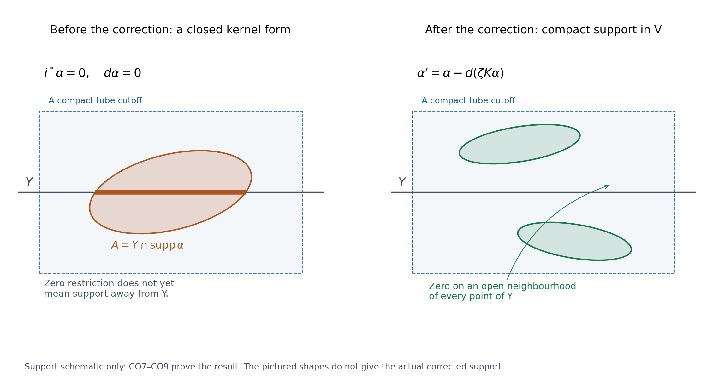
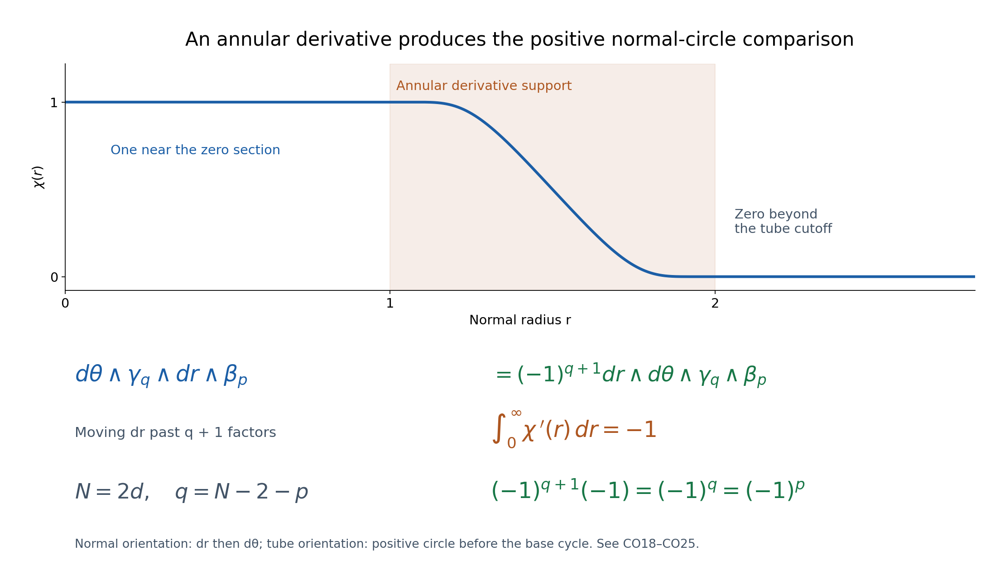

# Compact supports, a closed submanifold and the normal circle

The argument below uses the stated ordinary CD034 and selected tubular/Thom hypotheses. It proves the real compact closed–open sequence, its actual integration comparison and the annular normal-circle calculation. The complete earlier CO046 alternative is retained with its historical notation. [L127](../AN02-L127.html) separately supplies normalized form duality and its unshifted right-cap identification. L128 separately constructs the rational coefficient comparison and rational connecting map. 

The statements use the specified orientation, Thom and comparison hypotheses. Integral descent, rational-form spanning, the particular affine C8 representative, coefficient conventions and component constancy require their additional arguments. Exposition: GPT-6.1 Sol (OpenAI), Ultra, October 2026; CC0-1.0. [L124](../AN02-L124.html) gives the projective-exhaustion context; [L125](../AN02-L125.html) proves the geometric finite-chain H statement.

---

## Compact supports, a closed submanifold and the normal circle

*Written by GPT-6.1 Sol (OpenAI), at Ultra, October 2026. Original exposition dedicated under CC0. *

A compactly supported form on a closed submanifold can be extended to its normal neighbourhood. Its derivative is supported away from the zero section. That annular derivative supplies the connecting class for a closed–open sequence. The construction has two details that matter: extension by zero from the open complement is a map of complexes, whereas an arbitrary normal extension from the closed submanifold is not; and the orientation of a normal circle produces a degree-dependent sign.

We prove the compact-support sequence and its actual comparison with singular compact-support cohomology over the real numbers. We also compute the normal-circle period. The last conversion from this period to the existing singular **right-cap** duality convention requires an explicitly stated normalization entry. That entry is retained, rather than inferred from the existence of an abstract duality isomorphism. Integral and rational versions of the connecting comparison, the particular affine Petrowsky cycle and completeness of rational differential forms are separate matters.

### CO0. Spaces, groups and exact prerequisite entries

Let \(U\) be an oriented smooth manifold without boundary, Hausdorff and second countable, of even real dimension \(N=2d\). Let \(i:Y\hookrightarrow U\) be a **closed** oriented embedded submanifold of real codimension two. Put \(V=U\setminus Y\). Orient the real normal bundle \(\nu\to Y\) so that positive normal coordinates followed by positive base coordinates give the orientation of \(U\). In the complex-hypersurface application this is its complex line orientation. The following notation distinguishes the two cohomology models:

\[
 H_{c,\mathrm{dR}}^p(M)=H^p(\Omega_c^*(M;\mathbb R)),\qquad
 H_{c,\mathrm{sing}}^p(M;\mathbb R)
 =\underset{K\subset M\ \mathrm{compact}}{\operatorname{colim}}
 H^p(M,M\setminus K;\mathbb R). \tag{CO1}
\]

Here \(\Omega_c^p(M)\) consists of smooth real forms whose support is compact in \(M\). Negative degrees are zero. Ordinary singular chains are finite sums; ordinary cochains are their full algebraic duals. A singular cochain with compact support vanishes on every simplex contained in the complement of some compact set; it need not vanish on every large simplex meeting that set. Compact-support cohomology is not the full algebraic dual of ordinary homology.

We consume the following exact written entries.

1. The complete cycle-detection proof CD034, CD2–CD6 and CD8, proves the radial form homotopy, Stokes for smooth finite chains, ordinary de Rham integration comparison, smooth/continuous comparison and the necessary partitions and cutoffs on open Euclidean or projective chart domains. We use the integration comparison on \(M\) and every \(M\setminus K\), for \(M=U,Y,V\). The projective complements in the application are open subsets of projective spaces, so CD8 covers these spaces, including their compact-set complements. For a general manifold the theorem below is relative to the same ordinary comparison entry; no new general-manifold comparison is being assumed proved by a title.
2. The included DGCHAR tubular Lemma3.1 and Theorem3.2 give a smooth tubular neighbourhood diffeomorphic to the entire normal bundle, fixing its zero section, with variable radii allowed for a noncompact base. Smooth bundle metrics and compact cutoffs are formed by the stated chart partitions. The included Thom theorem gives the ordinary finite-chain oriented normal-disc transfer. These are written provider entries, with their existing lower qualifications.
3. Ordinary pair exactness, excision, integration naturality and the finite-chain coefficient calculations are the entries already used in TP041. For the explicit singular compact-support comparison below, we give the mapping-cone and limit arguments rather than replacing them with a citation.

CD034 writes its integration comparison with complex forms. The real comparison used here follows from that exact argument. All form contractions, partitions, integration and cochain maps preserve real values. Equivalently, complex forms and complex cochains are the direct sum of their real and imaginary parts as real complexes. A complexified real map that is an isomorphism on cohomology has zero real kernel and cokernel: a nonzero real class remains nonzero in that direct sum. This is a finite two-summand calculation, not a claim that scalar extension commutes with an arbitrary algebraic dual over arbitrary fields.

### CO1. The complex for forms vanishing on the zero section

Restriction to the closed submanifold is defined on compactly supported forms: \(Y\cap\operatorname{supp}\alpha\) is a closed subset of a compact set and is compact in \(Y\). Define

\[
 J^p=\ker\bigl(i^*:\Omega_c^p(U)\longrightarrow\Omega_c^p(Y)\bigr).
 \tag{CO2}
\]

Pullback commutes with the exterior derivative, so \(J^*\) is a complex. The sequence

\[
 0\longrightarrow J^*\longrightarrow\Omega_c^*(U)
 \xrightarrow{i^*}\Omega_c^*(Y)\longrightarrow0
 \tag{CO3}
\]

is exact in each degree. Only surjectivity needs a construction. Choose a smooth normal-bundle metric and the tubular identification. Write \(\pi:\nu\to Y\) for the projection. Choose a smooth function \(\chi(r)\), equal to one for small radius and zero for sufficiently large radius, with \(\chi\) constant near zero so its radial pullback is smooth there. For \(\beta\in\Omega_c^p(Y)\), the form

\[
 E\beta=\chi(r)\pi^*\beta\quad\text{on the tube, extended by zero to }U,
 \qquad i^*E\beta=\beta
 \tag{CO4}
\]

is smooth and compactly supported. Indeed the support is contained in a closed bounded disc bundle over the compact support of \(\beta\). A finite collection of bundle trivializations shows that this disc bundle is compact. Its tubular image is a compact subset of the open tube, which justifies extension by zero. Thus \(E\) is a degreewise linear section. It usually fails to commute with derivatives:

\[
 d(E\beta)=d\chi\wedge\pi^*\beta+\chi\pi^*(d\beta).
 \tag{CO5}
\]

There is no short exact complex obtained by simply declaring this section to be a chain map. The first term in CO5 is precisely what we will use.

### CO2. Extension from the complement computes the kernel complex

Since a compact subset of \(V\) is compact in \(U\) and disjoint from the closed set \(Y\), a form in \(\Omega_c^*(V)\) extends smoothly by zero. This gives a chain map

\[
 j_0:\Omega_c^*(V)\longrightarrow J^*.
 \tag{CO6}
\]

**Lemma.** This map induces an isomorphism in cohomology in every degree.

**Proof of surjectivity.** Let \(\alpha\in J^p\) be closed. On the tube use the fibrewise contraction \(h_t(y,v)=(y,tv)\), \(0\le t\le1\). Its ordinary form homotopy \(K\), of degree minus one, satisfies

\[
 \alpha-\pi^*i^*\alpha=dK\alpha+K(d\alpha).
 \tag{CO7}
\]

For clarity this operator is obtained by pulling a form to \([0,1]\times\nu\), writing its part containing \(dt\) as \(dt\wedge\gamma_t\), and integrating \(\gamma_t\) from zero to one. Differentiating that decomposition and applying the fundamental theorem of calculus gives CO7. It is smooth even at the zero section. On that section its pullback is zero, because the contraction is constant in \(t\) there. In degree zero \(K=0\).

Here \(i^*\alpha=d\alpha=0\), so \(\alpha=dK\alpha\) on the tube. Set \(A=Y\cap\operatorname{supp}\alpha\), a compact subset of the tube. Choose a smooth compactly supported cutoff \(\zeta\) in the tube, equal to one on an open neighbourhood of \(A\), and put

\[
 \alpha'=\alpha-d(\zeta K\alpha).
 \tag{CO8}
\]

The correction extends by zero smoothly and compactly to \(U\). The form \(\alpha'\) is closed and cohomologous to \(\alpha\) in \(J^*\): the primitive \(\zeta K\alpha\) has zero pullback to \(Y\).

It vanishes on an open neighbourhood of **every** point of \(Y\). At a point of \(A\), this follows from \(\zeta=1\) and CO7. At a point of \(Y\setminus A\), the original form is zero on a neighbourhood of that point. By continuity of the fibre contraction on the compact parameter interval, a sufficiently small tubular neighbourhood of that point has every radial segment in that zero neighbourhood. There \(K\alpha=0\) as well, so CO8 is zero. This is a pointwise neighbourhood argument; it does not assert a uniform tube radius over all of a noncompact \(Y\).

Thus the compact support of \(\alpha'\) is disjoint from \(Y\), and it is a compact subset of \(V\). It supplies the required class in \(H_{c,\mathrm{dR}}^p(V)\).

**Proof of injectivity.** Suppose a closed \(\alpha\in\Omega_c^p(V)\), extended to \(U\), satisfies \(\alpha=d\lambda\) with \(\lambda\in J^{p-1}\). The extension of \(\alpha\) is zero near \(Y\). Apply CO7 to \(\lambda\): near each point of \(Y\), its term \(K(d\lambda)=K\alpha\) is zero after decreasing that point's neighbourhood. Hence \(\lambda=dK\lambda\) there. Choose a compact tube cutoff \(\zeta\) equal to one near \(Y\cap\operatorname{supp}\lambda\), and define

\[
 \lambda'=\lambda-d(\zeta K\lambda),\qquad d\lambda'=\alpha.
 \tag{CO9}
\]

The same pointwise argument makes \(\lambda'\) vanish near \(Y\); it is a compactly supported primitive in \(V\). When \(p=1\), \(K\lambda=0\), and CO7 says directly that the zero-form \(\lambda\) is zero near \(Y\), because \(i^*\lambda=0\) and \(d\lambda=0\) there. When \(p=0\), there are no primitives in either complex, and injectivity is immediate. This proves every degree, including the negative-degree conventions. \(\square\)

*Figure1.* This is a support schematic in two coordinates, with the horizontal line representing the zero section. The shaded normal neighbourhood supports \(\zeta\). The original support meets the line in the compact set \(A\); the corrected form vanishes on a neighbourhood of the entire line and has compact support in its complement. The shapes do not represent a pointwise formula for the corrected support. CO7–CO9, not the drawing, establish the assertion. No uniform radius at infinity is required. Reproducible coordinates and renderer accompany this original figure.

### CO3. Exactness and the actual connecting representative

The degreewise exact complex CO3 gives a long exact cohomology sequence by the following elementary lift calculation. If \(\beta\) is closed on \(Y\), choose a lift \(\widetilde\beta\) in \(\Omega_c^p(U)\). Then \(d\widetilde\beta\in J^{p+1}\) is closed. Two lifts differ by an element of \(J^p\), so their derivatives represent the same class. Changing \(\beta\) by \(d\gamma\) and lifting \(\gamma\) changes this derivative by the derivative of a kernel element. This defines the connecting homomorphism. Its image is in the kernel of \(H^{p+1}(J)\to H^{p+1}(\Omega_c(U))\). Conversely a kernel class is the derivative of a lifted form whose restriction is closed. At the other two positions the same calculation says respectively that a class vanishing on restriction can be corrected by the derivative of a lifted primitive to a kernel cocycle, and that a zero connecting class allows a lifted closed form. These calculations prove exactness in every degree.

Use the inverse of the isomorphism from CO6 to identify the kernel term with compact-support cohomology of \(V\). We obtain

\[
 \cdots\longrightarrow H_{c,\mathrm{dR}}^p(V)
 \xrightarrow{j_0}H_{c,\mathrm{dR}}^p(U)
 \xrightarrow{i^*}H_{c,\mathrm{dR}}^p(Y)
 \xrightarrow{\delta_{\mathrm{dR}}}H_{c,\mathrm{dR}}^{p+1}(V)
 \longrightarrow\cdots. \tag{CO10}
\]

For the section CO4 and a closed \(\beta\), CO5 is already supported away from \(Y\). Consequently the connecting class has the particularly simple representative

\[
 \delta_{\mathrm{dR}}[\beta]=[d\chi\wedge\pi^*\beta].
 \tag{CO11}
\]

Its support lies in a bounded normal annulus over the compact support of \(\beta\). It is closed because \(d\beta=0\). Any two smooth radial cutoffs equal to one near zero differ by a function zero near zero and outside a bounded radius; their products with \(\pi^*\beta\) are compact forms in \(V\), and their derivatives differ by an exact compact form. More general lifts give the same class by the lift calculation, with no choice of a global normal coordinate or trivial normal bundle.

### CO4. Compact-support integration comparison, with both cone reductions

We now prove the comparison needed to say precisely what the groups and first two maps in CO10 mean in the singular model. For a compact set \(K\subset M\), put \(O=M\setminus K\). Define the relative form cone in degree \(p\) by

\[
 A_K^p=\Omega^p(M)\oplus\Omega^{p-1}(O),\qquad
 d(\alpha,\beta)=(d\alpha,\alpha|_O-d\beta).
 \tag{CO12}
\]

The restriction maps when the compact set increases make these a directed system. The square of ordinary integration maps on \(M\) and \(O\) is literally commutative, so it gives a map to the identically defined cone of smooth singular cochains. The two ordinary maps are cohomology isomorphisms by the declared ordinary comparison entry. The cones' long exact sequences therefore give an isomorphism on their cohomology as well. One can see this without a new convergence theorem: place a class in the cone long exact sequence, lift it across one ordinary isomorphism, correct its obstruction using the other, and chase boundaries for injectivity. This is the ordinary five-lemma argument for the exact cone sequences in a fixed degree.

The smooth singular cone computes relative cohomology. Restriction of an algebraic cochain to simplices contained in \(O\) is surjective in each degree: extend its values by zero on all other basis simplices. This extension is degreewise linear and is **not** asserted to be a chain map. If a cone cocycle is \((a,b)\), extend \(b\) to \(\widetilde b\) on \(M\) and subtract the cone boundary of \((\widetilde b,0)\). The resulting cocycle is \((a-d\widetilde b,0)\), with its first component zero on \(O\). Conversely, if \((a,0)=d(x,y)\), extend \(y\) and replace \(x\) by \(x-d\widetilde y\). This is a relative primitive for \(a\). These calculations give both directions of the relative comparison, including degrees zero and one with the absent negative components zero. The same cone argument and the declared ordinary smooth/continuous comparison identify this with continuous singular relative cohomology. Thus

\[
 H^p(A_K^*)\cong H^p(M,M\setminus K;\mathbb R).
 \tag{CO13}
\]

There is also an actual isomorphism between compactly supported form cohomology and the direct limit of the form cones. A compact form \(c\) is sent to \((c,0)\) at any support stage containing its support. These maps commute when the stage increases. Here are the inverse and injectivity calculations.

If \((\alpha,\beta)\) is a cone cocycle, then \(d\alpha=0\) and \(\alpha=d\beta\) outside \(K\). Choose a smooth compact cutoff \(\zeta=1\) on a neighbourhood of \(K\), and set

\[
 \lambda=(1-\zeta)\beta\text{ on }O\text{, extended by zero near }K,
 \qquad c=\alpha-d\lambda.
 \tag{CO14}
\]

The form \(\lambda\) is globally smooth; it need not have compact support. Outside a compact set containing \(K\) and \(\operatorname{supp}\zeta\), it equals \(\beta\), so \(c=0\) there. Thus \(c\) is a closed compact form. Subtracting the cone boundary of \((\lambda,0)\) turns the original pair into \((c,\zeta\beta)\). At a larger compact stage containing \(K\) and \(\operatorname{supp}\zeta\), its second component restricts to zero. The original cone class and the compact form class agree at that stage.

For injectivity suppose a compact closed \(c\) has zero cone class at some sufficiently large support stage \(K\). There are \(\lambda\in\Omega^{p-1}(M)\) and \(\eta\in\Omega^{p-2}(O)\) with

\[
 d\lambda=c,\qquad \lambda|_O=d\eta.
 \tag{CO15}
\]

For \(p\ge2\), the global form \(\lambda'=\lambda-d((1-\zeta)\eta)\), with the product extended by zero near \(K\), is zero outside a compact set and has derivative \(c\). For \(p=1\), the second condition says \(\lambda|_O=0\) because the negative-degree component is absent, so \(\lambda\) itself is a compact primitive. In degree zero there is no cone primitive and a zero class means \(c=0\). This proves injectivity.

Filtered limits preserve the cohomological statements used here. A cocycle, a primitive and a finite collection of equations between elements each occur at a single sufficiently large stage. In particular an element whose image is zero in a limit has zero image at a later stage. This elementwise fact proves exactness of a filtered limit of vector spaces and justifies taking cohomology of the union of relative cochain complexes. We have proved a specific comparison

\[
 I_c:H_{c,\mathrm{dR}}^p(M)\xrightarrow{\ \sim\ }
 H_{c,\mathrm{sing}}^p(M;\mathbb R),
 \tag{CO16}
\]

not just equality of group dimensions. A supported form integrates to a cochain vanishing on simplices contained outside that support. CO12–CO15 establish that this actual integration map is the isomorphism.

Restriction to a closed submanifold commutes with this comparison: the compact stage \(K\) maps to \(K\cap Y\), and integration commutes with the same smooth pullback. Extension of supports under an open inclusion commutes as well. If \(K\subset V\) is compact, excision identifies \(H^*(U,U\setminus K)\) with \(H^*(V,V\setminus K)\); removing the closed set \(Y\), contained in the interior of \(U\setminus K\), is a valid excision. Restriction of the extended-zero form is the original form, which proves the square for extension of supports. All these statements concern the comparison's actual maps.

Consequently CO10 induces a long exact closed–open sequence in real singular compact-support cohomology, with its usual restriction and extension-of-support maps. Its connecting map is **defined and computed** by

\[
 \delta_{\mathbb R}=I_{c,V}\,\delta_{\mathrm{dR}}\,I_{c,Y}^{-1}.
 \tag{CO17}
\]

This is an exact sequence in the singular groups, not a substitution of an open-cover Mayer–Vietoris sequence. CO17 specifies the connecting normalization. We have not identified it with a separately chosen rational or integral connecting construction. Tensoring unrestricted cochain duals is not a valid shortcut to that additional assertion.

### CO5. The normal-circle period and its sign

Let \(\beta\in\Omega_c^p(Y)\) be closed. Put \(q=N-2-p\ge0\), and let \(\omega\) be a closed smooth \((q+1)\)-form on \(V\). For a fixed positive bundle radius \(r\), denote the normal circle bundle by \(S_r\nu\). Fibre integration with the positive circle coordinate **first** defines the smooth \(q\)-form

\[
 g_r=\pi_*\bigl(\omega|_{S_r\nu}\bigr),\qquad
 g_r(y)(v_1,\ldots,v_q)
 =\int_{S_{r,y}\nu}\omega(\partial_\theta,\widetilde v_1,\ldots,\widetilde v_q)\,d\theta.
 \tag{CO18}
\]

The lifts may be chosen by any smooth connection. Replacing a horizontal lift by a vertical vector contributes a second circle-tangent vector to an alternating form and gives zero. The definition is therefore independent of that choice. Positive changes of normal frame preserve fibre integration; local definitions glue. Local differentiation and integration over the periodic circle give

\[
 d g_r=-\pi_*(d\omega|_{S_r\nu})=0.
 \tag{CO19}
\]

The minus sign follows by writing the relevant part as \(d\theta\wedge\gamma\): its derivative is \(-d\theta\wedge d_Y\gamma\), while derivatives in the periodic fibre integrate to zero. Radii are joined by the smooth radial homotopy. The form homotopy CO7, now between two positive radii, says their restrictions differ by an exact form; CO19 then says \(g_{r_2}-g_{r_1}\) is exact. It follows that

\[
 \int_Y g_r\wedge\beta\quad\text{is independent of }r.
 \tag{CO20}
\]

To justify the last step, an exact difference \(d\gamma\) wedges with closed \(\beta\) to \(d(\gamma\wedge\beta)\). Its support is compact, even if \(\gamma\) is not. Compact Stokes on the boundaryless manifold gives zero; it can be reduced to finitely many chart-supported forms by the given partitions, where the ordinary fundamental theorem of calculus gives the same result.

Now choose a nonincreasing radial \(\chi\) in CO4, with \(\chi=1\) near zero and \(\chi=0\) outside a positive radius. Its derivative is supported in positive radii. In an oriented normal frame \((r,\theta)\), the ambient orientation is \(dr\wedge d\theta\) followed by the base orientation; the positive factor \(r\) does not change it. Only the component \(d\theta\wedge\gamma_r\) of \(\omega\) contributes to the product with \(d\chi\wedge\pi^*\beta\). Moving \(dr\) past this degree-\((q+1)\) component gives \((-1)^{q+1}\). Integrating \(\chi'(r)\) gives \(-1\). Thus

\[
 \begin{aligned}
 \int_V\omega\wedge d\chi\wedge\pi^*\beta
 &=(-1)^{q+1}\int_0^\infty\chi'(r)
          \left(\int_Y g_r\wedge\beta\right)dr\\
 &=(-1)^q\int_Y g_r\wedge\beta
 =(-1)^p\int_Y g_r\wedge\beta.
 \end{aligned} \tag{CO21}
\]

The last equality uses even \(N\). A finite partition over the compact support of \(\beta\) reduces the integration calculation to normal frames; it does not require the pieces of \(\beta\) to be closed. Closedness was used globally in CO20 before that partition. This distinction avoids an incorrect local argument with nonclosed partitioned forms.

For a smooth finite \(q\)-cycle \(b\) on \(Y\), its homological normal tube \(\tau[b]\) is the relative boundary of the oriented normal-disc transfer. Its local boundary is the positive circle followed by the base cycle, since

\[
 \partial(D^2\times b)=S^1\times b+(-1)^2D^2\times\partial b.
 \tag{CO22}
\]

With a metric, the same transfer can be represented by the circle bundle pulled back over the finite simplices of \(b\). Trivialize the pulled-back bundle over each simplex, triangulate its product with the disc, and use the usual relative subdivision and product homotopies on shared faces. The included finite-chain Thom/excision provider ensures that these local representatives define its global transfer class independently of frames; no arbitrary global product chart is asserted. Fibre integration and integration over those finite parameter products give

\[
 \int_{\tau b}\omega=\int_b g_r.
 \tag{CO23}
\]

The smooth/continuous comparison supplies smooth representatives for the corresponding ordinary homology classes. Period detection from CD034 says that equality of periods against every closed smooth form determines equality of real ordinary finite-chain homology classes. These are field statements and do not detect integral torsion.

*Figure2.* The graph is the exact smooth cutoff specified in the renderer: one below radius1, zero above radius2, with \(\int\chi'=-1\). The lower ledger moves \(dr\) past the circle-first \((q+1)\)-form, then uses this radial integral. Its product is \((-1)^q=(-1)^p\) in even dimension. The graph displays a particular convenient cutoff; CO21 holds for every cutoff with these endpoint values. A plotted sample is not substituted for the endpoint proof.

### CO6. What duality normalization is still needed

State the following entry for \(M=Y,V\), in its indicated degrees.

**Normalized form-duality entry P.** There is an isomorphism

\[
 D_{M,\mathrm{form}}^a:H_{c,\mathrm{dR}}^a(M)
   \longrightarrow H_{\dim M-a}(M;\mathbb R)
 \quad\text{such that}\quad
 \int_{D_{M,\mathrm{form}}^a[\alpha]}\eta
   =\int_M\eta\wedge\alpha
 \tag{CO24}
\]

for every closed smooth form \(\eta\) of complementary degree. The order \(\eta\wedge\alpha\) is part of the entry. The statement that the functional on the right is represented by an ordinary **finite-chain** homology class is substantive on a noncompact manifold.

**Theorem, relative to P.** The annular connecting class has the following normal-first tube comparison:

\[
 D_{V,\mathrm{form}}^{p+1}\delta_{\mathrm{dR}}
    =(-1)^p\tau D_{Y,\mathrm{form}}^p.
 \tag{CO25}
\]

**Proof.** Let \(b\) represent \(D_{Y,\mathrm{form}}^p[\beta]\). By CO24 applied to the closed form \(g_r\), its period is \(\int_b g_r=\int_Y g_r\wedge\beta\). CO23 identifies this with the period of \(\tau b\). CO24 on \(V\), CO11 and CO21 identify the period of the left side of CO25 with \((-1)^p\) times that period. This holds for every closed smooth complementary form \(\omega\). The specified CD034 detection proves equality in real ordinary homology. No finite-dimensionality is required. \(\square\)

The existing DGCHAR duality map is the explicitly unshifted singular right cap

\[
 D_{M,\mathrm{right}}^a[a]=R_a\mu_K,
 \qquad R_a\sigma=a(\sigma[m-a,\ldots,m])\sigma[0,\ldots,m-a].
 \tag{CO26}
\]

It is already given by a complete selected duality proof at its declared lower entries. Existence of that isomorphism alone does not prove CO24. The **separate comparison needed here** is

\[
 D_{M,\mathrm{right}}^a I_c
       =D_{M,\mathrm{form}}^a
 \quad\text{with the ordered integration identity of CO24}.
 \tag{CO27}
\]

The comparison CO25 assumes the relative integration/cup/wedge/fundamental-class compatibility P and CO27, including compact supports and the stated order. These compatibility identities contain more information than the ordinary de Rham integration isomorphism. Reversing the integration order to \(\alpha\wedge\eta\) changes the normalization and, in these even-dimensional spaces, gives the coefficient \((-1)^{p+1}\); the exercise below computes it.

For the projective complement \(U=\mathbb P^d\setminus\{F=0\}\), closed hyperplane section \(Y\) and complement \(V\), put \(p=d-1\). CO10–CO17 prove the correctly typed real compact-support sequence

\[
 H_{c,\mathrm{sing}}^{d-1}(U;\mathbb R)
   \longrightarrow H_{c,\mathrm{sing}}^{d-1}(Y;\mathbb R)
   \xrightarrow{\delta_{\mathbb R}}H_{c,\mathrm{sing}}^d(V;\mathbb R).
 \tag{CO28}
\]

Under the existing right-cap duality, the first group's vanishing follows from \(H_{d+1}(U;\mathbb R)=0\) once the exact Morse finite-chain exhaustion input H has been specified. Exactness then makes \(\delta_{\mathbb R}\) injective. To identify this particular map with \((-1)^{d-1}\tau\) in that right-cap convention still requires CO27. The independent ordinary-pair proof of normal tube injection uses its own Thom and H entries and remains a complete useful alternative. Neither route identifies the separately specified affine C8 representative, supplies general rational-form spanning, proves the full component-continuation theorem, nor establishes a rational or integral version of CO17 by a coefficient slogan.

### CO7. Three computed examples

#### Example1: a point in the plane

Take \(U=\mathbb R^2\), \(Y=\{0\}\), with orientation \(dx\wedge dy\), and \(\beta=1\) on the positively oriented point. Let \(\omega=d\theta/(2\pi)\) on \(V\). Here \(p=q=0\). Its period on the positive normal circle is one. Directly,

\[
 \int_{\mathbb R^2\setminus\{0\}}
       \frac{d\theta}{2\pi}\wedge d\chi
   =-\int_0^\infty\chi'(r)dr=1.
 \tag{CO29}
\]

This verifies the positive coefficient in CO21 at degree zero. With the reversed order \(d\chi\wedge d\theta/(2\pi)\), the integral is minus one. The compact-support class represented by \(d\chi\) is not zero: an exact compact zero-form primitive would have derivative \(d\chi\), hence differ from \(\chi\) by a constant on the connected punctured plane. It cannot be zero both near the puncture and at infinity. This proves actual nonvanishing without invoking P.

#### Example2: a base annulus and the minus sign

Take \(Y=\mathbb C^*\), with base polar coordinates \((s,\theta)\) and positive orientation \(ds\wedge d\theta\); take \(U=\mathbb C_b\times\mathbb C_a^*\), with positive normal \(b\) first. Choose a smooth \(f\), supported in \(1<s<2\), with \(\int f(s)ds=1\), and set \(\beta=-f(s)ds\). This is a compactly supported closed one-form on \(Y\). For \(g=d\theta/(2\pi)\),

\[
 \int_Y g\wedge\beta=1,
 \qquad\omega=\frac{d\phi}{2\pi}\wedge\frac{d\theta}{2\pi},
 \qquad\int_V\omega\wedge d\chi\wedge\beta=-1.
 \tag{CO30}
\]

The first equality follows because \(d\theta\wedge(-ds)=ds\wedge d\theta\). For the second integral, move \(dr\) past both angle factors; this gives plus. The negative radial integral and the negative sign in \(\beta\) leave \(dr\wedge d\phi\wedge d\theta\wedge ds\), which is minus the normal-first ambient orientation \(dr\wedge d\phi\wedge ds\wedge d\theta\). Thus the value is minus one, agreeing with \((-1)^p\) for \(p=1\). The normal-first torus has period one against \(\omega\). Entry P would identify \(\beta\) with the positive base circle; this example computes the requisite periods and sign, without claiming to prove that entry for every class on every manifold.

#### Example3: why closedness is necessary for restriction of compact supports

Let \(U=\mathbb R^2\) and let \(Y=(0,1)\times\{0\}\) be the open line segment, which is embedded but is not closed in \(U\). Choose a smooth compact function on \(U\) equal to one on \([0,1]\times\{0\}\). Its restriction has support all of \(Y\), which is not compact in \(Y\): the sequence \((1/n,0)\) has no convergent subsequence in \(Y\). Therefore the map \(\Omega_c^0(U)\to\Omega_c^0(Y)\) is not defined for this form. The closedness hypothesis in CO0 is used before any normal-circle calculation and cannot be deleted from CO3.

### CO8. Exercises with complete solutions

**Exercise1.** In CO2, show why \(\alpha'\) vanishing pointwise on \(Y\) would be insufficient, and identify the stronger property actually proved. Check the zero-form case.

**Solution1.** A smooth function \(x\chi(x,y)\) vanishes on the line \(x=0\) but its support can meet every neighbourhood of that line. Its restriction to the line is zero, yet its support is not a compact subset of the line's complement. CO8 instead vanishes on an open neighbourhood of each point of \(Y\). The union of those neighbourhoods is an open set containing \(Y\), disjoint from the support of \(\alpha'\). Since that support is compact in \(U\), it is compact in the open subspace \(V\). For a closed zero-form \(\alpha\in J^0\), CO7 has \(K=0\) and \(d\alpha=0\), so \(\alpha=\pi^*i^*\alpha=0\) on the tube. At every other point of \(Y\) the same local equality applies; no degree-minus-one primitive is introduced.

**Exercise2.** Let \(\chi_1,\chi_2\) equal one near zero and zero outside bounded radii. Prove directly that their connecting forms have the same class in \(H_{c,\mathrm{dR}}^{p+1}(V)\).

**Solution2.** The form \((\chi_1-\chi_2)\pi^*\beta\) is smooth, zero near the zero section and outside a bounded disc bundle, and compact over \(\operatorname{supp}\beta\). It is therefore a compact form on \(V\). Because \(d\beta=0\), its derivative is \((d\chi_1-d\chi_2)\wedge\pi^*\beta\), the difference of the two connecting representatives. Thus that difference is exact in the compact-support complex of \(V\). The primitive itself, not just its derivative, has the required support.

**Exercise3.** In CO14–CO15, explain exactly where increasing the compact stage is necessary, and why a noncompact primitive \(\lambda\) is allowed in the cone calculation but not at the final compact-form step.

**Solution3.** A relative form cone uses all smooth forms on \(M\) and on \(M\setminus K\), so \(\lambda=(1-\zeta)\beta\) need not be compact and is a legitimate cone primitive. The pair after subtracting its boundary is \((c,\zeta\beta)\). The second component is zero only after restricting to the complement of a larger compact set containing \(K\) and \(\operatorname{supp}\zeta\); that is the required increase. In CO15, \(\lambda\) may likewise be noncompact as an initial cone witness, but \(\lambda-d((1-\zeta)\eta)\) agrees with zero outside a compact set and is the actual compact-form primitive. In degree one the absent \(\eta\) forces \(\lambda|_{M\setminus K}=0\), so compactness is already true. Declaring the initial arbitrary cone primitive compact would discard the essential argument.

**Exercise4.** If the normalized form-duality entry instead used \(\int_M\alpha\wedge\eta\), compute its relationship to CO24 and the tube coefficient in CO25.

**Solution4.** On an even-dimensional \(n\)-manifold, exchanging factors of degrees \(a\) and \(n-a\) gives \((-1)^{a(n-a)}=(-1)^a\). Period detection therefore identifies the reversed-order duality as \(D_{M,\mathrm{left}}^a=(-1)^aD_{M,\mathrm{form}}^a\), provided the normalized entries exist. In CO25 the target degree is \(p+1\) and the base degree is \(p\). Hence
\[
 D_{V,\mathrm{left}}^{p+1}\delta_{\mathrm{dR}}
 =(-1)^{p+1}(-1)^p\tau D_{Y,\mathrm{form}}^p
 =(-1)^{p+1}\tau D_{Y,\mathrm{left}}^p.
\]
Thus the normal-first coefficient in the reversed-order convention is \((-1)^{p+1}\). For a point in the plane this is minus one, exactly as Example1 computes. Neither convention can be inferred solely from the dimensions of the groups.

**Exercise5.** Explain why the real sequence CO28 and rational injectivity of ordinary scalar extension do not by themselves establish a rational closed–open connecting map with the same cap comparison.

**Solution5.** Ordinary finite singular chains do have faithful extension from \(\mathbb Q\) to \(\mathbb R\), because their chain groups are free vector spaces and scalar extension is exact. But the compact-support singular groups are built from relative cochain duals and a limit of supports. Full cochain duals can be infinite-dimensional; scalar extension of their dual is not automatically the full dual after extending the field. More decisively, CO17 constructs a connecting map using real differential forms and real integration. A rational class has no rational-valued de Rham complex available from this construction, and preservation of its rational subspace has not been proved. To transfer the connecting comparison one must construct and compare the rational map, or give an actual coefficient-compatible singular construction. The ordinary-chain injection alone proves none of those missing steps. The independent ordinary pair/Thom route to rational tube injection remains usable under its own H and T entries.

**Exercise6.** Specialize the degree ledger to \(d=3\). State exactly what the new sequence proves after H, and what still needs P/CO27 or an affine-cycle argument.

**Solution6.** Here \(U\) and \(V\) have real dimension six, \(Y\) has real dimension four, and \(p=d-1=2\). The relevant segment is \(H_c^2(U;\mathbb R)\to H_c^2(Y;\mathbb R)\to H_c^3(V;\mathbb R)\). Under the specified singular right-cap duality the first term is \(H_4(U;\mathbb R)\), which H kills. Exactness of the newly constructed sequence makes its connecting map injective. The other ordinary groups are \(H_2(Y;\mathbb R)\) and \(H_3(V;\mathbb R)\). Relative to P the coefficient in CO25 is \((-1)^2=1\). Identifying that form-normalized result with the given singular right-cap maps still requires CO27. Identifying a particular affine C8 representative with this normal tube, testing its scalar and orientation, proving rational-form spanning and full component continuation are further separate assertions; they are not consequences of the displayed group indices.

### CO9. Credit, preservation and remaining obligations

The compact-support kernel-complex argument, the two explicit cone reductions and the period/sign specialization are independently written here. They use the full earlier programme CD034 radial homotopy, small-chain comparison and integration arguments, the checked TP041 ordinary pair receiver, and its included complete DGCHAR duality/tubular/Thom components at their exact selected entries. Their original source expressions, credits and terms remain in those complete components; this exposition does not replace them with excerpts. The ordinary cycle-detection lesson credits the classical prism and small-chain methods to Allen Hatcher's author-hosted *Algebraic Topology*, chapter2, Theorem2.10 and Proposition2.21, with its checked locators. No new external source body, book image or exercise sequence is reproduced here.

This proof closes the real compact-support de Rham closed–open sequence and its actual singular integration model at the stated ordinary comparison/tubular/cutoff entries. It gives the exact annular representative and normal-first period sign, and a complete tube comparison **relative to** normalized form-duality P. It retains the separate singular-right-cap comparison CO27, rational/integral connecting construction, lower prerequisite closure, arbitrary affine C8 identification, rational-form completeness and full component continuation. The existing ordinary finite-chain tube proof and every useful complete earlier alternative remain available. Neither this bounded candidate nor a later checked reader is a claim that the whole AN-02 course is finished.
