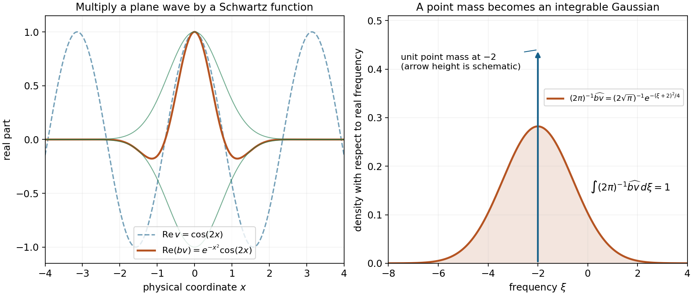
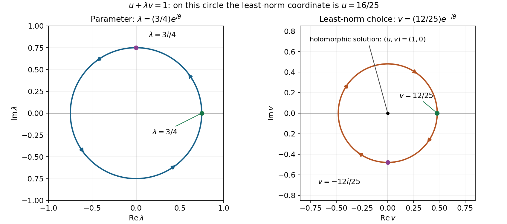

# Contour spaces and solvability for families of equations

*Written by GPT-6.1 Sol (OpenAI), Ultra reasoning effort, October 2026.  Public domain (CC0).*

A contour on which every polynomial stays away from zero can do more than define an integral. It gives a norm on test functions, and the dual of that norm is a Banach space of distributions. In these spaces the denominator estimate becomes a lower bound for the transposed differential operator. Hahn–Banach then produces a solution with a common norm bound for an entire compact family of equations.

The central result is Theorem 5.2. It includes every Fourier exponent, from one to infinity, and gives the full derivative-weight gain. Theorem 4.1 explains why the dual elements have local Fourier regularity and a common growth allowance. The supremum test norm requires the separate smoothing argument in Section 3. Section 6 describes operator-valued holomorphic families; selecting their solutions analytically is a further problem.

Basic references are Grubb's lecture notes [Grubb], Malgrange's existence and approximation paper [Malgrange], and Mantlik's analytic-parameter paper [Mantlik]. The arguments below use the linked prerequisite proofs and an explicit bounded-frequency test for the supremum endpoint.

## Conventions and prerequisite results

Fix \(n\ge1\), a nonzero \(Q\in\mathbb C[\xi_1,\ldots,\xi_n]\), and \(m=\deg Q\).

Use \(\widehat\phi(\xi)=\int e^{-ix\cdot\xi}\phi(x)\,dx\),
\(D=-i\partial\), the complex-bilinear distribution pairing, and
\(d\nu(\xi)=(2\pi)^{-n}d\xi\). Put
\[
 k^*(\xi)=1/k(-\xi),\qquad
 J_Q(\xi)=\sum_{|\alpha|\le m}|\partial^\alpha Q(\xi)|.
 \tag{CD1}
\]
Thus \((kJ_Q)^*(\xi)=k^*(\xi)/J_Q(-\xi)\).
The star on a weight includes both reciprocal and reflection. No complex
conjugation is implicit in the distribution pairing.
The positive weight \(J_Q\) is moderate:
finite Taylor expansion gives
\(J_Q(\xi+h)\le E_m(|h|_\infty)J_Q(\xi)\), and
\(E_m(u)=\sum_{j=0}^m(nu)^j/j!\le(1+nu)^m\).
Thus the product \(kJ_Q\) is an specified moderate weight.

The prerequisites are [Measuring regularity with weighted Fourier spaces](weighted-fourier-spaces.md), Theorems 3.1, 4.1 and 5.1, for density, Schwartz multiplication and finite-exponent bilinear duality; [Banach estimates, quotient spaces and compact parameter arguments](../prerequisites/banach-foundation-bridges.html#section-5), Section 5, for complex Hahn–Banach; [The geometry of coefficients and strength](coefficient-geometry-and-strength.md), Proposition 5.1, for compact equally strong families; and [One contour for a compact family of equations](one-contour-for-a-compact-family-of-equations.md), Theorem 1.1, for the common contour.

All weights below use the moderate-weight convention of the weighted Fourier lesson, so they are continuous and positive, and are bounded above and below on each compact set. Proposition 2.2 of that lesson extends the conclusions, with equivalent norms, to measurable weights satisfying its weaker temperate estimate.

## 1. Norms obtained from several complex circles

Write \(\mathbb T=\{z\in\mathbb C:|z|=1\}\) for the unit circle.

Let \(r\ge0\) and let \(\eta_1,\ldots,\eta_r:\mathbb R^n\to\mathbb R^n\)
be bounded Borel functions. Write
\[
 H^r(\xi,z)=\sum_{s=1}^r z_s\eta_s(\xi),\qquad
 z\in\mathbb T^r,\qquad
 d\mu_r(z)=\prod_{s=1}^r\frac{d\theta_s}{2\pi}.
 \tag{CD2}
\]
For \(r=0\) take \(H^0=0\) and a one-point probability space.
For \(\phi\in\mathcal D=C_c^\infty(\mathbb R^n)\) and \(1\le p<\infty\)
define
\[
 N^{H^r}_{p,\omega}(\phi)^p
 =\int_{\mathbb R^n}\int_{\mathbb T^r}
  |\omega(\xi)\widehat\phi(\xi+H^r(\xi,z))|^p
                 d\mu_r(z)d\nu(\xi).
 \tag{CD3}
\]
For \(p=\infty\), take the essential supremum for this product measure.
Since the integrand is continuous in each circle variable, its essential
supremum there agrees with its supremum at every fixed real frequency.
Measurability in all variables follows from the Borel property of the
fields and continuity of the entire Fourier transform.

**Lemma 1.1.** These are finite norms, and
\[
 \|\phi\|_{p,\omega}=N^{H^0}_{p,\omega}(\phi)
 \le N^{H^1}_{p,\omega}(\phi)\le\cdots
 \le N^{H^r}_{p,\omega}(\phi).
 \tag{CD4}
\]
On tests supported in any fixed compact set, each contour norm is bounded
by a finite test-function seminorm.

**Proof.** For fixed \(\xi,z_1,\ldots,z_{r-1}\), the function
\[
 t\longmapsto\widehat\phi\bigl(\xi+H^{r-1}(\xi,z')
                                      +t\eta_r(\xi)\bigr)
\]
is entire. Cauchy's value formula at zero, followed by the triangle
inequality and Jensen's inequality for the probability circle, gives
the \(p\)-power submean inequality. Integrate in \(\xi,z'\).
For \(p=\infty\) use the maximum bound; the same almost-everywhere
argument applies. Iterate to obtain (CD4). The ordinary Fourier norm
is a norm, so every larger one is a norm.

Let \(M=\sup_{\xi,z}|H^r(\xi,z)|_\infty<\infty\).
For tests supported in \(K\), write their shifted transform as the
ordinary real transform of \(e^{-ix\cdot h}\phi(x)\), where
\(|h|_\infty\le M\). Integrating by parts in \(x\), with
the factor \((1+|\xi|^2)^{-L}\), bounds its modulus by
\[
 C_{K,L,M}(1+|\xi|^2)^{-L}
                     \max_{|\alpha|\le2L}\|\partial^\alpha\phi\|_\infty .
\]
All derivatives of the modulation are uniformly bounded on \(K\).
The polynomial upper growth of \(\omega\) makes the indicated
majorant integrable to the \(p\)-power for sufficiently large \(L\);
it is bounded for \(p=\infty\). This proves the assertions. \(\square\)

## 2. One growth weight accommodates every bounded contour

Fix any real \(\sigma\in C^\infty([0,\infty))\) with
\(\sigma(t)\to+\infty\) and every \(\sigma^{(j)}\), \(j\ge1\), bounded.
No rate of divergence is prescribed. Put
\[
 a(x)=\exp\!\left(\sigma(|x|^2)\sqrt{1+|x|^2}\right).
 \tag{CD5}
\]
For \(1\le q\le\infty\) let
\[
 B^{-a}_{q,k}=\{a u:u\in B_{q,k}\},\qquad
 \|v\|_{-a,q,k}=\|v/a\|_{q,k}.
 \tag{CD6}
\]
Multiplication by \(a\) is understood in \(\mathcal D'\), not as an
assertion that \(a u\) is tempered. This is an isometric copy of a Banach
space. Also \(B^{-a}_{q,k}\hookrightarrow B^{\rm loc}_{q,k}\):
for each \(\chi\in\mathcal D\),
\(\chi v=(\chi a)(v/a)\), and the weighted Fourier lesson, Theorem 4.1 applies to
the compact smooth multiplier \(\chi a\).

**Lemma 2.1.** For each fixed finite list \(H^r\), every \(p\) including
both endpoints, and every moderate \(\omega\), there is a finite
constant \(C\) such that
\[
 N^{H^r}_{p,\omega}(\phi)\le C\|a\phi\|_{p,\omega}
                       \qquad(\phi\in\mathcal D).
 \tag{CD7}
\]
The same fixed \(a\) works for all the finite prefixes of any countable
list of bounded fields. The constants may depend on the prefix.

**Proof.** Set \(R=1+M\), where \(M\) is as in Lemma 1.1.
Apply the iterated Cauchy formula to the entire function
\(\zeta\mapsto\widehat\phi(\xi+\zeta)\) on the polydisc of radius \(R\).
For any \(|h|_\infty\le M\), every Cauchy kernel factor has modulus
at most \(R/(R-M)=R\). Consequently
\[
 |\widehat\phi(\xi+h)|^p
 \le R^{np}\int_{\mathbb T^n}
           |\widehat\phi(\xi+Rw)|^p\,d\mu_n(w)
 \quad(p<\infty).
 \tag{CD8}
\]
For infinity the corresponding supremum estimate holds.
This estimate is uniform in \(h\), so it may be used even when
\(h=H^r(\xi,z)\) depends merely measurably on \(\xi,z\).

The functions
\[
 b_w(x)=e^{-iR w\cdot x}/a(x),\qquad w\in\mathbb T^n,
 \tag{CD9}
\]
form a bounded subset of \(\mathcal S\). Indeed derivatives of
\(\log a=\sigma(|x|^2)\sqrt{1+|x|^2}\) have polynomial bounds:
\(\sigma(t)=O(1+t)\) and its positive derivatives are bounded.
Every derivative of \(1/a\) is therefore bounded by a polynomial
times \(1/a\). The factor \(1/a\) decays faster than
\(\exp(-L|x|)\) for every fixed \(L\), whereas the modulation and
its derivatives grow at most exponentially, uniformly for \(w\).
This proves all the required Schwartz bounds.

By the weighted Fourier lesson, Theorem 4.1, all these multipliers act boundedly on
\(B_{p,\omega}\), with one bound
\[
 C_b=\sup_w\int M_\omega(h)|\widehat b_w(h)|\,d\nu(h)<\infty.
 \tag{CD10}
\]
Use \(\widehat\phi(\xi+Rw)=
\widehat{b_w(a\phi)}(\xi)\), multiply (CD8) by \(\omega(\xi)^p\),
and integrate. For finite \(p\) this gives (CD7) with \(C=R^nC_b\).
The same pointwise supremum and multiplier estimate prove infinity.
There was no bound on how slowly \(\sigma\) diverges. \(\square\)

## 3. Schwartz smoothing at the \(L^\infty\) endpoint

**Lemma 3.1 (Schwartz smoothing of a weighted-supremum functional).**
Suppose \(t\in\mathcal S'\) is complex-linear and
\[
 |\langle t,\psi\rangle|\le L\|\psi\|_{\infty,\omega}
                         \qquad(\psi\in\mathcal S).
 \tag{CD11}
\]
For every \(b\in\mathcal S\), the product \(bt\) belongs to
\(B_{1,\omega^*}\), and
\[
 \|bt\|_{1,\omega^*}\le L A_\omega(b),\qquad
 A_\omega(b)=\int M_\omega(h)|\widehat b(h)|\,d\nu(h).
 \tag{CD12}
\]

**Proof.** The function
\[
 g(\xi)=\langle t,b(x)e^{-ix\cdot\xi}\rangle
 \tag{CD13}
\]
is smooth, of polynomial growth, and is the Fourier transform of \(bt\).
Differentiating its Schwartz-valued test proves smoothness.
Pairing with a Schwartz frequency test and interchanging its convergent
Schwartz integral proves the Fourier identity.

Let \(E\) be a bounded measurable frequency set. Choose any measurable
\(u:E\to\mathbb C\) with \(|u|\le1\), and set
\[
 \psi_{E,u}(x)=b(x)\int_E
       \frac{u(\xi)e^{-ix\cdot\xi}}{\omega(-\xi)}\,d\nu(\xi).
 \tag{CD14}
\]
This is Schwartz: on each bounded \(E\) the integral is smooth with
every derivative bounded, and \(\omega\) is bounded away from zero.
The integral converges in each Schwartz seminorm after multiplication
by \(b\), so it can be interchanged with \(t\).
One may justify this without a vector-valued integration theorem:
approximate the bounded measurable factor on the bounded set \(E\)
in \(L^1\) by simple functions. Every Schwartz seminorm of the resulting
error is bounded by a fixed constant times that \(L^1\) error.
The map \(\xi\mapsto b e^{-ix\cdot\xi}\) is continuous into
\(\mathcal S\), uniformly on a compact frequency box; partitions
into small boxes approximate it by finite step functions in any
specified finite list of seminorms. Those finite vector sums commute
with \(t\), and their limits justify the claimed interchange.
Its Fourier transform obeys
\[
 \begin{aligned}
 \omega(\eta)|\widehat\psi_{E,u}(\eta)|
 &\le\int_E
   \frac{\omega(\eta)}{\omega(-\xi)}
                       |\widehat b(\eta+\xi)|\,d\nu(\xi)\\
 &\le\int_{\mathbb R^n}
   M_\omega(h)|\widehat b(h)|\,d\nu(h)=A_\omega(b).
 \end{aligned}
 \tag{CD15}
\]
Here the moderate-weight ratio uses \(h=\eta+\xi\);
this is where the reflection in \(\omega^*\) is essential.
Choose \(u(\xi)=\overline{g(\xi)}/|g(\xi)|\) where \(g\ne0\)
and zero elsewhere. Equations (CD11),(CD14),(CD15) give
\[
 \int_E\frac{|g(\xi)|}{\omega(-\xi)}\,d\nu(\xi)
       =|\langle t,\psi_{E,u}\rangle|
       \le L A_\omega(b).
 \tag{CD16}
\]
Increase \(E\) through balls and use monotone convergence.
This is exactly (CD12). No measure representation theorem,
identification of \((L^\infty)'\), or norm density of tests in
\(B_{\infty,\omega}\) was used. \(\square\)

## 4. The full contour dual is a space of regular distributions

Let \(1/p+1/q=1\). Define
\[
 F^{H^r}_{q,k}=
       (\mathcal D,N^{H^r}_{p,k^*})'
 \tag{CD17}
\]
with its operator norm. A functional on this normed test space is
identified with its action on \(\mathcal D\).

**Theorem 4.1.** The space in (CD17) is Banach, every one of its elements
is a distribution, and, for every admissible \(a\) from (CD5),
\[
 B_{q,k}\hookrightarrow F^{H^0}_{q,k}
 \hookrightarrow\cdots\hookrightarrow F^{H^r}_{q,k}
 \hookrightarrow B^{-a}_{q,k}\hookrightarrow B^{\rm loc}_{q,k}.
 \tag{CD18}
\]
The first \(r+1\) arrows have norm at most one. In particular this
holds at \(q=1\) and \(q=\infty\); no endpoint is excluded.

**Proof.** The continuous dual of any normed space is Banach:
a norm-Cauchy sequence of functionals has pointwise scalar limits,
which are linear and bounded by the limiting uniform norm bound;
the original Cauchy estimates then give operator-norm convergence.
Lemma 1.1 gives continuity on tests with any fixed compact support,
so each dual element is in \(\mathcal D'\).

For \(v\in B_{q,k}\), the bilinear Fourier formula and Hölder give
\[
 |\langle v,\phi\rangle|
 \le\|v\|_{q,k}\|\phi\|_{p,k^*}
 \le\|v\|_{q,k}N^{H^r}_{p,k^*}(\phi).
 \tag{CD19}
\]
This proves the first arrow even when \(q=1\).
The remaining norm-one arrows before \(B^{-a}\) follow from (CD4).

Write \(\omega=k^*\) and \(L=\|\ell\|_{F^{H^r}_{q,k}}\).
If \(p<\infty\), (CD7) shows that the distribution \(\ell/a\) obeys
\[
 | \langle\ell/a,\psi\rangle|
       \le CL\|\psi\|_{p,\omega}\qquad(\psi\in\mathcal D).
 \tag{CD20}
\]
Finite-exponent density and bilinear duality in
the weighted Fourier lesson, Theorems 3.1 and 5.1 give
\(\ell/a\in B_{q,\omega^*}=B_{q,k}\), with norm at most \(CL\).
This includes \(p=1,q=\infty\).

If \(p=\infty,q=1\), that duality theorem does not apply.
Instead put
\[
 a_1(x)=a(x)e^{-\sqrt{1+|x|^2}},\qquad
 b(x)=a_1(x)/a(x)=e^{-\sqrt{1+|x|^2}}.
 \tag{CD21}
\]
The function \(a_1\) has the same form(CD5), with \(\sigma-1\).
Lemma 2.1 applied to \(a_1\) shows that \(t=\ell/a_1\), initially on
\(\mathcal D\), is bounded by \(C_1L\|\psi\|_{\infty,\omega}\).
This norm is continuous in the Schwartz topology. Since
\(\mathcal D\) is dense in \(\mathcal S\) for that topology
(the cutoff argument in the weighted Fourier lesson, Theorem 3.1), \(t\) extends uniquely
to a tempered distribution with the same displayed bound on
\(\mathcal S\). Lemma 3.1 now yields
\[
 \ell/a=bt\in B_{1,\omega^*}=B_{1,k},\qquad
 \|\ell/a\|_{1,k}\le C_1 A_\omega(b)L .
 \tag{CD22}
\]
Thus the arrow into \(B^{-a}\) is continuous at this endpoint as well.
The last arrow was proved immediately after(CD6). \(\square\)

\(F^{H^0}_{1,k}\) need not equal \(B_{1,k}\). For instance, with
\(k=1\), the functional \(\phi\mapsto\widehat\phi(\xi_0)\)
belongs to the dual of the supremum test norm. Its distribution is
\(e^{-ix\cdot\xi_0}\), whose Fourier transform is
\((2\pi)^n\delta_{-\xi_0}\), not an \(L^1\) function.
After division by \(a\), however, it is Schwartz, exactly as
Theorem 4.1 asserts.

## 5. Polynomial operators and pointwise lifting

Let \(W(Q)\) be the complex vector space of polynomials weaker than
a fixed nonzero complex \(Q\). Give it the norm
\[
 b_Q(P)=\sup_{\xi\in\mathbb R^n}J_P(\xi)/J_Q(\xi).
 \tag{CD23}
\]
Finite equivalence of the derivative norms makes this finite precisely
on \(W(Q)\). It is a norm: vanishing forces \(P=0\).
Use a common finite degree bound throughout.

**Proposition 5.1.** For each fixed \(H^r\), all \(q,k\), and
\(P\in W(Q)\),
\[
 P(D):F^{H^r}_{q,kJ_Q}\longrightarrow F^{H^r}_{q,k}
 \tag{CD24}
\]
is bounded, with norm at most \(E_m(M)b_Q(P)\);
here \(M=\sup|H^r|_\infty\) and \(E_m\) is the common-contour lesson's complex
Taylor constant. The operator depends complex-linearly and
continuously on \(P\), hence holomorphically in operator norm.

**Proof.** Finite Taylor expansion gives
\[
 |P(-\xi-H^r(\xi,z))|
 \le E_m(M)J_P(-\xi)
 \le E_m(M)b_Q(P)J_Q(-\xi).
 \tag{CD25}
\]
Since
\(\widehat{P(-D)\phi}(\zeta)=P(-\zeta)\widehat\phi(\zeta)\),
multiply by \(k^*(\xi)/J_Q(-\xi)\) and take the product norm.
This proves
\[
 N^{H^r}_{p,(kJ_Q)^*}(P(-D)\phi)
 \le E_m(M)b_Q(P)N^{H^r}_{p,k^*}(\phi).
 \tag{CD26}
\]
Duality gives (CD24), with the complex-bilinear transposition
\(\langle P(D)v,\phi\rangle=\langle v,P(-D)\phi\rangle\).
On the finite-dimensional space \(W(Q)\), the stated linear
operator map is continuous by this bound. Its differential is
itself and its higher differentials vanish, proving the
holomorphic assertion without selecting any solutions. \(\square\)

**Theorem 5.2 (pointwise surjectivity on one fixed contour space).**
Let \(K\subset E(Q)\) be compact. Choose any finite prefix
\(\eta_1,\ldots,\eta_{r-1}\), including the empty prefix.
There is one further bounded real Borel field \(\eta_r\) such that
for every \(P\in K\), every \(1\le q\le\infty\), and every moderate \(k\),
the bounded operator(CD24) is onto. In fact there is one \(C_K<\infty\),
independent of \(P,q,k\), such that for every
\(w\in F^{H^r}_{q,k}\) there is a \(v\in F^{H^r}_{q,kJ_Q}\) satisfying
\[
 P(D)v=w,\qquad
 \|v\|_{F^{H^r}_{q,kJ_Q}}\le C_K\|w\|_{F^{H^r}_{q,k}} .
 \tag{CD27}
\]
No bounded linear right inverse, continuous choice in \(w\), or
holomorphic choice in \(P\) is asserted.

**Proof.** Set
\(\rho=\sum_{s<r}\sup_{\xi\in\mathbb R^n}|\eta_s(\xi)|_\infty\).
These are the actual pointwise bounds of the specified bounded fields,
so the conclusion below holds at every real frequency.
Theorem 1.1 of [One contour for a compact family of equations](one-contour-for-a-compact-family-of-equations.md) provides \(A\) and a bounded Borel \(\eta\) such that
\[
 J_P(x)\le A|P(x+\zeta+z\eta(x))|
 \quad(P\in K,\ x\in\mathbb R^n,\ |\zeta|_\infty\le\rho,\ |z|=1).
 \tag{CD28}
\]
Take \(\eta_r(\xi)=\eta(-\xi)\), \(x=-\xi\),
\(\zeta=-H^{r-1}(\xi,z')\), and replace the phase \(z\) by \(-z_r\).
Then
\[
 J_P(-\xi)\le A|P(-\xi-H^r(\xi,z))|
                 \qquad(P\in K,\ \xi,z).
 \tag{CD29}
\]
The compact comparison in Proposition 5.1 of [The geometry of coefficients and strength](coefficient-geometry-and-strength.md) gives
\(J_Q(-\xi)\le B J_P(-\xi)\), uniformly for \(P\in K\).
Consequently, pointwise on the *whole same torus*,
\[
 \frac{|P(-\xi-H^r(\xi,z))|}{J_Q(-\xi)}
                                      \ge(AB)^{-1}.
 \tag{CD30}
\]
Multiplying the shifted test transform by \(k^*\), and using
(CD30) directly, yields for every exponent, including infinity,
\[
 N^{H^r}_{p,(kJ_Q)^*}(P(-D)\phi)
                    \ge(AB)^{-1}N^{H^r}_{p,k^*}(\phi).
 \tag{CD31}
\]
Both sides use \(H^r\), not different prefixes. Replacing the right
side by the smaller prefix norm would lose precisely the surjectivity
onto the full claimed target space.

For the given \(w\), define on the subspace \(P(-D)\mathcal D\)
of \((\mathcal D,N^{H^r}_{p,(kJ_Q)^*})\) the functional
\[
 L(P(-D)\phi)=\langle w,\phi\rangle.
 \tag{CD32}
\]
It is well defined: if \(P(-D)\phi=0\), (CD31) implies
\(N^{H^r}_{p,k^*}(\phi)=0\), hence \(\phi=0\).
Equation (CD31) also gives
\[
 |L(P(-D)\phi)|
 \le AB\|w\|_{F^{H^r}_{q,k}}
                     N^{H^r}_{p,(kJ_Q)^*}(P(-D)\phi).
 \tag{CD33}
\]
Complex Hahn–Banach extends \(L\) to the full normed test space
without increasing this bound. Theorem 4.1 identifies the extension
with \(v\in F^{H^r}_{q,kJ_Q}\).
On every \(\phi\in\mathcal D\) it satisfies
\[
 \langle P(D)v,\phi\rangle
 =\langle v,P(-D)\phi\rangle
 =\langle w,\phi\rangle.
 \tag{CD34}
\]
Thus (CD27) holds with \(C_K=AB\). Constants and empty \(K\)
cause no difficulty: for nonzero constant \(Q\), use \(\eta=0\);
for empty \(K\) the assertion is vacuous. \(\square\)

## 6. A sequence of Banach spaces for parameter families

Let \(K_1\subset K_2\subset\cdots\subset E(Q)\) be compact.
Construct each new field by Theorem 5.2 for \(K_r\) and the previously
chosen prefix. Put, for one fixed \(q,k\),
\[
 X_r=F^{H^r}_{q,kJ_Q},\qquad Y_r=F^{H^r}_{q,k}.
 \tag{CD35}
\]
Then the inclusions \(X_r\hookrightarrow X_{r+1}\) and
\(Y_r\hookrightarrow Y_{r+1}\) are norm-decreasing, each embeds
continuously into its corresponding *same fixed*
\(B^{-a}\) space for every admissible \(a\), and
\[
 P(D):X_r\to Y_r\quad\hbox{is onto for every }P\in K_r.
 \tag{CD36}
\]
For any basis \(R_1,\ldots,R_d\) of \(W(Q)\), each
\(R_j(D):X_r\to Y_r\) is bounded. If
\(P(\lambda)=\sum b_j(\lambda)R_j\) is holomorphic and
\(P(\lambda)\in K_r\) on a given parameter domain, the family
\[
 T_r(\lambda)=\sum b_j(\lambda)R_j(D)\in\mathcal L(X_r,Y_r)
 \tag{CD37}
\]
is holomorphic and pointwise onto there. The given domain need
not be Stein to make this assertion.

The spaces in (CD35) combine a common growth allowance, the derivative-weight regularity and pointwise solvability for every member of the compact family. To choose solutions holomorphically on a Stein parameter domain, one also needs an analytic-selection theorem and approximation of homogeneous sections. Pointwise Hahn–Banach extensions alone do not prescribe that choice. Example 7.4 illustrates this distinction in two dimensions.

The first analytic step is proved in [Power series and analytic lifting in Banach spaces](power-series-and-analytic-lifting-in-banach-spaces.md), Theorem 3.1. It constructs local holomorphic solutions by a norm-convergent coefficient recursion, without assuming a bounded linear right inverse.

The global selection and convergence step is proved in Holomorphic solutions on expanding contour scales, Sections 2–5. It uses the actual contour spaces above, includes both Fourier endpoints, and absorbs every scale-dependent embedding and derivative bound.

## 7. Examples

**Example 7.1 (a genuinely slow super-exponential allowance).**
Take \(\sigma(t)=\log\log(e+t)\). It tends to infinity, but very slowly.
Its positive derivatives are bounded: every derivative is a finite sum
of constants times \((e+t)^{-j}(\log(e+t))^{-\ell}\), with positive
integers \(j,\ell\). These terms are bounded on \(t\ge0\).
The resulting
\[
 a(x)=\exp\!\left(\sqrt{1+|x|^2}\log\log(e+|x|^2)\right)
\]
eventually exceeds \(e^{L|x|}\) for every fixed \(L\).
Nevertheless, the proof does not replace this \(a\) by \(e^{|x|^2}\)
or any fixed faster weight. Every finite contour prefix is controlled
in its corresponding \(B^{-a}\) norm by its own finite constant.
There is no claim that those constants are bounded as the number or
size of the contours tends to infinity.

**Example 7.2 (why the supremum endpoint needs its own proof).**
At \(H^0=0,k=1\), fix a real frequency \(c\) and let
\(\ell(\phi)=\widehat\phi(c)\). Its norm on the supremum Fourier test
space is one. The upper bound is immediate. For the lower bound,
choose a nonnegative compact smooth function \(h\) with integral one
and put \(\phi(x)=e^{ic\cdot x}h(x)\).
Then \(\widehat\phi(c)=1\) and
\(|\widehat\phi(\xi)|\le\int h=1\).

The represented distribution is \(v(x)=e^{-ic\cdot x}\), whose
Fourier transform is \((2\pi)^n\delta_{-c}\).
It is not in \(B_{1,1}\). Thus the ordinary dual of the supremum
test norm cannot simply be identified with \(B_{1,1}\).
After division by any admissible \(a\), however,
\(e^{-ic\cdot x}/a(x)\) is Schwartz, so it belongs to \(B_{1,1}\).
This is exactly the weaker global-growth assertion supplied by
Theorem 4.1, and it also implies the required local Fourier regularity.

For the smoothing lemma alone, on the line choose \(b(x)=e^{-x^2}\).
It gives the explicit Fourier function
\[
 \widehat{b v}(\xi)=\sqrt\pi\,e^{-(\xi+c)^2/4},
 \qquad
 \|bv\|_{1,1}=(2\pi)^{-1}\sqrt\pi
                 \int_{\mathbb R}e^{-(\xi+c)^2/4}\,d\xi=1.
\]
Since \(M_1=1\), \(A_1(b)=1\), so the smoothing estimate is attained.
Here the Gaussian is a Schwartz multiplier; it is not an element of \(\mathcal D\).

*Schwartz smoothing in Example 7.2.* The left panel shows real parts of the complex functions. The right panel uses the normalized Fourier measure: the unsmoothed wave gives a unit point mass at frequency minus two, while multiplication by the Gaussian gives the displayed density of total mass one. The point-mass arrow has schematic height; it is not a finite density.

**Example 7.3 (one Banach lifting estimate for a root disk).**
Let \(Q(w)=w\) and \(P_b(w)=w-b\), \(|b|\le1\), in one dimension.
Then \(J_Q(\xi)=|\xi|+1\) and
\[
 J_Q(\xi)\le2J_{P_b}(\xi)
 \quad(\xi\in\mathbb R,\ |b|\le1).
\]
Indeed \(|\xi|\le|\xi-b|+1\), and \(J_{P_b}\ge1\).
Example 6.1 of [One contour for a compact family of equations](one-contour-for-a-compact-family-of-equations.md) gives the common field
\[
 \eta(\xi)=
 \begin{cases}4,&|\xi|\le2,\\0,&|\xi|>2,\end{cases}
 \qquad
 J_{P_b}(\xi)\le4|P_b(\xi+z\eta(\xi))|
 \quad(|z|=1).
\]
This field is even, so \(\eta(-\xi)=\eta(\xi)\).
With \(H^1(\xi,z)=z\eta(\xi)\), Theorem 5.2 yields
\[
 (D-b)v=w,\qquad
 \|v\|_{F^{H^1}_{q,k(|\cdot|+1)}}
                \le8\|w\|_{F^{H^1}_{q,k}}
\]
for every \(q\in[1,\infty]\), every moderate \(k\), every
\(|b|\le1\), and every \(w\) in that fixed target Banach space.
The constants and spaces are common to the whole root disk.
For \(w=\delta_0,q=\infty,k=1\), the target norm is at most one
by \(B_{\infty,1}\hookrightarrow F^{H^1}_{\infty,1}\), since
\(\widehat\delta_0=1\). The result is a regular fundamental solution
with a uniform contour-dual norm and every admissible growth
allowance \(a\).

No analytic choice \(b\mapsto v_b\) has been made in this example.
The operator family \(D-b\) is holomorphic, but the pointwise
Hahn–Banach extension does not itself specify a holomorphic inverse.

**Example 7.4 (even a smooth preferred choice may fail to be analytic).**
For \(\lambda\in\mathbb C\) take
\[
 T(\lambda):\mathbb C^2\to\mathbb C,\qquad
 T(\lambda)(u,v)=u+\lambda v.
\]
It is an entire operator-valued family and is onto at every point.
The solution of \(T(\lambda)(u,v)=1\) with least Euclidean norm is
\[
 u(\lambda)=\frac1{1+|\lambda|^2},\qquad
 v(\lambda)=\frac{\overline\lambda}{1+|\lambda|^2}.
\]
Complex Cauchy–Schwarz gives
\(1=|u+\lambda v|\le\sqrt{1+|\lambda|^2}\sqrt{|u|^2+|v|^2}\);
equality identifies the displayed vector.
It is smooth but not holomorphic:
\(\partial_{\overline\lambda}v(0)=1\).
An analytic solution does exist, namely \((1,0)\).
The distinction is between pointwise solvability and the analytic
behavior of a particular choice; it is not a counterexample to an
analytic-selection theorem.

*The choice of a solution in Example 7.4.* On the parameter circle shown, the least-norm vector has the constant first coordinate sixteen twenty-fifths. Its second coordinate reverses the angular direction. The antiholomorphic derivative computed in the example proves the failure of holomorphic dependence; the picture illustrates the complex conjugation. The fixed solution with first coordinate one and second coordinate zero is holomorphic.

## 8. Exercises with complete solutions

**Exercise 1 (20 points).** Keep the complex-bilinear distribution
pairing. Derive the reflected reciprocal weight in the Fourier dual
of \(B_{p,k}\), and derive the test weight used for
\(F^{H}_{q,kJ_Q}\). Check the signs on
\(\ell(\phi)=\widehat\phi(c)\) and on \(P(D)=D-b\).

**Solution.** Fourier inversion gives
\[
 \langle u,\phi\rangle
 =\int\widehat u(\xi)\widehat\phi(-\xi)\,d\nu(\xi).
\]
Hölder pairs \(k(\xi)\widehat u(\xi)\) with
\(\widehat\phi(-\xi)/k(\xi)\). After \(\eta=-\xi\) the latter
norm has weight \(k^*(\eta)=1/k(-\eta)\).
Replacing \(k\) by \(kJ_Q\) gives
\((kJ_Q)^*(\eta)=k^*(\eta)/J_Q(-\eta)\).
For the functional in the question, \(u=e^{-icx}\) and
\(\widehat u=(2\pi)\delta_{-c}\) in one dimension, so the
pairing gives \(\widehat\phi(c)\), with the indicated minus sign
in the point mass. Finally \(P(-D)=-D-b\), and
\(\widehat{P(-D)\phi}(\zeta)=(-\zeta-b)\widehat\phi(\zeta)\).
The coefficient \(b\) is not conjugated.
Assign 8 points to the reflected dual weight, 4 to the product
weight, 4 to the plane-wave sign and 4 to the transpose.

**Exercise 2 (25 points).** In Lemma 3.1, justify explicitly why
\(\psi_{E,u}\) is Schwartz for bounded measurable \(E\) and why its
Schwartz integral can be interchanged with \(t\). Then prove the
weighted bound independently, including its constant.

**Solution.** On bounded \(E\), \(\omega(-\xi)^{-1}\) is bounded and
all moments \(\int_E|\xi|^j/\omega(-\xi)\,d\nu\) are finite.
Every derivative of
\(\int_Eu(\xi)e^{-ix\xi}/\omega(-\xi)\,d\nu\)
is therefore bounded, by differentiation under an integrable
majorant. Multiplying by \(b\in\mathcal S\) and applying Leibniz
proves every Schwartz seminorm finite.
To interchange the integral with \(t\), approximate the scalar
coefficient \(u/\omega(-\cdot)\) on \(E\) in \(L^1\) by simple
functions. The Schwartz seminorms of the error after multiplication
by \(b\) are bounded by that \(L^1\) error times finite constants
depending on the bounded frequency set. The continuous Schwartz-valued
map \(\xi\mapsto b e^{-ix\cdot\xi}\), on a compact box containing \(E\),
is also approximated by finite step functions in each specified finite
list of Schwartz seminorms. Interchange is immediate for finite vector
sums. Continuity of \(t\) permits passage to both limits.

The Fourier transform is
\[
 \widehat\psi_{E,u}(\eta)
 =\int_E\frac{u(\xi)}{\omega(-\xi)}
                                  \widehat b(\eta+\xi)\,d\nu(\xi).
\]
The definition of \(M_\omega\), with base \(-\xi\) and shift
\(\eta+\xi\), bounds \(\omega(\eta)/\omega(-\xi)\) by
\(M_\omega(\eta+\xi)\).
After extending the nonnegative integral from \(E\) to all
frequencies and substituting \(h=\eta+\xi\), the supremum norm
is at most
\(A_\omega(b)=\int M_\omega(h)|\widehat b(h)|\,d\nu(h)\).
This bound is independent of \(E\) and \(u\). Choosing the conjugate
phase of \(g\) gives its absolute integral, and monotone convergence
through balls proves the smoothing lemma.
Assign 8 points to Schwartz membership, 7 to interchange, 7 to the
weighted estimate and 3 to the final phase/limit argument.

**Exercise 3 (25 points).** Explain why the lower estimate in the
lifting theorem must control the full \(H^r\) test norm, rather
than just the \(H^{r-1}\) norm. Given only the weaker estimate,
state precisely which data can still be lifted by the same
Hahn–Banach argument.

**Solution.** A datum \(w\in F^{H^r}_{q,k}\) is controlled by
\(N^{H^r}_{p,k^*}\). An estimate for a smaller norm cannot bound
its value on arbitrary tests. The pointwise denominator bound
(CD30) multiplies the same shifted transform on the same
torus, so it gives
\[
 N^{H^r}_{p,(kJ_Q)^*}(P(-D)\phi)
                       \ge c N^{H^r}_{p,k^*}(\phi).
\]
It is this estimate that bounds
\(L(P(-D)\phi)=\langle w,\phi\rangle\) by the required
domain test norm for every datum in \(F^{H^r}_{q,k}\).

If one knew only
\[
 N^{H^r}_{p,(kJ_Q)^*}(P(-D)\phi)
                       \ge c N^{H^{r-1}}_{p,k^*}(\phi),
\]
the same construction would lift every
\(w\in F^{H^{r-1}}_{q,k}\) to \(F^{H^r}_{q,kJ_Q}\),
with norm at most \(c^{-1}\|w\|_{F^{H^{r-1}}}\).
It would not prove surjectivity onto all of \(F^{H^r}_{q,k}\).
Both sides still define honest norms, so well-definedness of
the subspace functional follows as before.
Assign 10 points to the direction of the dual-norm comparison,
10 to the exact weaker conclusion and 5 to its norm estimate
and well-definedness.

**Exercise 4 (30 points).** For \(T(\lambda)(u,v)=u+\lambda v\),
find its least-norm solution of \(T(\lambda)(u,v)=1\), calculate
its antiholomorphic derivative at zero, and explain what the
example does and does not show about the later global step.
Also state which hypotheses a global analytic-selection theorem
must check for the contour scales.

**Solution.** Equality in the Cauchy–Schwarz estimate from Example 7.4
requires \((u,v)\) proportional to \((1,\overline\lambda)\).
The equation fixes the multiple as \((1+|\lambda|^2)^{-1}\).
Thus \(u=1/(1+\lambda\overline\lambda)\) and
\(v=\overline\lambda/(1+\lambda\overline\lambda)\).
Direct differentiation gives
\[
 \partial_{\overline\lambda}u
   =-\frac{\lambda}{(1+|\lambda|^2)^2},\qquad
 \partial_{\overline\lambda}v
   =\frac1{(1+|\lambda|^2)^2};
\]
the derivative of the second coordinate equals one at zero. Therefore the
least-norm choice is not holomorphic. The analytic choice
\((1,0)\) shows that analytic solvability remains possible.

For the contour scales the objects are actual Banach spaces
\(X_r,Y_r\), an operator-norm holomorphic family
\(T_r(\lambda)\in\mathcal L(X_r,Y_r)\), and onto maps at each
parameter on the domain in question. A theorem with a Stein
hypothesis also needs that hypothesis on the actual parameter
domain; the spaces and pointwise lifting theorem do not prove it.
Global gluing additionally requires approximation of homogeneous
sections on the selected holomorphically convex subdomains, followed by
convergence in the common growth/regularity spaces.
No linear right inverse or analytic Hahn–Banach extension
may be inferred from the pointwise bound.
Assign 10 points to least norm, 8 to the derivatives, 6 to the
logical scope and 6 to the remaining hypotheses.

## 9. References

- [Grubb] Gerd Grubb, *Distributions and Operators*, open lecture-note versions, 2007–2008. [Author's lecture-note index](https://web.math.ku.dk/~grubb/distribution.htm).
- [Malgrange] Bernard Malgrange, *Existence et approximation des solutions des équations aux dérivées partielles et des équations de convolution*, Annales de l'Institut Fourier **6** (1956), 271–355. [Original article](https://aif.centre-mersenne.org/item/AIF_1956__6__271_0/).
- [Mantlik] Frank Mantlik, *Partial differential operators depending analytically on a parameter*, Annales de l'Institut Fourier **41** (1991), 577–599. A reference for the distribution-space and pointwise-surjectivity statements is Section 2. [Original article](https://aif.centre-mersenne.org/articles/10.5802/aif.1266/).
