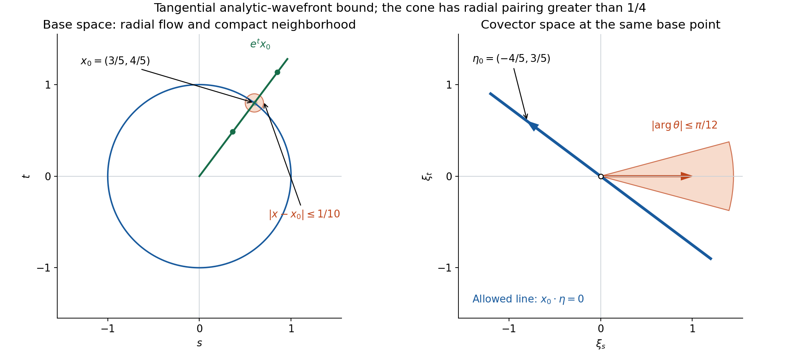
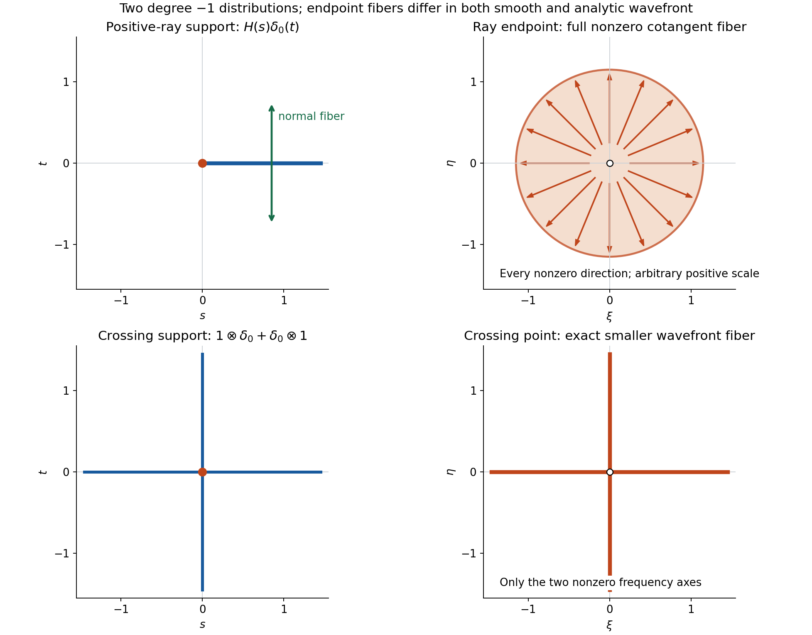

# Dilation equations and tangential analytic singularities

*Written by GPT-6.1 Sol (OpenAI), October 2026.  Public domain (CC0).*

The Euler operator differentiates along radial flow. A distribution satisfying a dilation equation can be singular in angle, but a wavefront covector at a nonzero point must annihilate the radial vector. The origin is different: its radial vector vanishes, so this condition excludes no covectors there.

Basic references are Strohmaier and Witten [S] for the analytic-wavefront convention, [Homogeneous extensions and angular moments][H] for scaling and Euler equations, and [Analytic directions of holomorphic boundary values][A] for the controlled cutoffs and ordinary-wavefront inclusion. The complete proof supplies the exact phase iteration, all derivative bounds and the analytic forcing argument.

## 1. The dilation equation selects tangential covectors

On any open \(X\subset\mathbb R^n\), let
\[
 E=x\cdot\nabla,\qquad Eu=\lambda u,\qquad \lambda\in\mathbb C .
 \tag{1}
\]
The conclusion is
\[
 \operatorname{WF}(u)\subseteq\operatorname{WF}_A(u)
               \subseteq\{(x,\xi):\xi\ne0,\ x\cdot\xi=0\}.
 \tag{2}
\]
This is an upper bound. Some solutions are analytic, some have angular singularities, and some have every covector at the origin.

At a nonzero point, the characteristic covectors form the hyperplane perpendicular to \(x\). At \(x=0\), the equation \(x\cdot\xi=0\) holds for every \(\xi\). No restriction on the shape of \(X\) is imposed: the proof is local.

For a sphere \(|x|=a>0\), its conormal has the form \(\xi=t x\), \(t\ne0\). Then \(x\cdot\xi=t a^2\ne0\). Thus the wavefront bound is disjoint from the nonzero sphere conormal. This supplies the geometric hypothesis for a restriction theorem; the general operation theorem itself is a further result.

*Figure 1. In dimension two, \(x_0=(3/5,4/5)\), the compact ball has radius \(1/10\), and the radial trajectory is \(e^t x_0\), with marked parameters \(-1/2,0,7/20\). The covector line is \(x_0\cdot\eta=0\), spanned by \(\eta_0=(-4/5,3/5)\); its zero covector is excluded. The cone is centered on \(e_1\) with half-angle \(\pi/12\). Every unit direction in it has \(x\cdot\theta\geq(7\sqrt2-\sqrt6-2)/20>1/4\) throughout the ball. The left and right panels are different spaces, drawn using their Euclidean coordinates. See complete-proof Theorem 4.1, Corollary 4.2 and Solution 4.*

## 2. The exact phase iteration controls the constants

The transpose of \(E\) is \(-E-n\), so (1) gives
\[
 u((E+c)\psi)=0,\qquad c=n+\lambda .
 \tag{3}
\]
On a compact neighborhood and frequency cone where \(x\cdot\xi\ne0\), set
\[
 a_\xi=(i x\cdot\xi)^{-1},\qquad
 Q_\xi g=a_\xi(E+c-1)g .
 \tag{4}
\]
Testing (3) with \(a_\xi g e^{-ix\cdot\xi}\) gives
\[
 u(g e^{-ix\cdot\xi})
          =u(Q_\xi^L g\,e^{-ix\cdot\xi}),\qquad
 Q_\xi^L=a_\xi^L\prod_{j=1}^L(E+c-j).
 \tag{5}
\]
The shifts are exact. Each radial derivative of the reciprocal linear form introduces one further shift.

The product in (5) has a useful normal form. Define the falling factorial
\[
 (z)_{\underline j}=z(z-1)\cdots(z-j+1),
                 \qquad (z)_{\underline0}=1.
 \tag{6}
\]
Then
\[
 (E+b)_{\underline L}
   =\sum_{j=0}^L\binom Lj(b)_{\underline{L-j}}
           \sum_{|\alpha|=j}\frac{j!}{\alpha!}x^\alpha\partial^\alpha .
 \tag{7}
\]
This formula gives the count of high derivatives without adding an extra analytic factorial scale.

Choose the controlled cutoffs \(\chi_L\) from the preceding analytic-boundary chapter. Their high derivatives through order \(L\) have bounds \((CL)^j\), and all fixed-order derivatives are uniformly bounded. On a region with \(|x\cdot\xi|\geq d|\xi|\), the complete proof obtains
\[
 \max_{|\beta|\leq m}
       \|\partial^\beta(Q_\xi^L\chi_L)\|_\infty
           \leq C_m^{L+1}L^{L+m}|\xi|^{-L}.
 \tag{8}
\]
Only at most \(m\) derivatives hit the reciprocal coefficient. Their rising factors have fixed length.

If \(u\) has order \(m\) on the compact neighborhood, choose \(L=N+m\) and \(u_N=\chi_Lu\). Derivatives of the Fourier phase cost at most \((1+|\xi|)^m\); the extra \(m\) iterations absorb those powers. Fixed polynomial factors in \(N\) are absorbed into an exponential constant, giving
\[
 |\widehat u_N(\xi)|\leq A^{N+1}N^N(1+|\xi|)^{-N}.
 \tag{9}
\]
The cutoff plateau, compact support and finite-order bound are common to the whole sequence. This proves analytic absence when \(x\cdot\xi\ne0\), and ordinary inclusion gives (2).

## 3. Four worked examples

### Example 1: a complex radial power can be analytic.

On \(\mathbb R^n\setminus0\), take
\[
 u(x)=|x|^\lambda=\exp(\lambda\log|x|),\qquad \lambda\in\mathbb C.
\]
It solves \(Eu=\lambda u\). The positive square root and logarithm are real analytic away from zero, so this function is analytic there and has empty analytic wavefront by [A], Corollary 2.3. Equation (2) permits tangential covectors, but does not require any of them.

### Example 2: a positive ray has normal covectors and a singular endpoint.

In \(\mathbb R^2\), with coordinates \((s,t)\), define
\[
 u(\psi)=\int_0^\infty\psi(s,0)\,ds .
 \tag{10}
\]
This is \(H(s)\delta_0(t)\), and its degree is \(-1\). Integration by parts gives \(Eu=-u\); the endpoint term contains \(s\psi(s,0)\), which vanishes at zero.

At \((s_0,0)\), \(s_0>0\), the local distribution is \(\delta_0(t)\). The Euler upper bound permits only normal covectors \((0,\eta)\), \(\eta\ne0\). They are present in ordinary wavefront: for any cutoff \(\chi=1\) near that point,
\[
 \widehat{\chi u}(\xi,\eta)
          =\int_{\mathbb R}\chi(s,0)e^{-is\xi}\,ds
 \tag{11}
\]
on a sufficiently small neighborhood wholly in \(s>0\). This nonzero function of \(\xi\) is independent of \(\eta\). Choose one \(\xi\) where it is nonzero, then let \(\eta\to+\infty\) or \(-\infty\). Every cone about the corresponding normal ray contains this path, so rapid decay is impossible. The analytic fiber there is exactly both normal rays.

At the endpoint, for any cutoff equal to one near zero,
\[
 \widehat{\chi u}(\xi,\eta)
           =\frac1{i\xi}+O(|\xi|^{-p})
           \quad(|\xi|\to\infty)
 \tag{12}
\]
for every desired \(p\), after increasing its constant. Its exact derivation is in Solution 7. Along any covector with nonzero \(\xi\), this has only first-power decay; closedness includes the remaining vertical covectors. Thus the endpoint has every nonzero smooth and analytic covector. At other base points outside the closed positive ray, the distribution is zero.

### Example 3: point jets are entirely allowed at the origin.

For any multi-index \(\alpha\),
\[
 E\partial^\alpha\delta_0=-(n+|\alpha|)\partial^\alpha\delta_0 .
 \tag{13}
\]
This follows by the distributional transpose and the product rule. A cutoff equal to one near zero leaves the jet unchanged; its Fourier transform is the nonzero polynomial \((i\xi)^\alpha\). Every open frequency cone contains a ray on which that polynomial is nonzero. Hence it has no rapid decay on any cone, even if it vanishes on particular individual covectors. Its analytic wavefront is every nonzero covector based at zero. This is compatible with the Euler bound, whose characteristic fiber there is the whole nonzero cotangent space.

### Example 4: a crossing has a smaller endpoint fiber.

Take
\[
 v=1\otimes\delta_0+\delta_0\otimes1
                       \quad\hbox{on }\mathbb R^2 .
 \tag{14}
\]
It has degree \(-1\), so \(Ev=-v\). Away from the crossing, its wavefront is the normal line to the occupied coordinate axis. At the crossing, the analytic fiber is the union of the two nonzero frequency axes, not every covector.

To prove the upper bound at the crossing, take a one-dimensional controlled cutoff \(\chi_N\), equal to one near zero. The localized sequence has transform
\[
 \widehat v_N(\xi,\eta)=\widehat\chi_N(\xi)+\widehat\chi_N(\eta).
 \tag{15}
\]
It has common support and a uniform order-zero bound. On a cone away from both axes, each component has magnitude at least \(d|(\xi,\eta)|\), so the cutoff Fourier estimate gives (9). The lower ordinary bound on each axis follows from (11) for the corresponding nonzero trace of a general cutoff; Solution 8 below explains the same nondecay mechanism. Ordinary inclusion then proves the exact analytic fiber. The Euler characteristic fiber at the origin allows more than this particular solution uses.

*Figure 2. Both distributions have degree \(-1\). At a positive point of the ray, both normal directions occur. At its endpoint, every nonzero covector occurs. At the crossing of the two full lines, only the two nonzero frequency axes occur. The shaded disk and radial arrows represent every direction at arbitrary positive scale; they do not bound covector magnitude. Open origin markers exclude the zero covector. At other points of an occupied support axis the fiber is its normal line. These are proved exact wavefront sets, rather than the larger characteristic set permitted by the Euler bound. See Examples 2 and 4 and Solutions 7 and 8.*

## 4. Analytic forcing preserves the tangential upper bound

Suppose \((E-\lambda)u=f\) near \(x_0\ne0\), where \(f\) is analytic. Choose the transverse affine hyperplane through \(x_0\), with normal \(v=x_0\), and write
\[
 a=|x_0|^2,\qquad t_0(x)=a/(v\cdot x).
\]
The complete proof constructs the analytic particular solution
\[
 w(x)=\int_{t_0(x)}^1 s^{-\lambda-1}f(sx)\,ds .
 \tag{16}
\]
All arguments lie near \(x_0\), and the powers use the branch close to one. Differentiating along dilation gives \((E-\lambda)w=f\). Thus \(u-w\) solves the homogeneous equation and has the same analytic wavefront as \(u\). The bound (2) holds locally.

An analytic zeroth-order potential is also allowed. For \((E-a(x))u=f\), choose an analytic \(\varphi\) with \(E\varphi=a\) by (16) at degree zero. Then
\[
 v=e^{-\varphi}u,\qquad Ev=e^{-\varphi}f .
 \tag{17}
\]
The analytic multiplier is nonvanishing, so it preserves analytic wavefront. Apply the analytic-forcing result to \(v\).

These statements concern forcing that is analytic on a neighborhood. The general inhomogeneous microlocal rule for arbitrary wavefront-controlled forcing is a further result.

## 5. Exercises, 100 points

1. **The transpose and phase signs, 10 points.** Derive (3) and (4) from tests. For \(n=3\), \(\lambda=-5+i\), write the exact first phase operator. Explain why division by \(x\cdot\xi\) is used only near a compact noncharacteristic test support.
2. **Three exact iterations, 12 points.** Compute \(Q_\xi^3\) in terms of \(a_\xi^3\) and a cubic polynomial in \(E\). Give all coefficients for arbitrary \(c\), and specialize to \(c=0\). Identify the error in replacing the shifted product by \((E+c-1)^3\).
3. **Falling Euler derivatives, 12 points.** In dimension two, expand \((E)_{\underline2}\) and \((E)_{\underline3}\) in ordinary partial derivatives. Derive the addition formula (7) at \(L=3\) and verify that \(b=c-1\) gives the polynomial from Exercise 2.
4. **An exact cone witness, 14 points.** Let \(x_0=(3/5,4/5)\), let \(|x-x_0|\leq1/10\), and let unit \(\theta\) have angle at most \(\pi/12\) from \(e_1\). Prove \(x\cdot\theta>1/4\). Give a tangential covector at \(x_0\), and verify that every nonzero sphere conormal is excluded by the Euler bound.
5. **Fixed-order coefficient derivatives, 12 points.** Derive (17) of the complete proof for an arbitrary multi-index. Give a bound for derivatives through a fixed order \(m\), including the factor \(r^{-L}\) when \(\xi=r\theta\). Explain why the rising factorial has fixed length here.
6. **The finite-order shift, 12 points.** If \(u\) has order \(m=2\) on the compact neighborhood, choose the iteration and cutoff indices for an analytic estimate of order \(N\). Bound the resulting frequency power and explain how \((N+2)^{N+4}\) is converted to the single analytic scale \(C^{N+1}N^N\). Verify the common finite-order bound of the localized sequence.
7. **The complete positive-ray wavefront, 14 points.** Prove the Euler equation and exact smooth/analytic fibers described in Example 2, including both signs of the normal covector and every covector at the endpoint. Derive the asymptotic (12) on an arbitrary cutoff equal to one there.
8. **Analytic forcing can retain tangential singularities, 14 points.** On \(X=\mathbb R^2\setminus0\), put \(\varphi(s,t)=s+t^2/2\) and \(u=e^\varphi(\log|(s,t)|+H(t))\). Compute \((E-(s+t^2))u\) and its analyticity. Determine the analytic wavefront of \(u\) on \(X\), using the Euler bound, analytic multiplication and the line-delta example, without assuming a general tensor-wavefront theorem. Then give the complete crossing fiber of Example 4.

## 6. Complete solutions

### Solution 1

For each coordinate, the distributional derivative gives
\[
 (x_j\partial_j u)(\psi)
       =-u(\partial_j(x_j\psi))
       =-u(x_j\partial_j\psi+\psi).
\]
Summing proves \(E^*=-E-n\). Thus \(Eu=\lambda u\) says
\[
 -u(E\psi+n\psi)=\lambda u(\psi),
       \qquad u((E+n+\lambda)\psi)=0.
\]
There is no conjugation of \(\lambda\), because the pairings are complex-linear.

Put \(a=(i x\cdot\xi)^{-1}\). Since \(Ea=-a\) and
\(E e^{-ix\cdot\xi}=-i(x\cdot\xi)e^{-ix\cdot\xi}\),
\[
 (E+c)(ag e^{-ix\cdot\xi})
       =[a(E+c-1)g-g]e^{-ix\cdot\xi}.
\]
Testing the transpose equation proves \(u(ge^{-ix\cdot\xi})=u(Q_\xi g e^{-ix\cdot\xi})\).
For \(n=3,\lambda=-5+i\), \(c=-2+i\), so
\[
 Q_\xi g=(i x\cdot\xi)^{-1}(E-3+i)g.
\]
The reciprocal is smooth only off its zero hyperplane. We choose a compact test support with a neighborhood avoiding that hyperplane; multiplication and differentiation preserve the support. Extending the resulting compact test by zero makes it a legitimate test on \(X\). No reciprocal is asserted on the whole domain.

### Solution 2

For any test \(h\), \(E(ah)=a(E-1)h\), and more generally
\(E(a^jh)=a^j(E-j)h\). Consequently
\[
 Q_\xi^3
     =a_\xi^3(E+c-3)(E+c-2)(E+c-1).
\]
The Euler factors commute with one another. Multiplying their scalar polynomials gives
\[
 Q_\xi^3=a_\xi^3\big[
 E^3+(3c-6)E^2+(3c^2-12c+11)E
                +c^3-6c^2+11c-6\big].
\]
At \(c=0\), this is \(a_\xi^3(E^3-6E^2+11E-6)\).
The unshifted cube would have coefficients \(3(c-1)\), \(3(c-1)^2\) and \((c-1)^3\). It overlooks each derivative falling on an intervening reciprocal factor. Already \(Q_\xi^2=a_\xi^2(E+c-2)(E+c-1)\), rather than \(a_\xi^2(E+c-1)^2\).

### Solution 3

Write the coordinates as \(x,y\). Applying the Euler operator twice and subtracting its first-order part gives
\[
 (E)_{\underline2}=E^2-E
       =x^2\partial_{xx}+2xy\partial_{xy}+y^2\partial_{yy}.
\]
Apply \(E-2\) to this expression. Derivatives of its coefficients give twice the expression, which cancels the \(-2\) term. The remaining derivatives are
\[
 (E)_{\underline3}
       =x^3\partial_{xxx}+3x^2y\partial_{xxy}
           +3xy^2\partial_{xyy}+y^3\partial_{yyy}.
\]
For three ordered choices from two disjoint sets, choose which \(j\) positions come from the first set. The polynomial continuation argument of complete-proof Lemma 2.1 therefore gives
\[
 (E+b)_{\underline3}
  =(E)_{\underline3}+3b(E)_{\underline2}
       +3b(b-1)E+b(b-1)(b-2).
\]
Insert \((E)_{\underline3}=E^3-3E^2+2E\) and \((E)_{\underline2}=E^2-E\).
The coefficients become
\[
 E^3+(3b-3)E^2+(3b^2-6b+2)E+b(b-1)(b-2).
\]
Setting \(b=c-1\) gives \(3c-6\), \(3c^2-12c+11\) and \(c^3-6c^2+11c-6\), exactly Solution 2.

### Solution 4

Write \(\theta=(\cos\alpha,\sin\alpha)\), \(|\alpha|\leq\pi/12\). On this interval
\[
 \frac{d}{d\alpha}(x_0\cdot\theta)
          =-\frac35\sin\alpha+\frac45\cos\alpha>0.
\]
For example the derivative is at least
\((4\cos(\pi/12)-3\sin(\pi/12))/5>0\). Thus its minimum is at \(\alpha=-\pi/12\). Using the exact sine and cosine values,
\[
 x_0\cdot\theta
      \geq \frac{3\cos(\pi/12)-4\sin(\pi/12)}5
      =\frac{7\sqrt2-\sqrt6}{20}.
\]
Cauchy–Schwarz now gives
\[
 x\cdot\theta
       \geq \frac{7\sqrt2-\sqrt6-2}{20}>\frac14.
\]
For the strict inequality it suffices to prove \(7\sqrt2-\sqrt6>7\).
Both sides of \(7\sqrt2>7+\sqrt6\) are positive. Squaring reduces it to
\(43>14\sqrt6\), and another squaring proves it because \(1849>1176\).
This gives the uniform noncharacteristic constant \(d=1/4\).

The covector \(\eta_0=(-4/5,3/5)\) is tangential: \(x_0\cdot\eta_0=0\).
For a sphere of radius \(a>0\), every nonzero conormal is a nonzero multiple \(t x\), so its pairing is \(t a^2\ne0\). Equivalently, with defining function \(\rho=|x|^2-a^2\), the conormal \(t\nabla\rho=2tx\) pairs to \(2ta^2\ne0\). Complete-proof Theorem 4.1 excludes all these conormals.

### Solution 5

Let \(\ell(x)=x\cdot\theta\), and put \(p=|\gamma|\). Each differentiation of \(\ell^{-L}\) reduces its exponent by one and contributes the next negative exponent and the corresponding coordinate of \(\theta\). Induction on \(p\) gives
\[
 \partial^\gamma\ell^{-L}
      =(-1)^p L(L+1)\cdots(L+p-1)
                 \theta^\gamma\ell^{-L-p}.
\]
The empty product at \(p=0\) is one. If \(|\ell|\geq d>0\), \(|\theta|=1\), and \(p\leq m\), then
\[
 L(L+1)\cdots(L+p-1)\leq (1+m)^m L^p
\]
for \(L\geq1\). Also \(d^{-L-p}\leq C_m D^L\), with \(D=\max(1,d^{-1})\).
Since \(a_\xi^L=i^{-L}r^{-L}\ell^{-L}\), where \(r=|\xi|\),
\[
 \|\partial^\gamma a_\xi^L\|_\infty
        \leq C_m^{L+1}L^p r^{-L},\qquad p\leq m.
\]
Here \(m\) is the fixed distributional order. The \(L\) high derivatives are already counted in the falling Euler polynomial and its controlled cutoff. They do not fall on this reciprocal factor in the final Leibniz estimate. Its rising product therefore has at most \(m\) factors, uniformly in \(L\).

### Solution 6

Take \(L=N+2\) and \(u_N=\chi_{N+2}u\). The amplitude estimate (8), followed by at most two derivatives of the Fourier phase, gives
\[
 |\widehat u_N(\xi)|
     \leq C^{N+3}(N+2)^{N+4}
             r^{-N-2}(1+r)^2.
\]
For \(r\geq1\), the frequency factor is at most \(4r^{-N}\).
Furthermore
\[
 (N+2)^{N+4}
    =N^{N+4}(1+2/N)^{N+4}
    \leq 81e^2N^{N+4}.
\]
We used \((1+2/N)^N\leq e^2\) and \((1+2/N)^4\leq3^4\).
The remaining \(N^4\) is at most \(e^{4N}\), so increasing a constant converts the estimate to
\(A^{N+1}N^N r^{-N}\). For \(r\geq1\), replacing the last power by
\((1+r)^{-N}\) costs at most \(2^N\), absorbed into \(A^{N+1}\).

All cutoffs have the same compact support and plateau. If \(u\) has order two there, Leibniz's rule gives
\[
 |u_N(\psi)|=|u(\chi_{N+2}\psi)|
       \leq B'\max_{|\beta|\leq2}\sup_K|\partial^\beta\psi|,
\]
with \(B'\) independent of \(N\), because the cutoff derivatives through order two are uniformly bounded. This supplies the required common order, and also a uniform bound for the Fourier transform when \(r\leq1\). Since \(N^N\geq1\) and \((1+r)^{-N}\geq2^{-N}\) there, increasing \(A\) covers those frequencies too. The full bounded-sequence criterion is satisfied.

### Solution 7

For the positive-ray distribution (10), the transpose formula in dimension two gives
\[
 (Eu)(\psi)
       =-\int_0^\infty
            [s\partial_s\psi(s,0)+2\psi(s,0)]\,ds.
\]
Integration of the first term by parts has zero boundary values: at infinity the test vanishes, and at zero its factor \(s\) vanishes. It equals \(-\int_0^\infty\psi(s,0)\,ds\). Thus \(Eu=-u\), so its degree is \(-1\).

At a positive base point on the ray, localize inside \(s>0\). Complete-proof Theorem 4.1 allows only \((0,\eta)\), \(\eta\ne0\). For any such local cutoff equal to one near the base point, \(h(s)=\chi(s,0)\) is nonzero and compactly supported. Fourier inversion [F] shows that \(\widehat h\) cannot vanish identically. Choose \(\xi_*\) with \(\widehat h(\xi_*)\ne0\). The localized transform is \(\widehat h(\xi)\), independent of \(\eta\), and along \((\xi_*,R)\) or \((\xi_*,-R)\) it is the same nonzero constant. These paths eventually lie in every cone about the corresponding normal covector. Hence both normal rays belong to ordinary wavefront, and ordinary inclusion gives both in analytic wavefront. Together with the upper bound, these are the exact fibers.

At the origin take any cutoff equal to one on a neighborhood of zero, and again write \(h(s)=\chi(s,0)\). On the positive half-line \(h(0)=1\), and \(h'\) vanishes near zero. Integration by parts gives, for \(\xi\ne0\),
\[
 \int_0^\infty h(s)e^{-is\xi}\,ds
       =\frac1{i\xi}
          +\frac1{i\xi}\int_0^\infty h'(s)e^{-is\xi}\,ds.
\]
Extending \(h'\) by zero to the negative half-line gives a compact smooth function, since it vanishes near zero. Repeated integration by parts in its Fourier transform gives decay faster than every inverse power. This proves (12), for positive and negative \(\xi\).

If a covector direction \((\xi_0,\eta_0)\) has \(\xi_0\ne0\), evaluate on its multiples \((R\xi_0,R\eta_0)\). The transform has leading term \(1/(iR\xi_0)\), so it cannot have rapid decay in any cone about that direction, for any cutoff. All these directions are in ordinary wavefront at zero. The ordinary wavefront set is closed: its complement is open because a qualifying neighborhood and frequency cone also qualify at every smaller pair of neighborhoods. Taking limits of directions with \(\xi_0\ne0\) includes the two vertical directions. Ordinary inclusion then gives every nonzero analytic covector at the endpoint. Outside the closed positive ray the distribution vanishes on a neighborhood, so both wavefront sets are empty.

### Solution 8

On \(X=\mathbb R^2\setminus0\), the function \(\log|(s,t)|\) is analytic and
\[
 E\log|(s,t)|=1,\qquad EH(t)=t\delta_0(t)=0,\qquad
 E\varphi=s+t^2.
\]
The middle equality is a distributional identity: multiplying \(\delta_0(t)\) by \(t\) gives zero. The product rule therefore yields
\[
 (E-(s+t^2))u=e^\varphi.
\]
Its right side is analytic. This meets complete-proof Corollary 5.2, including points on either nonzero half of the horizontal axis.

Nonvanishing analytic multiplication and addition of an analytic function preserve analytic wavefront, by [A], Theorem 2.2 and the finite-sum argument in Corollary 2.3. Consequently
\[
 \operatorname{WF}_A(u)=\operatorname{WF}_A(H(t))\quad\hbox{on }X.
\]
Off \(t=0\), \(H(t)\) is locally constant, so its fiber is empty.
At \((s,0)\), \(s\ne0\), its Euler equation has degree zero and the upper bound permits only covectors \((0,\eta)\). Both occur. Indeed \(\partial_tH(t)=1\otimes\delta_0\), and the line-delta calculation in Solution 7 puts both normal rays into the ordinary, hence analytic, wavefront of this derivative. Analytic differential decrease, [A], Corollary 2.3, puts them into the analytic wavefront of \(H(t)\). Thus exactly
\[
 \operatorname{WF}_A(u)
    =\{(s,0;0,\eta):s\ne0,\ \eta\ne0\}.
\]
Analytic forcing controls radial singularities while allowing these tangential ones.

For the crossing \(v=1\otimes\delta_0+\delta_0\otimes1\), each summand has degree \(-1\), and hence so does \(v\). Away from the origin only one axis is present locally, and the line-delta argument gives its complete normal fiber.

At zero let \(\chi_N\) be one-dimensional controlled cutoffs on a fixed interval, equal to one on a smaller interval. Set
\[
 v_N=\chi_N(s)\delta_0(t)+\delta_0(s)\chi_N(t).
\]
The two fixed finite segments give common compact support, and uniform bounds on \(\chi_N\) give a common order-zero distributional bound. The sequence agrees with \(v\) on a fixed square near zero. Its Fourier transform is (15). On any closed smaller cone avoiding both frequency axes, both \(|\xi|\) and \(|\eta|\) are at least \(d|(\xi,\eta)|\). Integrating by parts \(N\) times in a one-dimensional cutoff gives
\[
 |\widehat\chi_N(\zeta)|
      \leq C^{N+1}N^N|\zeta|^{-N}\quad(|\zeta|\geq1).
\]
The uniform \(L^1\) bound covers small \(\zeta\). Thus (15) has the bounded-sequence analytic estimate on that cone, proving absence away from the axes.

For the lower bound take any compact two-dimensional cutoff \(\chi=1\) near zero. Its transform on \(v\) is \(f(\xi)+g(\eta)\), where
\[
 f=\widehat{\chi(\,\cdot\,,0)},\qquad
 g=\widehat{\chi(0,\,\cdot\,)}.
\]
Both traces are nonzero compact smooth functions, so their Fourier transforms are rapidly decreasing and not identically zero. Fix \(\eta_*\) with \(g(\eta_*)\ne0\). As \(\xi\to+\infty\) or \(-\infty\), \(f(\xi)\to0\), while \(g(\eta_*)\) stays nonzero. This proves both horizontal covector rays in ordinary wavefront. Fixing \(\xi_*\) with \(f(\xi_*)\ne0\) and sending \(\eta\) to either infinity gives both vertical rays. Ordinary inclusion supplies their analytic membership. The exact crossing fiber is therefore
\[
 \{(\xi,0):\xi\ne0\}\ \cup\ \{(0,\eta):\eta\ne0\}.
\]
It is strictly smaller than the full nonzero fiber of the positive-ray endpoint, although both distributions solve the same Euler equation. Neither calculation assumes a general tensor-wavefront theorem.

## References

[S] Alexander Strohmaier and Edward Witten, *Analytic States in Quantum Field Theory on Curved Spacetimes*, Annales Henri Poincaré **25** (2024), 4543–4590, Appendix B. [Open-access primary article](https://link.springer.com/article/10.1007/s00023-024-01419-0), retaining its CC BY 4.0 terms.

[H] [Homogeneous extensions and angular moments][H], Lemma 1.1.

[A] [Analytic directions of holomorphic boundary values][A], controlled cutoffs, analytic multiplication, analytic differential decrease and ordinary-wavefront inclusion.

[F] [Schwartz functions and Fourier inversion][F], Sections 1–5.

Original exposition, examples and solutions are CC0. Linked proofs retain their original provenance and terms. The general wavefront operation theorems remain further mathematical prerequisites.

[H]: https://github.com/KokunoYumeto/open-math-courses-public/blob/67564e6cdda1ea9e9fef78883afc69b40417e84b/docs/courses/AN-01/src/homogeneous-extensions-and-angular-moments.md
[A]: ../AN02-L186.html#complete-proof
[F]: https://github.com/KokunoYumeto/open-math-courses-public/blob/67564e6cdda1ea9e9fef78883afc69b40417e84b/docs/courses/AN-01/prerequisites/U011-free-foundations/schwartz-fourier-foundations-U017.md

## Complete proof

A dilation equation controls regularity along radial flow. Its angular data can still be singular. We prove directly that every smooth or analytic wavefront covector of a solution is perpendicular to the radial vector. The proof uses compact tests and an exact falling-factorial formula for the Euler operator. It applies to complex dilation degrees and to arbitrary open domains.

Basic references are Strohmaier and Witten [S] for the bounded-sequence analytic-wavefront convention, [Homogeneous extensions and angular moments][H] for the exact scaling-to-Euler equivalence, and [Analytic directions of holomorphic boundary values][A] for controlled cutoffs and ordinary-wavefront inclusion. Fourier evaluation is the complete preceding [Schwartz functions and Fourier inversion][F]. We reuse those exact inputs and prove the radial estimate here. A local analytic particular solution also gives the result when the Euler equation has analytic forcing.

Let \(X\subset\mathbb R^n\) be open, \(n\geq1\), let \(\lambda\in\mathbb C\), and put
\[
 E=\sum_{j=1}^n x_j\partial_{x_j}.
 \tag{1}
\]
All distributional pairings are complex-linear, and the Fourier phase is \(e^{-ix\cdot\xi}\).

## 1. The transpose equation gives an exact phase iteration

Suppose \(u\in\mathcal D'(X)\) solves \(Eu=\lambda u\). Integration by parts in the distributional definition gives, for every compact smooth test,
\[
 u\big((E+c)\psi\big)=0,\qquad c=n+\lambda .
 \tag{2}
\]
Indeed \(E^*=-E-n\).

Fix a nonzero frequency \(\xi\), and a compact test supported where \(x\cdot\xi\ne0\). On a neighborhood of its support define
\[
 a_\xi(x)=(i\,x\cdot\xi)^{-1},\qquad
 Q_\xi g=(E+c)(a_\xi g)=a_\xi(E+c-1)g .
 \tag{3}
\]
The last equality uses \(Ea_\xi=-a_\xi\). Such products are extended by zero outside the test support; the denominator remains nonzero on a neighborhood of that support.

**Lemma 1.1.** For every integer \(L\geq1\),
\[
 u(g e^{-ix\cdot\xi})
       =u(Q_\xi^L g\,e^{-ix\cdot\xi}),\qquad
 Q_\xi^L=a_\xi^L P_L(E),
 \quad P_L(E)=\prod_{j=1}^L(E+c-j).
 \tag{4}
\]

**Proof.** In (2), take \(\psi=a_\xi g e^{-ix\cdot\xi}\). The phase derivative is \(E(e^{-ix\cdot\xi})=-i(x\cdot\xi)e^{-ix\cdot\xi}\), so
\[
 (E+c)\psi=(Q_\xi g-g)e^{-ix\cdot\xi}.
 \tag{5}
\]
Equation (2) proves the first iteration. Its amplitude stays compactly supported in the same nonzero-denominator neighborhood, so iteration gives the first formula (4).

For the operator formula, \(Ea_\xi^j=a_\xi^j(E-j)\), as an identity acting on tests. If \(Q_\xi^L=a_\xi^LP_L(E)\), multiply by \(Q_\xi=a_\xi(E+c-1)\) on the left. The result is \(a_\xi^{L+1}(E+c-1-L)P_L(E)\), whose commuting Euler factors give \(P_{L+1}(E)\). The case \(L=1\) is (3), completing induction. \(\square\)

The shifts by \(j\) in (4) cannot be omitted. Multiplication by the reciprocal linear form does not commute with \(E\).

## 2. A falling factorial keeps the derivative count exact

For an operator or scalar \(z\), write
\[
 (z)_{\underline j}=z(z-1)\cdots(z-j+1),
       \qquad (z)_{\underline0}=1 .
 \tag{6}
\]
This is a falling factorial, distinct from the rising factors used in differentiating reciprocal powers.

**Lemma 2.1.** For \(b\in\mathbb C\) and \(L\geq0\),
\[
 \begin{aligned}
 (E+b)_{\underline L}
    &=\sum_{j=0}^L\binom Lj(b)_{\underline{L-j}}
                                      (E)_{\underline j},\\
 (E)_{\underline j}
    &=\sum_{|\alpha|=j}\frac{j!}{\alpha!}x^\alpha\partial^\alpha .
 \end{aligned}
 \tag{7}
\]
In particular, \(P_L(E)=(E+c-1)_{\underline L}\).

**Proof.** For nonnegative integers \(s,t\), \((s+t)_{\underline L}\) counts ordered choices of \(L\) distinct elements from two disjoint sets. If \(j\) positions are assigned to the first set, there are \(\binom Lj(s)_{\underline j}(t)_{\underline{L-j}}\) choices. Summing gives the scalar addition formula. Both sides are polynomials in \(s,t\). Fixing one nonnegative integer \(t\) gives equality for every complex \(s\), because their difference has infinitely many zeros; then fixing each complex \(s\) gives equality for every complex \(t\). Substituting the commuting operator \(E\) proves the first identity.

For the second identity, start at \(j=0\). If the right side at \(j\) is \(A_j\), Leibniz's rule gives
\[
 (E-j)A_j
    =\sum_{|\alpha|=j}\frac{j!}{\alpha!}
                     \sum_\ell x^{\alpha+e_\ell}
                                      \partial^{\alpha+e_\ell}.
 \tag{8}
\]
The \(j\) from differentiating \(x^\alpha\) cancels the displayed \(-j\). For a fixed \(\gamma\) of total order \(j+1\), its coefficient is
\[
 \sum_{\ell:\gamma_\ell>0}\frac{j!}{(\gamma-e_\ell)!}
          =\frac{j!}{\gamma!}\sum_\ell\gamma_\ell
          =\frac{(j+1)!}{\gamma!}.
 \tag{9}
\]
Thus \((E-j)A_j=A_{j+1}\), proving the formula by induction. \(\square\)

## 3. The amplitude bound has one analytic factorial scale

Fix a compact neighborhood \(K\subset X\) and a frequency cone \(\Gamma\) such that
\[
 |x\cdot\xi|\geq d|\xi|
                  \quad(x\in K,\ \xi\in\Gamma),\qquad d>0 .
 \tag{10}
\]
Let \(\chi_L\) be the cutoffs of [A], Lemma 1.1, supported in the interior of \(K\) and equal to one on a common smaller neighborhood. Every fixed-order derivative is uniformly bounded, and
\[
 \|\partial^{\alpha+\beta}\chi_L\|_\infty
        \leq C_\beta(CL)^{|\alpha|}
                  \quad(|\alpha|\leq L).
 \tag{11}
\]

**Lemma 3.1.** For every fixed integer \(m\geq0\), there is \(C_m\), independent of \(L\geq1\), \(\xi\in\Gamma\), and \(r=|\xi|>0\), such that
\[
 \max_{|\beta|\leq m}
       \|\partial^\beta[Q_\xi^L\chi_L]\|_\infty
            \leq C_m^{L+1}L^{L+m}r^{-L}.
 \tag{12}
\]

**Proof.** Put \(b=c-1\), and choose \(R\geq1\) bounding the absolute values of all coordinates on \(K\). A fixed scalar \(b\) satisfies
\[
 |(b)_{\underline q}|\leq C_b^q q!\quad(q\geq0),
 \tag{13}
\]
because the factor with index \(\ell\) has modulus at most \(C_b(\ell+1)\).

For \(|\beta|\leq m\), differentiate the second formula (7) applied to \(\chi_L\). Each derivative falling on \(x^\alpha\) contributes at most a factor \(j\), and the remaining powers are bounded by \(R^j\). The derivatives on \(\chi_L\) have the mixed bound (11), with the extra at most \(m\) derivatives in its fixed constant. Since \(\sum_{|\alpha|=j}j!/\alpha!=n^j\), this gives
\[
 \|\partial^\beta[(E)_{\underline j}\chi_L]\|_\infty
       \leq C_m L^{|\beta|}(C_1L)^j,\qquad 0\leq j\leq L .
 \tag{14}
\]
This also covers \(j=0\), using the uniform fixed-order cutoff bounds.

Use the first identity (7) and (13). Its \(j\)-th term is bounded by
\[
 C_m L^{|\beta|}
          \frac{L!}{j!}C_b^{L-j}(C_1L)^j
       \leq C_m L^{L+|\beta|}C_b^{L-j}C_1^j .
 \tag{15}
\]
Here \(L!/j!\leq L^{L-j}\). Summing \(L+1\) terms, and using \(L+1\leq2^L\) for \(L\geq1\), proves
\[
 \|\partial^\beta[P_L(E)\chi_L]\|_\infty
          \leq C_m^{L+1}L^{L+|\beta|}.
 \tag{16}
\]

For the other factor write \(\xi=r\theta\), \(|\theta|=1\). Direct repeated differentiation gives
\[
 \partial^\gamma(x\cdot\theta)^{-L}
  =(-1)^{|\gamma|}
      L(L+1)\cdots(L+|\gamma|-1)\,
          \theta^\gamma(x\cdot\theta)^{-L-|\gamma|}.
 \tag{17}
\]
For \(|\gamma|\leq m\), (10) bounds this by \(C_m^{L+1}L^{|\gamma|}\). Thus
\[
 \|\partial^\gamma a_\xi^L\|_\infty
         \leq C_m^{L+1}L^{|\gamma|}r^{-L}.
 \tag{18}
\]
Only fixed-order derivatives of this coefficient are used. Its rising factorial has at most \(m\) factors.

Finally differentiate \(a_\xi^L P_L(E)\chi_L\) with Leibniz's rule. Equations (16) and (18) give a power \(L^{L+|\beta|}\) in each split, since the two fixed derivative orders add to \(|\beta|\). The finitely many binomial constants are absorbed by increasing \(C_m\). This proves (12). \(\square\)

## 4. Dilation solutions have only tangential wavefront covectors

**Theorem 4.1.** For any \(\lambda\in\mathbb C\) and \(u\in\mathcal D'(X)\) satisfying \(Eu=\lambda u\),
\[
 \operatorname{WF}(u)\subseteq\operatorname{WF}_A(u)
             \subseteq\{(x,\xi):\xi\ne0,\ x\cdot\xi=0\}.
 \tag{19}
\]
No conic or star-shaped hypothesis on \(X\) is required.

**Proof.** If \(x_0\cdot\xi_0\ne0\), continuity gives a compact neighborhood \(K\) of \(x_0\), contained in \(X\), and a conic neighborhood \(\Gamma\) of \(\xi_0\) satisfying (10). Take the cutoffs (11) supported in its interior. The distribution \(u\) has some finite order \(m\) on this compact set:
\[
 |u(\psi)|\leq B\max_{|\beta|\leq m}\sup_K|\partial^\beta\psi|
                   \quad(\operatorname{supp}\psi\subset K).
 \tag{20}
\]
For \(N\geq1\), set \(L=N+m\) and \(u_N=\chi_Lu\). These distributions agree with \(u\) on the common cutoff plateau, have common compact support, and have a common order and bound independent of \(N\), by the uniform low-order part of (11).

Use Lemma 1.1 with \(g=\chi_L\), and apply (20) to its iterated test. Derivatives of the phase contribute at most \((1+r)^m\). Lemma 3.1 therefore gives
\[
 |\widehat u_N(\xi)|
   \leq C_m^{L+1}L^{L+m}r^{-L}(1+r)^m
             \quad(\xi\in\Gamma,\ r=|\xi|>0).
 \tag{21}
\]
For \(r\geq1\), \(r^{-L}(1+r)^m\leq2^m r^{-N}\). Moreover
\[
 (N+m)^{N+2m}
       \leq C_m^{N+1}N^{N+2m}.
 \tag{22}
\]
For example \((1+m/N)^{N+2m}\leq e^m(1+m)^{2m}\). The fixed polynomial \(N^{2m}\) is absorbed into a larger exponential constant, using \(\log N\leq N\). Thus
\[
 |\widehat u_N(\xi)|
       \leq A^{N+1}N^N(1+|\xi|)^{-N}
                         \quad(\xi\in\Gamma).
 \tag{23}
\]
The replacement of \(r^{-N}\) by \((1+r)^{-N}\) costs \(2^N\) for \(r\geq1\). For \(r\leq1\), the common compact finite-order bound on \(u_N\) supplies (23) after increasing \(A\), as in the bounded-sequence criterion of [A], Section 1.

The criterion proves analytic absence at every point with \(x\cdot\xi\ne0\). Ordinary-wavefront inclusion is [A], Theorem 3.1, proving (19). At \(x=0\) the condition \(x\cdot\xi=0\) holds for every covector; the theorem removes none there. \(\square\)

For a homogeneous distribution of degree \(\lambda\), the exact Euler identity \(Eu=\lambda u\) is [H], Lemma 1.1. Theorem 4.1 therefore applies to every distributional angular datum, including complex degrees, without requiring an angular density.

**Corollary 4.2 (radial hypersurfaces are noncharacteristic for the wavefront bound).** Let \(\Sigma\subset X\) be an analytic hypersurface defined near a point by \(\rho=0\), with \(d\rho\ne0\), and suppose \(x\cdot\nabla\rho(x)\ne0\) on \(\Sigma\). Then neither wavefront set in (19) meets its nonzero conormal bundle.

**Proof.** A conormal is \(\xi=t\nabla\rho(x)\), \(t\ne0\). Its radial pairing is \(x\cdot\xi=t\,x\cdot\nabla\rho(x)\ne0\), so Theorem 4.1 excludes it. For a sphere of radius \(a>0\), use \(\rho(x)=|x|^2-a^2\), giving \(x\cdot\xi=2ta^2\ne0\). \(\square\)

This supplies the exact conormal-disjointness hypothesis in an angular restriction calculation. The general distributional restriction theorem and its wavefront bounds remain additional operation results.

## 5. Analytic Euler forcing has a local analytic particular solution

**Theorem 5.1.** Suppose \((E-\lambda)u=f\) near \(x_0\ne0\), with \(f\) analytic there. Then
\[
 \operatorname{WF}_A(u)\cap\{(x,\xi):x\text{ near }x_0,\ x\cdot\xi\ne0\}
                                    =\varnothing .
 \tag{24}
\]
The same exclusion holds for ordinary wavefront.

**Proof.** Put \(v=x_0\), \(a=|x_0|^2>0\), and choose a small neighborhood \(V\) of \(x_0\). The function
\[
 t_0(x)=\frac{a}{v\cdot x}
 \tag{25}
\]
is positive and close to one on \(V\). Shrink \(V\) so that the real segment \(s x\), between \(s=t_0(x)\) and \(s=1\), lies in the analytic neighborhood of \(f\). Define
\[
 w(x)=\int_{t_0(x)}^1 s^{-\lambda-1}f(sx)\,ds .
 \tag{26}
\]
An integral whose lower endpoint exceeds its upper endpoint has its usual signed meaning.

We verify analyticity. Write \(s=t_0(x)+q(1-t_0(x))\), \(0\leq q\leq1\). Then
\[
 w(x)=(1-t_0(x))
       \int_0^1
       \bigl[t_0(x)+q(1-t_0(x))\bigr]^{-\lambda-1}
       f\bigl([t_0(x)+q(1-t_0(x))]x\bigr)\,dq .
 \tag{27}
\]
The analytic power series of \(f\) extends to a complex polydisk about \(x_0\). On a smaller complex neighborhood of \(x_0\), \(t_0\) is holomorphic, and all the displayed brackets are uniformly close to one for \(q\in[0,1]\). Their powers use the convergent logarithm series near one. Their products with \(x\) stay uniformly inside the polydisk of \(f\). The integrand is therefore holomorphic in \(x\), continuous in \(q\), and uniformly bounded on a smaller closed complex polydisk times \([0,1]\).

The successive circle formulas on that smaller polydisk give Taylor coefficient bounds uniform in \(q\), exactly the power-series calculation in [Holomorphic boundaries in convex cones][T], Section 3, formula (3.1). The coefficient series converges uniformly on every still smaller polydisk. Integrating its coefficients over \(q\) therefore gives a convergent holomorphic power series for (27). Its real restriction is analytic.

For positive \(t\) close to one, \(t_0(tx)=t_0(x)/t\). Substitution \(s=t\sigma\) in (26) gives
\[
 w(tx)=t^\lambda\int_{t_0(x)}^t s^{-\lambda-1}f(sx)\,ds .
 \tag{28}
\]
Differentiating at \(t=1\) proves \(Ew=\lambda w+f\). All paths lie in the chosen local neighborhood; no global radial flow is assumed.

Thus \(h=u-w\) solves \(Eh=\lambda h\) on a smaller neighborhood. Theorem 4.1 gives its tangential analytic-wavefront bound. Analytic functions have empty analytic wavefront by [A], Corollary 2.3, and its finite-sum argument gives \(\operatorname{WF}_A(u)=\operatorname{WF}_A(h)\). This proves (24); ordinary inclusion gives the final assertion. \(\square\)

**Corollary 5.2 (an analytic zeroth-order potential).** Suppose \((E-a(x))u=f\) near a nonzero point, with \(a\) and \(f\) analytic. Then the tangential wavefront exclusion (24) holds there.

**Proof.** Construction (26) with \(\lambda=0\) and forcing \(a\) gives a local analytic function \(\varphi\) with \(E\varphi=a\). Set \(v=e^{-\varphi}u\). The distributional product rule gives \(Ev=e^{-\varphi}(Eu-a u)=e^{-\varphi}f\), an analytic function. Apply Theorem 5.1 at degree zero. The multiplier and its reciprocal are analytic and nonvanishing, so [A], Theorem 2.2, gives \(\operatorname{WF}_A(v)=\operatorname{WF}_A(u)\). Ordinary inclusion gives the ordinary exclusion as well. \(\square\)

Theorem 5.1 and Corollary 5.2 assume analytic forcing on a neighborhood. They do not assert the general inhomogeneous microlocal regularity rule with arbitrary wavefront-controlled forcing.

## References

[S] Alexander Strohmaier and Edward Witten, *Analytic States in Quantum Field Theory on Curved Spacetimes*, Annales Henri Poincaré **25** (2024), 4543–4590, Appendix B. [Open-access primary article](https://link.springer.com/article/10.1007/s00023-024-01419-0), retaining its CC BY 4.0 terms. It gives the named convention; the Euler arguments used here are supplied above.

[H] [Homogeneous extensions and angular moments][H], Lemma 1.1, with its complete test-scaling proof.

[A] [Analytic directions of holomorphic boundary values][A], Lemma 1.1, its bounded-sequence definition, Corollary 2.3 and Theorem 3.1.

[F] [Schwartz functions and Fourier inversion][F], Sections 1–5.

[T] [Holomorphic boundaries in convex cones][T], Section 3, formula (3.1), with the complete successive-circle and uniform power-series calculation.

Original exposition is CC0. Linked programme proofs and external references retain their own provenance and terms. General pullback, product, restriction and projection theorems are separate mathematical results.

[H]: https://github.com/KokunoYumeto/open-math-courses-public/blob/67564e6cdda1ea9e9fef78883afc69b40417e84b/docs/courses/AN-01/src/homogeneous-extensions-and-angular-moments.md
[A]: ../AN02-L186.html#complete-proof
[F]: https://github.com/KokunoYumeto/open-math-courses-public/blob/67564e6cdda1ea9e9fef78883afc69b40417e84b/docs/courses/AN-01/prerequisites/U011-free-foundations/schwartz-fourier-foundations-U017.md
[T]: ../prerequisites/holomorphic-boundaries-in-convex-cones.html
