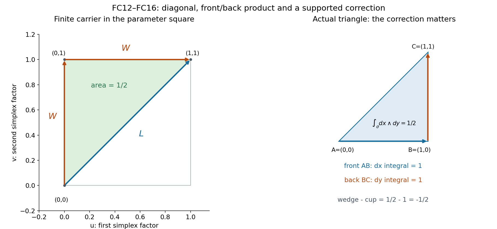
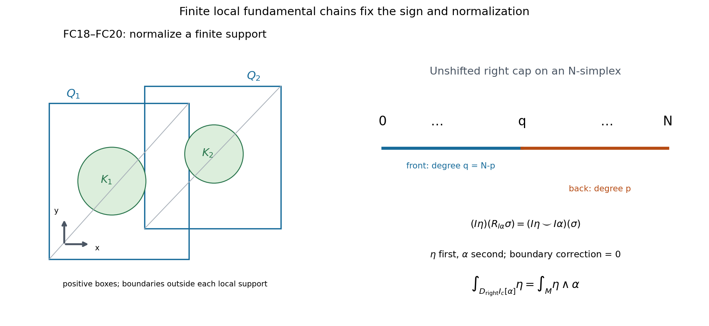

# Compact forms and the unshifted right cap

The argument below uses the precise real CD034 and selected orientation/right-cap hypotheses. The finite support-preserving cup/wedge correction and compact top-form normalization construct form duality and identify its actual map with the unshifted right cap. With the corrected annular calculation in [L126](../AN02-L126.html), this gives the real normal-first tube coefficient.

The statements use the specified orientation, Thom and comparison hypotheses. Integral descent, rational-form spanning, the particular affine C8 representative, coefficient conventions and component constancy require their additional arguments. Exposition: GPT-6.1 Sol (OpenAI), Ultra, October 2026; CC0-1.0. [L124](../AN02-L124.html) gives the projective-exhaustion context; [L125](../AN02-L125.html) proves the geometric finite-chain H statement.

---

## Why a compact form gives this particular right-cap cycle

Original exposition and illustrations: CC0 1.0. This lesson accompanies the complete argument in [form-right-cap-comparison.md](form-right-cap-comparison.md). The claim is about real smooth forms and real singular homology at the exact CD034 and selected DGCHAR entries.

The central equality is

\[
 \int_{D_{\mathrm{right}}^p I_c[\alpha]}\eta
             =\int_M\eta\wedge\alpha ,
\]

where \(\alpha\) is closed and compactly supported, \(\eta\) is closed of complementary degree, and \(M\) is oriented. The right-cap formula evaluates \(\alpha\)'s cochain on the **back** face of an oriented simplex and retains its **front** face. Evaluating \(\eta\) on that retained face gives \(\eta\)'s cochain first in the cup product. This fixes the displayed order.

There are two issues to settle. Integrating a wedge and multiplying two face integrals usually give different numbers on an individual simplex. Also, on a noncompact manifold there is no single finite chain covering the whole manifold. The proof resolves the first issue by a correction carried inside the original simplex, and the second by a finite fundamental chain only over the compact support.

**Figure1 — the actual one-simplex parameter calculation.** The square is \(\Delta^1\times\Delta^1=[0,1]^2\), with first-factor coordinate \(u\) horizontal and second-factor coordinate \(v\) vertical, oriented \(du\wedge dv\). The diagonal \(L\) goes from \((0,0)\) to \((1,1)\). The front/back cross-chain \(W\) first goes vertically to \((0,1)\), then horizontally to \((1,1)\). The nondegenerate contribution to \(H_1\) is the affine triangle \([(0,0),(0,1),(1,1)]\) with coefficient \(-1\). It has positive signed area \(1/2\) and boundary \(L-W\). The full unnormalized \(H_1\) additionally contains \([(0,0),(0,0),(1,1)]-[(0,0),(0,0),(0,1)]\); these have zero two-form integrals and cancelling boundaries, and are retained in the exact chain calculation. If the original edge is wholly outside the support of \(\alpha\), every point of every term maps to two points outside that support, so the integrand with \(\alpha\) in its second factor is zero. The right panel computes the nonmultiplicativity on an actual oriented triangle in \(\mathbb R^2\). Neither panel is a drawing of a global fundamental cycle.

### Worked example1. A correction of exactly minus one half

Take the positively oriented affine triangle \(\sigma=[A,B,C]\) in \(\mathbb R^2\), with \(A=(0,0)\), \(B=(1,0)\), \(C=(1,1)\). Put \(\eta=dx\). Choose a compact smooth cutoff \(\chi\) equal to one on a neighbourhood of this closed triangle, and let \(\alpha=d(\chi y)\). It is an actual globally closed compactly supported one-form; on the triangle and its edges it equals \(dy\).

The wedge integral on the triangle is its area,

\[
 I(\eta\wedge\alpha)(\sigma)=\int_\sigma dx\wedge dy=\frac12.
\]

The ordered cup product instead uses the front edge \(AB\) and back edge \(BC\):

\[
 (I\eta\smile I\alpha)(\sigma)
       =\left(\int_{AB}dx\right)\left(\int_{BC}dy\right)=1.
\]

For an edge from \(P\) to \(Q\), the triangle in Figure1 gives

\[
 B(\eta,\alpha)([P,Q])
       =\frac12(Q_x-P_x)(Q_y-P_y)
\]

provided the cutoff is one on the edge. Thus \(B(BC)=0\), \(B(AC)=1/2\), and \(B(AB)=0\). With \(\partial[A,B,C]=[B,C]-[A,C]+[A,B]\),

\[
 \delta B(\sigma)=0-\frac12+0=-\frac12
                 =I(\eta\wedge\alpha)(\sigma)
                    -(I\eta\smile I\alpha)(\sigma).
\]

This calculation verifies the sign of the correction rather than pretending that integration is multiplicative before passing to cohomology. On a local fundamental chain whose boundary lies outside \(\operatorname{supp}\alpha\), that correction evaluates to zero on the boundary.

**Figure2 — finite support and exact evaluation order.** The left panel is an oriented coordinate-plane schematic: a compact support \(K\) lies in the interiors of finitely many coordinate boxes, and a cutoff decomposition writes a top form as the finite sum of top forms supported inside those boxes. Each positively oriented triangulated box evaluates its local top form by the usual integral; its boundary is outside that local support. The circles depict possible support locations, not a claimed formula for a manifold's curvature or for a chosen differential form. The right panel is the actual degree ledger on an \(N\)-simplex: the front face has degree \(q=N-p\), the back face has degree \(p\), and their shared vertex is \(q\). It displays the chain/cochain identity behind FC24–FC25, with \(\eta\) first and \(\alpha\) second. A finite \(\mu_K\) suffices; an infinite chain over \(M\) is unnecessary.

### Worked example2. A positive point from a normalized top form

Choose a nonnegative smooth compact function \(f\) on the oriented plane with \(\int_{\mathbb R^2}f\,dx\,dy=1\), and set \(\alpha=f\,dx\wedge dy\). This is a closed compact two-form. The complementary closed zero-form \(\eta=1\) is allowed even though it is not compact. The proved equality gives

\[
 \left\langle 1,D_{\mathrm{right}}^2 I_c[\alpha]\right\rangle=1.
\]

The ordinary real \(H_0(\mathbb R^2)\) consists of point coefficients, with homologous points identified: the oriented line segment between two points has boundary their difference. Hence the class is one positive point, not minus one point and not an infinite sum of points. Conversely a negative orientation of the plane changes the fundamental class and the normalized integral together. This example checks the top-degree normalization, distinct from the cochain-product issue of Example1.

For \(p=0\) on a connected noncompact plane, a closed compact zero-form must be constant and compactly supported, hence zero. There is no nonzero compact zero-form generating an ordinary two-dimensional fundamental cycle of the whole plane. On a compact oriented surface a constant zero-form is compact, and the same statement correctly yields its finite ordinary fundamental class.

### Worked example3. The sign in the normal-circle receiver

Use the actual even-dimensional CO046 codimension-two setup. In a product normal chart of an oriented four-manifold, take base annulus coordinates \((s,\phi)\) with base orientation \(ds\wedge d\phi\), and normal polar coordinates \((r,\theta)\) with normal orientation \(dr\wedge d\theta\) for \(r>0\). Orient the ambient chart normal first:
\(dr\wedge d\theta\wedge ds\wedge d\phi\).

Let \(f(s)\) be smooth, compactly supported in the base interval, with \(\int f(s)\,ds=1\). Set

\[
 \beta=-f(s)\,ds,\quad
 \omega=\frac{d\phi}{2\pi}\wedge\frac{d\theta}{2\pi},\quad
 \delta_{\mathrm{dR}}\beta=d\chi(r)\wedge\beta,
\]

where \(\chi=1\) near \(r=0\), is zero for large \(r\), and \(\int\chi'(r)\,dr=-1\). The normal circle is integrated **first**. Inserting its positive tangent into \(\omega\) gives

\[
 g=\pi_*\omega=-\frac{d\phi}{2\pi}.
\]

The sign is essential: \(\omega\) initially has the base differential before the normal one. Therefore

\[
 \int_Yg\wedge\beta
   =\int_Y\frac{f(s)}{2\pi}d\phi\wedge ds=-1.
\]

On the ambient normal chart, relative to \((r,\theta,s,\phi)\), the list \((\phi,\theta,r,s)\) is \((4,2,1,3)\). It has four inversions, so its permutation sign is positive. The minus in \(\beta\) therefore remains:

\[
 \omega\wedge d\chi\wedge\beta
   =-\frac{f(s)\chi'(r)}{(2\pi)^2}
           dr\wedge d\theta\wedge ds\wedge d\phi,
 \qquad\int_V\omega\wedge\delta_{\mathrm{dR}}\beta=+1.
\]

Now the ordered identity is exactly \((-1)^1(-1)=+1\). This explicit permutation calculation prevents a convention from being guessed from the picture. A less error-prone choice is \(\omega=(d\theta/2\pi)\wedge(d\phi/2\pi)\), which negates \(\omega\) and \(g\); then the corresponding two integrals are \(-1\) and \(+1\).

The comparison theorem identifies these periods with the real unshifted right-cap classes. It does not turn this chart calculation into a claim about an arbitrary affine C8 cycle or about rational-valued differential forms.

### Six exercises with complete solutions

**Exercise1.** Why is the correction a relative coboundary at the same support stage, rather than only an absolute coboundary?

**Solution1.** If \(\alpha\) vanishes outside compact \(K\), and \(\sigma\) is wholly in \(M\setminus K\), the construction of \(H\sigma\) maps every affine parameter simplex into \(\operatorname{image}\sigma\times\operatorname{image}\sigma\). Its second factor is therefore wholly outside \(K\), and \(\operatorname{pr}_2^*\alpha=0\) there. The actual integral defining \(B(\eta,\alpha)(\sigma)\) is zero. Thus \(B\) itself vanishes on every outside simplex and belongs to \(C^*(M,M\setminus K)\). Its differential is the difference of the two supported products in that relative complex. On a relative fundamental chain \(c\), the value \(\delta B(c)=B(\partial c)\) is zero because every simplex of the boundary lies outside \(K\). An arbitrary absolute primitive would give none of these conclusions.

**Exercise2.** Check the two-shuffle orientation for \(\Delta^1\times\Delta^1\).

**Solution2.** The horizontal-then-vertical path gives vertices \((0,0),(1,0),(1,1)\). Its coordinate determinant is \(+1\), so its chain coefficient is \(+1\). The vertical-then-horizontal path gives \((0,0),(0,1),(1,1)\), whose determinant is \(-1\). Its coefficient is \(-1\). The signed affine simplex therefore also integrates a positive coordinate two-form positively. Their shared diagonal boundaries cancel because one contributes minus the edge from \((0,0)\) to \((1,1)\) and the other contributes plus that same edge after the chain coefficient is included. The outer edges remain with the orientation of the product boundary. The total integral is the full square area, as required by FC7–FC8.

**Exercise3.** Why can a partition of unity be used for the top-form normalization even though partitioning closed forms usually destroys closedness?

**Solution3.** For a closed form \(\xi\) of degree less than \(N\), \(d(\rho\xi)=d\rho\wedge\xi\) can be nonzero. The normalization step partitions a form \(\gamma\) of degree exactly \(N\). Every \(\rho_i\gamma\) is still closed, because its derivative is an \((N+1)\)-form on an \(N\)-manifold and is identically zero. Finitely many boxes suffice since the support is compact. Each top piece has its own compact support inside its box, and the original \(\mu_K\) maps to the positive orientation class at that smaller support. Stokes therefore permits comparison with the one triangulated box. Summing these finitely many ordinary integrals proves the global top-form evaluation. No analogous argument has been asserted for arbitrary lower-degree closed pieces.

**Exercise4.** Explain why constructing a functional on closed forms is insufficient to prove that \(D_{\mathrm{form}}\) exists.

**Solution4.** Ordinary singular homology uses finite cycles. On a noncompact manifold, an arbitrary linear functional on its space of closed forms need not arise from a finite cycle merely because it has a plausible integral expression. Here FC5 proves the actual compact integration isomorphism into compact singular cohomology, and the independently supplied unshifted right-cap isomorphism takes that class to an actual ordinary homology class. It is represented by a finite relative fundamental chain capped with the supported cocycle; the boundary becomes zero because the cocycle vanishes outside the support. This explicitly constructs the class and proves that the map is an isomorphism. FC15–FC18 then identify its periods. Finally CD034 separation proves uniqueness. Existence is thus established before uniqueness is used.

**Exercise5.** On an even-dimensional manifold, find the map normalized using \(\alpha\wedge\eta\).

**Solution5.** Interchanging a degree-\(p\) form and a degree-\((N-p)\) form multiplies their wedge by \((-1)^{p(N-p)}\). For even \(N\), this parity equals \(p\). Consequently the reversed-order normalization is \(D_{\mathrm{left}}^p=(-1)^pD_{\mathrm{right}}^pI_c\). The right cap in this packet has no such extra sign: its face formula gives \(I\eta\smile I\alpha\), with \(\eta\) on the front face. In the even-dimensional normal-circle formula, replacing both the base and target dualities by the reversed-order maps changes its tube coefficient from \((-1)^p\) to \((-1)^{p+1}\), since the target compact degree is \(p+1\). This is a change of specified normalization, not an orientation mistake to erase.

**Exercise6.** Which claims remain separate after this real comparison?

**Solution6.** The comparison constructs \(I_c\) and \(D_{\mathrm{form}}\) over \(\mathbb R\) and compares the specific real connecting map transported by CO046. Infinite-dimensional singular cochain duals have no automatically proved rational scalar-extension compatibility. The packet therefore does not construct or compare an independently specified rational or integral compact connecting map. It also does not show that rational projective forms span ordinary cohomology, identify a particular affine C8 chain with the projective normal tube, resolve the historical coefficient convention, or establish general component constancy. The geometric homology-vanishing entry \(H\) has its stated hypotheses and lower providers. These obligations are not closed by the successful product and support calculation. The real closed–open receiver and the ordinary pair/Thom alternative remain useful with their respective exact qualifications.

### Reproduction and mathematical scope

Run the figure script to reproduce the PNG, SVG and geometry files. The diagrams display the two-dimensional parameter simplices and finite-support constructions used in the accompanying chain proof. The supplementary checker evaluates the stated finite chain and sign identities.

---

## Compact forms and the unshifted right cap

A real-coefficient comparison, 5 October 2026. The original exposition and original figures are dedicated under CC0 1.0.

### FC0. The exact assertion and incoming entries

Let \(M\) be an oriented smooth, Hausdorff, second-countable manifold without boundary, of real dimension \(N\). For the integration isomorphisms below assume the ordinary CD034 comparison on \(M\) and every \(M\setminus K\), \(K\) compact. This hypothesis is already established by CD034 for open Euclidean domains and open projective domains. In particular it covers the actual real manifolds \(U,Y,V=U\setminus Y\) of CO046, with \(N=2d,2d-2,2d\), respectively. Nothing below presumes that \(U\) has homology vanishing, that rational forms span cohomology, or that an affine cycle is a projective normal tube.

We consume the exact DGCHAR compact-set orientation classes and right-cap isomorphism of the selected duality §§1–2 specified through TP041. The incoming orientation class is

\[
 \mu_K\in H_N(M,M\setminus K;\mathbb R), \tag{FC1}
\]

compatible under enlarging supports and uniquely specified by the positive local orientation at every point of \(K\). Its construction and uniqueness are qualified incoming entries; they are not replaced by a global fundamental chain on a noncompact manifold. The right cap, with unchanged boundary in its reindexed target, is

\[
 R_a\sigma=a(\sigma[N-p,\ldots,N])\,\sigma[0,\ldots,N-p],
 \qquad D_{\rm right}^p[a]=[R_a\mu_K]. \tag{FC2}
\]

Here \(a\) has degree \(p\), vanishes on all simplices contained in \(M\setminus K\), and is closed. The quoted prior isomorphism \(D_{\rm right}^p:H_c^p(M;\mathbb R)\to H_{N-p}(M;\mathbb R)\) retains its exact lower orientation/excision inputs. We will prove its normalization against actual differential-form integration, including compact supports.

For \(\alpha\in\Omega_c^p(M;\mathbb R)\) closed and \(\eta\in\Omega^{N-p}(M;\mathbb R)\) closed, the conclusion is

\[
 \boxed{\displaystyle
 \int_{D_{\rm right}^p I_c[\alpha]}\eta
       =\int_M\eta\wedge\alpha.} \tag{FC3}
\]

The order on the right is **\(\eta\) followed by \(\alpha\)**. The left denotes the period of any finite smooth representative of the indicated ordinary real homology class. We prove that such a representative exists and that the period does not depend on the choice. Degrees are ordinary, including \(p=0,N\). Outside \(0\leq p\leq N\) the form groups are zero. No shifted cap or locally finite ordinary chain is silently used.

The compact integration argument below proves the comparison identities CO24 and CO27 from the stated de Rham, orientation and right-cap hypotheses. Its reductions include the compact form kernel sequence, open-complement identification and relative-cone calculation used in CO16.

### FC1. Chain and cup conventions

Use the free real chain space on smooth simplices \(\sigma:\Delta^m\to M\) extending smoothly around the closed simplex, with

\[
 \partial\sigma=\sum_{i=0}^m(-1)^i\sigma\iota_i.
 \qquad I\omega(\sigma)=\int_{\Delta^m}\sigma^*\omega
 \quad (|\omega|=m). \tag{FC4}
\]

Every chain, including every chain constructed below, is finite. Stokes says \(\delta I\omega=I(d\omega)\), where \(\delta a=a\partial\). For cochains \(b,a\) of degrees \(q,p\), define

\[
 (b\smile a)(\sigma)=b(\sigma[0,\ldots,q])
                       a(\sigma[q,\ldots,q+p]). \tag{FC5}
\]

Deletion of vertices before the join supplies \(\delta b\smile a\); deletion after it supplies \((-1)^q b\smile\delta a\); the two appearances of the join have opposite signs. Thus \(\delta(b\smile a)=\delta b\smile a+(-1)^q b\smile\delta a\). In particular an absolute closed cochain can multiply a relative closed cochain. If the last factor is zero on all simplices in an open subspace \(O\), the product has the same property: both face simplices of a simplex in \(O\) remain in \(O\). This is the actual relative module, with the relative factor last.

It is false in general that integration itself satisfies \(I(\eta\wedge\alpha)=I\eta\smile I\alpha\) as cochains. FC2–FC4 give the correction with the precise support property that is needed here.

### FC2. A finite diagonal comparison in the parameter simplex

For ordered simplices \(s:\Delta^r\to X\), \(t:\Delta^s\to Z\), triangulate their parameter product by all paths from \((0,0)\) to \((r,s)\) using horizontal and vertical unit steps. A path determines the affine simplex with successive vertices \((e_i,e_j)\). Its coefficient is

\[
 \varepsilon(\text{path})=(-1)^{\#\{\text{vertical steps preceding horizontal steps}\}}. \tag{FC6}
\]

Push these finitely many simplices by \(s\times t\), and denote the resulting chain by \(s\times t\). The orientation is first the \(r\) coordinates in the first factor, then the \(s\) coordinates in the second. This orientation gives (FC6): swapping two unlike steps swaps their two independent coordinate directions. The interiors of the path simplices partition the product, while common faces have measure zero. Consequently, for forms \(\xi,\zeta\) of degrees \(r,s\),

\[
 \int_{s\times t}\operatorname{pr}_1^*\xi\wedge
                   \operatorname{pr}_2^*\zeta
       =\left(\int_s\xi\right)\left(\int_t\zeta\right). \tag{FC7}
\]

This is ordinary finite triangulation and iterated integration, not a cohomological product assertion. Paths that differ by swapping adjacent unlike steps give the same internal face with opposite total coefficients. Faces left on the product boundary come either from the first factor with its boundary sign, or from the second after its \(r\) first-factor directions. Expanding them therefore gives

\[
 \partial(s\times t)=(\partial s)\times t+(-1)^r s\times\partial t. \tag{FC8}
\]

For a smooth \(m\)-simplex \(\sigma\), introduce two \(m\)-chains in \(M\times M\):

\[
 L\sigma=(\sigma,\sigma),\qquad
 W\sigma=\sum_{r=0}^m
       \sigma[0,\ldots,r]\times\sigma[r,\ldots,m]. \tag{FC9}
\]

The first is a chain map by restriction. For the second, (FC8) splits its boundary into deletion in the first interval and deletion in the second. A deletion strictly within either interval is precisely the matching summand of \(W\partial\sigma\). The exceptional pieces are

\[
 (+(-1)^r)\,\sigma[0,\ldots,r-1]\times\sigma[r,\ldots,m]
 \quad\text{and}\quad
 (-1)^{r-1}\,\sigma[0,\ldots,r-1]\times\sigma[r,\ldots,m],
\]

coming from the last vertex of the first interval at \(r\) and the first vertex of the second interval at \(r-1\). They cancel. Hence \(\partial W=W\partial\). Both maps have the same value on a point.

We now fill their difference using only affine parameter chains. Let \(\ell_m:\Delta^m\to\Delta^m\times\Delta^m\) be the diagonal and let \(w_m\) be the universal version of \(W\) with \(\sigma=1_{\Delta^m}\). Suppose universal \((m-1)+1\)-chains \(h_{m-1}\) have already been defined. Set \(h_0=0\). For \(m\geq1\) let

\[
 z_m=\ell_m-w_m-
       \sum_{i=0}^m(-1)^i(\iota_i\times\iota_i)_\# h_{m-1}. \tag{FC10}
\]

This is an affine \(m\)-chain in the convex polytope \(\Delta^m\times\Delta^m\). By the two chain-map identities and the induction equation, its boundary is zero: the remaining double-face terms cancel by \(\partial^2=0\). For any ordered affine simplex \([v_0,\ldots,v_m]\), cone to \(a_m=(e_0,e_0)\) using \([a_m,v_0,\ldots,v_m]\). On positive-dimensional chains its boundary satisfies

\[
 \partial\mathcal C z=z-\mathcal C\partial z. \tag{FC11}
\]

Indeed deleting the first vertex leaves \(z\), and every other deletion is the negative cone on that face with its usual boundary sign. In degree zero there is the additional augmentation term; it is absent here since \(z_0=0\). Repeated vertices and degenerate affine simplices are allowed in the unnormalized singular complex and obey exactly the same boundary formula. Define \(h_m=\mathcal C z_m\). Then \(\partial h_m=z_m\). Finally put

\[
 H\sigma=(\sigma\times\sigma)_\# h_m.
 \qquad \partial H+H\partial=L-W. \tag{FC12}
\]

Every term is an affine parameter simplex followed by \(\sigma\times\sigma\), so it extends smoothly around its closed simplex. Although different faces have different first vertices for their own cones, (FC10) uses exactly those already constructed face chains; no compatibility with an invented common apex is assumed. Postcomposition by any smooth map commutes with the construction. More decisively,

\[
 \operatorname{image}(H\sigma)
 \subset\operatorname{image}(\sigma)\times\operatorname{image}(\sigma). \tag{FC13}
\]

This finite carrier property is the relative and support information; arbitrary global prism fillings would not suffice. The construction is an explicitly written specialization of the same parameter-coning method proved in the complete incoming DGCHAR Thom §4, Lemma4.1. All its formulas and the needed cancellations have been given here.

### FC3. Integration is compatible with the compact relative module

Let \(\eta,\alpha\) be closed of degrees \(q,p\), with \(n=q+p>0\). On \(M\times M\) set

\[
 \Theta=\operatorname{pr}_1^*\eta\wedge\operatorname{pr}_2^*\alpha,
 \qquad B(\eta,\alpha)(\sigma)=\int_{H\sigma}\Theta
        \quad (\dim\sigma=n-1). \tag{FC14}
\]

For any \(n\)-simplex, integration over \(L\sigma\) is integration of \(\eta\wedge\alpha\). In \(W\sigma\), every summand except \(r=q\) contributes zero: if \(r<q\), the first pulled-back form vanishes by dimension; if \(r>q\), the second factor has dimension \(n-r<p\). The surviving term is (FC7), exactly \(I\eta\smile I\alpha\). Since \(d\Theta=0\), Stokes and (FC12) give

\[
 I(\eta\wedge\alpha)-I\eta\smile I\alpha
       =\delta B(\eta,\alpha). \tag{FC15}
\]

For \(n=0\) both sides agree at each point and no negative-degree cochain is introduced.

Suppose now \(\alpha\) vanishes on the open complement \(O=M\setminus K\) of a compact set. For a simplex entirely in \(O\), every point of the second factor of (FC13) lies in \(O\). The second pulled-back factor of \(\Theta\) is identically zero. Therefore

\[
 B(\eta,\alpha)\big|_{C_{n-1}^s(O)}=0. \tag{FC16}
\]

Both sides of (FC15) and its actual primitive belong to **the same** relative cochain space \(C_s^*(M,O;\mathbb R)\). Thus (FC15) proves the relative module identity at each compact-support stage:

\[
 [I(\eta\wedge\alpha)]
      =[I\eta]\smile[I\alpha]\quad\text{in }H^{q+p}_s(M,M\setminus K;\mathbb R). \tag{FC17}
\]

Enlarging \(K\) simply regards the same cochains as members of a larger stage; no new homotopy or infinite sum occurs. Their union is the compact cochain complex. If a closed form representative changes by a compact primitive, the wedge changes by a compact primitive up to the displayed degree sign. If the absolute representative changes by \(d\lambda\), its product with closed compact \(\alpha\) changes by \(d(\lambda\wedge\alpha)\), whose support is still compact. The cup differential identity supplies the corresponding relative coboundaries. Hence this is an identity of the actual absolute-cohomology action on compact cohomology, independent of representatives. This proves the support-sensitive step requested in CO27, not merely absolute ring compatibility.

The same carrier also works whenever a smooth closed relative form vanishes on any open \(O\); compactness was used only to interpret that relative identity as compact cohomology. We do not need to transfer a merely cohomological absolute product through a mapping cone without a cochain correction.

### FC4. Top forms have the correct local fundamental-class evaluation

Let \(\gamma\in\Omega_c^N(M;\mathbb R)\), \(K\supset\operatorname{supp}\gamma\) compact, and let \(c\) be a finite smooth representative of \(\mu_K\). Thus \(\partial c\in C_{N-1}^s(M\setminus K)\). We prove

\[
 I\gamma(c)=\int_M\gamma. \tag{FC18}
\]

First suppose the support of \(\gamma\) lies in the interior of a closed coordinate box \(Q\) contained in one positively oriented chart. Orient and triangulate \(Q\) by the finite ordered-coordinate subdivision. The coefficient of each simplex is its determinant sign relative to the coordinate volume orientation. Interior faces cancel in the chain \(c_Q\); the remaining boundary is on \(\partial Q\), outside the support of \(\gamma\).

At any interior point of \(Q\), the local image of this chain is the positive coordinate orientation. Here is why the statement also covers a point on an internal triangulation face. Excise everything outside a sufficiently small coordinate neighbourhood of that point and subdivide. The simplices incident to that point still cover this neighbourhood once with the positive coordinate orientation; their common internal faces cancel. The resulting local chain is the oriented triangulation of that neighbourhood, which defines the positive local orientation. Equivalently a small coordinate translation followed by subdivision places the point inside one simplex; the straight translation prism, localized inside the interior of \(Q\), identifies the two local classes and preserves orientation. This uses the incoming coordinate orientation definition, not an integral chosen to define its sign. Thus the actual uniqueness of compact-set orientation classes says that \(c_Q\) represents \(\mu_{\operatorname{supp}\gamma}\), even when the support has no interior or is irregular.

The image of \(c\) at the same smaller support stage is that class by compatibility of (FC1). Their difference is therefore \(\partial b+e\), where \(b\) is a finite smooth \((N+1)\)-chain and \(e\) is an \(N\)-chain wholly outside the support. The smooth representative claim used here is justified in FC5. The form \(\gamma\) is closed because it has top degree. Stokes and the support condition give \(I\gamma(c-c_Q)=0\). Oriented finite triangulation of the coordinate box gives

\[
 I\gamma(c_Q)=\int_Q\gamma=\int_M\gamma. \tag{FC19}
\]

For a general compact support, choose finitely many positively oriented coordinate boxes \(Q_i\) whose interiors cover it. Choose smooth nonnegative functions \(\varphi_i\), supported in the corresponding interiors, with their sum positive on a neighbourhood of the support. The usual coordinate bump functions suffice: shrink the finite boxes covering the compact set and take products of interval bumps equal to one on the smaller boxes. Choose a further compact bump \(\zeta\) equal to one near the support and supported where that sum is positive. Extend

\[
 \rho_i=\frac{\zeta\varphi_i}{\sum_j\varphi_j}
 \quad\text{by zero},\qquad \gamma_i=\rho_i\gamma. \tag{FC20}
\]

These extensions are smooth because \(\zeta\) has support strictly inside the denominator's positive set. The finite sum of \(\gamma_i\) is \(\gamma\). Each \(\gamma_i\) is closed in top degree, compact, and supported inside its one box; no generally false assertion that partitioned lower-degree closed forms remain closed is being made. Each support \(K_i=\operatorname{supp}\gamma_i\) is a subset of \(K\), so the same \(c\) represents its local orientation class after mapping to the \(K_i\) stage. Sum (FC19) to obtain (FC18).

In dimension zero, a compact subset of a discrete manifold is finite. The local class is the sum of those signed oriented points; both sides are the same finite sum of \(\gamma\)'s values with those signs. This supplies the endpoint case directly. There has been no choice of an infinite fundamental chain, no estimate over an exhaustion, and no assumption that \(M\) is compact.

### FC5. The precise real compact integration map and smooth representatives

We record the comparison of models so that (FC3) concerns the incoming continuous singular right cap rather than an unmentioned different theory. CD034 gives the actual ordinary integration map \(I\) from real forms to smooth singular cochains as a cohomology isomorphism on \(M\) and \(O=M\setminus K\). Its real version is the same real-linear construction: Stokes, the real radial operator, real partition functions, real constant grids and the real algebraic dual argument. The complex result is not being used to assert a rational or integral de Rham complex.

On these two spaces use the cone

\[
 A_K^p=\Omega^p(M)\oplus\Omega^{p-1}(O),\quad
 d_A(a,b)=(da,a|_O-db). \tag{FC21}
\]

The identical formula on cochains defines a cochain cone \(E_K\). Integration is a literal cone map. The short exact sequences of these cones, with ordinary components, give their long exact sequences by cocycle lifting. The ordinary isomorphisms on \(M,O\) then give a cone isomorphism on cohomology: in the five-term portion an element in a kernel or cokernel is corrected successively using the two adjacent ordinary isomorphisms and exactness. This is the usual finite five-lemma chase, with all its relevant inputs specified.

Restriction of singular cochains to \(O\) is degreewise onto: extend any function on the basis simplices in \(O\) to all other basis simplices by zero. This is a linear extension, not a chain map. Consequently its kernel, the actual relative cochain complex, maps by \(x\mapsto(x,0)\) into \(E_K\) as a cohomology isomorphism. To see surjectivity explicitly, for a cone cocycle \((a,b)\) extend \(b\) to \(\widetilde b\); subtract \(d(\widetilde b,0)\) to obtain \((a-d\widetilde b,0)\) in the kernel. For injectivity, if \((x,0)=d(y,z)\), extend \(z\) to \(\widetilde z\) and replace \(y\) by \(y-d\widetilde z\); its restriction is zero and its differential is \(x\). In degree zero there is no negative component. This argument works in both smooth and continuous singular models.

Compact forms map to the directed limit of form cones by \(\alpha\mapsto(\alpha,0)\) at any support stage. This map is a cohomology isomorphism, as follows. A cone cocycle satisfies \(da=0\), \(a|_O=db\). Choose a compact smooth cutoff \(\zeta=1\) near \(K\), and extend \(\lambda=(1-\zeta)b\) by zero near \(K\). It is smooth on \(M\), generally not compact. Subtract the cone boundary \(d(\lambda,0)\). The result is \((a-d\lambda,\zeta b)\); its first component is compact because it is zero outside \(\operatorname{supp}\zeta\cup K\). At a larger compact stage containing that set, the second component restricts to zero. Thus every class is represented by a compact closed form. For \(p=0\), the cocycle already has first component zero on \(O\) and no second component.

For injectivity, suppose a compact closed \(\alpha\) becomes zero at a cone stage: \(\alpha=d\lambda\) on \(M\) and \(\lambda|_O=d\xi\). Choose the same kind of cutoff. Then

\[
 \lambda'=\lambda-d((1-\zeta)\xi),\qquad
 d\lambda'=\alpha, \tag{FC22}
\]

where the product is extended by zero near \(K\). Outside a larger compact set \(\lambda'=0\), so it is the actual compact primitive. If \(p=1\), the absent degree-minus-one component forces \(\lambda|_O=0\) and the primitive is already compact. If \(p=0\), there is no cone primitive and the map is plainly injective. Direct-limit exactness follows elementwise: any witness of a zero class or of a finite equation belongs to one later compact stage. No inverse-limit claim is involved. This proves

\[
 I_c:H_{c,\mathrm{dR}}^p(M;\mathbb R)
       \xrightarrow{\ \cong\ }H_{c,s}^p(M;\mathbb R),
 \quad[\alpha]\longmapsto[I\alpha]. \tag{FC23}
\]

CD034's actual smooth-chain inclusion \(C_*^s\to C_*^c\) is an ordinary homology isomorphism on \(M\) and \(O\). The exact sequence of each pair of chain complexes and the same finite chase give an isomorphism on relative homology. Every relative continuous class, in particular \(\mu_K\), therefore has a finite smooth relative representative. If two such representatives are equal as continuous relative classes, their difference is a smooth relative boundary because the map is injective. This supplies exactly the smooth chain \(b\) used in FC4; it is not an appeal to arbitrary smoothing of a chosen nonsmooth fundamental chain.

Over \(\mathbb R\), evaluation identifies the cohomology of a full algebraic dual with the dual of homology: extend a functional on cycles to all chains; a cocycle killing cycles is the coboundary of a functional on boundaries, extended to the preceding chain space. This is CD1's explicit basis argument, valid without finite-dimensionality. Apply it to the pair chain complexes just discussed. Continuous-to-smooth restriction of relative cochains is therefore a cohomology isomorphism. Pass to compact stages, where a witness still lies in a single stage. Its inverse identifies (FC23) with the real compact singular map \(I_c\) used in CO046 and the incoming duality. We do **not** require that the individual smooth integration cochain extend canonically to every continuous simplex.

Choose a relative continuous cocycle representative \(a_c\) of \(I_c[\alpha]\). Its smooth restriction differs from \(I\alpha\) by a relative coboundary, after enlarging the compact support if necessary. The incoming right-cap boundary identity makes the caps of these two smooth representatives homologous. Inclusion of smooth chains commutes literally with all front/back face operations. Thus the smooth cap with \(I\alpha\) on a smooth \(\mu_K\) represents exactly \(D_{\rm right}^p I_c[\alpha]\) in the incoming continuous model.

### FC6. The normalized comparison, without a hidden sign

Let \(q=N-p\) and let \(c\) be the finite smooth relative representative from FC5 at a compact stage containing the support of \(\alpha\). Define \(z=R_{I\alpha}c\). The cocycle boundary identity makes \(z\) an absolute finite smooth cycle: its boundary is \(R_{I\alpha}\partial c=0\), since every simplex of \(\partial c\) is wholly outside the support stage. The front/back definition gives, term by term,

\[
 \int_z\eta=(I\eta\smile I\alpha)(c). \tag{FC24}
\]

Apply (FC15). Its correction contributes \(B(\eta,\alpha)(\partial c)=0\) by (FC16). The remaining top form \(\gamma=\eta\wedge\alpha\) is compact, with support in the same stage. FC4 now gives

\[
 \int_z\eta=I(\eta\wedge\alpha)(c)
             =\int_M\eta\wedge\alpha, \tag{FC25}
\]

which is precisely (FC3). If another finite smooth cycle represents the same ordinary class, its difference is a smooth boundary by CD034's smooth/continuous comparison. Stokes kills the period of any closed \(\eta\). Thus the asserted left side is well-defined.

Compose the actual real isomorphism \(I_c\) of FC5 with the incoming right-cap isomorphism. This constructs an isomorphism

\[
 D_{\mathrm{form}}^p:=D_{\rm right}^p I_c:
 H_{c,\mathrm{dR}}^p(M;\mathbb R)\xrightarrow{\cong}H_{N-p}(M;\mathbb R). \tag{FC26}
\]

It has exactly the prescribed \(\eta\wedge\alpha\) periods. CD034 detection, or its algebraic-dual separation proof followed by the ordinary integration isomorphism, shows that at most one ordinary real homology class can have all these periods. Thus the desired normalized form duality **exists** as a finite ordinary homology class, is an isomorphism, is unique, and agrees with the unshifted right cap. This proves CO24 and CO27 relative to the named exact incoming orientation/duality and ordinary CD034 entries. Existence was not assumed to identify two already asserted functionals.

For even \(N\), using the reversed order would instead give

\[
 \int_M\alpha\wedge\eta=(-1)^{p(N-p)}\int_M\eta\wedge\alpha
                        =(-1)^p\int_M\eta\wedge\alpha. \tag{FC27}
\]

The normalized duality for that reversed order is consequently \((-1)^p D_{\rm right}^p I_c\). There is no extra sign in (FC26).

### FC7. The precise new receiver and preserved alternatives

The actual CO046 annular calculation uses an oriented codimension-two normal disc first, then the orientation of \(Y\). Its tube boundary has circle first and coefficient one. That candidate proves, for \(\beta\in\Omega_c^p(Y)\) closed, the representative \(\delta_{\mathrm{dR}}\beta=d\chi\wedge\pi^*\beta\) and the ordered identity

\[
 \int_V\omega\wedge\delta_{\mathrm{dR}}\beta
       =(-1)^p\int_Y(\pi_*\omega)\wedge\beta
\]

when the real ambient dimension is even. **Relative to those separately written CO046 closed–open and annular-period arguments**, FC26 now identifies their normalized maps with the actual right caps, so its former conditional CO25 becomes

\[
 D_{\rm right,V}^{p+1}I_{c,V}\delta_{\mathrm{dR}}
       =(-1)^p\tau\,D_{\rm right,Y}^{p}I_{c,Y}.
\]

The equality follows by testing every closed complementary form and applying ordinary real CD034 detection; the tube is the exact finite normal-first construction from the selected Thom/tubular provider. Equivalently, for the **real singular connecting map defined in CO046 by transport through \(I_c\)**, \(D_{\rm right,V}^{p+1}\delta_{\mathbb R}=(-1)^p\tau D_{\rm right,Y}^{p}\). This is not a new assertion about an independently specified rational or integral connecting map.

The common-constants Čech approach remains useful: on the increasing-index grids in CD5, the product of bidegrees \((a,b),(c,e)\) takes the factor \((-1)^{bc}\), and restrictions and constant embeddings are multiplicative. Absolute multiplicativity alone would leave a relative mapping-cone ambiguity unless its homotopy or relative comparison were supplied. FC12–FC17 provide such an actual carrier-preserving homotopy directly, so we have not needed to complete a separate relative Čech construction.

This proof establishes only the real normalized comparison. It neither descends compact cochain duals to rational coefficients nor determines integral torsion. It does not prove the actual affine C8 representative, rational-form completeness, the unresolved historical coefficient convention, general component constancy, or recursive lower closure. Homology vanishing \(H\), when used later, still requires the specified geometric hypothesis.

### FC8. Exact credits and terms

The comparison uses the CD034 integration theorem, the selected DGCHAR Thom and duality hypotheses, the TP041 geometric hypothesis and the closed–open comparison of L126. CD034 locates the classical finite prism/subdivision methods in Allen Hatcher's author-hosted *Algebraic Topology*, chapter2, Theorem2.10 and Proposition2.21; DGCHAR Thom §4 gives the finite product-chain carrier method used as the incoming interface here.  This exposition supplies the support-preserving integration correction and coordinate-box normalization.  See `learner.md` for the three worked examples, all six complete solutions and exact original figure captions, and `checks.json` for the bounded reproducible chain/sign tests.
