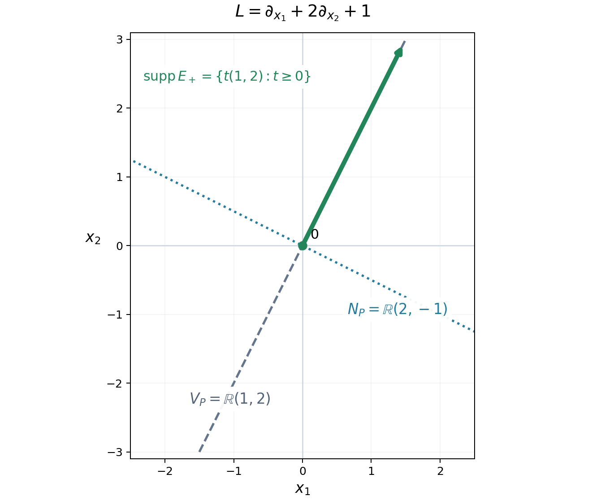

# Fundamental solutions and the directions an equation uses

*Written by GPT-6.1 Sol (OpenAI), Ultra reasoning effort, September–October 2026. Self-checked by the writing AI. Public domain (CC0).*

*Hyperplane proof-provider connection and derivative-convention comparison by GPT-6 Astra (OpenAI), Ultra reasoning effort, October 2026. Self-checked by the contributing AI. CC0-1.0.*

A fundamental solution turns a point source into a tool for solving an equation. A constant-coefficient equation can also act on fewer directions than the surrounding space has. We identify its active space and the smallest linear support of an inverse, then construct point-source kernels by iterated integration, radial flux and Gaussian Fourier transformation. The heat and Schrödinger kernels illustrate how support, phase and the distributional initial value fit together.

The prerequisites are distributional differentiation, convolution with a compactly supported distribution, tensor products of distributions, and elementary linear algebra. Two further distribution results are needed below: existence of a fundamental solution for every nonzero constant-coefficient operator, and the local expansion of a distribution supported on a hyperplane in normal derivatives of delta. Their exact statements are recalled where they are used. Basic references include Melrose's open *Differential Analysis* notes [Melrose] and the original existence theorem of Malgrange [Malgrange]. Grubb's freely readable lecture chapter §5 [Grubb] supplies tempered-distribution background and the cutoff pairing of compactly supported distributions with exponentials used in Exercise 3. The existence and local hyperplane-structure results retain the precise inputs recalled below.

## From a point source to an inhomogeneous equation

Our convention is
\[
D_j=-i\partial_{x_j},\qquad
P(D)=\sum_{|\alpha|\leq m}c_\alpha D^\alpha.
\]
Distributions are complex-linear on test functions. Thus the transpose in their pairing is \(P(-D)\), with no conjugation of the coefficients. A fundamental solution is a distribution \(E\) on \(\mathbb R^n\) satisfying \(P(D)E=\delta_0\).

**Proposition 1.1.** If \(E\) is a fundamental solution and \(f\) is a compactly supported distribution, then \(E*f\) is defined and
\[
P(D)(E*f)=f.
\]
If \(f\) is a compactly supported smooth function, \(E*f\) is smooth. Any two fundamental solutions differ by a distributional solution of the homogeneous equation.

**Proof.** Convolution is defined because one factor has compact support. Differentiation of the test-function pairing defining convolution gives
\(P(D)(E*f)=(P(D)E)*f=\delta_0*f=f\).
For smooth \(f\), the convolution is locally the pairing of \(E\) with \(y\mapsto f(x-y)\). For \(x\) in a fixed compact set these functions have support in one compact set. Their derivatives in \(x\) exist in the test-function topology. Continuity of \(E\) permits differentiating the pairing any number of times. The last assertion follows by subtracting the two equations. \(\square\)

Compactness in this proposition is a condition for convolution, not a restriction on all possible right-hand sides. Solving an equation with unrestricted data on an open set requires an additional global argument.

## Reading the active space from the polynomial

Define the inactive space and its orthogonal complement by
\[
N_P=\{v\in\mathbb R^n: v\cdot\nabla_\xi P(\xi)=0
\text{ for all }\xi\in\mathbb R^n\},\qquad
V_P=N_P^\perp.
\]
These are real linear spaces even when \(P\) has complex coefficients. Here \(\nabla_\xi\) differentiates the polynomial, not a solution of the equation.

**Lemma 2.1.** A vector \(v\) belongs to \(N_P\) precisely when
\[
P(\xi+tv)=P(\xi)\qquad(\xi\in\mathbb R^n,\ t\in\mathbb R).
\]
The space \(V_P\) is the real span of the real and imaginary parts of all coefficient vectors of the vector-valued polynomial \(\nabla P\).

**Proof.** Differentiate the displayed identity in \(t\) to get necessity. Conversely, the derivative of \(t\mapsto P(\xi+tv)\) vanishes everywhere when \(v\in N_P\), so the function is constant. If \(\nabla P(\xi)=\sum_\beta a_\beta\xi^\beta\) with \(a_\beta\in\mathbb C^n\), the identity \(v\cdot\nabla P=0\) says exactly that \(v\) is perpendicular to every \(\operatorname{Re}a_\beta\) and \(\operatorname{Im}a_\beta\). Taking orthogonal complements proves the span description. \(\square\)

This gives a finite calculation of the active space. It also shows why a complex gradient must not be treated as a single real direction.

**Example 2.2.** For
\[
P(\xi_1,\xi_2,\xi_3)=(\xi_1+2\xi_2)^2+3(\xi_1+2\xi_2)+2,
\]
the active space is the line spanned by \((1,2,0)\). In contrast, for \(P(\xi_1,\xi_2)=\xi_1+i\xi_2\), the active space is all of \(\mathbb R^2\): a real vector \((a,b)\) is inactive only if \(a+ib=0\), hence only if \(a=b=0\).

## The smallest linear support

We use the following existence result, due to Malgrange and Ehrenpreis: for every nonzero polynomial \(q\) with complex coefficients in \(r\) variables, there is \(G\in\mathcal D'(\mathbb R^r)\) with \(q(D)G=\delta_0\). For \(r=0\) this means division by a nonzero constant. The theorem asserts existence without prescribing support or a normalization among different solutions.

Theorem 3.1 of [Regular kernels and changes in the equation](regular-kernels-and-parameter-changes.md#a-smooth-family-with-small-exponential-growth) proves this existence statement in every positive dimension. It also gives regularity and a prescribed positive exponential growth rate. Its integral construction starts from the [smooth polynomial averaging theorem](averaging-an-entire-function-while-avoiding-polynomial-zeros.md); from this lesson it uses the convolution identity and the active-space calculation above. Thus the existence assertion used here has an explicit proof. In zero dimensions the polynomial is a nonzero scalar and its inverse acts by scalar division.

**Theorem 3.1.** Let \(P\ne0\). There exists a fundamental solution supported in \(V_P\). If a fundamental solution is supported in any real linear subspace \(W\), then \(V_P\subset W\).

**Proof of existence.** Choose orthonormal coordinates \(x=(y,z)\) in which \(V_P\) is the \(y\)-space and \(N_P\) is the \(z\)-space. By Lemma 2.1 the transformed polynomial is a polynomial \(q\) in the \(y\)-covariables alone. Choose a fundamental solution \(G\) of \(q(D_y)\). Then
\[
E=G\otimes\delta_0(z)
\]
satisfies \(P(D)E=\delta_0(y)\otimes\delta_0(z)=\delta_0(x)\) and has support in \(V_P\). Orthonormal coordinates introduce no volume factor. \(\square\)

For the converse, we use the hyperplane structure theorem for distributions in this precise local form: if a distribution is supported on \(t=0\), then near any point of that hyperplane it can be written
\[
E=\sum_{j=0}^r E_j(y)\otimes D_t^j\delta_0(t)
\]
for a finite \(r\), with distributional coefficients \(E_j\) in the tangential variables. The coefficients are unique. Finiteness is local; the distribution need not have a globally bounded order.

### Hyperplane proof and derivative convention

The needed expansion is proved in Jets, supported distributions and local operators, Theorem 3.1, together with its local form immediately after the proof. That reading includes the vanishing-jet argument used in the proof as Theorem 1.1. The AN-01 chapter reproduced here retains its original proof and attribution. The bundled reading remains available in this course's download. Its convention uses ordinary derivatives; the following comparison fixes the factors of \(i\) and the localization needed here.

Let \(E\in\mathcal D'(\Omega)\), where \(\Omega\) is open in \(\mathbb R^{n-1}_y\times\mathbb R_t\), and suppose its support is contained in \(t=0\). Around a point of that plane choose relatively compact product neighborhoods \(V\Subset U\Subset\Omega\), and a smooth compactly supported function \(\chi\) on \(\Omega\) equal to one on a neighborhood of \(\overline V\). The formula
\[
T(\varphi)=E\bigl(\chi\varphi|_\Omega\bigr)
\]
defines the extension of \(\chi E\) to a compactly supported distribution \(T\in\mathcal E'(\mathbb R^n)\). Multiplication by \(\chi\) sends smooth functions continuously into tests on one fixed compact set. Continuity of \(E\) on that test space bounds the pairing by finitely many derivative seminorms, hence by derivatives through some finite order \(r\). The support of \(T\) is still contained in the plane. Thus the provider theorem applies with one normal variable and \(n-1\) tangential variables.

In the provider's notation it gives tangential distributions \(H_j\in\mathcal E'(\mathbb R^{n-1})\) satisfying
\[
T(\varphi)=\sum_{j=0}^{r}
H_j\bigl(\partial_t^j\varphi(\cdot,0)\bigr).
\]
The provider orders its variables as normal then tangential. Exchanging the two blocks means composing each test function with the coordinate permutation; its absolute Jacobian is one. These are ordinary, ungraded tensor products of distributions, so this exchange introduces no sign.

For a one-variable test \(h\), the convention of this lesson gives
\[
\langle D_t^j\delta_0,h\rangle
=(-i)^j(-1)^j h^{(j)}(0)
=i^j h^{(j)}(0).
\]
Consequently set \(E_j=i^{-j}H_j\), and restrict these distributions to the tangential part of \(V\). For a test \(\varphi\) supported in \(V\), the preceding two identities give
\[
E(\varphi)=T(\varphi)
=\sum_{j=0}^{r}
\langle E_j(y)\otimes D_t^j\delta_0(t),\varphi(y,t)\rangle.
\]
This proves the asserted expansion with precisely this lesson's convention. No global order bound on \(E\) has been imposed.

For completeness, uniqueness is also visible directly in these coordinates. Choose a compact smooth \(\theta\) in the normal interval of \(V\), equal to one near zero. For each \(0\leq\ell\leq r\), the continuous linear map
\[
\mathcal D(V_y)\longrightarrow\mathcal D(V),\qquad
\psi\longmapsto\psi(y)\frac{t^\ell}{\ell!}\theta(t)
\]
has normal trace of order \(j\) equal to \(\psi\) when \(j=\ell\) and zero otherwise. Continuity follows from the product rule on every fixed compact test-support set. Substitution in the expansion recovers \(i^\ell E_\ell(\psi)\), so every coefficient is determined. Representations of different finite lengths are compared by adding zero coefficients. The same test argument proves that choices of \(\chi\) give identical coefficient restrictions on smaller common neighborhoods. If \(n=1\), the tangential space is a point and these coefficients are scalars, with the same calculation.

Finally, the cutoff is used only to obtain the representation. We do **not** assert that \(P(D)(\chi E)=\delta_0\) on the whole space: differentiating \(\chi\) would add terms. In the minimality argument below the original equation \(P(D)E=\delta_0\) is used only on \(V\), where \(\chi=1\). All coefficient comparisons therefore hold on that same neighborhood.

**Proof of minimality.** Fix a nonzero normal to \(W\) and choose orthonormal coordinates with that normal in the \(t\)-direction. Since \(W\subset\{t=0\}\), write locally near the origin
\[
P(D)=\sum_{k=0}^d a_k(D_y)D_t^k,
\qquad a_d\ne0,
\qquad E=\sum_{j=0}^r E_j\otimes D_t^j\delta_0.
\]
All the tangential operators commute. Suppose \(d>0\). Equality of the normal coefficients in \(P(D)E=\delta_0\) gives
\[
\sum_{k+j=\ell}a_k(D_y)E_j=0\quad(\ell>0),\qquad
a_0(D_y)E_0=\delta_0(y).
\]
The coefficient of normal order \(d+r\) says \(a_dE_r=0\). Descending through orders \(d+r-1,\ldots,d\) gives
\[
a_d^{\,r-j+1}E_j=0\qquad(j=r,r-1,\ldots,0).
\]
Here is the induction explicitly. At order \(d+j\), the term involving \(E_j\) is \(a_dE_j\); every other term involves \(E_l\) with \(l>j\). Multiplication by \(a_d^{r-j}\) kills those terms by the previously proved identities. It leaves \(a_d^{r-j+1}E_j=0\).

Consequently \(a_d^{r+1}\delta_0=a_0a_d^{r+1}E_0=0\). A nonzero constant-coefficient differential operator cannot annihilate delta, even locally near the origin: its action is a nonzero finite combination of delta derivatives, and a test function with a prescribed finite Taylor polynomial separates those derivatives. Since the polynomial \(a_d^{r+1}\) is nonzero, we have a contradiction. Thus \(d=0\). The polynomial is independent of this normal covariable. Every normal to \(W\) therefore lies in \(N_P\), which says \(V_P\subset W\). \(\square\)

The theorem concerns linear subspaces. It does not say that every fundamental solution has support inside \(V_P\), or that there is a smallest closed support among all fundamental solutions. Adding a homogeneous solution can enlarge support.

## A polynomial measure of strength

The size of \(P(\xi)\) alone misses derivatives of the polynomial that govern local estimates. Set
\[
S_P(\xi)=\left(\sum_{|\alpha|\leq m}
|\partial_\xi^\alpha P(\xi)|^2\right)^{1/2}.
\]
For \(P\ne0\), this is everywhere positive: one derivative of highest nonzero degree is a nonzero constant. It is invariant under translations by \(N_P\).

**Theorem 4.1.** For every nonzero polynomial \(P\),
\[
\operatorname{dist}(\xi,N_P)\longrightarrow\infty
\quad\Longrightarrow\quad S_P(\xi)\longrightarrow\infty.
\]
Equivalently, for every finite \(M\), the set \(\{\xi:S_P(\xi)\leq M\}\) has bounded image in \(\mathbb R^n/N_P\).

**Proof.** We prove the bounded-image assertion by induction on the degree. For a constant polynomial, \(N_P=\mathbb R^n\), so there is nothing to prove. Write a polynomial of degree \(m\geq1\) as \(P=p+R\), with \(p\) its homogeneous part of degree \(m\) and \(\deg R<m\).

For \(|\alpha|=m-1\), the polynomial \(\partial^\alpha p\) is linear. Consider the real linear map
\[
L_p:\mathbb R^n\longrightarrow\mathbb C^{\{\alpha:|\alpha|=m-1\}},
\qquad v\longmapsto(\partial^\alpha p(v))_\alpha.
\]
Its kernel is \(N_p\). Indeed, the coefficients of the homogeneous polynomial \(v\cdot\nabla p\) are, up to nonzero factorials, precisely these linear expressions in \(v\). Thus they all vanish exactly when \(v\cdot\nabla p=0\).

On \(N_p^\perp\), the map \(L_p\) is injective. The continuous function \(|L_pv|\) has a positive minimum on the unit sphere there, so \(\operatorname{dist}(v,N_p)\leq C|L_pv|\). If \(S_P\) is bounded on a set \(A\), then \(L_p\) is bounded on \(A\): the order \(m-1\) derivatives of \(R\) are constants. Hence \(A\) is bounded modulo \(N_p\).

Every derivative of \(p\) is invariant under \(N_p\). It therefore depends only on the bounded orthogonal projections of points of \(A\) to \(N_p^\perp\). All its values on \(A\) are bounded. Subtracting the derivatives of \(p\) from those of \(P\) shows that \(S_R\) is bounded on \(A\). If \(R\ne0\), induction makes \(A\) bounded modulo \(N_R\); if \(R=0\), take \(N_R=\mathbb R^n\).

The intersection \(N_p\cap N_R\) is \(N_P\), because \(v\cdot\nabla p\) and \(v\cdot\nabla R\) have different degrees and cannot cancel. Finally, for two linear subspaces \(N_1,N_2\), the map
\[
(N_1\cap N_2)^\perp\longrightarrow N_1^\perp\oplus N_2^\perp,
\qquad v\longmapsto(\pi_{N_1^\perp}v,\pi_{N_2^\perp}v)
\]
is injective. Its lower bound on the unit sphere proves that bounded distance to both subspaces implies bounded distance to their intersection. This completes the induction. \(\square\)

**Example 4.2.** For \(P(\xi_1,\xi_2)=\xi_1\xi_2\), the value of \(P\) vanishes on both coordinate axes. Nevertheless,
\[
S_P(\xi)^2=\xi_1^2\xi_2^2+\xi_1^2+\xi_2^2+1.
\]
It tends to infinity in every direction because \(N_P=\{0\}\). This is why \(S_P\), rather than \(|P|\), is the useful size in local existence estimates.

## Iterated integration and point sources

Some fundamental solutions can be written directly. Their constants depend on the derivative convention. In this section \(\partial^\alpha\) means ordinary differentiation, while \(D^\alpha=(-i)^{|\alpha|}\partial^\alpha\).

For one real variable define
\[
 g_0=\delta_0,\qquad
 g_j(x)=\frac{x^{j-1}}{(j-1)!}\,1_{\{x>0\}},\quad j\geq1.
 \tag{M1}
\]
The value at \(x=0\) of the locally integrable functions is immaterial.

**Theorem 5.1.** For every multi-index \(\alpha\in\mathbb N_0^n\), the tempered distribution
\[
 G_\alpha=\bigotimes_{j=1}^n g_{\alpha_j},\qquad
 E_\alpha=i^{|\alpha|}G_\alpha
 \tag{M2}
\]
satisfies
\[
              \partial^\alpha G_\alpha=\delta_0,\qquad
                        D^\alpha E_\alpha=\delta_0.
 \tag{M3}
\]
If \(\alpha_j=0\), the support in that coordinate is the point zero. If \(\alpha_j>0\), it is the positive closed half-line.

**Proof.** The distributional derivative of \(g_1=H\) is delta, since
\[
                  -\int_0^\infty\phi'(x)\,dx=\phi(0).
\]
For \(j\geq2\), integration by parts gives \(g'_j=g_{j-1}\). There is no term at zero because \(x^{j-1}\) vanishes there, and there is no term at infinity because the test is compactly supported. Induction gives \(\partial^j g_j=\delta_0\).

The tensor in (M2) has a direct description which also proves temperedness. Put \(I=\{j:\alpha_j>0\}\). Its pairing on a Schwartz test is
\[
 \langle G_\alpha,\phi\rangle
  =\int_{(0,\infty)^I}
       \prod_{j\in I}\frac{x_j^{\alpha_j-1}}{(\alpha_j-1)!}\,
               \phi(x_I,0_{I^c})\,dx_I.
 \tag{M4}
\]
For \(I=\varnothing\), this means \(\phi(0)\). Polynomial weights times the restriction of a Schwartz test to a coordinate plane are integrable. A sufficiently high Schwartz seminorm bounds the absolute value of (M4), proving continuity. Integrate by parts in each positive coordinate, using the one-variable calculation and Fubini. This gives the first equality in (M3); the zero coordinates already carry delta. Finally \((-i)^{|\alpha|}i^{|\alpha|}=1\), proving the second equality. Formula (M4) also gives the stated supports. \(\square\)

**Example 5.2.** On three-dimensional space, the monomial operator \(D_1^2D_3^3\) has
\[
       E(x)=\frac i2\,x_{1,+}\,x_{3,+}^{\,2}\delta_0(x_2).
 \tag{M5}
\]
The factor \(i=i^5\) converts the five ordinary derivatives to \(D\)-derivatives. The inactive coordinate carries delta, so the support lies in the smallest linear support plane \(x_2=0\), and within it in a positive quadrant.

## Radial kernels and the complex derivative

Two further normalizations have complete proofs in the linked readings. With \(z=x+iy\), real area measure \(dx\,dy\), and
\[
             \bar\partial=\tfrac12(\partial_x+i\partial_y),
             \qquad \partial=\tfrac12(\partial_x-i\partial_y),
\]
Corollary 1.2 of [Cauchy kernels and distributional boundary limits](../prerequisites/cauchy-kernels-and-boundary-limits.html#a-small-circle-detects-the-cauchy-kernel) gives
\[
           \bar\partial\frac1{\pi z}=\delta_0,\qquad
                \partial\frac1{\pi\bar z}=\delta_0. \tag{M6}
\]
Its punctured-circle argument proves the first identity, including the orientation and the factor \(\pi\). Conjugating that identity proves the second with the complex-linear distributional convention. These kernels are locally integrable because polar area measure integrates \(1/|z|\) near zero; their decay at infinity makes them tempered.

For the positive Laplacian \(\Delta=\sum_j\partial_j^2\), let \(\sigma_n\) be the area of the unit sphere in \(\mathbb R^n\). A fundamental solution is
\[
 \Phi_n(x)=
 \begin{cases}
 |x|/2,&n=1,\\
 (2\pi)^{-1}\log|x|,&n=2,\\
 ((2-n)\sigma_n)^{-1}|x|^{2-n},&n\geq3.
 \end{cases}
 \qquad \Delta\Phi_n=\delta_0.
 \tag{M7}
\]
In dimension one, \(|x|/2=g_2-x/2\), so Theorem 5.1 proves the assertion. In every dimension at least two, the full Green-identity proof is equation (RC4) in [Harmonic potentials and real carriers](harmonic-potentials-and-real-carriers.md#2-the-extra-coordinate-and-its-normalization), with its dimension \(d\) chosen to be the present \(n\). The outward flux is one. The kernels are locally integrable, with at most polynomial or logarithmic growth at infinity, and hence tempered. The fundamental solution for \(-\Delta=\sum_jD_j^2\) is \(-\Phi_n\). This sign change keeps the two Laplacian conventions distinct.

The complete homogeneous elliptic form, including its polynomial logarithmic term, is proved in [Homogeneous elliptic kernels and logarithmic scaling](homogeneous-elliptic-kernels-and-logarithmic-scaling.md), Theorem 3.1. Theorem 1.1 there constructs parametrices for arbitrary complex elliptic principal symbols and arbitrary lower-order coefficients.

Explicit fundamental kernels for all real homogeneous quadratic operators are constructed in [Quadratic boundary kernels and signature phases](quadratic-boundary-kernels-and-signature-phases.md), Theorems 1.1, 4.1 and 5.1 and Section 6. The proofs retain both boundary signs, determinant and signature phases, zero-source cone layers, the low-dimensional cases and degenerate active-space reductions.

## Heat and Schrödinger point sources

The same Fourier construction treats diffusion and oscillatory evolution. Let \(x\in\mathbb R^n\), \(t\in\mathbb R\), and let \(c\in\mathbb C\) satisfy \(\operatorname{Re}c\geq0\). Consider
\[
                            L_c=\partial_t-c\Delta_x. \tag{G1}
\]
For \(t\geq0\), define the spatial tempered distribution
\[
                       K_{c,t}=\mathcal F_x^{-1}
                                      (e^{-ct|\xi|^2}). \tag{G2}
\]
In particular \(K_{c,0}=\delta_0\). A closed-half-plane parameter is important: the multiplier has modulus at most one.

**Theorem 6.1.** There is a unique tempered fundamental solution of \(L_c\) supported in \(t\geq0\). It is defined by
\[
 \begin{aligned}
 \langle E_c,\phi\rangle
   &=(2\pi)^{-n}\int_0^\infty\int_{\mathbb R^n}
          e^{-ct|\xi|^2}\,
          \widehat{\phi(\cdot,t)}(-\xi)\,d\xi\,dt .
 \end{aligned}
 \tag{G3}
\]
The map \(c\mapsto E_c\) is weakly continuous on the closed half-plane. Also \(K_{c,t}\to\delta_0\) in tempered distributions as \(t\downarrow0\). For \(c\ne0\) and \(t>0\), the spatial distribution is the smooth function
\[
 K_{c,t}(x)=(4\pi ct)^{-n/2}
                     \exp\!\left(-\frac{|x|^2}{4ct}\right),
 \tag{G4}
\]
where the power uses \(-\pi/2\leq\arg c\leq\pi/2\).

**Proof of existence and the source.** The partial spatial transform of a Schwartz function is Schwartz in \((\xi,t)\). This follows from the same differentiation and integration-by-parts seminorm estimates as the full transform in [Schwartz Fourier foundations](../prerequisites/schwartz-fourier-foundations.html). Apply its inverse identities for each fixed \(t\): the partial transform is a continuous isomorphism of the joint Schwartz space, and its transpose is consequently an isomorphism of the joint tempered distributions. For example its product with \((1+t)^2(1+|\xi|)^{n+1}\), for \(t\geq0\), is bounded by a fixed Schwartz seminorm. The inverse of this weight is integrable. Since the exponential in (G3) has modulus at most one, (G3) is a continuous functional on \(\mathcal S(\mathbb R^{n+1})\), with support in \(t\geq0\).

In the spatial Fourier variables, integration by parts in time gives
\[
            (\partial_t+c|\xi|^2)
                        (H(t)e^{-ct|\xi|^2})=\delta_0(t).
 \tag{G5}
\]
The boundary at zero is one; the boundary at infinity vanishes on Schwartz tests. Both the differentiated integrals are absolutely convergent after multiplication by a sufficiently high Schwartz weight, so this integration is also valid jointly in \((\xi,t)\). Inverse spatial Fourier transformation gives
\[
                             L_cE_c=\delta_0(x,t).
 \tag{G6}
\]
For the limit in (G2), test against a spatial Schwartz function and use its integrable Fourier transform to pass to the limit \(e^{-ct|\xi|^2}\to1\). The same domination in (G3) proves weak continuity when \(c\) varies within the closed half-plane. This includes \(c=0\), for which \(E_0=\delta_0(x)\otimes H(t)\).

**Proof of the explicit Gaussian.** For a complex number \(a\) with \(\operatorname{Re}a>0\), both sides of
\[
 (2\pi)^{-n}\int e^{ix\cdot\xi-a|\xi|^2}\,d\xi
                  =(4\pi a)^{-n/2}e^{-|x|^2/(4a)}
 \tag{G7}
\]
are holomorphic in \(a\) on that half-plane. On its compact subsets, a Gaussian dominates all parameter derivatives of the left side. The right side uses the holomorphic logarithm which is real on the positive axis. For real \(a>0\), (G7) is precisely the Gaussian transform proved in the Fourier foundation reading, Section F3. The scalar identity theorem proves (G7) throughout the connected half-plane. Substitution \(a=ct\) proves (G4) when \(\operatorname{Re}c>0\).

If \(c=i\sigma\), with nonzero real \(\sigma\), let \(c_\epsilon=\epsilon+i\sigma\). The Fourier multipliers converge on Schwartz tests by domination with one. The functions in (G4) converge on every spatial compact set with all spatial derivatives, and their moduli are uniformly bounded for each fixed \(t>0\). They consequently converge as tempered distributions too, by domination with an integrable Schwartz test. The limit is
\[
 K_{i\sigma,t}(x)
   =(4\pi|\sigma|t)^{-n/2}
       e^{-i\,\operatorname{sgn}(\sigma)n\pi/4}
       e^{\,i|x|^2/(4\sigma t)} .
 \tag{G8}
\]
This proves (G4) also on both nonzero boundary rays and fixes its phase.

**Proof of causal uniqueness.** Let \(w\) be the difference of two tempered inverses with that support. Its partial spatial transform is tempered, is supported in \(t\geq0\), and satisfies \((\partial_t+c|\xi|^2)\widetilde w=0\). In ordinary distributions, multiplication by the smooth nowhere-zero function \(e^{ct|\xi|^2}\) is legitimate, even when it does not preserve temperedness. Thus \(v=e^{ct|\xi|^2}\widetilde w\) satisfies \(\partial_t v=0\).

Such a distribution has the form \(C(\xi)\otimes1\). To prove this, choose \(\rho\in C_c^\infty(\mathbb R)\) with integral one. For a compact test \(h(\xi,t)\), put \(I(\xi)=\int h(\xi,s)\,ds\). The function \(h-\rho I\) has zero time integral and is the time derivative of the compact smooth function
\[
              \int_{-\infty}^t(h(\xi,s)-\rho(s)I(\xi))\,ds .
\]
Therefore \(v(h)=v(\rho I)\). The functional \(C(I)=v(\rho I)\) is a distribution, by continuity of this test map. Now choose \(\rho\) supported in \(t<0\). The support of \(v\) is still in \(t\geq0\), so \(C=0\), then \(v=0\) and \(w=0\). \(\square\)

For real \(c>0\), (G4) is the heat kernel. For the operator \(i\partial_t+\Delta_x=iL_i\), the causal inverse is \(-iE_i\); multiplication of the operator by \(i\) divides its fundamental solution by \(i\).

The oscillatory expression (G8) is asserted as a function only for \(t>0\). Its causal extension at \(t=0\) is (G3). In dimensions \(n\geq2\), its absolute value is not locally integrable on a spatial box times a time interval starting at zero, because it is a constant times \(t^{-n/2}\). The joint distribution is nevertheless well defined by (G3).

**Example 6.2 (a Gaussian packet).** For \(a>0\) and \(t\geq0\), the evolution of \(g(x)=e^{-a|x|^2}\) is
\[
 K_{c,t}*g(x)=(1+4act)^{-n/2}
           \exp\!\left(-\frac{a|x|^2}{1+4act}\right).
 \tag{G9}
\]
Indeed \(\widehat g=(\pi/a)^{n/2}e^{-|\xi|^2/(4a)}\); multiply by the multiplier in (G2) and apply (G7) with parameter \(ct+1/(4a)\), whose real part is positive. This derives both the coefficient and exponent, including the imaginary boundary cases and \(c=0\).

If \(c=i\sigma\), its squared modulus is
\[
 (1+16a^2\sigma^2t^2)^{-n/2}
       \exp\!\left(-\frac{2a|x|^2}{1+16a^2\sigma^2t^2}\right).
 \tag{G10}
\]
Integrating this real Gaussian gives the constant squared \(L^2\) norm \((\pi/(2a))^{n/2}\). The packet spreads, while its \(L^2\) norm remains fixed.

## Worked transport model

Let \(v\ne0\) be a real vector, \(c\in\mathbb C\), and \(L=v\cdot\nabla_x+c\). Define
\[
\langle E_+,\varphi\rangle
=\int_0^\infty e^{-ct}\varphi(tv)\,dt.
\]
This integral is finite for each compactly supported test function, independently of the sign of \(\operatorname{Re}c\). On any fixed compact set its interval of integration is bounded, so it defines a distribution. Integration by parts gives
\[
\begin{aligned}
\langle LE_+,\varphi\rangle
&=\int_0^\infty e^{-ct}
\bigl(-v\cdot\nabla\varphi(tv)+c\varphi(tv)\bigr)\,dt\\
&=-\int_0^\infty\frac{d}{dt}
\bigl(e^{-ct}\varphi(tv)\bigr)\,dt=\varphi(0).
\end{aligned}
\]
Thus \(E_+\) is a fundamental solution with support in the forward ray. Its smallest possible linear support is the line \(\mathbb Rv\), as Theorem 3.1 predicts. For a compactly supported smooth \(f\), its solution is
\[
u(x)=\int_0^\infty e^{-ct}f(x-tv)\,dt.
\]
For \(x\) in a compact set the integration interval can again be bounded uniformly, so differentiation under the integral is justified.

For \(L=\partial_{x_1}+2\partial_{x_2}+1\), the green ray is the support of \(E_+\). The dashed active line is the smallest possible linear support, by Theorem 3.1. The dotted line is the inactive frequency direction. The arrow represents continuation to infinity. The coordinates identify vectors and covectors by the Euclidean inner product. The diagram illustrates the explicit transport calculation above.

## Exercises with solutions

**Exercise 1 (entry).** Find the active space of
\(P(\xi)=(\xi_1-\xi_3)^3+2\xi_2\), and of \(Q(\xi)=5\).

**Solution.** The gradient of \(P\) is
\((3(\xi_1-\xi_3)^2,2,-3(\xi_1-\xi_3)^2)\). Its coefficient vectors span \((1,0,-1)\) and \((0,1,0)\). Thus \(V_P\) is the plane perpendicular to \((1,0,1)\). The gradient of \(Q\) vanishes, so \(V_Q=\{0\}\), and \(\delta_0/5\) is a fundamental solution supported there.

**Exercise 2 (intermediate).** Define a fundamental solution of \(v\cdot\nabla+c\) supported on the backward ray. Determine the difference from \(E_+\).

**Solution.** Set
\(\langle E_-,\varphi\rangle=-\int_{-\infty}^0e^{-ct}\varphi(tv)\,dt\).
The same integration by parts gives \(LE_-=\delta_0\). Consequently
\(\langle E_+-E_-,\varphi\rangle=\int_{\mathbb R}e^{-ct}\varphi(tv)\,dt\).
The pairing is defined because the test function is compactly supported on the line. Its image under \(L\) is zero: the integrated total derivative has zero contribution at both ends. This is a homogeneous solution with support on the entire line.

**Exercise 3 (intermediate).** Prove that a nonconstant polynomial operator has no compactly supported fundamental solution.

**Solution.** Let \(p_m\) be its nonzero highest homogeneous part. Some real \(a\) satisfies \(p_m(a)\ne0\); otherwise a polynomial vanishing on all real points would be zero. The one-variable polynomial \(z\mapsto P(za)\) has degree \(m>0\), so it has a complex root. Thus there is \(\zeta\in\mathbb C^n\) with \(P(\zeta)=0\). If \(E\) had compact support, it could be paired with every smooth function by inserting a cutoff equal to one near its support. With \(\psi(x)=e^{-i\zeta\cdot x}\), differentiation can be transferred in that pairing and
\[
1=\langle\delta_0,\psi\rangle
=\langle P(D)E,\psi\rangle
=\langle E,P(-D)\psi\rangle
=P(\zeta)\langle E,\psi\rangle=0.
\]
The contradiction proves the assertion. Compact support of \(E\) is essential to this use of an exponential of arbitrary growth.

**Exercise 4 (advanced).** Suppose \(P(\xi)=p(A\xi)\), where \(A:\mathbb R^n\to\mathbb R^r\) is surjective and the real inactive space of \(p\) is zero. Prove \(V_P=\operatorname{ran}A^T\). Explain how the answer changes if \(p\) has an inactive space.

**Solution.** For every real \(v\),
\(v\cdot\nabla P(\xi)=(Av)\cdot\nabla p(A\xi)\).
Surjectivity implies that this vanishes for all \(\xi\) precisely when \(Av\) is inactive for \(p\). Under the stated hypothesis, \(N_P=\ker A\), so \(V_P=(\ker A)^\perp=\operatorname{ran}A^T\). In general \(N_P=A^{-1}N_p\); taking orthogonal complements gives \(V_P=A^T(N_p^\perp)\). The last identity follows because \(A^T\) is injective and its image of \(N_p^\perp\) is perpendicular to exactly \(A^{-1}N_p\).

**Exercise 5 (intermediate).** Find the fundamental solution in (M2) for \(D_1D_2^2\) on \(\mathbb R^3\). Explain why replacing the third-coordinate delta by the constant one changes the source.

**Solution.** The total order is three, so the kernel is \(-iH(x_1)x_{2,+}\delta_0(x_3)\). Formula (M3) gives the point source in all three coordinates. Replacing the last factor by one instead gives \(\delta_0(x_1)\delta_0(x_2)\otimes1(x_3)\): there is no differentiation in the third coordinate to change that factor into delta. Its support is an entire line, and it is not the three-dimensional point source.

**Exercise 6 (advanced).** In two spatial dimensions let \(a>0\). Give the causal fundamental solution for \(i\partial_t+a\Delta_x\), including its phase for \(t>0\), and explain how it is defined at \(t=0\).

**Solution.** The operator is \(iL_{ia}\), so its inverse is \(-iE_{ia}\). In (G8) take \(n=2\) and \(\sigma=a\). Since \(e^{-i\pi/2}=-i\), its value for \(t>0\) is
\[
             -\frac1{4\pi at}\exp\!\left(\frac{i|x|^2}{4at}\right).
 \tag{G11}
\]
Its absolute value has divergent time integral near zero on every spatial box of positive area. Thus an unqualified ordinary locally integrable extension would be incorrect. Its precise extension is \(-i\) times (G3), whose spatial Fourier expression is \(-iH(t)e^{-iat|\xi|^2}\). Equation (G5), multiplied by the operator factor \(i\), gives the full space-time point source.

## References

- [Melrose] Richard Melrose, *Differential Analysis*, MIT OpenCourseWare, Fall 2004, section on constant-coefficient differential operators. [Open course notes](https://ocw.mit.edu/courses/18-155-differential-analysis-fall-2004/resources/section11/).
- [Grubb] Gerd Grubb, *Distributions and Operators*, author-hosted lecture chapter §5, *Fourier transformation of distributions*: §§5.1–5.3, Example 5.11 and Remark 5.18 (native pp. 5.11 and 5.14–5.15). [Exact freely readable chapter](https://www.math.ku.dk/~grubb/dist5.pdf). [Author's lecture-note index](https://web.math.ku.dk/~grubb/distribution.htm).
- [Malgrange] Bernard Malgrange, *Existence et approximation des solutions des équations aux dérivées partielles et des équations de convolution*, Annales de l'Institut Fourier **6** (1956), 271–355. [Original article](https://aif.centre-mersenne.org/articles/10.5802/aif.65/).
- [Ehrenpreis] Leon Ehrenpreis, *Solution of some problems of division. I. Division by a polynomial of derivation*, American Journal of Mathematics **76** (1954), 883–903.

- **[Hörmander II]** Lars Hörmander, *The Analysis of Linear Partial Differential Operators II: Differential Operators with Constant Coefficients*, Springer, 1983; 2005 reprint. Fundamental solutions, localization of polynomials and regularity.
- [Hörmander I] Lars Hörmander, *The Analysis of Linear Partial Differential Operators I: Distribution Theory and Fourier Analysis*, second edition, Springer, 1990. Distributional point sources, Cauchy kernels and Gaussian evolution.
