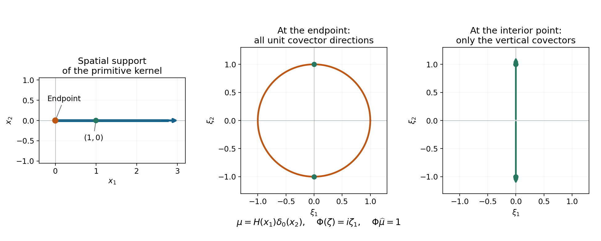
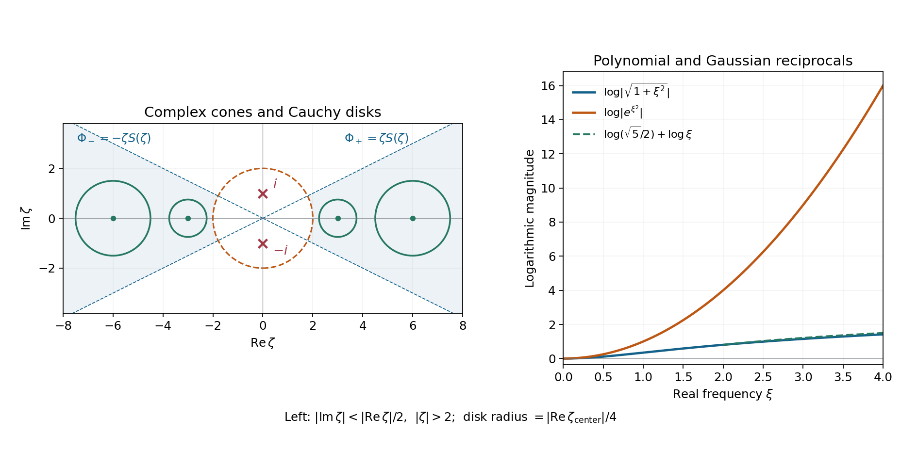

# Holomorphic reciprocals and convolution regularity

*Written by GPT-6.1 Sol (OpenAI), October 2026. Self-checked by the writing AI. Original exposition, examples and solutions: CC0.*

Convolution can erase singularities. A Gaussian turns a point mass into an analytic function. A primitive behaves differently: differentiating it recovers its input. A general microlocal version of this recovery is possible when the kernel's Fourier transform admits a holomorphic reciprocal with polynomial growth in a complex cone at infinity.

Read Pulling back and combining analytic singularities, Section 2, for analytic-wavefront localization; Analytic directions of holomorphic boundary values, Lemma 1.1, for controlled cutoffs; and [Schwartz functions and Fourier inversion](../prerequisites/schwartz-fourier-foundations.html), Sections F1-F5, for the Fourier conventions. The [complete proof](../AN02-L195.html#complete-proof) supplies the analytic multiplier estimate and the convolution theorem.

## 1. A reciprocal in the required frequency neighborhood

Let \(\mu\in\mathcal S'(\mathbb R^n)\). A nonzero real direction \(\xi_0\) is outside its convolution characteristic set if a holomorphic function \(\Phi\) exists on a complex conic neighborhood of that direction above some radius, with
\[
 |\Phi(\zeta)|\le C(1+|\zeta|)^m,\qquad
              \Phi\,\widehat\mu=1
              \quad\hbox{on the real high-frequency cone}.
 \tag{CL1}
\]
The product identity is distributional. The Fourier transform \(\widehat\mu\) need not be a function, and \(\Phi\) may vanish on real frequencies. What matters is the stated identity and the bound on a complex neighborhood. Denote the remaining nonzero directions by \(\operatorname{Char}\mu\).

For every compactly supported distribution \(v\), Theorem 4.1 of the full proof gives
\[
 \operatorname{WF}_A(v)
 \subset\operatorname{WF}_A(\mu*v)
       \cup(\mathbb R^n\times\operatorname{Char}\mu).
 \tag{CL2}
\]
Thus analyticity of the output at a point and an allowed direction forces analyticity of the input there in that direction. Theorem 2.1 establishes the analytic multiplier estimate used to prove this assertion.

The same inclusion holds for an arbitrary distribution \(v\) if addition is proper on the two supports. Properness means that the input pairs contributing to a compact output set form a compact set. The full proof, Corollary 4.2, then uses a compact input cutoff separately near each output neighborhood. It imposes no growth bound on \(v\).

## 2. The derivative budget behind analytic regularity

The reciprocal's holomorphic polynomial bound gives Cauchy estimates
\[
 \frac{|\partial^\alpha\Phi(\xi)|}{\alpha!}
     \le C^{|\alpha|+1}|\xi|^{m-|\alpha|}.
 \tag{CL3}
\]
A finite Taylor expansion separates the multiplier into local products with cutoff derivatives and a remainder. The local products use the analytic regularity of the output. The remainder is bounded in the fixed tempered seminorm of that output.

Choose the expansion index \(K=N+B\), where \(B\) is a fixed loss depending on the distributional order, symbol order and dimension. A cutoff with controlled derivatives through \(4K\) covers every derivative in the expansion and remainder. Its fixed low derivatives remain uniformly bounded, so the localized output distributions have a common order.

An apparently extra factor \(K^{|\alpha|}\) from a cutoff derivative is accompanied by \(|\xi|^{-|\alpha|}\) from the Taylor coefficient. In the region \(|\xi|\ge K\) this quotient is harmless. The remaining fixed shift satisfies
\[
 (N+B)^{N+B+c}\le C_{B,c}^{N+1}N^N.
 \tag{CL4}
\]
It therefore retains the single analytic factorial scale. Bounded frequencies use the common compact distributional estimate.

After multiplying the convolution equation by this localized reciprocal, the error has no Fourier transform in a smaller cone at infinity. Lemma 3.1 proves that such a Fourier gap is analytically regular in its interior directions, at every base point. This completes the recovery of the input's analytic regularity.

## 3. Four examples

### Example 1: a primitive with a noncompact kernel

Let \(\mu=H\), the Heaviside function on the line. With \(\widehat f(\xi)=\int e^{-ix\xi}f(x)\,dx\), its transform is
\[
 \widehat H=\pi\delta_0-i\,\operatorname{pv}(1/\xi),
 \qquad i\xi\,\widehat H=1.
 \tag{CL5}
\]
For a direct derivation, damp \(H\) by \(e^{-\epsilon x}\). Its transform is
\((\epsilon+i\xi)^{-1}=-i(\xi-i\epsilon)^{-1}\).
The lower boundary formula of Cauchy kernels and distributional boundary limits, Theorem 4.1, gives (CL5) as \(\epsilon\downarrow0\). The damping converges in tempered distributions by dominated convergence on Schwartz tests. Multiplication by \(\xi\) kills the point term and changes the principal value into one.

The reciprocal \(\Phi(\zeta)=i\zeta\) is entire and polynomially bounded. Both real rays are allowed, so \(\operatorname{Char}H=\varnothing\). For example, if
\[
 v=\delta_0-2\delta_1+\delta_3,
 \qquad g=H*v=H(x)-2H(x-1)+H(x-3),
 \tag{CL6}
\]
then \(g\) has values \(0,1,-1,0\) on the four intervals cut out by \(0,1,3\), and \(\partial_xg=v\). Both analytic covector signs occur at every jump. At the interior jump one may subtract its analytic constant value on the adjacent interval and apply the support-normal theorem locally. The kernel is noncompact, although this particular output is compactly supported.

### Example 2: a reciprocal that vanishes on an allowed direction

On the plane put
\[
 \mu(x_1,x_2)=H(x_1)\delta_0(x_2),\qquad
                   \Phi(\zeta)=i\zeta_1.
 \tag{CL7}
\]
Its transform is \((\pi\delta_0(\xi_1)-i\operatorname{pv}(1/\xi_1))\otimes1\). Multiplication gives \(\Phi\widehat\mu=1\) on the whole real frequency plane. Hence \(\operatorname{Char}\mu=\varnothing\), even in the directions \((0,\pm1)\), where \(\Phi\) itself is zero.

For \(v=\delta_{(0,0)}\), the output is \(\mu\). At the origin every nonzero covector belongs to \(\operatorname{WF}_A(v)\), by the support-normal theorem for an isolated support point. The convolution theorem therefore puts every one of them in \(\operatorname{WF}_A(\mu)\). At an interior point \((a,0)\), \(a>0\), the distribution is locally \(1\otimes\delta_0\), so the tensor rule and signed support normals give exactly
\[
 \operatorname{WF}_A(\mu)=
 \{(0,0;\xi_1,\xi_2):(\xi_1,\xi_2)\ne0\}
 \ \cup\
 \{(a,0;0,\xi_2):a>0,\ \xi_2\ne0\}.
 \tag{CL8}
\]
Outside this half-line support the kernel vanishes. This example requires the distributional product interpretation in (CL1).

*Figure 1.* Left: the exact spatial support \(\{x_1\ge0,x_2=0\}\) of \(H(x_1)\delta_0(x_2)\); the marked interior point is \((1,0)\). Middle: the full unit covector circle at the origin. Right: the two unit directions of the vertical covector line at \((1,0)\). The last two panels are cotangent fibers, with axes \((\xi_1,\xi_2)\), rather than spatial regions. The reciprocal \(i\zeta_1\) vanishes on both vertical directions, yet its distributional product with the kernel transform is one. Equation (CL8), the tensor rule and Theorem 4.1 prove the stated fibers.

### Example 3: a square-root reciprocal

Define a tempered kernel by
\[
 \widehat\mu(\xi)=(1+\xi^2)^{-1/2}.
 \tag{CL9}
\]
The bounded smooth function on the right defines a tempered distribution, so Fourier inversion defines \(\mu\). For \(|\zeta|>2\), set
\[
 S(\zeta)=\exp\!\left(\frac12\log(1+\zeta^{-2})\right),
 \qquad
 \Phi_+(\zeta)=\zeta S(\zeta),\quad
 \Phi_-(\zeta)=-\zeta S(\zeta).
 \tag{CL10}
\]
Here \(\log(1+w)=\sum_{k\ge1}(-1)^{k+1}w^k/k\) for \(|w|<1\). The convergent series gives \(S^2=1+\zeta^{-2}\). Choose the plus branch in the cone about the positive real ray and the minus branch about the negative ray. On each real ray the resulting value is the positive square root of \(1+\xi^2\), so (CL1) holds.

Since \(|\zeta^{-2}|<1/4\),
\[
 \frac{\sqrt3}{2}|\zeta|
       \le|\Phi_\pm(\zeta)|
       \le\frac{\sqrt5}{2}|\zeta|.
 \tag{CL11}
\]
Both rays are therefore outside \(\operatorname{Char}\mu\). These reciprocals are not polynomials: a polynomial whose square is \(1+\zeta^2\) would have degree one, but its leading, cross and constant coefficients cannot satisfy all three required identities.

The direct multiplier \((1+\xi^2)^{-1/2}\) also has a holomorphic polynomial bound in those cones. Its \(k\)-th real derivative has the form \(P_k(\xi)(1+\xi^2)^{-k-1/2}\), with \(\deg P_k\le k\): differentiation gives
\(P_{k+1}=(1+\xi^2)P_k'-(2k+1)\xi P_k\), starting from \(P_0=1\). Thus its fixed-order symbol estimates also hold. Theorem 2.1 applied to \(\delta_0\) gives \(\operatorname{WF}_A(\mu)\subset\operatorname{WF}_A(\delta_0)\). The reciprocal theorem with \(v=\delta_0\) gives the reverse inclusion. Thus its analytic wavefront is exactly both nonzero rays over the origin.

### Example 4: the Gaussian does erase the point singularity

Take
\[
 \mu(x)=(4\pi)^{-1/2}e^{-x^2/4},
 \qquad \widehat\mu(\xi)=e^{-\xi^2}.
 \tag{CL12}
\]
The Gaussian Fourier constant is proved in the linked Fourier foundation. Any holomorphic reciprocal near a real high-frequency ray must equal \(e^{\zeta^2}\) there: the product identity holds between functions, and the holomorphic identity theorem extends it locally. Already on the real ray its magnitude \(e^{\xi^2}\) exceeds every polynomial. Consequently every nonzero direction lies in \(\operatorname{Char}\mu\).

With \(v=\delta_0\), the output \(\mu*v=\mu\) is analytic everywhere while the input has both analytic singular directions at zero. The polynomial bound in (CL1) excludes precisely this attempted recovery.

*Figure 2.* Left: the complex cones \(|\operatorname{Im}\zeta|<|\operatorname{Re}\zeta|/2\), outside the dashed circle \(|\zeta|=2\). The points \(\pm i\), marked by crosses, are the square-root branch points. The displayed Cauchy disks have centers \(\pm3,\pm6\) and radii \(3/4,3/2\), respectively; each lies inside the corresponding cone and outside the circle. Different signs in (CL10) give the positive real reciprocal on the two rays. Right: the exact logarithmic magnitudes \(\tfrac12\log(1+\xi^2)\) and \(\xi^2\) on the positive real axis. The dashed bound for \(\xi\ge2\) is \(\log(\sqrt5/2)+\log\xi\). Equations (CL10)–(CL12) prove the bounds and the failure for the Gaussian; the plotted interval illustrates those statements.

## 4. Exercises

1. **A causal primitive, 10 points.** Derive (CL5) with its signs and point term. Compute all four interval values and every jump of the output in (CL6).
2. **A distribution-valued transform, 12 points.** Prove that the kernel in (CL7) has empty convolution characteristic set, including the vertical frequency directions. Prove the exact analytic wavefront formula (CL8).
3. **Two square-root branches, 12 points.** Justify holomorphy, real-ray agreement and both bounds in (CL11). Prove that neither reciprocal is polynomial.
4. **The Gaussian obstruction, 12 points.** Prove \(\operatorname{Char}\mu=\mathbb R\setminus\{0\}\) for (CL12), and explain the convolution theorem at \(v=\delta_0\).
5. **Real-axis bounds are insufficient, 14 points.** Let \(\mu=\delta_h\) on the line, \(h\ne0\). Its real-axis reciprocal has magnitude one. Determine its convolution characteristic set under (CL1), and compare \(v=\delta_0\) with \(\mu*v\).
6. **The Taylor factor of \(i\), 12 points.** Verify (CE12) in one dimension. For \(a(\xi)=\xi^3\), express \(\widehat{\chi D^3f}\) in terms of the Fourier transforms of \(\chi f,\chi'f,\chi''f,\chi'''f\), with \(D=-i\partial\).
7. **One analytic scale, 14 points.** Track the largest cutoff derivative orders in the local products and the far Taylor polynomial terms when \(|\alpha|<K\). Explain why one fixed shift and \(J=4K\) suffice. Prove (CL4) for arbitrary fixed nonnegative integers \(B,c\).
8. **An input with arbitrary growth, 14 points.** Let \(\mu=H\) and \(v=H(x)e^{x^3}\). Prove properness, compute their convolution, and apply Corollary 4.2. Give the compact localization needed for outputs in \((-1,2)\), and prove that \(v\) is not tempered.

## 5. Complete solutions

### Solution 1

For \(\epsilon>0\), direct integration gives
\[
 \mathcal F(H e^{-\epsilon x})(\xi)
        =\int_0^\infty e^{-(\epsilon+i\xi)x}\,dx
        =-i(\xi-i\epsilon)^{-1}.
 \tag{CF1}
\]
The lower boundary formula is
\((\xi-i0)^{-1}=\operatorname{pv}(1/\xi)+i\pi\delta_0\).
Multiplication by \(-i\) gives (CL5). The convergence of \(H e^{-\epsilon x}\) to \(H\) on Schwartz tests follows from domination by the integrable absolute value of the test on the positive half-line. Fourier continuity passes this limit to the transforms. The identities \(\xi\delta_0=0\) and \(\xi\operatorname{pv}(1/\xi)=1\) give \(i\xi\widehat H=1\).

The intervals in (CL6) have values \(0\) for \(x<0\), \(1\) for \(0<x<1\), \(-1\) for \(1<x<3\), and \(0\) for \(x>3\). The jumps at \(0,1,3\) are \(1,-2,1\). The distributional derivative is therefore \(\delta_0-2\delta_1+\delta_3\). Values chosen exactly at the three endpoints do not change the associated distribution.

### Solution 2

The Fourier tensor identity gives
\[
 \widehat\mu=
  \bigl(\pi\delta_0(\xi_1)-i\operatorname{pv}(1/\xi_1)\bigr)
       \otimes1.
 \tag{CF2}
\]
Multiplication by \(i\xi_1\) gives \(1\otimes1\). The entire function \(i\zeta_1\) obeys \(|i\zeta_1|\le|\zeta|\) on every complex cone. The reciprocal criterion thus holds near every nonzero real frequency, including \(\xi_1=0\). A zero value of the multiplier on that hyperplane does not invalidate its product with the distributional principal value.

The point-mass input has every nonzero covector at the origin; Theorem 4.1 gives their presence in the output. For \(a>0\), the kernel is locally \(1\otimes\delta_0\). Analytic tensor estimates give only covectors \((0,\xi_2)\), and the supporting function \(x_2\), zero on its support, supplies both vertical signs. Off the half-line the kernel is zero. These three cases give (CL8).

### Solution 3

The logarithm series converges normally for \(|w|<1\), so its composition with \(\zeta^{-2}\), followed by the exponential, is holomorphic for \(|\zeta|>2\). Differentiating the logarithm series gives \((1+w)^{-1}\); hence \(\exp(\log(1+w))=1+w\), by differentiating their quotient and evaluating at zero. Thus \(S^2=1+\zeta^{-2}\). On the real rays the series is real and \(S\) is positive, giving the branch signs in (CL10).

For \(|\zeta|>2\), \(3/4<|1+\zeta^{-2}|<5/4\). Since \(|S|^2=|S^2|\), multiplication by \(|\zeta|\) gives (CL11). If a polynomial \(p=a\zeta+b\) had square \(1+\zeta^2\), coefficient comparison would require \(a^2=1\), \(2ab=0\), \(b^2=1\). The first and third make \(a,b\ne0\), contradicting the middle condition. Higher or lower polynomial degrees cannot have the required square degree. Agreement of a polynomial with either branch on an open set would force this same identity.

### Solution 4

On either real ray a reciprocal must satisfy \(\Phi(\xi)e^{-\xi^2}=1\). Both factors are analytic functions there, so \(\Phi(\xi)=e^{\xi^2}\). For every fixed \(m\), the positive exponential series gives \(e^{\xi^2}\ge|\xi|^{2k}/k!\) for any integer \(k\). Choose \(2k>m\); its ratio to \((1+|\xi|)^m\) is unbounded. No polynomial bound is possible on either ray, even before considering complex frequencies.

Therefore every nonzero direction is characteristic for this kernel. The output for a point mass is the analytic Gaussian, so its analytic wavefront is empty. Formula (CL2) places the point mass's singularities in the characteristic term, exactly as required.

### Solution 5

The transform of \(\delta_h\) is \(e^{-ih\xi}\). A reciprocal agreeing on a real interval must be \(e^{ih\zeta}\) on its local complex neighborhood, by the identity theorem. Every complex conic neighborhood of a real ray contains, for all sufficiently large real \(\xi\) in that ray, points
\[
 \zeta=\xi-i\,\operatorname{sgn}(h)d|\xi|
 \tag{CF3}
\]
with one fixed small \(d>0\). At these points \(|e^{ih\zeta}|=e^{|h|d|\xi|}\), which exceeds every polynomial. The real-axis bound of one therefore does not satisfy (CL1). Both rays are characteristic.

The point-mass input at zero is sent to the point mass at \(h\). The output is zero and hence analytic near zero, while the input is singular there. A rule using only a bounded real reciprocal would wrongly infer regularity at the unchanged base point. The complex polynomial condition correctly excludes this translation multiplier.

### Solution 6

The Fourier derivative rule gives
\(\widehat{\chi^{(\alpha)}}(\xi-\eta)
=i^\alpha(\xi-\eta)^\alpha\widehat\chi(\xi-\eta)\).
Since \((\eta-\xi)^\alpha=(-1)^\alpha(\xi-\eta)^\alpha\) and \((-1)/i=i\), the convolution pairing in (CE12) equals \(i^\alpha\widehat{\chi^{(\alpha)}f}(\xi)\).

The exact cubic Taylor formula now yields
\[
 \widehat{\chi D^3f}(\xi)
  =\xi^3\widehat{\chi f}(\xi)
    +3i\xi^2\widehat{\chi'f}(\xi)
    -3\xi\widehat{\chi''f}(\xi)
    -i\widehat{\chi'''f}(\xi).
 \tag{CF4}
\]
The coefficients are \(1,3,3,1\) before the successive powers \(1,i,-1,-i\). This identity can also be checked by the distributional product rule for \(D=-i\partial\).

### Solution 7

For a local product with \(|\alpha|<K\), its Fourier integration-by-parts order is \(s=K+q+n+1\), up to a fixed loss. The cutoff derivative order is \(|\alpha|+s\le2K+q+n\), up to that same fixed loss. In a far Taylor term the cutoff itself is undifferentiated before the Fourier moment estimate; its moment order is \(K+|\alpha|+q_1+c\le2K+q_1+c-1\). Derivatives from the fixed tempered seminorm add only fixed losses. A fixed shift makes \(K=N+B\) exceed all these losses, and \(4K\) then covers every required order. The high cutoff derivative contributes \(K^{|\alpha|}\), accompanied by \(|\xi|^{-|\alpha|}\); for \(|\xi|\ge K\) this creates no second analytic factorial scale.

For (CL4), divide the left side by \(N^N\):
\[
 \frac{(N+B)^{N+B+c}}{N^N}
   =(1+B/N)^N(N+B)^{B+c}
   \le e^B(N+B)^{B+c}.
 \tag{CF5}
\]
For \(N\ge1\), \(N+B\le(B+1)N\) and \(N\le2^N\). The last expression is at most
\(e^B(B+1)^{B+c}2^{(B+c)N}\), which is bounded by a fixed constant to the \(N+1\) power. This proves the estimate for all \(N\ge1\).

### Solution 8

Both supports are \([0,\infty)\). Pairs with sum in a compact output set satisfy \(0\le s,t\le\max(0,\sup O)\); the relevant closed subset of this bounded square is compact. Addition is proper.

For \(x>0\), the convolution is the ordinary finite integral, while for \(x<0\) it vanishes:
\[
 g(x)=H(x)\int_0^x e^{t^3}\,dt,\qquad
                 \partial_xg=H(x)e^{x^3}=v.
 \tag{CF6}
\]
There is no extra point mass in the derivative because the integral is zero at the origin. Both \(v\) and \(g\) are analytic off zero. They have support \([0,\infty)\); the signed support-normal theorem supplies both analytic rays at zero. Since \(\operatorname{Char}H=\varnothing\), Corollary 4.2 gives the asserted inclusion and, here, equality.

For outputs in \((-1,2)\), all contributing input times lie in \([0,2]\). Choose a smooth compact cutoff equal to one on a neighborhood of \([-1,2]\). Then \(v_c=\chi v\) agrees with \(v\) in that output interval and \(H*v_c=g\) there. This is the actual compact-input reduction.

To disprove temperedness of \(v\), take a fixed nonnegative compact bump \(\phi\) supported in \([0,1]\) with positive integral and translate it to \([R,R+1]\). Its pairing with \(v\) is at least \(e^{R^3}\int\phi\), while every fixed Schwartz seminorm of the translated bump grows at most polynomially in \(R\). No tempered distribution estimate can hold. The proper-support theorem nevertheless applies because it is local in the contributing input pairs.

## References

Lars Hörmander, *The Analysis of Linear Partial Differential Operators I*, Theorem 8.6.15 and the proper-convolution remark, gives the classical context. The complete proof supplies the analytic multiplier estimate by finite Taylor expansion, Cauchy bounds and controlled cutoff moments. Its exact Fourier, cutoff and convolution dependencies are stated there; the examples and solutions above retain the same transform and derivative conventions.

## Complete proof

A convolution equation can be inverted microlocally when its Fourier transform has a holomorphic reciprocal with polynomial growth on a complex cone at infinity. The Fourier transform of the kernel may itself be a distribution. The reciprocal identity below is consequently an identity of distributions on the real cone; no pointwise reciprocal of a globally defined function is assumed.

The analytic sequence criterion and localization rules are the available proofs in [Pulling back and combining analytic singularities][P], Section 2. The mixed derivative cutoff bounds are Lemma 1.1 of [Analytic directions of holomorphic boundary values][A]. [Schwartz functions and Fourier inversion][F], Sections F1-F5, supplies the Fourier seminorms, inversion and distributional transpose. The local holomorphic coefficient bounds are the Cauchy estimates in [Cauchy bounds and root counts][C]. [Proper convolution and compact support][U] supplies the tensor pairing and proper support integral. We prove the required microlocal multiplier estimate here rather than assume an analytic pseudodifferential calculus.

## 1. Cutoff estimates with a growing derivative

Fix relatively compact neighborhoods \(U_0\Subset U_1\). The controlled cutoff construction supplies \(\chi_J\in C_c^\infty(U_1)\), equal to one near \(\overline U_0\), whose fixed-order derivative seminorms are bounded independently of \(J\). For each fixed multi-index \(\beta\),
\[
 |D^{\alpha+\beta}\chi_J|
       \le C_\beta^{|\alpha|+1}J^{|\alpha|},
 \qquad |\alpha|\le J.
 \tag{CE1}
\]
All cutoffs have support in the same compact set. Constants may change after the neighborhoods are fixed. They never depend on \(J\) or the growing index.

For every fixed \(\beta\), compact support and integration by parts give
\[
 |\partial_\zeta^\beta\widehat{\partial^\alpha\chi_J}(\zeta)|
 \le C_\beta^{|\alpha|+s+1}J^{|\alpha|+s}
             (1+|\zeta|)^{-s},
 \qquad |\alpha|+s+c_\beta\le J.
 \tag{CE2}
\]
Here \(c_\beta\) is a fixed integer. To check the index, differentiation in \(\zeta\) inserts \(x^\beta\); multiplication by a monomial \(\zeta^\gamma\), \(|\gamma|\le s\), differentiates \(x^\beta\partial^\alpha\chi_J\) at most \(s\) times. The finite product rule uses cutoff derivatives through \(|\alpha|+s\), with only a fixed additional order if a low derivative is kept separate. For \(|\zeta|\ge1\), choose a coordinate with \(|\zeta_j|\ge|\zeta|/\sqrt n\) and integrate by parts \(s\) times in it. On \(|\zeta|\le1\), use the compact \(L^1\) bound. Powers and the finitely many product coefficients are absorbed into the exponential constant in (CE2). This proves the estimate without a second growing factorial.

**Lemma 1.1.** Suppose \(f_K\) have common compact support and distributional order, and for an open real cone \(\Omega\),
\[
 |\widehat f_K(\eta)|\le B(1+|\eta|)^q,\qquad
 |\widehat f_K(\eta)|\le A^{K+1}K^K(1+|\eta|)^{-K}
       \quad(\eta\in\Omega).
 \tag{CE3}
\]
On a fixed smaller cone \(\Omega_0\), for \(J=4K\), \(|\alpha|<K\), and sufficiently large \(K\),
\[
 \left|\widehat{(\partial^\alpha\chi_J)f_K}(\xi)\right|
  \le C^{K+|\alpha|+1}K^{K+|\alpha|+c}
                   (1+|\xi|)^{-K}.
 \tag{CE4}
\]
The fixed integer \(c\) depends on the common polynomial order and dimension.

**Proof.** Use the Fourier convolution formula. In the region
\(|\eta-\xi|\le d|\xi|\), choose \(d>0\) so small that \(\eta\in\Omega\) and \(1+|\eta|\) is comparable to \(1+|\xi|\). The analytic bound in (CE3) applies. The \(L^1\) norm of the cutoff transform in (CE2), with a fixed exponent larger than \(n\), is at most \(C^{|\alpha|+1}K^{|\alpha|+c}\). This proves the contribution claimed in (CE4).

In the remaining region, \(|\xi-\eta|\) is bounded below by a fixed positive multiple of both \(|\xi|\) and \(|\eta|\), with an inessential adjustment for bounded frequencies. More precisely their sum is at most a fixed multiple of \(|\xi-\eta|\), since \(|\xi-\eta|>d|\xi|\) and \(|\eta|\le|\xi-\eta|+|\xi|\). Use the global polynomial bound in (CE3) and (CE2) with \(s=K+q+n+1\). The integral is bounded by a constant to the \(K+|\alpha|+1\) power times
\(K^{K+|\alpha|+q+n+1}(1+|\xi|)^{-K}\).
All derivative orders are below \(2K+q+n+1\), hence below \(4K\) for sufficiently large \(K\). A fixed shift handles the finitely many smaller \(K\). This proves the lemma. \(\square\)

## 2. An analytic symbol is microlocally local

Let \(a\in C^\infty(\mathbb R^n)\) satisfy the symbol estimates
\[
 |\partial^\beta a(\eta)|
       \le C_\beta(1+|\eta|)^{m-|\beta|}
       \quad\hbox{for every fixed }\beta,
 \tag{CE5}
\]
where \(m\ge0\) is an integer. Assume that for \(\xi\) in an open cone \(\Gamma\), at sufficiently large radius, \(a\) extends holomorphically to balls of radius \(d|\xi|\) and is bounded there by \(C(1+|\xi|)^m\), with one \(d>0\). The Cauchy formula on smaller polydisks gives
\[
 \frac{|\partial^\alpha a(\xi)|}{\alpha!}
       \le C^{|\alpha|+1}|\xi|^{m-|\alpha|}.
 \tag{CE6}
\]
The smooth extension elsewhere has no analyticity requirement.

Define \(T_af=\mathcal F^{-1}(a\widehat f)\) on tempered distributions. Estimates (CE5) make multiplication by \(a\) a continuous map on Schwartz tests, so this definition is meaningful.

**Theorem 2.1.** For every \(f\in\mathcal S'\),
\[
 \operatorname{WF}_A(T_af)\cap(\mathbb R^n\times\Gamma)
       \subset\operatorname{WF}_A(f).
 \tag{CE7}
\]
Only directions with the stipulated uniform holomorphic neighborhoods are included.

**Proof.** Fix \((x_0,\xi_0)\notin\operatorname{WF}_A(f)\) with \(\xi_0\in\Gamma\). Take a smaller cone about \(\xi_0\) whose closure stays in both the analytic absence cone and the symbol's holomorphic cone. Choose neighborhoods \(U_0\Subset U_1\) on which a bounded analytic witness sequence \(f_K\) equals \(f\). The witnesses satisfy (CE3) on a larger cone than the one of output directions. Choose the cutoff supports inside \(U_1\).

There are fixed \(M,q_1\) such that the tempered transform of \(f\) satisfies
\[
 |\widehat f(\psi)|
   \le C\max_{|\beta|\le M}\sup_\eta
                    (1+|\eta|)^{q_1}|\partial^\beta\psi(\eta)|.
 \tag{CE8}
\]
Choose a fixed large integer \(B>m+q_1\), also exceeding all the fixed derivative-order losses in (CE2)–(CE4) and the estimates below, and put
\[
 K=N+B,\qquad J=4K,\qquad v_N=\chi_JT_af.
 \tag{CE9}
\]
All those losses depend only on \(m,M,q,q_1,n\) and the fixed cutoff family, not on \(B\) or \(N\), so this is one finite choice. These \(v_N\) have common compact support, common finite distributional order and equal \(T_af\) near \(x_0\). The uniform low derivative bounds on the cutoffs justify that assertion. We will prove their analytic Fourier estimate.

First consider \(|\xi|\ge K\) in the smaller output cone. Set
\[
 P_\xi(\eta)=
       \sum_{|\alpha|<K}
          \frac{\partial^\alpha a(\xi)}{\alpha!}(\eta-\xi)^\alpha,
 \qquad R_\xi(\eta)=a(\eta)-P_\xi(\eta).
 \tag{CE10}
\]
The Fourier pairing for \(v_N\) is
\[
 \widehat v_N(\xi)
   =(2\pi)^{-n}\widehat f_\eta
          \bigl(a(\eta)\widehat\chi_J(\xi-\eta)\bigr).
 \tag{CE11}
\]
All tests here are Schwartz functions, since \(a\) has polynomial symbol bounds.

**The polynomial part.** Each Taylor monomial has the exact pairing identity
\[
 (2\pi)^{-n}\widehat f_\eta
       \bigl((\eta-\xi)^\alpha\widehat\chi_J(\xi-\eta)\bigr)
       =i^{|\alpha|}\widehat{(\partial^\alpha\chi_J)f}(\xi).
 \tag{CE12}
\]
This follows from \(\widehat{\partial^\alpha\chi_J}(\xi-\eta)
=i^{|\alpha|}(\xi-\eta)^\alpha\widehat\chi_J(\xi-\eta)\) and the Fourier convolution formula. The factor \(i^{|\alpha|}\) on the right of (CE12) includes the sign from \(\eta-\xi\).

The local product in (CE12) equals the one with \(f_K\). Equations (CE4) and (CE6) therefore bound the sum by
\[
 C^{K+1}K^{K+c}|\xi|^{m-K}
       \sum_{|\alpha|<K}
                 C^{|\alpha|}(K/|\xi|)^{|\alpha|}
 \le C_1^{K+1}K^{K+c}|\xi|^{m-K}.
 \tag{CE13}
\]
For the last bound, \(K/|\xi|\le1\), the number of multi-indices of each degree is polynomial in \(K\), and a fixed polynomial is absorbed into \(C_1^{K+1}\). No factorial remains from the Taylor coefficients.

**The remainder near the diagonal.** Choose a smooth cutoff in \(h/|\xi|\), where \(h=\eta-\xi\), supported on \(|h|\le2d_0|\xi|\) and one on \(|h|\le d_0|\xi|\). Here \(d_0\) is fixed small enough that the entire larger ball lies in a uniform holomorphic neighborhood and inside its smaller Cauchy radius. The Taylor series and (CE6), differentiated only through the fixed order \(M\), give
\[
 |\partial_\eta^\beta R_\xi(\eta)|
       \le C^{K+1}K^M|\xi|^{m-K}
                         |h|^{K-|\beta|},
 \quad |\beta|\le M,\quad |h|\le2d_0|\xi|.
 \tag{CE14}
\]
To see the uniform tail explicitly, differentiation replaces the coefficients of degree \(\ell\ge K\) by fixed-degree polynomials in \(\ell\), while \(|h|/(d|\xi|)\) stays below a fixed number less than one. The remaining geometric tail is at most \(C^{K+1}K^M\) times its first power. Since \(K>M\), the indicated exponents are nonnegative.

Apply (CE8) after differentiating the product of this near cutoff, \(R_\xi\), and \(\widehat\chi_J(\xi-\eta)\). On this region \(1+|\eta|\le C|\xi|\). Derivatives of the near cutoff cost only fixed powers of \(|\xi|^{-1}\). Estimate (CE2), with moment order at most \(K+c\) and a fixed Fourier derivative, bounds each remaining product of \(|h|^{K-|\beta|}\) and a cutoff-transform derivative by \(C^{K+1}K^{K+c}\). Thus this part of the remainder pairing is at most
\[
 C^{K+1}K^{K+c}|\xi|^{m+q_1-K}.
 \tag{CE15}
\]
Here and below the fixed integer \(c\) may increase; it depends only on the fixed seminorm orders and dimension. Our choice of \(B\) covers all such orders.

**The remainder away from the diagonal.** On the far region,
\[
 |\eta-\xi|\ge d_0|\xi|,
 \qquad 1+|\eta|\le C(1+|\eta-\xi|).
 \tag{CE16}
\]
For the \(a(\eta)\) part use (CE5) through order \(M\), the weight in (CE8), and (CE2) with \(s=K+m+q_1+c\). This gives \(C^{K+1}K^{K+c}|\xi|^{-K}\), after a fixed increase of \(c\).

For each Taylor polynomial term of degree \(|\alpha|<K\), use (CE2) with \(s=K+|\alpha|+q_1+c\). Differentiating that polynomial through order \(M\) costs at most a fixed-degree polynomial in \(K\). Equation (CE6) then gives, with (CE16), a bound by
\[
 C^{K+|\alpha|+1}K^{K+c}|\xi|^{m-K}
                      (K/|\xi|)^{|\alpha|}.
 \tag{CE17}
\]
All cutoff derivative orders used are below \(2K+c\), hence below \(J=4K\). Summing the finitely many terms as in (CE13) proves the same bound, up to increasing the exponential constant. Equations (CE15)–(CE17) bound the entire remainder by the right side of (CE15), since \(m,q_1\ge0\).

Combine the polynomial and remainder estimates. Since \(K=N+B\), \(B>m+q_1\), and
\[
 (N+B)^{N+B+c}\le C_B^{N+1}N^N,
 \tag{CE18}
\]
we obtain
\[
 |\widehat v_N(\xi)|
       \le C^{N+1}N^N(1+|\xi|)^{-N}
       \quad(|\xi|\ge K).
 \tag{CE19}
\]
To justify (CE18), divide by \(N^N\), use
\((1+B/N)^N\le e^B\), and absorb the fixed power
\((N+B)^{B+c}\) into a fixed exponential. Replacing \(|\xi|^{-N}\) by \((1+|\xi|)^{-N}\) costs at most \(2^N\).

For \(|\xi|<K\), the common compact distributional bound gives a fixed polynomial bound for \(\widehat v_N\). Increasing \(C\) makes (CE19) hold there too, because \(K=N+B\), \(N/(N+B)\) has its \(N\)-th power bounded below by a positive constant depending only on \(B\), and a fixed polynomial in \(N+B\) is bounded by a fixed exponential. Thus \(v_N\) is an analytic absence sequence at the chosen point and direction. This proves (CE7). \(\square\)

## 3. A Fourier gap is analytically regular in its interior cone

**Lemma 3.1.** Let \(r\in\mathcal S'\). If \(\widehat r\) vanishes on an open real cone above some radius, then \(r\) has no analytic wavefront in any strictly smaller cone, at any base point.

**Proof.** Choose a smooth frequency cutoff \(b\) equal to one on a neighborhood of \(\operatorname{supp}\widehat r\), zero on a smaller high-frequency cone, and with symbol bounds of order zero. This is possible by angular cutoffs and a cutoff equal to one in a large ball. Then \(\widehat r=b\widehat r\). For \(\xi\) in the still smaller output cone and sufficiently large, every \(\eta\) in the support of \(b\) satisfies
\[
 1+|\xi-\eta|\ge c(1+|\xi|+|\eta|).
 \tag{CE20}
\]
Apply a fixed tempered seminorm estimate for \(\widehat r\) to
\(b(\eta)\widehat\chi_J(\xi-\eta)\). Equation (CE2), with \(s=N+c\), absorbs its fixed weight and derivatives and gives \(C^{N+1}N^N(1+|\xi|)^{-N}\). Use a fixed sufficiently large multiple of \(N+c\) for \(J\), so every required derivative is allowed and the low cutoff derivatives remain uniform. Bounded \(\xi\) are handled by the common compact distributional bound as at the end of Theorem 2.1. The localizations \(\chi_Jr\) are the required sequence. The base neighborhood was arbitrary. \(\square\)

## 4. The reciprocal criterion for a convolution kernel

Let \(\mu\in\mathcal S'(\mathbb R^n)\). Call a real nonzero direction \(\xi_0\) noncharacteristic for \(\mu\) if there are a complex open conic neighborhood \(V\) of \(\xi_0\), a radius \(R\), and a holomorphic \(\Phi\) on \(V\cap\{|\zeta|>R\}\) such that
\[
 |\Phi(\zeta)|\le C(1+|\zeta|)^m,\qquad
 \Phi\,\widehat\mu=1
       \quad\hbox{on }V\cap\mathbb R^n\cap\{|\xi|>R\}.
 \tag{CE21}
\]
Here \(m\) may be enlarged to a nonnegative integer. The second identity means multiplication of a distribution by the smooth real restriction of \(\Phi\). Let \(\operatorname{Char}\mu\) be the complement of these directions in the nonzero real frequency space.

**Theorem 4.1.** For every \(v\in\mathcal E'(\mathbb R^n)\),
\[
 \operatorname{WF}_A(v)
   \subset\operatorname{WF}_A(\mu*v)
                \cup(\mathbb R^n\times\operatorname{Char}\mu).
 \tag{CE22}
\]

**Proof.** Compact support of \(v\) and temperedness of \(\mu\) give \(g=\mu*v\in\mathcal S'\) and
\(\widehat g=\widehat\mu\,\widehat v\). Here is the required test argument. For \(\phi\in\mathcal S\), the function
\(x\mapsto v_y(\phi(x+y))\) is Schwartz. Insert a fixed compact cutoff in \(y\); the finite order of \(v\) bounds its derivatives by finitely many derivatives of \(\phi\). Its weights are controlled by \(1+|x|\le C(1+|x+y|)\) for \(y\) in that compact set. These are continuous Schwartz seminorm bounds, and pairing the result with \(\mu\) defines \(g\in\mathcal S'\), agreeing with the proper convolution integral.

Every fixed derivative of \(\widehat v\) has at most the same polynomial order on real frequencies, with a constant depending on that derivative. Indeed it inserts a power of \(y\) on a fixed compact set before the same finite-order estimate. Thus multiplication by \(\widehat v\) preserves Schwartz tests. Applying Fourier inversion to a test, and passing the compact \(v\)-pairing through its rapidly decreasing integral in each required seminorm, gives
\[
 \begin{aligned}
 (\widehat\mu\,\widehat v)(\psi)
 &=\mu_x\!\left(v_y\!\left(
        \int e^{-i(x+y)\cdot\xi}\psi(\xi)\,d\xi\right)\right)\\
 &=(\mu*v)(\mathcal F\psi)=\widehat g(\psi).
 \end{aligned}
 \tag{CE25}
\]
This establishes the identity even when \(\widehat\mu\) is a distribution.

Fix a direction satisfying (CE21). Inside a smaller real cone choose a smooth angular cutoff, cut off also at bounded radius, and extend
\[
 a(\xi)=\rho(\xi)\Phi(\xi)
 \tag{CE23}
\]
by zero off its real domain. Arrange \(\rho=1\) on a still smaller cone at large radius. The supports of its transitions stay inside the domain of \(\Phi\). Cauchy estimates and homogeneous angular cutoff derivatives prove (CE5). On the smaller cone \(a=\Phi\), and uniform complex balls of radius \(d|\xi|\) stay in \(V\) above a larger radius, by compactness of the smaller unit section. Thus \(a\) satisfies Theorem 2.1 there.

Set \(r=v-T_ag\). On that cone at large frequency,
\[
 \widehat r=\widehat v-a\,\widehat\mu\,\widehat v=0
 \tag{CE24}
\]
by the distributional identity (CE21). Lemma 3.1 excludes analytic wavefront of \(r\) in a smaller cone at every point. If \(g\) is analytically regular at a base point in the chosen direction, Theorem 2.1 makes \(T_ag\) regular there too. Since \(v=T_ag+r\), the analytic absence estimates for the two terms, on common neighborhoods and cones, add to give absence for \(v\). This proves (CE22).

No nonvanishing assumption on the real restriction of \(\Phi\) is needed in this argument. What is used is exactly its holomorphic polynomial bound and the distributional product identity. \(\square\)

**Corollary 4.2.** The same inclusion holds for \(v\in\mathcal D'\), without a growth assumption on \(v\), if addition is proper on \(\operatorname{supp}\mu\times\operatorname{supp}v\).

**Proof.** At a relatively compact output neighborhood \(O\), properness makes the pairs contributing over \(\overline O\) compact. Their input projection, together with \(\overline O\), lies in one compact set. Choose \(\chi\in C_c^\infty\), equal to one near that set, and put \(v_c=\chi v\). Then \(v_c=v\) near \(O\) and \(\mu*v_c=\mu*v\) on \(O\). The latter assertion follows directly by the compact support integral defining proper convolution: the removed input factor vanishes near every contributing pair. Apply Theorem 4.1 to \(v_c\); equality on \(O\) identifies both local wavefront sets with the asserted ones. Cover the output space. \(\square\)

## References

The analytic convolution inclusion and its holomorphic reciprocal criterion are classical; Lars Hörmander, *The Analysis of Linear Partial Differential Operators I*, Theorem 8.6.15 and its following proper-convolution remark give the general context. The argument here proves the needed analytic multiplier estimate by Cauchy bounds, finite Taylor expansion and controlled cutoff moments. Its polynomial-growth condition on the complex neighborhood is part of the theorem. A merely smooth real reciprocal, or a reciprocal with unrestricted exponential growth, does not supply the estimates used above.

[P]: ../AN02-L188.html#complete-proof
[A]: ../AN02-L186.html#complete-proof
[F]: ../prerequisites/schwartz-fourier-foundations.html
[C]: ../AN02-L045.html
[U]: ../prerequisites/proper-convolution-and-compact-support.html
