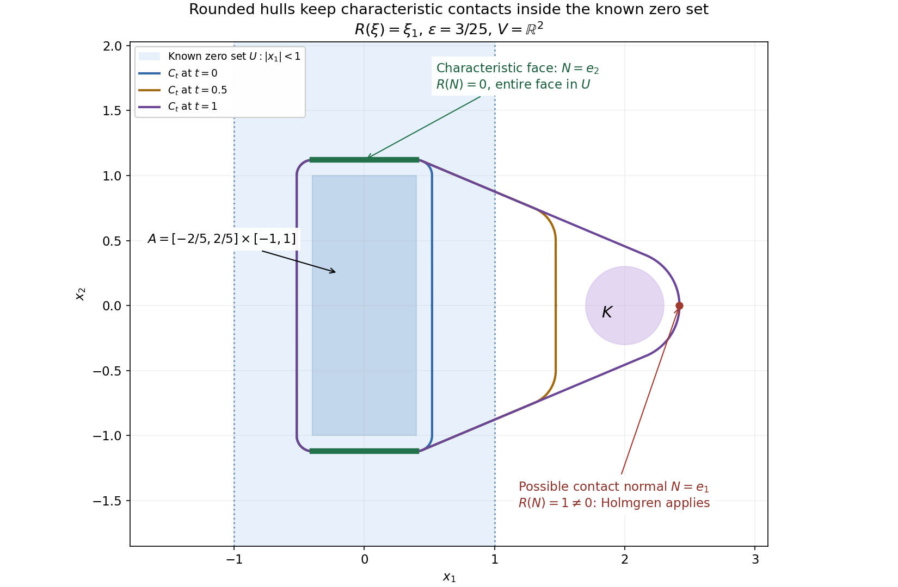

# Lorentz cones and domain solvability

*Written by GPT-6.1 Sol (OpenAI), Ultra reasoning effort, October 2026. Self-checked by GPT-6.1 Sol (OpenAI). Public domain (CC0).*

For a wave equation, a domain can fail the support condition even though the troublesome part of its boundary is only a portion of a light ray. The decisive configuration consists of a null segment whose endpoints lie inside the domain, together with a neighborhood in which the double cone from one endpoint contains no other missing points. We prove that this configuration characterizes failure of support convexity, including when all lower order coefficients are complex.

Basic references are Kalmes's papers on geometric criteria for surjectivity and Bär, Ginoux and Pfäffle's treatment of causal wave kernels, listed below.

Throughout this lesson \(n\geq2\), \(x=(t,z)\in\mathbb R\times\mathbb R^{n-1}\), and
\[
\begin{aligned}
\Lambda(t,z)&=t^2-|z|^2,\\
P_2(\tau,\xi)&=-\tau^2+|\xi|^2.
\end{aligned}
\tag{1}
\]
The polynomial \(P\) has degree two and principal part \(P_2\). Its lower order coefficients are arbitrary complex numbers. We write \(A=P^t=P(-D)\), \(D=-i\partial\). Euclidean balls and distances will always be distinguished from the Lorentz form \(\Lambda\).

Set
\[
\begin{gathered}
C_+=\{(t,z):t\geq|z|\},\\
C_-=-C_+.
\end{gathered}
\tag{2}
\]
A nonzero vector is **timelike** if \(\Lambda>0\), **null** if \(\Lambda=0\). Future means its time component is positive. The interiors \(C_\pm^\circ\) consist of the corresponding timelike vectors.

We use the support-distance criterion from [Approximation and global solvability from support geometry](approximation-and-global-support-solvability.md), Theorem 4.1. We also use the analytic support-normal theorem proved in [Support normals and analytic singularities](../AN02-L194.html#3-a-supporting-analytic-function-produces-a-singular-normal) and the propagation statement declared in [Boundary distance and propagation](boundary-distance-and-propagation.md). Their applicability here follows from
\[
\begin{gathered}
\nabla P_2(\tau,\xi)=(-2\tau,2\xi)\ne0\\
\text{when }(\tau,\xi)\ne0.
\end{gathered}
\tag{3}
\]
These statements permit complex lower order coefficients.

The support-normal theorem is proved in [Support normals and analytic singularities](../AN02-L194.html#3-a-supporting-analytic-function-produces-a-singular-normal), Theorem 3.1 and Corollary 4.1. The general characteristic-hyperplane continuation theorem is proved next from distributional Holmgren uniqueness. Microlocal ellipticity is proved in [Noncharacteristic directions and microlocal regularity](../AN02-L199.html#complete-proof), Theorem 1.1. Analytic propagation for the null-segment converse is proved in [Resolving singular directions at a holomorphic boundary](../AN02-L201.html#complete-proof), Theorem 6.1 and Corollary 6.2, with its full derivative-class form. These written proofs and the analytic support-normal theorem supply the stated continuation and null-segment inputs.

## Convex continuation

**Theorem 0.1 (convex continuation).** Let \(R\ne0\) be any complex constant-coefficient polynomial on \(\mathbb R^n\), with principal homogeneous part \(R_d\). Suppose \(U\subset V\) are nonempty convex open sets and every affine hyperplane whose real normal \(N\ne0\) satisfies \(R_d(N)=0\), and which meets \(V\), also meets \(U\). If \(u\in\mathcal D'(V)\), \(R(D)u=0\) in \(V\), and \(u=0\) in \(U\), then \(u=0\) in \(V\). The proof below includes complex lower order coefficients and every finite degree.

In this lesson we apply the theorem with \(R(D)=A=P(-D)\). Its characteristic normals \(N=(a,b)\ne0\) satisfy \(a^2=|b|^2\). The two lemmas below are consequences of this specialization.

### Rounded convex sets have a usable normal

We use the full distributional [Holmgren theorem](../AN02-L191.html#3-a-continuously-differentiable-surface-needs-no-analytic-flattening), Theorem 3.2: a homogeneous solution vanishing on one side of a noncharacteristic \(C^1\) hypersurface vanishes near the contact point. Constant complex coefficients are analytic. No reality condition on the lower terms, elliptic regularity theorem, or wavefront propagation theorem is needed for the following continuation argument.

For a nonempty compact convex set \(B\), write its support function as
\[
h_B(N)=\max_{b\in B}N\cdot b.
\tag{CC1}
\]
It is continuous in \(N\): if \(|b|\le M\) on \(B\), its variation is at most \(M|N-N'|\). The supporting-covector lemma in [Fourier transforms, finite spectra and convex separation](../prerequisites/prerequisite-bridges.html#strict-separation-of-an-open-convex-set) implies that a compact convex set is the intersection of its supporting closed halfspaces. Equivalently, if a point is outside it, its nearest-point separating normal already separates that point strictly. We give the required nearest-point facts explicitly.

**Lemma 0.2.** For every \(\varepsilon>0\), the boundary of
\[
C=B+\varepsilon\overline{B(0,1)}
 =\{x:\operatorname{dist}(x,B)\le\varepsilon\}
\tag{CC2}
\]
is a \(C^1\) hypersurface. At a boundary point \(p\), there are a unique nearest \(b\in B\) and an outward unit normal \(N\) such that
\[
p=b+\varepsilon N,\qquad N\cdot b=h_B(N).
\tag{CC3}
\]

**Proof.** Compactness gives a nearest point. Two different minimizers would have a midpoint with strictly smaller squared distance, so the minimizer \(b(x)\) is unique. Minimizing along the segment from it to any \(z\in B\) gives
\[
(x-b(x))\cdot(z-b(x))\le0.
\tag{CC4}
\]
Using this once at \(x\) with \(z=b(y)\), and once at \(y\) with \(z=b(x)\), and adding, gives
\[
|b(x)-b(y)|^2\le (b(x)-b(y))\cdot(x-y).
\tag{CC5}
\]
Thus the projection is 1-Lipschitz, by Cauchy–Schwarz. Put \(r(x)=|x-b(x)|^2\). Comparing its value at \(x+h\) with the candidate \(b(x)\) gives an upper increment bound; comparing the value at \(x\) with the candidate \(b(x+h)\) gives a lower one:
\[
\begin{aligned}
r(x+h)-r(x)&\le2(x-b(x))\cdot h+|h|^2,\\
r(x+h)-r(x)&\ge2(x+h-b(x+h))\cdot h-|h|^2.
\end{aligned}
\tag{CC6}
\]
Equation (CC5) shows that the two linear parts differ by at most \(4|h|^2\). Consequently \(r\) is \(C^1\), with gradient \(2(x-b(x))\). At level \(\varepsilon^2>0\) that gradient is nonzero. This level is precisely the boundary in (CC2), and is a \(C^1\) hypersurface, described locally by its nonzero-gradient defining function. Taking \(N=(p-b(p))/\varepsilon\), inequality (CC4) proves (CC3). \(\square\)

### A compact seed controls all characteristic normals

**Proof of Theorem 0.1.** Order zero is immediate, because a nonzero constant times \(u\) is zero only when \(u=0\). Assume the degree \(d\) of \(R\) is positive. Let
\[
\Sigma=\{N\in\mathbb R^n:|N|=1,\ R_d(N)=0\}.
\tag{CC7}
\]
This is a compact set, possibly empty. Fix any closed ball \(K\) of positive radius compactly contained in \(V\). We will prove that \(u\) vanishes near all of \(K\).

For \(N\in\Sigma\), the image of an open convex set under \(x\mapsto N\cdot x\) is an open interval. The hyperplane hypothesis and \(U\subset V\) say exactly that these intervals coincide for \(U\) and \(V\). Since \(K\Subset V\), its maximal value \(h_K(N)\) is strictly below some value attained in \(V\), hence in \(U\). Choose \(z_N\in U\) with
\[
N\cdot z_N>h_K(N).
\tag{CC8}
\]
Continuity preserves this strict inequality for all unit normals in a neighborhood of \(N\). A finite number of these neighborhoods cover \(\Sigma\). Let \(A\) be the convex hull of their finitely many chosen points and a fixed small closed ball compactly contained in \(U\). If \(\Sigma\) is empty, use just that ball. The set \(A\) is compact: its points are weighted sums of those finitely many points and one point in the ball, with weights in a compact finite simplex. Convexity of \(U\) puts this entire compact set inside \(U\). We have
\[
h_A(N)>h_K(N)\quad(N\in\Sigma).
\tag{CC9}
\]
Only this one compact seed, rather than the whole possibly unbounded set \(U\), will be used.

Let \(H=\operatorname{conv}(A\cup K)\). It is compact, since its points have the form \((1-s)a+sk\), with \(s\in[0,1]\), \(a\in A\), \(k\in K\). It is contained in \(V\). Choose a fixed \(\varepsilon>0\) so small that
\[
\begin{gathered}
A+2\varepsilon\overline{B(0,1)}\subset U,\\
H+2\varepsilon\overline{B(0,1)}\subset V.
\end{gathered}
\tag{CC10}
\]
These inclusions follow from the positive distances of the two compact sets to the respective closed complements; when a complement is empty there is no restriction from it.

For \(0\le t\le1\), form the nested compact convex sets
\[
\begin{aligned}
B_t&=(1-t)A+tH,\\
C_t&=B_t+\varepsilon\overline{B(0,1)}.
\end{aligned}
\tag{CC11}
\]
They lie inside the fixed compact set \(H+\varepsilon\overline{B(0,1)}\Subset V\), and \(C_0\Subset U\). They vary continuously in Hausdorff distance: representing a point with the same \(a,h\) at two parameter values changes it by at most \(|t-t'|\max_{A\times H}|h-a|\). Their support functions are
\[
h_{B_t}=(1-t)h_A+t\max(h_A,h_K),
\qquad h_{C_t}=h_{B_t}+\varepsilon|N|.
\tag{CC12}
\]

Every boundary point of \(C_t\) with a characteristic outward normal actually lies in \(U\). Indeed, by Lemma 0.2 it has the form \(p=b+\varepsilon N\), with \(|N|=1\), and \(b\) maximizes \(N\cdot b\) on \(B_t\). If \(N\in\Sigma\), the strict inequality (CC9) says that every maximizing point of \(H\) lies in the maximizing face of \(A\): a positive weight from \(K\) would strictly lower its value. Maximizing in the Minkowski sum \(B_t\) therefore puts \(b\) in that same convex face of \(A\), including \(t=0,1\). Hence
\[
p\in A+\varepsilon\overline{B(0,1)}\subset U.
\tag{CC13}
\]

### The first contact cannot occur

Let \(S=\operatorname{supp}u\), taken relative to \(V\). Suppose \(S\cap C_1\ne\varnothing\). The set of pairs \((t,p)\) with \(p\in S\cap C_t\) is closed in the compact set \([0,1]\times C_1\); all of \(C_1\) lies in \(V\), where \(S\) is closed. Thus its first parameter \(t_*\) is attained. It is positive because \(C_0\Subset U\) is disjoint from \(S\), and the family is Hausdorff continuous.

Every point of the interior of \(C_{t_*}\) belongs to an earlier \(C_t\). To verify this rather than assume strict expansion, take \(x+\delta\overline{B(0,1)}\subset C_{t_*}\). For all unit normals,
\[
N\cdot x+\delta\le h_{C_{t_*}}(N).
\tag{CC14}
\]
The uniform support-function bound following (CC12) makes \(h_{C_t}(N)\ge N\cdot x+\delta/2\) for sufficiently close \(t<t_*\). The supporting-halfspace characterization then gives \(x\in C_t\). By definition of \(t_*\), \(u\) is zero on the interior of \(C_{t_*}\).

Choose \(p\in S\cap C_{t_*}\). It must be on the boundary. Lemma 0.2 makes that boundary a \(C^1\) hypersurface, with outward normal \(N\). If \(N\) were characteristic, (CC13) would put the support point in \(U\), where \(u=0\). Therefore \(R_d(N)\ne0\). The equation holds on a full neighborhood of \(p\), because \(C_1\Subset V\), and \(u\) vanishes on its interior side. The distributional Holmgren theorem gives a zero neighborhood of \(p\), contradicting \(p\in S\). Thus \(S\cap C_1\) is empty. Since \(K\subset H\) and \(K+\varepsilon B(0,1)\subset C_1\), this proves vanishing near \(K\).

Every point of \(V\) is in such a closed ball. Therefore \(u=0\) throughout \(V\), proving Theorem 0.1. \(\square\)

**Figure 0.1.** For \(R(\xi)=\xi_1\), the characteristic unit normals are \(\pm e_2\). Take \(U=\{|x_1|<1\}\), \(V=\mathbb R^2\), \(A=[-2/5,2/5]\times[-1,1]\), \(K=\overline B((2,0),3/10)\), and \(\varepsilon=3/25\). The curves are the rounded sets (CC11) at \(t=0,1/2,1\), sampled by their exact support-point formulas. Their characteristic top and bottom faces remain at \(x_2=\pm28/25\), \(|x_1|\le2/5\), inside \(U\). The rightmost normal at \((121/50,0)\) is \(e_1\), so \(R(e_1)=1\); the marked point illustrates an admissible noncharacteristic contact, without asserting that a particular solution has support there. The proof applies to every degree and dimension, not just this directional example.

### Two consequences with different geometric hypotheses

**Corollary 0.3 (elliptic continuation).** If \(R\) is elliptic and \(U\subset V\) are nonempty convex open sets, every homogeneous distribution on \(V\) vanishing in \(U\) vanishes in \(V\).

**Proof.** There are no characteristic real hyperplanes, so the hypothesis of Theorem 0.1 is empty. This proves uniqueness; no assertion that every solution is analytic is needed for this corollary. \(\square\)

**Corollary 0.4 (continuation along rays).** Let \(\Gamma\) be a nonempty open convex set. Suppose a real linear form \(\lambda\) has bounded supremum on every bounded subset, is unbounded above on \(\Gamma\), and every characteristic affine hyperplane meeting \(\Gamma\) contains a ray \(x+sv\), \(s\ge0\), in \(\Gamma\) with \(\lambda(v)>0\). A homogeneous distribution on \(\Gamma\) that vanishes there outside a bounded set is zero.

**Proof.** Choose \(T\) larger than \(\lambda\) on that bounded set. The nonempty convex open set \(U_T=\{x\in\Gamma:\lambda(x)>T\}\) is a zero set. Each stated ray meets \(U_T\), so every characteristic hyperplane meeting \(\Gamma\) also meets \(U_T\). Apply Theorem 0.1 with \(V=\Gamma\). The set \(\Gamma\) may contain lines, as the cylindrical wedges do; a positive functional on every vector of the whole wedge is not required. \(\square\)

For the planar proper cones used in the exterior-angle proof, choose a functional positive on their closed nonzero directions. Each characteristic line has an interior ray, and translating that ray from any point of the line in the cone gives the ray hypothesis of Corollary 0.4. For wedges with an edge, the explicit functional and ray are instead the ones in [Cylindrical wedges and support](../AN02-L017.html#continuation-in-a-wedge-with-an-edge), Lemma 4.1. These are the exact continuation inputs used below.

The usual proper-cone version also allows characteristic rays on the boundary of the cone. State the properness precisely as follows: after moving the vertex to zero, the closed cone \(C=\overline\Gamma\) admits a real linear form \(\lambda\) strictly positive on \(C\setminus\{0\}\). Suppose no characteristic hyperplane through zero meets \(C\) only at zero. For each characteristic normal \(N\), choose
\[
0\ne v\in C\cap N^\perp.
\tag{CC16}
\]
Then \(\lambda(v)>0\). If \(x\in\Gamma\), we have \(x+sv\in\Gamma\) for every \(s\ge0\), even if \(v\) is on the boundary. Here is the open-set detail: choose \(\delta>0\) with \(x+B(0,\delta)\subset\Gamma\), and approximate \(v\) by \(v_j\in\Gamma\). Addition preserves an open convex cone, by convexity followed by multiplication by two. Hence \(x+sv_j+B(0,\delta)\subset\Gamma\); for large \(j\), this contains \(x+sv+B(0,\delta/2)\). Thus the full ray lies in \(\Gamma\) and its \(\lambda\) values tend to infinity. Every affine characteristic hyperplane meeting \(\Gamma\) therefore satisfies the hypothesis of Corollary 0.4, which proves this proper-cone version. Positivity on all nonzero closed-cone directions is the precise properness used here; the separate ray criterion handles cylindrical wedges with lines.

## Two continuation lemmas

For \(R>0\), define the open diamond
\[
D_R=\{(t,z):|t|+|z|<\sqrt2R\}.
\tag{4}
\]
Euclidean Cauchy–Schwarz gives \(B(0,R)\subset D_R\subset B(0,\sqrt2R)\).

**Lemma 1.1.** If \(Au=0\) in \(D_R\) and \(u=0\) in \(B(0,R)\), then \(u=0\) in \(D_R\). The same assertion holds after translation.

**Proof.** Normalize a characteristic normal \(N=(a,b)\) to Euclidean length one. Then \(|a|=|b|=1/\sqrt2\), and
\[
|N\cdot(t,z)|\leq
\frac{|t|+|z|}{\sqrt2}<R
\quad\text{on }D_R.
\tag{5}
\]
Any characteristic hyperplane meeting \(D_R\) therefore has equation \(N\cdot x=c\) with \(|c|<R\). It meets the ball \(B(0,R)\). Both sets are convex and open, so the continuation theorem applies. \(\square\)

For timelike separated points \(a,b\), with \(b-a\) future, their open causal diamond is
\[
\mathcal D(a,b)=(a+C_+^\circ)\cap(b+C_-^\circ).
\tag{6}
\]
It contains the open segment between them.

**Lemma 1.2.** Let \(Y\) be convex and open, \(Au=0\) in \(Y\). Let \(a(s),b(s)\), \(0\leq s\leq1\), be continuous curves in \(Y\setminus\operatorname{supp}u\) with \(\Lambda(b(s)-a(s))>0\). Then \(u\) vanishes near the whole segment \([a(s),b(s)]\) for every \(s\), or for no \(s\). Whenever it vanishes near that segment, it also vanishes on \(Y\cap\mathcal D(a(s),b(s))\), with time orientation chosen continuously.

**Proof.** The nonzero time component of \(b(s)-a(s)\) has constant sign. Interchange the curves if necessary so that it is positive.

First fix a pair \(a,b\) whose segment has a zero neighborhood. For a characteristic normal \(N\ne0\), the linear form \(N\cdot v\) has one strict sign on \(C_+^\circ\): after possibly changing \(N\) to \(-N\), its time component is positive and
\[
N\cdot v\geq |N_t|(v_t-|v_z|)>0.
\tag{7}
\]
Thus, at each \(w\in\mathcal D(a,b)\), \(N\cdot w\) is strictly between \(N\cdot a\) and \(N\cdot b\). Every characteristic hyperplane meeting \(Y\cap\mathcal D(a,b)\) cuts the open segment \((a,b)\). Take a small convex open tube about \([a,b]\), contained in \(Y\) and in the zero set of \(u\), and intersect it with this diamond. The continuation theorem proves vanishing on the whole of \(Y\cap\mathcal D(a,b)\).

Let \(S\) be the set of good parameters. It is relatively open, because a compact segment with a zero neighborhood retains that property under small changes of its endpoints. To prove closedness, let \(s_j\in S\) tend to \(s\). Every compact subset of \(\mathcal D(a(s),b(s))\) lies in \(\mathcal D(a(s_j),b(s_j))\) for large \(j\), by the strict cone inequalities. The preceding paragraph makes \(u\) zero on \(Y\cap\mathcal D(a(s),b(s))\). The endpoints themselves have zero neighborhoods by hypothesis. These open zero sets cover \([a(s),b(s)]\), so \(s\in S\). A relatively open and closed subset of the connected interval \([0,1]\) is either empty or the whole interval. \(\square\)

Strict timelike separation is used in (7) and in the open diamond. It cannot simply be replaced by a nonstrict inequality in this argument.

## The null-segment criterion

Recall that \(X\) is **\(P\)-convex for supports** if for every compact \(K\subset X\) there is a compact \(K'\subset X\) such that
\[
\begin{gathered}
v\in\mathcal E'(X),\qquad
\operatorname{supp}Av\subset K\\
\Longrightarrow\quad\operatorname{supp}v\subset K'.
\end{gathered}
\tag{8}
\]

**Theorem 2.1.** An open set \(X\subset\mathbb R^n\) fails to be \(P\)-convex for supports if and only if there are distinct points \(p,q\in X\), a null segment \(I=[p,q]\), and an open neighborhood \(W\) of \(I\), such that
\[
\begin{gathered}
\Lambda(q-p)=0,\qquad I\cap\partial X\ne\varnothing,\\
W\cap\{w:\Lambda(w-p)\geq0\}\subset X\cup I.
\end{gathered}
\tag{9}
\]

The statement does not require \(X\) to be connected. In one dimension the principal part is elliptic, all open sets satisfy the support condition, and there is no pair of distinct null-separated points.

We first prove that (9) forces failure, then construct such a configuration from a support-distance defect.

## A compact witness from the light front

**Proof that (9) implies failure.** Reverse time if necessary so that \(q-p\) is future. By [Wave kernels with complex coefficients](wave-kernels-with-complex-coefficients.md), Theorems 3.1 and 4.1, the transpose \(A\) has a global homogeneous distribution \(F\) supported in the double cone with vertex \(p\), with every point of that light cone in its support.

Choose \(\chi\in C_c^\infty(W)\) equal to one near \(I\), and put \(v=\chi F\). Then
\[
I\subset\operatorname{supp}v\subset X\cup I.
\tag{10}
\]
Since \(AF=0\), the image is \(Av=[A,\chi]F\). The commutator has support where derivatives of \(\chi\) meet the support of \(F\); this compact set is disjoint from \(I\) and lies in \(X\), by (9). Thus \(Av\) has compact support inside \(X\).

Choose a fixed future timelike vector \(h\). For small \(\varepsilon>0\), let \(v_\varepsilon(x)=v(x-\varepsilon h)\). We claim that its entire support lies in \(X\). Split \(\operatorname{supp}v\) into its compact intersections with \(p+C_+\) and \(p+C_-\). The past part is already a compact subset of \(X\), because \(I\) meets that past cone only at \(p\), which lies in \(X\). Its sufficiently small translates stay in \(X\). The future part, after translation by \(\varepsilon h\), lies in \(p+C_+^\circ\). All such translates stay in \(W\) for uniformly small \(\varepsilon\), since the unshifted support is compact in \(W\). They cannot belong to the null segment \(I\). Condition (9) therefore puts them in \(X\) too.

The image supports of these translates lie in one fixed compact subset of \(X\): translate the compact set \(\operatorname{supp}Av\) by \([0,\varepsilon_0]h\), with \(\varepsilon_0\) small enough. But if \(r\in I\cap\partial X\), then
\[
r+\varepsilon h\in\operatorname{supp}v_\varepsilon,
\qquad r+\varepsilon h\longrightarrow r.
\tag{11}
\]
No compact subset of \(X\) can contain all these support points. This contradicts (8), and proves failure. \(\square\)

Notice why the support statement at every light-front point was needed. The boundary point \(r\) in (11) is specified by the domain, not selected afterward to match a potentially smaller kernel support.

## From a distance defect to a boundary interval

For the converse, suppose \(X\) is not \(P\)-convex for supports. It is then a nonempty proper open set. By the support-distance criterion there is \(0\ne u\in\mathcal E'(X)\) with
\[
\begin{aligned}
r&=d_X(\operatorname{supp}u),\\
b&=d_X(\operatorname{supp}Au)>r.
\end{aligned}
\tag{12}
\]
Both support sets are nonempty: the compact-support hull identity rules out a nonzero compactly supported homogeneous solution. Choose \(y\in\operatorname{supp}u\), \(x_0\in\partial X\) attaining the distance \(r\), and put \(a=y-x_0\). In particular \(|a|=r>0\).

Translate by the full contact vector and then partially translate back:
\[
\begin{gathered}
v_\varepsilon(x)=u(x+(1-\varepsilon)a),\\
0\leq\varepsilon\leq1.
\end{gathered}
\tag{13}
\]
For \(\varepsilon>0\) its support lies in \(X\), because the translation length is strictly smaller than \(r\). Hence \(\operatorname{supp}v_0\subset\overline X\), by passing to limits of its translated support points. Also
\[
\begin{gathered}
x_0\in\operatorname{supp}v_0,\\
v_0=0\text{ in }B(x_0-a,r),\\
d_X(\operatorname{supp}Av_\varepsilon)\geq
\delta:=b-r>0,\\
0\leq\varepsilon\leq1.
\end{gathered}
\tag{14}
\]

The real analytic function \(-|x-(x_0-a)|^2\) attains its maximum on \(\operatorname{supp}v_0\) at \(x_0\), with nonzero differential \(-2a\). The support-normal theorem puts \((x_0,-a)\) in the analytic wavefront set: its supplied covector is \(-2a\), and positive conicity permits division by two. Since \(Av_0=0\) near \(x_0\), analytic elliptic regularity gives \(\Lambda(a)=0\).

Write \(\nu=a/r\), and reverse time if necessary so that it is future. Define
\[
\begin{gathered}
H=\operatorname{diag}(1,-1,\ldots,-1),\\
g=H\nu.
\end{gathered}
\tag{15}
\]
Both \(\nu\) and \(g\) are future null unit vectors in the Euclidean metric, and \(\nu\cdot g=0\). A bicharacteristic line at the supplied covector \(-a\) runs in direction \(g\), since \(\nabla P_2(-a)=2Ha=2rg\).

Choose
\[
0<R<\min\left(r,\frac{\delta}{1+\sqrt2}\right).
\tag{16}
\]
Let \(J\) be the maximal compact interval in
\[
(x_0+\mathbb Rg)\cap
\partial X\cap\operatorname{supp}v_0
\tag{17}
\]
containing \(x_0\). It may initially be a singleton. Such an interval exists as the connected component containing \(x_0\) in a compact closed subset of a line.

Every \(x\in J\) satisfies \(x+a\in\operatorname{supp}u\). Because \(x\notin X\), its distance from \(\operatorname{supp}u\) is at least \(r\), and the point \(x+a\) makes it exactly \(r\). The entire contact argument (14) therefore applies at \(x\). In particular \(v_0=0\) in \(B(x-a,r)\), and the support-normal theorem gives the analytic covector \(-a\) at \(x\), by the same positive rescaling of its differential \(-2a\).

The smaller ball \(B(x-R\nu,R)\) lies in \(B(x-a,r)\). Its concentric diamond is contained in \(B(x-R\nu,\sqrt2R)\), on which \(Av_0=0\): every point of that ball is within \(R+\sqrt2R<\delta\) of \(x\in X^c\). Lemma 1.1 thus gives
\[
v_0=0\text{ on }\Omega(x):=x-R\nu+D_R.
\tag{18}
\]
Analytic propagation at the supplied covector \(-a\) also gives
\[
\widehat J:=J+(-R,R)g
\subset\operatorname{supp}v_0\subset\overline X.
\tag{19}
\]
Indeed each propagation segment starts at a point \(x\in J\) and has length less than \(R<\delta\), so it avoids the image support.

The union
\[
\Gamma=J-R\nu+D_R
\tag{20}
\]
is an open convex zero set of \(v_0\), since \(J\) and \(D_R\) are convex. Define also the open convex tubes
\[
\begin{aligned}
W_0&=J+B(0,R),\\
Y&=J+B(0,2R).
\end{aligned}
\tag{21}
\]
We have \(Av_0=0\) in \(Y\), because \(2R<\delta\) and all points of \(J\) lie in \(X^c\).

## The interior cone must be inside the domain

We claim that
\[
\begin{gathered}
W_0\cap(x+C_+^\circ)\subset X\\
\text{for every }x\in\widehat J.
\end{gathered}
\tag{22}
\]
Fix such an \(x\) and a point \(w\in W_0\) with \(d=w-x\in C_+^\circ\). Choose \(x_*\in J\), \(|c|<R\), with \(x=x_*+cg\), and set \(z=x-\eta d\), with \(\eta>0\) to be chosen small.

Choose \(j\in J\) with \(|w-j|<R\). There is \(s_1<R/r\), sufficiently close to \(R/r\), for which
\[
w-s_1a\in j-R\nu+B(0,R)\subset\Gamma.
\tag{23}
\]
We will also choose \(\eta\) so that
\[
z-sa\in\Gamma\quad(0\leq s\leq s_1).
\tag{24}
\]
Here is the geometric verification, including the endpoint \(s=0\). In coordinates with \(\nu=(1,e)/\sqrt2\), \(g=(1,-e)/\sqrt2\), \(|e|=1\), one has
\[
\begin{gathered}
|(b\nu+cg)_t|+|(b\nu+cg)_z|\\
{}=\sqrt2\max(|b|,|c|).
\end{gathered}
\tag{25}
\]
Before the perturbation \(-\eta d\), the vector relative to the center \(x_*-R\nu\) is \((R-rs)\nu+cg\). For \(0<s\leq s_1\) both coefficients in (25) have absolute value strictly less than \(R\), so it lies in \(D_R\). At \(s=0\) it lies on a smooth part of the diamond boundary, because \(|c|<R\). The outward differential there is \(\sqrt2\nu\), whose pairing with the future timelike vector \(d\) is strictly positive. Thus \(-\eta d\) moves it into the diamond. Uniformly for \(s\) in a small interval starting at zero, the same differential has a positive pairing with \(d\): the time component and the nonzero spatial component keep their signs, and their directions vary continuously under this small perturbation. On the remaining compact \(s\)-interval the unperturbed points have a positive margin inside \(D_R\). Taking \(\eta\) small proves (24).

Both curves \(w-sa\) and \(z-sa\), \(0\leq s\leq s_1\), lie in \(Y\). For the first, its distance to \(J\) is less than \(R+rs_1<2R\). For the unperturbed second, the displacement \(cg-rs\nu\) has length less than \(\sqrt2R\), using \(\nu\cdot g=0\); a sufficiently small perturbation retains the strict \(2R\) bound.

Suppose no positive \(s\leq s_1\) had \(w-sa\in\operatorname{supp}v_0\). On each closed interval \([s_0,s_1]\) with \(s_0>0\), the two curves would satisfy Lemma 1.2: both endpoints of each segment lie outside the support, and their difference is the fixed timelike vector \((1+\eta)d\). At \(s_1\) both endpoints lie in the convex open zero set \(\Gamma\); hence their segment has a zero neighborhood. The lemma makes the same true at every \(s\in[s_0,s_1]\), and makes the causal diamond between its endpoints a zero set in \(Y\).

At \(s=0\), the point \(x\) lies strictly between \(z=x-\eta d\) and \(w=x+d\) in the timelike sense. For all sufficiently small positive \(s_0\), it still belongs to \(\mathcal D(z-s_0a,w-s_0a)\). The preceding conclusion would make \(v_0=0\) near \(x\), contradicting (19). Consequently some strictly positive \(s\leq s_1<1\) has \(w-sa\in\operatorname{supp}v_0\). By (13), this means \(w\in\operatorname{supp}v_s\subset X\). This proves (22).

The positive parameter is essential here. A support point obtained only at \(s=0\) would show membership in \(\overline X\), which would not suffice.

We can strengthen (22) to the closed cone:
\[
\begin{gathered}
W_0\cap(x+C_+)\subset X\cup\widehat J,\\
x\in\widehat J.
\end{gathered}
\tag{26}
\]
If \(w-x\) is future null and not parallel to \(g\), choose \(x'=x-\varepsilon g\in\widehat J\) with \(\varepsilon>0\) small. The sum \(w-x+\varepsilon g\) is future timelike: two nonparallel future null vectors have strictly positive Lorentz product. Thus (22), applied at \(x'\), gives \(w\in X\). If \(w-x\) is parallel to \(g\), or zero, then \(w\) lies on the line of \(J\); its membership in \(W_0\) puts it in \(\widehat J\). Timelike differences were already treated.

## Choosing the two interior endpoints

Write the endpoints of \(J\) in their future order. There are points of \(X\) in \(\widehat J\) arbitrarily close beyond each endpoint. Otherwise a nontrivial adjacent interval in \(\widehat J\) would be outside \(X\). By (19) it would belong to \(\partial X\cap\operatorname{supp}v_0\), contradicting maximality of \(J\).

Choose \(p,q\in\widehat J\cap X\), with \(p\) before \(J\) and \(q\) after it. Then \(I=[p,q]\) is null, is contained in \(W_0\), and contains the nonempty boundary interval \(J\).

Shrink a neighborhood \(W\) of \(I\), keeping \(W\subset W_0\), as follows. The part of \(\widehat J\cap W\) outside \(I\) can be confined to small balls about \(p,q\) contained in \(X\). Also the closed past cone \(p+C_-\) meets \(I\) only at \(p\). On the compact part of \(I\) outside a small such ball it has positive Euclidean separation; shrink \(W\) there so that its intersection with this past cone is absent. Near \(p\), keep \(W\) inside \(X\). We have arranged
\[
\begin{gathered}
\widehat J\cap W\subset X\cup I,\\
W\cap(p+C_-)\subset X.
\end{gathered}
\tag{27}
\]
Formula (26) at \(p\) now puts the future cone portion of \(W\) in \(X\cup I\); (27) does the same for the past cone. Their union is exactly \(\{w:\Lambda(w-p)\geq0\}\). This is (9), and completes the converse and Theorem 2.1. \(\square\)

Although the construction used the image of one compact distribution to locate a boundary interval, the final obstruction (9) depends only on \(X\) and the principal Lorentz form. Thus support convexity in this class is independent of its first-order and constant coefficients.

## Exercises with solutions

**Exercise 1 — Intermediate level: the diamond constant is sharp.** Show that Lemma 1.1 cannot hold uniformly with \(D_R\) replaced by \(\{|t|+|z|<CR\}\) for any \(C>\sqrt2\). Use the characteristic halfspace solution declared in *Boundary distance and propagation*.

**Solution.** Choose a Euclidean unit future null normal \(N\), and choose \(h\) with \(R<h<CR/\sqrt2\). There is a global smooth homogeneous solution of \(Au=0\) with exact support \(\{N\cdot x\geq h\}\). It is zero in \(B(0,R)\). The larger diamond has points with \(N\cdot x>h\): take a point on its positive time axis with time between \(\sqrt2h\) and \(CR\). That point lies in the support, so the solution cannot vanish throughout the diamond. This applies with the same complex lower order coefficients as in Lemma 1.1.

**Exercise 2 — Elementary level: why timelike matters.** Prove that a nonzero characteristic linear form never vanishes on a future timelike vector. Give a null vector on which it does vanish, and identify the step of Lemma 1.2 that this destroys.

**Solution.** Write \(N=(a,b)\), \(|a|=|b|>0\). After changing its sign assume \(a>0\). For \(v_t>|v_z|\), \(N\cdot v\geq a(v_t-|v_z|)>0\). Take instead \(v=(1,-b/a)\), which is future null and has \(N\cdot v=0\). A characteristic hyperplane can then contain both endpoints of a null segment, and the open causal diamond between those endpoints is empty. Neither the strict-between argument nor the closedness proof through an open diamond applies. This calculation identifies a limitation of that proof without asserting a different continuation theorem.

**Exercise 3 — Intermediate level: deleting part of a light ray.** Let \(J_0\) be a nonempty compact subset of a null line. Suppose it is contained strictly between distinct points \(p,q\) on that line, and neither endpoint belongs to \(J_0\). Show that \(X=\mathbb R^n\setminus J_0\) fails support convexity for every polynomial with principal part (1).

**Solution.** The compact set \(J_0\) has empty interior in \(\mathbb R^n\), so it is the boundary of \(X\). The segment \(I=[p,q]\) contains it and has endpoints in \(X\). Every point outside \(X\) already lies in \(I\), so (9) holds with \(W=\mathbb R^n\). Theorem 2.1 gives the failure, independently of the complex lower order coefficients. No connectedness hypothesis on the deleted subset is needed.

**Exercise 4 — Advanced level: uniform compact image supports.** In the first implication of Theorem 2.1, justify both compact sets used in the translation argument, and explain why translating the whole of \(\operatorname{supp}v\) using only compactness would be insufficient.

**Solution.** The past part \(S_-=\operatorname{supp}v\cap(p+C_-)\) is compact and contained in \(X\), so it has positive distance from \(X^c\). Therefore \(S_-+[0,\varepsilon_0]h\subset X\) for small \(\varepsilon_0\). The image support \(K=\operatorname{supp}Av\) is also compact in \(X\), and the same reasoning makes \(K+[0,\varepsilon_0]h\) a fixed compact subset of \(X\). These facts respectively control the past support and all image supports. The future support may contain \(I\cap\partial X\), so it has no positive distance from \(X^c\). Its translates are controlled instead by the strict cone inclusion, the null nature of \(I\), and condition (9). Compactness alone could not justify them.

**Exercise 5 — Advanced level: why the rounded boundary can be used.** For a nonempty compact convex \(B\), let \(b(x)\) be its nearest-point projection. Derive (CC5), and prove directly from (CC6) that the squared distance is \(C^1\). In the family (CC11), explain why an interior first-contact point cannot occur even when some supporting faces do not move with \(t\). What fails if the strict inequality (CC9) is replaced by a nonstrict one?

**Solution.** The two inequalities (CC4) give
\[
\begin{aligned}
(x-b(x))\cdot(b(y)-b(x))&\le0,\\
(y-b(y))\cdot(b(x)-b(y))&\le0.
\end{aligned}
\tag{CC15}
\]
Adding and rearranging yields (CC5). Cauchy–Schwarz proves \(|b(x)-b(y)|\le|x-y|\). In (CC6), the difference between \(x+h-b(x+h)\) and \(x-b(x)\) has norm at most \(2|h|\), so both bounds differ from \(2(x-b(x))\cdot h\) by \(O(|h|^2)\). The gradient is therefore \(2(x-b(x))\), and is continuous by the Lipschitz bound on \(b\).

An interior point has a ball of radius \(\delta>0\) inside \(C_{t_*}\). The uniform support-function continuity in (CC12) then keeps a ball of radius \(\delta/2\) about it inside an earlier \(C_t\), exactly as in (CC14). Fixed faces do not affect this interior margin. Thus the first contact is on the rounded boundary, where the gradient is nonzero.

With only \(h_A(N)\ge h_K(N)\), a characteristic maximizing face of \(H\) could contain points of \(K\) outside \(A\). Its translated boundary points need not lie in the known zero set \(U\), so (CC13) would be unavailable. For example, take \(A=[-2/5,2/5]\times[-1,1]\) and \(K=\overline B((2,0),1)\); at \(N=e_2\) both support functions equal 1, but the top point \((2,1)\) of \(K\) lies outside the strip \(|x_1|<1\). A first characteristic contact there could not be dismissed by vanishing in that strip. This identifies the exact need for the strict compact-seed choice, rather than asserting that every such contact occurs.

## References

- Thomas Kalmes, [*Surjectivity of differential operators and linear topological invariants for spaces of zero solutions*](https://arxiv.org/abs/1408.4356), *Revista Matemática Complutense* 32 (2019), 37–55. The geometric criteria there relate boundary distance and characteristic directions.
- Thomas Kalmes, [*Some results on surjectivity of augmented differential operators*](https://www.tu-chemnitz.de/mathematik/analysis/kalmes/Preprints/Some_results_on_surjectivity_of_augmented_differential_operators_manuscript.pdf), *Journal of Mathematical Analysis and Applications* 386 (2012), 125–134. This provides further context for support and singular-support convexity.
- Christian Bär, Nicolas Ginoux and Frank Pfäffle, [*Wave Equations on Lorentzian Manifolds and Quantization*](https://arxiv.org/abs/0806.1036), European Mathematical Society, 2007. The preceding lesson constructs the particular complex-coefficient homogeneous kernel needed in (10).

- Lars Hörmander, *The Analysis of Linear Partial Differential Operators I*, second edition, Springer, 1990, §8.6, Theorem 8.6.8. This is the general convex continuation statement proved above from the separately written Holmgren theorem.
