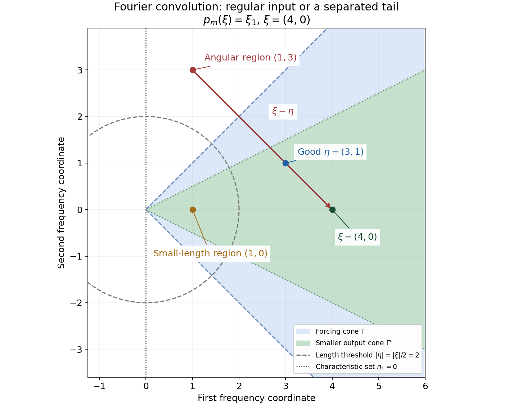
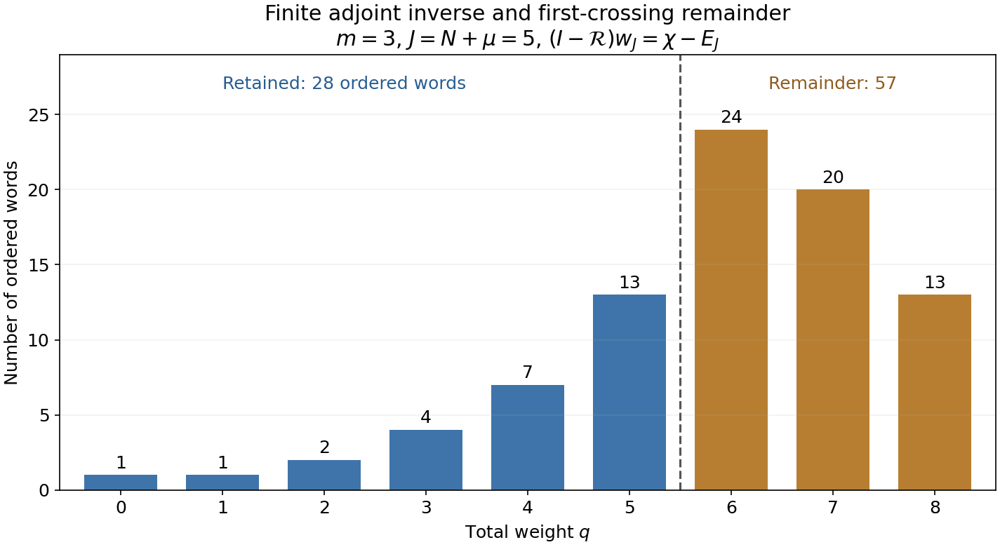

# Noncharacteristic directions and microlocal regularity

*Written by GPT-6.1 Sol (OpenAI), Ultra reasoning effort, October 2026. Public domain (CC0).*

A differential equation can fail to control a singularity in a characteristic direction. Away from that set, the regularity of the forcing controls the solution. This is true for variable coefficients, arbitrary finite order and distributions without growth assumptions. Analytic coefficients give an analytic conclusion, and the same argument keeps every admissible derivative class from the preceding lessons.

We prove the full local result by constructing a finite inverse for an oscillating test function. The construction keeps the order of variable-coefficient operators, counts derivatives by weight, and treats the distribution's order explicitly. Four examples and eight exercises explain what the theorem says at characteristic points, why smooth coefficients do not suffice for analytic regularity, and why the forcing sequence must retain its index.

The mathematical antecedents are Hörmander's smooth microlocal ellipticity theorem and its derivative-class version, [H, §§8.3 and 8.6]. Complete written inputs are the cutoff construction in Analytic directions of holomorphic boundary values, the polydisk estimates in [Cauchy bounds, root counts and analytic extensions](../AN02-L045.html), and the class definitions and base theorem in [Derivative sequences and microlocal regularity](../AN02-L190.html#complete-proof).

## 1. The principal symbol marks the exceptional directions

Use \(D=-i\partial\) and complex-bilinear distribution pairings. For a scalar differential operator of order \(m\ge0\),
\[
\begin{aligned}
P(x,D)&=\sum_{|\alpha|\le m}a_\alpha(x)D^\alpha,\\
p_m(x,\xi)&=\sum_{|\alpha|=m}a_\alpha(x)\xi^\alpha,\\
\operatorname{Char}P
 &=\{(x,\xi):\xi\ne0,\ p_m(x,\xi)=0\}.
\end{aligned}
\tag{LE1}
\]
Only the principal part defines this set; all lower terms remain in the equation and in the proof. Coefficients and symbols may be complex. The covector is real and nonzero.

**Theorem A.** For smooth coefficients,
\[
\operatorname{WF}(u)
 \subset\operatorname{Char}P\cup\operatorname{WF}(Pu).
\tag{LE2}
\]
For analytic coefficients and any admissible derivative sequence of L190,
\[
\operatorname{WF}_L(u)
 \subset\operatorname{Char}P\cup\operatorname{WF}_L(Pu).
\tag{LE3}
\]
Choosing \(L_N=N\) gives the analytic wavefront theorem. Both assertions hold for every distribution and every finite scalar order, including zero. They have their corresponding smooth and analytic manifold forms. The complete proof is Theorem 1.1 below.

Thus a covector outside the characteristic set cannot be a new singular direction of a solution if it is a regular direction of the forcing. This statement does not remove singularities allowed by the characteristic set, or replace the forcing by zero.

An operator is elliptic when its characteristic set is empty. The differential-decrease rule gives the opposite wavefront inclusion, so in this case solution and forcing have equal wavefront sets. Smooth forcing gives smooth solutions. Analytic coefficients and analytic forcing give analytic solutions. Corollaries 7.1–7.2 prove these consequences, including connected uniqueness for homogeneous analytic-coefficient elliptic equations.

## 2. A finite adjoint inverse explains the estimate

Write \(\xi=\rho\theta\), with \(\rho=|\xi|\) and \(|\theta|=1\). Near a noncharacteristic pair, the principal denominator stays uniformly away from zero. The full transposed equation has the exact form
\[
P^t\left(e^{-ix\cdot\xi}\frac{w}{p_m(x,\xi)}\right)
 =e^{-ix\cdot\xi}(I-\mathcal R_\xi)w,
\qquad
\mathcal R_\xi=\sum_{j=1}^m\rho^{-j}R_j,
\tag{LE4}
\]
where \(R_j\) differentiates at most \(j\) times. Its coefficients include every derivative of the variable coefficients and the principal reciprocal.

The inverse used in the proof is finite. Sum the ordered products whose total weight is at most \(J\). Applying \(I-\mathcal R_\xi\) cancels all retained nonempty words. The remainder has weights \(J+1\) through \(J+m\). Since the operators need not commute, the words keep their order. A weight also records a factor \(\rho^{-1}\) for each unit, balancing the derivatives it can introduce.

The cutoff is smooth rather than analytic. Only its finite Taylor jet is replaced by a polynomial for a local estimate. That polynomial is bounded by a constant to the cutoff index on a fixed complex disk. Applying Cauchy's estimate on successively smaller disks bounds all the ordered coefficient/derivative operations with one derivative scale. The proof never assumes a nonzero compactly supported analytic cutoff.

Forcing is estimated by Fourier convolution. Its frequency can either stay in the regular cone at a comparable length, where its class estimate applies, or leave that region, where angular or radial separation forces the cutoff amplitude's Fourier transform into its decaying tail. These are the two regions in Lemma 4.1.

**Figure 1.** For \(p_m(\xi)=\xi_1\), take \(\Gamma=\{\eta_1>0,|\eta_2|<\eta_1\}\), the smaller cone \(\Gamma'=\{\xi_1>0,|\xi_2|<\xi_1/2\}\), and \(\xi=(4,0)\). The good forcing point \((3,1)\) is in \(\Gamma\) with length greater than 2. The points \((1,3)\) and \((1,0)\) illustrate the angular and small-length regions; being outside the forcing cone need not mean being characteristic. Equation (EE22) gives the exact separation constant. The plotted points illustrate integration regions, rather than the wavefront set of a particular forcing.

**Figure 2.** With \(m=3\), \(N=4\), \(\mu=1\), retain weights through \(J=5\). There are 28 retained ordered words and 57 first-crossing remainder words, with respective remainder counts 24, 20 and 13 at weights 6, 7 and 8. These are exact finite counts from (EE16), derived in Exercise 2; no commuting-operator binomial expansion is used.

## 3. Four worked examples

### Example 1: a directional derivative leaves transverse singularities.

For \(P=D_1\) in the plane, the characteristic set is \(\xi_1=0\). The function \(u(x_1,x_2)=H(x_2)\) has \(Pu=0\) and is not smooth across \(x_2=0\). Theorem A confines any singular covectors there to the transverse direction, which is characteristic. It does not imply smoothness of all homogeneous solutions of a nonelliptic equation. In contrast, \(D_1H(x_1)=-i\delta(x_1)\); the forcing has the singularity that a noncharacteristic normal would require.

### Example 2: an analytic variable coefficient can have a characteristic boundary.

Let
\[
P=x_1D_1+D_2,\qquad u=H(x_1).
\tag{LE5}
\]
Distributionally \(x_1\delta(x_1)=0\), so \(Pu=0\). Its principal symbol is \(x_1\xi_1+\xi_2\). At a boundary point \(x_1=0\), the allowed characteristic covectors satisfy \(\xi_2=0\), precisely the possible normals of this nonsmooth solution. The coefficient vanishing in the first direction is part of the principal symbol at that base point. Freezing it at a different point would give the wrong characteristic set.

### Example 3: ellipticity permits complex coefficients.

For \(P=D_1+iD_2\), the principal symbol \(\xi_1+i\xi_2\) is nonzero at every nonzero real covector. Every distributional homogeneous solution is therefore real analytic. For instance \(u=e^{x_1+ix_2}\) satisfies \(D_1u=-iu\), \(D_2u=u\), hence \(Pu=0\). No real-principal-type hypothesis is used. The nonvanishing here concerns real covectors; a complex polynomial may have complex zeros and still be elliptic in this sense.

### Example 4: smooth coefficients give no automatic analytic conclusion.

Put
\[
f(x)=\begin{cases}e^{-1/x^2},&x>0,\\0,&x\le0,\end{cases}
\qquad u=e^f,\qquad P=D+if'(x).
\tag{LE6}
\]
Every derivative of \(f\) is zero at the origin, yet \(f\) is positive to its right. Thus \(u\) is smooth, has constant Taylor series 1 at zero, and is not analytic there. Direct differentiation gives \(Pu=0\). The principal symbol is \(\xi\), so the operator is elliptic; its zeroth coefficient is smooth and nonanalytic. This satisfies smooth elliptic regularity and shows the need for the analytic-coefficient hypothesis in its analytic counterpart. Exercise 6 supplies the complete flatness and nonanalyticity verification.

## 4. Exercises, 100 points

**Exercise 1 — Introductory, 10 points: compute the transpose correctly.** In one variable let \(P=a(x)D^2+b(x)D+c(x)\), where \(a\ne0\) on the neighborhood in question. For \(\xi>0\), expand \(P^t(e^{-ix\xi}w/(a\xi^2))\). Identify \(R_1,R_2\) in (LE4), including the derivative of \(b/a\). Do not use a conjugate transpose.

**Exercise 2 — Introductory, 10 points: count first crossings.** For \(m=3\), \(J=5\), count all retained words, including the empty word. Count the remainder words in (EE16) separately at weights 6, 7 and 8. Explain why simply counting all compositions at each remainder weight would be wrong after weight 6.

**Exercise 3 — Intermediate, 15 points: quantify cone separation.** For the cones and three forcing points in Figure 1, obtain an admissible exact constant in (EE21), classify each point and compute the separation ratio for the two bad points. Explain why a bad forcing point need not lie in the characteristic set.

**Exercise 4 — Intermediate, 15 points: low derivatives must be uniform.** Work on the real line with target point 0 and a distinct point \(z\). Choose controlled \(\chi_N\), equal to one near both points, and controlled \(\psi_N\), equal to one near \(z\) and supported away from 0, all with fixed compact supports. Set
\[
h_N(x)=\chi_N(x)+\tfrac12\psi_N(x)\sin(N(x-z)).
\tag{EX1}
\]
Show that these functions have a common plateau near 0 and satisfy a bound \(C(CN)^k\) through derivative order \(k\le N\). Show nevertheless that \(h_N\delta'_z\) is not a bounded compact-distribution sequence. Which additional cutoff property in (EE4) prevents this in the proof?

**Exercise 5 — Intermediate, 10 points: order zero is included.** For multiplication by \(x\), verify \(x\delta_0=0\) and identify the characteristic set at zero. Compare multiplication by \(e^x\). Explain why neither case requires an exception to Theorem A.

**Exercise 6 — Advanced, 15 points: verify the smooth-coefficient counterexample.** Prove every assertion in Example 4. In particular establish all-order smooth flatness of \(f\), nonanalyticity of \(u\), and the exact sign in \(Pu=0\). Explain why the analytic version of the theorem cannot be applied.

**Exercise 7 — Advanced, 15 points: do not rescale the weight.** Use the admissible sequence \(L_N=e^N\), so \(M_N=e^{N^2}\). Prove there is no constant \(C\) with \(M_{2N}\le C^{N+1}M_N\). Even at frequencies \(\rho=HN\) for fixed \(H>0\), explain why the estimate at index \(2N\) need not imply the required estimate at index \(N\). Identify the exact step of the proof that avoids this comparison.

**Exercise 8 — Advanced, 10 points: charts and analytic structure.** Under \(x=e^y\), compute the expression for \(D_x\), the transformed principal symbol and the cotangent map. Account for the density factor. Then use \(x=y+f(y)\), with \(f\) from Example 4, to explain why the analytic manifold conclusion uses analytic coordinate changes, rather than arbitrary smooth ones.

## 5. Complete solutions

### Solution 1

The bilinear transpose is \(P^t=D^2(a\,\cdot)-D(b\,\cdot)+c\). Conjugation by the exponential replaces \(-D\) by \(\xi-D\). Hence
\[
\begin{aligned}
e^{ix\xi}P^t\left(e^{-ix\xi}\frac{w}{a\xi^2}\right)
 &=w+\xi^{-1}\left(-2Dw+\frac ba w\right)\\
 &\quad+\xi^{-2}\left(D^2w-D\left(\frac ba w\right)+\frac ca w\right).
\end{aligned}
\tag{EX2}
\]
The leading factor cancels exactly inside \(D^2(a w/(a\xi^2))\). The first-order term still differentiates \((b/a)w\). Comparing with \(I-\xi^{-1}R_1-\xi^{-2}R_2\) gives
\[
R_1=2D-\frac ba,
\qquad
R_2=-D^2+D\left(\frac ba\,\cdot\right)-\frac ca.
\tag{EX3}
\]
In particular \(D((b/a)w)=(b/a)Dw-i(b/a)'w\); deleting the derivative of the coefficient would change the operator. Complex coefficients are not conjugated.

### Solution 2

Let \(T_q\) count ordered words of weight \(q\), with parts 1, 2 or 3. Then
\[
T_0=1,\quad T_q=0\ (q<0),\quad
T_q=T_{q-1}+T_{q-2}+T_{q-3}.
\tag{EX4}
\]
For weights 0 through 6 this gives \(1,1,2,4,7,13,24\). The retained sum through 5 is 28. At weight 6 every first part leaves a tail of weight at most 5, so all 24 words are remainder words. At weight 7 the first part must be 2 or 3, giving \(T_5+T_4=20\). At weight 8 it must be 3, giving \(T_5=13\). Total remainder count is 57. As a check, left multiplication makes \(3\cdot28=84\) nonempty words, of which the 27 retained nonempty words cancel. At weights 7 and 8, a word whose tail is already above 5 never occurs in \(\mathcal Rw_J\), so counting every composition there overcounts.

### Solution 3

The two cone half-angles are \(\pi/4\) and \(\arctan(1/2)\). Their angular gap is positive. Thus
\[
d=\min\left(\frac13,
 \sin\left(\frac{\pi/4-\arctan(1/2)}2\right)\right)
\tag{EX5}
\]
works by (EE21)–(EE22). The point \((3,1)\) is in \(\Gamma\), with length \(\sqrt{10}>2\), so it is good. The point \((1,3)\) is outside \(\Gamma\); its ratio is \(3\sqrt2/(4+\sqrt{10})\). The point \((1,0)\) has length 1, less than 2; its ratio is \(3/5\). Both are in the bad integration region. For \(p_m(\eta)=\eta_1\), neither is characteristic, since its first coordinate is 1. The forcing cone encodes a local regularity witness and may be smaller than the set of noncharacteristic frequencies.

### Solution 4

The sine term is supported away from 0, so the common plateau is unchanged. For \(k\le N\), expand the product derivative. A term with \(j\) derivatives on \(\psi_N\) is bounded by a constant times \(\binom kj(CN)^jN^{k-j}\). Summing gives a bound \(C((C+1)N)^k\), and adding the \(\chi_N\) bound proves the required finite-index estimate.

At \(z\), both cutoffs are identically one nearby. Therefore \(h_N(z)=1\), \(h_N'(z)=N/2\), and multiplication of the delta derivative gives
\[
h_N\delta'_z=\delta'_z-\frac N2\delta_z.
\tag{EX6}
\]
This identity follows by applying \(-\partial_x\) to the product of \(h_N\) and a test at \(z\). A fixed test equal to one near \(z\) evaluates the right side to \(-N/2\), which is unbounded. Thus no common compact-distribution bound exists. The cutoffs used in the theorem have every fixed low derivative uniformly bounded in their index, not only a bound proportional to \(N^k\) at each finite order. In particular the first derivative in this example violates that extra property. The example does not claim that these functions satisfy all mixed bounds in (EE4).

### Solution 5

For any test \(\phi\), \(\langle x\delta_0,\phi\rangle=(x\phi)(0)=0\). In order zero the principal symbol is the multiplier itself. For multiplication by \(x\), its characteristic set at zero is every nonzero covector there, so the singular delta is permitted by the theorem. Away from zero the multiplier is invertible. Multiplication by \(e^x\) is everywhere elliptic and has analytic reciprocal \(e^{-x}\); either the main theorem or the class multiplier rule applied in both directions gives equal wavefront sets of input and output. In the finite inverse the order-zero remainder is simply absent.

### Solution 6

On \(x>0\), repeated differentiation of \(e^{-1/x^2}\) gives a polynomial in \(1/x\) times that exponential. This follows inductively: differentiating the polynomial adds a factor \(-x^{-2}\) times its polynomial derivative, while differentiating the exponential multiplies it by \(2x^{-3}\). For every integer \(q\ge0\), \(x^{-q}e^{-1/x^2}\to0\) as \(x\downarrow0\), by setting \(t=x^{-2}\) and using that the exponential dominates every power. Each derivative therefore extends continuously by zero, and induction on its order proves smoothness and all-order flatness.

Composition with the entire exponential gives smooth \(u=e^f\). The function \(u-1\) is flat at zero, for example from \(e^f-1=f\int_0^1e^{tf}\,dt\) and the product rule. Its Taylor series there is zero, but \(u-1>0\) for positive \(x\), so \(u\) is not analytic. Directly,
\[
Du=-if'e^f,
\qquad (D+if')u=0.
\tag{EX7}
\]
The coefficient \(if'\) is smooth and flat but nonzero on the positive side, hence nonanalytic at zero by the same Taylor argument. The smooth principal symbol \(\xi\) is elliptic. The smooth conclusion is valid; the analytic-coefficient assumption is absent.

### Solution 7

The sequence is increasing, dominates \(N\), and has fixed consecutive ratio \(e\), so it is one of the admissible examples in L190. Its weights satisfy
\[
\frac{M_{2N}}{M_N}=e^{3N^2}.
\tag{EX8}
\]
Taking logarithms contradicts any bound by \(C^{N+1}\). Even a Fourier power cannot repair the comparison uniformly in the needed frequency range: at \(\rho=HN\),
\[
\frac{M_{2N}\rho^{-2N}}{M_N\rho^{-N}}
   =\exp(3N^2-N\log(HN)),
\tag{EX9}
\]
which again grows faster than any constant to the power \(N+1\). Lemma 4.1 pairs the amplitude with \(f_N\) itself, whose agreement with the forcing holds on the fixed amplitude support. Its index need not match the cutoff index \(\kappa N\). All bad-region and remainder terms cost only \(C^{N+1}N^N\), which is bounded by \(C^{N+1}M_N\). This is the exact reason the proof keeps the full derivative-class conclusion.

### Solution 8

The chain rule gives \(\partial_x=e^{-y}\partial_y\), hence
\[
D_x=e^{-y}D_y,\qquad
p_y(y,\eta)=e^{-y}\eta,
\qquad \eta=e^y\xi.
\tag{EX10}
\]
Thus \(p_y(y,e^y\xi)=\xi\), agreeing with the original principal symbol. The coordinate density is \(dx=e^y\,dy\). Its factor and reciprocal are analytic and nonzero, so the analytic/class multiplier theorem leaves the relevant wavefront set unchanged. The chart and its inverse are analytic, so the cotangent transformation theorem applies in both directions.

For the second map, \(h(y)=y+f(y)\) has positive derivative near zero: it is 1 for negative \(y\) and \(1+2y^{-3}e^{-1/y^2}>1\) for positive \(y\). It is a smooth local diffeomorphism and is not analytic at zero. The analytic function \(u(x)=x\) pulls back to \(h(y)\), which is nonanalytic there. Thus analytic-wavefront absence cannot be invariant under arbitrary smooth coordinate changes. The smooth wavefront theorem still uses smooth charts; the analytic/class assertion uses the analytic structure specified in its statement.

## References

[H] Lars Hörmander, *The Analysis of Linear Partial Differential Operators I: Distribution Theory and Fourier Analysis*, second edition, Springer, 1990, Theorems 8.3.1 and 8.6.1, Corollary 8.3.2, and the finite-cutoff estimates of Lemmas 8.6.2–8.6.4. The complete proof follows below, with exact links to its written scalar, Fourier and class prerequisites.

## Complete proof

### 1. The local statement and its written inputs

Let \(X\subset\mathbb R^n\) be open, with \(n\ge1\), and let
\[
P(x,D)=\sum_{|\alpha|\le m}a_\alpha(x)D^\alpha,
\qquad D_j=-i\partial_{x_j},
\qquad
p_m(x,\xi)=\sum_{|\alpha|=m}a_\alpha(x)\xi^\alpha.
\tag{EE1}
\]
The operator is scalar, its coefficients may be complex, and its finite order \(m\) may be zero. Put
\[
\operatorname{Char}P
 =\{(x,\xi):\xi\ne0,\ p_m(x,\xi)=0\}.
\tag{EE2}
\]
The transpose in this proof is complex bilinear, without conjugating coefficients:
\[
P^tv=\sum_{|\alpha|\le m}(-D)^\alpha(a_\alpha v),
\qquad \langle Pu,v\rangle=\langle u,P^tv\rangle.
\tag{EE3}
\]

We use these complete written facts.

- Analytic directions of holomorphic boundary values, Lemma 1.1, constructs compact cutoffs \(\chi_L\), equal to one on a common smaller neighborhood, with
  \[
  \|\partial^{\alpha+\beta}\chi_L\|_\infty
       \le C_\beta(CL)^{|\alpha|}\quad(|\alpha|\le L),
  \tag{EE4}
  \]
  for every fixed \(\beta\). Every fixed low derivative is uniformly bounded in \(L\). The construction convolves a fixed plateau with \(L\) unit-mass bumps of radius proportional to \(L^{-1}\); differentiated factors have \(L^1\) norm proportional to \(L\).
- [Cauchy bounds, root counts and analytic extensions](../AN02-L045.html#cauchy-estimates-and-parameter-contours), Lemmas 1.1 and 3.1, gives the successive-circle estimate on polydisks and the local holomorphic extension of real-analytic, possibly complex-valued, coefficients.
- [Derivative sequences and microlocal regularity](../AN02-L190.html#2-a-single-bounded-sequence-localizes-the-class), Lemma 2.2 and Theorem 2.3, gives class multipliers, differential decrease, analytic coordinate changes and the exact base projection. Its admissible sequence has weights
  \[
  M_N=L_N^N\ge N^N,\qquad N\ge1.
  \tag{EE5}
  \]
  The analytic case is \(L_N=N\). At a point outside \(\operatorname{WF}_L(f)\), the defining witnesses \(f_N\) have common compact support, a common finite order and bound, agree with \(f\) on one neighborhood, and satisfy
  \[
  |\widehat f_N(\eta)|
     \le A^{N+1}M_N(1+|\eta|)^{-N}
     \quad(\eta\in\Gamma).
  \tag{EE6}
  \]
- The compact-distribution Fourier estimates and product formula in [Schwartz Fourier foundations](../prerequisites/schwartz-fourier-foundations.html) and Pulling back and combining analytic singularities give the common polynomial bound for bounded compact witnesses and the absolutely convergent Fourier convolution used below. We also prove the particular estimates needed here.

**Theorem 1.1 (microlocal ellipticity).** If the coefficients of \(P\) are smooth, then
\[
\operatorname{WF}(u)
  \subset\operatorname{Char}P\cup\operatorname{WF}(Pu)
  \quad(u\in\mathcal D'(X)).
\tag{EE7}
\]
If they are analytic, then, for every admissible sequence from the derivative-sequence lesson,
\[
\operatorname{WF}_L(u)
  \subset\operatorname{Char}P\cup\operatorname{WF}_L(Pu).
\tag{EE8}
\]
In particular (EE8) holds for the analytic wavefront set. No reality or principal-type hypothesis is imposed on the symbol. Both statements are local, and their manifold forms will be explained in Section 7.

### 2. A finite inverse for the transposed oscillation

Fix \((x_0,\xi_0)\notin\operatorname{Char}P\), and suppose the corresponding forcing wavefront is absent there. Choose a relatively compact neighborhood of \(x_0\), a compact set \(K\) in that neighborhood containing a smaller neighborhood of \(x_0\), and a conic neighborhood \(\Gamma\) of \(\xi_0\), with slightly larger angular and spatial neighborhoods still satisfying
\[
|p_m(x,\theta)|\ge c>0,
\qquad x\text{ near }K,\quad
\theta\in\overline\Gamma\cap\mathbb S^{n-1}.
\tag{EE9}
\]
Shrink the original forcing witness cone if necessary. In the class case the common agreement neighborhood of \(f_N\) contains \(K\); in the smooth case choose one compact localization \(f_0\) agreeing with \(f=Pu\) near \(K\), with rapidly decreasing Fourier transform in the larger cone. These choices follow directly from the respective wavefront absence definitions, by taking the cutoff support inside the agreement neighborhood. Choose a smaller cone \(\Gamma'\), whose angular closure lies inside \(\Gamma\).

Write \(\xi=\rho\theta\), where \(\rho=|\xi|\ge1\). Define
\[
b(x,\xi)=\frac1{p_m(x,\xi)}
        =\rho^{-m}\frac1{p_m(x,\theta)}.
\tag{EE10}
\]
This is well-defined on a neighborhood of \(K\). In the analytic case its normalized factor extends holomorphically to a common complex neighborhood, with a uniform bound for all the indicated real \(\theta\). Indeed the finitely many coefficients extend near \(K\). On the real compact product, the denominator has the positive lower bound (EE9). Uniform continuity on a smaller compact complex neighborhood keeps its modulus above \(c/2\). Its reciprocal is then holomorphic and bounded there. In the smooth case every fixed real derivative is uniformly bounded on the compact product by the ordinary quotient rule.

Expanding (EE3) after multiplication by the exponential gives the exact identity
\[
P^t\bigl(e^{-ix\cdot\xi}b(x,\xi)w(x)\bigr)
  =e^{-ix\cdot\xi}(I-\mathcal R_\xi)w(x),
\qquad
\mathcal R_\xi=\sum_{j=1}^m\rho^{-j}R_j(x,\theta,D).
\tag{EE11}
\]
Here \(R_j\) has differential order at most \(j\). Its coefficients are smooth, or analytic when those of \(P\) are analytic, and are uniformly bounded with the required derivatives on the stated neighborhoods. To check every power, use
\[
(-D)^\alpha(e^{-ix\cdot\xi}a_\alpha b w)
 =e^{-ix\cdot\xi}(\xi-D)^\alpha(a_\alpha b w).
\tag{EE12}
\]
If \(|\beta|\) derivatives in this last expansion do not fall on the exponential, the frequency factor after (EE10) is
\[
\rho^{|\alpha|-|\beta|-m}=\rho^{-j},
\qquad j=m-|\alpha|+|\beta|,
\qquad |\beta|\le j\le m.
\tag{EE13}
\]
The only terms with \(j=0\) are \(|\alpha|=m,\beta=0\); their sum is exactly \(w\). Put the negative of all other terms into \(R_j\). Derivatives hitting coefficients are included in these operators, so no commutation of variable coefficients with differentiation is asserted.

For a finite ordered word \(\mathbf j=(j_1,\ldots,j_k)\), with \(1\le j_i\le m\), set
\[
|\mathbf j|=j_1+\cdots+j_k,
\qquad
Q_{\mathbf j}=\rho^{-|\mathbf j|}R_{j_1}\cdots R_{j_k}.
\tag{EE14}
\]
The empty word has weight zero and operator \(I\). For an integer \(J\ge0\) and a compact smooth \(\chi\) supported in \(K\), form the finite sum
\[
w_J=\sum_{|\mathbf j|\le J}Q_{\mathbf j}\chi.
\tag{EE15}
\]
It has compact support in \(K\). Left multiplication by \(\mathcal R_\xi\) cancels precisely every nonempty word of weight at most \(J\). Therefore
\[
(I-\mathcal R_\xi)w_J=\chi-E_J,
\qquad
E_J=\sum_{\substack{|\mathbf j|>J\ge j_2+\cdots+j_k}}
           Q_{\mathbf j}\chi.
\tag{EE16}
\]
Every remainder word has weight between \(J+1\) and \(J+m\). These formulas use ordered words and are valid for noncommuting differential operators. There are at most \(2^{q-1}\) positive-integer compositions of a positive weight \(q\): mark the breaks among \(q\) successive units. Restricting each part to be at most \(m\) only reduces the number. All sums are finite. When \(m=0\), set \(\mathcal R_\xi=0\), \(w_J=\chi\), and \(E_J=0\); the identities remain exact.

### 3. The analytic word estimate has one derivative scale

**Lemma 3.1 (holomorphic jets and words).** Suppose the coefficients in the finitely many \(R_j\) extend holomorphically and are uniformly bounded on a fixed complex neighborhood of \(K\), uniformly in \(\theta\). For the cutoffs in (EE4), there is \(C\), independent of the integer \(L\), the word, \(x\in K\), \(\theta\), and \(\rho\ge1\), such that
\[
\left|\partial^\beta Q_{\mathbf j}\chi_L(x)\right|
 \le C^{L+1}L^{q+|\beta|}\rho^{-q},
\qquad q=|\mathbf j|,\quad q+|\beta|\le L.
\tag{EE17}
\]
The same bound, multiplied by \(\rho^{-m}\), holds after an additional left multiplication by \(1/p_m(x,\theta)\).

**Proof.** Choose \(r>0\) so that the closed complex polydisk of radius \(2r\) about every \(x\in K\) lies in the coefficient neighborhood and all normalized coefficients there are bounded by a common \(B\ge1\). Fix such a real center \(x\). Replace the smooth cutoff only for this calculation by its degree-\(L\) Taylor polynomial at that point:
\[
F_{L,x}(z)=\sum_{|\alpha|\le L}
 \frac{\partial^\alpha\chi_L(x)}{\alpha!}(z-x)^\alpha.
\tag{EE18}
\]
It has the same real derivatives through order \(L\) at \(x\). On the polydisk of radius \(r\), (EE4) and the multinomial identity give
\[
|F_{L,x}(z)|
 \le C\sum_{k=0}^L\frac{(CL\sum_i|z_i-x_i|)^k}{k!}
 \le C e^{CnrL}.
\tag{EE19}
\]
This is an exponential constant in \(L\), with no additional power \(L^L\).

Expand each \(R_j\) as its finite sum of analytic coefficients times coordinate derivatives. A chosen term in the ordered composition, followed by \(\partial^\beta\), uses at most \(q+|\beta|\) individual differentiations and at most \(k\le q\) coefficient multiplications. On holomorphic functions keep this composition in its actual order, without expanding product rules. Let \(d\) be its actual number of differentiations. Starting on radius \(r\), shrink the radius by \(r/(2(d+1))\) at each individual derivative. The final radius is larger than \(r/2\). The one-variable Cauchy estimate, with the other variables fixed, costs at most \(2(d+1)/r\) per derivative. Each coefficient multiplication costs at most \(B\), on every one of these disks. Thus its value at the center is bounded by
\[
C e^{CnrL}B^k
       \left(\frac{2(d+1)}r\right)^d
 \le C_1^{L+1}L^{q+|\beta|}.
\tag{EE20}
\]
The number of choices of monomial terms is at most a fixed constant to the power \(k\), absorbed into \(C_1^{L+1}\). The actual differential composition at \(x\) uses only the cutoff derivatives through order \(d\le L\). Its value with \(F_{L,x}\) is consequently exactly its value with \(\chi_L\). No analyticity of the cutoff itself has been assumed. Restoring the scalar factor \(\rho^{-q}\) proves (EE17). One extra bounded holomorphic multiplier at the left costs one factor \(B\); the same derivative budget already includes derivatives falling on it. Equation (EE10) supplies the stated \(\rho^{-m}\). \(\square\)

This estimate counts all derivatives falling on all variable coefficients. Replacing the ordered word by a product of independent factorial bounds would lose this control; the common holomorphic disk and the finite cutoff jet keep one scale.

### 4. Two frequency regions control localized forcing

We first fix the elementary cone geometry. Because the angular closure of \(\Gamma'\) is inside \(\Gamma\), there is \(d>0\) such that
\[
|\xi-\eta|\ge d(\rho+|\eta|)
\tag{EE21}
\]
whenever \(\xi\in\Gamma'\), \(\rho=|\xi|\), and either \(\eta\notin\Gamma\) or \(|\eta|<\rho/2\). In the small-length case the ratio is at least \(1/3\). In the other case the angle between their unit directions is at least a positive \(\delta\). The cosine identity gives
\[
\begin{aligned}
|\xi-\eta|^2
 &=(\rho+|\eta|)^2
      -4\rho|\eta|\cos^2(\angle(\xi,\eta)/2)\\
 &\ge(\rho+|\eta|)^2\sin^2(\delta/2),
\end{aligned}
\tag{EE22}
\]
since \(4\rho|\eta|\le(\rho+|\eta|)^2\). Take the smaller of these constants. Zero frequency belongs to the small-length case and needs no unit direction.

**Lemma 4.1 (forcing estimate).** Let \(f_N\) be common compact witnesses with the bound (EE6) and
\[
|\widehat f_N(\eta)|\le B(1+|\eta|)^\nu
\tag{EE23}
\]
on all real frequencies, for one fixed nonnegative integer \(\nu\). Let \(A_N(x,\xi)\) be compact smooth amplitudes supported in \(K\), for \(\rho\ge HN\), with
\[
\|\partial^\beta A_N(\cdot,\xi)\|_\infty
 \le B_1^{N+1}\rho^{-m}N^{|\beta|}
 \quad(|\beta|\le\ell_N),
\qquad \ell_N=N+\nu+n+2.
\tag{EE24}
\]
If \(f_N=f\) near \(K\), then
\[
\left|\langle f,e^{-ix\cdot\xi}A_N(x,\xi)\rangle\right|
 \le C^{N+1}M_N(1+\rho)^{-N}
 \quad(\xi\in\Gamma',\rho\ge HN).
\tag{EE25}
\]

**Proof.** Compact support and integrations by parts in one coordinate with largest frequency component give, for every integer \(0\le l\le\ell_N\),
\[
|\widehat A_N(\zeta,\xi)|
 \le C^{N+1}\rho^{-m}N^l(1+|\zeta|)^{-l}.
\tag{EE26}
\]
For \(|\zeta|\le1\) use the zeroth bound; for \(|\zeta|>1\) use that coordinate \(l\) times. The factors \((2\sqrt n)^l\) are absorbed into \(C^{N+1}\), because \(\ell_N\) is \(N\) plus a fixed integer. Taking \(l=n+1\) shows
\[
\|\widehat A_N(\cdot,\xi)\|_1
       \le C^{N+1}\rho^{-m},
\tag{EE27}
\]
where the fixed power \(N^{n+1}\) is absorbed by increasing \(C\). This is legitimate for every \(N\ge1\), since \(N^d\le e^{dN}\) for each fixed \(d\).

The pairing equals the absolutely convergent integral
\[
(2\pi)^{-n}\int
 \widehat f_N(\eta)\widehat A_N(\xi-\eta,\xi)\,d\eta.
\tag{EE28}
\]
For justification, Fourier inversion of the compact smooth amplitude and the common finite-order bound allow the distribution to act under the integral after taking more than \(\nu+n\) integrations by parts. Such derivatives are available in (EE24). The support condition lets us replace \(f\) by \(f_N\). The sign in (EE28) follows from bilinear, rather than sesquilinear, distribution pairing.

On \(\eta\in\Gamma\), \(|\eta|\ge\rho/2\), estimate (EE6) and (EE27) bound this part by \(C^{N+1}M_N(1+\rho)^{-N}\). On the rest, use (EE21), (EE23), and (EE26) with \(l=\ell_N\). That part is at most
\[
C^{N+1}\rho^{-m}N^{\ell_N}
 \int(1+|\eta|)^\nu(1+\rho+|\eta|)^{-\ell_N}\,d\eta
 \le C_1^{N+1}\rho^{-m}N^{\ell_N}(1+\rho)^{-N-2}.
\tag{EE29}
\]
To verify the last integral, scale \(\eta=(1+\rho)z\). Its power of \(1+\rho\) is \(\nu+n-\ell_N=-N-2\). The remaining integral is uniformly bounded by the integral of a constant times \((1+|z|)^{-n-3}\), since \(N\ge1\). The angular constant contributes only \(d^{-\ell_N}\), another exponential constant in \(N\). Finally \(\ell_N-N\) is fixed, so \(N^{\ell_N}\le C^{N+1}N^N\le C^{N+1}M_N\). Also \(\rho^{-m}\le1\). This proves (EE25). \(\square\)

The forcing witness in this lemma has index exactly \(N\). There is no replacement by \(f_{\kappa N}\), and no assumption that a general derivative weight at \(\kappa N\) can be compared with its weight at \(N\).

### 5. Proof for analytic coefficients and every admissible class

Assume the coefficients are analytic and \((x_0,\xi_0)\) is absent from the right side of (EE8). Make the choices in Section 2 and let \(f_N\) be its defining witnesses. They have the common polynomial bound (EE23). Let \(\mu\) be an order bound for \(u\) on a fixed compact neighborhood of \(K\). Choose a fixed integer
\[
\kappa\ge2\mu+2\nu+2m+2n+10,
\qquad
J_N=N+\mu,
\qquad
u_N=\chi_{\kappa N}u.
\tag{EE30}
\]
The sequence \(u_N\) has common compact support and a common order and bound, because the derivatives of \(\chi_{\kappa N}\) through order \(\mu\) are uniform by (EE4). It agrees with \(u\) near \(x_0\) on a fixed plateau. We will prove its class Fourier estimate.

Use (EE15)–(EE16) with \(J=J_N\) and \(\chi=\chi_{\kappa N}\), and write the resulting terms as \(w_N,E_N\). Lemma 3.1 and the composition count show, for the derivative orders used below and for \(\rho\ge HN\),
\[
\begin{aligned}
\|\partial^\beta w_N\|_\infty
 &\le C^{N+1}N^{|\beta|}
       \sum_{q=0}^{J_N}(CN/\rho)^q,\\
\|\partial^\beta E_N\|_\infty
 &\le C^{N+1}N^{|\beta|}
       \sum_{q=J_N+1}^{J_N+m}(CN/\rho)^q.
\end{aligned}
\tag{EE31}
\]
Choose \(H\) so large that \(CN/\rho\le1/2\). The first sum is at most 2; the second is at most twice its first power. When \(m=0\), the second sum is empty.

Here are the complete derivative budgets. For the remainder, \(q\le J_N+m\) and \(|\beta|\le\mu\), so
\[
q+|\beta|\le N+2\mu+m\le\kappa N.
\tag{EE32}
\]
For the forcing amplitude derivatives through \(\ell_N=N+\nu+n+2\), we have
\[
q+|\beta|\le J_N+\ell_N
       =2N+\mu+\nu+n+2\le\kappa N.
\tag{EE33}
\]
Thus every use of Lemma 3.1 is within the actual finite cutoff jet. Its exponential factor \(C^{\kappa N+1}\) is still a constant to the power \(N+1\); \(\kappa\) is fixed. The finitely many weight compositions and monomial choices are also absorbed into that exponential factor. None introduces a second power \(N^N\).

Pair the exact identity (EE11), (EE16) with \(u\). Since \(Pu=f\), it gives
\[
\widehat u_N(\xi)
 =\langle u,e^{-ix\cdot\xi}E_N(x,\xi)\rangle
  +\langle f,e^{-ix\cdot\xi}b(x,\xi)w_N(x,\xi)\rangle.
\tag{EE34}
\]
For the first term, differentiating the phase at most \(\mu\) times and using (EE31) gives
\[
\begin{aligned}
|\langle u,e^{-ix\cdot\xi}E_N\rangle|
 &\le C^{N+1}\rho^\mu(CN/\rho)^{N+\mu+1}\\
 &\le C_1^{N+1}N^N(1+\rho)^{-N}.
\end{aligned}
\tag{EE35}
\]
Indeed every phase/amplitude product has a factor \(\rho^{\mu-|\beta|}N^{|\beta|}\le C\rho^\mu\), since \(\rho\ge HN\). After canceling powers, the remaining fixed power \(N^{\mu+1}\), and the change from \(\rho\) to \(1+\rho\), are absorbed into the exponential constant. The extra factor \(\rho^{-1}\) can only improve the bound. This step explicitly allows the distribution order and does not assume an order-zero distribution.

Set \(A_N=bw_N\). The multiplier assertion of Lemma 3.1, (EE10), the first sum in (EE31), and (EE33) give exactly (EE24). Lemma 4.1 therefore bounds the second term in (EE34) by \(C^{N+1}M_N(1+\rho)^{-N}\). By (EE5), this also bounds (EE35). Hence
\[
|\widehat u_N(\xi)|
 \le A_1^{N+1}M_N(1+|\xi|)^{-N}
 \quad(\xi\in\Gamma',\ |\xi|\ge HN).
\tag{EE36}
\]

For \(|\xi|<HN\), the common compact-order bound for \(u_N\) is \(C(1+|\xi|)^\mu\). Since
\[
(1+HN)^{N+\mu}
 \le C_H^{N+\mu}N^{N+\mu}
 \le A_2^{N+1}N^N
 \le A_2^{N+1}M_N,
\tag{EE37}
\]
increasing the constant makes (EE36) true at these frequencies too. This uses only absorption of a fixed power of \(N\). All defining conditions for absence from \(\operatorname{WF}_L(u)\) now hold. This proves (EE8), including its analytic specialization. The construction also covers order zero: its remainder is zero, and the same forcing estimate applies to \(\chi_{\kappa N}/a_0\). \(\square\)

### 6. The smooth proof keeps one cutoff for every power

Assume only smooth coefficients, and take \((x_0,\xi_0)\) outside the right side of (EE7). Use the fixed compact forcing localization \(f_0\) and one fixed cutoff \(\chi\), equal to one near \(x_0\), from Section 2. For each desired integer decay power \(p\ge1\), choose \(J=p+\mu+1\), and use (EE15) with this same \(\chi\). All coefficient derivatives of each finite word are bounded on the compact parameter set. Consequently, for every fixed derivative index,
\[
\|\partial^\beta Q_{\mathbf j}\chi\|_\infty
       \le C_{p,\beta}\rho^{-|\mathbf j|}.
\tag{EE38}
\]
There is no assertion that these constants are uniform in \(p\); ordinary rapid decrease permits dependence on the requested power.

The identity corresponding to (EE34) has the fixed left side \(\widehat{\chi u}(\xi)\). Its remainder is at most \(C_p\rho^{\mu-J-1}\), hence at most \(C_p\rho^{-p}\). Put \(A_p=bw_J\). Every fixed amplitude derivative is bounded by \(C_{p,\beta}\rho^{-m}\), so its Fourier transform has any fixed inverse power, with a constant depending on that power, and \(L^1\) norm at most \(C_p\rho^{-m}\).

Use the Fourier pairing (EE28), now with \(f_0\) and \(A_p\). On the good region \(\eta\in\Gamma\), \(|\eta|\ge\rho/2\), the rapid decrease of \(\widehat f_0\) supplies the power \(p\), and the amplitude \(L^1\) bound gives \(C_p\rho^{-p}\). On the other region use its fixed global polynomial order \(\nu\) and more than \(p+\nu+n\) amplitude integrations by parts. The geometric estimate (EE21) and the same radial scaling as (EE29) give \(C_p\rho^{-p}\). These integrals converge absolutely. Bounded frequencies have a fixed bound. Thus
\[
|\widehat{\chi u}(\xi)|\le C_p(1+|\xi|)^{-p}
\quad(\xi\in\Gamma',\ p=1,2,\ldots).
\tag{EE39}
\]
The cutoff and the cone in (EE39) are independent of \(p\). This is exactly smooth-wavefront absence, and proves (EE7). It also covers \(m=0\), where there is no remainder. \(\square\)

### 7. Elliptic regularity, connected uniqueness and charts

The already written differential-decrease properties give \(\operatorname{WF}(Pu)\subset\operatorname{WF}(u)\), and, for analytic coefficients, \(\operatorname{WF}_L(Pu)\subset\operatorname{WF}_L(u)\). The class assertion is Lemma 2.2 of the derivative-sequence lesson; analytic coefficients belong to each of its classes since \(L_N\ge N\). The smooth assertion follows from the fixed-cutoff Fourier product estimate: smooth multiplication preserves rapid conic decrease on a smaller cone, derivatives multiply a compact localization by a polynomial, and the same product estimate controls cutoff derivatives. These are the distributional multiplier and derivative rules used in that lemma's ordinary-wavefront comparison. Combining them with Theorem 1.1 proves equality outside the characteristic set.

**Corollary 7.1 (elliptic regularity).** If \(p_m(x,\xi)\ne0\) for every nonzero real \(\xi\), then
\[
\operatorname{WF}(u)=\operatorname{WF}(Pu),
\qquad
\operatorname{singsupp}u=\operatorname{singsupp}Pu.
\tag{EE40}
\]
For analytic coefficients, the same equality holds for every \(\operatorname{WF}_L\). In particular, analytic \(Pu\) implies analytic \(u\), and a homogeneous elliptic solution is analytic.

**Proof.** The characteristic set is empty. The two inclusions just proved give the wavefront equalities. Their base projections are smooth singular support and, by the exact base-regularity theorem of the derivative-sequence lesson, failure of the corresponding local class. For \(L_N=N\), the class derivative bounds are equivalent to analytic factorial bounds: \(k!\le k^k\le e^k k!\), the second inequality following from the degree-\(k\) term of \(e^k\). These bounds imply a convergent local Taylor series by the integral Taylor remainder. Thus this case is real analyticity, not only smoothness. \(\square\)

**Corollary 7.2 (connected elliptic uniqueness).** On a connected open set, a distributional homogeneous solution of an elliptic operator with analytic coefficients that vanishes on a nonempty open subset vanishes everywhere. This includes every complex constant-coefficient elliptic polynomial.

**Proof.** Corollary 7.1 first makes the solution analytic. The set of points having a zero neighborhood is open and nonempty. If such points tend to an interior point, every derivative is zero at the limit by continuity. The convergent Taylor expansion there is zero, so the limit also has a zero neighborhood. This set is therefore relatively closed. Connectedness makes it the whole domain. No real-coefficient restriction was used. \(\square\)

The smooth theorem is valid on smooth manifolds and the analytic/class theorem on analytic manifolds. To see this, work in a coordinate chart and apply the proofs above to tests compactly supported in that chart. Under coordinate changes, the highest-order chain rule transforms the principal symbol by the transpose derivative, while derivatives falling on coefficients or coordinate Jacobians have lower order. The full smooth and analytic pullback theorems, proved in Pulling back and combining analytic singularities and [Derivative sequences and microlocal regularity](../AN02-L190.html#complete-proof), transform the respective wavefront sets by exactly the same cotangent map. Applying the inverse chart map gives equality, not only one inclusion. A chart's distributional pairing uses its coordinate density; any smooth, or analytic in the analytic setting, nonvanishing density factor is covered by the corresponding multiplier rule. Thus the local conclusions agree on overlaps and prove the stated manifold forms. There are no nonzero covectors in dimension zero, where the wavefront statements are empty.

### References

- Lars Hörmander, *The Analysis of Linear Partial Differential Operators I: Distribution Theory and Fourier Analysis*, second edition, Springer, 1990, §8.3, Theorem 8.3.1 and Corollary 8.3.2; §8.6, Theorem 8.6.1 and Lemmas 8.6.2–8.6.4. These locate the smooth and derivative-class microlocal ellipticity statements. The proof here uses the explicit finite ordered inverse, cutoff-jet polynomials and Fourier estimates given above.
- The linked course proofs supply the cutoff construction, polydisk Cauchy bounds, compact-distribution Fourier operations, class normalization, projection and coordinate-change results with the exact scopes stated in Section 1.
