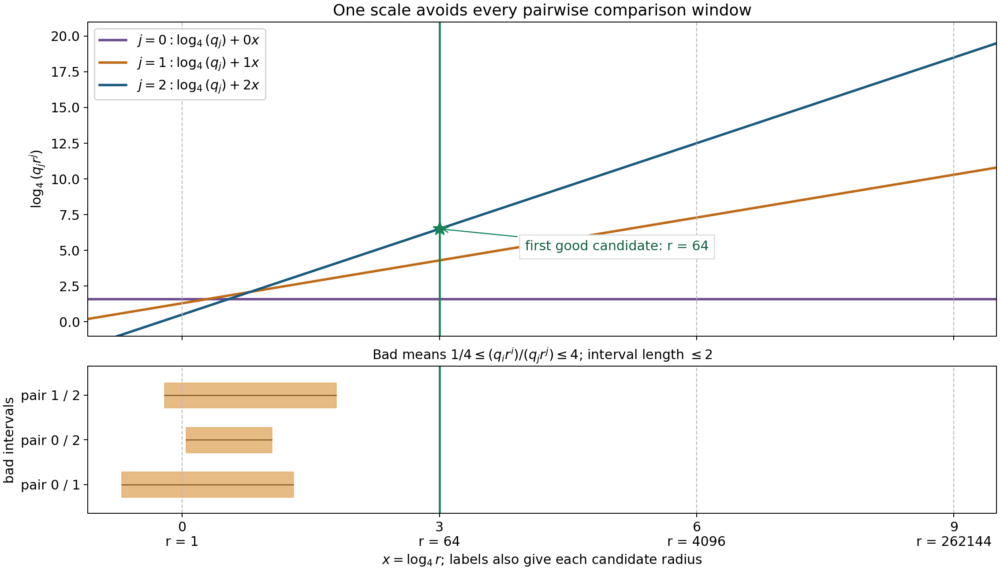
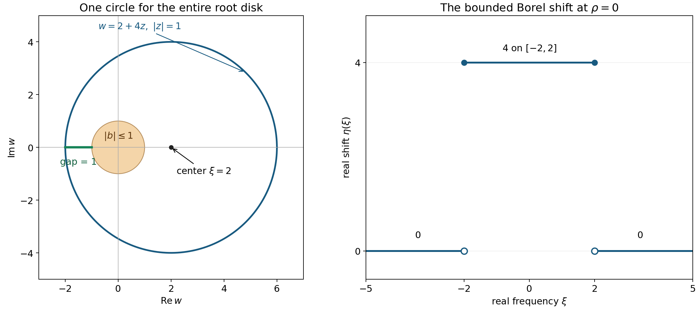

# One contour for a compact family of equations

*Written by GPT-6.1 Sol (OpenAI), Ultra reasoning effort, October 2026. Self-checked by GPT-6.1 Sol (OpenAI). Public domain (CC0).*

Dividing a Fourier transform by a polynomial requires a place where the polynomial does not vanish. For a family of equations, the same place must work for every member. This lesson constructs bounded real vectors whose complex rotations give a common denominator estimate at every real frequency. The estimate survives any prescribed bounded complex translation. The vector field is measurable and can be constant on lattice cubes; no continuity of that field is required.

Read [Rescaled symbols and stable strength](rescaled-symbols-and-stable-strength.md) and [The geometry of coefficients and strength](coefficient-geometry-and-strength.md). Two polynomials are equally strong when their full derivative norms on real frequency space bound one another by positive constants. The compact-family estimate in the second lesson is the only family comparison used here. [Regular kernels and changes in the equation](regular-kernels-and-parameter-changes.md) explains how denominator bounds enter the construction of parameter-dependent inverses.

Basic references are Mantlik's original analytic-parameter paper [Mantlik], Malgrange's existence and approximation paper [Malgrange], and Grubb's lecture notes [Grubb]. The proof uses positive derivative masses at three scales. A finite list of radii isolates one homogeneous order, and rotating a real point preserves its modulus while the other orders remain small.

## 1. The exact theorem

Fix \(n\ge1\), a nonzero \(Q\in\mathbb C[\xi_1,\ldots,\xi_n]\), and a compact set \(K\subset E(Q)\). Here \(E(Q)\) is the set of polynomials equally strong as \(Q\), in the finite-dimensional coefficient space of weaker polynomials. Put \(m=\deg Q\). All members of \(E(Q)\) have degree at most \(m\). For any polynomial of that degree bound define
\[
J_P(a,t)=\sum_{|\alpha|\le m}t^{|\alpha|}
                            |\partial^\alpha P(a)|,
\qquad a\in\mathbb C^n,\quad t>0.
\tag{UC1}
\]
In particular \(S_P(\xi)\le J_P(\xi,1)\le\sqrt{\binom{n+m}{n}}S_P(\xi)\).

**Theorem 1.1.** For every \(\rho\ge0\), there are \(A\ge1\) and a bounded Borel map
\(\eta:\mathbb R^n\to\mathbb R^n\) such that
\[
J_P(\xi,1)\le
A\,|P(\xi+\zeta+z\eta(\xi))|
\tag{UC2}
\]
for every \(P\in K\), every real \(\xi\), every \(\zeta\in\mathbb C^n\) with \(|\zeta|_\infty\le\rho\), and every complex \(z\) with \(|z|=1\). The map can be chosen constant on each half-open unit cube \(a+[0,1)^n\), \(a\in\mathbb Z^n\).

There is no hypoellipticity, ellipticity, connectedness or small-neighborhood assumption on \(K\). The same map is used for all its members and for all permitted complex shifts. Empty \(K\) is vacuous. If \(m=0\), all polynomials are nonzero constants and \(\eta=0,A=1\) prove the assertion. Hence assume \(m\ge1\) and \(K\ne\varnothing\) below.

We use Proposition 5.1 of [The geometry of coefficients and strength](coefficient-geometry-and-strength.md), which proves uniform scaled comparison on compact equally strong families, and Lemma 1.1 of [Rescaled symbols and stable strength](rescaled-symbols-and-stable-strength.md), which compares the jet norm with a real-ball supremum. The complex-shift and positive-coefficient estimates are proved below.

## 2. Jet shifts and a common real point

For \(u\ge0\), put
\[
E_m(u)=\sum_{|\beta|\le m}\frac{u^{|\beta|}}{\beta!}.
\]
The zero-power term is one. For every complex base point \(a\), every complex shift \(h\) with \(|h|_\infty\le ut\), and every \(t>0\), the finite Taylor formula gives
\[
J_P(a+h,t)\le E_m(u)J_P(a,t).
\tag{UC3}
\]
Indeed, expand every \(\partial^\alpha P(a+h)\). For each total derivative index \(\gamma=\alpha+\beta\), its coefficient after multiplication by \(t^{|\alpha|}\) is bounded by
\[
t^{|\gamma|}\sum_{\beta\le\gamma}
                              \frac{u^{|\beta|}}{\beta!}
\le t^{|\gamma|}E_m(u).
\]
Summing proves (UC3). Applying it with base \(a+h\) and shift \(-h\) gives the reverse comparison with the same constant.

Let \(\mathcal P\) be any compact subset of \(E(Q)\), enlarged to include \(Q\) if necessary. Uniform scaled comparison and equivalence of the finite \(\ell^1\) and \(\ell^2\) derivative norms give a constant \(B\ge1\) such that
\[
B^{-1}J_Q(\xi,t)\le J_P(\xi,t)\le B J_Q(\xi,t)
\quad(P\in\mathcal P,\ \xi\in\mathbb R^n,\ t\ge1).
\tag{UC4}
\]
The reference polynomial \(Q\) remains fixed throughout the construction.

The real-ball norm equivalence supplies \(C_w\ge1\), depending only on \(m,n\), such that
\[
J_R(\xi,t)\le C_w\max_{|h|\le t}|R(\xi+h)|.
\tag{UC5}
\]
The ball here is a closed real Euclidean ball. Passing from the stated \(\ell^2\) version to (UC5) costs only the square root of the number of derivatives. The maximum is positive for a nonzero polynomial: vanishing on a real open ball makes all of its real derivatives at the center zero. This also directly proves that the real-ball supremum is a norm on the finite-dimensional complex polynomial space.

Write \(C_s=E_m(1)\), \(C_0=C_sC_w\), and set
\[
\mu=\max(1,2B^2C_0),\qquad
A_0=2C_sB^2C_0.
\tag{UC6}
\]

**Lemma 2.1 (one common real point).** For every real \(\xi\) and every \(r\ge\mu\), there is a real \(\eta\), \(|\eta|\le r\), such that
\[
J_P(\xi,r)\le A_0|P(\xi+\eta)|
\qquad(P\in\mathcal P).
\tag{UC7}
\]

**Proof.** Choose \(y=\xi+\eta\) where \(|Q|\) attains its maximum \(M>0\) on the real ball \(\xi+\overline B(0,r)\). The choice uses only \(Q,\xi,r\). Since \(|y-\xi|_\infty\le r\), (UC3) and (UC5) give
\[
J_Q(y,r)\le C_sJ_Q(\xi,r)\le C_0M.
\]
For every \(P\in\mathcal P\), (UC4) at scales \(r\) and \(1\) gives
\[
J_P(y,r)\le BC_0M,\qquad
J_P(y,1)\ge B^{-1}J_Q(y,1)\ge M/B.
\]
Every positive-order term in \(J_P(y,1)\) is at most \(r^{-1}\) times its term in \(J_P(y,r)\). Therefore
\[
\begin{aligned}
|P(y)|
&=J_P(y,1)-\sum_{|\alpha|\ge1}|\partial^\alpha P(y)|\\
&\ge M/B-BC_0M/r\ge M/(2B).
\end{aligned}
\tag{UC8}
\]
Finally use the reverse real shift at scale \(r\):
\[
J_P(\xi,r)\le C_sJ_P(y,r)
             \le C_sBC_0M\le A_0|P(y)|.
\]
This proves the simultaneous estimate. \(\square\)

## 3. A finite list of radii isolates one derivative order

Put
\[
D=\max(2,12A_0B^2),\qquad
H=\max(2,2mD^m),\qquad
r_0=\max(D,\mu),\qquad
N=\frac{m(m+1)}2.
\]
Use the \(N+1\) radii
\[
r_l=r_0H^{3l},\qquad 0\le l\le N.
\tag{UC9}
\]
They depend on the compact family and degree/dimension, and not on the frequency.

At a fixed real \(\xi\), write
\[
q_j=\sum_{|\alpha|=j}|\partial^\alpha Q(\xi)|,
\qquad
p_j=\sum_{|\alpha|=j}|\partial^\alpha P(\xi)|.
\]
These coefficients are nonnegative and \(J_Q(\xi,t)=\sum_{j=0}^m q_jt^j\). At least one \(q_j\) is positive, because \(Q\ne0\).

**Lemma 3.1 (finite separation of positive masses).** One radius \(r\) from (UC9) has a unique largest mass \(q_kr^k\), and
\[
q_jr^j< H^{-1}q_kr^k\qquad(j\ne k).
\tag{UC10}
\]

**Proof.** For a pair \(i<j\) with \(q_iq_j>0\), call a candidate radius bad for that pair when
\[
H^{-1}\le \frac{q_ir^i}{q_jr^j}\le H.
\]
Between consecutive candidates this ratio changes by a factor \(H^{3(j-i)}\), or its reciprocal. Its factor is at least \(H^3>H^2\), so it can belong to the indicated interval at at most one candidate. There are at most \(N\) pairs, hence at most \(N\) bad candidate indices. At one of the \(N+1\) candidates no pair is bad. Select a largest mass there. It is unique, because equality of two positive masses would make their pair bad. Every other positive mass is less than \(1/H\) times it; zero masses satisfy the same strict inequality. \(\square\)

*The finite-gap choice in Lemma 3.1.* This exact model uses \(Q(w)=(w+3)^2\) at frequency zero, so the derivative masses are \(q_0=9,q_1=6,q_2=2\). With \(H=4\) and starting radius one, the candidates are \(1,64,4096,262144\). Each shaded interval is where one pair of logarithmic masses differs by at most one. Its length is at most two, while successive candidates are three units apart. The first candidate with no bad pair is \(r=64\), where order two dominates. These constants illustrate the finite-gap argument alone; the later transfer estimate chooses its own larger constants in (UC9).

The purpose of the wide spacing is to make a *single* order work for every polynomial, rather than separately isolating an order for each member.

**Lemma 3.2 (transfer to the entire compact family).** For the radius \(r\) and order \(k\) in Lemma 3.1,
\[
\sum_{j\ne k}r^jp_j\le \frac1{4A_0}J_P(\xi,r)
\qquad(P\in\mathcal P).
\tag{UC11}
\]

**Proof.** Both \(r/D\) and \(Dr\) are at least one. At either of these two scales, (UC10) implies
\[
J_Q(\xi,r/D)\le\tfrac32q_k(r/D)^k,\qquad
J_Q(\xi,Dr)\le\tfrac32q_k(Dr)^k.
\tag{UC12}
\]
Indeed the ratio of another mass to the \(k\)-th mass changes by at most \(D^m\), and the sum of the \(m\) other ratios is at most \(mD^m/H\le1/2\).

For orders below \(k\), compare at \(r/D\); for orders above \(k\), compare at \(Dr\). Positivity of every derivative mass and (UC4) give
\[
\begin{aligned}
\sum_{j<k}r^jp_j
&\le D^{k-1}J_P(\xi,r/D)
 \le \frac{3B}{2D}q_kr^k,\\
\sum_{j>k}r^jp_j
&\le D^{-k-1}J_P(\xi,Dr)
 \le \frac{3B}{2D}q_kr^k .
\end{aligned}
\tag{UC13}
\]
If \(k=0\) or \(k=m\), the respective empty sum is zero and its displayed upper bound is still valid. At the middle scale, \(J_P(\xi,r)\ge B^{-1}q_kr^k\). Thus the total in (UC13) is at most
\[
\frac{3B^2}{D}J_P(\xi,r)\le\frac1{4A_0}J_P(\xi,r).
\]
This proves (UC11). Only positivity and the three scale comparisons are used in this step. \(\square\)

## 4. Rotating the common real point

For a real vector \(\eta\), let
\[
P_{\xi,j}(\eta)=
\sum_{|\alpha|=j}\frac{\partial^\alpha P(\xi)}{\alpha!}\eta^\alpha.
\]
The finite Taylor identity is
\[
P(\xi+z\eta)=\sum_{j=0}^m z^j P_{\xi,j}(\eta).
\tag{UC14}
\]
When \(|\eta|\le r\), each \(|P_{\xi,j}(\eta)|\le r^jp_j\). The factorials in (UC14) only decrease that upper bound; the masses defining \(J\) have no factorial weights.

**Proposition 4.1 (a circle for the full family).** For every real \(\xi\) there is a radius \(r\) in the fixed finite list (UC9) and a real \(\eta\), \(|\eta|\le r\), such that
\[
J_P(\xi,r)\le 2A_0|P(\xi+z\eta)|
\qquad(P\in\mathcal P,\ |z|=1).
\tag{UC15}
\]
In particular \(|\eta|\le r_0H^{3N}\).

**Proof.** Choose \(r,k\) by Lemma 3.1, and choose the real vector \(\eta\) by Lemma 2.1 at that radius. It is the same vector for every \(P\). Set \(e_P=\sum_{j\ne k}r^jp_j\), so \(e_P\le J_P(\xi,r)/(4A_0)\). From the common real-point estimate,
\[
|P_{\xi,k}(\eta)|
\ge |P(\xi+\eta)|-e_P
\ge J_P(\xi,r)/A_0-e_P.
\]
For every unit complex \(z\), the \(k\)-th term has the same modulus, while the sum of all other terms has modulus at most \(e_P\). Therefore
\[
|P(\xi+z\eta)|
\ge J_P(\xi,r)/A_0-2e_P
\ge J_P(\xi,r)/(2A_0).
\]
This proves the proposition, including the cases \(k=0\) and \(k=m\). \(\square\)

## 5. Complex shifts and a bounded Borel choice

We now prove Theorem 1.1 for its full complex-shift radius \(\rho\). Form the compact family
\[
\mathcal P=
\{P(\,\cdot+h): P\in K,\ h\in\mathbb C^n,\ |h|_\infty\le\rho+1\}
\ \cup\ \{Q\}.
\tag{UC16}
\]
The coefficient translation map is continuous, so this set is compact. Every translated polynomial is equally strong as \(Q\): (UC3) and its reverse at scale one compare its derivative norm with that of \(P\), uniformly for bounded \(h\); the fixed equivalence between \(J\) and \(S\) gives equal strength. Thus \(\mathcal P\subset E(Q)\), and all the preceding construction applies with one set of constants.

For each \(a\in\mathbb Z^n\), use Proposition 4.1 at the real center \(a\) to choose \(r_a\) from (UC9) and \(\eta_a\in\mathbb R^n\), \(|\eta_a|\le r_a\). For a specific choice, take the first radius with no bad pair in Lemma 3.1, let \(y_a\) be the lexicographically least maximizer of \(|Q|\) on \(a+\overline B(0,r_a)\), and set \(\eta_a=y_a-a\). Such a maximizer exists by successive minimization of coordinates on compact nonempty sets. Only countably many choices are used.

Define
\[
\eta(\xi)=\eta_a\quad\text{if }\xi\in a+[0,1)^n.
\tag{UC17}
\]
The cubes are Borel, disjoint and cover real space. The preimage of an open set is a countable union of these cubes, so \(\eta\) is Borel. Its norm is bounded by the common finite maximum \(r_0H^{3N}\).

Fix \(P\in K\), real \(\xi\in a+[0,1)^n\), and \(|\zeta|_\infty\le\rho\). Put \(h=\xi-a+\zeta\), so \(|h|_\infty\le\rho+1\), and \(P_h=P(\cdot+h)\in\mathcal P\). Proposition 4.1 gives, for all \(|z|=1\),
\[
|P(\xi+\zeta+z\eta(\xi))|
=|P_h(a+z\eta_a)|
\ge \frac{J_{P_h}(a,r_a)}{2A_0}.
\]
Since \(r_a\ge1\), positivity of the derivative masses and the reverse unit-scale shift give
\[
\begin{aligned}
J_{P_h}(a,r_a)
&\ge J_{P_h}(a,1)=J_P(\xi+\zeta,1)\\
&\ge E_m(\rho)^{-1}J_P(\xi,1).
\end{aligned}
\tag{UC18}
\]
Taking \(A=2A_0E_m(\rho)\) proves (UC2). The same constants and same real Borel vector field work simultaneously for all \(P,\xi,\zeta,z\) in the asserted ranges. This completes the proof of Theorem 1.1. \(\square\)

The common contour also gives a Banach-space existence theorem. [Contour spaces and solvability for families of equations](contour-spaces-and-solvability-for-families-of-equations.md), Theorem 5.2, proves a uniform solution bound for every member of the compact family, including both endpoint Fourier exponents.

## 6. Examples

**Example 6.1 (a two-valued real shift).** For the monic linear family \(P_b(w)=w-b\), \(|b|\le1\), and arbitrary \(\rho\ge0\), one can take \(A=4\) and
\[
\eta(\xi)=
\begin{cases}
4(1+\rho),&|\xi|\le2(1+\rho),\\
0,&|\xi|>2(1+\rho).
\end{cases}
\]
Inside the interval, \(|\xi+\zeta-b|\le3(1+\rho)\), so the circle denominator is at least \(1+\rho\), while \(J_{P_b}(\xi,1)=|\xi-b|+1\le4(1+\rho)\). Outside it, the denominator is at least \(|\xi|-(1+\rho)>|\xi|/2\), while \(J_{P_b}(\xi,1)\le|\xi|+2\le2|\xi|\). These prove the claimed constant, uniformly in the complex shift and root. At \(\rho=0,\xi=2,b=-1,z=-1\), equality in the bound \(J\le4|P|\) is attained.

*Example 6.1 at \(\rho=0\).* The roots \(b\) fill the closed unit disk. At the center \(\xi=2\), the chosen contour is \(w=2+4z\), \(|z|=1\). Its distance from the root disk is one. The largest derivative mass there is four, so \(A=4\) works, with equality at \(b=-1,z=-1\). The right panel shows the exact Borel shift: solid endpoints belong to the interval, and the lower endpoints are excluded. Outside that interval the contour is the single point \(\xi\).

**Example 6.2 (good real points and bad circles).** A good real point alone does not give a good circle. For \(P_s(w)=w-is\), \(1\le s\le2\), every positive real point \(r\) has \(J_{P_s}(0,r)=s+r\le\sqrt2|P_s(r)|\). Nevertheless each radius \(r\in[1,2]\) gives a zero on its circle for the member \(s=r\), at \(z=i\). This is why the derivative-order separation is a substantive part of the argument.

**Example 6.3 (reading the finite list of scales).** For the quadratic used in the first drawing, the three masses at \(r=1\) are \(9,6,2\), and some pairs have ratio between \(1/4\) and \(4\). At \(r=64\), they are
\[
9,\qquad384,\qquad8192.
\]
The ratios of the largest mass to the other two are greater than four; the ratio \(384/9\) is also greater than four. Thus no pair is bad at this candidate. The derivative value \(q_2=2\) is used in the jet mass; the Taylor coefficient of \(w^2\) is one. The factorial in (UC14) accounts for that distinction.

**Example 6.4 (a compact family with no common real circle).** The constant-strength assumption cannot be replaced by compactness and a fixed positive degree. In dimension at least two, let \(P_v(\xi)=v\cdot\xi\), \(v\) ranging over the real unit sphere. At \(\xi=0,\zeta=0\), any real \(\eta\) has a unit \(v\perp\eta\). That member vanishes on the entire proposed circle \(z\eta\), while \(J_{P_v}(0,1)=\sum_j|v_j|>0\). Thus no common circle exists even at that single center. These operators do not form a constant-strength family.

## 7. Exercises with complete solutions

**Exercise 1 (20 points).** Derive the complex-shift estimate (UC3) directly from the finite Taylor formula. Compute its constant \(E_2(u)\) in two complex variables. Explain why no factorial occurs in the definition of the derivative mass \(J\).

**Solution.** Expand every \(\partial^\alpha P(a+h)\) as a sum indexed by \(\beta\). If \(|h|_\infty\le ut\), multiplication by \(t^{|\alpha|}\) bounds its term by
\[
t^{|\alpha+\beta|}\,
|\partial^{\alpha+\beta}P(a)|\,
\frac{u^{|\beta|}}{\beta!}.
\]
For a fixed \(\gamma=\alpha+\beta\), summing over \(\beta\le\gamma\) gives a coefficient at most \(E_m(u)\), proving (UC3). The factorial is the Taylor coefficient, while \(J\) is the unweighted sum of derivative moduli with their scale powers. In two variables the orders zero, one and two give
\[
E_2(u)=1+2u+
\left(\frac12+1+\frac12\right)u^2
=1+2u+2u^2.
\]
Assign 12 points to the regrouping and 8 to the constant and factorial convention.

**Exercise 2 (25 points).** For \(a>0\), consider the positive-coefficient mass polynomials
\[
q(t)=(1+at)^2,\qquad p(t)=2(1+a^2t^2).
\]
Prove \(q(t)\le p(t)\le2q(t)\) for \(t\ge0\), and explain why these comparisons do not compare individual coefficients in both directions. Show that the degree-one mass of \(q\) can never satisfy (UC10) with \(H>2\).

**Solution.** The exact differences are
\[
p(t)-q(t)=(1-at)^2\ge0,\qquad
2q(t)-p(t)=4at\ge0.
\]
Thus these arrays obey the two-sided scale comparison with \(B=2\), although \(p\)'s degree-one coefficient is zero and \(q\)'s is \(2a>0\). Reversing their roles also gives a zero coefficient in the comparison denominator. A proof that transfers domination by comparing each coefficient separately would therefore fail.

For \(q\)'s middle mass to dominate both other masses as in (UC10), one would need
\[
1<\frac{2ar}{H},\qquad
a^2r^2<\frac{2ar}{H}.
\]
These imply \(ar>H/2\) and \(ar<2/H\), which are incompatible for \(H>2\). The finite-gap selection consequently chooses order zero or two in this example. Assign 10 points to the two identities, 7 to the coefficient issue and 8 to the excluded order.

**Exercise 3 (25 points).** Replace the unit lattice cubes in the proof by cubes of any fixed side length \(h>0\). Give the complex-translation radius needed in (UC16), construct the Borel shift, and identify the reverse Taylor factor in the final denominator estimate.

**Solution.** Enlarge \(K\) by translations \(P(\cdot+w)\) with \(|w|_\infty\le\rho+h\), and include \(Q\). This is again a compact equally strong family by (UC3), its reverse and continuity of coefficient translation. Apply Proposition 4.1 at every center \(ha\), \(a\in\mathbb Z^n\), using that one enlarged family. On the cube \(ha+[0,h)^n\), use its chosen vector \(\eta_{ha}\).

The countably many half-open cubes are Borel and partition real space, so the resulting bounded piecewise constant map is Borel. For a point \(\xi\) in that cube and \(|\zeta|_\infty\le\rho\), the required translated polynomial uses \(w=\xi-ha+\zeta\), with \(|w|_\infty\le h+\rho\). Its unit-scale derivative mass at the center is \(J_P(\xi+\zeta,1)\). The reverse shift by \(\zeta\) therefore still costs exactly \(E_m(\rho)\), independently of \(h\). The other constants depend on \(h\) through the enlarged compact family. The radius is \(\rho+h\) because the complex shifts use the maximum norm; the Euclidean diameter of a cube does not enter this bound. Assign 10 points to the construction and measurability, 10 to the derivative-mass comparison and 5 to the two radius factors.

**Exercise 4 (30 points).** In two variables let \(P_v(\xi)=v_1\xi_1+v_2\xi_2\), \(v\) ranging over the real unit circle. Prove the obstruction to a common real shift at \(\xi=0,\zeta=0\). What changes at that single center if complex vectors are allowed and one takes \(\eta=(1,i)\)? Verify directly that this family is not equally strong, and explain why the single-center complex calculation does not prove a global contour theorem for it.

**Solution.** For every real \(\eta\), choose a real unit \(v\perp\eta\). Then \(P_v(z\eta)=0\) for every \(z\), while \(J_{P_v}(0,1)=|v_1|+|v_2|\ge1\). A denominator bound for the full family is impossible.

For the complex vector \((1,i)\),
\[
|P_v(z\eta)|=|z|\,|v_1+iv_2|=1
\quad(|z|=1),
\qquad J_{P_v}(0,1)\le\sqrt2.
\]
Thus the single-center, zero-shift obstruction disappears when the vector is allowed to be complex. This only treats \(\xi=0,\zeta=0\); it says nothing about uniformity at other real centers or under all bounded complex shifts.

To check the failed strength hypothesis, take \(v=e_1,e_2\). Along \(\xi=(0,t)\),
\[
S_{P_{e_1}}(0,t)=1,\qquad
S_{P_{e_2}}(0,t)=\sqrt{t^2+1},
\]
so these two operators have no uniform two-sided derivative-norm comparison. Assign 12 points to the real obstruction, 10 to the complex-vector calculation and 8 to the strength test and its quantifier limit.

## 8. References

- [Mantlik] Frank Mantlik, *Partial differential operators depending analytically on a parameter*, Annales de l'Institut Fourier **41** (1991), 577–599. A reference for the uniform-contour theorem is Theorem 1.2. [Original article](https://aif.centre-mersenne.org/articles/10.5802/aif.1266/).
- [Malgrange] Bernard Malgrange, *Existence et approximation des solutions des équations aux dérivées partielles et des équations de convolution*, Annales de l'Institut Fourier **6** (1956), 271–355. [Original article](https://aif.centre-mersenne.org/articles/10.5802/aif.65/).
- [Grubb] Gerd Grubb, *Distributions and Operators*, open lecture-note versions, 2007–2008. [Author's lecture-note index](https://web.math.ku.dk/~grubb/distribution.htm).
