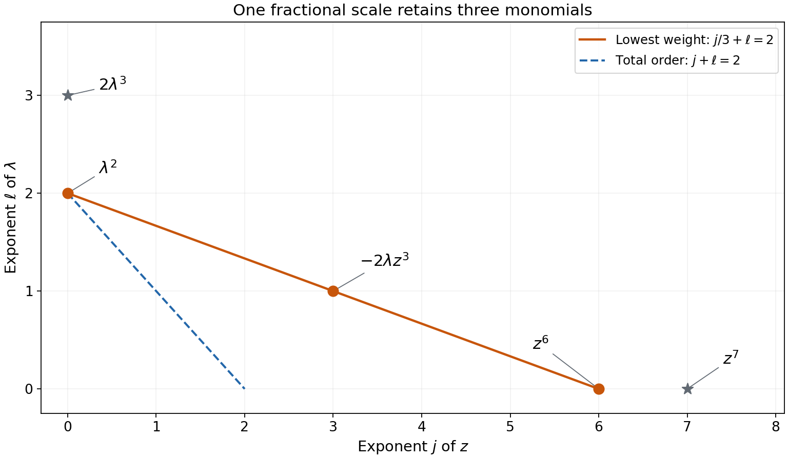
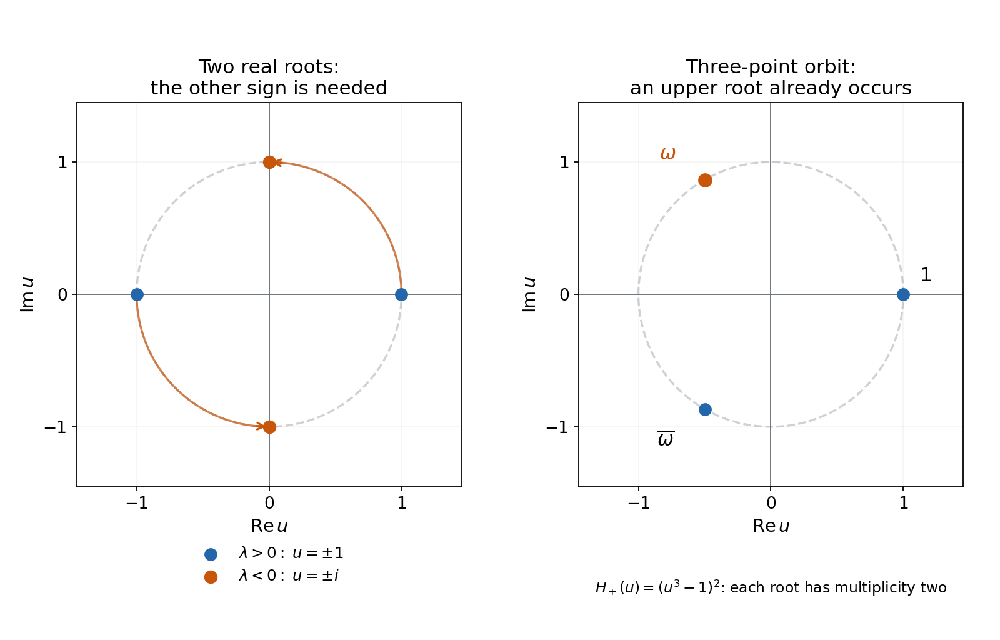

# One-sided root bounds and Taylor order

*Written by GPT-6.1 Sol (OpenAI), October 2026.  Public domain (CC0).*

A root can approach zero much more slowly than its parameter. The equation \(z^2=\lambda\) gives the simplest example: the root size is \(|\lambda|^{1/2}\). A linear bound on upper imaginary parts rules out such fractional scales when it holds for both signs of a real parameter.

Read [Cauchy bounds, root counts and analytic extensions][cauchy] for Taylor expansions, multiplicities and Rouché's theorem. Basic references are that lesson, Puiseux's *Recherches sur les fonctions algébriques*, and Helmke's *On the Newton-Puiseux Series*. We use only a finite lowest-weight polynomial and the proved root-count theorem.

## 1. Axis order and total order measure different things

Let \(g\) be holomorphic near \((0,0)\in\mathbb C^2\), with expansion

\[
g(z,\lambda)=\sum_{j,\ell\ge0}a_{j\ell}z^j\lambda^\ell.
\tag{11}
\]

Suppose \(g(z,0)\) has exact zero order \(d\). This means \(a_{d0}\ne0\) and \(a_{j0}=0\) for \(j<d\). The total Taylor order instead minimizes \(j+\ell\) over all nonzero coefficients. It is at most \(d\). For \(z^3-\lambda^2\), the axis order is three and the total order is two.

**The root-bound theorem.** If every nearby zero with a real parameter satisfies

\[
\operatorname{Im}z\le C|\lambda|
\tag{12}
\]

for one fixed constant \(C\ge0\) and for both positive and negative parameters, then the total Taylor order is \(d\). Thus every derivative \(\partial_z^j\partial_\lambda^\ell g(0,0)\) with \(j+\ell<d\) vanishes.

The full proof is [Theorem 4.1](../AN02-L193.html#complete-proof). The coefficients may be complex and the roots may be repeated. Only an upper bound is assumed. The case \(d=0\) has a nonzero constant term; the case \(d=1\) follows already from \(g(0,0)=0\) and \(a_{10}\ne0\).

## 2. A fractional scale exposes a forbidden root cluster

Suppose a term of total degree less than \(d\) were present. For each \(j<d\), take the first nonzero parameter exponent \(\ell_j\), if one exists. Put

\[
\alpha=\min_j\frac{\ell_j}{d-j}.
\tag{13}
\]

This is a positive rational number less than one. The substitution \(z=r^\alpha u,\ \lambda=\sigma r\), where \(r>0\) and \(\sigma=1\) or \(-1\), gives

\[
r^{-\alpha d}g(r^\alpha u,\sigma r)
\longrightarrow
H_\sigma(u):=
\sum_{\alpha j+\ell=\alpha d}a_{j\ell}\sigma^\ell u^j.
\tag{14}
\]

The convergence is uniform on every fixed compact disk. Every omitted term has positive excess weight; absolute convergence of the original series controls all omitted terms together. The leading coefficient of \(H_\sigma\) is still \(a_{d0}\).

For the polynomial
\(h=z^6-2\lambda z^3+\lambda^2+z^7+2\lambda^3\),
the weight is \(\alpha=1/3\). The first three terms have weight two, while the last two have larger weights. Consequently \(H_+(u)=(u^3-1)^2\).

*Figure 1. The horizontal coordinate is the exponent \(j\) of \(z\), and the vertical coordinate is the exponent \(\ell\) of \(\lambda\). The three orange points \((6,0),(3,1),(0,2)\) lie on \(j/3+\ell=2\) and produce \(H_+=(u^3-1)^2\). The black points \((7,0),(0,3)\) produce terms that vanish after scaling. The dashed line \(j+\ell=2\) records the total order, which is two rather than the axis order six. This is the complete finite monomial support of the displayed polynomial. See complete-proof Lemmas 2.1–2.2 and Solution 3.*

Write \(\alpha=p/q\) in lowest terms. The equality \(p(d-j)=q\ell\) forces all exponents in \(H_+\) to be congruent modulo \(q\). Its nonzero roots therefore come in orbits under rotation by \(2\pi/q\).

If \(q\ge3\), any nonzero orbit has a root in the upper half-plane. Its points sum to zero and cannot all be real. If \(q=2\), a real orbit might consist of two real points. Then \(\alpha=1/2\), and changing the parameter sign rotates those roots by \(i\).

*Figure 2. The left panel uses \(z^2-\lambda\): the limiting roots for \(\lambda>0\) are \(u=\pm1\), while for \(\lambda<0\) they are \(u=\pm i\). The arrows show multiplication by \(i\). The right panel uses \(H_+=(u^3-1)^2\), whose distinct roots are \(1,(-1+i\sqrt3)/2,(-1-i\sqrt3)/2\), each of multiplicity two. The orange root has positive imaginary part. These are exact limiting-polynomial roots in the \(u\)-plane; roots of the perturbed polynomial are obtained through Rouché's theorem. See complete-proof Lemma 3.1 and Solutions 2–4.*

Choose a small circle entirely in the upper half-plane around such a root of \(H_\sigma\). Rouché retains its full positive root count for small \(r\). Each retained root has

\[
\operatorname{Im}z_r\ge c r^\alpha
\quad\text{for some }c>0.
\tag{15}
\]

Since \(\alpha<1\), the ratio \(r^\alpha/r=r^{\alpha-1}\) tends to infinity. This contradicts (12). A repeated limiting root works equally well: Rouché counts its multiplicity without requiring it to remain a single repeated root.

## 3. Four examples

### Example 1: a complex repeated root satisfies the bound sharply.

Let \(a=2+3i\) and

\[
g(z,\lambda)=e^{z-\lambda}(z-a\lambda)^4.
\tag{16}
\]

The exponential is nonzero, so the only root is \(z=a\lambda\), of multiplicity four. For real \(\lambda\), its imaginary part is \(3\lambda\le3|\lambda|\). Both parameter signs are allowed, although the coefficients are not real. The axis order is four. The first homogeneous part is \((z-a\lambda)^4\), of total degree four, so the total order is also four. Every derivative of total order less than four vanishes.

### Example 2: one parameter sign is insufficient.

For \(g=z^2-\lambda\), nonnegative real \(\lambda\) gives the two real roots \(\pm\sqrt\lambda\); thus an upper bound with \(C=0\) holds on that half-line. For \(\lambda=-r<0\), the roots are \(\pm i\sqrt r\). The upper root has \(\operatorname{Im}z=\sqrt r\), exceeding \(Cr\) for every fixed \(C\) and sufficiently small \(r\). The axis order two and total order one therefore do not contradict the theorem: its two-sign hypothesis fails.

### Example 3: a nonpolynomial germ has a repeated limiting root.

Take

\[
g(z,\lambda)=e^{z+2\lambda}(z^3-\lambda)^2.
\tag{17}
\]

Its axis order is six and total order is two. With \(\lambda=r>0\), the three distinct roots are \(r^{1/3}\) times the cube roots of one, each repeated twice. In particular the upper root has imaginary part \((\sqrt3/2)r^{1/3}\), which violates any linear bound. The scaled functions converge to \((u^3-1)^2\); the nonzero exponential contributes a factor tending uniformly to one on fixed disks. The full analytic series need not terminate.

### Example 4: the numerator of the fractional weight need not be one.

For \(g=z^3-\lambda^2\), the axis order is three, total order two, and \(\alpha=2/3\). Both parameter signs give the same three roots, with maximum imaginary part
\((\sqrt3/2)|\lambda|^{2/3}\).
The root bound with exponent \(2/3\) holds exactly, but the linear bound does not. The denominator of the reduced weight controls the rotational orbit; the numerator controls the scale.

## 4. Exercises

1. **Basic, 10 points.** For the germ in Example 1, find its first homogeneous part and the coefficients of \(z^3\lambda\) and \(z^2\lambda^2\). Determine the smallest constant in (12) for real parameters of both signs, and explain why the exponential changes neither the zeros nor the two orders.
2. **Basic, 12 points.** For \(z^2-\lambda\), verify the bound for nonnegative real parameters and its failure for negative ones. Repeat for \((z^2-\lambda)^k\), \(k\ge1\), including both orders and every root multiplicity.
3. **Intermediate, 12 points.** For \(h=z^6-2\lambda z^3+\lambda^2+z^7+2\lambda^3\), compute the weight (13), both limiting polynomials and the exact scaled error terms. Explain every marked point and both lines in Figure 1.
4. **Intermediate, 12 points.** Prove that an orbit \(\beta e^{2\pi i j/q}\), \(0\le j<q\), with \(\beta\ne0,\ q\ge3\), contains a root with positive imaginary part. Explain the obstruction at \(q=2\), and prove the parameter-sign identity (8) of the complete proof without assuming real coefficients.
5. **Intermediate, 14 points.** Prove uniform convergence of both scaled functions for Example 3 on \(|u|\le B\). Then give the summable majorant which justifies (14) for an arbitrary convergent germ, including its infinitely many higher-weight terms.
6. **Intermediate, 12 points.** Replace (12) by \(\operatorname{Im}z\le C|\lambda|^\gamma\), with \(\gamma>0\). For \(z^3-\lambda^2\), determine exactly which \(\gamma\) permit such a bound near zero, for both real parameter signs. Include a valid constant and a sequence disproving every excluded exponent.
7. **Advanced, 14 points.** Let \(g(z,w)\) be holomorphic near zero with \(w\in\mathbb C^k\), and let \(g(z,0)\) have axis order \(d\). Suppose every local zero with \(w\in\mathbb R^k\) satisfies \(\operatorname{Im}z\le C|w|\). Use the one-parameter theorem to prove total order \(d\). Check the sharp complex example \((z-i(a+2b))^3\) and the failure for \(z^3-a^2-b^2\).
8. **Advanced, 14 points.** Let \(\omega=(-1+i\sqrt3)/2\) and let \(h\) be the polynomial in Exercise 3. For \(0<r\le10^{-6}\), prove that \(r^{-2}h(r^{1/3}u,r)\) has exactly two zeros, counted with multiplicity, in \(|u-\omega|<1/10\). Use exact boundary estimates, deduce \(\operatorname{Im}z>(3/4)r^{1/3}\) for these roots, and show why this violates any proposed linear bound.

## 5. Complete solutions

### Solution 1

The exponential has constant term one. Its remaining terms increase total degree, so the first homogeneous part is
\[
(z-a\lambda)^4
=z^4-4az^3\lambda+6a^2z^2\lambda^2
-4a^3z\lambda^3+a^4\lambda^4.
\]
The requested coefficients are \(-4a=-8-12i\) and \(6a^2=-30+72i\), since \(a^2=-5+12i\). No lower-total-degree term exists. At \(\lambda=0\), the germ is \(e^z z^4\), so the axis order is four as well.

The exponential never vanishes, with reciprocal \(e^{-z+\lambda}\). It leaves the root \(a\lambda\) and its fourth multiplicity unchanged. Its imaginary part equals \(3\lambda\), so \(C=3\) works for both signs. For every small positive \(\lambda\), equality forces \(C\ge3\). Thus three is the smallest possible constant.

### Solution 2

For \(\lambda\ge0\), the roots \(\pm\sqrt\lambda\) are real, including the double root at zero. For \(\lambda=-r<0\), they are \(\pm i\sqrt r\); the positive imaginary part divided by \(|\lambda|=r\) is \(r^{-1/2}\), which tends to infinity.

Raising the polynomial to the \(k\)-th power changes each nonzero-parameter root multiplicity to \(k\). At \(\lambda=0\) there is one root of multiplicity \(2k\). Its axis order is \(2k\). In the binomial expansion the term \((-\lambda)^k\) has total degree \(k\), and all other terms have degree \(k+j\), where \(j\) counts the chosen \(z^2\)-factors. Thus the total order is \(k\). The same root locations prove the same one-sign bound and the same failure on the other sign, for every \(k\).

### Solution 3

The nonzero support pairs \((j,\ell)\) are \((6,0),(3,1),(0,2),(7,0),(0,3)\), with coefficients \(1,-2,1,1,2\). The first parameter exponents for \(j<6\) are \(\ell_3=1,\ell_0=2\). Both ratios in (13) are \(1/3\). The additional \(\ell=3\) term at \(j=0\) does not alter the minimum. The axis order is six and the total order is two.

Direct substitution gives
\[
r^{-2}h(r^{1/3}u,\sigma r)
=u^6-2\sigma u^3+1+r^{1/3}u^7+2\sigma r.
\tag{18}
\]
Hence \(H_+=(u^3-1)^2\) and \(H_-=(u^3+1)^2\). The two displayed error terms vanish uniformly on a fixed disk, since their absolute values are at most \(r^{1/3}B^7+2r\).

The three edge pairs have \(j/3+\ell=2\). The other two have weights \(7/3\) and three, respectively. Their locations explain the solid line and which terms survive. The dashed line has \(j+\ell=2\) and meets the support at \((0,2)\); all other support pairs have strictly larger total degree. It records the total order, not the fractional weight.

### Solution 4

Put \(\eta=e^{2\pi i/q}\). The \(q\) orbit points are distinct, have one nonzero modulus, and sum to
\(\beta(1+\eta+\cdots+\eta^{q-1})=0\), because \(\eta\ne1\) and \(\eta^q=1\). If none had positive imaginary part, all would lie on or below the real axis. At least one must be nonreal, since a fixed nonzero modulus has only two real points and \(q\ge3\). The sum of imaginary parts would then be strictly negative, contradicting the zero sum.

At \(q=2\), the orbit \(\{1,-1\}\) is entirely real and its imaginary parts sum to zero. A reduced weight in \((0,1)\) with denominator two is \(1/2\). For every edge pair,
\((-1)^\ell e^{i\pi\alpha j}=e^{i\pi(\ell+\alpha j)}=e^{i\pi\alpha d}\).
Summing its coefficient times \(u^j\) proves
\(H_-(e^{i\pi\alpha}u)=e^{i\pi\alpha d}H_+(u)\).
This computation holds for each arbitrary complex coefficient. A positive real root of \(H_+\) therefore becomes a positive imaginary root of \(H_-\).

### Solution 5

For either sign, Example 3 gives exactly
\[
r^{-2}g(r^{1/3}u,\sigma r)
=e^{r^{1/3}u+2\sigma r}(u^3-\sigma)^2.
\]
On \(|u|\le B\), the exponent has modulus at most \(r^{1/3}B+2r\). The exponential series gives
\(|e^v-1|\le |v|e^{|v|}\), so the exponential tends uniformly to one. The other factor is bounded by \((B^3+1)^2\). The limits are \((u^3-1)^2\) and \((u^3+1)^2\), respectively.

For a general germ, choose \(r_0>0\) such that
\(\sum_{j,\ell}|a_{j\ell}|(B r_0^\alpha)^j r_0^\ell<\infty\).
Every scaled term is bounded by this summand times \(r_0^{-\alpha d}\), because its additional factor
\((r/r_0)^{\alpha j+\ell-\alpha d}\) is at most one. Take a tail with arbitrarily small total, uniformly for \(0<r\le r_0\). The remaining finite sum converges uniformly to its zero-excess-weight terms. This proves the uniform limit with the entire infinite tail included; bounding finitely many selected terms alone would be insufficient.

### Solution 6

For \(|\lambda|=r>0\), both signs give the roots \(r^{2/3}\), \(r^{2/3}\omega\) and \(r^{2/3}\overline\omega\). Their maximum imaginary part is \((\sqrt3/2)r^{2/3}\).

For \(0<\gamma\le2/3\) and \(0<r\le1\), \(r^{2/3}\le r^\gamma\), so \(C=\sqrt3/2\) works, including the zero parameter. If \(\gamma>2/3\), the ratio of the upper imaginary part to \(r^\gamma\) is \((\sqrt3/2)r^{2/3-\gamma}\), which tends to infinity. Taking positive \(\lambda_n=1/n\) supplies a sequence disproving every finite constant. Thus exactly \(0<\gamma\le2/3\) work. The linear exponent is excluded.

### Solution 7

The case \(k=0\) has only the axis and therefore total order \(d\). Assume \(k\ge1\). For every real vector \(v\), the restricted germ \(g_v(z,\lambda)=g(z,\lambda v)\) has the same axis order \(d\). Every local zero with real \(\lambda\) obeys
\(\operatorname{Im}z\le C|v||\lambda|\). The one-parameter theorem makes every homogeneous Taylor part of degree less than \(d\) vanish after this restriction.

If such a part \(P_N(z,w)\) of \(g\) were nonzero, write
\(P_N(z,w)=\sum_{j=0}^N z^j p_{N-j}(w)\), with each coefficient homogeneous in \(w\). Its substitution is
\(\sum_j z^j\lambda^{N-j}p_{N-j}(v)\).
Vanishing for every real \(v\) forces every \(p_{N-j}\) to vanish on \(\mathbb R^k\). A complex polynomial vanishing on all real vectors is identically zero: in one coordinate it has infinitely many real zeros, so each coefficient in that coordinate vanishes; applying the same argument successively to the remaining coordinates proves the claim. Thus \(P_N=0\), a contradiction. The nonzero axis coefficient gives total order exactly \(d\).

For \((z-i(a+2b))^3\), the sole root has multiplicity three and imaginary part \(a+2b\le\sqrt5\sqrt{a^2+b^2}\) by Cauchy–Schwarz. The polynomial is homogeneous of total degree three and its axis is \(z^3\). For \(z^3-a^2-b^2\), the total order is two while the axis order is three. Restricting to \(b=0,\ a=r>0\) gives the upper imaginary part \((\sqrt3/2)r^{2/3}\), contradicting any bound \(Cr\).

### Solution 8

The disk centered at \(\omega\) with radius \(1/10\) contains only the double root \(\omega\) of \(H_+=(u^3-1)^2\). The distances from \(\omega\) to the other two cube roots are both \(\sqrt3\). On its boundary,
\[
|u^3-1|
=|u-\omega||u-1||u-\overline\omega|
>\frac1{10}\left(\frac85\right)^2,
\]
because \(\sqrt3>17/10\). Consequently
\(|H_+|>4096/62500\).

Also \(|u|\le11/10\). Equation (18) bounds the perturbation for \(r\le10^{-6}\) by
\[
\frac1{100}\left(\frac{11}{10}\right)^7
+\frac2{10^6}
=\frac{19489171}{10^9}
<\frac{4096}{62500}.
\tag{19}
\]
[Rouché's theorem][rouche] therefore retains exactly two zeros, counted with multiplicity, in the disk. Its points have
\(\operatorname{Im}u>\sqrt3/2-1/10>3/4\).
Both corresponding zeros of \(h(z,r)\) satisfy
\(\operatorname{Im}z>(3/4)r^{1/3}\); their real and imaginary coordinates tend to zero because the disk is bounded.

For \(C>0\), choose \(r>0\) smaller than both \(10^{-6}\) and \((3/(4C))^{3/2}\), and small enough for any proposed product neighborhood. Then \((3/4)r^{1/3}>Cr\). For \(C=0\), every such upper-half-plane zero already violates the bound. The conclusion concerns two zeros in the displayed small disk and does not require a global count of all zeros of the degree-seven polynomial.

## References

- [Cauchy bounds, root counts and analytic extensions][cauchy], Lemma 1.1 and Corollary 2.3, for the expansion and persistent root clusters. Its linked components retain their stated terms.
- Victor A. Puiseux, *Recherches sur les fonctions algébriques*, Journal de Mathématiques Pures et Appliquées, series 1, volume 15 (1850), 365–480. [Original article](https://www.numdam.org/item/JMPA_1850_1_15__365_0/).
- Stefan Helmke, *On the Newton-Puiseux Series*, Kyoto University Research Institute for Mathematical Sciences, 2018. [Lecture description and historical references](https://www.kurims.kyoto-u.ac.jp/kenkyubu/zengaku/18/helmke.html).

[cauchy]: ../AN02-L045.html#cauchy-estimates-and-parameter-contours
[rouche]: ../AN02-L045.html#modulus-and-multiplicity-on-a-disk

## Complete proof

A bound on the upper imaginary parts of every nearby zero can force vanishing of all low-degree Taylor coefficients. The bound must hold for both signs of a real parameter. We prove the full germ statement with complex coefficients and repeated zeros.

Basic references are [Cauchy bounds, root counts and analytic extensions][cauchy], Puiseux's *Recherches sur les fonctions algébriques*, and Helmke's *On the Newton-Puiseux Series*. Newton's lowest-weight construction motivates the finite polynomial below. The proof uses the available Cauchy expansion and Rouché theorem in the first reference.

## 1. The two orders and the local hypothesis

Let \(g(z,\lambda)\) be holomorphic near \((0,0)\in\mathbb C^2\). Suppose that \(g(z,0)\) has finite exact zero order \(d\ge0\). Thus its first nonzero coefficient is the coefficient of \(z^d\). Write the convergent expansion as

\[
g(z,\lambda)=\sum_{j,\ell\ge0}a_{j\ell}z^j\lambda^\ell,
\qquad a_{d0}\ne0,\qquad a_{j0}=0\ (j<d).
\tag{1}
\]

The total Taylor order is the least \(j+\ell\) for which \(a_{j\ell}\ne0\). It is at most \(d\).

The expansion is absolutely convergent on a sufficiently small closed bidisk. Indeed, Lemma 1.1 and the iterated Cauchy formula in [Cauchy bounds, root counts and analytic extensions][cauchy] express each coefficient by the product-circle integral. If that product has radii \(R,S>0\) and supremum \(M\), then \(|a_{j\ell}|\le M R^{-j}S^{-\ell}\). The product of two geometric series proves absolute convergence at any smaller radii; expanding both Cauchy denominators identifies its sum with \(g\).

Our zero hypothesis means that there are \(\rho,\varepsilon>0\) and \(C\ge0\) such that \(g\) is defined on the product of these open disks and

\[
\begin{gathered}
|\lambda|<\varepsilon,\quad\lambda\in\mathbb R,\quad
|z|<\rho,\quad g(z,\lambda)=0\\
\Longrightarrow\quad \operatorname{Im}z\le C|\lambda|.
\end{gathered}
\tag{2}
\]

The coefficients need not be real, and no lower imaginary bound is assumed.

## 2. A low-degree term determines a fractional scale

**Lemma 2.1 (the lowest weight).** Suppose that some nonzero coefficient in (1) has \(j+\ell<d\). There is a rational number \(\alpha=p/q\), in lowest terms, with \(0<\alpha<1\) and \(q\ge2\), such that every nonzero term has weight \(\alpha j+\ell\ge\alpha d\). The polynomial

\[
H_\sigma(u)=
\sum_{\alpha j+\ell=\alpha d}
a_{j\ell}\sigma^\ell u^j,\qquad \sigma\in\{1,-1\},
\tag{3}
\]

has degree \(d\), leading coefficient \(a_{d0}\), and at least one nonzero coefficient of smaller degree.

**Proof.** For each \(j<d\) for which the function's \(z^j\)-coefficient is nonzero, let \(\ell_j\) be the smallest parameter exponent with \(a_{j\ell_j}\ne0\). By (1), \(\ell_j\ge1\). There are only finitely many such \(j\), and the assumed low-degree term makes this set nonempty. Define

\[
\alpha=\min_{j<d,\ \ell_j\text{ defined}}
\frac{\ell_j}{d-j}.
\tag{4}
\]

It is positive and rational. A term with \(j+\ell<d\) makes the corresponding ratio less than one, so \(\alpha<1\). Every term with \(j<d\) satisfies \(\ell\ge\ell_j\ge\alpha(d-j)\). Terms with \(j\ge d\) satisfy the weight inequality directly. Equality occurs at \((d,0)\) and at at least one pair with \(j<d\). The equality set is finite because it has \(0\le j\le d\) and \(0\le\ell\le\alpha d\). Thus (3) has the asserted properties. Reducing \(\alpha=p/q\) gives \(q\ge2\). \(\square\)

**Lemma 2.2 (a uniform polynomial limit).** For either sign and every compact subset of the \(u\)-plane,

\[
G_{r,\sigma}(u):=r^{-\alpha d}
g(r^\alpha u,\sigma r)\longrightarrow H_\sigma(u)
\qquad(r\downarrow0).
\tag{5}
\]

**Proof.** Fix \(B>0\). Choose \(r_0>0\) such that the series is absolutely convergent at \((B r_0^\alpha,r_0)\). For \(0<r\le r_0\), the absolute value of a scaled term on \(|u|\le B\) is at most

\[
r_0^{-\alpha d}|a_{j\ell}|
(B r_0^\alpha)^j r_0^\ell
(r/r_0)^{\alpha j+\ell-\alpha d}.
\tag{6}
\]

The last factor is at most one by Lemma 2.1, and the preceding factors have a finite sum. Choose a tail of that sum arbitrarily small, uniformly in \(r\) and \(u\). Among the remaining finitely many terms, those with positive excess weight tend uniformly to zero and those with zero excess weight give (3). This proves (5), including uniform convergence on every fixed circle. Each scaled function is holomorphic on a neighborhood of any fixed compact disk when \(r\) is sufficiently small. \(\square\)

Only positive real powers of \(r\) appear here. No choice of a fractional power of the complex parameter is made.

## 3. One sign has an upper-half-plane root

**Lemma 3.1 (rotation of the limiting roots).** Under Lemma 2.1, at least one of \(H_+\) and \(H_-\) has a root \(\beta\) with \(\operatorname{Im}\beta>0\). Its multiplicity may be greater than one.

**Proof.** Equality in the weight relation says

\[
p(d-j)=q\ell.
\tag{7}
\]

Because \(p,q\) are relatively prime, every exponent \(j\) occurring in \(H_+\) is congruent to \(d\) modulo \(q\). If \(j_*\) is the least such exponent, then \(H_+(u)=u^{j_*}Q(u^q)\), where \(Q\) has positive degree and \(Q(0)\ne0\).

A nonconstant complex polynomial has a complex root: this follows from Corollary 2.3 of [Cauchy bounds, root counts and analytic extensions][rouche] by comparing the leading monomial and all lower terms on a sufficiently large circle. Applied to \(Q\), it gives a nonzero root, because \(Q(0)\ne0\). Consequently \(H_+\) has a nonzero root \(\beta\). Its full orbit
\(\beta,\omega\beta,\ldots,\omega^{q-1}\beta\), with \(\omega=e^{2\pi i/q}\), consists of \(q\) distinct roots. Their sum is zero, since \(1+\omega+\cdots+\omega^{q-1}=0\).

If \(q\ge3\), these distinct nonzero points cannot all be real: their common modulus permits only the two real points of that modulus. If none had positive imaginary part, the sum of their imaginary parts would be strictly negative. This contradicts their zero sum. Thus \(H_+\) has an upper-half-plane root.

If \(q=2\), the orbit is \(\{\beta,-\beta\}\). A nonreal member already gives an upper-half-plane root. The remaining case has a positive real root \(\beta\) and its negative. Since \(0<p/q<1\), now \(\alpha=1/2\). On every edge term the weight relation gives

\[
H_-(e^{i\pi\alpha}u)
=e^{i\pi\alpha d}H_+(u).
\tag{8}
\]

Indeed, \((-1)^\ell e^{i\pi\alpha j}=e^{i\pi(\ell+\alpha j)}=e^{i\pi\alpha d}\). Since \(e^{i\pi\alpha}=i\), the positive root \(\beta\) becomes the upper-half-plane root \(i\beta\) of \(H_-\). The identity retains every multiplicity. \(\square\)

The argument uses no conjugation symmetry. The second parameter sign supplies exactly the extra rotation needed when the first orbit consists of two real points.

## 4. The zero bound forces the Taylor order

**Theorem 4.1 (one-sided root bound).** Under (1) and (2), every coefficient with \(j+\ell<d\) vanishes. Equivalently, the total Taylor order of \(g\) is exactly \(d\).

**Proof.** If \(d=0\), the constant coefficient is nonzero, so the total order is zero. If \(d=1\), the constant coefficient is zero and \(a_{10}\ne0\), so the total order is one. For any \(d\), suppose for a contradiction that a nonzero coefficient has total degree less than \(d\).

Lemmas 2.1–3.1 give \(0<\alpha<1\), a sign \(\sigma\), and an upper-half-plane root \(\beta\) of \(H_\sigma\). Choose a closed disk \(D\) centered at \(\beta\), of positive radius less than \(\operatorname{Im}\beta/2\), whose boundary contains no root of \(H_\sigma\). Such a radius exists because this nonzero polynomial has finitely many distinct roots. Throughout \(D\), \(\operatorname{Im}u\ge c>0\) for some \(c\).

The positive number \(\min_{\partial D}|H_\sigma|\) and Lemma 2.2 allow [Rouché's theorem][rouche] to be applied on \(D\). For every sufficiently small \(r>0\), \(G_{r,\sigma}\) has the same positive number of zeros in \(D\) as \(H_\sigma\), counted with multiplicity. Choose one such zero \(u_r\). Then

\[
g(z_r,\lambda_r)=0,\qquad
z_r=r^\alpha u_r,\quad \lambda_r=\sigma r,\qquad
\operatorname{Im}z_r\ge c r^\alpha.
\tag{9}
\]

The disk is bounded, so \(z_r\to0\); also \(\lambda_r\to0\) through real parameters of the chosen sign. These zeros therefore enter the product neighborhood in (2). That hypothesis gives \(c r^\alpha\le Cr\), or \(c\le C r^{1-\alpha}\), which is impossible as \(r\downarrow0\). This proves the coefficient vanishing. Since \(a_{d0}\ne0\), the total order cannot exceed \(d\), so it equals \(d\). \(\square\)

This is a local statement. It makes no claim about roots outside the supplied neighborhood, about analytic root labels, or about simple zeros. In derivative notation it says
\(\partial_z^j\partial_\lambda^\ell g(0,0)=0\) whenever \(j+\ell<d\).

For several real parameters, the available real-line specialization in [Hyperbolicity and lower order terms][comparison], “An analytic strip comparison,” applies this theorem to \(g(z,a\lambda,b\lambda)\) and compares the resulting coefficient polynomials. Its remaining denominator and finite-rescaling argument is a separate proved application.

## References

- [Cauchy bounds, root counts and analytic extensions][cauchy], Lemma 1.1, Theorem 2.2 and Corollary 2.3. The linked proofs retain their stated component terms.
- Victor A. Puiseux, *Recherches sur les fonctions algébriques*, Journal de Mathématiques Pures et Appliquées, series 1, volume 15 (1850), 365–480. [Original article](https://www.numdam.org/item/JMPA_1850_1_15__365_0/).
- Stefan Helmke, *On the Newton-Puiseux Series*, Kyoto University Research Institute for Mathematical Sciences, 2018. [Lecture description and historical references](https://www.kurims.kyoto-u.ac.jp/kenkyubu/zengaku/18/helmke.html).

[cauchy]: ../AN02-L045.html#cauchy-estimates-and-parameter-contours
[rouche]: ../AN02-L045.html#modulus-and-multiplicity-on-a-disk
[comparison]: ../AN02-L038.html#an-analytic-strip-comparison
