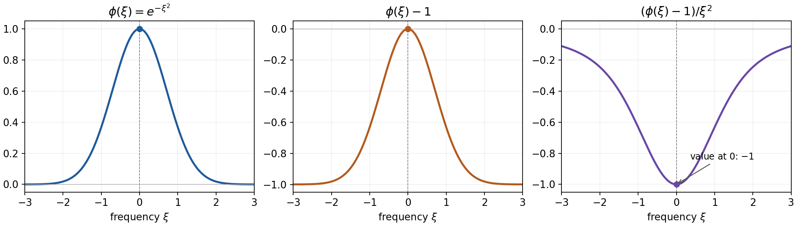

# Polynomial reciprocals and tempered fundamental solutions

*Written by GPT-6.1 Sol (OpenAI), Ultra reasoning effort, October 2026. Self-checked by the writing AI. Public domain (CC0).*

The Fourier transform turns a constant-coefficient differential equation into multiplication by a polynomial. Away from the zeros, division is ordinary division. At a zero, a reciprocal may have to be a distribution. This lesson constructs a tempered reciprocal for every nonzero complex polynomial and hence a tempered fundamental solution for every constant-coefficient polynomial operator.

Read [Schwartz Fourier foundations](../prerequisites/schwartz-fourier-foundations.html), [Fundamental solutions and the directions an equation uses](fundamental-solutions-and-active-directions.md), and [Regularity and tempered growth](regularity-and-tempered-growth.md). The last lesson distinguishes local Fourier regularity from growth at infinity. Basic references are Bernstein [B] for the polynomial functional equation, Grubb [G] for tempered Fourier analysis, and Hörmander [H] for constant-coefficient equations. The [complete proof](#complete-proof) includes the algebraic finiteness argument, the continuation of distributions, and every step of the construction.

## 1. A reciprocal of the constant one

**Theorem 1.1.** Let \(P\) be any nonzero polynomial with complex coefficients on \(\mathbb R^n\). There is \(U\in\mathcal S'(\mathbb R^n)\) with
\[
                              P U=1. \tag{1}
\]
Therefore \(E=\mathcal F^{-1}U\) is tempered and
\[
                              P(D)E=\delta_0. \tag{2}
\]
The Fourier convention is \(\widehat f(\xi)=\int e^{-ix\cdot\xi}f(x)\,dx\), with \(D=-i\partial\).

The theorem includes repeated real zeros, nonreal coefficients, and polynomials independent of some variables. The polynomial \(P=0\) is excluded because its product with any distribution is zero. For a nonzero constant \(a\), take \(U=1/a\) and \(E=\delta_0/a\).

The construction uses polynomial differential operators acting on a parameter family. It never requires multiplying two singular distributions. Its consequence for compact data is also useful: if \(f\) is a compactly supported distribution, \(E*f\) is tempered and solves \(P(D)(E*f)=f\). The complete-proof Corollary 7.1 proves the required continuity on Schwartz tests.

## 2. Continuing a polynomial power

Conjugate the coefficients of \(P\) to obtain \(P^\#\), and put
\[
                             F=P P^\#.
\]
On real space, \(F=|P|^2\). For \(\operatorname{Re}s>0\), the function \(F^s\), set to zero on its zero set, has polynomial growth and defines a tempered distribution \(T(s)\). It depends holomorphically on \(s\). The complete-proof Lemmas 2.1 and 2.2 prove this with a common Schwartz seminorm on each compact parameter set.

Bernstein's functional equation supplies a nonzero scalar polynomial \(b(s)\) and a differential operator \(B(s)\), polynomial in \(s\) and in the real variables, such that
\[
                         b(s)F^s=B(s)F^{s+1}. \tag{3}
\]
Thus the family at \(s\) can be obtained from the family at \(s+1\). Each step can introduce finite-order poles from zeros of \(b\). Repeating the step continues \(T(s)\) meromorphically to every finite complex parameter.

At zero the continuation is holomorphic and equals one. Indeed \(F^s\to1\) almost everywhere as real \(s\downarrow0\), the zero set is null, and \(F^s\leq1+F\) for \(0<s\leq1\). Dominated convergence gives a finite limit on every Schwartz test. A finite-order pole would contradict that limit.

At \(s=-1\), take the constant Laurent coefficient:
\[
                T(s)=\sum_{\ell=-L}^{\infty}A_\ell(s+1)^\ell.
 \tag{4}
\]
The identity \(F T(s)=T(s+1)\) gives \(F A_0=1\), because the right side is holomorphic there with value one. Therefore
\[
                             U=P^\# A_0 \tag{5}
\]
proves (1). Every coefficient in (4) is tempered. This follows from the locally uniform Schwartz-seminorm bounds and the Cauchy formula for the parameter coefficients, as proved in the complete-proof Lemma 2.2.

## 3. Why the functional equation exists

Here is the finite algebraic mechanism behind (3). The full argument is in complete-proof Sections 3–6.

Work over the field \(\mathbb C(s)\), where the parameter is an indeterminate. Polynomial multiplication and ordinary differentiation generate the Weyl algebra. Its operators of total degree at most \(k\) have dimension
\[
                              \binom{k+2n}{2n}. \tag{6}
\]
The noncommutativity has the simple rule \([\partial_i,x_j]=\delta_{ij}\).

A nonzero finitely generated module over this algebra cannot have growth degree below \(n\). To see the key point, an operator of degree at most \(k\) which killed the degree-\(k\) part of a module would, after at most \(k\) commutators, give a nonzero scalar killing a nonzero generator. The complete-proof Theorem 5.2 expands those commutators and proves
\[
              \binom{k+2n}{2n}\leq(\dim M_k)(\dim M_{2k}). \tag{7}
\]
This forces growth degree at least \(n\).

For the cyclic module generated by the formal symbol \(F^s\), the degree is at most \(n\). If \(d=\deg F\), putting the derivatives over a common denominator \(F^k\) bounds the numerator degree by \((d+1)k\). Hence
\[
                         \dim M_k\leq\binom{(d+1)k+n}{n}. \tag{8}
\]
The degree is exactly \(n\). Its leading coefficient, multiplied by \(n!\), is a positive integer called its multiplicity.

Now the cyclic submodules generated by
\[
                             F^s,\ F^{s+1},\ F^{s+2},\ldots
\]
form a descending chain. Every strict inclusion consumes at least one unit of multiplicity, so the chain must have two consecutive equal terms. That equality expresses one power as a polynomial differential operator applied to the next power, with rational dependence on \(s\). Change the parameter back and clear its scalar denominators. The result is (3).

The complete proof supplies the monomial counting, finite-generation and exact-sequence arguments that justify these multiplicities. Thus the chain argument has no assumed finiteness theorem hidden inside it.

## 4. Three reciprocals at real zeros

### Example 1: a simple real zero

For \(P(\xi)=\xi\) on the line, define
\[
 \left\langle\operatorname{pv}\frac1\xi,\phi\right\rangle
       =\int_0^\infty\frac{\phi(t)-\phi(-t)}t\,dt. \tag{9}
\]
The numerator is \(O(t)\) near zero by the mean value theorem, and both tests decrease rapidly at infinity. These bounds also give continuity in a finite set of Schwartz seminorms. Substituting \(\xi\phi\) gives
\[
 \left\langle \xi\,\operatorname{pv}\frac1\xi,\phi\right\rangle
       =\int_0^\infty(\phi(t)+\phi(-t))\,dt
       =\int_{\mathbb R}\phi(t)\,dt.
\]
Thus (9) is a tempered reciprocal. In physical space, \(E(x)=\frac i2\operatorname{sgn}x\) is a tempered fundamental solution of \(D=-i\partial_x\), because \(\partial_x\operatorname{sgn}x=2\delta_0\).

### Example 2: a repeated real zero

For \(P(\xi)=\xi^2\), define the finite part by
\[
 \left\langle\operatorname{fp}\frac1{\xi^2},\phi\right\rangle
    =\lim_{\epsilon\downarrow0}
       \left(\int_{|\xi|>\epsilon}\frac{\phi(\xi)}{\xi^2}\,d\xi
                         -\frac{2\phi(0)}\epsilon\right). \tag{10}
\]
Taylor subtraction shows that the limit exists. More precisely it equals
\[
 \begin{aligned}
 &\int_{|\xi|<1}
       \frac{\phi(\xi)-\phi(0)-\xi\phi'(0)}{\xi^2}\,d\xi\\
 &\qquad+\int_{|\xi|\geq1}\frac{\phi(\xi)}{\xi^2}\,d\xi-2\phi(0).
 \end{aligned}
 \tag{11}
\]
The first integral is bounded by \(\sup_{[-1,1]}|\phi''|\), and the second by \(2\sup|\phi|\). This proves tempered continuity. Replacing \(\phi\) by \(\xi^2\phi\) in (10) gives exactly \(\int\phi\), so the finite part is a reciprocal of \(\xi^2\).

*Figure 1. The test is \(\phi(\xi)=e^{-\xi^2}\). The three panels show \(\phi\), the subtracted test \(\phi-1\), and \((\phi-1)/\xi^2\), extended at zero by \(-1\). These are ordinary functions illustrating (11), not a graph of a distribution. Integration by parts gives the exact pairing \(\langle\operatorname{fp}(1/\xi^2),e^{-\xi^2}\rangle=-2\sqrt\pi\).*

To verify the last value, the odd linear Taylor term vanishes and (10) equals the integral of \((e^{-\xi^2}-1)/\xi^2\). Its boundary terms in integration by parts vanish at both zero and infinity. Differentiating the numerator gives \(-2\xi e^{-\xi^2}\), so the integral is \(-2\int e^{-\xi^2}\,d\xi=-2\sqrt\pi\). The Gaussian integral follows by squaring the positive integral and using polar coordinates in the plane.

### Example 3: a complex linear zero

For \(P(\xi_1,\xi_2)=\xi_1+i\xi_2\), the ordinary function
\[
                     U(\xi)=\frac{\xi_1-i\xi_2}{\xi_1^2+\xi_2^2}
 \tag{12}
\]
is locally integrable: its modulus is \(1/|\xi|\), and polar area measure cancels that singular power near zero. It decreases at infinity, so it is tempered. Its product with \(P\) is one almost everywhere, hence distributionally.

Here \(F=|\xi|^2\). Its power family has a pole at \(s=-1\), but multiplication by \(P^\#\) removes that pole. Solution 8 computes the residue and verifies that (5) gives exactly (12).

## 5. What existence does and does not select

If \(U_1,U_2\) solve (1), their difference \(W\) satisfies \(P W=0\), and it is supported on the real zero set of \(P\). This follows by smooth division on every open set where \(P\ne0\). Support on the zero set alone is insufficient: multiplication can detect normal delta derivatives.

If \(P\) has no real zeros, the tempered reciprocal is unique. For example \(P=1+|\xi|^2\) has the smooth reciprocal \((1+|\xi|^2)^{-1}\). When real zeros are present, choosing boundary conditions or support can select a particular inverse.

The theorem supplies tempered growth. The regular inverse construction supplies the local weight \(S_P\). These are distinct conclusions. The degenerate diffusion example in [Regularity and tempered growth](regularity-and-tempered-growth.md) has no inverse with both properties, even though each existence theorem applies.

## 6. Exercises with complete solutions

### Exercise 1: constants and the Fourier normalization — 5 points

For \(P=a\ne0\), determine both inverses in (1) and (2). State the convention in zero dimensions.

### Solution 1

The frequency distribution is the constant \(U=1/a\), so \(\mathcal F^{-1}U=\delta_0/a\). There is no factor of \(2\pi\), since the inverse transform already contains \((2\pi)^{-n}\) and sends the constant one to delta. In zero dimensions integration and Fourier transformation are the identity on scalars, and the same answer is scalar division.

### Exercise 2: ambiguity at a simple zero — 10 points

Show that every distribution \(W\) on the line with \(\xi W=0\) equals \(c\delta_0\). Deduce all tempered reciprocals of \(P(\xi)=\xi\).

### Solution 2

Choose \(\chi\in C_c^\infty\) equal to one near zero. For every compact test \(\phi\), the function \(\phi-\phi(0)\chi\) vanishes at zero and equals \(\xi\psi\) for a compact smooth \(\psi\); smoothness at zero follows from the integral Taylor formula. Therefore
\[
 \langle W,\phi\rangle=\phi(0)\langle W,\chi\rangle+\langle\xi W,\psi\rangle
                        =c\phi(0).
\]
Thus \(W=c\delta_0\). The difference of two tempered reciprocals has this form. Conversely \(\xi\delta_0=0\), so they are exactly \(\operatorname{pv}(1/\xi)+c\delta_0\). The equality first established on compact tests is equality of tempered distributions because compact smooth functions are dense in the Schwartz topology, as proved in the Fourier foundation reading.

### Exercise 3: a repeated zero in physical space — 15 points

Prove directly that \(E(x)=-|x|/2\) is a tempered fundamental solution of \(D^2\). Also show that \(\delta'_0\) is annihilated by \(\xi^2\), whereas \(\delta''_0\) is not.

### Solution 3

The locally integrable function \(|x|\) has linear growth and is tempered. Integration by parts on the positive and negative half-lines gives \(\partial_x|x|=\operatorname{sgn}x\), and one more integration gives \(\partial_x^2|x|=2\delta_0\). Since \(D^2=-\partial_x^2\), (2) follows. For compact tests,
\[
 \langle \xi^2\delta'_0,\phi\rangle=-(\xi^2\phi)'(0)=0,\qquad
 \langle \xi^2\delta''_0,\phi\rangle=(\xi^2\phi)''(0)=2\phi(0).
\]
Thus \(\xi^2\delta''_0=2\delta_0\). All three delta derivatives are supported at the same point, which illustrates why support alone does not characterize the ambiguity.

### Exercise 4: finding the scalar by commutators — 10 points

In one variable put \(Q=x^2\partial+3x\partial^2+5\). Compute \((\operatorname{ad}\partial)^2(\operatorname{ad}x)Q\), and explain its role in the dimension inequality.

### Solution 4

Using \([x,\partial]=-1\),
\[
 [x,Q]=-x^2-6x\partial,\quad
 [\partial,[x,Q]]=-2x-6\partial,\quad
 [\partial,[\partial,[x,Q]]]=-2.
\]
If this degree-three operator killed the degree-three part of a nonzero module with a generator \(m\), expand the three commutators on \(m\). Every term contains \(Q\) applied to a word of length at most three acting on \(m\), so every term is zero. But their sum is \(-2m\ne0\), a contradiction. This is the scalar-detection step of complete-proof Theorem 5.2.

### Exercise 5: a module of the smallest possible growth — 10 points

Let the one-variable Weyl algebra act on \(K[x]\) by multiplication and differentiation. Use the generator \(1\) to compute the growth degree and multiplicity, and show that the module has no proper nonzero submodule.

### Solution 5

Its degree-\(k\) filtered part is the polynomials of degree at most \(k\), with dimension \(k+1\). Thus \(d=1\) and \(e=1\). A nonzero submodule contains a nonzero polynomial. Differentiating as many times as its degree yields a nonzero constant, since the field has characteristic zero. Scalar division gives \(1\), and multiplication by powers of \(x\) gives every polynomial. The chain therefore has length one, agreeing with the multiplicity bound.

### Exercise 6: a functional equation with repeated factors — 15 points

For \(F(x)=x^d\), \(d\geq1\), find a scalar polynomial \(b(s)\) for which \(\partial_x^d F^{s+1}=b(s)F^s\) holds formally. For \(d=2\), explain why a zero of \(b\) need not be an actual pole of \(T(s)\).

### Solution 6

Differentiating \(x^{d(s+1)}\) \(d\) times gives
\[
 b(s)=\prod_{j=1}^d(ds+j),\qquad
                    \partial_x^d F^{s+1}=b(s)F^s. \tag{13}
\]
This is a formal differential identity, or an ordinary identity after choosing a local logarithm off zero. For \(d=2\), \(b(s)=(2s+1)(2s+2)\). The apparent singularity at \(s=-1\) is removable for \(T(s)=|x|^{2s}\). To see this, subtract \(\phi(0)+x\phi'(0)\) on \(|x|<1\). The remaining integral is holomorphic for \(\operatorname{Re}s>-3/2\), while the subtracted constant contributes \(2\phi(0)/(2s+1)\), and the odd term contributes zero. The outer integral is holomorphic on every bounded parameter set by Schwartz decay. Thus the only pole in this strip is at \(-1/2\); at \(-1\) the expression equals (11). Scalar factors in the recurrence give possible poles, with cancellations permitted.

### Exercise 7: why the value at zero is enough — 15 points

Suppose a meromorphic tempered family \(T(s)\) continues \(F^s\), for a nonzero nonnegative polynomial \(F\), and satisfies \(F T(s)=T(s+1)\). Prove \(T(0)=1\) and \(F A_\ell=0\) for every negative Laurent coefficient at \(-1\).

### Solution 7

The zero set of \(F\) is null. For real \(s\downarrow0\), dominated convergence with \(|F^s|\leq1+F\) gives the weak limit one on every Schwartz test. If a most negative Laurent coefficient at zero were nonzero, choose a test on which it is nonzero. Its scalar pairing would diverge on this real approach. There is therefore no pole at zero, and its value is one. The right side of \(F T(s)=T(s+1)\) is now holomorphic near \(-1\), so every negative coefficient on the left is zero: \(F A_\ell=0\) for \(\ell<0\). The constant coefficient is \(F A_0=1\). No assertion that the individual negative coefficients vanish is required.

### Exercise 8: the residue at a complex linear zero — 20 points

In two dimensions take \(F(\xi)=|\xi|^2\). Compute the residue of \(T(s)=F^s\) at \(s=-1\). Show that multiplication by \(\xi_1-i\xi_2\) removes the pole and gives (12).

### Solution 8

For a Schwartz test put \(g(r)=\int_0^{2\pi}\phi(r\cos\theta,r\sin\theta)\,d\theta\). Taylor expansion and the vanishing angular integral of the linear term give \(g(r)=2\pi\phi(0)+O(r^2)\), with the remainder controlled by the second derivatives on the unit ball. The inner radial integral is
\[
 \int_0^1 r^{2s+1}(g(r)-2\pi\phi(0))\,dr
                         +\frac{\pi\phi(0)}{s+1}. \tag{14}
\]
Its first term is holomorphic for \(\operatorname{Re}s>-2\). The radial integral over \(r\geq1\) is holomorphic on bounded parameter sets by Schwartz decay. Thus
\[
                         \operatorname{Res}_{s=-1}T(s)=\pi\delta_0.
\]
Multiplication by \(\xi_1-i\xi_2\) kills this residue. More directly the function \((\xi_1-i\xi_2)|\xi|^{2s}\) has modulus \(r^{2\operatorname{Re}s+1}\); with area measure it is locally integrable for \(\operatorname{Re}s>-3/2\), including a neighborhood of \(-1\), and its parameter derivatives are dominated there. Hence this multiplied family is holomorphic at \(-1\) and takes the value \((\xi_1-i\xi_2)/|\xi|^2\). Its constant Laurent coefficient is exactly the \(U\) in (5), proving (12).

## References

- **[G]** Gerd Grubb, *Distributions and Operators*, freely readable lecture chapters, especially Chapter 5 on Fourier transformation. [Author's lecture-note index](https://web.math.ku.dk/~grubb/distribution.htm). The Fourier proofs used here are also supplied in the linked foundation reading.
- **[B]** I. N. Bernstein, “The analytic continuation of generalized functions with respect to a parameter,” *Functional Analysis and Its Applications* **6** (1972), 273–285. [Author-hosted article](https://www.math.tau.ac.il/~bernstei/Publication_list/publication_texts/Bern-a-cont-FAN.pdf); [bibliographic record](https://www.mathnet.ru/php/archive.phtml?jrnid=faa&option_lang=eng&paperid=2532&wshow=paper).
- **[H]** Lars Hörmander, *The Analysis of Linear Partial Differential Operators II: Differential Operators with Constant Coefficients*, Springer, 1983; 2005 reprint.

## Complete proof

The construction has an analytic part and a finite algebraic part. A functional equation continues a polynomial power through its singular exponents. The constant Laurent coefficient then supplies a reciprocal. We prove the functional equation using commutators and finite-dimensional growth, including the commutative algebra required for that growth argument.

The Fourier transform and its distributional extension are proved in [Schwartz Fourier foundations](../prerequisites/schwartz-fourier-foundations.html). The one-variable Cauchy integral formula and estimates used for parameter coefficients are in [Cauchy bounds, root counts and analytic extensions](cauchy-bounds-and-root-counts.md). The algebraic method is due to I. N. Bernstein [Bernstein].

## 1. The statement and the coefficient we need

**Theorem 1.1.** For every nonzero polynomial \(P\in\mathbb C[\xi_1,\ldots,\xi_n]\), there is \(U\in\mathcal S'(\mathbb R^n)\) such that
\[
                         P U=1. \tag{F1}
\]
Consequently there is \(E\in\mathcal S'(\mathbb R^n)\) with \(P(D)E=\delta_0\), where \(D=-i\partial\). No assumption on the real zeros, degree, or ellipticity of \(P\) is required.

Write \(P^\#\) for the polynomial obtained by conjugating its coefficients, and put \(F=P P^\#\). On real space, \(F=|P|^2\geq0\), and \(F\) is not identically zero. We shall obtain a meromorphic tempered-distribution family \(T(s)\) continuing \(F^s\). It will satisfy
\[
                 F T(s)=T(s+1),\qquad T(0)=1. \tag{F2}
\]
If \(A_0\) is the constant Laurent coefficient of \(T(s)\) at \(s=-1\), multiplication in (F2) gives \(F A_0=1\). Thus
\[
                              U=P^\# A_0 \tag{F3}
\]
has the required property. Negative Laurent coefficients are allowed. We need the constant coefficient, not a pointwise limit at a pole.

The following sections justify this construction and then supply its algebraic input.

## 2. Polynomial powers as tempered families

**Lemma 2.1.** The real zero set of a nonzero real or complex polynomial has Lebesgue measure zero.

**Proof.** In one variable there are finitely many roots. For induction write a polynomial in the last variable as \(\sum_j a_j(x')t^j\), and choose a coefficient \(a_j\) which is not identically zero. Outside its measure-zero zero set, the polynomial in \(t\) is not zero and has finitely many real roots. Fubini on each bounded box proves the assertion there. A countable union of boxes proves it globally. For a complex polynomial one can use a nonzero real or imaginary part. Nonzero constants have no zeros. \(\square\)

For a nonzero nonnegative real polynomial \(F\), define \(F^s(x)=\exp(s\log F(x))\) where \(F(x)>0\), and set it to zero on its zero set when \(\operatorname{Re}s>0\).

**Lemma 2.2.** On \(\operatorname{Re}s>0\), these functions define a holomorphic family \(T(s)\) of tempered distributions. Suppose there are a nonzero scalar polynomial \(b(s)\) and a polynomial-coefficient differential operator \(B(s)\), depending polynomially on \(s\), with the formal identity
\[
                        b(s)F^s=B(s)F^{s+1}. \tag{F4}
\]
Then \(T\) continues meromorphically to the whole parameter plane. Its Laurent coefficients are tempered distributions, (F2) holds, and \(T\) is holomorphic at zero with value one.

**Proof.** Let \(K\) be a compact subset of the initial half-plane. Choose \(0<a\leq\operatorname{Re}s\leq A\) on a neighborhood of \(K\). For every fixed integer \(j\geq0\),
\[
 \sup_{0<t\leq1} t^a|\log t|^j<\infty. \tag{F5}
\]
On \(F\geq1\), the functions \(F^s(\log F)^j\) have polynomial growth in \(x\), uniformly for \(s\in K\), because \(F\) is polynomial. On \(0<F<1\), (F5) bounds them uniformly. A sufficiently large Schwartz weight therefore dominates all the integrals
\[
           \int F(x)^s(\log F(x))^j\phi(x)\,dx,\qquad \phi\in\mathcal S.
\]
Differentiation in \(s\) follows from dominated convergence. The estimates hold uniformly when \(\phi\) ranges over a bounded set in \(\mathcal S\). In particular there is, for every parameter compact set, a fixed continuous Schwartz seminorm \(p\) such that
\[
                    |\langle T(s),\phi\rangle|\leq C_K p(\phi).
                    \tag{F6}
\]
This proves the initial assertion, including the continuity required of its parameter coefficients.

Let \(r\) be the largest differential order in \(B\). Initially take \(\operatorname{Re}s>r+1\). The function \(t\mapsto t_+^{s+1}\), extended by zero to \(t\leq0\), is \(C^r\). Its composition with \(F\) is consequently \(C^r\) across the zero set. Differentiating there gives the distributional identity (F4): on \(F>0\) it is the formal chain rule, and the zero set has measure zero. The classical derivatives through order \(r\) are the distributional derivatives, so no extra term supported on the zero set occurs. Their growth at infinity is polynomial. Integration by parts on Schwartz tests follows by inserting expanding compact cutoffs and using Schwartz decay.

Both sides of (F4) are holomorphic distributions on \(\operatorname{Re}s>0\). Testing against each \(\phi\) and using the scalar identity theorem extends the equality to that half-plane. The scalar identity theorem itself follows from uniqueness of Taylor coefficients on a disk and continuation through a chain of overlapping disks.

Now use
\[
                       T(s)=b(s)^{-1}B(s)T(s+1). \tag{F7}
\]
The right side extends \(T\) meromorphically to \(\operatorname{Re}s>-1\). Iterating gives an extension to \(\operatorname{Re}s>-N\) for every integer \(N\). The expressions agree on overlaps: their difference is a scalar-meromorphic distribution which vanishes on the original open half-plane, and the preceding scalar uniqueness argument applies after testing. On a neighborhood of any fixed parameter only finitely many factors \(b(s),\ldots,b(s+N-1)\) occur. Each has a finite-order zero. Polynomial differential operators act continuously on \(\mathcal S'\), uniformly on compact parameter sets: their transposes send each Schwartz seminorm into a finite sum of Schwartz seminorms. Thus multiplication by a sufficiently high power of \(s-s_0\) makes the family holomorphic with a bound of the form (F6).

For completeness, its Laurent coefficients really belong to \(\mathcal S'\). Apply the scalar Cauchy formula on a small parameter circle to the holomorphic numerator. Integrating its values against each \(\phi\) defines Taylor coefficients; (F6) bounds each by a fixed Schwartz seminorm times the circle radius to a negative integer power. They are continuous linear functionals on \(\mathcal S\). Division by the finite scalar power gives the asserted finite principal part and tempered Laurent coefficients.

The equality \(F T(s)=T(s+1)\) holds on the initial half-plane by multiplication of ordinary functions. It holds everywhere meromorphically by the same uniqueness argument.

Finally let real \(s\downarrow0\). Away from the null zero set, \(F^s\to1\), and for \(0<s\leq1\),
\[
                         |F^s|\leq 1+F.
\]
Dominated convergence on every Schwartz test gives \(T(s)\to1\) weakly. If the finite principal part at zero were nonzero, take its most negative nonzero coefficient and a test on which that coefficient is nonzero. The scalar pairing would have a pole and could not have this finite real-axis limit. Thus every negative coefficient vanishes and \(T(0)=1\). \(\square\)

Only finite-order poles and the value at zero were used. There is no assumption about the locations or rationality of the poles.

## 3. Polynomial differential operators

Let \(K\) be any field of characteristic zero. Let \(A_n(K)\) be the algebra generated by \(x_1,\ldots,x_n,\partial_1,\ldots,\partial_n\), subject to
\[
 [\partial_i,x_j]=\delta_{ij},\qquad
 [x_i,x_j]=[\partial_i,\partial_j]=0. \tag{F8}
\]
Here \([R,S]=RS-SR\). In this algebra \(\partial_i\) is the ordinary derivative; the Fourier convention \(D=-i\partial\) is used only in the final application.

**Lemma 3.1.** The normal monomials \(x^\alpha\partial^\beta\) form a basis. If \(A_k\) is their span for \(|\alpha|+|\beta|\leq k\), then
\[
 \dim_K A_k=\binom{k+2n}{2n},\qquad
 \operatorname{gr}A_n(K)=K[x_1,\ldots,x_n,\zeta_1,\ldots,\zeta_n].
 \tag{F9}
\]

**Proof.** The commutation relations move every \(x\) to the left of every \(\partial\), proving spanning. Represent these generators as multiplication and differentiation on \(K[x]\). If a normal linear combination acts as zero on every polynomial, apply it coefficientwise to the formal series \(\exp(x\cdot t)\). It gives
\[
       \left(\sum_{\alpha,\beta}c_{\alpha\beta}x^\alpha t^\beta\right)
                       \exp(x\cdot t)=0.
\]
The exponential is an invertible formal series, so every coefficient is zero. This proves linear independence, also in the algebra defined by (F8). Counting monomials of total degree at most \(k\) in \(2n\) variables gives the binomial coefficient. Every commutator in (F8) lowers total degree by two, so the leading symbols commute. The same monomial basis shows that they have no further relations. \(\square\)

## 4. Why the dimension counts become polynomials

We give the algebraic counting argument needed for filtered modules. No finiteness theorem for differential equations is assumed here.

**Lemma 4.1.** A polynomial ring \(R=K[z_1,\ldots,z_q]\), and every finite module over it, has the ascending-chain finiteness property: every submodule is finitely generated. If a graded \(R\)-module \(G\) has finitely many homogeneous generators and is bounded below in degree, then
\[
                 H_G(k)=\sum_{\nu\leq k}\dim_K G_\nu \tag{F10}
\]
is a polynomial in \(k\) for all sufficiently large integers \(k\). If \(G\ne0\), this eventual polynomial has nonnegative degree \(d\), positive leading coefficient, and leading coefficient \(e/d!\) for some positive integer \(e\).

**Proof.** First, an upward-closed subset of \(\mathbb N^q\) has finitely many minimal elements. To prove this, every infinite sequence in \(\mathbb N\) has an infinite constant or strictly increasing subsequence: a value repeated infinitely often gives the first case; otherwise each finite initial interval is visited only finitely often, and successive larger values can be selected. Apply this successively to the \(q\) coordinates. An infinite sequence of distinct minimal vectors would then have two vectors ordered componentwise, a contradiction. Every vector in an upward-closed set dominates a minimal vector, since repeated strict descent lowers the sum of its coordinates.

Order polynomial monomials first by total degree and then lexicographically. This is a well-order preserved by multiplication. For a submodule \(L\) of a finite free module \(\bigoplus_{i=1}^a R e_i\), also order the finite component indices to break ties. In each component the exponents of leading terms of nonzero members of \(L\) form an upward-closed set. Choose members of \(L\) for its finitely many minimal leading monomials, scaling the leading coefficients to one.

These chosen members generate \(L\). Given a nonzero member, subtract a monomial multiple of a chosen member to cancel its leading term. Each subtraction decreases the leading monomial. The well-order makes the process terminate. A nonzero remainder still in \(L\) would have a leading term divisible by one of the chosen leading monomials, which contradicts termination. This proves finite generation of submodules of finite free modules. For a submodule of any finite module, take its inverse image under a finite free presentation, and then take the images of its finite generators. This proves the first assertion.

For the graded assertion choose homogeneous generators \(g_i\), of degrees \(d_i\), and a graded surjection
\[
                         \bigoplus_i R(-d_i)\longrightarrow G.
 \tag{F11}
\]
Its kernel is homogeneous. In its leading-term construction use the shifted degree \(|\alpha|+d_i\), followed by a lexicographic tie-break. It is bounded below and is again a well-order preserved by multiplication. The members chosen for its minimal leading terms can be chosen homogeneous.

The monomials not belonging to this leading-term submodule give a graded basis of \(G\). They span by the cancellation procedure. A nontrivial relation between their residue classes would lie in the kernel and have a leading monomial in that leading-term submodule, which is impossible. In a fixed component, the excluded exponents are a union of finitely many orthants
\[
                  a^{(j)}+\mathbb N^q.
\]
An intersection of any specified orthants is the orthant beginning at their componentwise maximum \(a\). The number of its monomials with shifted degree at most \(k\) is, for all sufficiently large \(k\),
\[
                         \binom{k-d_i-|a|+q}{q}. \tag{F12}
\]
The elementary count is the number of nonnegative integer \(q\)-tuples with sum at most \(k-d_i-|a|\): add one slack coordinate and distribute that sum among \(q+1\) coordinates. Inclusion-exclusion over the finitely many orthants proves that the count of allowed monomials, summed over components, is eventually a polynomial. If \(q=0\), the same count is eventually either zero or one per surviving component.

For a nonzero graded module the cumulative count is eventually positive and nondecreasing, so its leading coefficient is positive. Its degree-\(d\) finite difference is \(d!\) times that coefficient. Finite differences of integer values are integers, so this number is a positive integer \(e\). This includes \(d=0\). \(\square\)

## 5. A commutator bounds the length of a chain

A filtration \(M_k\) of a left \(A_n(K)\)-module is **good** if it is bounded below, each \(M_k\) is finite-dimensional, its union is \(M\), and there are finitely many \(m_i\) and integers \(d_i\) with
\[
                         M_k=\sum_i A_{k-d_i}m_i. \tag{F13}
\]
We put \(A_j=0\) for \(j<0\). For a nonzero finitely generated module the standard filtration takes all \(d_i=0\).

**Lemma 5.1.** A good filtered module has an eventual dimension polynomial with positive leading coefficient \(e(M)/d(M)!\), where \(d(M)\geq0\) and \(e(M)\) is a positive integer. Its degree and leading coefficient do not depend on the good filtration. Submodules with the induced filtration and quotients with the quotient filtration are good. In an exact sequence of nonzero modules, degree is the maximum of the two end degrees; if those degrees agree, multiplicities add.

**Proof.** The leading symbols of the \(m_i\) generate \(\operatorname{gr}M\) over the polynomial ring \(\operatorname{gr}A\). Apply Lemma 4.1, noting that its cumulative count is \(\dim M_k\). Write its eventual leading term as
\[
                       \frac{e(M)}{d(M)!}k^{d(M)}. \tag{F14}
\]
For degree zero the polynomial is a positive constant.

Let \(N\subset M\), and filter it by \(N\cap M_k\). Its associated graded module injects into \(\operatorname{gr}M\): a member of \(N\cap M_k\) whose symbol is zero in \(\operatorname{gr}M\) lies in \(N\cap M_{k-1}\). This is a graded submodule and is finitely generated by Lemma 4.1. Lift finitely many homogeneous generators to \(n_i\in N\), in degrees \(c_i\). For \(n\in N\cap M_k\), express its leading symbol using them and lift the coefficient polynomials to operators of the same degrees. Subtraction leaves a member of \(N\cap M_{k-1}\). Induction down to the filtration's lower bound gives
\[
                          N\cap M_k=\sum_i A_{k-c_i}n_i.
 \tag{F15}
\]
Thus \(N\) is finitely generated and its induced filtration is good. The images of the original good generators give a good quotient filtration on \(M/N\). In every degree,
\[
            \dim M_k=\dim(N\cap M_k)+\dim((M_k+N)/N). \tag{F16}
\]
The eventual polynomials therefore add. Their positive leading coefficients give the asserted degree and multiplicity rules.

Finally compare two good filtrations on the same module. Express the finitely many generators of each in terms of those of the other. The finitely many operator degrees give a constant \(C\) with
\[
                          M_{k-C}\subseteq M'_k\subseteq M_{k+C}.
 \tag{F17}
\]
Shifting the variable in an eventual polynomial preserves its degree and leading coefficient. Squeezing the two dimension counts proves their invariance. \(\square\)

**Theorem 5.2 (Bernstein's dimension inequality).** Every nonzero finitely generated \(A_n(K)\)-module satisfies \(d(M)\geq n\).

**Proof.** Choose generators with a nonzero generator \(m\), and use their standard filtration. Consider the action map
\[
                    A_k\longrightarrow\operatorname{Hom}_K(M_k,M_{2k}).
 \tag{F18}
\]
It is injective. Indeed, suppose a nonzero \(Q\in A_k\) kills all of \(M_k\). Choose a nonzero coefficient \(c\) of a normal monomial \(x^\alpha\partial^\beta\) of maximal total degree in \(Q\), and apply the iterated commutators
\[
                    (\operatorname{ad}\partial)^\alpha
                    (\operatorname{ad}x)^\beta Q.
 \tag{F19}
\]
On normal monomials, \(\operatorname{ad}\partial_i\) differentiates the \(x_i\)-power, and \(\operatorname{ad}x_i\) is minus differentiation of the \(\partial_i\)-power. Every other monomial of smaller degree, or of the same degree with a different exponent pair, vanishes under these differentiations. The result is the nonzero scalar
\[
                              (-1)^{|\beta|}\alpha!\beta!c.
 \tag{F20}
\]
There are \(|\alpha|+|\beta|\leq k\) commutators. Expanding them on \(m\), every term has the form \(\pm L Q Rm\), where \(L,R\) are words in the generators and the right word has length at most \(k\). Thus \(Rm\in M_k\), and every such term is zero. The nonzero scalar (F20) would annihilate \(m\), a contradiction. This proves injectivity without assuming in advance that the module action is faithful.

By (F9) and (F18),
\[
               \binom{k+2n}{2n}\leq(\dim M_k)(\dim M_{2k}). \tag{F21}
\]
The left side has degree \(2n\) in \(k\), while (F14) makes the right side grow with degree \(2d(M)\). Hence \(d(M)\geq n\). \(\square\)

**Corollary 5.3.** If a nonzero finitely generated module has \(\dim M_k=O(k^n)\) for one good filtration, every nonzero subquotient has degree \(n\). There can be at most \(e(M)-1\) strict inclusions in a descending chain of nonzero submodules.

**Proof.** Induced and quotient filtrations in Lemma 5.1 bound every subquotient's degree by \(n\). Theorem 5.2 bounds it below by \(n\). In a strict inclusion \(N'\subsetneq N\) of nonzero submodules the quotient is nonzero, so
\[
                         e(N)=e(N')+e(N/N')\geq e(N')+1.
 \tag{F22}
\]
All multiplicities are positive integers. Starting at \(e(M)\), at most \(e(M)-1\) such drops can leave a nonzero submodule. This argument also applies to an infinite proposed chain and forces it to stop. \(\square\)

## 6. Producing the functional equation

**Theorem 6.1 (Bernstein's functional equation).** For every nonzero polynomial \(F\in\mathbb C[x_1,\ldots,x_n]\), there are a nonzero polynomial \(b\in\mathbb C[s]\) and an operator \(B(s)\in\mathbb C[s,x,\partial]\) such that (F4) holds formally, and therefore as a differential identity for any local branch of \(F^s\) away from its zero set.

**Proof.** A nonzero constant \(F\) permits \(b=1\) and \(B=F^{-1}\). Suppose its degree is \(d\geq1\). Work over the characteristic-zero field \(K=\mathbb C(s)\). In the rank-one space
\[
                         V=K[x,F^{-1}]v_s
\]
define multiplication by \(x_i\) as multiplication of its coefficient, and set
\[
 \partial_i(a v_s)=
       \left(\partial_i a+s a\,\frac{\partial_iF}{F}\right)v_s.
 \tag{F23}
\]
These actions satisfy (F8). The mixed derivatives of \(\partial_iF/F\) are symmetric, so the \(\partial_i\)'s commute; their commutators with the \(x_j\)'s are immediate. Thus \(V\) is an \(A_n(K)\)-module. The notation \(v_s\) represents the formal power \(F^s\), with no analytic branch chosen.

Let \(N_0=A_n(K)v_s\), with its standard cyclic filtration. Repeated differentiation gives
\[
 \partial^\beta v_s=F^{-|\beta|}R_\beta(s,x)v_s,\qquad
              \deg_x R_\beta\leq|\beta|(d-1). \tag{F24}
\]
For induction, differentiating \(F^{-q}R v_s\) gives numerator
\[
                   F\partial_iR+(s-q)R\partial_iF
\]
over \(F^{q+1}\). Its degree increases by at most \(d-1\), proving (F24).

Put every \(x^\alpha\partial^\beta v_s\), for \(|\alpha|+|\beta|\leq k\), over the common denominator \(F^k\). Its numerator has degree at most
\[
 \begin{aligned}
 d(k-|\beta|)+|\alpha|+|\beta|(d-1)
       &=dk+|\alpha|-|\beta|\\
       &\leq(d+1)k.
 \end{aligned}
 \tag{F25}
\]
Consequently
\[
                 \dim_K (N_0)_k
                    \leq\binom{(d+1)k+n}{n}. \tag{F26}
\]
The map sending a numerator to its coefficient times \(F^{-k}v_s\) is injective, since the localized polynomial ring is a domain; in particular this count bounds the span in question. By Theorem 5.2 the degree of \(N_0\) is exactly \(n\), and comparison of leading coefficients gives \(e(N_0)\leq(d+1)^n\).

Now consider the nonzero cyclic submodules
\[
                         N_j=A_n(K)F^jv_s,\qquad j=0,1,2,\ldots.
 \tag{F27}
\]
They form a descending chain, since multiplication by \(F\) is a polynomial differential operator of order zero. Corollary 5.3 gives an index \(j<e(N_0)\) with \(N_j=N_{j+1}\). Thus for some \(R(s)\in A_n(\mathbb C(s))\),
\[
                            F^jv_s=R(s)F^{j+1}v_s. \tag{F28}
\]

We explain the parameter change in this equality precisely. The map
\[
 J_j(a(s,x)v_s)=a(s-j,x)F^{-j}v_s
 \tag{F29}
\]
is semilinear for the field automorphism \(s\mapsto s-j\). It commutes with \(x_i\) and \(\partial_i\) after this change of scalar coefficients. To check the latter, differentiating its right side by (F23) gives
\[
 F^{-j}\left(\partial_i a(s-j,x)
          +(s-j)a(s-j,x)\frac{\partial_iF}{F}\right)v_s,
\]
which is \(J_j(\partial_i(a v_s))\). Applying \(J_j\) to (F28) therefore yields
\[
                           v_s=R(s-j)Fv_s. \tag{F30}
\]
Only finitely many rational functions of \(s\) occur among this operator's coefficients. Multiply by a common nonzero scalar polynomial denominator \(b(s)\); the resulting operator \(B(s)=b(s)R(s-j)\) has coefficients polynomial in \(s,x\). This is (F4).

On an open set where a branch of \(\log F\) exists, replacing \(v_s\) by \(\exp(s\log F)\) respects (F23). It turns the formal equality into the asserted analytic one. For the nonnegative real polynomial used in Section 2, the positive real logarithm is sufficient. \(\square\)

The proof supplies the needed finite chain inside the cyclic module \(N_0\). It does not assume that the whole localization \(V\) is finitely generated.

## 7. Completing the tempered construction

**Proof of Theorem 1.1.** If \(P=a\ne0\) is constant, take the constant frequency distribution \(U=a^{-1}\). In zero dimensions this is scalar division and is the whole assertion. Otherwise apply Theorem 6.1 to \(F=P P^\#\), then Lemma 2.2. It gives the meromorphic family and both identities (F2).

Expand near \(s=-1\):
\[
                    T(s)=\sum_{\ell=-L}^{\infty}A_\ell(s+1)^\ell,
                       \qquad A_\ell\in\mathcal S'. \tag{F31}
\]
Polynomial multiplication is continuous on \(\mathcal S'\). Comparing constant coefficients in \(F T(s)=T(s+1)\), whose right side is holomorphic there, gives
\[
                              F A_0=T(0)=1. \tag{F32}
\]
Hence \(U=P^\#A_0\) is tempered and satisfies (F1).

Let \(E=\mathcal F^{-1}U\), using the continuous Fourier isomorphism on \(\mathcal S'\). Its differentiation rule and inverse normalization give
\[
 \mathcal F(P(D)E)=P U=1,\qquad
                 P(D)E=\mathcal F^{-1}1=\delta_0. \tag{F33}
\]
This proves the theorem for every nonzero complex polynomial. \(\square\)

The division just proved is division of the constant distribution one. Multiplying an arbitrary distribution by a singular reciprocal would be a different operation and has not been used.

There is no general uniqueness. Two solutions of \(P U=1\) differ by a tempered distribution \(W\) with \(P W=0\). On every open set where \(P\ne0\), multiplication by its smooth reciprocal shows \(W=0\); thus
\[
                           \operatorname{supp}W\subseteq\{P=0\}. \tag{F34}
\]
This does not mean that every distribution supported on that set is annihilated by \(P\): its normal derivatives may survive multiplication. If \(P\) has no real zeros, uniqueness does hold. In that case the constructed \(U\), restricted to compact tests, is the ordinary smooth reciprocal \(1/P\); its ordinary distribution on compact tests therefore has a tempered extension.

**Corollary 7.1.** For every \(f\in\mathcal E'(\mathbb R^n)\), there is a tempered solution of \(P(D)u=f\).

**Proof.** Take \(u=E*f\). Convolution with a compactly supported distribution preserves temperedness. Explicitly, if \(f\) has order \(r\) and support in a compact \(K\), its action in
\[
              x\longmapsto\langle f(y),\phi(x+y)\rangle
\]
maps \(\mathcal S\) continuously to \(\mathcal S\): differentiating in \(x\), using the order-\(r\) bound in \(y\), and comparing \(1+|x|\) with \(1+|x+y|\) for \(y\in K\) bounds each Schwartz seminorm by a finite one. Pairing this function with \(E\) defines a tempered convolution. The compact-factor differentiation identity gives \(P(D)(E*f)=\delta_0*f=f\), with exactly the Fourier and complex-linear conventions of the [convolution reading](../prerequisites/proper-convolution-and-compact-support.html). \(\square\)

The theorem does not require a regular fundamental solution to be tempered. [Regularity and tempered growth](regularity-and-tempered-growth.md) proves that those two properties can be incompatible for the same polynomial.

## References for the complete proof

- **[Bernstein]** I. N. Bernstein, “The analytic continuation of generalized functions with respect to a parameter,” *Functional Analysis and Its Applications* **6** (1972), 273–285. [Author-hosted article](https://www.math.tau.ac.il/~bernstei/Publication_list/publication_texts/Bern-a-cont-FAN.pdf); [bibliographic record](https://www.mathnet.ru/php/archive.phtml?jrnid=faa&option_lang=eng&paperid=2532&wshow=paper). The functional equation and dimension method are due to Bernstein. All arguments needed here are supplied above.
- Lars Hörmander, *The Analysis of Linear Partial Differential Operators II: Differential Operators with Constant Coefficients*, Springer, 1983; 2005 reprint. Background on fundamental solutions and the distinction between regularity and tempered growth.
