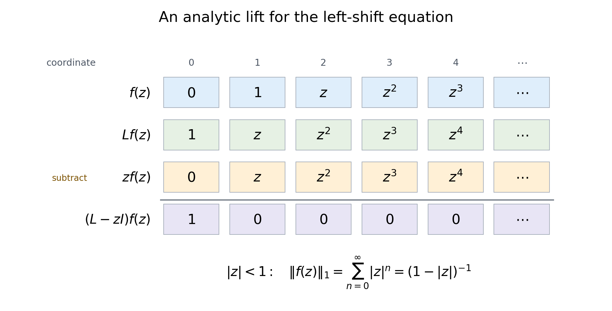

# Power series and analytic lifting in Banach spaces

*Written by GPT-6.1 Sol (OpenAI), October 2026.  Public domain (CC0).*

A differential equation can be solvable at every parameter without a
preferred pointwise choice of solution depending holomorphically on that
parameter. The first step toward an analytic family is local: expand the
equation in a power series, lift one coefficient at a time, and prove that
the lifted series converges. This works for an onto operator between
Banach spaces even when no bounded linear right inverse has been given.

We first prove the Cauchy estimates needed to control that construction.
We also develop the free Banach spaces that let us lift whole operators,
rather than one vector at a time. These spaces will later provide local
presentations of kernels.

Read [Cauchy bounds, root counts and analytic extensions](cauchy-bounds-and-root-counts.md),
Lemmas 1.1 and 1.2, for scalar Cauchy estimates and limits, and
[Banach estimates, quotient spaces and compact parameter arguments](../prerequisites/banach-foundation-bridges.html),
Sections 5 and 8, for complex Hahn–Banach and the open-mapping theorem.
Basic references are these internal foundations, Lempert and Patyi [LP],
and Mantlik [M]. All lifting and convergence arguments used here are
proved below.

## 1. Cauchy formulas with a Banach target

Let \(E\) be a complex Banach space. A function from an open set in
\(\mathbb C^d\) to \(E\) is holomorphic if it is complex Fréchet
differentiable locally. Operator-valued holomorphy always uses the
operator norm.

A continuous \(E\)-valued function on a compact rectangle has a
norm-convergent Riemann integral. Uniform continuity makes its Riemann
sums Cauchy, and completeness supplies their limit. The triangle
inequality passes to the limit, giving
\[
                         \left\|\int h\right\|\le\int\|h\|.
 \tag{1.1}
\]
Every bounded linear map commutes with this integral, first on the
finite sums and then on their limit. Parametrizing circles gives the
same construction on a product of boundary circles.

**Theorem 1.1 (Cauchy estimates and limits).** Suppose that \(h\) is
holomorphic on a neighborhood of the closed polydisc
\(\overline{D_R(a)}\), where all \(R_j>0\). Then
\[
 h(z)=\frac1{(2\pi i)^d}
       \int_{|\zeta_j-a_j|=R_j}
          \frac{h(\zeta)}{\prod_{j=1}^d(\zeta_j-z_j)}
                          \,d\zeta_1\cdots d\zeta_d
 \tag{1.2}
\]
inside that polydisc. In particular it has a norm-convergent expansion
\[
 h(z)=\sum_{\alpha\in\mathbb N^d}c_\alpha(z-a)^\alpha,\qquad
 \|c_\alpha\|\le M R^{-\alpha},\qquad
 M=\sup_{|\zeta_j-a_j|=R_j}\|h(\zeta)\|.
 \tag{1.3}
\]
If a sequence of holomorphic functions into \(E\) converges uniformly
on compact subsets in norm, its limit is holomorphic and every fixed
derivative converges uniformly on compact subsets.

**Proof.** A bounded complex-linear functional on \(E\), composed with
\(h\), gives a scalar holomorphic function. Apply the scalar Cauchy
formula in each variable successively. The functional commutes with
the circle integrals. Complex Hahn–Banach separates vectors, so the
scalar identities for all such functionals imply the vector identity
(1.2).

On a smaller closed polydisc, with radii \(r_j<R_j\), expand each
Cauchy denominator geometrically. These expansions converge uniformly
on the circles of integration. Termwise integration is justified by
(1.1). It gives (1.3), with
\[
           \sum_\alpha\|c_\alpha\|r^\alpha
                       \le M\prod_{j=1}^d(1-r_j/R_j)^{-1}<\infty.
 \tag{1.4}
\]
Every differentiated series is uniformly norm-convergent on a
further smaller polydisc, since the corresponding differentiated
geometric series converges there. It follows by difference quotients
that the represented function is holomorphic and that these are its
derivatives.

Now suppose \(h_n\) converges locally uniformly to \(h\). Completeness
and local uniform convergence make \(h\) continuous. Pass the uniform
limit on the boundary circles through (1.2). The resulting formula
for \(h\), expanded as above, proves holomorphy. Differentiating its
Cauchy kernel and applying (1.1) to \(h_n-h\) proves uniform
convergence of every fixed derivative on a smaller polydisc.
A compact set has a finite covering by such smaller polydiscs,
which proves the final assertion. \(\square\)

Neither compactness of bounded sets in \(E\) nor a vector-valued
Montel theorem was used. The completeness needed here is norm
completeness.

## 2. Free Banach spaces and bounded columns

For an arbitrary set \(I\), define
\[
 \ell^1(I)=\left\{u=(u_i):
    \|u\|_1:=\sup_{J\subset I,\ J\text{ finite}}
                         \sum_{i\in J}|u_i|<\infty\right\}.
 \tag{2.1}
\]
Every such family has countable support. Indeed
\(\{i:|u_i|\ge1/m\}\) is finite for every positive integer \(m\);
otherwise its finite sums would be unbounded. Every nonzero
coordinate belongs to one of these sets. The norm is therefore
the usual absolutely convergent sum over this countable support.

The space is Banach. To see this, let \(u^{(n)}\) be norm-Cauchy.
Each coordinate has a limit \(u_i\). Each finite sum of \(|u_i|\)
is bounded by the common bound on \(\|u^{(n)}\|_1\), so \(u\)
belongs to the space. Given a Cauchy bound
\(\|u^{(n)}-u^{(m)}\|_1\le\varepsilon\) for \(m,n\ge N\),
pass \(m\) to infinity on each finite set of coordinates and
then take the supremum. This gives
\(\|u^{(n)}-u\|_1\le\varepsilon\).
Finite-support families are dense by the tails of their absolutely
convergent sums.

**Lemma 2.1 (bounded columns).** A family \(v_i\in E\) with
\(\sup_i\|v_i\|<\infty\) defines a unique bounded operator
\[
 V:\ell^1(I)\longrightarrow E,\qquad
 Vu=\sum_i u_i v_i,\qquad
                      \|V\|=\sup_i\|v_i\|.
 \tag{2.2}
\]

**Proof.** Countable support and completeness give the absolutely
convergent sum. The triangle inequality gives the upper norm
bound. Evaluation on each coordinate vector \(e_i\) gives the
reverse bound. Density of finite-support families proves
uniqueness. \(\square\)

An onto bounded operator \(A:Z\to W\) between Banach spaces has
a finite preimage constant \(C_A\): every \(w\in W\) has some
\(z\in Z\) with
\[
                          Az=w,\qquad \|z\|\le C_A\|w\|.
 \tag{2.3}
\]
This is the open-mapping theorem. Its unit-ball image contains
a ball of some positive radius; rescale a slightly smaller
ball to get the displayed non-strict inequality. Choose
zero when \(w=0\). No linearity of these individual choices
is asserted.

**Theorem 2.2 (lifting an operator from a free space).**
For an onto \(A:Z\to W\) as above and a bounded
\(R:\ell^1(I)\to W\), there is a bounded
\(S:\ell^1(I)\to Z\) satisfying
\[
                           AS=R,\qquad \|S\|\le C_A\|R\|.
 \tag{2.4}
\]

**Proof.** Lift each column \(Re_i\) by (2.3), choosing a column
\(s_i\) with norm at most \(C_A\|R\|\). Lemma 2.1 gives a
bounded operator \(S\) with these columns. The equation holds
on coordinate vectors, then on finite sums, and then everywhere
by density and continuity. \(\square\)

This constructs a linear lift of this particular operator \(R\)
whose domain is free. It does not construct a linear right
inverse \(W\to Z\).

Every Banach space \(K\) has a canonical quotient from a free
space. For \(K\ne0\), let \(S_K=\{s\in K:\|s\|=1\}\) and set
\[
                   Q_K:\ell^1(S_K)\longrightarrow K,\qquad
                         Q_K e_s=s.
 \tag{2.5}
\]
Lemma 2.1 makes its norm one. A nonzero \(k\in K\) has the
preimage \(\|k\|e_{k/\|k\|}\), of exactly its norm.
For \(K=0\), use the empty index set and the zero map;
the same preimage estimate holds.

Free spaces are also preserved by \(\ell^1\)-sums:
\[
             \bigoplus_j^{\ell^1}\ell^1(I_j)
                       \cong \ell^1\!\left(\coprod_j I_j\right).
 \tag{2.6}
\]
Regrouping the coordinates preserves the same nonnegative
absolute sum in both directions, giving the isometry.
This includes finite sums and countable sums.

## 3. Local analytic lifting

**Theorem 3.1.** Let \(X,Y\) be complex Banach spaces,
\(T:U\to\mathcal L(X,Y)\) norm-holomorphic and
\(g:U\to Y\) holomorphic near \(0\in\mathbb C^d\).
If \(T(0)\) is onto, then on a neighborhood of zero there is
a holomorphic \(f\) such that
\[
                                  T(z)f(z)=g(z).
 \tag{3.1}
\]

**Proof.** Let \(C\) be a preimage constant for \(T(0)\).
Theorem 1.1 gives norm-convergent expansions
\[
             T(z)=\sum_\alpha T_\alpha z^\alpha,\qquad
             g(z)=\sum_\alpha g_\alpha z^\alpha,\qquad
                             T_0=T(0).
 \tag{3.2}
\]
Choose a positive polyradius \(r\) so small that
\[
 G(r):=\sum_\alpha\|g_\alpha\|r^\alpha<\infty,\qquad
             \theta:=C\sum_{\beta\ne0}\|T_\beta\|r^\beta<1.
 \tag{3.3}
\]
The Cauchy estimate (1.3) bounds these coefficient series on
every strictly smaller polydisc than their original disc of
expansion. The nonconstant coefficient sum tends to zero
as all radii tend to zero, so (3.3) is possible.

In increasing total degree choose \(f_\alpha\) by solving
\[
 T_0f_\alpha=
      g_\alpha-\sum_{0<\beta\le\alpha}T_\beta f_{\alpha-\beta},
 \qquad
 \|f_\alpha\|\le C\left(\|g_\alpha\|
        +\sum_{0<\beta\le\alpha}\|T_\beta\|\|f_{\alpha-\beta}\|\right).
 \tag{3.4}
\]
The degree-zero sum is empty. Every term in each higher-degree
sum was already chosen. There are finitely many multi-indices
in each degree, so this recursion is well-defined using
only the individual preimages (2.3).

Set \(F_N=\sum_{|\alpha|\le N}\|f_\alpha\|r^\alpha\)
and \(F_{-1}=0\). Summing (3.4), and enlarging the
nonnegative convolution sum, gives
\[
                 F_N\le CG(r)+\theta F_{N-1}
                            \le \frac{CG(r)}{1-\theta}.
 \tag{3.5}
\]
The last inequality follows inductively from the geometric
sum. Hence \(\sum f_\alpha z^\alpha\) converges absolutely
and uniformly in norm on the closed polydisc of radius \(r\).
Its partial sums are holomorphic polynomials, so
Theorem 1.1 proves holomorphy in the interior.
Absolute convergence justifies its Cauchy product with
the series for \(T\). Equation (3.4) makes each coefficient
of that product equal \(g_\alpha\). This proves (3.1).
\(\square\)

The construction does not require a complemented kernel.
It chooses coefficients separately and obtains holomorphy
from the convergence estimate.

**Corollary 3.2 (uniform neighborhood for onto operators).**
After shrinking \(U\), every \(T(z)\) is onto and has
a common finite preimage constant.

**Proof.** Shrink until \(C\|T(z)-T_0\|\le\eta<1\).
Given \(y\), lift it through \(T_0\) to \(x_0\) with
\(\|x_0\|\le C\|y\|\). Its residual is
\(y-T(z)x_0=(T_0-T(z))x_0\), of norm at most
\(\eta\|y\|\). Lift that residual through \(T_0\),
and continue. At the \(j\)-th step the chosen vector
has norm at most \(C\eta^j\|y\|\).
Their norm-convergent sum \(x\) satisfies
\[
                   T(z)x=y,\qquad
                   \|x\|\le \frac{C}{1-\eta}\|y\|.
 \tag{3.6}
\]
Indeed the residuals tend to zero and the bounded
operator \(T(z)\) commutes with the convergent sum.
This is a uniform existence estimate, without a
claim that the choices in this argument are analytic.
\(\square\)

The analytic homogeneous spaces also have a local description by free generators and relations. Free resolutions for analytic operator kernels constructs arbitrary finite free presentations of the varying kernel in Theorems 3.1 and 4.1, with operator-norm holomorphic lifting for every free parameter space.

## 4. Examples

**Example 4.1 (a sharp scalar majorant).**
For \(T(z)=1-z\) and \(g(z)=1\), the recursion has
\(f_n=1\). Thus \(f(z)=\sum_{n\ge0}z^n=(1-z)^{-1}\)
on \(|z|<1\). Here \(C=1,\theta=r,G(r)=1\), and
(3.5) is the exact coefficient-norm sum
\(\sum r^n=(1-r)^{-1}\).
The pole at \(1\) prevents extending this solution
holomorphically through that point. Onto solvability
at the original parameter is a local hypothesis.

**Example 4.2 (an infinite-dimensional analytic solution).**
On \(\ell^1(\mathbb N_0)\), let
\[
          Lx=(x_1,x_2,\ldots),\qquad
          Rx=(0,x_0,x_1,\ldots).
 \tag{4.1}
\]
Both have norm one and \(LR=I\).
For \(|z|<1\), the equation
\((L-zI)f=e_0\) has the solution
\[
                f(z)=(0,1,z,z^2,\ldots)
                     =\sum_{n\ge0}z^n R^{n+1}e_0.
 \tag{4.2}
\]
Its series converges in \(\ell^1\), locally uniformly
for \(|z|<1\), and
\(\|f(z)\|_1=(1-|z|)^{-1}\).
Subtracting \(zf\) from \(Lf\) cancels every
coordinate except the first, which is one.

*The cancellation in the shift example.* The dots stand for
the entire remaining geometric sequence. It belongs to
\(\ell^1\) exactly when \(|z|<1\). The norm estimate,
rather than a finite truncation of the diagram, justifies
the infinite-dimensional solution.

**Example 4.3 (an uncountable free domain).**
Let \(I\) be the unit circle and define
\(V:\ell^1(I)\to\mathbb C\) by \(Ve_\zeta=\zeta\).
The norm is one. Although its domain has an
uncountable index set, each input uses at most
countably many coordinates, and its image is
an absolutely convergent scalar sum.
Every nonzero \(w\) has the norm-preserving lift
\(|w|e_{w/|w|}\). This is the quotient (2.5)
for \(K=\mathbb C\).

## 5. Exercises with complete solutions

**Exercise 1 (20 points).** Suppose \(h\) is holomorphic
near the closed bidisc with radii \(R_1,R_2\), and
its boundary norm is at most \(M\). For smaller
radii \(r_1,r_2\), bound the sum of the norms
of all Taylor terms whose first exponent exceeds
\(m\) or whose second exponent exceeds \(n\).
Explain why the rectangular Taylor truncations
converge in the Banach norm.

**Solution.** Put \(q_j=r_j/R_j<1\).
The Cauchy estimate bounds each term by
\(M q_1^{\alpha_1}q_2^{\alpha_2}\).
The union of the two tail conditions is bounded
by the sum of their nonnegative geometric tails:
\[
  \sum_{\alpha_1>m\ {\rm or}\ \alpha_2>n}
             \|c_\alpha\|r^\alpha
   \le
   \frac{M(q_1^{m+1}+q_2^{n+1})}{(1-q_1)(1-q_2)}.
 \tag{5.1}
\]
Double-counting their intersection only enlarges
the bound. The right side tends to zero as
both truncation levels grow. It bounds the
uniform Banach-norm error on the smaller
closed bidisc. Assign 8 points to the
coefficient estimate, 8 to the tail sum,
and 4 to the norm-convergence conclusion.

**Exercise 2 (25 points).** Let \(A:Z\to W\)
have preimage constant \(C_A\), and let
\(R:\ell^1(I)\to W\) have norm at most \(B\).
Construct its lift explicitly from columns.
Then prove that if \(\|R_n-R\|\to0\), each
error \(R_n-R\) has a lift of norm at most
\(C_A\|R_n-R\|\). Does this require the
original column choices for the \(R_n\)
to converge?

**Solution.** Choose \(s_i\) with
\(As_i=Re_i\) and \(\|s_i\|\le C_AB\).
The operator \(Su=\sum u_i s_i\) exists
by Lemma 2.1 and satisfies \(AS=R\).
For each error choose fresh columns
\(v_{n,i}\) lifting \((R_n-R)e_i\)
with norm at most \(C_A\|R_n-R\|\).
They define \(V_n\) with that operator-norm
bound and \(AV_n=R_n-R\).
Thus \(S+V_n\) is a lift of \(R_n\)
converging in operator norm to \(S\).
Unrelated earlier choices of lifts of
\(R_n\) need not converge: arbitrary
kernel-valued columns could have been
added to them. Assign 10 points to
the column construction, 10 to the
error lift, and 5 to this distinction.

**Exercise 3 (25 points).** Let
\[
                 T(z)=I-zA-z^2B
 \tag{5.2}
\]
on a Banach space, with bounded operators
\(A,B\), and let the datum be \(y\).
Give the coefficient recursion for its
analytic solution near zero. State an
explicit condition on \(r>0\) that
guarantees convergence and a coefficient
norm bound. Do not assume \(A\) and \(B\)
commute.

**Solution.** The constant coefficient is
\(f_0=y\), the first is \(f_1=Ay\), and
\[
                  f_n=Af_{n-1}+Bf_{n-2}\quad(n\ge2).
 \tag{5.3}
\]
For example
\(f_2=(A^2+B)y\) and
\(f_3=(A^3+AB+BA)y\);
the order of the mixed products is fixed
by the recursion. Since \(T_0=I\), take
\(C=1\). Any \(r>0\) with
\(\theta=r\|A\|+r^2\|B\|<1\)
gives, by (3.5),
\[
                         \sum_n\|f_n\|r^n
                              \le\frac{\|y\|}{1-\theta}.
 \tag{5.4}
\]
The resulting series is holomorphic and
solves the equation by its absolutely
convergent product. Assign 10 points
to the recursion and ordered example,
10 to the radius and bound, and 5
to the product justification.

**Exercise 4 (30 points).** For the shifts
in Example 4.2 and arbitrary
\(y\in\ell^1(\mathbb N_0)\), prove that
\[
                   x(z)=R\sum_{n\ge0}z^nR^n y
 \tag{5.5}
\]
solves \((L-zI)x=y\) for \(|z|<1\).
Give a norm bound and prove holomorphy.
Find a nonzero homogeneous vector for
the same operator, and explain why the
particular solution is not unique.

**Solution.** The series converges in
operator norm, locally uniformly for
\(|z|<1\), because \(\|R\|=1\).
Theorem 1.1 or its differentiated
geometric series proves norm holomorphy.
Using \(LR=I\),
\[
 (L-zI)R\sum_{n\ge0}z^nR^ny
       =(I-zR)\sum_{n\ge0}z^nR^ny=y.
 \tag{5.6}
\]
Absolute convergence justifies the
telescoping, and
\(\|x(z)\|_1\le\|y\|_1/(1-|z|)\).
The vector \(v(z)=(1,z,z^2,\ldots)\)
belongs to \(\ell^1\) on that disc
and satisfies \(Lv=zv\).
Thus any scalar multiple of \(v(z)\)
can be added to a particular solution;
if the scalar depends holomorphically
on \(z\), the resulting family is
also holomorphic. Assign 10 points
to the product identity, 8 to the
norm and holomorphy, 8 to the
homogeneous vector, and 4 to
nonuniqueness.

## References

- Internal foundations: [Cauchy bounds, root counts and analytic extensions](cauchy-bounds-and-root-counts.md),
  Lemmas 1.1 and 1.2; [Banach estimates, quotient spaces and compact parameter arguments](../prerequisites/banach-foundation-bridges.html),
  Sections 5 and 8.
- [LP] László Lempert and Imre Patyi, “Analytic sheaves in Banach spaces,”
  *Annales scientifiques de l’École Normale Supérieure* 40 (2007), 453–486.
  [Primary article](https://www.numdam.org/item/10.1016/j.ansens.2006.12.006.pdf).
- [M] Frank Mantlik, “Partial differential operators depending analytically
  on a parameter,” *Annales de l’Institut Fourier* 41 (1991), 577–599.
  [Primary article](https://aif.centre-mersenne.org/item/10.5802/aif.1266.pdf).
