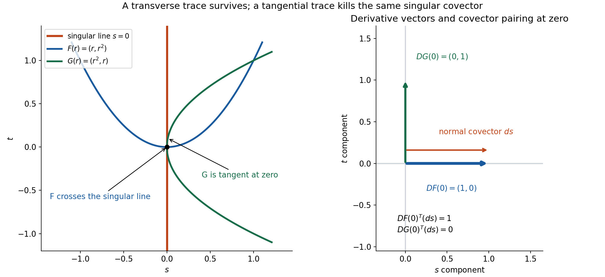
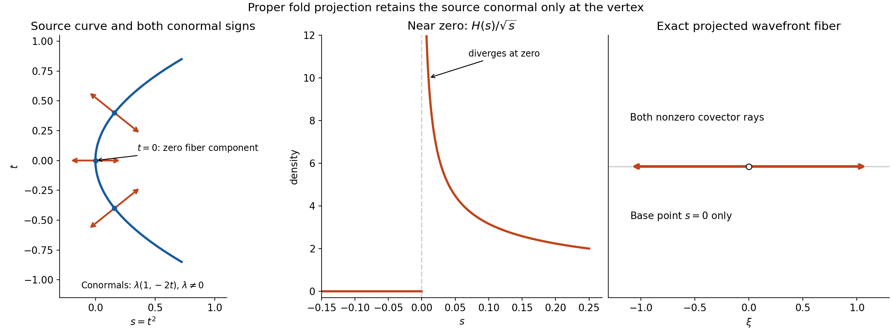

# Pulling back and combining analytic singularities

*Written by GPT-6.1 Sol (OpenAI), October 2026. Self-checked by the writing AI. Public domain (CC0).*

A singular distribution can sometimes be restricted to a curve, multiplied by another singular distribution, or integrated along a fiber. The decision depends on covectors. A pullback must not annihilate a singular covector. A product must not join opposing singular covectors. A projection retains only source covectors whose fiber component is zero.

Basic references are [Detecting regularity without choosing coordinates][G] for the exact smooth operations, [Analytic directions of holomorphic boundary values][A] for analytic-wavefront sequences, and Brouder, Dang and Hélein [B] for the normal topology and continuity results. The complete proof supplies the analytic estimates and exact operation statements. [Dilation equations and tangential analytic singularities][E] gives the sphere-transversality input used below.

## 1. A transpose derivative decides whether a pullback exists

For a smooth map \(F:X\to Y\), its normal set consists of the nonzero target covectors killed by its transpose derivative:
\[
 N_F=\{(F(x),\eta):\eta\ne0,\ DF(x)^T\eta=0\}.
 \tag{1}
\]
If this set misses the ordinary wavefront of \(u\), the smooth pullback exists. Its wavefront has the bound
\[
 \operatorname{WF}(F^*u)
       \subseteq\{(x,DF(x)^T\eta):(F(x),\eta)\in\operatorname{WF}(u)\}.
 \tag{2}
\]
For an analytic map, the corresponding analytic condition and bound are
\[
 N_F\cap\operatorname{WF}_A(u)=\varnothing,\qquad
 \operatorname{WF}_A(F^*u)
       \subseteq\{(x,DF(x)^T\eta):(F(x),\eta)\in\operatorname{WF}_A(u)\}.
 \tag{3}
\]
All displayed wavefront covectors are nonzero. The analytic condition implies smooth existence, because ordinary wavefront is contained in analytic wavefront.

An embedding is the restriction case. Its killed covectors are exactly the conormals of the embedded submanifold. For a diffeomorphism the transpose derivative is invertible, so the bounds become equalities. The scalar distributional pullback includes the absolute determinant of the inverse map on tests; the covector map itself remains \(DF^T\).

The analytic proof is local. It writes the pullback Fourier transform with phase
\[
 \Phi(x,\xi,\eta)=F(x)\cdot\eta-x\cdot\xi,\qquad
 \nabla_x\Phi=DF(x)^T\eta-\xi.
 \tag{4}
\]
Where this gradient has a uniform lower bound by \(d(|\xi|+|\eta|)\), \(L\) integrations by parts with a controlled cutoff give
\[
 \left|\int b_L(x)e^{i\Phi(x,\xi,\eta)}dx\right|
       \leq C^{L+1}L^L(1+|\xi|+|\eta|)^{-L}.
 \tag{5}
\]
The complete proof retains the differentiated analytic coefficients and shows why they produce just one analytic factorial scale. Regular input directions supply the other part of the integral. The choice \(L=N+m+a+2\), for target dimension \(a\) and compact input order \(m\), gives the analytic-wavefront estimate at order \(N\). Its localized output sequence has a fixed plateau, common compact support and a common finite-order bound.

*Figure 1. The singular support is \(s=0\). The maps are \(F(r)=(r,r^2)\) and \(G(r)=(r^2,r)\), at \(r=0\). Their actual derivative vectors are \(DF(0)=(1,0)\) and \(DG(0)=(0,1)\). The normal covector \(ds\) pairs to one and zero respectively. The right panel uses the Euclidean identification to draw that covector; its arrow is translated vertically by \(4/25\) solely for visibility. The base point and the transpose pairings remain at zero. See Example 3, Solution 1, complete-proof Theorem 4.1 and Corollary 6.1.*

## 2. Zero components matter in tensors and products

Adjoin the zero covector over the support:
\[
 Z_u=\{(x,0):x\in\operatorname{supp}u\},\qquad
 \operatorname{WF}_{\star,0}(u)=\operatorname{WF}_{\star}(u)\cup Z_u,
          \quad \star\in\{\text{ordinary},A\}.
 \tag{6}
\]
The tensor bound is
\[
 \operatorname{WF}_{\star}(u\otimes v)
    \subseteq
       \big(\operatorname{WF}_{\star,0}(u)\times
                  \operatorname{WF}_{\star,0}(v)\big)\setminus0.
 \tag{7}
\]
For instance \(u\otimes1\) can be singular even though the constant factor has empty wavefront. Its covectors have zero component in that smooth factor.

Multiplication is pullback to the diagonal:
\[
 uv=\Delta^*(u\otimes v),\qquad
 \Delta(x)=(x,x),\qquad D\Delta^T(\xi,\eta)=\xi+\eta.
 \tag{8}
\]
Thus a sufficient condition is the absence of pairs \(\xi,-\xi\) in the two wavefront sets at the same point. Under the ordinary condition the product exists. Under the analytic condition it also has the analytic sum bound:
\[
 \operatorname{WF}_{\star}(uv)
 \subseteq\{(x,\xi+\eta):
       (x,\xi)\in\operatorname{WF}_{\star,0}(u),\
       (x,\eta)\in\operatorname{WF}_{\star,0}(v)\}\setminus0.
 \tag{9}
\]
The zero components retain the single-factor terms. This is a sufficient condition, so failure of the condition does not by itself prove that every particular proposed product is impossible.

## 3. Projection integration needs proper support

Let \(\pi(x,y)=x\). If its restriction to \(\operatorname{supp}u\) is proper, integration in \(y\) defines \(\pi_*u\). A compact target test sees a compact source support, so a cutoff in \(y\) makes its lifted test legitimate and does not change the pairing.

The smooth and analytic bound is
\[
 \operatorname{WF}_{\star}(\pi_*u)
    \subseteq\{(x,\xi):\xi\ne0,\
        (x,y;\xi,0)\in\operatorname{WF}_{\star}(u)
                                      \text{ for some }y\}.
 \tag{10}
\]
Only zero fiber covectors contribute. For a compact source distribution the Fourier identity is simply
\[
 \widehat{\pi_*u}(\xi)=\widehat u(\xi,0).
 \tag{11}
\]
The analytic proof uses finite controlled partitions near the compact fiber. Their sum is one there, while their high derivatives retain the single analytic scale. It then applies (11) to their localized sequences.

## 4. Four worked examples

### Example 1: a positive ray has a well-defined sphere trace.

In the plane let \(u=H(s)\delta_0(t)\), the positive-ray distribution. It has degree \(-1\). The Euler theorem [E], Theorem 4.1, places its wavefront covectors at nonzero base points in \(s\xi+t\eta=0\). Sphere conormals are nonzero multiples of \((s,t)\), with nonzero radial pairing. Therefore restriction to every circle of radius \(a>0\) exists, by complete-proof Corollary 6.1.

Parameterize the circle by \(j(\theta)=(a\cos\theta,a\sin\theta)\), and use test density \(d\theta\). Near \(\theta=0\) the positive-ray factor is one, and the scalar delta composition is
\[
 \delta_0(a\sin\theta)=\frac1a\delta_0(\theta).
 \tag{12}
\]
Indeed the coordinate \(r=a\sin\theta\) has derivative \(a\) at zero; the scalar pullback of a point delta carries the reciprocal absolute derivative. Near \(\theta=\pi\) the positive-ray factor is zero, and outside those two possible intersections the line delta vanishes. Thus the full periodic trace is one angular point delta with coefficient \(1/a\).

At the positive-ray point \((a,0)\), the original covectors are \((0,\eta)\), of either nonzero sign. The transpose of \(Dj=(0,a)^T\) sends them to \(a\eta\), giving every nonzero angular covector at \(\theta=0\). Formula (12) confirms this exact fiber. The coefficient is stated for \(d\theta\); converting the test density to arclength \(a\,d\theta\) converts its pairing accordingly.

### Example 2: transverse poles multiply, while opposing poles can diverge.

The upper pole \(p(r)=(r+i0)^{-1}\) has only positive covectors at zero, with the convention in [A], Example 1. Put
\[
 u(s,t)=p(s),\qquad v(s,t)=p(t).
 \tag{13}
\]
Their covectors lie respectively in the positive horizontal and positive vertical frequency directions, so they never oppose. The product is \(p(s)\otimes p(t)\), and the analytic sum bound at the crossing is the closed positive quadrant with zero removed.

This is the exact fiber, as proved for the same two-pole distribution in [A], Example 4. The tensor transform is \((-2\pi i)^2H(\xi)H(\eta)\). For any compact cutoff equal to one at zero, convolution with its Schwartz transform approaches the nonzero constant \(-4\pi^2\) along each interior positive-quadrant ray. Ordinary wavefront therefore contains those rays; closedness adds the two boundary rays. The analytic upper bound and ordinary inclusion give the exact analytic quadrant. Along either occupied axis away from the crossing, only the positive normal covectors remain.

In contrast, on one line the regularized opposite poles give
\[
 \frac1{r+i\varepsilon}\frac1{r-i\varepsilon}
                 =\frac1{r^2+\varepsilon^2}.
 \tag{14}
\]
For a nonnegative compact test \(\psi\) with \(\psi(0)>0\),
\[
 \varepsilon\int\frac{\psi(r)}{r^2+\varepsilon^2}\,dr
     =\int\frac{\psi(\varepsilon z)}{1+z^2}\,dz
            \longrightarrow\pi\psi(0)>0.
 \tag{15}
\]
Dominated convergence uses \(\|\psi\|_\infty/(1+z^2)\). The unscaled pairings diverge. This proposed common regularization has no distributional limit. Its two singular covectors oppose, exactly the obstruction left out of the product theorem.

### Example 3: the map matters even for the same line delta.

Let \(U(s,t)=\delta_0(s)\). Its smooth and analytic wavefront at \((0,t)\) is exactly \((\tau,0)\), \(\tau\ne0\). The tensor bound gives the upper inclusion; the Fourier transform of a localized trace is independent of the normal frequency and supplies both signs for the ordinary lower bound.

For \(F(r)=(r,r^2)\),
\[
 DF(r)^T(\tau,0)=\tau,
             \qquad F^*U=\delta_0(r).
 \tag{16}
\]
It is transverse at the only intersection \(r=0\). Both smooth and analytic fibers there are every nonzero one-dimensional covector.

For \(G(r)=(r^2,r)\), the transpose sends the same covector to \(2r\tau\), which vanishes at zero. Transversality fails. The Gaussian regularization
\[
 g_\varepsilon(s)=(4\pi\varepsilon)^{-1/2}e^{-s^2/(4\varepsilon)}
 \tag{17}
\]
would give \(g_\varepsilon(r^2)\). Its test pairing is
\[
 \int g_\varepsilon(r^2)\psi(r)\,dr
   =\frac{\varepsilon^{-1/4}}{\sqrt{4\pi}}
       \int e^{-z^4/4}\psi(\varepsilon^{1/4}z)\,dz.
 \tag{18}
\]
The integral after the prefactor tends to a positive constant when \(\psi(0)>0\). For nonnegative \(\psi\), dominated convergence is immediate from the integrable quartic exponential. Thus these pairings diverge like \(\varepsilon^{-1/4}\). This natural proposed trace has no distributional limit.

### Example 4: a fold projects a smooth curve density to a singular density.

Choose a real compact smooth \(\chi(t)\), equal to one near zero, and define
\[
 w(\Psi)=\int\chi(t)\Psi(t^2,t)\,dt.
 \tag{19}
\]
Its support is a compact portion of a parabola, so \(\pi(s,t)=s\) is proper on its support. Substitution at the two roots gives the projected density, for \(s>0\),
\[
 (\pi_*w)(s)
       =\frac{\chi(\sqrt s)+\chi(-\sqrt s)}{2\sqrt s},
              \qquad(\pi_*w)(s)=0\quad(s<0).
 \tag{20}
\]
Near zero this is \(H(s)/\sqrt s\), a locally integrable density that is not smooth at zero. Its realness makes ordinary wavefront symmetric under covector negation: Fourier conjugation replaces a qualifying cutoff by its conjugate and reverses the frequency. In one dimension there are only two direction rays. Absence of both would imply smoothness, so both occur. Ordinary inclusion gives every nonzero analytic covector at zero; away from zero the local density is analytic.

The source covectors near the vertex explain where this happens. The analytic coordinate map \(\kappa(s,t)=(s-t^2,t)\) has determinant one and carries \(w\), where \(\chi=1\), to the line-delta model. Its normal covectors are
\[
 (s,t;\tau,-2t\tau),\qquad s=t^2,\quad\tau\ne0.
 \tag{21}
\]
The projection rule retains a covector only when \(-2t\tau=0\), hence only at \(t=0\). Its source base projects to \(s=0\), exactly the singular point of (20).

*Figure 2. The source curve is \(s=t^2\), shown for \(|t|\leq17/20\). Its marked parameters are \(t=-2/5,0,2/5\), with conormal segments \(\lambda(1,-2t)\), \(\lambda=\pm11/50\), drawn at equal Euclidean coordinate scales. Projection retains only zero \(t\)-covector components, hence only the marked vertex. The cutoff is one for \(|t|\leq1/2\) and supported in \(|t|\leq1\); its projected density is exactly \(H(s)/\sqrt s\) in the displayed interval \(-3/20<s\leq1/4\). The density graph's finite vertical window clips its divergence, which is labelled. The right panel represents both one-dimensional covector rays at \(s=0\), with zero removed. See Example 4, Solution 7 and complete-proof Theorem 7.1.*

## 5. Convergence must retain both directions and support

For a fixed closed ordinary wavefront bound \(\Gamma\), sequential convergence requires weak distributional convergence and convergence of every rapid Fourier seminorm on a compact cutoff and closed cone disjoint from \(\Gamma\). The normal topology uses those seminorms together with uniform pairings on bounded compact-test families. For sequences the two convergence descriptions agree by the complete bounded-test argument [Q], Lemma 3.2.

The complete proof gives normal-topology continuity for a transverse pullback and proper projection. Tensor and nonopposing product are hypocontinuous: continuity in one factor is uniform over a bounded set of the other. They are consequently sequentially continuous. Brouder, Dang and Hélein [B] give the named normal-topology theorems and Alesker's counterexample for the weaker topology.

A projection limit also needs one common proper support. For example
\[
 w_j=\delta_{(0,j)}\quad\hbox{on }\mathbb R^2
                       \longrightarrow0
 \tag{22}
\]
on every bounded compact-test family: eventually every test in such a family has support away from the point. The corresponding local rapid Fourier seminorms also become exactly zero. Yet \(\pi_*w_j=\delta_0\) for every \(j\). Each individual point support is proper, while their closed union over \(s=0\) is not proper. The missing common-support condition explains the failure of the projected limit.

## 6. Exercises, 100 points

1. **Transpose geometry, 10 points.** For \(F(r)=(r,r^2)\), compute \(DF^T(\xi,\eta)\). Identify its normal directions at \(r=0\). Apply this to \(\delta_0(s)\) and \(\delta_0(t)\), explaining which trace is transverse. Compute the transverse trace and its coefficient.
2. **One analytic scale, 12 points.** In complete-proof Lemma 3.1, derive the identity used to sum the multi-index product coefficients, bound the sum (25), and justify the induction (24). Explain why multiplying two factorial scales would lose the required analytic estimate.
3. **A controlled partition, 12 points.** For three cutoffs between zero and one, use (15) of the complete proof to write all partition functions and sum them. Prove the fixed plateau and both kinds of derivative bounds. Explain why each partition support remains inside its own regular neighborhood.
4. **Tensor zeros and positive sums, 14 points.** Determine the full analytic wavefront of \(\delta_0(s)\otimes1\). Explain the needed zero term in the tensor bound. For the two upper poles of Example 2, give their exact analytic fibers on each support axis and at the crossing, including the boundary directions of the quadrant.
5. **Opposition and a divergent product, 12 points.** Derive the diagonal normal set and the sum map on covectors. Use it to explain the two cases in Example 2. Prove (15), with its constant, and show that (14) has no distributional limit.
6. **The sphere trace coefficient, 12 points.** For the positive-ray distribution, prove that its trace on a circle of radius \(a>0\) is the periodic angular delta divided by \(a\), in test density \(d\theta\). Compute the transported covectors at the intersection and explain the arclength pairing.
7. **The fold and the forbidden trace, 14 points.** Derive both (18) and (20), including all constants. Determine the exact source conormals and the smooth/analytic wavefront of the projected density near zero. Explain why the proper projection is allowed while the tangential trace in Example 3 is not supplied by the restriction theorem.
8. **The actual convergence conditions, 14 points.** Describe the normal topology and its sequential convention precisely. Explain how hypocontinuity gives convergence of products for two convergent sequences with fixed nonopposing wavefront bounds. Prove the failure in (22), including its local Fourier seminorms, and identify exactly which common-support hypothesis fails.

## 7. Complete solutions

### Solution 1

The derivative is the column \((1,2r)^T\), so
\[
 DF(r)^T(\xi,\eta)=\xi+2r\eta.
\]
At zero the normal directions are \((0,\eta)\), \(\eta\ne0\).
The line delta \(\delta_0(s)\) has covectors \((\xi,0)\), \(\xi\ne0\), at \(s=0\), so none is normal to this map. Its first coordinate is \(r\), giving the point delta \(\delta_0(r)\) with coefficient one, because that derivative is one. Its complete fiber has both nonzero signs.

The line delta \(\delta_0(t)\) has covectors \((0,\eta)\) at \(t=0\). At the intersection \(r=0\) these are killed. Thus the theorem does not define its trace along \(F\). It is the same scalar difficulty as \(\delta_0(r^2)\) in Example 3: applying the Gaussian regularization in the \(t\) variable gives (18), whose pairings diverge for a nonnegative test nonzero at zero.

### Solution 2

For \(\alpha\) of total order \(p\), the coefficient of \(t^s\) in
\[
 \prod_i(1+t)^{\alpha_i}=(1+t)^p
\]
is both \(\sum_{|\beta|=s,\beta\leq\alpha}\binom\alpha\beta\) and \(\binom ps\). This proves the exact sum identity.
Since \(p\leq L\),
\[
 \binom ps s!=p(p-1)\cdots(p-s+1)\leq L^s.
\]
With \(D\geq2B_1\), the sum of the factors in complete-proof (25) is bounded by
\[
 B_0\sum_{s=0}^p(B_1/D)^s\leq2B_0.
\]
The bound is independent of \(p,L\).

In the induction, \(k\) integrations and \(p\) remaining derivatives have total budget \(k+p\leq L\). A derivative term \(b_j\partial_j\) uses one more amplitude derivative. Splitting \(s\) derivatives onto \(b_j\) leaves \(p-s+1+k\leq L\) for the induction hypothesis. The preceding sum bounds the product rule by a fixed multiple of \((DL)^{p+k+1}\). The zeroth-order coefficient leaves one less derivative and is also bounded by this expression because \(DL\geq1\). Absorb the fixed number of coefficients into \(C_1\), proving (24).

At \(k=L,p=0\), the bound is \(C^{L+1}L^L\). Multiplication by \(R^{-L}\) comes from the \(L\) normalized integration operators. The analytic coefficient factorials have already been absorbed by the geometric product sum. Adding another \(L!\) would instead produce an extra scale of order \(L^L\), and would not establish the bounded-sequence analytic criterion. The calculation prevents that extra factor.

### Solution 3

The three functions are
\[
 p_1=\chi_1,\qquad
 p_2=(1-\chi_1)\chi_2,\qquad
 p_3=(1-\chi_1)(1-\chi_2)\chi_3.
\]
Their sum is \(1-(1-\chi_1)(1-\chi_2)(1-\chi_3)\).
It equals one wherever one cutoff equals one. Thus plateaux covering the compact set give a fixed neighborhood on which the sum equals one for every \(L\).

Each \(p_j\) contains its own factor \(\chi_j\), so its support is contained in \(\operatorname{supp}\chi_j\). Every derivative of \(\chi_j\) is also supported there, and the extension by zero outside the chart is smooth.
For a derivative of total order \(k\leq L\), the full product rule distributes the derivatives among at most three factors. Their multinomial coefficient sum is at most \(3^k\). Each factor contributes a bound \(C(CL)^{k_i}\), and the total powers sum to \(k\). Hence the bound is \(C'(3CL)^k\), with a fixed number of zeroth-order constants absorbed into \(C'\). For any fixed derivative order, use the uniform fixed-order bounds of all factors; the finite product rule then gives a bound independent of \(L\). No reciprocal normalization of the cutoffs is needed.

### Solution 4

A one-dimensional point delta has every nonzero smooth and analytic covector at zero, [E], Example 3. The constant factor has empty wavefront and full support. The tensor bound therefore permits exactly
\[
 \{(0,t;\xi,0):t\in\mathbb R,\ \xi\ne0\}.
\]
Every permitted direction occurs in ordinary wavefront. For any cutoff equal to one near \((0,t_0)\), the localized transform is
\[
 \widehat{\chi(\delta_0\otimes1)}(\xi,\eta)
                  =\widehat{\chi(0,\cdot)}(\eta).
\]
The nonzero compact trace has a Fourier transform that is not identically zero. Fix an \(\eta_*\) where it is nonzero, and send \(\xi\) to either infinity. These paths eventually lie in any cone about the corresponding nonzero horizontal covector; rapid decrease is impossible. Ordinary inclusion gives analytic membership, proving equality. Without the zero term in the smooth constant factor, the tensor upper bound would incorrectly be empty.

For \(p(s)\) and \(p(t)\), at a nonzero point of \(s=0\), the second factor is a nonvanishing analytic function, so the fiber is the positive \(s\)-normal ray. At a nonzero point of \(t=0\) it is the positive \(t\)-normal ray. Off both axes the product is analytic. At the crossing its fiber is
\[
 \{(\xi,\eta):\xi\geq0,\ \eta\geq0,\ (\xi,\eta)\ne(0,0)\}.
\]
The upper inclusion follows from the sum theorem, including the zero components. On every interior positive ray the cutoff transform tends to \(-4\pi^2\chi(0,0)=-4\pi^2\), by convolution with the quadrant Fourier transform and dominated convergence of the Schwartz cutoff transform. Thus these directions are ordinarily singular. Closedness includes the two boundary rays; ordinary inclusion proves the exact analytic fiber.

### Solution 5

The derivative of the diagonal sends a tangent vector \(h\) to \((h,h)\). Its transpose sends \((\xi,\eta)\) to \(\xi+\eta\). The nonzero killed covectors are therefore \((\xi,-\xi)\), \(\xi\ne0\).
The two positive-coordinate pole covectors in the plane cannot sum to zero unless both are zero, which is excluded from a normal obstruction. They are transverse to the diagonal. On one line the upper and lower poles have opposite covector signs, so their nonzero covectors do meet the diagonal normal set.

The product of their common regularizations is exactly \(1/(r^2+\varepsilon^2)\). Substitute \(r=\varepsilon z\); multiplying its pairing by \(\varepsilon\) gives the integral in (15). The test is bounded, and \(1/(1+z^2)\) is integrable with integral \(\pi\), by its antiderivative \(\arctan z\). Dominated convergence gives \(\pi\psi(0)>0\).
Consequently the unscaled pairings have magnitude asymptotic to \(\pi\psi(0)/\varepsilon\) and diverge. Distributional convergence would require a finite limit on this one test, so it is impossible for this regularization. The wavefront criterion explains its obstruction; the divergence supplies the separate impossibility proof.

### Solution 6

At every nonzero point of the ray the Euler bound makes each wavefront covector perpendicular to that point. A circle conormal is a nonzero multiple of the radius vector, whose pairing with the radius is nonzero. Therefore the analytic restriction theorem applies. The circle does not contain the singular endpoint of the ray.

The only possible intersections with \(t=0\) are \(\theta=0,\pi\). Near zero, \(s=a\cos\theta>0\), so \(H(s)=1\), and the coordinate \(r=a\sin\theta\) is a local diffeomorphism with derivative \(a\). A delta pulled back by such a one-variable coordinate pairs as the value of the angular test at zero divided by the absolute derivative \(a\). Near \(\pi\), the Heaviside factor is zero. Elsewhere the line delta is zero. Thus on periodic tests
\[
 (j^*u)(\psi(\theta)\,d\theta)=\frac{\psi(0)}a.
\]
At the intersection, \(Dj(0)=(0,a)^T\). The two nonzero normal signs \((0,\eta)\) are sent to \(a\eta\), so both angular signs remain. The point delta in the preceding pairing verifies the exact fiber.
For an arclength test \(\psi\,d\sigma=\psi a\,d\theta\), the pairing becomes \((a\psi(0))/a=\psi(0)\). This changes the test density, not the scalar pullback convention.

### Solution 7

For the forbidden trace, insert \(s=r^2\) into the Gaussian (17):
\[
 g_\varepsilon(r^2)
    =(4\pi\varepsilon)^{-1/2}e^{-r^4/(4\varepsilon)}.
\]
Substitute \(r=\varepsilon^{1/4}z\). The differential contributes \(\varepsilon^{1/4}\), yielding the factor \(\varepsilon^{-1/4}/\sqrt{4\pi}\) in (18). The remaining integral tends to
\(\psi(0)\int e^{-z^4/4}dz\), a positive finite number when \(\psi(0)>0\). Its domination is \(\|\psi\|_\infty e^{-z^4/4}\), integrable since it decreases faster than \(e^{-|z|}\) outside a sufficiently large interval. Thus the natural trace approximation diverges with the stated power.

For the fold projection, start from \((\pi_*w)(\psi)=\int\chi(t)\psi(t^2)dt\). Split into \(t>0\) and \(t<0\). On each half put \(s=t^2\). The absolute derivatives are \(dt=ds/(2\sqrt s)\) and \(|dt|=ds/(2\sqrt s)\), with the negative branch evaluated at \(-\sqrt s\). Their sum is precisely (20). This density is integrable at zero because \(\int_0^\delta s^{-1/2}ds=2\sqrt\delta\).

Near the vertex the source is the analytic pullback of \(\delta_0(r)\otimes1\) by \(\kappa(s,t)=(s-t^2,t)\). The exact analytic coordinate theorem and its smooth counterpart give
\[
 D\kappa(s,t)^T(\tau,0)=(\tau,-2t\tau).
\]
Both signs occur for every \(\tau\ne0\), giving (21).
The projected density near zero is real and equals \(H(s)/\sqrt s\). It is not smooth at zero: any smooth representative would agree on \(s>0\) with \(s^{-1/2}\), which is unbounded approaching zero. Ordinary wavefront is symmetric for a real distribution, since conjugating a localization reverses the Fourier frequency. In one dimension, absence of one sign would therefore give absence of both, which would imply local smoothness. Hence both ordinary signs occur. Ordinary inclusion gives both analytic signs. At nonzero sufficiently small \(s\), the density is either the analytic function \(s^{-1/2}\) or zero, so there are no other nearby analytic singular base points.

Projection is allowed because the source support is compact and hence proper; its rule may retain a critical-source normal with zero fiber component. Restriction instead requires every singular normal to survive the transpose derivative. For \(r\mapsto(r^2,r)\), the line-delta normal is annihilated at zero, so that condition fails. These are different geometric requirements.

### Solution 8

The normal topology is generated by the strong distribution seminorms \(q_B\), for bounded compact-test families, and all rapid seminorms \(p_{\chi,V,k}\) on cutoff/cone pairs disjoint from the fixed closed bound \(\Gamma\). The preceding bounded-test lemma makes weak convergence of a sequence imply strong distributional convergence. Thus the sequential convention is weak convergence plus convergence of every such rapid seminorm. This does not identify the full topology with the topology generated by weak individual pairings.

Suppose \(u_j\to u\) and \(v_j\to v\) in their fixed-wavefront spaces, with their closed bounds nonopposing. Each convergent sequence together with its limit is bounded: a continuous seminorm is bounded on a convergent sequence by its limit and finitely many early values. Hypocontinuity gives uniform continuity in the first argument over the bounded second-factor set. Use
\[
 u_jv_j-uv=(u_j-u)v_j+u(v_j-v).
\]
The first term tends to zero in every output seminorm by that uniform continuity; the second tends to zero by continuity with \(u\) fixed. The sum bound includes zero components and is closed off zero under nonopposition, as in complete-proof Theorem 8.2.

For the escaping points \(w_j\), every bounded compact-test family is supported in one fixed compact set, which misses \((0,j)\) for all sufficiently large \(j\). Its strong pairings are then exactly zero. For a rapid Fourier seminorm on any fixed compact cutoff, the cutoff also eventually vanishes near \((0,j)\), so the entire localized distribution and its transform are zero. Thus the sequence tends to zero in the fixed-wavefront normal topology for the closed cone over the discrete point supports.

Each singleton source support is proper, but their closed union has an unbounded fiber over the compact target set \(\{0\}\). It is not proper. Every projected point distribution is \(\delta_0\), with pairing one on a target test equal to one at zero, so the projected sequence cannot tend to zero. Complete-proof Theorem 8.3 requires one common proper source set, and this example fails exactly that requirement.

## References

[G] [*Detecting regularity without choosing coordinates*][G] (2026), Sections 10 and 18.1–18.5. The linked proof chapter retains its GNU FDL 1.2 component terms.

[A] [Analytic directions of holomorphic boundary values][A], controlled cutoffs, ordinary inclusion, and Examples 1 and 4.

[E] [Dilation equations and tangential analytic singularities][E], Theorem 4.1, Corollary 4.2 and the positive-ray example.

[Q] [Tensor products and parameter-dependent distributions][Q], Lemma 3.2.

[B] Christian Brouder, Nguyen Viet Dang and Frédéric Hélein, *Continuity of the fundamental operations on distributions having a specified wave front set (with a counterexample by Semyon Alesker)*, Studia Mathematica **232** (2016), 201–226. [Primary article and publisher's CC-BY grant](https://www.impan.pl/en/publishing-house/journals-and-series/studia-mathematica/all/232/3/91541/continuity-of-the-fundamental-operations-on-distributions-having-a-specified-wave-front-set-with-a-counterexample-by-semyon-alesker). [Complete open proof article](https://www.impan.pl/shop/en/publication/transaction/download/product/91541), Section 3, Theorem 4.6, Proposition 5.1 and Theorems 6.1 and 6.3. Linked article retains its authorship and CC-BY terms.

Original exposition, examples and solutions are CC0. Linked proof chapters and references retain their actual authorship and component terms. Homogeneous Fourier-wavefront interchange is a separate further theorem.

[G]: https://github.com/KokunoYumeto/open-math-courses-public/blob/2c2a0ad6bc3a0ec35a65f66c8c4c3a315f22ffc4/docs/courses/elliptic-operators-and-boundary-problems/src/geometric-microlocal-calculus.md
[A]: ../AN02-L186.html#complete-proof
[E]: ../AN02-L187.html#complete-proof
[Q]: https://github.com/KokunoYumeto/open-math-courses-public/blob/2c2a0ad6bc3a0ec35a65f66c8c4c3a315f22ffc4/docs/courses/AN-01/src/tensor-products-and-parameters.md

## Complete proof

A distribution cannot always be evaluated on a submanifold or multiplied by another distribution. The obstruction has a precise direction: a covector may become zero under the transpose derivative of a map, or two covectors may cancel in a product. We prove the smooth and analytic wavefront bounds for the operations when these obstructions are absent. Properly supported integration along a projection needs no transversality condition.

Basic references are [Detecting regularity without choosing coordinates][G] for the complete smooth pullback construction and fixed-direction convergence convention, [Analytic directions of holomorphic boundary values][A] for the analytic-wavefront definition and controlled cutoffs, and [Tensor products and parameters][D] for the distributional tensor construction. Brouder, Dang and Hélein [B] prove the normal-topology continuity theorems, and [Tensor products and parameter-dependent distributions][Q], Lemma 3.2, proves the bounded-test sequence result. The Fourier convention and complete inverse-transform proofs are [Schwartz functions and Fourier inversion][F]. Strohmaier and Witten [S], Appendix B, give the named analytic-wavefront convention. We reuse the exact available smooth constructions and supply the analytic estimates and operation-continuity arguments here.

All Euclidean opens below may have arbitrary dimension. Pairings are complex-linear, the Fourier phase is \(e^{-ix\cdot\xi}\), and inverse transformation has factor \((2\pi)^{-d}\) in dimension \(d\). Wavefront sets contain only nonzero covectors. For a distribution \(u\), put
\[
 Z_u=\{(x,0):x\in\operatorname{supp}u\},\qquad
 \operatorname{WF}_0(u)=\operatorname{WF}(u)\cup Z_u,\qquad
 \operatorname{WF}_{A,0}(u)=\operatorname{WF}_A(u)\cup Z_u.
 \tag{1}
\]
The zero terms will be retained in tensor and product bounds; omitting them would lose singularities when one factor is smooth and nonzero.

## 1. The available smooth construction fixes the operation

Let \(F:X\subset\mathbb R^b\to Y\subset\mathbb R^a\) be smooth. Its normal set is
\[
 N_F=\{(F(x),\eta):\eta\ne0,\ DF(x)^T\eta=0\}.
 \tag{2}
\]
If \(N_F\cap\operatorname{WF}(u)=\varnothing\), [G], Section 18.5, formulas (WF11)–(WF14), constructs \(F^*u\) and proves
\[
 \operatorname{WF}(F^*u)
 \subseteq\{(x,DF(x)^T\eta):(F(x),\eta)\in\operatorname{WF}(u)\}.
 \tag{3}
\]
Here and throughout, zero output covectors are removed from such displayed wavefront bounds.

We state its local formula because the analytic estimate will use the same operation. Choose a target cutoff \(\chi=1\) near the image of the source test support, and put \(w=\chi u\). For a sufficiently small source neighborhood and \(\psi\) supported there,
\[
 (F^*u)(\psi)=(2\pi)^{-a}
    \int\widehat w(\eta)
       \left(\int\psi(x)e^{iF(x)\cdot\eta}\,dx\right)d\eta.
 \tag{4}
\]
The proof in [G] splits target directions into a regular cone containing the kernel directions and its complement. On the first it uses rapid Fourier decrease. On the second it integrates by parts with the nonzero gradient \(DF(x)^T\eta\). This proves absolute convergence and a finite-order test bound. Its Gaussian approximation proves independence of \(\chi\), locality and gluing. For a diffeomorphism it gives
\[
 (F^*u)(\psi)
    =u\big((\psi\circ F^{-1})|\det DF^{-1}|\big).
 \tag{5}
\]
It therefore fixes the scalar pullback and its actual Jacobian; no pullback at a forbidden covector is being defined.

The tensor construction in [D], Theorem 2.1, agrees with this convention and has the factorized compact Fourier transform
\[
 \widehat{v\otimes w}(\xi,\eta)=\widehat v(\xi)\widehat w(\eta).
 \tag{6}
\]
[G], Section 18.4, formulas (WF8)–(WF10), proves the smooth tensor bound
\[
 \operatorname{WF}(u\otimes v)
 \subseteq\big(\operatorname{WF}_0(u)\times
                    \operatorname{WF}_0(v)\big)\setminus0
 \tag{7}
\]
and the exact projection-pullback equality. These complete linked proofs are the smooth inputs used below.

## 2. Localized analytic sequences can use one cutoff family

Call \(h_L\) a controlled compact family in an open set \(U\) if all its supports lie in one compact subset of \(U\), every fixed-order derivative is uniformly bounded, and
\[
 \|\partial^\alpha h_L\|_\infty\leq C(CL)^{|\alpha|}
                           \quad(|\alpha|\leq L).
 \tag{8}
\]
The cutoffs of [A], Lemma 1.1, have these properties and are one on a common smaller neighborhood. A controlled family need not be one anywhere.

**Lemma 2.1 (simultaneous analytic localization).** Suppose a finite collection of analytic-wavefront absence witnesses for \(u\) agree with \(u\) on a common neighborhood \(U\), with cones \(\Gamma_j\). Let \(h_L\) be a controlled family supported compactly in \(U\). There is a fixed integer \(c\) such that, on any cones \(\Gamma'_j\) with angular closure inside \(\Gamma_j\),
\[
 |\widehat{h_{N+c}u}(\eta)|
       \leq A^{N+1}N^N(1+|\eta|)^{-N}.
 \tag{9}
\]
The localized distributions have common compact support and a common finite-order bound. The same \(c\) works for any finitely many controlled families with common support inside \(U\).

**Proof.** Let \(w_L^j\) be the given witnesses. They have common compact supports, common orders \(m_j\), polynomial Fourier bounds \(B_j(1+|\eta|)^{m_j}\), and analytic bounds at index \(L\) in \(\Gamma_j\). On the support of \(h_L\), \(h_Lu=h_Lw_L^j\).

The integration-by-parts calculation of [A], Lemma 2.1, applied directly to (8), gives
\[
 |\widehat h_L(\zeta)|\leq C(CL)^k(1+|\zeta|)^{-k}
                  \quad(0\leq k\leq L),\qquad
 \|\widehat h_L\|_1\leq C.
 \tag{10}
\]
For the last bound use any one fixed derivative order above the dimension; its constant is uniform by the fixed-order part of the definition.

Use the exact convolution formula
\[
 \widehat{h_Lu}(\eta)=(2\pi)^{-a}
        \int\widehat h_L(\eta-\zeta)\widehat w_L^j(\zeta)\,d\zeta.
 \tag{11}
\]
Here \(a\) denotes the dimension of \(U\). On \(\zeta\in\Gamma_j\), \(|\zeta|\geq|\eta|/2\), the analytic bound and the last estimate (10) give
\(C^{L+1}L^L(1+|\eta|)^{-L}\). On the rest, either angular separation or \(|\zeta|<|\eta|/2\) gives
\[
 |\eta-\zeta|\geq d(|\eta|+|\zeta|)
                 \quad(\eta\in\Gamma'_j).
 \tag{12}
\]
Use \(k=L\) in (10) and the polynomial bound of \(w_L^j\). Scaling \(\zeta=(1+|\eta|)z\) bounds that integral by
\[
 C^{L+1}L^L(1+|\eta|)^{m_j+a-L}.
 \tag{13}
\]
Choose \(c\geq\max_j m_j+a+2\) and \(L=N+c\). For \(|\eta|\geq N\), the two estimates imply (9): \(L^L\leq C_c^{N+1}N^{N+c}\), and every remaining fixed polynomial in \(N\) is absorbed into an exponential constant. For \(|\eta|<N\), the common finite-order bound gives (9) after increasing \(A\), exactly as in [A], Theorem 2.2. That common bound follows by multiplying the fixed distribution \(u\) by cutoffs whose derivatives through its compact order are uniformly bounded. Take maxima of the finitely many constants for the simultaneous assertion. \(\square\)

This lemma applies to any finite closed set of regular directions over one base point. Cover those directions by smaller witness cones and intersect their finitely many spatial neighborhoods. It does not assume that arbitrary smooth multiplication preserves analytic wavefront.

**Lemma 2.2 (controlled partitions).** A compact set covered by finitely many sufficiently small coordinate neighborhoods has a finite controlled family \(p_{L,j}\), each supported inside its specified neighborhood, with
\[
 \sum_jp_{L,j}=1
       \quad\hbox{on one fixed neighborhood of the compact set}.
 \tag{14}
\]

**Proof.** Choose controlled cutoffs \(0\leq\chi_{L,j}\leq1\), supported inside the neighborhoods, whose fixed plateaux cover the compact set. Such cutoffs are [A], Lemma 1.1; choose a finite subcover of their plateaux. Set
\[
 p_{L,j}=\chi_{L,j}\prod_{i<j}(1-\chi_{L,i}).
 \tag{15}
\]
The telescoping sum is \(1-\prod_j(1-\chi_{L,j})\), hence one wherever one plateau occurs. The support of \(p_{L,j}\) is contained in that of \(\chi_{L,j}\). The number of factors is fixed. The full product rule bounds derivatives of order \(k\leq L\) by \(C(C'L)^k\): distributing the \(k\) derivatives contributes at most the number of factors to the power \(k\), absorbed into \(C'\). Every fixed-order derivative is uniform as well. \(\square\)

For use in analytic charts, controlled families remain controlled after composition with a fixed analytic coordinate map on compact subsets. Here is the derivative argument. At a point \(y\), form the degree-\(L\) Taylor polynomial of \(h_L\), using its actual smooth derivatives. Its complex absolute value at \(y+z\) is at most
\[
 C\sum_{|\alpha|\leq L}
       \frac{(DL)^{|\alpha|}|z^\alpha|}{\alpha!}
       \leq C\exp(DL\textstyle\sum_i|z_i|).
 \tag{16}
\]
An analytic map \(\kappa\) extends on a uniform small complex polydisk near a compact real set and has
\(|\kappa(z)-\kappa(x)|\leq B|z-x|_\infty\). Its uniform radius and constant follow from a finite power-series cover. Compose the polynomial in (16) with this extension. For derivative order \(1\leq k\leq L\), apply successive circle formulas on a polydisk of radius \(\varepsilon k/L\), with a fixed sufficiently small \(\varepsilon\). The bound is
\[
 C\,k!\left(\frac{L}{\varepsilon k}\right)^k e^{C\varepsilon k}
          \leq C(C'L)^k.
 \tag{17}
\]
We used \(k!\leq k^k\). The chain rule through order \(k\) uses only those Taylor coefficients, so this is the derivative of the actual smooth composition. Fixed low-order bounds follow from its finite product and chain rules, independently of \(L\). The successive-circle formula is proved in [Holomorphic boundaries in convex cones][T], Section 3, formula (3.1). Thus (14)–(15) also work in finitely many analytic charts.

## 3. Analytic nonstationary integration has one factorial scale

Let
\[
 \Phi(x,\xi,\eta)=F(x)\cdot\eta-x\cdot\xi,\qquad
 R=|\xi|+|\eta|,
 \tag{18}
\]
where \(F\) is real analytic on a neighborhood of a fixed compact set \(K\). Suppose, on a region of frequency parameters and throughout a neighborhood of \(K\),
\[
 |\nabla_x\Phi|\geq dR,\qquad d>0.
 \tag{19}
\]

**Lemma 3.1.** For controlled amplitudes \(h_L\) supported in \(K\),
\[
 \left|\int h_L(x)e^{i\Phi(x,\xi,\eta)}\,dx\right|
   \leq C^{L+1}L^L(1+|\xi|+|\eta|)^{-L}.
 \tag{20}
\]
The constant is uniform over the indicated frequency region.

**Proof.** For \(R\geq1\) define the integration operator
\[
 \mathcal L=\sum_{j=1}^b
     \frac{\partial_j\Phi}{i|\nabla\Phi|^2}\partial_j,\qquad
 \mathcal L e^{i\Phi}=e^{i\Phi}.
 \tag{21}
\]
Its bilinear transpose is
\[
 \mathcal L^t h
   =-\sum_j\partial_j\left(
      \frac{\partial_j\Phi}{i|\nabla\Phi|^2}h\right).
 \tag{22}
\]
Let \(T=R\mathcal L^t\). It is a first-order operator
\(\sum_jb_j\partial_j+b_0\). Its coefficients satisfy a uniform analytic bound
\[
 \|\partial^\alpha b_j\|_\infty
              \leq B_0 B_1^{|\alpha|}|\alpha|!.
 \tag{23}
\]
To see the uniformity, normalize \((\xi,\eta)\) by \(R\). These real parameters range in a bounded set with combined length one. The derivatives of \(F\) have a uniform holomorphic extension near \(K\). The complex extension of the denominator is the sum of squares of the normalized phase derivatives, rather than the sum of their absolute-value squares. On the real set this is at least \(d^2\). Uniform bounds on its first complex derivatives give a common smaller polydisk on which its modulus is at least \(d^2/2\). The reciprocals and numerators are holomorphic and uniformly bounded there. The successive-circle coefficient bounds in [T], Section 3, give (23). Differentiating a coefficient once to obtain \(b_0\) retains (23), with a larger \(B_1\), because \((k+1)!\leq2^k k!\) for \(k\geq1\), and the case \(k=0\) is a fixed constant.

We verify the iteration bound without multiplying two factorial scales. Increase \(D\) so \(D\geq2B_1\), \(D\geq1\), and (8) holds with \(D\). Induction gives
\[
 \|\partial^\alpha T^k h_L\|_\infty
       \leq C_0 C_1^k(DL)^{|\alpha|+k}
              \quad(|\alpha|+k\leq L).
 \tag{24}
\]
The case \(k=0\) is (8). In the product rule for
\(\partial^\alpha(b_j\partial_jT^kh_L)\), put \(p=|\alpha|\). Terms with \(s\) derivatives on \(b_j\), summed over their multi-indices, are bounded by the common right side at order \(p+k+1\), times
\[
 B_0\binom ps s!\left(\frac{B_1}{DL}\right)^s.
 \tag{25}
\]
The identity \(\sum_{|\beta|=s,\beta\leq\alpha}\binom\alpha\beta=\binom ps\) follows by comparing degree-\(s\) coefficients of \(\prod_i(1+t)^{\alpha_i}\). Since \(p\leq L\),
\(\binom ps s!\leq L^s\), and the sum in (25) is at most \(2B_0\). The zeroth-order term has one fewer amplitude derivative and obeys the same bound, because \(DL\geq1\). The fixed number of coefficients is absorbed into \(C_1\). This proves the induction. At \(k=L,\alpha=0\), (24) is bounded by \(C^{L+1}L^L\).

Integrate by parts \(L\) times in (21)–(22). Compact support eliminates every boundary term, and \(R^{-L}T^Lh_L\) is the resulting amplitude. Its integral gives (20), replacing \(R^{-L}\) by \((1+R)^{-L}\) at cost \(2^L\). When \(R<1\), the uniform zeroth-order amplitude bound proves (20) after increasing \(C\). \(\square\)

## 4. Analytic pullback retains the transpose derivative

**Theorem 4.1.** Let \(F:X\to Y\) be real analytic and
\[
 N_F\cap\operatorname{WF}_A(u)=\varnothing.
 \tag{26}
\]
Then the smooth pullback constructed in Section 1 exists, and
\[
 \operatorname{WF}_A(F^*u)
 \subseteq\{(x,DF(x)^T\eta):
                    (F(x),\eta)\in\operatorname{WF}_A(u)\}.
 \tag{27}
\]

**Proof.** Ordinary-wavefront inclusion [A], Theorem 3.1, makes (26) imply the smooth existence condition.

Fix \(x_0\) and a nonzero \(\xi_0\) outside the right side of (27); put \(y_0=F(x_0)\). The unit analytic singular directions over \(y_0\) form a compact set. Condition (26) makes their images under \(DF(x_0)^T\) nonzero. None of these images has the positive direction of \(\xi_0\). Compactness therefore gives a closed angular neighborhood \(\Omega\) of that singular set, a compact source neighborhood \(K\) and a cone \(\Gamma\) about \(\xi_0\), such that
\[
 |DF(x)^T\eta-\xi|
       \geq d(|\eta|+|\xi|)
       \quad(x\in K,\ \eta\in\Omega,\ \xi\in\Gamma).
 \tag{28}
\]
For justification normalize the two lengths to sum to one. A zero minimum would either give equal nonzero covectors with the excluded direction, or a nonzero target covector in \(\Omega\) mapping to zero. Both contradict the compact margins. Enlarge or shrink the neighborhoods slightly to keep the margins. If the singular set is empty, take \(\Omega=\varnothing\).

The complementary unit directions outside the interior of \(\Omega\) have a finite analytic-absence cover. Lemma 2.1 gives one controlled target cutoff sequence \(w_L\), with common order \(m\), equal to \(u\) on a fixed neighborhood of \(y_0\), such that
\[
 |\widehat w_L(\eta)|\leq B(1+|\eta|)^m
       \quad\hbox{everywhere},\qquad
 |\widehat w_L(\eta)|\leq A^{L+1}L^L(1+|\eta|)^{-L}
       \quad(\eta\notin\Omega).
 \tag{29}
\]
More explicitly \(w_L=h_{L+c}u\) with a fixed \(c\) from Lemma 2.1. Choose its common plateau first and then shrink \(K\) until \(F(K)\) lies in that plateau. Choose controlled source cutoffs \(b_L\), supported in \(K\), equal to one on a common neighborhood of \(x_0\).

Set \(L=N+m+a+2\) and \(v_N=b_LF^*u\). This is a common compact bounded sequence: \(F^*u\) is a fixed distribution, and all the cutoff derivatives through its compact order are uniform. By locality \(v_N=b_LF^*w_L\). Formula (4) gives
\[
 \widehat v_N(\xi)=(2\pi)^{-a}
        \int\widehat w_L(\eta)I_L(\xi,\eta)\,d\eta,\qquad
 I_L=\int b_L(x)e^{i(F(x)\cdot\eta-x\cdot\xi)}\,dx.
 \tag{30}
\]
This is the absolutely convergent smooth pullback formula; each \(w_L\) is a smooth-cutoff localization of \(u\), so its ordinary wavefront satisfies the same local transversality condition. We estimate that formula uniformly in \(L\).

On \(\eta\in\Omega\), (28), Lemma 3.1 and the polynomial bound (29) give an absolute integral at most
\[
 C^{L+1}L^L
       \int(1+|\xi|+|\eta|)^{-L}(1+|\eta|)^m\,d\eta
 \leq C^{L+1}L^L(1+|\xi|)^{m+a-L}.
 \tag{31}
\]
Scaling \(\eta=(1+|\xi|)z\) proves the last inequality; \(L\geq m+a+3\) leaves a fixed integrable power in \(z\).

On \(\eta\notin\Omega\), split at \(|\eta|=c_0|\xi|\), where \(c_0>0\) is smaller than \(1/(2\sup_K\|DF^T\|)\); if the norm is zero take any fixed \(c_0\leq1\). On the smaller-frequency part the gradient is at least \(|\xi|/2\), and combined lengths are comparable with \(|\xi|\). Lemma 3.1 and the uniform polynomial bound give the same bound (31). On the other part use the analytic estimate (29) and \(|I_L|\leq C\). Its tail integral is at most
\[
 C^{L+1}L^L(1+|\xi|)^{a-L}.
 \tag{32}
\]
For small \(|\xi|\) the same estimate with a larger constant follows by integrating the full analytic bound. For large \(|\xi|\), radial integration of the tail proves it, with \(c_0^{-L}\) absorbed in the exponential constant.

Since \(L=N+m+a+2\), (31)–(32) give the analytic estimate
\[
 |\widehat v_N(\xi)|
       \leq C^{N+1}N^N(1+|\xi|)^{-N}
                         \quad(\xi\in\Gamma).
 \tag{33}
\]
For \(|\xi|\geq N\), use \(L^L\leq C^{N+1}N^{N+m+a+2}\), the extra decay powers, and absorb each fixed polynomial in \(N\) exponentially. For \(|\xi|<N\), use the common finite-order bound on \(v_N\), as in Lemma 2.1. The common plateau and compact support complete the analytic-wavefront witness. This proves (27). \(\square\)

**Corollary 4.2 (analytic coordinates).** If \(F\) is an analytic diffeomorphism, then
\[
 \operatorname{WF}_A(F^*u)
   =\{(x,DF(x)^T\eta):(F(x),\eta)\in\operatorname{WF}_A(u)\}.
 \tag{34}
\]

**Proof.** Its transpose derivative has no nonzero kernel. Apply Theorem 4.1 to \(F\) and \(F^{-1}\), using the exact composition law for the scalar pullback (5). The two inclusions are inverse. \(\square\)

## 5. Tensor factors retain the zero components

**Theorem 5.1 (analytic tensor bound).** For distributions \(u\) on \(X\) and \(v\) on \(Y\),
\[
 \operatorname{WF}_A(u\otimes v)
 \subseteq
       \big(\operatorname{WF}_{A,0}(u)\times
                 \operatorname{WF}_{A,0}(v)\big)\setminus0.
 \tag{35}
\]

**Proof.** Outside the product of supports the tensor vanishes, by [D], Theorem 2.1. At a base point inside that product but outside the displayed right side, at least one nonzero component is analytically regular for its factor. Suppose it is \((x_0,\xi_0)\) for \(u\). Shrink a product direction cone so \(|\xi|\geq d|(\xi,\eta)|\) there and \(\xi\) lies in a smaller regular cone for \(u\).

Use Lemma 2.1 to obtain \(u_J=h_{J+c}u\), with common compact support, common order and analytic estimate at index \(J\). Let \(q\) be the compact order of \(v\). Use controlled cutoffs \(k_{J+c}\) near \(y_0\), and put \(v_J=k_{J+c}v\). Their Fourier transforms have the uniform polynomial bound \(C(1+|\eta|)^q\).

For target index \(N\), take \(J=N+q\) and
\(U_N=u_J\otimes v_J\). The tensor finite-order estimate in [D], Theorem 2.1, gives common compact support and a common order for this sequence. It equals \(u\otimes v\) on a fixed product neighborhood. Formula (6) gives
\[
 |\widehat U_N(\xi,\eta)|
    \leq C^{J+1}J^J(1+|\xi|)^{-J}(1+|\eta|)^q
    \leq A^{N+1}N^N(1+|(\xi,\eta)|)^{-N}.
 \tag{36}
\]
The cone margin absorbs the frequency factors; \(J^J\leq C_q^{N+1}N^{N+q}\), and \(N^q\) is absorbed exponentially. If instead the regular component is that of \(v\), reverse the roles. These cover every excluded pair direction. \(\square\)

For the projection \(\pi(x,y)=x\), its pullback is \(u\otimes1\), and both wavefront sets obey the exact equality
\[
 \operatorname{WF}_{\star}(\pi^*u)
    =\{(x,y;\xi,0):(x,\xi)\in\operatorname{WF}_{\star}(u)\},
             \qquad \star\in\{\text{ordinary},A\}.
 \tag{37}
\]
The ordinary equality is the complete [G], Section 18.4, formula (WF10). For the analytic upper inclusion use (35) and the empty analytic wavefront of the constant function, [A], Corollary 2.3. For the reverse inclusion use the analytic slice map \(j_y(x)=(x,y)\): its normal covectors have first component zero, so the upper inclusion makes it transverse to \(\pi^*u\). Local Gaussian approximation in the smooth construction gives \(j_y^*(u\otimes1)=u\), by its ordinary constant-factor identity and locality. Theorem 4.1 then puts every analytic singular covector of \(u\) into the corresponding fiber of \(\pi^*u\).

## 6. Restrictions and products are particular pullbacks

**Corollary 6.1 (submanifold restriction).** Let \(j:S\to X\) be a smooth embedding. If its nonzero conormal bundle is disjoint from \(\operatorname{WF}(u)\), then \(j^*u\) exists and satisfies (3). If \(j\) is analytic and its conormal bundle is disjoint from \(\operatorname{WF}_A(u)\), it satisfies (27).

**Proof.** A covector is conormal exactly when it annihilates \(Dj(TS)\), equivalently when \(Dj^T\eta=0\). Thus the conditions are (2) and (26). Apply the two pullback theorems in charts. Smooth coordinate compatibility is [G], Section 18.3; analytic compatibility is Corollary 4.2. The scalar Jacobian (5) and analytic nonvanishing density changes give the same intrinsic restriction on overlaps. \(\square\)

In particular the tangential Euler bound in [Dilation equations and tangential analytic singularities][E], Theorem 4.1 and Corollary 4.2, now gives actual restriction to every nonzero-radius sphere, rather than only a conormal-disjointness statement.

**Corollary 6.2 (nonopposing products).** Suppose no pair
\[
 (x,\xi)\in\operatorname{WF}(u),\qquad
                   (x,-\xi)\in\operatorname{WF}(v),\qquad \xi\ne0
 \tag{38}
\]
occurs. Then the product \(uv\) is defined and
\[
 \operatorname{WF}(uv)\subseteq
       \{(x,\xi+\eta):(x,\xi)\in\operatorname{WF}_0(u),\
                           (x,\eta)\in\operatorname{WF}_0(v)\}\setminus0.
 \tag{39}
\]
If the same nonopposition condition holds with analytic wavefront, the same product satisfies
\[
 \operatorname{WF}_A(uv)\subseteq
       \{(x,\xi+\eta):(x,\xi)\in\operatorname{WF}_{A,0}(u),\
                           (x,\eta)\in\operatorname{WF}_{A,0}(v)\}\setminus0.
 \tag{40}
\]

**Proof.** Use the diagonal \(\Delta(x)=(x,x)\) and define
\[
 uv=\Delta^*(u\otimes v),\qquad
               D\Delta^T(\xi,\eta)=\xi+\eta.
 \tag{41}
\]
Its nonzero normal covectors are \((\xi,-\xi)\). The tensor bounds (7) and (35) show that (38), respectively its analytic version, exclude those normals. Apply the smooth or analytic pullback bound. The zero components in (1) yield the two single-factor terms as well as sums of two singular covectors.

This operation agrees with ordinary smooth multiplication whenever a factor is smooth. More generally, in a compact localization the Gaussian regularization of \(u\otimes v\) is the tensor of the separately Gaussian-regularized factors, because the Cartesian Gaussian factors and the iterated distributional pairing in [D] permit their compact-test interchange. The Gaussian pullback construction in [G], Section 18.5, therefore identifies (41) with the distributional limit of their smooth products. Independence of target cutoffs and the already proved locality give a common product on overlaps. The analytic nonopposition condition implies the smooth one by [A], Theorem 3.1, so the analytic bound concerns this same product. \(\square\)

This is a sufficient product condition. The existence of a particular product does not imply (38). A product whose analytic covectors oppose is not assigned (40) by this corollary.

## 7. Proper projection integration uses only covectors with zero fiber component

Let \(\pi:X\times Y\to X\) be the projection, and let its restriction to \(\operatorname{supp}u\) be proper. For a compact test \(\psi(x)\), choose a compact cutoff \(\rho(x,y)=1\) near the part of \(\operatorname{supp}u\) over \(\operatorname{supp}\psi\). Define
\[
 (\pi_*u)(\psi)=u(\rho(x,y)\psi(x)).
 \tag{42}
\]
Properness makes that part compact. A cutoff difference vanishes near it, so the value is independent of the choice. On each fixed target compact, one fixed cutoff gives a continuous finite-order test map. This defines a distribution. For functions or densities it is integration in the fiber variables, with the corresponding coordinate density.

**Theorem 7.1.** Under this proper-support condition,
\[
 \operatorname{WF}_{\star}(\pi_*u)
   \subseteq\{(x,\xi):\xi\ne0,\
        \text{some }y\text{ has }(x,y;\xi,0)\in
                                  \operatorname{WF}_{\star}(u)\},
                       \qquad\star\in\{\text{ordinary},A\}.
 \tag{43}
\]

**Proof of the analytic assertion.** Fix an excluded \((x_0,\xi_0)\). Over a small closed target neighborhood, properness gives a compact portion \(K\) of the support. At every point of the fiber over \(x_0\), the direction \((\xi_0,0)\) is analytically regular. A finite cover of that compact fiber by its absence neighborhoods, with a smaller common frequency cone about \((\xi_0,0)\), gives regularity on a neighborhood of the fiber. Shrink the target neighborhood until its support portion \(K\) lies in this cover. To justify this shrink, otherwise choose support points over \(x_j\to x_0\) outside the cover; properness gives a convergent subsequence whose limit is in the covered fiber, a contradiction. If the fiber is empty, the same argument makes the distribution vanish over a neighborhood.

Use Lemma 2.2 to choose controlled partitions \(p_{L,j}\), supported in the regular neighborhoods and summing to one near \(K\). Lemma 2.1, with the finite family of witnesses, gives a fixed shift \(c\) and estimates
\[
 |\widehat{p_{N+c,j}u}(\zeta)|
      \leq C^{N+1}N^N(1+|\zeta|)^{-N}
 \tag{44}
\]
on a common smaller cone about \((\xi_0,0)\). Each localization has common compact support and order, since \(u\) is fixed and the low derivatives of the partitions are uniform.

Set \(U_N=\sum_jp_{N+c,j}u\) and \(v_N=\pi_*U_N\). The supports of all \(U_N\) lie in one compact set, so projection gives a common compact support and finite-order bound for \(v_N\); insert one fixed fiber cutoff in (42). Near \(x_0\), the partition identity makes \(v_N=\pi_*u\). The compact Fourier identity is
\[
 \widehat v_N(\xi)=\widehat U_N(\xi,0).
 \tag{45}
\]
Indeed both sides evaluate the same test \(e^{-ix\cdot\xi}\) with a cutoff equal to one near the compact source support. Sum (44) and restrict to \((\xi,0)\). This is precisely the bounded analytic sequence estimate at the target covector. It proves the analytic bound.

For ordinary wavefront use the same finite regular cover and fixed smooth partition. The cutoff localization theorem [G], Section 18.1, gives rapid decrease for each localized transform in the common cone. Their finite sum and (45) give every target inverse power with one fixed localization. This proves the ordinary assertion. \(\square\)

The same proof applies to projection integration on analytic manifolds. Work in one target chart and finitely many product charts over the compact fiber. Use the controlled partition (15), whose analytic coordinate compatibility was proved in (16)–(17). The density Jacobians are analytic and nonvanishing on each chart, so [A], Theorem 2.2, preserves the analytic bounds. Smooth chart transport is [G], Section 18.3. Thus chart sums represent the intrinsic fiber integral with the same condition of zero fiber covector.

## 8. Fixed-wavefront convergence and the normal topology

Let \(\Gamma\) be a closed conic subset of \(T^*X\setminus0\), and let
\(\mathcal D'_\Gamma(X)=\{u:\operatorname{WF}(u)\subseteq\Gamma\}\).
For a compact smooth \(\chi\), a closed frequency cone \(V\) with
\((\operatorname{supp}\chi\times V)\cap\Gamma=\varnothing\) off zero, and \(k\geq0\), write
\[
 p_{\chi,V,k}(u)
       =\sup_{\xi\in V}(1+|\xi|)^k
                            |\widehat{\chi u}(\xi)|.
 \tag{46}
\]
These seminorms are finite. The normal topology is generated by them and by the strong distributional seminorms
\[
 q_B(u)=\sup_{\psi\in B}|u(\psi)|,
 \tag{47}
\]
where \(B\) ranges over bounded sets of compact smooth tests: one common compact support and uniform bounds for every fixed derivative.

[G], Section 10, defines sequential fixed-direction convergence by weak distributional convergence and convergence in every seminorm (46). For sequences, [Q], Lemma 3.2, proves that weak convergence implies convergence uniformly on every bounded test family. Consequently this sequential convention is exactly sequential convergence in the normal topology. We do not identify it with a weakly generated locally convex topology on arbitrary nets.

The normal topology and its operation theorems are due to Brouder, Dang and Hélein [B], Section 3, Theorem 4.6, Proposition 5.1 and Theorems 6.1 and 6.3. The direct seminorm arguments below retain the bounded families needed in the present calculations. Their Proposition 2.1 supplies Alesker's explicit counterexample to continuity in the topology generated instead by weak pairings and the Fourier seminorms.

**Theorem 8.1 (pullback continuity).** If \(F\) is smooth and
\[
 N_F\cap\Gamma=\varnothing,
 \tag{48}
\]
then \(F^*:\mathcal D'_\Gamma(Y)\to\mathcal D'_{F^*\Gamma}(X)\) is continuous in the normal topologies, where
\[
 F^*\Gamma=\{(x,DF(x)^T\eta):(F(x),\eta)\in\Gamma\}.
 \tag{49}
\]
This set is closed and conic off zero, locally in \(X\).

**Proof.** Transversality gives a positive lower norm for \(DF(x)^T\eta\) on the singular unit directions over each compactly localized source region. If an output covector sequence in (49) converges off zero, that lower bound makes its target covectors bounded. A subsequence converges, and closedness of \(\Gamma\) gives its limit in (49). This proves closedness.

Use a local target cutoff \(\chi\), a small source neighborhood and the formula (4). Choose a smooth angular cutoff \(q(\eta)\), equal to one on a neighborhood of all directions of \(\Gamma\) over \(\operatorname{supp}\chi\), supported in a slightly larger cone on which \(DF(x)^T\eta\) has a positive lower norm. Set \(q=1\) at small frequencies. The support of \(1-q\) is a closed regular cone disjoint from \(\Gamma\) over this cutoff support. The finite-cover and shrinking argument in [G], Section 18.5, supplies these choices. If there are no singular directions, take \(q\) supported in a bounded frequency ball.

Split (4) with \(q+(1-q)\). On the \(q\) part, ordinary nonstationary integration gives rapid decrease of
\[
 I_\psi(\eta)=\int\psi(x)e^{iF(x)\cdot\eta}\,dx
 \tag{50}
\]
uniformly for \(\psi\) in any bounded test family. Every fixed desired decay order uses finitely many uniformly bounded test derivatives. Therefore
\[
 H_\psi(y)=\chi(y)(2\pi)^{-a}
                   \int q(\eta)I_\psi(\eta)e^{-iy\cdot\eta}\,d\eta
 \tag{51}
\]
forms a bounded family of compact smooth target tests. For each derivative in \(y\), take that many further integrations by parts before integrating \(\eta\). The \(q\) contribution is \(u(H_\psi)\), bounded by one input seminorm \(q_C(u)\). On \(1-q\), choose \(j>a\). The input seminorm \(p_{\chi,V,j}\) and the uniform \(L^1\) bounds of the source tests dominate the integral. This bounds every output strong seminorm by an input strong seminorm plus a fixed regular-direction seminorm.

For an output seminorm (46), let \(b\) be its spatial cutoff and \(W\) its good cone, disjoint from \(F^*\Gamma\). Choose the angular support of \(q\) a little smaller if needed, using the full compact margins in the proof of (28). For large combined frequencies on its support,
\[
 |DF(x)^T\eta-\xi|\geq d(|\eta|+|\xi|)
                        \quad(x\in\operatorname{supp}b,\ \xi\in W).
 \tag{52}
\]
For bounded \(\eta\) and large \(\xi\), the same nonstationary estimate follows from the \(-\xi\) term. Bounded combined frequencies are controlled directly.

Put \(I_b(\xi,\eta)=\int b(x)e^{i(F(x)\cdot\eta-x\cdot\xi)}dx\).
For every \(k\), the tests
\[
 H_\xi(y)=\chi(y)(2\pi)^{-a}(1+|\xi|)^k
               \int q(\eta)I_b(\xi,\eta)e^{-iy\cdot\eta}\,d\eta,
                         \qquad\xi\in W,
 \tag{53}
\]
form a bounded compact family. Indeed a derivative of order \(s\) in \(y\) costs at most \(|\eta|^s\). Take ordinary nonstationary order \(J>k+s+a+1\) in (52). The integral of
\((1+|\xi|)^k(1+|\eta|)^s(1+|\xi|+|\eta|)^{-J}\)
is then bounded uniformly in \(\xi\). Product derivatives of the fixed \(\chi\) use only finitely many such bounds. Thus the \(q\) part of the output seminorm is at most \(q_{\{H_\xi\}}(u)\).

On \(1-q\), use \(p_{\chi,V,j}\), now with \(j>k+a+1\). Split at \(|\eta|=c_0|\xi|\). The smaller part has nonstationary gradient at least \(|\xi|/2\), giving arbitrary output powers. On the other part the constant kernel bound and integration of \((1+|\eta|)^{-j}\) give a bound \(C(1+|\xi|)^{-k}\). Hence this part is at most \(C p_{\chi,V,j}(u)\). Both bounds are input continuous seminorms, with no input order chosen as a function of \(u\).

A finite cover of each output compact set and a fixed smooth partition reduce its strong and good-cone seminorms to these local bounds. Multiplication by fixed cutoffs preserves the normal topology: in its Fourier convolution formula, the regular-frequency part is bounded by a finite input seminorm; angular separation makes the complementary part the pairing with a bounded compact family, exactly (53) with the Schwartz kernel \(\widehat b(\xi-\eta)\). This also justifies the finite localization step. These seminorm inequalities prove continuity. \(\square\)

**Theorem 8.2 (tensor and product continuity).** Tensor product is hypocontinuous in the normal topology with the closed bound
\[
 \Gamma_T=
   \big((\Gamma_1\cup(X\times0))\times
          (\Gamma_2\cup(Y\times0))\big)\setminus0.
 \tag{54}
\]
Here hypocontinuity means continuity in one argument uniformly when the other ranges over a bounded set. In particular it is sequentially continuous. If \(\Gamma_1\) and \(-\Gamma_2\) do not meet off zero over the same base point, product is hypocontinuous, hence sequentially continuous, with bound obtained by adding their covectors, retaining zero components.

**Proof.** A normal-bounded factor family is pointwise bounded on every fixed-support test space. The complete Baire argument in [Q], Lemma 3.2, gives a common compact order for this family: use its closed sets \(A_k=\{\psi:\sup_{v\text{ in the family}}|v(\psi)|\leq k\}\), whose union is the complete fixed-support test space, and repeat the same interior and scaling steps. The argument does not require the family to be countable. Every good-cone seminorm is uniformly bounded by the definition of normal boundedness.

For an output bounded test family \(B\) and a bounded family of second factors \(v\), the parameter tests
\[
 x\longmapsto v\big(H(x,\cdot)\big),\qquad H\in B,
 \tag{55}
\]
form a bounded compact family in the first factor: its derivative of order \(\alpha\) is \(v(\partial_x^\alpha H(x,\cdot))\), controlled by the common finite order of \(v\). The iterated tensor construction [D], Theorem 2.1, gives a strong output bound by one first-factor seminorm (47). Interchanging the factors proves the reverse statement.

For Fourier seminorms, use product spatial cutoffs first. A compact good pair cone has a finite cover by pieces on which some nonzero component is regular for its factor and has length at least a fixed fraction of the total. This is the same closed-set exclusion used in (7), now with \(\Gamma_i\) and zeros over the whole base spaces. If the first component is regular, and the bounded second-factor family has common order \(m\), then
\[
 (1+|(\xi,\eta)|)^k
   |\widehat{\alpha u}(\xi)\widehat{\beta v}(\eta)|
       \leq C p_{\alpha,V,k+m}(u).
 \tag{56}
\]
If instead the second component is regular, its rapid seminorms are bounded to every order. The family of first-factor tests
\[
 (1+|(\xi,\eta)|)^k
     \alpha(x)e^{-ix\cdot\xi}\widehat{\beta v}(\eta)
 \tag{57}
\]
is bounded in compact smooth tests, since \(|\eta|\) dominates the total frequency length and the rapid decrease defeats every fixed \(\xi\)-derivative power. Its pairing with \(u\) gives one strong seminorm (47). This proves continuity in the first factor uniformly on a bounded second-factor set on each piece; reverse the roles for the other assertion. Finite product-coordinate covers and the fixed-multiplier continuity at the end of Theorem 8.1 handle arbitrary output cutoffs and good cones.

For sequences converging in the normal topology, each factor sequence, including its limit, is bounded. Apply the hypocontinuity bounds to
\[
 u_j\otimes v_j-u\otimes v
       =(u_j-u)\otimes v_j+u\otimes(v_j-v).
 \tag{58}
\]
Both terms tend to zero in every output seminorm.

For product, the nonopposition condition excludes the diagonal normal set from \(\Gamma_T\). Theorem 8.1 makes the diagonal pullback continuous, so compose it with tensor hypocontinuity and (58). The sum bound is closed locally off zero: nonopposition gives a positive lower norm of \(\xi+\eta\) on the compact pairs with \(|\xi|+|\eta|=1\), including zero components. Thus bounded output sums come from bounded input covectors; closedness follows by subsequences. This also proves that the declared output normal topology uses a closed cone. \(\square\)

**Theorem 8.3 (proper projection continuity).** Suppose every input is supported in one fixed closed set \(S\) proper over \(X\), and \(\Gamma\) is closed, conic and based in \(S\). Then projection integration is continuous in the normal topologies, with
\[
 \Gamma_\pi=\{(x,\xi):\xi\ne0,\
                      (x,y;\xi,0)\in\Gamma\text{ for some }y\}.
 \tag{59}
\]

**Proof.** Properness over each compact target set makes the relevant source support compact. A convergent sequence of output covectors off zero therefore has a convergent source-base subsequence; its source covectors are \((\xi,0)\), already bounded. Closedness of \(\Gamma\) proves that of \(\Gamma_\pi\).

For a bounded target test family, insert one fixed source cutoff as in (42). The lifted tests have common compact support and uniform bounds for every derivative, so its strong seminorm is bounded by one input strong seminorm. For a good output pair \((\chi,V)\), choose a compact fiber cutoff \(\rho(y)=1\) over the portion of \(S\) above \(\operatorname{supp}\chi\). Then
\[
 \widehat{\chi\pi_*u}(\xi)
            =\widehat{(\chi\otimes\rho)u}(\xi,0).
 \tag{60}
\]
The closed input cone \(V\times\{0\}\), off zero, is disjoint from \(\Gamma\) over this cutoff support, by (59). Thus its output seminorm is bounded by the corresponding input seminorm (46). These two exact bounds prove continuity. \(\square\)

The requirement of one common proper support is essential to the convergence statement. Individual properness allows mass to escape to infinity in the fiber while leaving a nonzero projected limit.

## 9. Dimensions, charts and the remaining Fourier question

When a target or fiber dimension is zero, its Fourier factor is the constant one and the integration is over a point with mass one. The corresponding wavefront has no nonzero covectors. The formulas above reduce to ordinary scalar multiplication, evaluation under the stated smooth transversality condition, or the unchanged distribution. They introduce no additional exceptional covectors.

On manifolds, distributions acting on test densities use (5) for scalar pullback, with the local density factors stated in the chosen coordinates. Proper projection integrates the corresponding fiber densities. Analytic transition maps transport the analytic wavefront by (34), and a nonvanishing analytic density multiplier preserves it by [A], Theorem 2.2. Thus the covector statements are coordinate invariant. Smooth fixed-wavefront convergence is the exact chart-independent convention proved in [G], Section 10; the normal-topology continuity proofs retain the corresponding bounded test families.

These operations do not prove homogeneous Fourier-wavefront interchange between the two nonzero base spaces. Fourier transformation has its own relation between behavior at infinity and local covectors. That further theorem is not inferred from the local pullback, tensor or projection estimates proved here.

## References

[G] [*Detecting regularity without choosing coordinates*][G] (2026), Section 10 and Sections 18.1–18.5, especially (WF8)–(WF15). The linked programme proof chapter retains its GNU Free Documentation License 1.2 component terms.

[A] [Analytic directions of holomorphic boundary values][A], Lemma 1.1, Lemma 2.1, Theorem 2.2, Corollary 2.3 and Theorem 3.1.

[D] [Tensor products and parameters][D], Theorem 2.1 and Theorem 3.1, with complete tensor and parameter-pairing proofs.

[Q] [Tensor products and parameter-dependent distributions][Q], Lemma 3.2, with the complete Baire, finite-net and bounded-test sequence argument.

[B] Christian Brouder, Nguyen Viet Dang and Frédéric Hélein, *Continuity of the fundamental operations on distributions having a specified wave front set (with a counterexample by Semyon Alesker)*, Studia Mathematica **232** (2016), 201–226. [Primary article and publisher's CC-BY grant](https://www.impan.pl/en/publishing-house/journals-and-series/studia-mathematica/all/232/3/91541/continuity-of-the-fundamental-operations-on-distributions-having-a-specified-wave-front-set-with-a-counterexample-by-semyon-alesker). [Complete open proof article](https://www.impan.pl/shop/en/publication/transaction/download/product/91541), Section 3, Theorem 4.6, Proposition 5.1 and Theorems 6.1 and 6.3. Linked article retains its authorship and CC-BY terms.

[F] [Schwartz functions and Fourier inversion][F], Sections 1–5.

[T] [Holomorphic boundaries in convex cones][T], Section 3, formula (3.1), with complete successive-circle and power-series estimates.

[E] [Dilation equations and tangential analytic singularities][E], Theorem 4.1 and Corollary 4.2.

[S] Alexander Strohmaier and Edward Witten, *Analytic States in Quantum Field Theory on Curved Spacetimes*, Annales Henri Poincaré **25** (2024), 4543–4590, Appendix B. [Open-access primary article](https://link.springer.com/article/10.1007/s00023-024-01419-0), retaining its CC BY 4.0 terms.

Original exposition and the analytic estimates here are CC0. Linked prerequisite proofs retain their component authorship and licences.

[G]: https://github.com/KokunoYumeto/open-math-courses-public/blob/2c2a0ad6bc3a0ec35a65f66c8c4c3a315f22ffc4/docs/courses/elliptic-operators-and-boundary-problems/src/geometric-microlocal-calculus.md
[A]: ../AN02-L186.html#complete-proof
[D]: ../prerequisites/tensor-products-and-parameters.html
[F]: https://github.com/KokunoYumeto/open-math-courses-public/blob/2c2a0ad6bc3a0ec35a65f66c8c4c3a315f22ffc4/docs/courses/AN-01/prerequisites/U011-free-foundations/schwartz-fourier-foundations-U017.md
[T]: ../prerequisites/holomorphic-boundaries-in-convex-cones.html
[E]: ../AN02-L187.html#complete-proof
[Q]: https://github.com/KokunoYumeto/open-math-courses-public/blob/2c2a0ad6bc3a0ec35a65f66c8c4c3a315f22ffc4/docs/courses/AN-01/src/tensor-products-and-parameters.md
