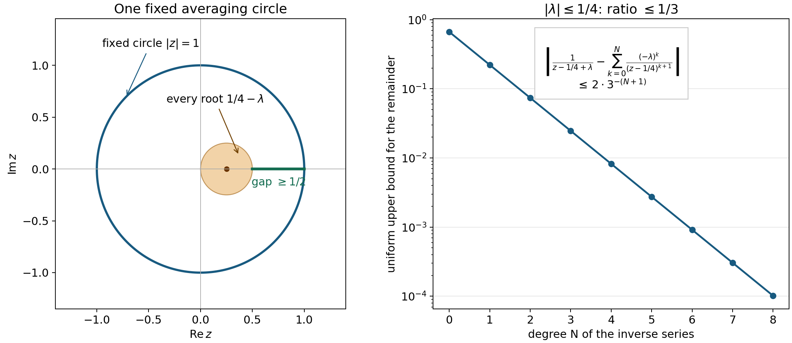

# Regular kernels and changes in the equation

*Written by GPT-6.1 Sol (OpenAI), Ultra reasoning effort, October 2026.  Public domain (CC0).*

Solving an equation is only part of the problem. We also want the solution to retain the regularity of the data, and we want estimates that survive a change in the coefficients. These two questions meet in the choice of a fundamental solution. A poorly chosen inverse can carry avoidable singularities. A regular inverse uses the full derivative norm of the polynomial to control its localized Fourier transform. A fixed averaging measure also produces holomorphic kernels on small neighborhoods of equally strong operators.

Read [Measuring regularity with weighted Fourier spaces](weighted-fourier-spaces.md) and [Local regularity, sharp embeddings, and compactness](local-regularity-and-compactness.md) first. We also use the distributional convolution identities discussed in [Fundamental solutions and the directions an equation uses](fundamental-solutions-and-active-directions.md). The additional prerequisite is holomorphic averaging for polynomials, stated precisely below. Its construction belongs to the theory of Fourier–Laplace transforms. Basic references are the open treatments of distributions by Grubb [Grubb] and Melrose [Melrose], Malgrange's original existence paper [Malgrange], Hörmander's survey of existence and regularity [Hormander 1971], and Mantlik's work on dependence on a parameter [Mantlik].

We keep \(D=-i\partial\), the negative-exponential Fourier transform, and complex-linear distributional pairings. For a nonzero polynomial,
\[
S_P(\xi)=\left(\sum_\alpha|\partial^\alpha P(\xi)|^2\right)^{1/2}.
\]
All polynomial spaces in this lesson have a fixed maximum degree \(m\). The actual degree may fall when the coefficients vary.

The smooth polynomial averaging statement below is proved in [Averaging an entire function while avoiding polynomial zeros](averaging-an-entire-function-while-avoiding-polynomial-zeros.md), including compact averaging support, scalar homogeneity and the uniform denominator bound. The construction retains its declared scalar Taylor, finite-dimensional compactness, cutoff and Lebesgue/Fubini inputs; the other prerequisites and recursive closure of this lesson remain explicit.

## What a regular inverse controls

A fundamental solution \(E\) of \(P(D)\) is **regular** if
\[
E\in B_{\infty,S_P}^{\mathrm{loc}}(\mathbb R^n).
\]
Thus every compactly supported smooth \(\chi\) gives a bounded function \(S_P\widehat{\chi E}\). This is a local assertion. It makes no claim that \(E\) is tempered before a cutoff is applied.

We shall use a simple Fourier estimate repeatedly. Suppose \(a\) is measurable and \(\sup_\xi k(\xi)|a(\xi)|\leq A\), and let \(g=\mathcal F^{-1}a\). For \(f\in\mathcal S\),
\[
\widehat{fg}(\eta)=(2\pi)^{-n}\int\widehat f(h)a(\eta-h)\,dh,
\]
so
\[
\|fg\|_{\infty,k}\leq
A(2\pi)^{-n}\int M_k(h)|\widehat f(h)|\,dh. \tag{1}
\]
Indeed \(k(\eta)/k(\eta-h)\leq M_k(h)\). Polynomial growth of \(M_k\) makes the integral finite. The formula first follows by testing against Schwartz functions and using absolute convergence; it then represents the Fourier transform by a bounded weighted function. In particular it applies when \(g\) is a tempered distribution rather than an ordinary function.

The exponential denominator we use is
\[
w_\varepsilon(x)=\cosh(\varepsilon|x|).
\]
It is smooth at the origin: its power series contains only powers of \(|x|^2\). For fixed \(0<\rho<\varepsilon\), the functions
\[
f_z(x)=\frac{e^{ix\cdot z}}{w_\varepsilon(x)},
\qquad z\in\mathbb C^n,\quad |z|\leq\rho,
\tag{2}
\]
form a bounded subset of \(\mathcal S\). Every derivative is a sum of bounded powers of \(z\) times derivatives of \(1/w_\varepsilon\). Away from the origin those derivatives decay exponentially, and the factor \(e^{ix\cdot z}\) grows by at most \(e^{\rho|x|}\). The remaining decay is \(e^{-(\varepsilon-\rho)|x|}\), which absorbs every polynomial in \(x\).

## Holomorphic averaging as a starting tool

Here is the precise prerequisite. Let \(\mathcal P_m\) be the complex vector space of polynomials of degree at most \(m\), and give it the norm
\[
|q|_J=\left(\sum_{|\alpha|\leq m}|\partial^\alpha q(0)|^2\right)^{1/2}.
\]
For every \(\rho>0\), there is a nonnegative smooth function \(\Phi(q,z)\), defined for \(q\ne0\) and \(z\in\mathbb C^n\), with these properties:

1. Its \(z\)-support is contained in a fixed compact subset of \(\{|z|<\rho\}\).
2. \(\Phi(aq,z)=\Phi(q,z)\) for every nonzero complex scalar \(a\).
3. For every entire holomorphic \(H\),
   \[
   \int_{\mathbb C^n}H(z)\Phi(q,z)\,d\lambda(z)=H(0).
   \tag{3}
   \]
4. There is a constant \(c>0\) such that
   \[
   |q(z)|\geq c|q|_J\quad\hbox{whenever }\Phi(q,z)\ne0.
   \tag{4}
   \]

Here \(\lambda\) is real \(2n\)-dimensional Lebesgue measure. The constants depend on \(m,n,\rho\). The complete [polynomial averaging proof](averaging-an-entire-function-while-avoiding-polynomial-zeros.md) supplies this lemma, including its smooth dependence on the real and imaginary coefficient coordinates and the denominator differentials below. The averaging construction is due to Hörmander; a reference for the existence and regularity method is [Hormander 1971]. The existence theorem it supports is the Malgrange–Ehrenpreis theorem. The argument below derives the stronger estimates from the stated averaging properties.

Define
\[
A(q,z)=\frac{\Phi(q,z)}{q(z)}
\]
where \(q(z)\ne0\), and define it to be zero near the zero set of \(q(z)\). This is a smooth definition. In fact (4) says that \(\Phi\) vanishes on the open set \(|q(z)|<c|q|_J\), including a neighborhood of every zero of \(q(z)\).

**Lemma 2.1.** For every \(j\geq0\), the real coefficient differential of \(A\) satisfies
\[
\big|d^jA(q,z)[r_1,\ldots,r_j]\big|
\leq C_j\frac{\prod_{\nu=1}^j|r_\nu|_J}{|q|_J^{j+1}}.
\tag{5}
\]
The empty product is one. All these differentials have \(z\)-support in the same fixed compact set.

**Proof.** On the unit coefficient sphere \(|q|_J=1\), the function \(A\) and all of its coefficient differentials are bounded on the fixed compact \(z\)-set. Smoothness across the division set was just established. Outside that set they vanish. If \(t>0\), then \(A(tq,z)=t^{-1}A(q,z)\). Differentiating this identity \(j\) times scales the differential by \(t^{-j-1}\). Normalize \(q\) to the unit sphere and use the operator norm of the resulting multilinear differential. This proves (5). \(\square\)

For a translated polynomial \(P_\xi(z)=P(\xi+z)\), its coefficient norm is exactly \(S_P(\xi)\). Translation of the directions gives \(|(Q_\nu)_\xi|_J=S_{Q_\nu}(\xi)\). Therefore (5) becomes a frequency estimate, uniform over all nonzero \(P\):
\[
\big|d^jA(P_\xi,z)[(Q_1)_\xi,\ldots,(Q_j)_\xi]\big|
\leq C_j\frac{\prod_\nu S_{Q_\nu}(\xi)}{S_P(\xi)^{j+1}}.
\tag{6}
\]
No lower bound on an individual coefficient of \(P\) is needed.

## A smooth family with small exponential growth

**Theorem 3.1.** Fix \(m,n\) and \(\rho>0\), and choose one averaging function with support in \(|z|<\rho\). There is a real \(C^\infty\) map
\[
P\longmapsto E_\rho(P),\qquad
\mathcal P_m\setminus\{0\}\longrightarrow\mathcal D'(\mathbb R^n),
\]
such that \(P(D)E_\rho(P)=\delta_0\). For every \(\varepsilon>\rho\),
\[
\left\|\frac{E_\rho(P)}{w_\varepsilon}\right\|_{\infty,S_P}
\leq C_0.
\tag{7}
\]
For nonzero \(Q_1,\ldots,Q_j\in\mathcal P_m\), put
\[
F_j(\xi)=\frac{S_P(\xi)^{j+1}}{\prod_{\nu=1}^jS_{Q_\nu}(\xi)}.
\]
Then
\[
\left\|\frac{E_\rho^{(j)}(P)[Q_1,\ldots,Q_j]}{w_\varepsilon}\right\|_{\infty,F_j}
\leq C_j.
\tag{8}
\]
The constants are independent of the coefficients of \(P,Q_1,\ldots,Q_j\). They depend on the fixed averaging choice, \(m,n,j,\varepsilon\). A zero direction makes the differential zero. Every \(E_\rho(P)\) is regular and has support in the active subspace \(V_P=N_P^\perp\).

**Proof.** Define the distribution by
\[
\langle E_\rho(P),\phi\rangle
=(2\pi)^{-n}\int_{\mathbb R^n}\int_{\mathbb C^n}
\widehat\phi(-\xi-z)A(P_\xi,z)\,d\lambda(z)\,d\xi,
\qquad\phi\in C_c^\infty.
\tag{9}
\]
For a fixed \(P\ne0\), \(S_P\) is bounded below by a positive constant, because a derivative of its highest nonzero homogeneous part is a nonzero constant. The inner integrand is bounded by \(C/S_P(\xi)\), apart from the rapidly decreasing test transform. The transform \(\widehat\phi(-\xi-z)\) decreases faster than any power of \(|\xi|\), uniformly for \(z\) in the fixed compact set. This follows by integration by parts in \(x\), with its imaginary-frequency growth bounded on \(\operatorname{supp}\phi\). Thus (9) converges absolutely and defines a distribution.

The Fourier–Laplace transform of \(P(-D)\phi\), evaluated at \(-\xi-z\), is \(P(\xi+z)\widehat\phi(-\xi-z)\). Cancel that polynomial in (9) and apply (3) to the entire function \(z\mapsto\widehat\phi(-\xi-z)\). Fourier inversion gives
\[
\langle P(D)E_\rho(P),\phi\rangle
=(2\pi)^{-n}\int\widehat\phi(-\xi)\,d\xi
=\phi(0).
\]

For each \(z\), let \(g_z\) be the tempered distribution with transform \(A(P_\xi,z)\). Formula (9) can also be written
\[
E_\rho(P)=\int e^{ix\cdot z}g_z\,d\lambda(z)
\quad\hbox{in distributions}.
\tag{10}
\]
After division by \(w_\varepsilon\), the multiplier in (10) is the Schwartz function (2). Apply (1) with \(k=S_P\), using (6) for \(j=0\). The shift function \(M_{S_P}\) has a polynomial bound with constants depending only on \(m,n\), by Proposition 1.3 of the weighted-spaces lesson. The functions \(f_z\) are uniformly Schwartz, and the \(z\)-set has finite measure. Integrating (1) proves (7), and also shows that the quotient in (7) is tempered. Multiplication by \(\chi w_\varepsilon\), for any \(\chi\in C_c^\infty\), proves local regularity.

To differentiate (9), observe that on a compact subset of \(\mathcal P_m\setminus\{0\}\),
\[
S_P(\xi)\geq C^{-1}(1+|\xi|)^{-m}S_P(0)
\geq c_K(1+|\xi|)^{-m}.
\]
The first inequality is the reverse moderate shift estimate. For bounded coefficient directions, \(S_Q(\xi)\) is bounded by a fixed polynomial in \(|\xi|\). Consequently every order of coefficient differentiation in (9) has a polynomially bounded integrand before multiplication by the test transform. The rapid decrease of that transform justifies differentiation under the integrals. The same estimates are uniform on bounded sets of test functions with a common compact support. This proves smoothness in the strong distribution topology, as well as the formula obtained by replacing \(A\) by its corresponding differential.

Now apply (1) to that differentiated formula. Estimate (6) bounds its Fourier coefficient by \(C_j/F_j\). Products and reciprocals of the weights \(S_Q\) are moderate. Their shift constants are uniform for degrees at most \(m\), so
\[
M_{F_j}(h)\leq(1+C|h|)^{m(2j+1)}.
\]
Equations (1) and (2) therefore prove (8).

Finally, split the Euclidean coordinates as \(V_P\oplus N_P\). The polynomial \(P(\xi+z)\), and hence the translated polynomial \(P_\xi\) as an element of \(\mathcal P_m\), is independent of the \(N_P\)-component of \(\xi\). It follows that \(\widehat g_z\) is independent of that component. Its inverse transform is a distribution in the active coordinates tensored with \(\delta_0\) in the inactive coordinates. Thus \(g_z\), every multiplier in (10), and their integral are supported in \(V_P\). \(\square\)

For any prescribed positive exponential rate \(\varepsilon\), choose \(\rho<\varepsilon\). The theorem gives a family with the bound (7) at that rate. A fixed averaging choice has a fixed \(\rho\); the proof does not assert (7) for all smaller rates with that same choice. The parameter map is smooth in real coefficient coordinates. We have made no claim of holomorphic dependence on unrestricted complex coefficients.

This support statement strengthens the existence result in the first lesson: the family now has both minimal active-subspace support and regularity. The minimality theorem there says that no real linear subspace smaller than \(V_P\) can support a fundamental solution.

## Holomorphic dependence at constant strength

The averaging density in the smooth construction changes with the real and imaginary parts of the coefficients. To obtain a holomorphic family locally, keep that density fixed and vary only the polynomial in its denominator. A uniform comparison of derivative norms makes this possible. The analytic parameter problem is studied in [Mantlik].

Fix a nonzero polynomial \(P_0\), write \(S_0=S_{P_0}\), and set
\[
\begin{aligned}
\mathcal W(P_0)&=\{R\in\mathcal P_m:\|R\|_0<\infty\},\\
\|R\|_0&=\sup_{\xi\in\mathbb R^n}\frac{S_R(\xi)}{S_0(\xi)}.
\end{aligned}
\tag{H1}
\]
The zero polynomial has norm zero. The triangle inequality for the derivative vectors makes this a complex norm on a vector subspace. It gives the usual finite-dimensional topology: evaluation of the derivative vector at zero gives a lower bound for a fixed coefficient norm, while expansion in any basis of \(\mathcal W(P_0)\) bounds \(\|\cdot\|_0\) above by a constant times that coefficient norm.

Choose the averaging function \(\Phi\) with support in \(|z|<\rho\) and denominator constant \(c\) from (4). Put
\[
T_\rho=\max_{|z|\le\rho}
\left(\sum_{|\alpha|\le m}\frac{|z^\alpha|^2}{(\alpha!)^2}\right)^{1/2},
\qquad
r=\min\left(\frac12,\frac{c}{2T_\rho}\right).
\tag{H2}
\]
Taylor's formula and Cauchy–Schwarz give
\[
|R(\xi+z)|\le T_\rho S_R(\xi)
\le T_\rho\|R\|_0 S_0(\xi)
\quad (|z|\le\rho).
\tag{H3}
\]

**Theorem 3.2 (local holomorphic regular kernels).** On the complex ball \(\|R\|_0<r\) there is a holomorphic family \(F_R\) of fundamental solutions for \(P_0+R\). For every fixed \(\varepsilon>\rho\), the map
\[
R\longmapsto \frac{F_R}{w_\varepsilon}
\quad\hbox{is holomorphic into }B_{\infty,S_0}(\mathbb R^n).
\tag{H4}
\]
Every member is regular for \(P_0+R\) and is supported in the common active subspace \(V_{P_0}\). For \(s<r\) and every integer \(j\ge0\),
\[
\left\|\frac{d^jF_R[R_1,\ldots,R_j]}{w_\varepsilon}\right\|_{\infty,S_0}
\le
C_\varepsilon
\frac{j!\,T_\rho^j}{(c-T_\rho s)^{j+1}}
\prod_{\nu=1}^j\|R_\nu\|_0
\quad(\|R\|_0\le s).
\tag{H5}
\]
The constant \(C_\varepsilon\) is independent of \(R,j,R_1,\ldots,R_j\). For \(j=0\) the product is one. This is also a holomorphic map into the strong distribution topology. Any prescribed positive exponential rate can be obtained by choosing \(\rho\) below that rate before constructing the family.

**Proof.** Freeze the density at the translated base polynomial:
\[
\Phi_0(\xi,z)=\Phi((P_0)_\xi,z),\qquad
B_R(\xi,z)=\frac{\Phi_0(\xi,z)}{(P_0+R)(\xi+z)}.
\tag{H6}
\]
Define the quotient to be zero off the support of \(\Phi_0\). On that support, (4) and (H3) give
\[
\begin{aligned}
|(P_0+R)(\xi+z)|
&\ge(c-T_\rho\|R\|_0)S_0(\xi),\\
S_{P_0+R}(\xi)
&\in[(1-\|R\|_0)S_0(\xi),
       (1+\|R\|_0)S_0(\xi)].
\end{aligned}
\tag{H7}
\]
The first lower bound is positive and holds on a neighborhood of the density's support. Thus extension by zero is smooth wherever the quotient needs that extension. The second bound follows from the triangle inequality and its reverse for the full derivative vectors. In particular these polynomials are nonzero and equally strong.

Scalar homogeneity and compactness of the unit coefficient sphere show that \(\Phi\) is bounded by one constant \(C_\Phi\) for all its arguments. Consequently
\[
|B_R(\xi,z)|\le
\frac{C_\Phi}{(c-T_\rho\|R\|_0)S_0(\xi)}.
\tag{H8}
\]
Define \(F_R\) by (9), replacing \(A(P_\xi,z)\) with \(B_R(\xi,z)\). The positive lower bound for \(S_0\), the compact \(z\)-support, and the rapid decrease of the test transform prove absolute convergence and continuity on each test-function space with fixed compact support. Multiplication by \(P_0+R\) cancels the denominator. The averaging identity (3), which still holds for the frozen density at every \(\xi\), then gives \((P_0+R)(D)F_R=\delta_0\).

The Fourier estimate (1), applied with \(k=S_0\), proves the bound for \(j=0\) in (H5). More explicitly, multiply the inverse transform of \(B_R(\cdot,z)\) by \(f_z\) from (2), then integrate in \(z\). The moderate shift bound for \(S_0\), the uniform Schwartz bounds for \(f_z\), and the finite measure of the \(z\)-support give one bounded linear passage from any coefficient bounded by a constant times \(1/S_0(\xi)\) to \(B_{\infty,S_0}\). Absorb its norm and \(C_\Phi\) into \(C_\varepsilon\).

This passage also proves holomorphy in that Banach space, rather than only scalar holomorphy after testing. On the support of \(\Phi_0\), put
\[
q_R(\xi,z)=\frac{R(\xi+z)}{P_0(\xi+z)}.
\]
Then \(|q_R|\le T_\rho\|R\|_0/c<1/2\), and
\[
B_R(\xi,z)=
\sum_{k=0}^\infty
(-1)^k\frac{\Phi_0(\xi,z)R(\xi+z)^k}
                     {P_0(\xi+z)^{k+1}}.
\tag{H9}
\]
Each term, extended by zero as above, is a continuous homogeneous polynomial of degree \(k\) in the finite-dimensional complex variable \(R\). After the Fourier passage its norm is at most
\[
\frac{C_\varepsilon}{c}
\left(\frac{T_\rho\|R\|_0}{c}\right)^k.
\tag{H10}
\]
The series therefore converges in \(B_{\infty,S_0}\), uniformly on every smaller ball. Its sum agrees with \(F_R/w_\varepsilon\): termwise testing is justified by the same bound and the rapid decrease of the test transform. It is a locally convergent series of continuous complex homogeneous polynomials, which proves Banach-space holomorphy.

For completeness, differentiation gives the exact coefficient formula
\[
d^jB_R[R_1,\ldots,R_j]
=(-1)^j j!\,
\frac{\Phi_0(\xi,z)\prod_{\nu=1}^jR_\nu(\xi+z)}
     {(P_0+R)(\xi+z)^{j+1}}.
\tag{H11}
\]
Taylor's bound (H3) for each numerator and (H7) for the denominator give (H5) under the same bounded Fourier passage. The derivatives in (H11) are complex differentials. No parameter derivative falls on the frozen density.

The embedding of \(B_{\infty,S_0}\) into tempered distributions is continuous: \(1/S_0\) has at most polynomial growth, so integration against a Schwartz transform is bounded by a Schwartz seminorm. Multiplication by \(w_\varepsilon\) then gives a continuous map into strong distributions. Indeed a bounded family of test functions with common compact support remains bounded after multiplication by that fixed smooth function. This proves the asserted distributional holomorphy. Multiplication instead by \(\chi w_\varepsilon\), with \(\chi\) compactly supported, proves local regularity with weight \(S_0\), and (H7) makes that weight equivalent to \(S_{P_0+R}\).

Finally take \(\nu\in N_{P_0}\). The function \(S_0(\xi+t\nu)\) is constant in \(t\). The norm bound in (H1) makes \(R(\xi+t\nu)\) a bounded polynomial in real \(t\), so it is constant. Thus every \(R\in\mathcal W(P_0)\) is independent of the inactive variables of \(P_0\). Conversely, along an inactive direction of \(P_0+R\), the reverse comparison in (H7) makes \(P_0(\xi+t\nu)\) bounded and therefore constant. Their active spaces agree. Both factors in (H6) are independent of the inactive component of \(\xi\). The Fourier support argument following (10) therefore puts \(F_R\) in \(V_{P_0}\). The minimality theorem of [Fundamental solutions and the directions an equation uses](fundamental-solutions-and-active-directions.md), Theorem 3.1, gives its minimal supporting linear subspace. This finishes the proof. \(\square\)

*A one-variable circle model of (H7)–(H10).* On \(|z|=1\), the polynomial \(z-\tfrac14+\lambda\), with \(|\lambda|\le\tfrac14\), has modulus at least \(\tfrac12\). Its root stays in the shaded disk. The fixed circle averages every entire function to its value at zero. Relative to \(z-\tfrac14\), the denominator's geometric-series ratio is at most \(1/3\), so the remainder after degree \(N\) is bounded by \(2\cdot3^{-(N+1)}\). The circle is an exact elementary model of a fixed averaging support; the theorem uses the smooth density in (3).

**Corollary 3.3 (a holomorphic constant-strength parameter).** Let \(\lambda\mapsto P_\lambda\) be a holomorphic map from a finite-dimensional complex manifold into the polynomials, and suppose its members are equally strong near \(\lambda_0\). Locally at \(\lambda_0\) it has a holomorphic family of regular fundamental solutions, with any chosen positive exponential rate.

**Proof.** Set \(P_0=P_{\lambda_0}\). Equal strength puts \(P_\lambda-P_0\) in \(\mathcal W(P_0)\). In local manifold coordinates, the coefficient map into this fixed finite-dimensional subspace is holomorphic. Equivalence of its coefficient topology with the norm in (H1) makes \(P_\lambda-P_0\) enter the ball of Theorem 3.2 after shrinking the neighborhood. Compose the map with that theorem. \(\square\)

A scalar change illustrates the construction exactly. If \(P_\lambda=(1+\lambda)P_0\), the frozen family is \(F_\lambda=(1+\lambda)^{-1}F_0\). This formula extends over \(\lambda\ne-1\). For several coefficient directions, Theorem 3.2 constructs a family on a neighborhood of each base point; agreement of separately chosen families on overlaps is an additional problem.

Uniform denominator estimates for a compact family, with one bounded measurable real shift at every frequency and stable complex translations, are proved in [One contour for a compact family of equations](one-contour-for-a-compact-family-of-equations.md), Theorem 1.1.

## How differentiation forces the weight

The preceding estimate has a useful converse. It is independent of the averaging construction.

**Proposition 4.1.** Suppose \(P\mapsto E(P)\) is a real \(C^j\) family of fundamental solutions on a neighborhood of \(P\ne0\) in \(\mathcal P_m\). For coefficient directions \(Q_1,\ldots,Q_j\),
\[
P(D)^{j+1}E^{(j)}(P)[Q_1,\ldots,Q_j]
=(-1)^j j!\,Q_1(D)\cdots Q_j(D)\delta_0.
\tag{11}
\]

**Proof.** The case \(j=0\) is the defining equation. Assume the formula at order \(j-1\), with the first \(j-1\) directions. Differentiate it in direction \(Q_j\). Its right side is independent of \(P\), while its left side gives
\[
jP(D)^{j-1}Q_j(D)E^{(j-1)}
+P(D)^jE^{(j)}=0.
\]
Multiply by \(P(D)\) and substitute the induction formula for \(P(D)^jE^{(j-1)}\). Commutation of all constant-coefficient operators yields (11). \(\square\)

The regularity comparison in the next theorem uses the following consequence of convolution. If \(Q\ne0\), \(G\) is a regular fundamental solution of \(Q(D)\), and \(h\) is compactly supported with \(h\in B_{p,l}\), then
\[
G*h\in B_{p,lS_Q}^{\mathrm{loc}}.
\tag{12}
\]
For a cutoff \(\chi\), choose a compactly supported cutoff \(\psi\) equal to one near \(\operatorname{supp}\chi-\operatorname{supp}h\). On \(\operatorname{supp}\chi\), \(G*h=(\psi G)*h\). The compact kernel \(\psi G\) lies in \(B_{\infty,S_Q}\). The weighted convolution estimate and then the cutoff estimate prove (12), including \(p=\infty\).

**Theorem 4.2.** Assume every direction \(Q_\nu\) is nonzero. If the differential in Proposition 4.1 belongs to \(B_{p,k}^{\mathrm{loc}}\), for a moderate weight \(k\) and \(1\leq p\leq\infty\), then
\[
\frac{k}{F_j}\in L^p(\mathbb R^n),
\qquad B_{\infty,F_j}\subset B_{p,k}
\quad\hbox{continuously}.
\tag{13}
\]
For \(j=0\), this says that every local \(B_{p,k}\) regularity assertion for a fundamental solution forces \(k/S_P\in L^p\).

**Proof.** The differential-operator estimate sends the left side of (11) into
\(B_{p,k/S_P^{j+1}}^{\mathrm{loc}}\). Therefore the compact distribution
\(h_0=Q_1(D)\cdots Q_j(D)\delta_0\) belongs to that local space. Local and global membership agree for a distribution of fixed compact support.

Choose a regular fundamental solution \(G_\nu\) for each \(Q_\nu(D)\). Distributional convolution gives
\[
G_1*h_0=Q_2(D)\cdots Q_j(D)\delta_0.
\]
Although \(G_1\) need not have compact support, this convolution is defined because \(h_0\) does; the displayed identity shows that its result does have compact support. Equation (12) improves its weight by \(S_{Q_1}\). Repeat the argument for \(G_2,\ldots,G_j\), converting local to global membership at each compact result. We obtain
\[
\delta_0\in B_{p,k\prod_\nu S_{Q_\nu}/S_P^{j+1}}
=B_{p,k/F_j}.
\]
Since \(\widehat\delta_0=1\), this is exactly the first assertion of (13). If \(u\in B_{\infty,F_j}\), then
\[
\|u\|_{p,k}
\leq(2\pi)^{-n/p}\|k/F_j\|_{L^p}\|u\|_{\infty,F_j},
\]
with the factor interpreted as one for \(p=\infty\). This proves the inclusion. \(\square\)

The conclusion concerns weighted Fourier spaces. It does not assert that all fundamental solutions have the same wave front set or the same behavior at infinity. It also explains why the derivative norm \(S_Q\), rather than just \(|Q|\), appears in (8): the proof must invert the full operator \(Q(D)\), even at frequencies where its symbol vanishes.

## A transport model with a visible regularity estimate

Let \(v\in\mathbb R^n\setminus\{0\}\), \(c\in\mathbb C\), and
\[
L=v\cdot\nabla+c=P(D),\qquad P(\xi)=iv\cdot\xi+c.
\]
The forward kernel from the first lesson is
\[
\langle E_+,\phi\rangle=\int_0^\infty e^{-ct}\phi(tv)\,dt.
\]
Its support is the ray \(\{tv:t\geq0\}\), and \(LE_+=\delta_0\). This definition is valid for every \(c\), because test functions have compact support along the ray.

For \(\chi\in C_c^\infty\), put \(h(t)=e^{-ct}\chi(tv)\). Then
\[
\widehat{\chi E_+}(\xi)=\int_0^\infty h(t)e^{-itv\cdot\xi}\,dt.
\]
The \(L^1\) norm of \(h\) bounds this integral. For \(a=v\cdot\xi\ne0\), integration by parts also gives
\[
\left|\int_0^\infty h(t)e^{-iat}\,dt\right|
\leq\frac{|h(0)|+\|h'\|_{L^1(0,\infty)}}{|a|}.
\]
Combining the two estimates yields a bound by \(C/(1+|a|)\). Since
\[
S_P(\xi)^2=|iv\cdot\xi+c|^2+|v|^2,
\]
the weight \(S_P\) is comparable to \(1+|v\cdot\xi|\). Hence \(E_+\) is regular. Its transform after a cutoff need not decay in the inactive frequency directions. The anisotropic weight records exactly that fact.

## Exercises with solutions

**Exercise 1 (entry).** For a nonzero constant \(P=a\), identify the fundamental solution, the regularity weight, and the differentials in constant directions \(Q_\nu=b_\nu\).

**Solution.** The equation has the unique fundamental solution \(E(a)=a^{-1}\delta_0\). Here \(S_P=|a|\), and
\[
E^{(j)}(a)[b_1,\ldots,b_j]
=(-1)^j j!\frac{b_1\cdots b_j}{a^{j+1}}\delta_0.
\]
Multiplication by \(1/w_\varepsilon\) leaves \(\delta_0\) unchanged. The weight \(F_j\) is the constant \(|a|^{j+1}/\prod|b_\nu|\). Its weighted \(B_\infty\) norm times the coefficient of the delta is \(j!\), consistent with (8). For finite \(p\), a positive constant weight is not integrable on \(\mathbb R^n\) when \(n\geq1\), so the delta belongs to none of the corresponding \(B_{p,k}\) spaces with constant positive \(k\).

**Exercise 2 (intermediate).** On \(\mathbb R\), take \(L_a=\partial_x+a\) and its forward kernel \(E_a=1_{[0,\infty)}e^{-ax}\). Differentiate with respect to \(a\) and verify (11) at order one directly.

**Solution.** The derivative is \(\dot E_a=-x1_{[0,\infty)}e^{-ax}\). Since \(L_aE_a=\delta_0\), direct distributional differentiation gives \(L_a\dot E_a=-E_a\): the boundary term at zero vanishes because of the factor \(x\). Applying \(L_a\) once more gives \(L_a^2\dot E_a=-\delta_0\), which is (11) with \(Q=1\). After localization, two integrations by parts show decay of the transform of \(\dot E_a\) by \((1+|\xi|)^{-2}\); the first boundary term vanishes, while the second contains the derivative of \(-xe^{-ax}\chi(x)\) at zero. Thus the gain predicted by \(F_1=S_P^2\) is visible in this model.

**Exercise 3 (intermediate).** Prove that adding any distributional solution \(H\) of \(P(D)H=0\) to a fundamental solution preserves the fundamental-solution equation. Why does this observation alone give no regularity bound?

**Solution.** Linearity gives \(P(D)(E+H)=\delta_0\). The homogeneous equation does not force arbitrary solutions into the regular inverse scale. For example, in \(\mathbb R^2\) with \(P(\xi)=\xi_1\), take \(H=1\otimes D_2\delta_0(x_2)\). It solves \(D_1H=0\). Choose \(\chi(x)=\chi_1(x_1)\chi_2(x_2)\), with \(\chi_2=1\) near zero and nonzero \(\chi_1\). Its localized transform is \(\xi_2\widehat\chi_1(\xi_1)\). Fix a \(\xi_1\) where \(\widehat\chi_1\) is nonzero and let \(|\xi_2|\to\infty\). Multiplication by \(S_P=(1+\xi_1^2)^{1/2}\) remains unbounded. Thus adding this homogeneous solution to a regular fundamental solution destroys regularity.

**Exercise 4 (advanced).** Let \(P_a(\xi_1,\xi_2)=\xi_1^2+i\xi_2+a\), with \(a\) a real parameter. For a smooth family of fundamental solutions, prove that local membership of its \(j\)-th parameter derivative in \(B_{p,k}\) forces \(k/S_{P_a}^{j+1}\in L^p\). Explain why an elliptic estimate with weight \(\langle\xi\rangle^{2j+2}\) cannot be substituted.

**Solution.** Every parameter direction is \(Q=1\), so \(S_Q=1\) and Theorem 4.2 gives the asserted integrability. Along \(\xi_1=0\), the derivative norm is
\(S_{P_a}(0,\xi_2)^2=|i\xi_2+a|^2+5\), which grows like \(\xi_2^2\), rather than \(\xi_2^4\). Therefore \(S_{P_a}^{j+1}\) has growth of order \(j+1\) in that direction. The proposed isotropic weight has growth of order \(2j+2\) and is not bounded by a constant multiple of the actual weight. The operator is not elliptic of order two, so that stronger uniform gain is unsupported.

**Exercise 5 (20 points).** Explain why (H11) is a complex differential even though the averaging density need not be holomorphic in the polynomial coefficients. Identify the term that would obstruct this argument if the original density were varied.

**Solution.** In (H6), \(\Phi_0\) is fixed independently of \(R\). The parameter enters only through the reciprocal of a nonvanishing complex-linear expression. Repeated complex differentiation of that reciprocal gives (H11), and (H5) justifies it in the asserted Banach space. With the original varying density, a derivative with respect to a conjugate coefficient would also differentiate \(\Phi\). Smoothness in real coefficient coordinates does not make that derivative zero. Assign 10 points to the fixed-density argument and 10 to identifying the conjugate-coefficient derivative.

**Exercise 6 (20 points).** For \(P_0(\xi_1,\xi_2)=\xi_1\), determine \(\mathcal W(P_0)\). Explain why \(R=\lambda\xi_2\), with \(\lambda\ne0\), is outside every ball in (H1).

**Solution.** Here \(S_0=(1+\xi_1^2)^{1/2}\). Boundedness of \(R(\xi_1,\xi_2)\) in \(\xi_2\), for each fixed \(\xi_1\), makes \(R\) independent of \(\xi_2\). Its bound by a constant times \(1+|\xi_1|\) makes its degree at most one. Conversely every \(a\xi_1+b\) has derivative norm bounded by a constant times \(S_0\). Thus \(\mathcal W(P_0)=\operatorname{span}_{\mathbb C}\{1,\xi_1\}\). For \(R=\lambda\xi_2\), the ratio on \(\xi_1=0\) is \(|\lambda|(1+\xi_2^2)^{1/2}\), which is unbounded. The theorem's neighborhood lies in a fixed strength space, not in an unrestricted coefficient ball. Assign 12 points to the exact space and 8 to the diverging ratio.

**Exercise 7 (30 points).** For the scalar family at the end of the holomorphic section, compute every derivative and the norm of the remainder after degree \(N\) in the Taylor expansion at zero. Give a bound uniform on \(|\lambda|\le t<1\).

**Solution.** Direct differentiation gives
\[
\frac{d^jF_\lambda}{d\lambda^j}
=(-1)^j j!(1+\lambda)^{-j-1}F_0.
\]
The finite geometric-series identity gives the exact remainder
\[
F_\lambda-\sum_{k=0}^N(-\lambda)^kF_0
=\frac{(-\lambda)^{N+1}}{1+\lambda}F_0.
\]
Consequently its weighted norm is
\[
\left\|\frac{F_0}{w_\varepsilon}\right\|_{\infty,S_0}
\frac{|\lambda|^{N+1}}{|1+\lambda|}
\le
\left\|\frac{F_0}{w_\varepsilon}\right\|_{\infty,S_0}
\frac{t^{N+1}}{1-t}.
\]
Assign 10 points each to the derivative, exact remainder, and uniform bound.

**Exercise 8 (30 points).** On \(\mathbb R^2\), let \(P_{a,b}(\xi)=a\xi_1+b\), where \(a\ne0\) and \(a,b\) are complex. Prove that
\[
E_{a,b}=\frac{i}{a}H(x_1)e^{-ibx_1/a}\otimes\delta_0(x_2)
\]
is a globally holomorphic distributional family of regular fundamental solutions. Specify a sufficient exponential rate for this particular forward family.

**Solution.** Distributional differentiation of the Heaviside function gives
\[
aD_1E_{a,b}
=\delta_0(x_1)\otimes\delta_0(x_2)
-\frac{ib}{a}H(x_1)e^{-ibx_1/a}\otimes\delta_0(x_2).
\]
The second term cancels \(bE_{a,b}\). For a fixed compactly supported test function, the pairing is a finite-interval integral of an expression holomorphic in \((a,b)\) on \(a\ne0\). All parameter derivatives are uniformly bounded on compact parameter sets and bounded sets of tests, so the family is holomorphic in the strong distribution topology.

For a cutoff \(\chi\), its transform is
\[
\frac{i}{a}\int_0^\infty
e^{-ibt/a}\chi(t,0)e^{-it\xi_1}\,dt.
\]
The direct integral bound and one integration by parts give \(C/(1+|\xi_1|)\), with no dependence on \(\xi_2\). Since \(S_{P_{a,b}}\) is comparable to \(1+|\xi_1|\), this proves regularity. For this forward family, every \(\varepsilon>|\operatorname{Im}(b/a)|\) is sufficient: division by \(\cosh(\varepsilon t)\) leaves an integrable amplitude with integrable first derivative, so the same Fourier bound holds globally. These bounds are uniform on compact parameter sets satisfying that strict inequality. Assign 10 points to the fundamental-solution identity, 8 to holomorphy, 8 to regularity, and 4 to the exponential bound.

## References

- [Grubb] Gerd Grubb, *Distributions and Operators*, open lecture-note versions, 2007–2008, sections on Fourier transformation and convolution. [Author's lecture-note index](https://web.math.ku.dk/~grubb/distribution.htm).
- [Melrose] Richard Melrose, *Differential Analysis*, MIT OpenCourseWare, Fall 2004, sections on distributions and constant-coefficient operators. [Open course](https://ocw.mit.edu/courses/18-155-differential-analysis-fall-2004/).
- [Malgrange] Bernard Malgrange, *Existence et approximation des solutions des équations aux dérivées partielles et des équations de convolution*, Annales de l'Institut Fourier **6** (1956), 271–355. [Original article](https://aif.centre-mersenne.org/articles/10.5802/aif.65/).
- [Hormander 1971] Lars Hörmander, *On the existence and the regularity of solutions of linear pseudo-differential equations*, L'Enseignement Mathématique **17** (1971), 99–163. [Original article archive](https://www.e-periodica.ch/digbib/view?lang=en&pid=ens-001%3A1971%3A17%3A%3A213).
- [Mantlik] Frank Mantlik, *Partial differential operators depending analytically on a parameter*, Annales de l'Institut Fourier **41** (1991), 577–599. [Original article](https://www.numdam.org/item/10.5802/aif.1266/).
- **[Hörmander II]** Lars Hörmander, *The Analysis of Linear Partial Differential Operators II: Differential Operators with Constant Coefficients*, Springer, 1983; 2005 reprint. Fundamental solutions, localization of polynomials and regularity.
