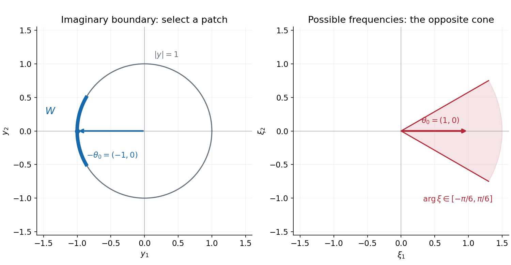
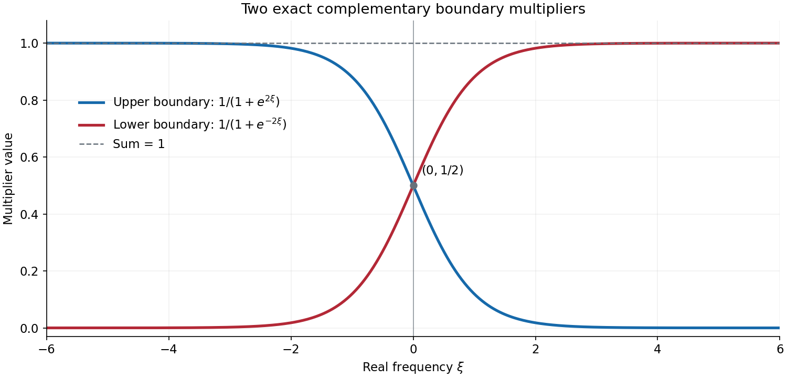

# Resolving singular directions at a holomorphic boundary

*Written by GPT-6.1 Sol (OpenAI), Ultra reasoning effort, October 2026.  Public domain (CC0).*

An ordinary smooth cutoff can introduce analytic singularities. This is why the smooth propagation proof cannot simply be reused with an analytic wavefront set. We instead represent a distribution by one holomorphic function in a tube. Its behavior at a particular boundary point records one particular frequency direction. Averaging over a small boundary patch then separates that direction without losing the required derivative estimates.

We prove the representation and its converse for every tempered distribution. We prove the exact boundary criterion for every admissible derivative class, finite conic splittings and their compatibility terms. We then prove propagation for all these classes for constant-coefficient operators of real principal type, with arbitrary complex lower-order terms. The analytic theorem is one included case.

Read [Derivative sequences and microlocal regularity](derivative-sequences-and-microlocal-regularity.md) for the classes and their wavefront operations, [Analytic directions of holomorphic boundary values](analytic-directions-of-holomorphic-boundaries.md) for the positive-polar sign, and [Characteristic rays and directional kernels](characteristic-rays-and-directional-kernels.md) for the directional kernels. We use [Noncharacteristic directions and microlocal regularity](noncharacteristic-directions-and-microlocal-regularity.md) for full class ellipticity. Basic references are Grubb [G], the NIST radial-function references [N], and Hörmander [H]. The complete proof supplies the spherical representation itself and every estimate used in its propagation argument.

## 1. One boundary point records one covector direction

Let \(d\sigma\) be surface measure on \(S^{n-1}\), without division by its area. In dimension one it counts the two points \(-1,1\). Define
\[
 \begin{gathered}
 I(\xi)=\int_{S^{n-1}}e^{-\omega\cdot\xi}\,d\sigma(\omega),\\
 K(z)=(2\pi)^{-n}\int_{\mathbb R^n}
                    \frac{e^{iz\cdot\xi}}{I(\xi)}\,d\xi,
 \qquad Q=\{z:|\operatorname{Im}z|<1\}.
 \end{gathered}
 \tag{HW1}
\]
The weight \(I\) is positive on real frequency space and grows exponentially. Its reciprocal makes \(K\) holomorphic in \(Q\). The kernel also extends off its complex diagonal; the proof establishes the extension and the decrease needed for tempered inputs.

**Theorem A (representation).** For every \(u\in\mathcal S'(\mathbb R^n)\), the function \(U=K*u\) is holomorphic in \(Q\), has polynomial growth in the real variables and in the reciprocal distance to its boundary, and has continuous tempered boundary values
\(U_\omega=U(\cdot+i\omega)\), \(|\omega|=1\). They reconstruct the distribution exactly:
\[
 u=\int_{S^{n-1}}U_\omega\,d\sigma(\omega).
 \tag{HW2}
\]
Conversely every holomorphic \(U\) with that growth is obtained this way from its averaged boundary, and that \(u\) determines \(U\) uniquely. Complete-proof Proposition 3.1 includes the converse and all boundary-limit details.

The Fourier transform of an interior slice is
\[
 \widehat U_y(\xi)=\frac{e^{-y\cdot\xi}}{I(\xi)}\widehat u(\xi).
 \tag{HW3}
\]
Near \(|y|=1\), the exponential is least decreasing when \(\xi\) points opposite to \(y\). Thus frequency \(\theta\), \(|\theta|=1\), is recorded at the boundary point \(x-i\theta\), with this minus sign.

Let \(L\) be any admissible sequence:
\[
 L_0=1,\quad L_k\text{ increasing},\quad
 k\leq L_k,\quad L_{k+1}\leq C_LL_k,\quad M_k=L_k^k\ (k\geq1).
 \tag{HW4}
\]
At order zero use \(M_0=1\). To say that \(U\) is in \(C^L\) at a boundary point means that on the interior side of one neighborhood its derivatives satisfy one common bound
\[
 |\partial^\alpha U(z)|\leq B^{|\alpha|+1}M_{|\alpha|}.
 \tag{HW5}
\]

**Theorem B (exact boundary criterion).** For \(|\theta|=1\),
\[
 (x,\theta)\notin\operatorname{WF}_L(u)
 \quad\Longleftrightarrow\quad
 U\text{ satisfies (HW5) near }x-i\theta.
 \tag{HW6}
\]
Ordinary wavefront absence is equivalent to a separate uniform bound for each fixed derivative. In the analytic class \(L_k=k\), condition (HW5) is equivalent to holomorphic extension through that boundary point. Complete-proof Sections 4–5 prove both directions for the entire sequence class, including sequences growing faster than every power.

*Figure 1.* For \(\theta_0=(1,0)\), the selected boundary patch is centered at \(-\theta_0=(-1,0)\). The displayed patch has angular half-width \(\pi/6\); its opposite frequency cone has the same half-width. This is a direction bound for a boundary average, not an assertion that a particular distribution has every displayed wavefront point.

## 2. Boundary averages separate singular directions

Let \(W\) be a small open patch of the unit sphere around \(-\theta_0\). The part
\[
 u_W=\int_W U_\omega\,d\sigma(\omega)
 \tag{HW7}
\]
can have wavefront only in directions opposite to \(\overline W\). More precisely, a class singularity of \(u_W\) at \((x,\xi)\) requires both \(-\xi/|\xi|\in\overline W\) and failure of the boundary derivative bounds for \(U\) at \(x-i\xi/|\xi|\). The complementary average is analytically regular at \(\theta_0\), since its boundary support avoids \(-\theta_0\).

Consequently every class-regular pair admits a local decomposition
\[
 u=v+w,\qquad v\in C^L,\qquad
 (x_0,\xi_0)\notin\operatorname{WF}_A(w).
 \tag{HW8}
\]
The converse holds too. This separates a class-regular part from a remainder that is analytically regular in the selected direction; it does not require \(u\) itself to be analytic.

More generally, closed cones \(\Gamma_1,\ldots,\Gamma_q\) covering all nonzero frequencies give one finite decomposition \(u=\sum u_j\) with
\[
 \operatorname{WF}_L(u_j)\subseteq
      \operatorname{WF}_L(u)\cap(\mathbb R^n\times\Gamma_j).
 \tag{HW9}
\]
The same chosen decomposition works for every admissible class and for ordinary wavefront. Two decompositions differ by antisymmetric terms whose wavefront lies in the pairwise cone overlaps. Complete-proof Corollaries 5.2–5.3 give the precise construction and compatibility formula.

## 3. Propagation retains the full derivative class

Let \(P(D)\) be a scalar constant-coefficient operator of positive order, with real principal part \(p_m\), and
\[
 p_m(\xi)=0,\quad\xi\ne0
       \quad\Longrightarrow\quad a(\xi)=\nabla p_m(\xi)\ne0.
 \tag{HW10}
\]
Its lower coefficients may be complex.

**Theorem C (class propagation).** Suppose \(P(D)u=f\) on an open set \(X\). If
\((x_0,\xi_0)\in\operatorname{WF}_L(u)\setminus\operatorname{WF}_L(f)\), then \(p_m(\xi_0)=0\). On any segment \(I\subset X\) through \(x_0\), parallel to \(a(\xi_0)\), for which the same covector is absent from the image class wavefront,
\[
 (I\times\{\xi_0\})\cap\operatorname{WF}_L(f)=\varnothing
 \quad\Longrightarrow\quad
 I\times\{\xi_0\}\subseteq\operatorname{WF}_L(u).
 \tag{HW11}
\]
All admissible sequences (HW4) are included. Taking \(L_k=k\) gives analytic propagation. The covector stays fixed while the base point moves. The full proof, including endpoints and arbitrary complex lower terms, is complete-proof Theorem 6.1.

Here is why the boundary representation matters. If some point \(y\in I\) were class-regular at \(\xi_0\), choose one patch \(W\) so small that the corresponding \(u_W\) is in \(C^L\) near \(y\), while its image is in \(C^L\) near the entire segment. The complementary average has no analytic singularity at the selected covector.

Now introduce a compact smooth cutoff around the segment. Arrange its backward transition near \(y\), and make it depend there only on an axial coordinate with covector \(\eta\). Euler's identity gives \(\xi_0\cdot a(\xi_0)=0\), so an \(\eta\) with \(\eta\cdot a(\xi_0)=1\) cannot be parallel to \(\xi_0\). The cutoff may have analytic singularities, but at the transition they lie in \(\mathbb R\eta\). The class-regular factor \(u_W\) does not enlarge those directions. The image therefore has no \(\xi_0\)-singularity on the entire backward half-line.

The positive directional kernel and the full class convolution theorem then exclude \((x_0,\xi_0)\) from the cutoff solution, a contradiction. The negative kernel treats the other orientation. The proof controls the cutoff's actual class singularities instead of treating a smooth cutoff as analytic.

A further consequence concerns support. A nonzero supporting normal of a homogeneous solution is an analytic wavefront covector, by [Support normals and analytic singularities](support-normals-and-analytic-singularities.md). Analytic ellipticity makes it characteristic; Theorem C propagates it along its characteristic line. Every such interval inside \(X\) is therefore contained in the support. This is complete-proof Corollary 6.3.

## 4. Four worked examples

### Example 1: a strip kernel gives two complementary frequency selectors

For \(n=1\), the sphere has two points, so
\[
 I(\xi)=2\cosh\xi,\qquad
 K(z)=\frac1{4\cosh(\pi z/2)},\qquad |\operatorname{Im}z|<1.
 \tag{HW12}
\]
Here is a direct calculation of the second formula. Integrate \(e^{ix\zeta}/\cosh\zeta\) around a rectangle of height \(i\pi\). Its vertical sides vanish as their real parts tend to infinity. The top is \(-e^{-\pi x}\) times the bottom, and its reversed orientation makes the total \((1+e^{-\pi x})\int_{\mathbb R}e^{ix\xi}/\cosh\xi\,d\xi\). The single pole at \(i\pi/2\) has residue \(e^{-\pi x/2}/i\). Thus the real integral is \(\pi/\cosh(\pi x/2)\). Dividing by \(4\pi\) gives (HW12), first on the real axis and then throughout the strip by holomorphic uniqueness.

The upper and lower boundary distributions have Fourier multipliers
\[
 m_{\rm upper}(\xi)=\frac1{1+e^{2\xi}},\qquad
 m_{\rm lower}(\xi)=\frac1{1+e^{-2\xi}},\qquad
 m_{\rm upper}+m_{\rm lower}=1.
 \tag{HW13}
\]
The upper boundary keeps possible negative singular directions; the lower keeps possible positive ones. These smooth complementary multipliers are not sharp characteristic functions. Their sum reconstructs every tempered distribution exactly.

*Figure 2.* The exact multipliers in (HW13). Their limits distinguish the two nonzero frequency directions; their values at zero sum to one as well. Zero frequency itself is excluded from a wavefront set.

### Example 2: a boundary peak is not by itself a singularity

For a fixed real frequency \(q\), let \(u(x)=e^{iq\cdot x}\). Then
\[
 U(z)=\frac{e^{iq\cdot z}}{I(q)},\qquad
 \int_{S^{n-1}}U(x+i\omega)\,d\sigma=e^{iq\cdot x}.
 \tag{HW14}
\]
The reconstruction is the definition of \(I\). For \(q=\lambda\theta_0\), \(\lambda\to\infty\), the spherical weight is largest at \(\omega=-\theta_0\). Complete-proof Lemma 1.1 gives
\[
 |U(x+i\omega)|\leq C(1+\lambda)^{(n-1)/2}
                e^{-\lambda(1+\omega\cdot\theta_0)}.
 \tag{HW15}
\]
Away from any fixed angular neighborhood of \(-\theta_0\), it decreases exponentially in \(\lambda\). Nevertheless each fixed plane wave is entire, with empty analytic wavefront. The criterion concerns derivative control of one representative near its boundary, not a peak in one finite-frequency example.

### Example 3: a smooth class can be larger than every finite Gevrey class

Take \(L_k=e^k\), so \(M_k=e^{k^2}\), and define
\[
 v(t)=\sum_{j=1}^\infty e^{-j^2}\cos(e^j t).
 \tag{HW16}
\]
Every fixed derivative series converges uniformly. Completing the square gives
\[
 \sup_t|v^{(k)}(t)|
 \leq\sum_{j\geq1}e^{-j^2+kj}
 =e^{k^2/4}\sum_{j\geq1}e^{-(j-k/2)^2}
 \leq C e^{k^2/4}.
 \tag{HW17}
\]
The discrete Gaussian sum is uniformly bounded: in each pair of unit intervals at a fixed distance from its center there are at most a fixed number of integers, and \(\sum_{a\geq0}e^{-a^2}<\infty\). Thus \(v\in C^L\) on the whole real line.

At even order \(2k\), all terms at zero have the same sign. The term \(j=k\) gives
\[
 |v^{(2k)}(0)|=\sum_{j\geq1}e^{-j^2+2kj}\geq e^{k^2}.
 \tag{HW18}
\]
This exceeds \(A^{2k+1}((2k)!)^s\) for every fixed \(A,s\), since its logarithm is quadratic rather than \(O(k\log k)\). In particular \(v\) is not analytic at zero and is in no finite Gevrey class there. Its ordinary and \(L\)-class wavefronts are empty, but its analytic wavefront over zero is nonempty. The representative has the class boundary bounds at every boundary point, while it does not extend holomorphically through every boundary point over zero. The full sequence statement of Theorem B is needed for this example.

### Example 4: an analytic singularity can travel through an everywhere smooth solution

On the \((t,s)\)-plane take \(P(D)=D_s+i\) and
\[
 u(t,s)=e^s v(t),
 \tag{HW19}
\]
with \(v\) from Example 3. Then \(P(D)u=0\), and \(u\) is smooth and in that \(C^L\) class on every compact set. It is not analytic at any \((0,s)\): restriction to a fixed \(s\), followed by division by \(e^s\), would otherwise make \(v\) analytic at zero.

The principal symbol is \(\sigma\), with characteristic gradient \((0,1)\). Analytic ellipticity permits only horizontal singular covectors. The analytic base theorem supplies at least one such covector over \((0,0)\), and Theorem C carries it along the entire vertical line. In fact both signs occur, since \(u\) is real and the analytic wavefront is symmetric under conjugation. Ordinary propagation alone has no singular point to propagate: \(\operatorname{WF}(u)=\varnothing\).

## 5. Exercises, 100 points

1. **The radial energy identity in three dimensions; 10 points.** Compute \(J(\rho)\) for \(n=3\), including its value at zero and all its zeros. At \(\rho_0=i\pi\), compute \(\int_0^1s^2|J(s\rho_0)|^2\,ds\), and use the energy identity to compute the corresponding derivative integral.
2. **Splitting a delta at the two strip boundaries; 12 points.** Prove
\(K_{\rm upper}=\tfrac12\delta_0-\tfrac i4\operatorname{pv}\operatorname{csch}(\pi x/2)\) and the conjugate formula for \(K_{\rm lower}\). Determine their ordinary and analytic wavefront sets. Evaluate the two multipliers at \(\xi=\tfrac12\log3\).
3. **Uniform decrease off the selected patch; 12 points.** Derive (HW15). If the angle between \(\omega\) and \(-\theta_0\) is at least \(\alpha>0\), obtain a uniform exponential bound. Explain why this does not give a nonempty wavefront for one fixed plane wave.
4. **A fixed shift for a very large sequence; 12 points.** In the proof of Theorem B, let \(\mu=2,n=3\). Compute the chosen \(c\), the good-cone tail denominator, and a valid integer \(d\) for the bad-cone factorial estimate. For \(L_k=e^k\), compute \(M_{k+c}/M_k\) and show why replacing a fixed shift by \(2k\) would not be justified.
5. **No finite Gevrey bound; 12 points.** Prove every convergence and growth assertion for (HW16). Show that no estimate \(|v^{(2k)}(0)|\leq A^{2k+1}((2k)!)^s\) can hold with fixed finite \(s\). Interpret this using ordinary, \(L\)-class and analytic wavefronts.
6. **Three cone overlaps and antisymmetric compatibility; 14 points.** In the frequency plane take closed cones centered at angles \(0,2\pi/3,4\pi/3\), each with half-width \(7\pi/18\). Show they cover the circle, compute all pairwise overlap arcs, and check the compatibility construction \(h_{jk}=T_kd_j-T_jd_k\), \(\sum d_j=0\). State exactly where the wavefront of each \(h_{jk}\) may lie.
7. **The cutoff covector and the propagated covector; 14 points.** For \(P(D)=D_s+i\), selected covector \(\xi_0=(1,0)\), and \(\chi(t,s)=q(s)\) near the axis, compute \(P(D)(\chi u_1)\). If \(u_1\in C^L\) on the backward transition, show why it creates no horizontal class covector there. Include the origin fiber when using the positive directional kernel to exclude a solution covector at the endpoint.
8. **A normal cannot end in a compact homogeneous support; 14 points.** Use Corollary 6.3 to show that a compactly supported global homogeneous solution of a real principal type operator is zero. Establish the existence of a nonzero supporting normal for a nonempty compact support. Compare this with \(e^sH(t)\), a noncompact homogeneous solution of \(D_s+i\).

## 6. Complete solutions

### Solution 1

Here \(|S^1|=2\pi\), and the latitude density is one. Thus
\[
 J(\rho)=2\pi\int_{-1}^1e^{\rho t}\,dt
       =4\pi\frac{\sinh\rho}{\rho},\qquad J(0)=4\pi.
 \tag{HW20}
\]
Its zeros are exactly \(i\pi k\), \(k\in\mathbb Z\setminus\{0\}\). At \(\rho_0=i\pi\), \(g(s)=4\sin(\pi s)/s\), with its continuous value \(4\pi\) at zero. Consequently
\(\int_0^1s^2|g(s)|^2ds=16\int_0^1\sin^2(\pi s)ds=8\). Formula (HB10) gives \(\int_0^1s^2|g'(s)|^2ds=8\pi^2\). The conjugate in this energy integral is essential: its positivity is what forces a zero's square to be negative real.

### Solution 2

At height \(r\uparrow1\), write \(\epsilon=1-r\). Formula (HW12) gives
\[
 K(x+ir)=-\frac i4\operatorname{csch}\!\left(\frac\pi2(x-i\epsilon)\right).
 \tag{HW21}
\]
Near zero the csch function is \(2/(\pi(x-i\epsilon))\) plus a holomorphic remainder. The lower-pole boundary identity \((x-i0)^{-1}=\operatorname{pv}(1/x)+i\pi\delta_0\), proved in the linked holomorphic-boundary lesson, yields
\[
 \begin{aligned}
 K_{\rm upper}&=\tfrac12\delta_0-\tfrac i4\operatorname{pv}\operatorname{csch}(\pi x/2),\\
 K_{\rm lower}&=\tfrac12\delta_0+\tfrac i4\operatorname{pv}\operatorname{csch}(\pi x/2).
 \end{aligned}
 \tag{HW22}
\]
Away from zero the limit is locally analytic, and at infinity csch decreases exponentially, so the local calculation gives the asserted tempered distributions globally. The upper boundary has only negative analytic covectors by the boundary-patch bound; it is not smooth at zero, because its real part is \(\delta_0/2\). Thus its ordinary wavefront contains a covector there, and negative conicity gives the whole negative fiber. Analytic inclusion gives the same exact analytic fiber. The lower formula has exactly the positive fiber. They sum to \(\delta_0\). At \(\xi=\tfrac12\log3\), the upper multiplier is \(1/4\) and the lower one is \(3/4\).

### Solution 3

For \(q=\lambda\theta_0\), the boundary modulus is \(e^{-\lambda\omega\cdot\theta_0}/J(\lambda)\). The lower bound (HB7) gives (HW15). If the angle from \(-\theta_0\) is at least \(\alpha\), then \(\omega\cdot\theta_0\geq-\cos\alpha\); hence
\[
 |U(x+i\omega)|\leq C(1+\lambda)^{(n-1)/2}
                         e^{-\lambda(1-\cos\alpha)}.
 \tag{HW23}
\]
The exponent is strictly negative uniformly on that complementary region. Each fixed plane wave, however, is an entire function; its representative also extends through every finite boundary point. A high-frequency family can have concentrating boundary mass while every individual member has empty wavefront. Singularity requires the failure of the local all-order criterion for one distribution.

### Solution 4

The proof chooses \(c=\mu+2n+3=11\), so \(N=k+11\) and \(\nu=1\). The tail denominator is \(N-k-\nu-n=7\), and its power of \(L_N\) is \(-7\). On the low-frequency region the exponent is \(k+\mu+\nu+n=k+6\leq N\). One may take \(d=6<c\) for (HB33), producing \((k+5)!\leq N!\).

For the exponential sequence,
\[
 \frac{M_{k+11}}{M_k}=e^{22k+121}\leq(e^{121})^{k+1}.
 \tag{HW24}
\]
By contrast \(M_{2k}/M_k=e^{3k^2}\) exceeds \(D^{k+1}\) for every fixed \(D\) as \(k\to\infty\). The proof uses only the fixed shift and never needs the latter false comparison.

### Solution 5

At derivative order \(k\), each trigonometric factor has modulus at most one and contributes a frequency factor \(e^{kj}\). The dominating Gaussian sum in (HW17) is finite, uniformly in the real variable, so repeated uniform termwise differentiation is valid at every fixed order. Grouping integers by their unit distance from \(k/2\) bounds the translated Gaussian sum by a constant independent of \(k\). This proves (HW17) and the \(C^L\) bound.

At order \(2k\) all terms at zero are \((-1)^k\) times positive numbers, so (HW18) follows without cancellation. If a finite Gevrey estimate held, it would imply
\[
 k^2\leq(2k+1)\log A+2sk\log(2k).
 \tag{HW25}
\]
Division by \(k^2\) makes its right side tend to zero, a contradiction. Ordinary wavefront is empty because \(v\) is smooth. Its \(L\)-class wavefront is empty because it is in that class everywhere. Its analytic fiber over zero is nonempty by failure of analyticity and the analytic base theorem. It has both signs: real controlled cutoffs have reflected-conjugate Fourier transforms, so the normalized analytic-wavefront estimates are symmetric for a real distribution. In one dimension a nonempty symmetric conic fiber contains both nonzero half-lines.

### Solution 6

In degrees the centers are \(0,120,240\) and the half-width is \(70\). Adjacent centers are only \(120\) apart, less than the total width \(140\), so the cones cover every direction. Their pairwise overlaps are
\[
 \begin{array}{c|c}
 (1,2)&[50^\circ,70^\circ]\\
 (2,3)&[170^\circ,190^\circ]\\
 (3,1)&[290^\circ,310^\circ].
 \end{array}
 \tag{HW26}
\]
Each has width \(20\) degrees, and no direction lies in all three. The splitting operators satisfy \(\sum T_j=I\) and keep only the corresponding cone's class wavefront. Therefore \(h_{kj}=-h_{jk}\), \(h_{jj}=0\), and
\[
 \sum_kh_{jk}=\sum_kT_kd_j-T_j\sum_kd_k=d_j.
 \tag{HW27}
\]
Both terms defining \(h_{jk}\) have class wavefront in \(\operatorname{WF}_L(u)\cap(\mathbb R^n\times\Gamma_j\cap\Gamma_k)\). The sum has the same bound. Thus \(h_{12},h_{23},h_{31}\) can have singular covectors only in their respective displayed overlap arcs, over base points already represented in the original class wavefront. The formula gives no triple-overlap term.

### Solution 7

Since \(D_s=-i\partial_s\),
\[
 (D_s+i)(q u_1)=q f_1-iq' u_1.
 \tag{HW28}
\]
Near a line point the cutoff is the pullback of the one-variable \(q\) by the analytic projection \((t,s)\mapsto s\). Its analytic wavefront is contained in vertical covectors \((0,\tau)\). On the backward transition, multiplying by the class function \(u_1\) preserves this bound; differentiating the cutoff or solution does not enlarge the class wavefront. Hence it cannot create \(\xi_0=(1,0)\). Elsewhere on the backward half-line the image is either zero or the class function \(f_1\).

The positive kernel has, at the selected covector, base points \(ta\), \(t\geq0\), with \(a=(0,1)\). An output at \(x_0\) would therefore require an image covector at \(x_0-ta\), \(t\geq0\). All these are absent, including \(t=0\), where the image agrees with \(f_1\) near \(x_0\). The entire correction contributes none. The class convolution bound excludes the output covector. A cutoff error in a different covector direction cannot supply the missing horizontal one.

### Solution 8

Suppose the support \(C\) is nonempty and compact. Choose a real point \(y\notin C\) and a nearest \(x\in C\). The real analytic function \(\phi(t)=-|t-y|^2\), \(t\in\mathbb R^n\), attains its maximum on \(C\) at \(x\), and \(\nabla\phi(x)=2(y-x)\ne0\). The support-normal theorem supplies this nonzero analytic wavefront normal. Ellipticity makes it characteristic. Real principal type makes its principal gradient nonzero, and Corollary 6.3 fills the entire line through \(x\) in that gradient direction, since the equation is homogeneous on all of \(\mathbb R^n\). That line is unbounded, contradicting compactness. Thus the original solution is zero.

For \(u=e^sH(t)\), \((D_s+i)u=0\), while \(\operatorname{supp}u=\{t\geq0\}\) is unbounded. At its boundary the horizontal normals are characteristic for \(p_1(\tau,\sigma)=\sigma\), and the principal gradient is vertical. Every resulting vertical line is indeed contained in the support. This satisfies the propagation conclusion and shows exactly where the compactness contradiction fails.

## References

[G] Gerd Grubb, *Distributions and Operators*, [Fourier transformation of distributions](https://web.math.ku.dk/~grubb/dist5.pdf), University of Copenhagen lecture notes. The Fourier and tempered-distribution inputs used here have their complete written course proofs.

[N] NIST, *Digital Library of Mathematical Functions*, [zeros of Bessel functions](https://dlmf.nist.gov/10.21) and [large-argument expansions of modified Bessel functions](https://dlmf.nist.gov/10.40). The complete proof gives its own energy, Laplace and contour arguments for the spherical weight and kernel.

[H] Lars Hörmander, *The Analysis of Linear Partial Differential Operators I: Distribution Theory and Fourier Analysis*, second edition, Springer, 1990, Sections 8.4 and 8.6. This lesson supplies the full tempered representation, conic localization and admissible-class propagation arguments.

## Complete proof

We use the Fourier phase \(e^{-ix\cdot\xi}\), \(D=-i\partial\), and complex-bilinear distribution pairings. Surface measure on \(S^{n-1}\) is not normalized; for \(n=1\), it is counting measure on \(\{-1,1\}\). Assume \(n\geq1\). Complex squares below mean the bilinear polynomial \(z\cdot z=\sum z_j^2\), never \(\sum|z_j|^2\).

The admissible sequences and wavefront definitions are those of [Derivative sequences and microlocal regularity](derivative-sequences-and-microlocal-regularity.md), complete-proof Sections 1–2:
\[
 \begin{gathered}
 L_0=1,\qquad L_k>0,\qquad L_k\leq L_{k+1},\qquad
 k\leq L_k,\qquad L_{k+1}\leq C_LL_k,\\
 M_0=1,\qquad M_k=L_k^k\quad(k\geq1).
 \end{gathered}
 \tag{HB1}
\]
A smooth function belongs locally to \(C^L\) if its order-\(k\) derivatives on each compact set are bounded by \(A^{k+1}M_k\). We use the proved fixed-shift bounds
\[
 M_{k+c}\leq D_c^{k+1}M_k,\qquad k^k\leq M_k,
 \tag{HB2}
\]
for each fixed integer \(c\geq0\). Absence from \(\operatorname{WF}_L(u)\) means that compact extensions \(u_N\), equal to \(u\) on one neighborhood, have common support and finite order and, on a cone \(\Gamma\) about the covector,
\[
 \begin{gathered}
 |\widehat u_N(\xi)|\leq C(1+|\xi|)^\mu\quad\text{for all real }\xi,\\
 |\widehat u_N(\xi)|\leq A^{N+1}M_N(1+|\xi|)^{-N}
             \quad(\xi\in\Gamma).
 \end{gathered}
 \tag{HB3}
\]
Here \(\mu\) is a fixed nonnegative integer. Ordinary wavefront uses a fixed compact cutoff with arbitrary inverse Fourier powers instead. The same linked proof establishes
\(\operatorname{WF}(u)\subseteq\operatorname{WF}_L(u)\subseteq\operatorname{WF}_A(u)\), the class base projection theorem, class multipliers, analytic pullback, tensor products and proper projection.

We also use the proved Cauchy, maximum-modulus and contour results in [Cauchy bounds, root counts and analytic extensions](cauchy-bounds-and-root-counts.md); the tube-boundary sign in [Analytic directions of holomorphic boundary values](analytic-directions-of-holomorphic-boundaries.md), Theorem 4.1; and the full analytic directional kernels in [Characteristic rays and directional kernels](characteristic-rays-and-directional-kernels.md), complete-proof Theorem 1.1. No spherical kernel or class-preserving decomposition is assumed: both are proved below.

### 1. The spherical Fourier weight has no zeros off the imaginary radial axis

Define the entire function
\[
 I(\zeta)=\int_{S^{n-1}}e^{-\omega\cdot\zeta}\,d\sigma(\omega),
 \qquad J(\rho)=I(\rho e_1),\qquad \nu=\frac{n-1}{2}.
 \tag{HB4}
\]
Reflection makes \(J\) even. Real rotation invariance gives \(I(\xi)=J(|\xi|)\); by holomorphic uniqueness, \(I(\zeta)=j(\zeta\cdot\zeta)\), where the entire function \(j\) is defined by the even series \(J(\rho)=j(\rho^2)\). Equality first on real space implies equality on complex space by applying the one-variable identity theorem successively in a polydisk. In particular notation \(J(\sqrt{\zeta\cdot\zeta})\) is independent of the square-root choice.

For \(n=1\), \(J(\rho)=2\cosh\rho\). For \(n\geq2\), the sphere parametrization \(\omega=(t,\sqrt{1-t^2}\theta)\) has surface factor \((1-t^2)^{(n-3)/2}\): the \(t\)-tangent has length \((1-t^2)^{-1/2}\) and the other \(n-2\) tangents scale by \(\sqrt{1-t^2}\). Thus
\[
 J(\rho)=|S^{n-2}|\int_{-1}^1(1-t^2)^{\nu-1}e^{\rho t}\,dt.
 \tag{HB5}
\]
At \(n=2\) the integrable endpoint power is \(-1/2\).

**Lemma 1.1.** For every \(\varepsilon>0\), uniformly as \(|\rho|\to\infty\) in \(|\arg\rho|\leq\pi/2-\varepsilon\),
\[
 J(\rho)=(2\pi)^\nu e^\rho\rho^{-\nu}
                       \bigl(1+O_\varepsilon(|\rho|^{-1})\bigr).
 \tag{HB6}
\]
Every zero of \(J\) is nonzero and purely imaginary. On the positive real axis,
\[
 c(1+r)^{-\nu}e^r\leq J(r)\leq C(1+r)^{-\nu}e^r
                  \qquad(r\geq0).
 \tag{HB7}
\]

**Proof.** The one-dimensional formula proves (HB6) directly when \(\nu=0\). Otherwise put \(s=1-t\) in (HB5). After removing \(e^\rho\), its integral is
\(\int_0^2s^{\nu-1}(2-s)^{\nu-1}e^{-\rho s}\,ds\). On \([0,1]\), replace \((2-s)^{\nu-1}\) by \(2^{\nu-1}\), with error bounded by \(Cs\). The error integral is \(O((\operatorname{Re}\rho)^{-\nu-1})\); the portion \([1,2]\) and the tail of the replacement integral are exponentially small in \(\operatorname{Re}\rho\). The identity
\[
 \int_0^\infty s^{\nu-1}e^{-\rho s}\,ds
        =\Gamma(\nu)\rho^{-\nu}\qquad(\operatorname{Re}\rho>0)
 \tag{HB8}
\]
follows by substitution for positive real \(\rho\), then holomorphic uniqueness in the right half-plane. Here \(\Gamma(\nu)\) is the defining integral at \(\rho=1\). The elementary polar Gaussian integral gives \(|S^{n-2}|\Gamma(\nu)=2\pi^\nu\); multiplying by \(2^{\nu-1}\) yields \((2\pi)^\nu\). Since \(\operatorname{Re}\rho\geq|\rho|\sin\varepsilon\), these estimates prove (HB6). Positivity and continuity of the real integral on bounded intervals then give (HB7).

For zero avoidance, differentiation under the spherical integral gives \(\Delta_\xi I=I\). Its radial form, first on the real axis and then by analyticity, is
\[
 J''(\rho)+(n-1)\rho^{-1}J'(\rho)=J(\rho),
 \quad J'(0)=0,\quad J(0)=|S^{n-1}|>0.
 \tag{HB9}
\]
If \(J(\rho_0)=0\), let \(g(s)=J(s\rho_0)\), \(0\leq s\leq1\). Multiply
\((s^{n-1}g')'=\rho_0^2s^{n-1}g\) by \(\overline g\) and integrate. The boundary at one vanishes because \(g(1)=0\); at zero it vanishes because \(g'(s)=O(s)\), including \(n=1\). Hence
\[
 -\int_0^1s^{n-1}|g'(s)|^2\,ds
       =\rho_0^2\int_0^1s^{n-1}|g(s)|^2\,ds.
 \tag{HB10}
\]
The second integral is positive. The first is strictly negative: a constant \(g\) could not have its nonzero value at zero and vanish at one. Therefore \(\rho_0^2\) is negative real, as required. This energy argument proves the precise zero fact needed for the contours. \(\square\)

We record two consequences. For some \(\delta>0\), \(I(\xi+i\eta)\ne0\) whenever \(\xi,\eta\) are real and \(|\eta|\leq\delta\). Indeed choose \(2\delta\) inside a zero-free disk of \(J\). If \(I(\xi+i\eta)=0\), (HB10) would force
\((\xi+i\eta)^2=-b^2\) for a real \(|b|>2\delta\), whereas its real part is \(|\xi|^2-|\eta|^2\geq-\delta^2\). This is impossible. For large \(|\xi|=r\), the square root with positive real part is \(r+O(1)\), with real part \(r+O(r^{-1})\), uniformly for \(|\eta|\leq\delta\). Formula (HB6), and compactness for bounded \(\xi\), therefore give
\[
 |I(\xi+i\eta)^{-1}|\leq C(1+|\xi|)^\nu e^{-|\xi|},
                         \qquad |\eta|\leq\delta.
 \tag{HB11}
\]
Shrinking the strip, Cauchy's polydisk formula gives for each fixed multi-index \(\alpha\)
\[
 |\partial_\xi^\alpha(I^{-1})(\xi)|
       \leq C_\alpha(1+|\xi|)^\nu e^{-|\xi|}.
 \tag{HB12}
\]

### 2. The kernel extends past the real diagonal and decreases at infinity

Put
\[
 Q=\{z\in\mathbb C^n:|\operatorname{Im}z|<1\},\qquad
 K(z)=(2\pi)^{-n}\int_{\mathbb R^n}\frac{e^{iz\cdot\xi}}{I(\xi)}\,d\xi.
 \tag{HB13}
\]
Equation (HB7) proves absolute locally uniform convergence in \(Q\), with all complex derivatives. Thus \(K\) is holomorphic. Radial integration gives \(K(z)=k(\sqrt{z\cdot z})\), initially in \(Q\), where
\[
 k(w)=(2\pi)^{-n}\int_0^\infty\frac{J(i\rho w)}{J(\rho)}\rho^{n-1}\,d\rho,
                        \qquad |\operatorname{Im}w|<1.
 \tag{HB14}
\]
The equality first for real \(z\) follows by polar coordinates, and then follows throughout the tube by holomorphic uniqueness. The function \(k\) is even.

**Lemma 2.1.** The kernel extends holomorphically to the connected open set
\[
 \Omega=\{z\in\mathbb C^n:z\cdot z\notin(-\infty,-1]\}.
 \tag{HB15}
\]
On every closed real-dilation cone whose nonzero points satisfy \(z\cdot z\notin(-\infty,0]\), it obeys \(|K(z)|\leq Ce^{-c|z|}\) for large \(|z|\). For real \(x,y\) with \(|y|<1\),
\[
 \begin{gathered}
 |K(x+iy)|\leq K(iy),\\
 K(iy)=\frac{(n-1)!}{(2\pi)^n}(1-|y|)^{-n}
                          \bigl(1+O(1-|y|)\bigr)
                 \quad\text{as }|y|\uparrow1.
 \end{gathered}
 \tag{HB16}
\]

**Proof.** Rotate the integration ray in (HB14) to \(\rho=e^{i\alpha}r\), \(r\geq0\), \(|\alpha|<\pi/2\). The denominator is zero-free in that sector by Lemma 1.1. For \(w=it\), \(|t|<1\), the bounds
\(|J(i\rho w)|\leq |S^{n-1}|e^{|t|\operatorname{Re}\rho}\) and (HB6) make the outer rotation arc tend to zero. The inner arc tends to zero since \(J(0)>0\) and the radial power is \(n-1\geq0\). Cauchy's theorem proves equality on that imaginary interval. The rotated integral is holomorphic in the strip
\[
 |\operatorname{Im}(e^{i\alpha}w)|<\cos\alpha,
 \quad\text{equivalently}\quad
 |(\tan\alpha)\operatorname{Re}w+\operatorname{Im}w|<1.
 \tag{HB17}
\]
The bound \(|J(z)|\leq|S^{n-1}|e^{|\operatorname{Re}z|}\) proves locally uniform convergence there. Intersections of two such strips are convex and contain the imaginary interval \((-i,i)\), so their definitions agree. Their union is the plane minus the imaginary rays \(\{it:|t|\geq1\}\): when \(\operatorname{Re}w\ne0\), choose \(\tan\alpha=-\operatorname{Im}w/\operatorname{Re}w\). Evenness now defines a holomorphic function of \(w^2\) off \((-\infty,-1]\), including at zero by its even power series. This proves (HB15). For \(z=x+iy\in\Omega\), the path \(x+ity\), \(0\leq t\leq1\), stays there: if \(x\cdot y\ne0\), its square is nonreal for \(t>0\); otherwise \(|x|^2-t^2|y|^2>-1\). Hence \(\Omega\) is connected.

Here are the decay details. Shifting the Cartesian integral by \(i\eta\), using (HB11) on bounded imaginary strips, gives
\[
 K(x)e^{x\cdot\eta}=(2\pi)^{-n}
              \int_{\mathbb R^n}\frac{e^{ix\cdot\xi}}{I(\xi+i\eta)}\,d\xi.
 \tag{HB18}
\]
The outer contour sides vanish by exponential decay in \(|\xi|\). Set \(\eta=(\delta/2)x/|x|\) to get \(|k(t)|\leq Ce^{-d|t|}\) on the real axis for some \(d>0\).

On each closed sector \(|\arg w|\leq\beta<\pi/2\), the rotated formula with \(\alpha=-\arg w\) is uniformly bounded: its numerator is \(J(ir|w|)\), of modulus at most \(|S^{n-1}|\); the reciprocal denominator is bounded by \(C(1+r)^\nu e^{-r\cos\beta}\). Thus \(|k(w)|\leq C_\beta\). To turn this into exponential decrease in a smaller sector, fix \(0<\gamma<\beta<\pi/2\). In the upper wedge use
\[
 H(w)=k(w)\exp\!\left(\frac{d}{2\sin\beta}
                            e^{i(\pi/2-\beta)}w\right).
 \tag{HB19}
\]
It is bounded on both boundary rays: the real-axis factor grows only as \(e^{dt/2}\), while the other factor has modulus one. Inside it grows at most exponentially. Choose \(1<p<\pi/(2\beta)\) and apply maximum modulus on truncated wedges to \(H(w)e^{-\epsilon w^p}\), using the branch with \(0\leq\arg w\leq\beta\). On the outer arc its modulus tends to zero because \(\operatorname{Re}w^p\geq\cos(p\beta)|w|^p\); on the rays the extra factor has modulus at most one. The origin is handled by continuity, or by an inner arc tending to zero. Letting the outer radius tend to infinity and then \(\epsilon\downarrow0\) proves that \(H\) is bounded. Therefore
\(|k(w)|\leq C\exp(-c|w|)\) for \(0\leq\arg w\leq\gamma\), since \(\operatorname{Re}(e^{i(\pi/2-\beta)}w)=|w|\sin(\beta-\arg w)\). The lower wedge has the conjugate argument. For the stated complex cone, compactness of its unit section gives \(|\sqrt{z\cdot z}|\geq c_1|z|\) and a square-root argument bounded away from \(\pm\pi/2\). This proves the full cone estimate. Fixed complex derivatives have the same exponential decrease on a slightly smaller cone, by Cauchy.

The first inequality of (HB16) is the triangle inequality in (HB13), since \(I(\xi)>0\) on real space. For \(t=|y|\) near one, polar integration gives
\[
 K(iy)=(2\pi)^{-n}\int_0^\infty
                     \frac{J(t\rho)}{J(\rho)}\rho^{n-1}\,d\rho.
 \tag{HB20}
\]
For \(n\geq2\), (HB6) gives the ratio \(t^{-\nu}e^{-(1-t)\rho}(1+O(\rho^{-1}))\), uniformly for \(t\in[1/2,1]\) and large \(\rho\). The leading integral is \((n-1)!(1-t)^{-n}\). The error is \(O((1-t)^{1-n})\); the bounded initial interval contributes \(O(1)\). Also \(t^{-\nu}=1+O(1-t)\). For \(n=1\), the exact cosh formula gives an exponentially small ratio error and an \(O(1)\) integrated error. These prove the second assertion of (HB16), in every dimension. \(\square\)

Two estimates will be used repeatedly. Cauchy's formula with a radius proportional to \(1-|y|\), (HB16), and the cone decay at large real part give, for each fixed \(\beta\),
\[
 |\partial^\beta K(x+iy)|
 \leq C_\beta(1-|y|)^{-n-|\beta|}e^{-c|x|},
 \qquad |y|<1.
 \tag{HB21}
\]
The constant \(c>0\) can be chosen independent of this fixed derivative order. If a real compact set \(B\) stays a positive distance from \(x_0\), then \(K(z-t)\), \(t\in B\), is holomorphic across \(z=x_0-i\theta\), \(|\theta|=1\), on a common neighborhood. Indeed the sufficient condition
\[
 |\operatorname{Im}z|^2<1+|\operatorname{Re}z-t|^2
 \tag{HB22}
\]
keeps its bilinear square off the excluded cut. The same statement, with Schwartz decrease and all fixed derivatives in \(t\), holds for unbounded real \(t\) outside a fixed neighborhood of \(x_0\); the cone estimate gives the tail.

### 3. Every tempered distribution has one holomorphic representative

For \(u\in\mathcal S'(\mathbb R^n)\), define \(U(z)=\langle u(t),K(z-t)\rangle\). Formula (HB21) makes this well-defined and holomorphic in \(Q\). A tempered seminorm bound for \(u\), followed by \((1+|t|)^a\leq(1+|x|)^a(1+|x-t|)^a\), gives integers \(a,b\geq0\) and \(C\) with
\[
 |U(x+iy)|\leq C(1+|x|)^a(1-|y|)^{-b}.
 \tag{HB23}
\]
For \(|y|<1\), its Fourier transform in \(x\) is
\[
 \widehat U_y(\xi)=m_y(\xi)\widehat u(\xi),\qquad
 m_y(\xi)=\frac{e^{-y\cdot\xi}}{I(\xi)}.
 \tag{HB24}
\]
For \(|y|\leq1\), (HB12) and differentiation show that every fixed \(\xi\)-derivative of \(m_y\) has a common polynomial bound. Derivatives in \(y\) add only fixed polynomial powers. Thus \(m_y\) acts continuously on Schwartz space, depends continuously on \(y\) there uniformly on bounded test families, and defines a strongly continuous family \(U_y\in\mathcal S'\) on the closed unit ball. To check the asserted continuity, apply the mean-value formula in \(y\) and use the common polynomial bounds times the Schwartz test seminorms; the line between two points stays in that closed ball.

The boundary distributions \(U_\omega=U(\cdot+i\omega)\), \(|\omega|=1\), therefore exist in \(\mathcal S'\), are continuous in \(\omega\), and satisfy
\[
 u=\int_{S^{n-1}}U_\omega\,d\sigma(\omega).
 \tag{HB25}
\]
Indeed the integral of their Fourier multiplier is \(I(\xi)/I(\xi)=1\). Uniform polynomial bounds justify this equality on every Schwartz test and on bounded test families.

**Proposition 3.1 (converse and uniqueness).** Every holomorphic \(U\) in \(Q\) satisfying (HB23) is the representative \(K*u\) of the tempered distribution defined by (HB25).

**Proof.** Take \(b\) to be a nonnegative integer. For \(\phi\in\mathcal S\), set \(F_\omega(t)=\int U(x+it\omega)\phi(x)\,dx\), \(0\leq t<1\). Cauchy–Riemann and compactly justified integration by parts give
\(F_\omega^{(j)}(t)=\int U(x+it\omega)(-i\omega\cdot\partial_x)^j\phi(x)\,dx\). The assertion for Schwartz tests follows by a real cutoff tending to one, since all fixed interior derivatives of \(U\) have polynomial growth. Taylor's formula at zero, through degree \(b\), is
\[
 F_\omega(r)=\sum_{j=0}^b\frac{r^j}{j!}F_\omega^{(j)}(0)
       +\frac1{b!}\int_0^r(r-t)^bF_\omega^{(b+1)}(t)\,dt.
 \tag{HB26}
\]
Its integrand is bounded by a fixed weighted \(L^1\) seminorm of derivatives of \(\phi\): \((r-t)^b(1-t)^{-b}\leq1\). Dominated convergence as \(r\uparrow1\) gives a boundary functional, with a common finite Schwartz seminorm bound and continuity in \(\omega\). The same argument is uniform on bounded test families, giving strong convergence and strong continuity. Thus (HB25) defines \(u\in\mathcal S'\).

For interior \(y\), the Cauchy–Riemann equations give \(\partial_{y_j}\widehat U_y=-\xi_j\widehat U_y\). Work first with compactly supported frequency tests, where multiplication by \(e^{y\cdot\xi}\) is harmless. It follows that \(e^{y\cdot\xi}\widehat U_y=A\), independent of \(y\) in the connected unit ball. Passing radially to \(\omega\) and integrating gives \(\widehat u=I A\) as local frequency distributions. Since \(I\) is nonzero on real space, \(A=I^{-1}\widehat u\). Formula (HB24) follows in \(\mathcal S'\) because its right side is a tempered multiplier; equality of local distributions identifies it with \(\widehat U_y\). Fourier inversion now gives \(U=K*u\). In particular an averaged boundary equal to zero forces \(U=0\), proving uniqueness. No exponentially growing function has been multiplied into an arbitrary tempered distribution in this argument. \(\square\)

### 4. One regular covector gives derivative bounds at one boundary point

Say that a holomorphic \(U\) is **in \(C^L\) at a boundary point** \(z_0\in\partial Q\) if there is a neighborhood \(V\) of \(z_0\) and one \(B\geq1\) such that
\[
 |\partial_z^\alpha U(z)|\leq B^{|\alpha|+1}M_{|\alpha|}
                    \qquad(z\in V\cap Q).
 \tag{HB27}
\]
Being in \(C^\infty\) there means a uniform bound for each fixed derivative, without one common exponential constant. These definitions include all complex directions on the interior side of the boundary.

**Lemma 4.1.** Let \(U=K*u\), \(u\in\mathcal S'\), and \(|\theta_0|=1\). If \((x_0,\theta_0)\notin\operatorname{WF}_L(u)\), then \(U\) is in \(C^L\) at \(x_0-i\theta_0\). Ordinary wavefront absence gives the corresponding \(C^\infty\) assertion.

**Proof.** Choose the extensions in (HB3), equal to \(u\) on \(B(x_0,r)\), and write \(u=u_N+v_N\). The family \(v_N\) is bounded in \(\mathcal S'\) and vanishes on that ball. Its convolution with \(K\) is holomorphic on a fixed full neighborhood of \(x_0-i\theta_0\), uniformly in \(N\). Here is the required off-diagonal justification. Choose a real cutoff \(\psi=1\) on \(B(x_0,r/2)\), supported in \(B(x_0,3r/4)\). For
\[
 |\operatorname{Re}z-x_0|<r/4,\qquad
 |\operatorname{Im}z|^2<1+r^2/32,
 \tag{HB28}
\]
the Schwartz-valued function \((1-\psi(t))K(z-t)\) is holomorphic in \(z\). Where its cutoff is nonzero, \(|t-x_0|\geq r/2\), so \(|\operatorname{Re}z-t|>r/4\) and (HB22) applies. At infinity Lemma 2.1 gives exponential decrease with all fixed derivatives and weights. Pair this function with \(v_N=(1-\psi)v_N\). Common tempered seminorm bounds give locally uniform bounds, and Cauchy on a smaller complex neighborhood gives derivative bounds \(C^{k+1}k!\), uniform in \(N\). These satisfy (HB27) by \(k!\leq k^k\leq M_k\).

It remains to bound \(K*u_N\) uniformly up to the boundary on the interior side. Write \(k=|\alpha|\), choose the fixed integer
\[
 c=\mu+2n+3,\qquad N=k+c,
 \tag{HB29}
\]
and use the Fourier derivative formula and (HB7):
\[
 |\partial^\alpha(K*u_N)(x+iy)|
 \leq C\int e^{-y\cdot\xi-|\xi|}(1+|\xi|)^\nu
                         |\xi|^k|\widehat u_N(\xi)|\,d\xi.
 \tag{HB30}
\]
For \(|y|<1\) the exponential is at most one. On the good cone \(\Gamma\), first consider \(|\xi|\leq L_N\). The common polynomial bound in (HB3) gives
\[
 C^{k+1}L_N^{k+\mu+\nu+n}\leq C^{N+1}M_N.
 \tag{HB31}
\]
Here \(L_N\geq N\geq1\) and \(k+\mu+\nu+n\leq N\). On \(\Gamma\cap\{|\xi|>L_N\}\), the regular bound gives at most
\[
 C A^{N+1}M_N
       \int_{L_N}^\infty r^{k+\nu+n-1-N}\,dr
 =\frac{C A^{N+1}M_N L_N^{k+\nu+n-N}}{N-k-\nu-n}
 \leq C_1^{N+1}M_N.
 \tag{HB32}
\]
The denominator is a fixed positive number because of (HB29).

Outside \(\Gamma\), shrink the neighborhood of \(-\theta_0\) so that
\(-y\cdot\xi-|\xi|\leq-b|\xi|\) there for some \(b>0\). This is the fixed angular separation from \(\theta_0\). The common polynomial bound then gives a radial integral bounded by
\[
 C\int_0^\infty e^{-br}(1+r)^{k+\mu+\nu+n-1}\,dr
       \leq C_2^{N+1}N!\leq C_2^{N+1}M_N.
 \tag{HB33}
\]
For completeness, choose a fixed integer \(d\geq\mu+\nu+n\), still smaller than \(c\). Split at \(r=1\), bound \((1+r)^{k+d-1}\) by \(2^{k+d-1}r^{k+d-1}\) on the tail, and use \(\int_0^\infty e^{-br}r^{k+d-1}\,dr=(k+d-1)!b^{-k-d}\). Since \(k+d-1\leq N\), (HB33) follows.

Sum (HB31)–(HB33) and apply the fixed-shift estimate \(M_{k+c}\leq D_c^{k+1}M_k\). The resulting bound is \(B^{k+1}M_k\), uniformly in \(x\) near \(x_0\) and \(y\) near \(-\theta_0\), \(|y|<1\). Combine it with the analytic error term already estimated. This proves (HB27). The witness remains at \(N=k+c\); no comparison with a multiplied index is used.

For ordinary wavefront, use one fixed compact cutoff \(u_0\) agreeing with \(u\) near \(x_0\). Its good-cone transform decreases faster than every power. For each fixed \(k\), use a sufficiently large power in (HB30); the complementary cone still has exponential decrease. The off-diagonal remainder is analytic as before. This gives every fixed derivative bound and proves the ordinary assertion. \(\square\)

### 5. A spherical patch isolates exactly its frequency directions

Let \(\lambda\) be a finite complex Borel measure on the unit sphere and write
\[
 T_\lambda u=\int_{S^{n-1}}U_\omega\,d\lambda(\omega).
 \tag{HB34}
\]
The integral exists in \(\mathcal S'\) by the strong continuity and common seminorm bounds of Section 3.

**Lemma 5.1 (boundary-patch bound).** For every admissible \(L\),
\[
 \operatorname{WF}_L(T_\lambda u)
 \subseteq\left\{(x,\xi):
   -\xi/|\xi|\in\operatorname{supp}\lambda,\quad
   U\text{ is not in }C^L\text{ at }x-i\xi/|\xi|\right\}.
 \tag{HB35}
\]
The analogous statement holds for ordinary wavefront, with \(C^\infty\) in place of \(C^L\).

**Proof.** First suppose \(\lambda\) is supported in a sufficiently small closed spherical cap contained in a closed pointed convex cone \(G\). Put \(Y=\operatorname{int}(-G^*)\). If \(y\) has direction in a compact subset of \(Y\), there is a common \(b>0\) for which \(y\cdot\omega\leq-b|y|\) on the support of \(\lambda\). Consequently
\[
 |y+\omega|^2\leq1-2b|y|+|y|^2<1-b|y|
 \tag{HB36}
\]
for small \(|y|\). The function
\(F(x+iy)=\int U(x+i(y+\omega))\,d\lambda(\omega)\) is holomorphic on this smaller tube and has a bound \(C(1+|x|)^a|y|^{-b_0}\) for some fixed integer \(b_0\), by (HB23). Its boundary is (HB34): the closed-ball strong continuity from Section 3 gives the limit uniformly in \(\omega\) and on bounded tests. The tube-boundary theorem gives
\[
 \operatorname{WF}_A(T_\lambda u)\subseteq\mathbb R^n\times(-G).
 \tag{HB37}
\]
One applies it on all smaller directional cones in \(Y\); their polars intersect to \(-G\), by finite-dimensional separation. This also bounds every \(\operatorname{WF}_L\) and ordinary wavefront.

If \(-\xi_0/|\xi_0|\notin\operatorname{supp}\lambda\), cover that compact support by finitely many caps with closed cones \(G_j\) avoiding this direction. A Borel partition of the measure and (HB37) exclude \(\xi_0\) from every piece, proving absence everywhere at that covector.

Suppose next that \(U\) satisfies (HB27) near \(x_0-i\xi_0/|\xi_0|\). Restrict \(\lambda\) to a small closed cap around \(-\xi_0/|\xi_0|\), within that neighborhood. The restricted average is a \(C^L\) function near \(x_0\). Indeed bounds through order \(k+1\) make the order-\(k\) holomorphic derivatives uniformly Lipschitz on a smaller convex intersection with \(Q\); hence they extend continuously to its closure, agree with the distributional boundary, and can be differentiated in the real variables. Integrating their bounds against \(|\lambda|\) gives \(B^{k+1}M_k\) after increasing \(B\). The remaining measure has support away from the distinguished direction, so the preceding paragraph excludes \(\xi_0\) from its wavefront. The class base theorem excludes it from the first piece. The same reasoning with separate bounds for each derivative proves the ordinary version. \(\square\)

The boundary-patch bound completes the converse of Lemma 4.1, since the full spherical measure reconstructs \(u\). We have proved the exact criterion
\[
 \begin{aligned}
 (x,\theta)\notin\operatorname{WF}_L(u)
 &\;\Longleftrightarrow\;
 U\text{ is in }C^L\text{ at }x-i\theta,\\
 (x,\theta)\notin\operatorname{WF}(u)
 &\;\Longleftrightarrow\;
 U\text{ is in }C^\infty\text{ at }x-i\theta,
 \qquad |\theta|=1.
 \end{aligned}
 \tag{HB38}
\]
For the analytic sequence \(L_k=k\), \(k\geq1\), (HB27) is equivalent to holomorphic extension through that boundary point. To see the nontrivial implication, the bounded derivatives give limiting jets there as in Lemma 5.1. Since \(k^k\leq e^k k!\), their Taylor series converges in a fixed polydisk. The total degree-\(k\) bound is \(B(Be|z-z_0|_1)^k\), using \(\sum_{|\alpha|=k}|z-z_0|^\alpha/\alpha!=|z-z_0|_1^k/k!\). The same estimate bounds Taylor remainders along segments in a smaller convex interior neighborhood, so the series agrees with \(U\) there and gives the extension. The reverse implication is Cauchy's estimate.

**Corollary 5.2 (finite conic splitting and compatibility).** Let closed cones \(\Gamma_1,\ldots,\Gamma_q\) cover all nonzero real covectors. Every \(u\in\mathcal S'\) has a decomposition \(u=\sum u_j\), with
\[
 \operatorname{WF}_L(u_j)\subseteq
              \operatorname{WF}_L(u)\cap(\mathbb R^n\times\Gamma_j).
 \tag{HB39}
\]
The same chosen decomposition works for every admissible \(L\) and for ordinary wavefront. Two such decompositions, for a fixed class, differ by antisymmetric terms \(h_{jk}=-h_{kj}\) satisfying
\[
 \widetilde u_j-u_j=\sum_k h_{jk},\qquad
 \operatorname{WF}_L(h_{jk})\subseteq
       \operatorname{WF}_L(u)\cap
                    (\mathbb R^n\times\Gamma_j\cap\Gamma_k).
 \tag{HB40}
\]

**Proof.** On the unit sphere choose the Borel partition \(a_j\) obtained by assigning each direction to the first cone containing it. Define
\(T_j u=\int U(x-i\theta)a_j(\theta)\,d\sigma(\theta)\). Its measure, in the sign convention of (HB34), is supported in \(-\Gamma_j\). Lemma 5.1 and (HB38) prove (HB39), and (HB25) gives \(\sum T_j=I\). No part of this definition depends on \(L\). For \(d_j=\widetilde u_j-u_j\), put \(h_{jk}=T_kd_j-T_jd_k\). Then \(\sum d_k=0\) gives \(\sum_kh_{jk}=d_j\); antisymmetry is immediate. Applying (HB39) to each term proves (HB40). \(\square\)

**Corollary 5.3 (a class part and an analytically regular remainder).** A pair \((x_0,\xi_0)\) is absent from \(\operatorname{WF}_L(u)\) precisely when, on some neighborhood of \(x_0\), one can write \(u=v+w\) with \(v\in C^L\) and \((x_0,\xi_0)\notin\operatorname{WF}_A(w)\).

**Proof.** Work first with a compact extension equal to the given distribution near \(x_0\); this does not change the pair. Choose an open spherical cap \(W\) about \(-\xi_0/|\xi_0|\) whose closure lies in the regular boundary neighborhood supplied by (HB38). Put \(v=\int_WU_\omega\,d\sigma\). The derivative argument in Lemma 5.1 makes \(v\in C^L\) near \(x_0\). Its remainder uses the complementary measure, whose support excludes the distinguished direction; (HB37) on a finite cap cover gives analytic absence for \(w\). Conversely the class base theorem gives no \(\operatorname{WF}_L\) for \(v\) there, and \(\operatorname{WF}_L(w)\subseteq\operatorname{WF}_A(w)\). The sum bound gives absence for \(u\). \(\square\)

### 6. Propagation preserves every admissible derivative class

Let \(P(D)\) have positive order \(m\), constant complex coefficients, real principal part \(p_m\), and nonzero gradient at every nonzero characteristic covector. These are the full real principal type hypotheses; lower terms need not be real.

**Theorem 6.1.** If \(P(D)u=f\) on an open \(X\) and
\((x_0,\xi_0)\in\operatorname{WF}_L(u)\setminus\operatorname{WF}_L(f)\), then \(p_m(\xi_0)=0\). For any segment \(I\subset X\) containing \(x_0\), parallel to \(a=\nabla p_m(\xi_0)\), with \((z,\xi_0)\notin\operatorname{WF}_L(f)\) for every \(z\in I\),
\[
 I\times\{\xi_0\}\subseteq\operatorname{WF}_L(u).
 \tag{HB41}
\]
This holds for every admissible sequence (HB1), including the analytic class.

**Proof.** Full class microlocal ellipticity in [Noncharacteristic directions and microlocal regularity](noncharacteristic-directions-and-microlocal-regularity.md), Theorem 1.1, first gives \(p_m(\xi_0)=0\). Suppose there is a point \(y\in I\) with \((y,\xi_0)\notin\operatorname{WF}_L(u)\). Replace \(u\) by a compactly supported extension equal to it on a neighborhood of the compact interval \([y,x_0]\), chosen inside \(X\); replace \(f\) by the image of this extension. They agree with the originals near that interval, so none of the hypotheses there changes. We can now use the global tempered representation. Write \(U=K*u\), \(F=K*f\). Constant-coefficient differentiation commutes with this Schwartz convolution, so \(P(D)U=F\).

By (HB38), \(F\) has the class derivative bounds near each \(z-i\xi_0/|\xi_0|\), \(z\in[y,x_0]\), and \(U\) has them near \(y-i\xi_0/|\xi_0|\). Compactness supplies one sufficiently small open spherical cap \(W\) about \(-\xi_0/|\xi_0|\), with closure in these boundary neighborhoods, and common constants on a finite cover. Define
\[
 u_1=\int_W U_\omega\,d\sigma(\omega),\qquad
 f_1=\int_W F_\omega\,d\sigma(\omega).
 \tag{HB42}
\]
The functions satisfy \(P(D)u_1=f_1\), \(u_1\in C^L(V)\) near \(y\), and \(f_1\in C^L(V_1)\) near the whole interval. The complementary measure excludes the distinguished frequency, hence
\[
 (x_0,\xi_0)\notin\operatorname{WF}_A(u-u_1),\qquad
 (x_0,\xi_0)\in\operatorname{WF}_L(u_1).
 \tag{HB43}
\]
The second assertion follows from the first and the class sum bound.

Assume first \(x_0-y=t_0a\) with \(t_0>0\). Put \(\eta=a/|a|^2\), so \(\eta\cdot a=1\), whereas \(\xi_0\cdot a=0\) by Euler's identity. Thus \(\eta\) and \(\xi_0\) are linearly independent. Use coordinates \(z=y+sa+v\), \(v\perp a\). Take a compact product cutoff \(\chi(z)=q(s)r(v)\), with \(r=1\) near zero and \(q=1\) on a neighborhood of \([0,t_0]\). Its backward transition is in a small interval just before zero, inside \(V\); its forward transition is after \(t_0\). Make both intervals small enough that \(f_1\) remains in \(C^L\) wherever \(q=1\) on the backward half-line through \(x_0\). Such choices are possible because \(V,V_1\) are open neighborhoods.

On a neighborhood of each point of that line the transverse cutoff is one, so \(\chi=q(\eta\cdot(z-y))\). Analytic pullback of a one-dimensional smooth distribution gives
\[
 \operatorname{WF}_A(\chi)\big|_{\text{line}}
        \subseteq\{(z,s\eta):s\ne0\}.
 \tag{HB44}
\]
The linear pullback has no zero transpose covectors; hence its operation hypothesis is satisfied. On the backward transition, the class multiplier \(u_1\in C^L(V)\) gives \(\operatorname{WF}_L(\chi u_1)\subseteq\operatorname{WF}_L(\chi)\subseteq\operatorname{WF}_A(\chi)\). Constant-coefficient differentiation does not enlarge the class wavefront. To verify this directly from (HB3), an order-\(m\) derivative uses the witness at \(N+m\), whose polynomial factor is absorbed by \((1+|\xi|)^m\), and whose weight is reduced to \(M_N\) by the fixed-shift bound (HB2). Common compact support and order remain bounded.

Set \(v=\chi u_1\) and \(g=P(D)v\). On the backward half-line, outside the transition, either \(v=0\) or \(g=f_1\) locally. On the transition, (HB44) and the preceding differential bound put all class covectors of \(g\) in \(\mathbb R\eta\). Since \(\xi_0\notin\mathbb R\eta\), we have
\[
 (z,\xi_0)\notin\operatorname{WF}_L(g)
             \qquad(z=x_0-ta,\ t\geq0).
 \tag{HB45}
\]
This also holds at \(z=x_0\), since \(f_1\) is in the class near that endpoint.

Use the positive directional kernel from [Characteristic rays and directional kernels](characteristic-rays-and-directional-kernels.md), Theorem 1.1. It gives
\[
 v=E_+*g-w_+*v,
 \qquad
 \operatorname{WF}_L(E_+)\subseteq\operatorname{WF}_A(E_+).
 \tag{HB46}
\]
The correction \(w_+*v\) is entire, since \(v\) is compact and \(w_+\) is entire. The class convolution bound is
\[
 \begin{gathered}
 \operatorname{WF}_L(A*B)\subseteq\\
 \{(z+y,\xi):(z,\xi)\in\operatorname{WF}_L(A),
                              \ (y,\xi)\in\operatorname{WF}_L(B)\},\\
 B\in\mathcal E'.
 \end{gathered}
 \tag{HB47}
\]
For clarity, this follows from the full class tensor, analytic-coordinate and proper-projection theorems in the linked derivative-sequence lesson. Addition is proper over compact output sets on \(\operatorname{supp}(A\otimes B)\) because \(B\) is compact. The transpose of its output covector \(\xi\) is \((\xi,\xi)\); both components are nonzero. Thus the tensor bound has no extra zero-component alternative at this pair, and proper projection gives exactly (HB47).

At output \((x_0,\xi_0)\), the ray bound for \(E_+\) requires the input point of \(g\) to lie in \(x_0-\mathbb R_+a\), including its endpoint for the origin fiber. Equation (HB45) excludes every such point. Equations (HB46)–(HB47) therefore give \((x_0,\xi_0)\notin\operatorname{WF}_L(v)\), contradicting (HB43), since \(\chi=1\) near \(x_0\).

If \(t_0<0\), reverse the axial construction and use \(E_-\). If one endpoint is approached through an open segment, closedness of the class wavefront supplies it. These arguments rule out every regular point \(y\) in the given segment and prove (HB41), with its full stated endpoint quantifiers. \(\square\)

**Corollary 6.2 (analytic propagation).** Theorem 6.1 with \(L_k=k\), \(k\geq1\), is the corresponding analytic wavefront propagation theorem. For a fixed characteristic covector, either every point or no point of a connected line interval avoiding the image analytic wavefront belongs to the solution's analytic wavefront.

**Corollary 6.3 (a supporting normal follows its characteristic line).** Let \(P(D)u=0\) on \(X\). If \((x,\xi)\) is a nonzero supporting normal to \(\operatorname{supp}u\), in the sense proved in [Support normals and analytic singularities](support-normals-and-analytic-singularities.md), then \(p_m(\xi)=0\) and every line interval in \(X\) through \(x\), parallel to \(\nabla p_m(\xi)\), is contained in \(\operatorname{supp}u\).

**Proof.** The support-normal theorem places \((x,\xi)\) in \(\operatorname{WF}_A(u)\); it also supplies the opposite sign when needed. Analytic microlocal ellipticity makes the normal characteristic, because the image is zero. Corollary 6.2 fills that fixed-covector line interval in \(\operatorname{WF}_A(u)\). Its base projection lies in \(\operatorname{supp}u\), proving the assertion. \(\square\)

### References

[H] Lars Hörmander, *The Analysis of Linear Partial Differential Operators I: Distribution Theory and Fourier Analysis*, second edition, Springer, 1990, the holomorphic spherical representation and conic splitting in Section 8.4 and derivative-class propagation in Section 8.6. The complete kernel, boundary, class and propagation arguments are given here with their written inputs.

[N] NIST, *Digital Library of Mathematical Functions*, [zeros of Bessel functions](https://dlmf.nist.gov/10.21) and [large-argument expansions of modified Bessel functions](https://dlmf.nist.gov/10.40). These provide background for radial averages; Lemmas 1.1 and 2.1 above prove the required zero and decay facts without a special-function prerequisite.
