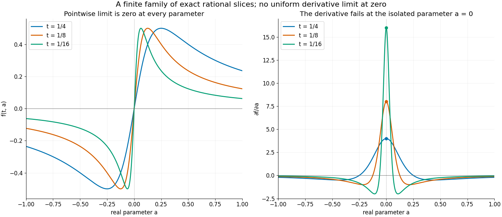
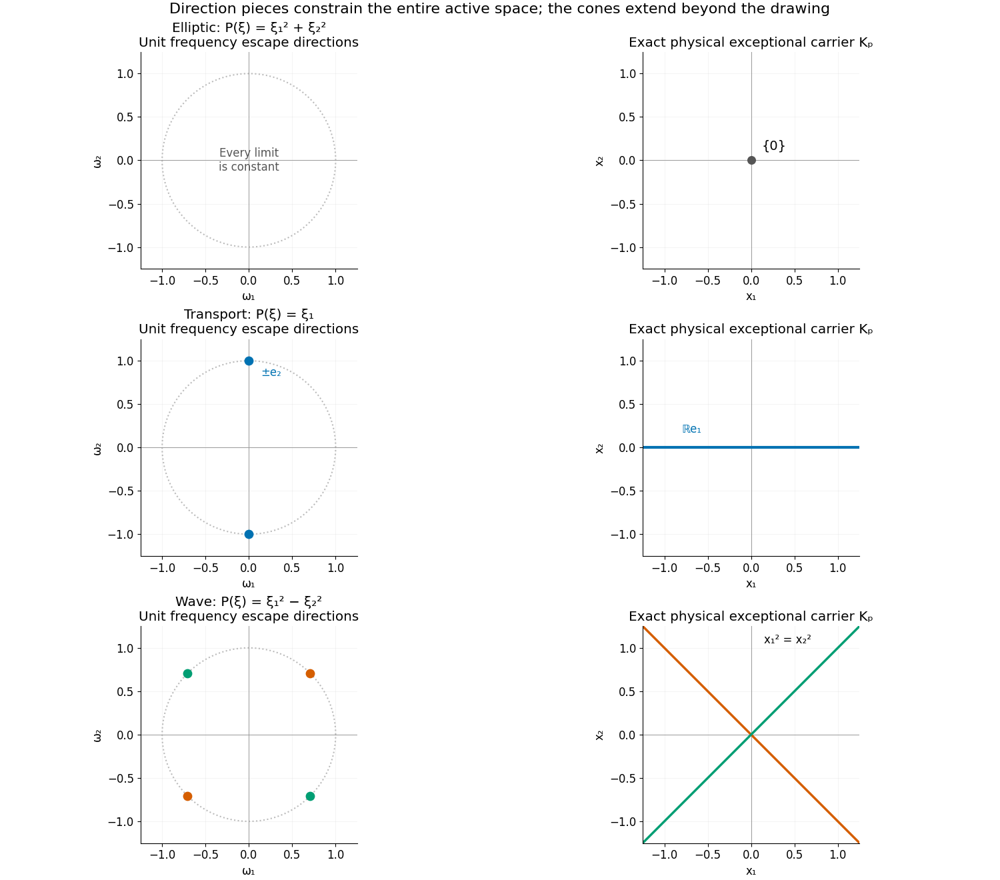

# Why the singular carrier leaves an open set

*Written by GPT-6.1 Sol (OpenAI), Ultra reasoning effort, October 2026. Self-checked by the writing AI. Public domain (CC0).*

A fundamental solution can be singular at many points, but the canonical regular construction has an algebraically constrained exceptional set. We prove that this exact closed carrier always has positive codimension. The difficulty is controlling a union of many linear spaces: each space can be proper even when their union fills the ambient space.

Read [Symbols at infinity](symbols-at-infinity.md) for limiting translated polynomials and one-variable algebraic power expansions, and [Wavefronts of regular kernels](wavefronts-of-regular-kernels.md) for the canonical inverse and its wavefront bound. [Cauchy bounds, root counts and analytic extensions](cauchy-bounds-and-root-counts.md) supplies the polynomial root tools. Basic references are Gabrielov [G], Bochnak–Coste–Roy [B] and Hörmander [H]. Every additional parameter lemma used here is proved in the complete proof.

## 1. A union of proper spaces can still be too large

Fix a nonzero complex polynomial \(P\) on \(\mathbb R^n\), \(n\geq1\), and put
\[
 S_P(\eta)^2=\sum_{|\alpha|\leq\deg P}|\partial^\alpha P(\eta)|^2,
 \qquad T_P(\eta)(z)=P(\eta+z)/S_P(\eta).
 \tag{SC1}
\]
These are normalized windows onto the symbol far out in real frequency space. A limiting pair consists of a unit escape direction \(\omega\) and a coefficient limit \(Q\) of these windows along centers escaping in that direction. Denote the compact set of such pairs by \(C_P\).

For each \(Q\), its inactive real directions and its active real space are
\[
 N_Q=\{v:\partial_vQ=0\},\qquad V_Q=N_Q^\perp.
 \tag{SC2}
\]
The inactive-direction theorem in the first prerequisite gives \(\omega\in N_Q\). Thus \(V_Q\subset\omega^\perp\), which makes every individual active space proper. This alone does not control the union: all lines through zero in a plane are proper, and their union is the entire plane.

The exact carrier is
\[
 K_P=\overline{\bigcup_{(\omega,Q)\in C_P}V_Q}.
 \tag{SC3}
\]
Its closure matters because active spaces can change in a limiting family.

**Theorem A.** The set \(K_P\) is a closed semialgebraic symmetric real-dilation cone and
\[
 \dim K_P\leq n-1.
 \tag{SC4}
\]
The canonical regular fundamental solution has singular support in \(K_P\), hence is smooth on its dense open complement. When \(n=1\), \(K_P=\{0\}\).

A semialgebraic set is a finite Boolean combination of real polynomial equalities and inequalities. Its dimension is the largest dimension of its smooth cells. The complete proof constructs the needed cells and proves that projection and closure cannot increase dimension.

## 2. Moving the escape direction removes more active directions

The stronger geometric fact is this. The possible escape directions can be treated in finitely many smooth semialgebraic pieces \(S\subset S^{n-1}\), so that every relevant limiting symbol over \(\omega\in S\) has
\[
 \mathbb R\omega+T_\omega S\subseteq N_Q.
 \tag{SC5}
\]
Here \(T_\omega S\) is the tangent space of the piece on the unit sphere. The radial vector \(\omega\) is perpendicular to this tangent space.

If the piece has dimension \(d\), every such active space lies in the same \((n-d-1)\)-dimensional orthogonal complement. The union over that piece is the projection of a vector bundle of dimension
\[
 d+(n-d-1)=n-1.
 \tag{SC6}
\]
Many limiting symbols can occur over one direction. They all lie in this common orthogonal complement, so their number and parameter dimension do not increase (SC6). A finite union and its closure still have dimension at most \(n-1\).

The proof of (SC5) differentiates actual translated polynomials. It does not infer the result from the geometry of their highest homogeneous term alone.

## 3. Why differentiating a limiting family needs care

A semialgebraic function can converge pointwise while its derivative fails to converge at one parameter. Consider
\[
 f(t,a)=\frac{ta}{t^2+a^2},\qquad t>0.
 \tag{SC7}
\]
It tends to zero for every real \(a\), including zero. Yet
\[
 \partial_a f(t,a)=\frac{t(t^2-a^2)}{(t^2+a^2)^2},
 \qquad \partial_a f(t,0)=t^{-1}.
 \tag{SC8}
\]
Away from zero the derivative tends to zero. The exceptional parameter cannot be ignored when claiming a statement at every limiting symbol.

The complete proof handles this by finite descent. On an open dense part of each parameter cell, derivatives do converge to the derivatives of the limit. Its complement has smaller dimension. Decompose that complement and repeat. After finitely many steps every point is covered, including isolated points where there are no parameter derivatives to take.

*Figure 1.* The exact functions are (SC7) and (SC8), for \(t=1/4,1/8,1/16\), on \(-1\leq a\leq1\). The derivative heights at zero are exactly \(4,8,16\). The graphs display these finite slices; the pointwise limits and failure at zero follow from the formulas. See Example 4, Solution 4 and complete-proof Lemma 2.1.

## 4. The translated-polynomial identity

Choose a smooth parameter piece of limiting pairs \((\omega(a),Q(a))\). Semialgebraic selection gives real centers \(\eta(t,a)\) whose windows and unit directions approach these pairs and whose lengths tend to infinity. Write
\[
 \begin{gathered}
 R=|\eta|,\qquad \Omega=\eta/R,\qquad
 S=S_P(\eta),\qquad T=T_P(\eta).
 \end{gathered}
 \tag{SC9}
\]
The selection can be made by minimizing the radius needed for a prescribed error, followed by coordinatewise minima on its compact minimizer set.

For a parameter coordinate \(a_j\), the exact chain rule is
\[
 \frac1R\partial_{a_j}T
 =\partial_{\partial_{a_j}\Omega}T
  +\frac{\partial_{a_j}R}{R}\partial_\Omega T
  -\frac1R\frac{\partial_{a_j}S}{S}T.
 \tag{SC10}
\]
A positive semialgebraic function has a power leading term at generic parameter values. On each retained piece that power is constant, so its logarithmic parameter derivatives stay bounded. This applies to both \(R\) and \(S\). The parameter derivatives of \(T\) and \(\Omega\) converge generically as in Section 3. Consequently the left side of (SC10) and its last term tend to zero. Its middle radial term tends to zero because \(\partial_\omega Q=0\). We obtain
\[
 \partial_{\partial_{a_j}\omega}Q=0.
 \tag{SC11}
\]
Submersion onto the direction piece makes these derivatives span its tangent space, which proves (SC5). The complete proof retains the lower-dimensional exceptional parameters through finite descent.

## 5. Four worked examples

### Example 1. Transport leaves one line

Take \(P(\xi_1,\xi_2)=\xi_1\). Its weight and window are
\[
 S_P(\eta)=\sqrt{\eta_1^2+1},\qquad
 T_P(\eta)(z)=\frac{\eta_1+z_1}{\sqrt{\eta_1^2+1}}.
 \tag{SC12}
\]
If \(|\eta_1|\to\infty\), the limit is a constant and its active space is zero. Otherwise extract a subsequence \(\eta_1\to b\). Since \(|\eta|\to\infty\), its escape direction is one of \(\pm e_2\), and
\[
 Q_b(z)=\frac{b+z_1}{\sqrt{b^2+1}},\qquad V_{Q_b}=\mathbb Re_1.
 \tag{SC13}
\]
Every \(b\in\mathbb R\) occurs by choosing \(\eta=(b,t^{-1})\). Thus \(K_P=\mathbb Re_1\). The two nonconstant-limit direction pieces are points, of dimension zero, and their orthogonal complements have dimension one. Other direction pieces contribute only the zero active space.

This is consistent with the fundamental solution \(iH(x_1)\delta_0(x_2)\) for \(D_1=-i\partial_1\): differentiating gives \(D_1(iH\delta_0)=\delta_0(x_1)\delta_0(x_2)\). Its singular support is the nonnegative part of the horizontal line, which lies in \(K_P\). The canonical carrier is an upper bound, not a claim of equality for this chosen inverse.

### Example 2. Ellipticity leaves only the origin

Let \(P(\xi)=\xi_1^2+\xi_2^2\), and put \(r=|\eta|\). Then
\[
 S_P(\eta)^2=r^4+4r^2+8,
 \qquad
 T_P(\eta)(z)=\frac{r^2+2\eta\cdot z+z_1^2+z_2^2}
                         {\sqrt{r^4+4r^2+8}}.
 \tag{SC14}
\]
The constant coefficient tends to one, the linear coefficients tend to zero, and the quadratic coefficients tend to zero. Hence every localization is the constant one. Its active space is zero, and \(K_P=\{0\}\). This carrier has dimension zero, which is smaller than the general upper bound one.

### Example 3. The wave cone saturates the dimension bound

In three variables take
\[
 P(\xi)=\xi_0^2-\xi_1^2-\xi_2^2,
 \qquad H=\operatorname{diag}(1,-1,-1).
 \tag{SC15}
\]
At a unit characteristic direction \(\omega\), use centers \(\eta=\omega/t\). Since \(P(\omega)=0\),
\[
 \begin{gathered}
 S_P(\eta)^2=4t^{-2}+12,\\
 T_P(\eta)(z)\longrightarrow Q_\omega(z)=H\omega\cdot z.
 \end{gathered}
 \tag{SC16}
\]
Thus the active space \(\mathbb RH\omega\) occurs. At a noncharacteristic escape direction the constant term dominates and every limit is constant. At a characteristic direction, the quadratic coefficients always tend to zero because \(S_P(\eta)\geq2|\eta|\); any nonconstant limit is affine with gradient parallel to \(H\omega\). This classifies all possible nonzero active spaces.

Parametrize the positive characteristic circle by
\[
 \omega(\theta)=\frac{(1,\cos\theta,\sin\theta)}{\sqrt2},
 \qquad
 H\omega(\theta)=\frac{(1,-\cos\theta,-\sin\theta)}{\sqrt2}.
 \tag{SC17}
\]
Both \(\omega\) and its circle tangent are orthogonal to \(H\omega\). Their span is the inactive plane of \(Q_\omega\). The direction piece has dimension one and its active normal fiber has dimension one; their union is the two-dimensional physical null cone
\[
 K_P=\{x:x_0^2=x_1^2+x_2^2\}.
 \tag{SC18}
\]
The negative characteristic circle gives the same real lines. Thus the bound \(n-1=2\) is attained. The carrier is not one linear space and its complement has several connected components.

*Figure 2.* Frequency space is on the left and physical carrier space is on the right. The symbols are \(\xi_1^2+\xi_2^2\), \(\xi_1\), and \(\xi_1^2-\xi_2^2\). Their carriers are, respectively, the origin, the horizontal line, and the two null lines. The marked nonconstant-limit directions are absent in the first row, \(\pm e_2\) in the second, and \((\pm1,\pm1)/\sqrt2\) in the third. The third row is the two-dimensional version of Example 3; each active line is generated by \((\omega_1,-\omega_2)\). All axes have equal scale. The finite drawing windows do not bound these conic sets. See Examples 1–3 and Solution 6.

### Example 4. An exceptional parameter must become a separate piece

For the family (SC7), \(|f(t,a)|\leq1/2\): the inequality \(2t|a|\leq t^2+a^2\) proves this directly. Nevertheless (SC8) diverges at \(a=0\). On each of the two open pieces \(a<0\) and \(a>0\), differentiation commutes with the limit. The omitted point is a third cell, of dimension zero. It has no tangent parameter direction whose derivative needs to be preserved.

A related positive family explains why leading powers also need pieces:
\[
 h(t,a)=(a^2+t^2)t^{-3}.
 \tag{SC19}
\]
For \(a\ne0\), its leading power is \(t^{-3}\), with coefficient \(a^2\). At zero its leading power is \(t^{-1}\), with coefficient one. On either open nonzero piece,
\[
 \frac{\partial_a h}{h}=\frac{2a}{a^2+t^2}
                  \longrightarrow\frac2a.
 \tag{SC20}
\]
At zero the exact ratio is zero. There is no need for one leading exponent over all three pieces.

## 6. Exercises

1. **Basic, 10 points.** Explain why the individual bounds \(\dim V_Q\leq n-1\) do not prove Theorem A. For a \(d\)-dimensional direction piece, derive the rank of the common normal fiber and its total bundle dimension. Include \(d=n-1\).
2. **Basic, 12 points.** Derive the transport window (SC12), classify every nonconstant limit and prove \(K_P=\mathbb Re_1\). Check the distributional normalization of \(iH(x_1)\delta_0(x_2)\).
3. **Intermediate, 12 points.** Derive (SC14) with the stated unweighted sum of derivative squares, including both second derivatives. Prove coefficient convergence uniformly over the escaping directions.
4. **Intermediate, 12 points.** Prove all the claims about (SC7)–(SC8): the uniform bound, the pointwise limit, the exceptional derivative, and the exact zero-derivative locations. Calculate the three peak heights in Figure 1.
5. **Intermediate, 12 points.** For (SC19), find the leading power and coefficient on each of its three parameter pieces. Derive (SC20), including its value at zero. Explain why Lemma 2.2 makes a generic assertion before finite descent.
6. **Advanced, 14 points.** For the wave polynomial in (SC15), classify all active spaces, prove (SC18), and verify both orthogonality identities using (SC17). Derive the two-dimensional version shown in Figure 2.
7. **Advanced, 14 points.** Derive (SC10) directly from \(T=P(\eta+z)/S\) and \(\eta=R\Omega\). Identify precisely which factor makes each term vanish in the limit, and explain why no rate of convergence of \(\partial_\Omega T\) is needed.
8. **Advanced, 14 points.** Show that the canonical conclusion cannot be asserted for every fundamental solution of transport. Enumerate the nonzero rationals as \(q_j\), put \(\mu=\sum_{j\geq1}2^{-j}\delta_{q_j}\), and add the homogeneous distribution \(1\otimes\mu\) to \(iH(x_1)\delta_0(x_2)\). Prove that the result is a fundamental solution with singular support all of \(\mathbb R^2\).

## 7. Complete solutions

### Solution 1

The union of all lines through zero in \(\mathbb R^2\) is the plane. Every line has dimension one, but the direction of the line contributes an additional parameter. In Theorem A the motion of that direction forces additional inactivity, which offsets this parameter count.

For \(\omega\in S\subset S^{n-1}\), every tangent vector to \(S\) is perpendicular to \(\omega\). Therefore \(\mathbb R\omega+T_\omega S\) has dimension \(d+1\). Its orthogonal complement has dimension \(n-d-1\). Adding the base dimension gives \(n-1\). If \(d=n-1\), the fiber is zero: such a piece contributes only the origin to physical space.

### Solution 2

The only nonzero derivatives are \(P(\eta)=\eta_1\) and \(\partial_1P=1\), so (SC12) follows. Any sequence has a subsequence on which either \(|\eta_1|\to\infty\), giving constant limit \(1\) or \(-1\), or \(\eta_1\to b\), giving (SC13). In the second case escape forces \(|\eta_2|\to\infty\), and the unit direction tends to \(e_2\) or \(-e_2\). The gradient of \(Q_b\) is a nonzero multiple of \(e_1\). Thus its inactive space is \(\mathbb Re_2\) and its active space is \(\mathbb Re_1\). The explicit sequence \((b,t^{-1})\) realizes it, so the entire union and its closure are that line.

Since \(\partial_1H(x_1)=\delta_0(x_1)\),
\(-i\partial_1(iH(x_1)\delta_0(x_2))=\delta_0(x_1)\delta_0(x_2)\). This checks the phase convention.

### Solution 3

The order zero term contributes \(r^4\). The two first derivatives contribute \(4\eta_1^2+4\eta_2^2=4r^2\). The only nonzero second derivatives are \(\partial_1^2P=2\) and \(\partial_2^2P=2\); their squared moduli contribute eight. There is no factorial weight in the definition of \(S_P\).

Divide numerator and denominator in (SC14) by \(r^2\). Its constant coefficient is \((1+4r^{-2}+8r^{-4})^{-1/2}\to1\). Each linear coefficient has modulus at most \(2/r\), and each quadratic coefficient is at most \(1/r^2\), since \(S_P\geq r^2\). The bounds are independent of direction. Every limiting window is one and has zero active space, proving the claimed carrier.

### Solution 4

The inequality \((t-|a|)^2\geq0\) gives \(|ta|/(t^2+a^2)\leq1/2\). At a fixed nonzero \(a\), the numerator tends to zero and the denominator tends to \(a^2\). At zero the function is identically zero. This proves its pointwise limit.

The quotient rule gives (SC8). Its numerator vanishes exactly at \(a=\pm t\), since \(t>0\), and its denominator is positive. At zero its value is \(1/t\), so the heights for the three stated values of \(t\) are four, eight and sixteen. At every fixed nonzero \(a\), the derivative tends to zero by the same fixed-denominator argument. The divergence at zero shows why a theorem about every parameter must revisit exceptional pieces.

### Solution 5

For \(a\ne0\), \(t^3h=a^2+t^2\to a^2>0\); thus the exponent is \(-3\). At zero, \(h=t^{-1}\), so the exponent is \(-1\) and its coefficient is one. Direct differentiation gives \(\partial_a h=2at^{-3}\), and division by \(h\) yields (SC20). At zero it is exactly zero for every \(t\).

The logarithmic derivative need only be bounded at each fixed retained parameter. It need not have a bound uniform as \(a\to0\). The two nonzero pieces have different limiting coefficient behavior from the exceptional point. Lemma 2.2 permits this, and finite descent treats the point with its own exponent.

### Solution 6

The gradient of \(P\) is \(2H\eta\), and its three nonzero second derivatives have squared moduli summing to twelve. Hence
\[
 S_P(\eta)^2=P(\eta)^2+4|\eta|^2+12.
 \tag{SC21}
\]
The quadratic coefficients of a normalized window tend to zero as \(|\eta|\to\infty\), since \(S_P\geq2|\eta|\). Its linear coefficient vector is \(2H\eta/S_P\). If this has a nonzero limit, it is a nonzero multiple of \(H\omega\), because \(\eta/|\eta|\to\omega\). If \(P(\omega)\ne0\), the term \(|P(\eta)|\) grows quadratically and this vector tends to zero. Thus a nonconstant limit requires a characteristic \(\omega\). Its gradient then has precisely the active line \(\mathbb RH\omega\), regardless of its constant coefficient. The explicit centers in (SC16) show that every such line occurs.

In (SC17),
\[
 \begin{gathered}
 \omega\cdot H\omega=(1-\cos^2\theta-\sin^2\theta)/2=0,\\
 \omega'(\theta)\cdot H\omega
       =(\sin\theta\cos\theta-\cos\theta\sin\theta)/2=0.
 \end{gathered}
 \tag{SC22}
\]
The two inactive vectors are independent: one has nonzero first coordinate and the other has first coordinate zero and nonzero norm. Their orthogonal complement is the active line. Every nonzero physical null vector is a real multiple of \(H\omega\) for one of the stated characteristic circles. This proves (SC18); the cone is already closed.

In two variables the characteristic unit directions are the four points \((\pm1,\pm1)/\sqrt2\). The same calculation gives active vectors \((\omega_1,-\omega_2)\). Their lines are \(x_1=x_2\) and \(x_1=-x_2\), which are exactly the two carrier lines in Figure 2.

### Solution 7

Differentiate the numerator and the positive normalizer:
\[
 \partial_{a_j}T
  =\partial_{\partial_{a_j}\eta}T
          -\frac{\partial_{a_j}S}{S}T.
 \tag{SC23}
\]
The directional derivative here acts in the polynomial variable \(z\). Since
\(\partial_{a_j}\eta=R\partial_{a_j}\Omega+(\partial_{a_j}R)\Omega\), dividing (SC23) by \(R\) gives (SC10).

At a retained parameter, \(R\to\infty\) and \(\partial_{a_j}T\) has a finite coefficient limit, so the left side tends to zero. The last term tends to zero because \(T\) has a finite limit and \(\partial_{a_j}S/S\) is bounded. In the radial term, \(\partial_{a_j}R/R\) is bounded, while \(\partial_\Omega T\to\partial_\omega Q=0\). A bounded number times a quantity tending to zero tends to zero; no quantitative rate is needed. The remaining term tends to \(\partial_{\partial_{a_j}\omega}Q\), proving (SC11).

### Solution 8

The series defines a finite positive measure: its total mass is \(\sum2^{-j}=1\). In particular it is a distribution, and its tensor product with the constant function one is defined on compactly supported tests. Integration of a derivative in the first variable is zero, so \(D_1(1\otimes\mu)=0\). Adding it preserves the fundamental-solution equation checked in Solution 2.

At each \(q_j\), the measure has a strictly positive atom. A measure given by a smooth function on a neighborhood has zero mass at an individual point, so \(\mu\) is not smooth on any neighborhood containing \(q_j\). If \(1\otimes\mu\) were smooth near \((x_1,q_j)\), integration against a smooth first-variable test supported in that neighborhood and of integral one would make \(\mu\) smooth near \(q_j\), a contradiction.

The rationals used here are nonzero. Near each \((x_1,q_j)\), a sufficiently small neighborhood misses \(x_2=0\), so \(iH(x_1)\delta_0(x_2)\) vanishes there. The sum is therefore singular at every such point. These points are dense in the plane, and singular support is closed. Its singular support is all of \(\mathbb R^2\). This does not contradict Theorem A, whose smoothness conclusion concerns the canonical regular inverse.

## References

[G] A. M. Gabrielov, *On a theorem of Hörmander*, Functional Analysis and Its Applications 4 (1970), 106–109. [Author-hosted text](https://www.math.purdue.edu/~gabriea/TheoremOfHormander.pdf). Gabrielov proved the positive-codimension theorem.

[B] J. Bochnak, M. Coste and M.-F. Roy, *Real Algebraic Geometry*, Springer, 1998. Semialgebraic geometry provides the finite pieces and algebraic asymptotics; the exact additional statements used here are proved in the complete proof.

[H] L. Hörmander, *The Analysis of Linear Partial Differential Operators II: Differential Operators with Constant Coefficients*, Springer, 1983. Localization at infinity controls the canonical regular fundamental solution.

## Complete proof

Let \(n\geq1\), and let \(P\ne0\) be a polynomial of degree \(m\) on \(\mathbb R^n\), with arbitrary complex coefficients. Complex polynomial coefficients are regarded as pairs of real coordinates whenever semialgebraic sets are used. Put
\[
 S_P(\eta)^2=\sum_{|\alpha|\leq m}|\partial^\alpha P(\eta)|^2,
 \qquad T_P(\eta)(z)=\frac{P(\eta+z)}{S_P(\eta)}.
 \tag{EC1}
\]
At least one highest derivative of \(P\) is a nonzero constant. Thus \(S_P\) is everywhere positive and bounded below by a positive constant. The jet norm of \(T_P(\eta)\) is one.

Let \(C_P\) be the compact set of pairs \((\omega,Q)\) that arise as limits
\[
 \frac{\eta_j}{|\eta_j|}\longrightarrow\omega,
 \qquad T_P(\eta_j)\longrightarrow Q,
 \qquad |\eta_j|\longrightarrow\infty.
 \tag{EC2}
\]
Here \(|\omega|=1\) and polynomial convergence is coefficient convergence. The compactness and semialgebraicity of this exact graph are proved in [Symbols at infinity](symbols-at-infinity.md), Sections 1 and 6. Its Section 5 proves the important identity
\[
 \partial_\omega Q=0\qquad ((\omega,Q)\in C_P).
 \tag{EC3}
\]
For any complex polynomial \(Q\), define real subspaces
\[
 N_Q=\{v\in\mathbb R^n:\partial_vQ=0\},
 \qquad V_Q=N_Q^\perp.
 \tag{EC4}
\]
Let
\[
 U_P=\bigcup_{(\omega,Q)\in C_P}V_Q,
 \qquad K_P=\overline{U_P}\subset\mathbb R^n.
 \tag{EC5}
\]
The target is a dimension bound for the union, not merely the assertion that each individual \(V_Q\) is proper. A continuously varying family of proper subspaces can fill all space.

We use the real projection theorem, finite polynomial sign tables, and the one-variable algebraic power expansion proved in [Symbols at infinity](symbols-at-infinity.md), Lemmas 2.1 and 3.1. We give the parameter and dimension consequences needed here. No Whitney stratification at infinity or limiting-tangent assertion about complex zero sets is assumed.

**Local inverse fact.** A continuously differentiable map with invertible derivative has a continuously differentiable local inverse. If the map is real analytic, its inverse is real analytic. A simple real root of a polynomial with real analytic parameters is consequently real analytic in those parameters. A submersion onto a manifold is locally a coordinate projection and maps open sets to open sets.

Here is the argument needed for these facts. Translate the point and its image to zero and apply the inverse derivative to the range, so the map is \(F(x)=x+g(x)\), with \(g(0)=0\), \(Dg(0)=0\). On a sufficiently small closed ball of radius \(r\), the mean-value formula gives \(|g(x)-g(x')|\leq q|x-x'|\), with \(q<1\). For \(|y|<(1-q)r/2\), the map \(x\mapsto y-g(x)\) maps this ball into itself and is a contraction. Its successive iterates from zero have differences bounded by a geometric series; completeness gives a unique fixed point \(x(y)\). It satisfies \(|x(y)-x(y')|\leq(1-q)^{-1}|y-y'|\). The expansion
\(F(x+h)-F(x)=DF(x)h+o(|h|)\), together with this Lipschitz bound, gives
\(Dx(y)=DF(x(y))^{-1}\). Continuity of the derivative proves the continuously differentiable inverse assertion. Shrinking the neighborhoods keeps all these derivatives invertible.

For an analytic map, its real power series extends to a complex neighborhood, as proved in [Cauchy bounds, root counts and analytic extensions](cauchy-bounds-and-root-counts.md). The same contraction works on a smaller complex ball. The iterates are holomorphic in \(y\), converge uniformly on smaller closed parameter balls by the same geometric estimate, and have holomorphic limit by that lesson's Lemma 1.2. Thus the inverse is analytic; its real restriction is the real fixed point. To obtain the simple-root assertion, apply this inverse result to the map \((a,y)\mapsto(a,p(a,y))\), whose derivative is invertible when \(\partial_y p\ne0\), and set its last output coordinate equal to zero.

Finally, for a submersion of rank \(r\) onto an \(r\)-manifold, choose input and output charts and a nonzero \(r\)-minor of its derivative. Adjoin the remaining input coordinates to its \(r\) output coordinates. The resulting square map has invertible derivative, so it supplies local coordinates in which the original map is projection onto the first \(r\) coordinates. Projection is open. These arguments also justify the inverse-function use in the dimension comparison below.

### 1. Finite smooth pieces and their dimensions

**Lemma 1.1 (semialgebraic pieces).** The following facts hold for real semialgebraic sets and maps.

1. A finite collection of sets in a real coordinate space has a finite partition into compatible semialgebraic real analytic cells. Each cell has a semialgebraic real analytic parametrization, with real analytic inverse, by an open cube of its dimension. Coordinates may be ordered in advance. Projection onto an initial group of coordinates maps each cell onto a cell and is a submersion there.
2. A semialgebraic scalar function on an open set is real analytic on an open dense semialgebraic subset. An empty-interior semialgebraic subset of an open \(d\)-cell has dimension less than \(d\).
3. Images under semialgebraic maps have dimension at most the domain dimension. Closure does not increase dimension. A semialgebraic set of dimension less than \(n\) has closure with empty interior in \(\mathbb R^n\).

Here the dimension of a finite cell partition is its largest cell dimension; the proof also shows that it is independent of the chosen compatible partition.

**Proof.** We recall the cell construction to specify the smoothness being used. For finitely many polynomials in \((a,y)\), perform the finite sign-table procedure of the linked projection lemma with respect to \(y\). Include its coefficient tests, degree tests and every denominator test in the projected polynomial family in \(a\). On a cell on which those tests have fixed signs, the actual degrees, greatest common divisors and multiplicities are fixed. Euclidean polynomial division then gives the squarefree factors with analytic coefficient functions: their denominators are nonzero on this cell. Their real roots are simple. The real implicit-function theorem gives analytic root functions locally; their increasing real order identifies the same functions on overlaps. Their graphs are semialgebraic, since the sign table specifies which ordered root is meant. The real roots of all factors, in increasing order, give sections. The open bands between successive roots, including the two possible unbounded bands, give the other cells. On every such section or band the original polynomial signs are fixed.

Induct on the number of coordinates, starting with the finitely many real roots in one variable. At each step use the preceding projected family for the base partition. The sections are analytic graphs. A finite band is parametrized by interpolation between its analytic endpoints; a one-sided unbounded band uses \(u/(1-u)\), \(0<u<1\), added to or subtracted from its finite endpoint. The band with two infinite endpoints uses \(u/(1-u^2)\), \(-1<u<1\). These formulas are analytic semialgebraic diffeomorphisms in the free variable. Together with the base parametrization they give the asserted cube charts and their analytic inverses. Their coordinate projections are graph projections or band projections, hence submersions. The construction preserves any prescribed ordering of coordinates and is compatible with any finite Boolean combination of the initial polynomial conditions. This proves item 1.

For the assertion about a function \(f(a)\), apply the construction to its graph, with \(a\) first. Above a full-dimensional base cell the graph is one section, since it contains exactly one point in each vertical fiber. This section is analytic. The union of the full-dimensional base cells is open and dense; the remaining base cells have lower dimension. The same reasoning in the cube chart of any cell proves the relative statement in item 2. A cell of the full chart dimension is open in that chart; thus an empty-interior subset cannot contain such a cell.

For dimension of an image, apply a compatible decomposition to the graph of the map, ordering the output coordinates first. Projection onto these coordinates is a submersion on each resulting graph cell. The dimension of its image cannot exceed the dimension of that graph cell. The graph has the domain dimension: alternatively order the input coordinates first, in which case each graph fiber is a single section. Refining these two finite partitions makes the inequality independent of either choice. Cell charts and their inverses give the same dimension comparison for subsets of a cell. This proves the image assertion and independence of dimension.

We spell out the closure assertion. An empty-interior semialgebraic subset \(A\subset\mathbb R^r\) is contained in the zero set of a nonzero polynomial. Indeed take a finite polynomial sign description, omit identically zero polynomials, and take their product. If none of these polynomials vanished at a point of \(A\), their signs would be unchanged on a neighborhood, so that neighborhood would lie in \(A\). Consequently their product vanishes on \(A\), hence on its closure. A nonzero polynomial cannot vanish on a real open box: repeated one-variable uniqueness would make all its coefficients zero. Thus \(\overline A\) still has empty interior.

Now let \(A\) have dimension \(d\), and suppose a cell \(B\subset\overline A\) had dimension \(r>d\). Some projection onto \(r\) coordinates has nonzero differential determinant on an open part of \(B\), because its tangent space has dimension \(r\). Its image contains an open subset of \(\mathbb R^r\), by the inverse-function theorem. The corresponding image of \(A\) has dimension at most \(d\), by the image assertion. It therefore has empty interior, and its closure has empty interior by the preceding paragraph. But the image of \(B\) lies in that closure, since projection is continuous. This is a contradiction. A compatible cell partition of \(\overline A\), which is semialgebraic by the projection lemma, proves \(\dim\overline A\leq d\). The reverse inequality follows from inclusion. Item 3 follows. \(\square\)

The real analytic implicit- and inverse-function theorems used above apply to nonvanishing derivatives or determinants on an open chart. No assertion about roots with changing multiplicity is made before the polynomial sign partition.

### 2. Differentiation of a tame limit at generic parameter values

The next lemma is useful because a finite pointwise limit need not have the expected derivative at every parameter value.

**Lemma 2.1 (generic derivative convergence).** Let \(A\subset\mathbb R^d\) be open and semialgebraic, and let \(f:(0,1)\times A\to\mathbb R\) be semialgebraic. Suppose \(f(t,a)\to f_0(a)\in\mathbb R\) for every \(a\in A\). There is an open dense semialgebraic \(A_1\subset A\) such that, locally at each point of \(A_1\), \(f\) is real analytic for all sufficiently small positive \(t\), \(f_0\) is real analytic, and
\[
 \lim_{t\downarrow0}\partial_{a_j}f(t,a)
       =\partial_{a_j}f_0(a),\qquad 1\leq j\leq d.
 \tag{EC6}
\]
The convergence in (EC6) is pointwise on \(A_1\). A finite collection of functions can use one common such subset.

**Proof.** First consider the required analytic branch. Apply the polynomial sign-table construction to the graph of \(f(t,a)\), ordering \(a\) first, then \(t\), then its value. Outside a lower-dimensional subset of \(A\), each sufficiently small positive \(t\) lies in the first open band above \(t=0\). The graph of \(f\) above that band is one analytic section. The lower endpoint of this band is zero, and its upper endpoint is a positive continuous semialgebraic function of \(a\), or infinity. Thus around any chosen point of such a base cell there is a parameter neighborhood and a common positive \(t\)-interval on which \(f\) is analytic. More explicitly, roots of the projected polynomials cannot accumulate at positive arbitrarily small \(t\) over such a neighborhood: their lowest nonzero \(t\)-coefficients are nonzero there, after the finite coefficient tests. Discard the lower-dimensional base cells. The limit function \(f_0\) is semialgebraic, since its limit definition uses only real quantifiers. Lemma 1.1 makes it analytic after a further open dense restriction.

On this region \(\partial_{a_j}f\) is semialgebraic. Its graph can be defined by the usual difference-quotient limit, or obtained by implicit differentiation on the analytic section. At each fixed \(a\), the one-variable expansion theorem gives an extended limit
\[
 G_j(a)=\lim_{t\downarrow0}\partial_{a_j}f(t,a)
                  \in\mathbb R\cup\{-\infty,+\infty\}.
 \tag{EC7}
\]
The finite and infinite alternatives and their graphs are semialgebraic, by the quantified definitions of these limits.

Suppose that the set on which \(G_j\ne\partial_{a_j}f_0\) had interior. Finite decomposition and generic continuity give an open box \(B\) on which one of the two strict inequalities has a uniform positive gap. For example, after shrinking,
\(G_j(a)>\partial_{a_j}f_0(a)+2\epsilon\) on \(B\), for some \(\epsilon>0\); this also includes \(G_j=+\infty\). The other sign is treated by replacing \(f\) with \(-f\).

For each \(a\in B\) there is \(\delta(a)>0\) such that
\[
 \partial_{a_j}f(t,a)-\partial_{a_j}f_0(a)>\epsilon
                 \quad(0<t<\delta(a)).
 \tag{EC8}
\]
Choose \(\delta(a)\leq1\) semialgebraically: half the supremum of the positive admissible \(\delta\)'s works, with an additional cap inside the analytic \(t\)-band. The supremum and its conditions are semialgebraic by real projection. It is positive. Lemma 1.1 makes it continuous on an open dense part of \(B\). A smaller closed box in this part has a positive minimum \(\delta_*\).

Fix the other coordinates and integrate (EC8) along a nontrivial \(a_j\)-interval inside that box. For every \(0<t<\delta_*\), the increase of \(f(t,a)-f_0(a)\) between its two endpoints is at least \(\epsilon\) times the interval length. At each endpoint this difference tends to zero by hypothesis. The limiting inequality is impossible. Therefore the set of failure of (EC6) has empty interior. It is semialgebraic, so its closure has empty interior by Lemma 1.1. Remove this closure, for every \(j\), and the earlier exceptional sets. The resulting open dense subset has all the asserted properties. Finitely many functions require only finitely many such restrictions. \(\square\)

For dimension zero there are no parameter derivatives; the assertion is interpreted without restrictions.

**Lemma 2.2 (positive functions have bounded logarithmic parameter derivatives generically).** Let \(h:(0,1)\times A\to(0,\infty)\) be semialgebraic. On an open dense semialgebraic subset, partitioned into finitely many open pieces, there are a constant rational number \(q\) on each piece and a positive real analytic semialgebraic function \(c\) such that
\[
 \begin{gathered}
 h(t,a)t^{-q}\longrightarrow c(a),\\
 \frac{\partial_{a_j}h(t,a)}{h(t,a)}
       \longrightarrow\frac{\partial_{a_j}c(a)}{c(a)}.
 \end{gathered}
 \tag{EC9}
\]
Derivatives are taken on the analytic region supplied by Lemma 2.1's first step. In particular every ratio in the second line is bounded as \(t\downarrow0\) at a fixed retained parameter.

**Proof.** On the graph of a scalar semialgebraic function there is a nonzero polynomial \(H(t,a,y)\) vanishing identically. To see this, use a finite polynomial sign description of the graph. At every graph point at least one nonzero defining polynomial vanishes, since otherwise the graph would contain an open box. Their product vanishes on the graph. It must involve \(y\), because the graph projects onto the open set \((0,1)\times A\), on which a nonzero polynomial in \((t,a)\) alone cannot vanish.

Write \(H=\sum_i b_i(t,a)y^i\). Away from finitely many proper algebraic subsets of the parameter space, every nonzero coefficient has a fixed lowest \(t\)-degree \(\ell_i\) and a nonzero analytic leading coefficient at that parameter. At a fixed such parameter, the one-variable expansion theorem gives \(h(t,a)\sim c(a)t^{q(a)}\), with \(c(a)>0\) and \(q(a)\in\mathbb Q\). The lowest power in \(H(t,a,h(t,a))=0\) must occur at least twice. Thus
\[
 q(a)\in\left\{\frac{\ell_i-\ell_k}{k-i}:i\ne k,
                         \ b_i b_k\not\equiv0\right\}.
 \tag{EC10}
\]
This is a finite set, fixed on the retained parameter region. If there were only one nonzero coefficient, it could not vanish at a positive \(h\); hence this case does not occur there.

For each candidate \(q\), the condition that \(t^{-q}h\) have a finite positive limit is semialgebraic: positive rational powers and all the limit quantifiers are semialgebraic. These finitely many sets partition the parameter region. Their full-dimensional open parts have dense union; remove their lower-dimensional boundaries. The exponent \(q\) is constant on each retained part. The limit \(c(a)\) is semialgebraic and positive, hence analytic generically by Lemma 1.1. Apply Lemma 2.1 to \(t^{-q}h(t,a)\). Its derivatives converge to those of \(c\). Dividing by \(t^{-q}h\to c>0\) proves the second line of (EC9), because \(t^{-q}\) is independent of the parameter. \(\square\)

This proof needs only one-variable power expansions. It does not assume a uniform power-series expansion with arbitrary parameters.

### 3. Lifting every limiting symbol and differentiating its direction

**Lemma 3.1 (a semialgebraic lift).** Let \(A\) be a real analytic semialgebraic cell in \(C_P\), with analytic semialgebraic coordinates \(a\mapsto(\omega(a),Q(a))\). There is a semialgebraic function \(\eta(t,a)\), \(0<t<1\), such that
\[
 \begin{gathered}
 R(t,a):=|\eta(t,a)|\geq t^{-1},\\
 \Omega(t,a):=\eta(t,a)/R(t,a)\longrightarrow\omega(a),\\
 T_P(\eta(t,a))\longrightarrow Q(a).
 \end{gathered}
 \tag{EC11}
\]
After removing a lower-dimensional semialgebraic subset of \(A\), all parameter derivatives used below exist for sufficiently small \(t\), the derivatives of the last two limits converge to the derivatives of their limits, and
\[
 \frac{\partial_a R}{R}=O_a(1),
 \qquad
 \frac{\partial_a S_P(\eta)}{S_P(\eta)}=O_a(1).
 \tag{EC12}
\]
The constants are required only at each fixed retained parameter.

**Proof.** For each \((t,a)\), consider real \(\eta\) satisfying \(|\eta|\geq t^{-1}\) and
\[
 \left|\frac{\eta}{|\eta|}-\omega(a)\right|\leq t,
 \qquad |T_P(\eta)-Q(a)|_J\leq t.
 \tag{EC13}
\]
This closed set is nonempty: the limiting sequence in (EC2) eventually satisfies the strict versions of these inequalities. It is semialgebraic; the positive square roots in the denominators are expressed by additional positive variables and polynomial equations. Minimize \(|\eta|\) on it. The minimum is attained, since one chosen feasible point cuts out a nonempty compact sublevel set. The minimizer set is compact. Choose its lexicographically smallest point by minimizing the first coordinate, then the second, and so on. Each minimum is attained. The real projection theorem makes both the minimum graph and this unique selection semialgebraic. This supplies \(\eta(t,a)\), with errors at most \(t\), and proves (EC11).

Apply Lemma 2.1 to the finitely many real coordinates of \(\Omega\) and the coefficients of \(T_P(\eta)\). Apply Lemma 2.2 to the positive semialgebraic functions \(R\) and \(S_P(\eta)\). Intersect their open dense regions in the cell chart. The complements have smaller dimension by Lemma 1.1. Equations (EC11)–(EC12) and the stated derivative convergence follow. \(\square\)

Let \(T(t,a)=T_P(\eta(t,a))\) and \(S(t,a)=S_P(\eta(t,a))\). Differentiate the exact translated-polynomial identity in (EC1), at a retained parameter in Lemma 3.1. For each chart coordinate \(a_j\),
\[
 \frac1R\partial_{a_j}T
  =\partial_{\partial_{a_j}\Omega}T
    +\frac{\partial_{a_j}R}{R}\,\partial_\Omega T
    -\frac1R\frac{\partial_{a_j}S}{S}\,T.
 \tag{EC14}
\]
This is an identity of finite-degree polynomials in \(z\). The left side tends to zero, because \(R\to\infty\) and \(\partial_{a_j}T\to\partial_{a_j}Q\). The last term tends to zero by (EC12). The middle term involving \(\partial_\Omega T\) tends to zero because its scalar factor is bounded and
\(\partial_\Omega T\to\partial_\omega Q=0\) by (EC3). Therefore
\[
 \partial_{\partial_{a_j}\omega(a)}Q(a)=0.
 \tag{EC15}
\]
Together with (EC3), every tangent direction swept out by \(\omega\) on this retained part of the cell is inactive for its corresponding limiting symbol. No rate of derivative convergence and no uniform bound over all parameters is needed.

### 4. The union lies in finitely many normal bundles

**Lemma 4.1.** There are finitely many semialgebraic real analytic submanifolds \(S_i\subset S^{n-1}\) such that every \((\omega,Q)\in C_P\) has \(\omega\in S_i\) for some \(i\) with
\[
 \mathbb R\omega+T_\omega S_i\subseteq N_Q.
 \tag{EC16}
\]
Each \(S_i\) is locally closed within a sphere cell; no global closedness of an individual \(S_i\) is asserted.

**Proof.** Partition \(C_P\) by Lemma 1.1, ordering the \(\omega\) coordinates first. Each resulting cell \(A\) projects submersively onto a sphere cell \(S\). On its open dense retained subset \(A_1\) from Lemma 3.1, equations (EC3) and (EC15) hold at every point. The differential of the projection is still onto \(T_\omega S\), because \(A_1\) is open in \(A\). Consequently every vector in \(T_\omega S\) is a linear combination of the derivatives \(\partial_{a_j}\omega\), and is inactive for that point's \(Q\). Equation (EC16) follows there.

The image of \(A_1\) is open in \(S\), since a submersion is locally a coordinate projection by the inverse-function theorem and is therefore an open map. It is semialgebraic by real projection. Its tangent space is the tangent space of \(S\). Use this image for one \(S_i\), or its finitely many connected components.

The omitted subset \(A\setminus A_1\) has strictly smaller dimension. Decompose it anew into cells with the same coordinate ordering and repeat the preceding construction. At every repetition the dimension of the remaining pieces strictly decreases. There are finitely many cells at each step, and dimensions are nonnegative integers. Hence after finitely many steps every point has been treated. Zero-dimensional cells have no parameter derivative; (EC3) alone supplies (EC16).

One may now partition the unit sphere by a cell decomposition compatible with the finitely many images just obtained. At a point of a new direction cell, every relevant pair had some old image containing that point. The entire new cell is contained in that old image, so its tangent space is contained in the old tangent space. Thus (EC16) holds for every limiting symbol over the new cell. This gives a single finite partition of direction space, with the same conclusion. The lemma follows. \(\square\)

For each such \(S_i\), define the real vector bundle
\[
 B_i=\{(\omega,x):\omega\in S_i,
           \ x\perp\omega,\quad x\perp T_\omega S_i\}.
 \tag{EC17}
\]
If \(d_i=\dim S_i\), then \(T_\omega S_i\subset\omega^\perp\). Thus \(\mathbb R\omega+T_\omega S_i\) has dimension \(d_i+1\), and \(B_i\) has fiber dimension \(n-d_i-1\). It follows that
\[
 \dim B_i=d_i+(n-d_i-1)=n-1.
 \tag{EC18}
\]
For completeness these are semialgebraic bundles. The cell charts and their first derivatives are semialgebraic; derivatives are defined by real difference-quotient quantifiers. On a chart choose a nonzero minor of the matrix whose rows are \(\omega\) and a tangent basis. Gaussian elimination gives an analytic semialgebraic basis for its nullspace. The finitely many possible nonzero pivot minors cover the chart. Equations (EC17) therefore give local product charts of the indicated dimension and a semialgebraic total space.

Equation (EC16) gives
\[
 U_P\subseteq\bigcup_i\pi_x(B_i).
 \tag{EC19}
\]
The crucial point is that the entire active space \(V_Q\), not just one gradient or one normal direction, lies in the same bundle fiber. The coefficients of \(Q\) can vary within a fiber of the projection to \(\omega\); that variation adds no dimension to the right side of (EC19).

### 5. The exceptional carrier has positive codimension

**Theorem 5.1 (Gabrielov's dimension bound).** For every nonzero complex polynomial on \(\mathbb R^n\), \(n\geq1\), the exact closed set \(K_P\) in (EC5) is a symmetric real-dilation cone, is semialgebraic, and satisfies
\[
 \dim K_P\leq n-1.
 \tag{EC20}
\]
In particular it has empty interior. For \(n=1\), \(K_P=\{0\}\).

**Proof.** Write the coefficients of the map \(v\mapsto\partial_vQ\), including their real and imaginary parts, as a real matrix \(A(Q)\). Its entries are linear functions of the coefficients of \(Q\). Then
\[
 N_Q=\ker A(Q),\qquad V_Q=\operatorname{im}A(Q)^T.
 \tag{EC21}
\]
The second identity is elementary real linear algebra: the row space annihilates the kernel and has its complementary dimension, by row reduction. Membership in \(U_P\) can consequently be expressed by
\[
 \exists\omega,Q,\lambda:
       (\omega,Q)\in C_P,\qquad x=A(Q)^T\lambda.
 \tag{EC22}
\]
All conditions are semialgebraic, and \(C_P\) is the already proved semialgebraic limiting graph. Real projection and closure therefore make \(U_P\) and \(K_P\) semialgebraic. Each \(V_Q\) is a real vector space, so their union and its closure are symmetric real-dilation cones and contain zero.

By (EC18), Lemma 1.1 and (EC19), the right side of (EC19) has dimension at most \(n-1\). Taking closure does not increase this dimension. Since \(K_P=\overline{U_P}\), (EC20) follows. Empty interior follows from Lemma 1.1. If \(n=1\), (EC3) and \(\omega\ne0\) give \(N_Q=\mathbb R\) for every limit, so every \(V_Q=\{0\}\) and \(K_P=\{0\}\). \(\square\)

This proves a dimension statement about the precise closed union in (EC5). It does not assert that its complement is connected, that it is one linear subspace, or that every fundamental solution is smooth on its complement.

**Corollary 5.2 (the canonical fundamental solution is smooth off a thin closed cone).** The canonical regular fundamental solution constructed in [Wavefronts of regular kernels](wavefronts-of-regular-kernels.md), Theorem 2.1, has singular support in \(K_P\). Thus it is smooth on the dense open semialgebraic set \(\mathbb R^n\setminus K_P\).

**Proof.** The cited theorem bounds its wavefront by the closure of the pairs \((x,\omega)\) with \((\omega,Q)\in C_P\) and \(x\in V_Q\), allowing all positive covector multiples. The base projection of this closed set is \(K_P\). One inclusion follows by projecting convergent pairs. For the reverse limiting step, a convergent sequence of base points can use unit covectors; their compact sphere has a convergent subsequence. Thus projection of that closure equals the closure in (EC5). The wavefront base-projection theorem in the same lesson gives the singular-support inclusion. Theorem 5.1 makes its complement open and dense. \(\square\)

The constant-polynomial case is included: every limiting symbol is constant and \(K_P=\{0\}\); the inverse is a nonzero multiple of the Dirac distribution. For a hypoelliptic polynomial all limiting symbols are constant by [Hypoellipticity and complex zeros](hypoellipticity-and-complex-zeros.md), Theorem 3.1, so again \(K_P=\{0\}\).

### References

[G] A. M. Gabrielov, *On a theorem of Hörmander*, Functional Analysis and Its Applications 4 (1970), 106–109. [Author-hosted text](https://www.math.purdue.edu/~gabriea/TheoremOfHormander.pdf). The positive-codimension theorem is due to Gabrielov. The argument above obtains the dimension estimate from differentiable semialgebraic limits of translated symbols, with its parameter lemmas proved here.
