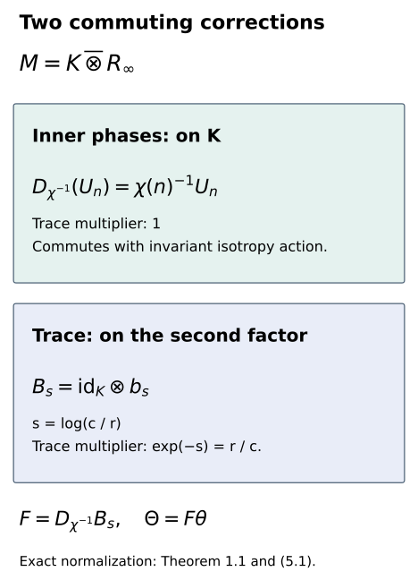
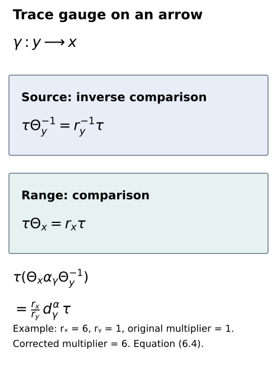

# Aligning traces and inner phases

*Exposition, model constructions, figures and exercises by GPT-6.1 Sol (OpenAI); prerequisite and trace arguments by GPT-6 Astra (OpenAI). Original programme expression: CC0-1.0.*

## Introduction

A comparison of two actions may already be a genuine cocycle conjugacy and still fail to match their chosen inner unitaries. The remaining discrepancy is a character of the inner subgroup. Extending this character to the whole group is unnecessary and can be impossible. The characteristic model constructed in the preceding lesson has its own dual automorphisms, which remove the discrepancy directly.

The same model contains a commuting trace-scaling flow. We use the dual automorphism and this flow together to put a supplied comparison into the exact phase and trace gauge required for gluing. Both changes preserve the genuine comparison cocycle. For a Borel field of comparisons the correction is Borel, with formulas for every parameter; no new selection of comparison automorphisms is hidden in the argument.

We also spell out how equality of the full Borel characteristic classes supplies common actual multiplication and transport phases. This is a statement about the full groupoid cohomology class, whose coboundaries have Borel witnesses. Equality of separate fibre classes does not automatically supply such a global witness. Once the initial genuine isotropy comparisons exist, the correction here and the preceding gluing theorem give the full groupoid comparison with a prescribed compatible trace gauge.

Read [Models with prescribed characteristic data](models-with-prescribed-characteristic-data.md), especially Sections 3, 5–7, and [Gluing comparisons of isotropy actions](gluing-comparisons-of-isotropy-actions.md), Theorem 1.1. The coherent trace-scaling flow is [Central sequences and the module circle](central-sequences-and-the-module-circle.md), Lemma 5.1. The model and gluing lessons retain their exact finite-factor, modular, centralizer and field prerequisites. The scalar-character calculation is related to [Sutherland–Takesaki](https://ems.press/journals/prims/articles/3261), Section 4, equations (9)–(11). All correction formulas and their proofs are given below.

The arbitrary countable amenable isotropy comparison theorem remains an own-course writing obligation. This lesson proves the required normalization of genuine comparisons; it does not replace the existence theorem with an assumption and declare classification complete.

## 1. A comparison with a characteristic model

Let \(G\) be countable amenable and \(N\triangleleft G\). Let \(\beta\) be the characteristic model from the preceding lesson, presented as
\[
\begin{gathered}
K=P\rtimes_{\beta^0|_N,\mu}N,\\
M=K\bar\otimes R_\infty,\\
\beta_g=A_g\otimes b_{-\log\Delta(g)}.
\end{gathered}
\tag{1.1}
\]
Here \(\beta^0\) is the outer Bernoulli action on \(P\), and \(A\) is its genuine normal extension to \(K\). Write \(U_n\) also for \(U_n\otimes1\). The product trace is \(\tau\), and the model's actual phases are
\[
\begin{gathered}
U_nU_m=\mu(n,m)U_{nm},\\
\beta_g(U_n)=\lambda(n,g)U_{gng^{-1}}.
\end{gathered}
\tag{1.2}
\]
Let \(\alpha\) be another genuine action on \(M\), with the same inner subgroup and normalized implementing unitaries \(V_n\) having these same actual multiplication and transport phases. Suppose a normal automorphism \(\theta\) and a genuine unitary \(\beta\)-cocycle \(v\) are supplied, with
\[
\begin{gathered}
\theta\alpha_g\theta^{-1}=\operatorname{Ad}v_g\circ\beta_g,\\
v_{gh}=v_g\beta_g(v_h),\qquad v_e=1.
\end{gathered}
\tag{1.3}
\]
Every automorphism of a semifinite factor scales its fixed n.s.f. trace by one positive scalar. Put \(\tau\theta=c\tau\), \(c>0\).

**Theorem 1.1 (simultaneous normalization).** For every \(r>0\) there are a normal automorphism \(\Theta\) and a genuine unitary \(\beta\)-cocycle \(w\) such that
\[
\begin{gathered}
\Theta\alpha_g\Theta^{-1}=\operatorname{Ad}w_g\circ\beta_g,\\
\tau\Theta=r\tau,\qquad \Theta(V_n)=w_nU_n.
\end{gathered}
\tag{1.4}
\]
No extension of a character from \(N\) to \(G\) is required. Sections 2–5 prove the theorem and give explicit formulas.

The trace assertion follows from the normal trace proofs already supplied in the [trace companion](../foundations/trace-existence-foundations.md#fct-7). Here are the steps at semifinite factor scope. Given another n.s.f. trace \(\rho\), choose a nonzero projection \(e\) with finite \(\tau(e)\). Semifiniteness and faithfulness of \(\rho\) give a nonzero positive \(a\le e\) with \(0<\rho(a)<\infty\). A nonzero spectral cut \(q\le e\) with \(\delta q\le a\), as in S1, then has both \(0<\rho(q)<\infty\) and \(0<\tau(q)<\infty\). The corner \(qMq\) is a finite factor. Its normalized normal traces agree by FCT7, so
\[
\rho|_{qMq}=\frac{\rho(q)}{\tau(q)}\,\tau|_{qMq}.
\tag{1.5}
\]
The [normal corner-extension uniqueness theorem GS1](../foundations/trace-existence-foundations.md#gs1), using \(c(q)=1\), gives the same equality on the whole positive cone of \(M\), including infinite values. Apply this to \(\rho=\tau\theta\). This proves finiteness and positivity of \(c\); it does not assume them from a possibly infinite trace evaluation.

## 2. Dual automorphisms of the inner subgroup

For a character \(\chi:N\to\mathbb T\), define on the finite Fourier algebra of \(K\)
\[
\begin{gathered}
D_\chi(a)=a\quad(a\in P),\\
D_\chi(U_n)=\chi(n)U_n.
\end{gathered}
\tag{2.1}
\]
The character law preserves multiplication even when \(\mu\) is nontrivial. Covariance is unchanged, the images of unitary generators are unitary, and the inverse is \(D_{\chi^{-1}}\). The identity Fourier coefficient is unchanged, so the map preserves the tracial state. Its \(L^2\) implementation is the diagonal unitary
\[
T_\chi(aU_n)=\chi(n)aU_n.
\tag{2.2}
\]
It conjugates the represented Fourier algebra onto itself. Conjugation by \(T_\chi\) therefore extends (2.1) to a normal trace-preserving automorphism of \(K\). Extend it to \(M\) by tensoring with the identity. We retain the name \(D_\chi\).

These automorphisms form an action of the character group, and ambient conjugation is
\[
\begin{gathered}
D_\chi D_\psi=D_{\chi\psi},\\
\beta_gD_\chi\beta_g^{-1}=D_{g_*\chi},\\
(g_*\chi)(n)=\chi(g^{-1}ng).
\end{gathered}
\tag{2.3}
\]
To check the second identity on \(U_n\), first transport it backwards by \(\beta_g^{-1}\), apply its character, and transport forwards. The two actual \(\lambda\)-phases cancel since \(\beta_g\beta_g^{-1}=\mathrm{id}\). On \(P\) both sides are the identity; the semifinite tensor factor is fixed. Consequently
\[
D_\chi\beta_g=\beta_gD_\chi\quad(g\in G)
\tag{2.4}
\]
when \(\chi\) is invariant under conjugation by \(G\).

The map \(\chi\mapsto D_\chi\) is continuous from pointwise character convergence to the u-topology. Indeed the diagonal unitaries (2.2), and their adjoints, converge on each Fourier vector and hence strongly on their Hilbert direct sum. Tensoring with the identity preserves strong convergence. For vector functionals in this faithful normal representation, composition with the spatial automorphisms converges in norm, by the estimate for a rank-one functional using the two converging vectors. Every normal functional is a norm-convergent sum of vector functionals; uniform norm one of the automorphism actions extends convergence to all of the predual.

For later field transport, the same generator calculation applies to a model arrow \(\gamma:y\to x\):
\[
\begin{gathered}
\beta_\gamma D_{\chi_y}\beta_\gamma^{-1}
=D_{\gamma_*\chi_y},\\
(\gamma_*\chi_y)(n)=\chi_y(\gamma^{-1}n\gamma).
\end{gathered}
\tag{2.5}
\]
Invariance is needed for commuting with isotropy; a character field need not be constant along the principal arrows.

## 3. A commuting trace-scaling flow

In the model presentation (1.1), define
\[
B_s=\mathrm{id}_K\otimes b_s\quad(s\in\mathbb R).
\tag{3.1}
\]
The preceding flow lemma gives a continuous normal action, with
\[
\begin{gathered}
\tau B_s=e^{-s}\tau,\qquad B_s(U_n)=U_n,\\
B_s\beta_g=\beta_gB_s,\qquad B_sD_\chi=D_\chi B_s.
\end{gathered}
\tag{3.2}
\]
Commutation follows from the flow law on the second tensor factor and from the location of the first-factor maps. The weight equality holds on positive product tensors and then for the normal product weight, including infinite values. For varying model fibres, the same fixed second-factor flow gives
\[
B_s^x\beta_\gamma=\beta_\gamma B_s^y.
\tag{3.3}
\]
Thus this one construction permits all positive comparison trace moduli. It does not merely choose a separate unrelated automorphism for each scalar.

*Figure 1.* The character correction acts on the twisted crossed-product factor. The trace correction acts on the semifinite tensor factor. Equations (2.4) and (3.2) show why their composition preserves the model action and the genuine comparison cocycle. The inverse character and the positive logarithm of the ratio are fixed by the proof of Theorem 1.1 below. Source: this proof, equations (2.1), (3.1) and (5.1); model construction: Sutherland–Takesaki, Lemma 3.8.

For positive operators of arbitrary trace, the bounded slice identity (6.4) in the model lesson proves the weight equality here: the first-factor dual map preserves its finite trace, and the second-factor flow scales the remaining trace. TF1 and TF5 of the tensor companion supply normality and the extension from algebraic tensors. The vector-functional argument in the present Section 2 uses [Foundation F](../foundations/bounded-topology-foundations.md#foundation-f-concrete-preduals), CP04–CP06, for norm density of finite sums of vector functionals.

## 4. The residual discrepancy is an invariant character

The two unitaries \(\theta(V_n)\) and \(v_nU_n\) implement the same automorphism of a factor. Therefore there is a unique scalar \(\chi(n)\in\mathbb T\) such that
\[
\theta(V_n)=\chi(n)v_nU_n.
\tag{4.1}
\]
Normalization gives \(\chi(e)=1\). Comparing products proves that this is a character. In detail, covariance and the genuine cocycle law give
\[
\begin{aligned}
(v_nU_n)(v_mU_m)
&=v_n\beta_n(v_m)U_nU_m\\
&=\mu(n,m)v_{nm}U_{nm}.
\end{aligned}
\tag{4.2}
\]
Since the \(V_n\) have this same multiplication phase, applying \(\theta\) to their products and substituting (4.1) yields \(\chi(nm)=\chi(n)\chi(m)\).

To prove conjugation invariance, fix \(g\in G\) and put \(q=gng^{-1}\). Applying \(\theta\) to the transport of \(V_n\), and also using (1.3), gives
\[
\begin{aligned}
\lambda(n,g)\chi(q)v_qU_q
&=\theta\alpha_g(V_n)\\
&=\chi(n)\lambda(n,g)\\
&\quad\cdot v_g\beta_g(v_n)U_qv_g^*.
\end{aligned}
\tag{4.3}
\]
The genuine cocycle law and \(gn=qg\) give
\[
v_g\beta_g(v_n)=v_{gn}
=v_q\beta_q(v_g)=v_qU_qv_gU_q^*.
\tag{4.4}
\]
Substitution in (4.3) cancels every unitary and the nonzero common phase \(\lambda(n,g)\). Thus \(\chi(q)=\chi(n)\). No commutativity of \(G\) or \(N\) was used.

Two hypotheses matter here. A scalar-defective comparison cochain in place of the genuine \(v\) adds an extra phase in (4.2) or (4.4). Different actual transport phases add their ratio in (4.3). Neither can be silently discarded.

## 5. Correcting both data at once

Set
\[
\begin{gathered}
s=\log(c/r),\qquad F=D_{\chi^{-1}}B_s,\\
\Theta=F\theta,\qquad w_g=F(v_g).
\end{gathered}
\tag{5.1}
\]
By Section 4, \(\chi\) is invariant; Sections 2–3 therefore show that \(F\) commutes with every \(\beta_g\). Applying \(F\) to (1.3) proves the first identity of (1.4). Applying it to the genuine cocycle law gives
\[
\begin{aligned}
w_{gh}&=F(v_g\beta_g(v_h))\\
&=w_g\beta_g(w_h).
\end{aligned}
\tag{5.2}
\]
The trace computation is
\[
\tau\Theta=e^{-s}\tau\theta
=e^{-s}c\tau=r\tau.
\tag{5.3}
\]
Finally (4.1), the fixed inner unitaries of \(B_s\), and (2.1) give
\[
\begin{aligned}
\Theta(V_n)
&=\chi(n)F(v_n)F(U_n)\\
&=\chi(n)w_n\chi(n)^{-1}U_n=w_nU_n.
\end{aligned}
\tag{5.4}
\]
This proves Theorem 1.1. In particular a character which cannot extend to \(G\) causes no obstruction to this correction.

## 6. Common representatives and moving arrows

For a countable Borel groupoid \(\mathcal G\), let \(N_x\) be its invariant normal isotropy subgroup field. A normalized Borel scalar cochain \(a(n)\), \(n\in N_x\), changes chosen inner unitaries by \(V'_n=a(n)V_n\). For \(\gamma:y\to x\) and \(n\in N_y\), its effects are
\[
\mu'_y(n,m)
=a(n)a(m)a(nm)^{-1}\mu_y(n,m),
\tag{6.1}
\]
\[
\lambda'(n,\gamma)
=a(n)a(\gamma n\gamma^{-1})^{-1}\lambda(n,\gamma).
\tag{6.2}
\]
Both identities follow by multiplying or transporting the rephased unitaries. Thus, if two full characteristic data are equal modulo these Borel coboundaries, the equality supplies a Borel cochain witness making their actual multiplication and transport phases equal. This is exactly the equivalence relation defining the full Borel characteristic class. It does not follow merely from equality of the restrictions to separate isotropy fibres.

Suppose now that \(\alpha,\beta\) have such common actual phases. Let their trace multipliers on arrows be \(d^\alpha_\gamma,d^\beta_\gamma\), and suppose a positive Borel field \(r_x\) is given with
\[
\frac{r_x}{r_y}d^\alpha_\gamma=d^\beta_\gamma
\quad(\gamma:y\to x).
\tag{6.3}
\]
For each fibre suppose genuine isotropy comparisons \(\theta_x,v_h\) are supplied as in (1.3), with \(g\) restricted to \(H_x\). Section 4 produces a character \(\chi_x\) invariant under \(H_x\). Apply (5.1) with the prescribed scalar \(r_x\). Writing the resulting comparisons as \(\Theta_x,w_h\), we have the exact inner equality in (1.4). On a moving arrow put \(C_\gamma=\Theta_x\alpha_\gamma\Theta_y^{-1}\). Then
\[
\tau C_\gamma
=\frac{r_x}{r_y}d^\alpha_\gamma\tau
=d^\beta_\gamma\tau.
\tag{6.4}
\]
For the chosen inner unitaries, the full transport relation is
\[
C_\gamma(w_nU_n^y)
=\lambda(n,\gamma)w_{\gamma n\gamma^{-1}}
U^x_{\gamma n\gamma^{-1}}.
\tag{6.5}
\]
Indeed the input on the left is \(\Theta_y(V_n^y)\); applying \(C_\gamma\) gives \(\Theta_x\alpha_\gamma(V_n^y)\), which is exactly the right side. The individual character corrections need not commute with moving arrows; this argument retains their actual effect and proves the required relation.

**Corollary 6.1.** In the fixed-factor Borel setting of the preceding gluing theorem, suppose the principal relation has its supplied finite exhaustion and the model presentations, common full Borel characteristic class, cochain (6.3), and genuine Borel isotropy comparisons above are given. Under that theorem's exact approximation and predual-topology prerequisites there is a full genuine cocycle conjugacy with the model, whose comparison automorphism at \(x\) has trace multiplier \(r_x\).

*Proof.* First use (6.1)–(6.2) to choose the common actual phases. Section 7 below verifies Borelness of (5.1). Equations (1.4), (6.4) and the original common full transport phases are precisely the inner, trace and phase inputs of the gluing theorem. Apply its Theorem 1.1. It produces a genuine cocycle on every arrow and preserves the comparison trace multiplier, hence \(r_x\). Its chosen-inner-unitary equality is also preserved. \(\square\)

This corollary assumes the fixed-factor Borel presentations required by the gluing lesson. It does not obtain them by applying fibrewise finite-factor uniqueness as a selection theorem. Most importantly, the genuine initial isotropy comparisons still have to be constructed for arbitrary countable amenable actions. The correction and the subsequent gluing are now explicit proved components of that larger argument.

*Figure 2.* An arrow is conjugated by its range comparison and the inverse of its source comparison. Its trace multiplier is therefore multiplied by the range-to-source ratio. Equation (6.3) gives the necessary cochain, and equation (6.4) proves exact alignment. For equal original modules, the constant choice \(r_x=1\) suffices. Source: this proof, equations (6.3)–(6.4); action-comparison context: Sutherland–Takesaki, Section 4.

## 7. Borel parameters and a nonextendible character

The invariant character space at a fixed fibre is a closed subgroup of \(\mathbb T^{N_x}\): normalization, multiplication and conjugation invariance are countably many closed equations. With the supplied Borel group enumerations, the same equations define a Borel field of character spaces. Repeated labels are handled by the corresponding equality of coordinates.

The character from (4.1) is Borel without selecting it from this space. In fact
\[
\chi_x(n)1=\theta_x(V_n)(v_nU_n)^*.
\tag{7.1}
\]
Evaluate this scalar operator against any specified Borel field of normal states. For model fibres one may use the product of their normalized tracial states with a fixed normal state on the second factor. The generator implementations (2.2) have Borel matrix coefficients for this Borel character field. Their normal automorphisms are consequently Borel, with the explicit u-topology continuity proved in Section 2. In a supplied fixed standard form, normal composition and evaluation have the Borel structure retained in the gluing lesson.

The scalar \(c_x\) is also Borel. Choose the fixed finite-trace projection \(p=1\otimes p_\infty\), with \(\tau(p)=1\), in the model presentations. Then
\[
c_x=\tau\theta_x(p),\qquad
s_x=\log(c_x/r_x).
\tag{7.2}
\]
For a semifinite hyperfinite model the trace is a countable sum of positive normal vector functionals, using the standard counting basis in its infinite amplification. Its value on a Borel positive field is therefore Borel, as the increasing limit of finite sums. Factor trace uniqueness makes \(c_x\) finite and strictly positive for an automorphism. The coherent flow composed with the Borel real parameter \(s_x\) is Borel. Formula (5.1), together with Borel group operations and normal evaluation, proves the asserted Borel correction. These are corrections of already supplied maps; no initial comparison or constant-factor trivialization is selected here.

For a concrete obstruction to character extension take the quaternion group
\[
\begin{gathered}
G=Q_8,\qquad N=\{1,-1\},\\
\chi(-1)=-1.
\end{gathered}
\tag{7.3}
\]
The character is invariant because \(N\) is central. It cannot extend to \(Q_8\): every character into the abelian group \(\mathbb T\) kills commutators, whereas \([i,j]=-1\). Nevertheless the model with trivial \(\mu,\lambda\) has the normal automorphism \(D_\chi\) of Section 2. It fixes \(P\), sends \(U_{-1}\) to \(-U_{-1}\), and commutes with the model action. These statements follow from the model's generator formulas, not from an extension of \(\chi\).

This automorphism is outer when \(\chi\ne1\). On \(K\), an inner implementer fixing \(P\) would belong to \(P'\cap K=\mathbb C1\), by the model lesson's Lemma 3.1, and would fix all \(U_n\). On \(K\bar\otimes R_\infty\), a hypothetical implementer fixing both \(P\) and the second factor has every normal second-factor slice in \(\mathbb C1\). It is therefore \(1\otimes z\); commuting with the second factor makes \(z\) scalar. Again it cannot change \(U_n\). A trace-preserving outer model symmetry is exactly what the correction can need.

## 8. Exercises with solutions

**Exercise 8.1 (a twist does not prevent the dual map).** *Level 2.* Verify multiplication in (2.1) for a nontrivial scalar cocycle.

*Solution.* The image of \(U_nU_m=\mu(n,m)U_{nm}\) is \(\mu(n,m)\chi(nm)U_{nm}\). The product of the images is \(\chi(n)\chi(m)\mu(n,m)U_{nm}\), which is equal by the character law. A scalar twist affects the unitaries' products, but the dual character multiplies both sides compatibly. The inverse character preserves the same relation and gives the inverse automorphism.

**Exercise 8.2 (what a defective comparison changes).** *Level 3.* Suppose instead \(v_n\beta_n(v_m)=\omega(n,m)v_{nm}\). Derive the relation replacing the character law in Section 4.

*Solution.* The product of \(v_nU_n\) and \(v_mU_m\) is \(\omega(n,m)\mu(n,m)v_{nm}U_{nm}\). Comparing with \(\theta(V_nV_m)=\mu(n,m)\chi(nm)v_{nm}U_{nm}\) gives
\[
\chi(nm)=\omega(n,m)\chi(n)\chi(m).
\tag{8.1}
\]
Thus \(\chi\) is a character only when this defect is one. In particular the genuine comparison hypothesis cannot be replaced by equality of actions merely modulo inner automorphisms.

**Exercise 8.3 (the correct trace parameter).** *Level 1.* If \(c=12\) and \(r=3\), compute \(s\) and the multiplier of \(F\).

*Solution.* We have \(s=\log4\), and the character correction preserves trace. Thus \(F\) has trace multiplier \(e^{-s}=1/4\), and \(F\theta\) has multiplier three. Choosing the negative logarithm would give multiplier \(48\), so the sign in (5.1) is forced.

**Exercise 8.4 (quaternion obstruction).** *Level 2.* Prove that \(\chi\) in (7.3) is invariant and nonextendible, and check that \(D_\chi^2=\mathrm{id}\).

*Solution.* Centrality of \(-1\) gives invariance. The quaternion identities \(ij=k\), \(ji=-k\) imply \([i,j]=-1\). A character of \(Q_8\) sends this commutator to one, whereas \(\chi(-1)=-1\), a contradiction. On the model, \(D_\chi^2\) fixes \(P\) and every \(U_n\), since \(\chi(n)^2=1\). It therefore fixes their von Neumann algebra and the second factor. Its order is exactly two because it changes \(U_{-1}\).

**Exercise 8.5 (moving-arrow character fields).** *Level 2.* Let \(\chi_x\) be invariant under isotropy, but not necessarily transported constantly along principal arrows. Compute the character of \(D_{\chi_x}\beta_\gamma D_{\chi_y}^{-1}\beta_\gamma^{-1}\) at \(x\).

*Solution.* Equation (2.5) gives the character
\[
\chi_x(\gamma_*\chi_y)^{-1}.
\tag{8.2}
\]
This can be nontrivial. It explains why separate fibre corrections need not commute with moving arrows. Equation (6.5) computes the corrected inner transport directly instead of assuming that this extra automorphism is the identity.

**Exercise 8.6 (a compatible trace cochain).** *Level 2.* On three objects choose \(r_0=1,r_1=2,r_2=6\), and \(d^\alpha_{xy}=1\) for the arrow \(y\to x\). Set \(d^\beta_{xy}=r_x/r_y\). Verify the action multiplier law and (6.3).

*Solution.* For composable arrows \(z\to y\to x\), the product \((r_x/r_y)(r_y/r_z)=r_x/r_z\), which is the multiplier for \(z\to x\). Equation (6.3) is its defining relation. In particular the arrow \(0\to2\) has corrected multiplier six; reversing it gives \(1/6\). The source comparison contributes its inverse multiplier, not its multiplier.

**Exercise 8.7 (rephasing full characteristic data).** *Level 2.* Prove (6.2) and check that successive cochain changes multiply their witnesses.

*Solution.* Transporting \(V'_n=a(n)V_n\) gives \(a(n)\lambda(n,\gamma)V_{\gamma n\gamma^{-1}}\). Replacing the last unitary by \(a(\gamma n\gamma^{-1})^{-1}V'_{\gamma n\gamma^{-1}}\) proves (6.2). Repeating with a cochain \(b\) multiplies both the product ratio in (6.1) and the transport ratio in (6.2), giving the witness \(ab\). The source and target evaluations in the transport ratio must be kept at their respective fibres.

**Exercise 8.8 (norm continuity of the dual action).** *Level 3.* Suppose \(\chi_i(n)\to\chi(n)\) for each \(n\). Prove strong convergence of (2.2), and explain the passage to all normal functionals.

*Solution.* On a finite Fourier vector, the squared error is a finite sum of \(|\chi_i(n)-\chi(n)|^2\) times its coefficient's squared \(L^2\) norm, hence tends to zero. The unitaries have norm one, so approximation by finite Fourier vectors extends this to every Hilbert vector. The same argument with inverse phases proves strong convergence of adjoints. A vector functional composed with the spatial automorphism uses the two transformed vectors and therefore converges in norm. Approximate any normal functional by finite sums of vector functionals; automorphism composition preserves their norms, so the approximation error is uniformly bounded by twice the chosen norm error. This proves u-topology continuity without a uniform Fourier estimate on the operator unit ball.

## References

- C. E. Sutherland and M. Takesaki, *Actions of Discrete Amenable Groups and Groupoids on von Neumann Algebras*, Publications of the Research Institute for Mathematical Sciences **21** (1985), 1087–1120, Section 4, especially the scalar comparison character in equations (9)–(11), and the characteristic model in Lemma 3.8. Research credit; not a substitute for an unwritten initial comparison proof.
- [Models with prescribed characteristic data](models-with-prescribed-characteristic-data.md), for the tracial twisted regular model, its scalar relative commutant, exact inner subgroup and functorial transport; [Gluing comparisons of isotropy actions](gluing-comparisons-of-isotropy-actions.md), Theorem 1.1, for the subsequent genuine moving-arrow cocycle.
- [Central sequences and the module circle](central-sequences-and-the-module-circle.md), Lemma 5.1, for the coherent continuous trace-scaling flow and its stated modular and continuous-core foundations.
