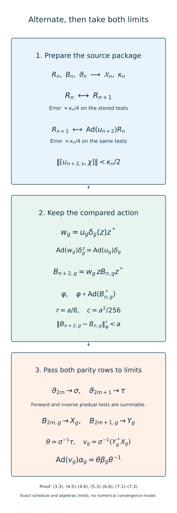

# Alternating comparisons with convergent cocycles

*Mathematical exposition and figures by GPT-6.1 Sol (OpenAI); source comparison and prerequisite exposition by GPT-6 Astra (OpenAI). Original programme expression is CC0; cited human works retain their rights.*
## Introduction

An arbitrarily accurate finite comparison does not by itself give a conjugacy. The corrections must also control the inverse conjugators and the scalar phases of the cocycles. We now construct the required rows, using the genuine original-factor comparison cocycles proved in the preceding lesson.

The order of choices matters. After constructing an action row, prepare the finite functional tests needed when that same row is changed two steps later. The following comparison makes the other action close on those tests. The next comparison makes its genuine cocycle nearly central on them. This is a finite look-ahead construction; no unchosen future functional or infinitely enlarged finite set enters it.

A gauge must preserve the implemented action during this schedule. We prove that version directly from the preceding tower support inequalities. We also prove a bound for the cumulative cocycle increment using tests specified before the correcting unitary is selected. These estimates give two convergent conjugator rows and two strong-star convergent cocycle rows. Their common limiting action produces the desired cocycle conjugacy, including an optional near-identity cocycle on prescribed finite data.

The action-preserving gauge, two-step finite preparation, alternating comparison rows, transported old-cocycle states, and both parity limits are the construction of [Masuda], Theorem 3.1, pp.55–62. Sections 3–4 below spell out the support estimate and a two-term cumulative bound; Sections 5–6 express the two parity cases through one row index. These are explanations of the classical proof strategy. The theorem does not claim a new comparison method.

The [bounded-topology companion](../foundations/bounded-topology-foundations.md) supplies faithful-state strong-star tests and normal-functional density; [TF0–TF6](../foundations/normal-tensor-and-tracial-product-foundations.md) supplies the normal spatial tensor interfaces. Their stated prerequisite scopes remain in force.

## 1. Statement and exact hypotheses

Let \(M\) be a finite factor or a countably decomposable infinite semifinite factor with separable predual. Fix a faithful normal state \(\varphi\). Retain the exact Ocneanu, lifting, normal-functional and bounded strong-star foundations in [Near-identity two-cocycle correction on the original factor](near-identity-two-cocycle-correction-on-the-original-factor.md), Section 1, and its named providers. Let \(G\) be countable amenable. Let \(\alpha,\beta\) be normalized genuine actions whose induced actions on \(F=M_\omega\) are nontrivial at every \(g\ne e\).

Write \(\overline{\operatorname{Inn}}(M)\) for the closure of the inner automorphisms in the u-topology. Suppose

\[
\alpha_g\beta_g^{-1}\in\overline{\operatorname{Inn}}(M)
\quad(g\in G).
\tag{1.1}
\]

**Theorem 1.1.** Under these hypotheses, there are \(\theta\in\overline{\operatorname{Inn}}(M)\) and a normalized genuine original-factor \(\alpha\)-cocycle \(v\) such that

\[
\operatorname{Ad}(v_g)\alpha_g=\theta\beta_g\theta^{-1}
\quad(g\in G).
\tag{1.2}
\]

For every finite \(K\subset G\), finite family \(\Omega\) of normal states and \(\varepsilon>0\), these can be chosen with \(\|v_g-1\|_\rho^\sharp<\varepsilon\) for \(g\in K,\rho\in\Omega\). Here \(\|x\|_\rho^{\sharp\,2}=\rho(x^*x)+\rho(xx^*)\), without a factor of one half.

The genuine comparison input is the preceding lesson's Corollary 8.1. The finite stabilization input is [Generator tests for cocycle stabilization](generator-tests-for-cocycle-stabilization.md), Sections 2–5, together with the support construction in [Uniform towers and genuine cocycle stabilization](uniform-towers-and-genuine-cocycle-stabilization.md), Theorem 4.1. Limit passage uses [Two-sided convergence and transported cocycle limits](two-sided-convergence-and-transported-cocycle-limits.md), Theorem 2.1, Lemmas 4.1–4.2 and Theorem 5.1. All these exact hypotheses remain attached. We do not extend the unitary-lifting theorem to arbitrary type III factors here.

This is the centrally nontrivial comparison component of classification. Actions with a nontrivial inner subgroup require their characteristic phases as well. Borel selection of initial comparisons, strict field presentations and continuous reconstruction require their respective additional arguments.

## 2. Genuine finite comparisons remain available

The u-topology makes composition and inversion continuous. Composition is proved in the convergence lesson, (2.7). For inversion, precompose the difference by an automorphism and use its predual isometry:

\[
\begin{aligned}
\|\psi\sigma_n^{-1}-\psi\sigma^{-1}\|
&=\|\psi-(\psi\sigma^{-1})\sigma_n\|\longrightarrow0.
\end{aligned}
\tag{2.1}
\]

Thus the closure of the normal subgroup \(\operatorname{Inn}(M)\) is a normal subgroup. To spell out the closure step, products and inverses of approximating inner automorphisms converge to the corresponding products and inverses, and conjugation by a fixed automorphism maps \(\operatorname{Ad}(w)\) to \(\operatorname{Ad}(\sigma(w))\). A countable norm-dense predual family gives a metric for these finite tests, so sequential approximation suffices.

Every finite row used below has the form \(\delta_g=\operatorname{Ad}(B_g)\vartheta\xi_g\vartheta^{-1}\), where \(\xi\) is either original action, \(\vartheta\) is inner, and \(B\) is a genuine cocycle for \(\xi^\vartheta\). It differs pointwise from \(\xi\) by an inner automorphism: if \(\vartheta=\operatorname{Ad}(q)\), its implementing unitary is \(B_gq\xi_g(q^*)\). Its centralizer action remains conjugate to that of \(\xi\), as established by the tower transport provider. Therefore every comparison between opposite rows meets (1.1) and the centralizer hypotheses.

The preceding genuine-comparison corollary consequently has the following usable finite form. For a target action \(\lambda\), a source row \(\delta\), finite \(S\subset G\), finite \(\Xi\subset M_*\) and \(b>0\), there is a normalized genuine \(\delta\)-cocycle \(u\), defined on the entire group, with

\[
\|\chi\operatorname{Ad}(u_g)\delta_g-\chi\lambda_g\|<b
\quad(g\in S,\chi\in\Xi).
\tag{2.2}
\]

Indeed approximate innerness supplies the pointwise approximate implementers; Corollary 8.1 gives an ordinary sequence of genuine full-group cocycles converging in the u-topology to the target. One sufficiently large member meets every finite requirement. No law is inferred merely from approximate implementers.

## 3. A gauge that retains the implemented action

Fix a finite symmetric \(S\ni e\), errors \(r,c>0\), and an action row \(\delta\). The generator stabilization construction supplies a finite prefix set \(P\) and \(\kappa>0\). For prescribed finite \(\Phi\subset M_*\) and normal states \(\Omega\), suppose a genuine \(\delta\)-cocycle satisfies \(\|[u_s,\chi]\|\le\kappa\) for \(s\in S\) and \(\chi\in\{\psi\delta_p:\psi\in\Phi,p\in P\}\).

**Lemma 3.1.** There is a unitary \(z\) with \(\|[z,\psi]\|<c\), \(\psi\in\Phi\), such that

\[
\begin{aligned}
\delta_g^z&=\operatorname{Ad}(z)\delta_g\operatorname{Ad}(z^*),\\
w_g&=u_g\delta_g(z)z^*,\\
\|w_g-1\|_\rho^\sharp&<r\quad(g\in S,\rho\in\Omega).
\end{aligned}
\tag{3.1}
\]

The family \(w\) is a normalized genuine \(\delta^z\)-cocycle on all of \(G\), and

\[
\operatorname{Ad}(w_g)\delta_g^z
=\operatorname{Ad}(u_g)\delta_g.
\tag{3.2}
\]

*Proof of the estimate.* Use the generator word estimates to meet the tower-label commutator tests. In the support construction, regard \(u\) as constant representatives of a quotient cocycle. The relative tower algebra commutes with its values. With the notation of that construction, \(Z\) and \(\delta_g(Z)\) commute with the bad support \(H_g\), and \(D_g=u_g-Z\delta_g(Z^*)\) has both positive squares bounded by \(4H_g\). Set \(W_g=u_g\delta_g(Z)Z^*\). Then

\[
\begin{aligned}
W_g-1&=D_g\delta_g(Z)Z^*,\\
(W_g-1)^*(W_g-1)&\le4H_g,\\
(W_g-1)(W_g-1)^*&\le4H_g.
\end{aligned}
\tag{3.3}
\]

The first positive-square inequality uses commutation with \(H_g\); the second cancels the adjacent unitary pair. Each normal state sees the canonical trace mass on that centralizer projection. Choose that mass below \(r^2/32\). The squared sharp error is then less than \(r^2/4\). Lift \(Z\) to exact unitaries \(z_k\); the preceding near-centrality estimate has a strict margin below \(c\). Formula (3.3) gives the additional error in (3.1) along the same ultrafilter. A finite intersection selects one coordinate for \(S,\Omega,\Phi\).

With the tower count \(m\) and maximal word length \(L\) chosen as in the generator lesson, one permissible input is

\[
\kappa=\frac{c}{4\max(1,m)L}.
\tag{3.4}
\]

For \(S=\{e\}\), take \(P=\{e\},\kappa=1,z=1\). The combinatorial choices precede the supplied finite state and functional families. They retain their dependence on \(S,r,c\); no accuracy-independent neighborhood is asserted.

*Proof of the laws.* Inserting \(\delta_g^z(x)=z\delta_g(z^*xz)z^*\) into \(w_g\delta_g^z(w_h)\) cancels \(\delta_g(z)\delta_g(z^*)\). What remains is \(u_g\delta_g(u_h)\delta_{gh}(z)z^*=w_{gh}\). Normalization is exact. The same ordered cancellations prove (3.2). These laws use the original full-group cocycle, at the selected original-factor coordinate. □

The usual stabilized cocycle \(z^*u_g\delta_g(z)\) is a cocycle for \(\delta\), but its implemented action is conjugated by \(z^*\). Formula (3.1) transports the source action instead and keeps the already selected comparison unchanged. Its seminorm estimate comes from (3.3), rather than an invalid claim that conjugation preserves a nontracial sharp seminorm.

## 4. Prechosen tests control the cumulative cocycle

We need one elementary estimate. For a normal state \(\rho\) and \(x\in M\), normal-functional Cauchy–Schwarz, applied at \(x^*\) and \(x\), gives

\[
\|x\|_\rho^{\sharp\,2}
\le\|x\|\bigl(\|x\rho\|+\|\rho x\|\bigr).
\tag{4.1}
\]

Let \(B,z\) be unitaries. In the predual bimodule convention of the generator lesson,

\[
\begin{aligned}
[z,B]\rho&=[z,B\rho]-B[z,\rho],\\
\rho[z,B]&=[z,\rho B]-[z,\rho]B.
\end{aligned}
\tag{4.2}
\]

If the commutators with \(\rho,B\rho,\rho B\) are all less than \(c\), (4.1) and \(\|[z,B]\|\le2\) give \(\|[z,B]\|_\rho^{\sharp\,2}<8c\). Put \(A=zBz^*\). Right multiplication by \(z^*\) transports only the first positive square. Its state differs from \(\rho\) by less than \(c\), since \(\|\rho\operatorname{Ad}(z)-\rho\|=\|[z,\rho]\|\). Thus

\[
\|A-B\|_\rho^{\sharp\,2}<8c+4c=12c.
\tag{4.3}
\]

The extra \(4c\) is essential in a nontracial state.

Put \(\mu=\rho\operatorname{Ad}(B^*)\). If the commutators with both \(\rho,\mu\) are below \(c\), composition by automorphisms and a two-term telescope give

\[
\begin{aligned}
\mu'&=\rho\operatorname{Ad}(A^*),\\
&=\rho\operatorname{Ad}(z)\operatorname{Ad}(B^*)\operatorname{Ad}(z^*),\\
\|\mu'-\mu\|&<2c.
\end{aligned}
\tag{4.4}
\]

Let \(w\) be unitary with \(\|w-1\|_\rho^\sharp,\|w-1\|_\mu^\sharp<r\). For \(e=w-1\), \(\|e\|\le2\); exact multiplication and (4.4) imply

\[
\begin{aligned}
\|eA\|_\rho^{\sharp\,2}
&=\mu'(e^*e)+\rho(ee^*)\\
&<2r^2+8c,\\
\|wA-B\|_\rho^\sharp
&<\sqrt{2r^2+8c}+\sqrt{12c}.
\end{aligned}
\tag{4.5}
\]

The state tests in this bound are \(\rho,\rho\operatorname{Ad}(B^*)\), and the functional tests are \(\rho,B\rho,\rho B,\rho\operatorname{Ad}(B^*)\). They depend on the old \(B\), and hence are all available before choosing \(z,w\).

**Lemma 4.1.** For \(0<a\le1\), it suffices to use \(r=a/8\) and \(c=a^2/256\) with strict output inequalities. Then

\[
\|wzBz^*-B\|_\rho^\sharp
<\left(\frac14+\frac{\sqrt3}{8}\right)a<a.
\tag{4.6}
\]

Indeed \(2r^2+8c=a^2/16\) and \(12c=3a^2/64\). This bound controls actual unitary coefficients, including their phases; a bound only on their inner automorphisms would not do so.

## 5. Prepare one row for its later correction

Choose a norm-dense sequence \((\psi_j)_{j\ge1}\) in the predual unit ball. Choose increasing finite symmetric sets \(S_n\ni e\), \(n\ge0\), exhausting \(G\), and put \(\eta_n=a_n=2^{-n}\). Start with \(R_{-1}=\beta\) and \(R_0=\alpha\). Even rows belong to the \(\alpha\) side; odd rows to the \(\beta\) side. Write each constructed row as

\[
\begin{aligned}
R_{n,g}&=\operatorname{Ad}(B_{n,g})\gamma_{n,g},\\
\gamma_{n,g}&=\vartheta_n\xi_g\vartheta_n^{-1},\\
\xi&=\alpha\ \text{for even }n,
\quad\xi=\beta\ \text{for odd }n.
\end{aligned}
\tag{5.1}
\]

The \(B_n\) are genuine \(\gamma_n\)-cocycles and \(\vartheta_n\) are inner. Initially \(B_{-1}=B_0=1\), \(\vartheta_{-1}=\vartheta_0=\mathrm{id}\).

After constructing a row \(n\ge0\), prepare it for the change at \(n+2\). Set

\[
r_n=\frac{a_{n+2}}8,
\qquad c_n=\frac{a_{n+2}^2}{256}.
\tag{5.2}
\]

Its finite state and centrality families are

\[
\begin{aligned}
\Omega_n&=\{\varphi\}\cup
\{\varphi\operatorname{Ad}(B_{n,g}^*):g\in S_n\},\\
\Phi_n&=\Omega_n\cup
\{B_{n,g}\varphi,\varphi B_{n,g}:g\in S_n\}\\
&\quad\cup\{\psi_j,\psi_j\vartheta_n^{-1}:j\le n+2\}.
\end{aligned}
\tag{5.3}
\]

Apply Lemma 3.1's finite preparation to \(R_n,S_n,r_n,c_n\). Obtain \(P_n,\kappa_n\), and store

\[
\mathcal X_n=\{\psi R_{n,p}:\psi\in\Phi_n,p\in P_n\}.
\tag{5.4}
\]

Everything in this package is known at row \(n\). The package may depend on its actual action, cocycle and conjugator. The next comparison will satisfy

\[
\begin{gathered}
\|\chi R_{n+1,s}-\chi R_{n,s}\|<\kappa_n/4,\\
s\in S_n,\quad\chi\in\mathcal X_n.
\end{gathered}
\tag{5.5}
\]

The following comparison will satisfy the same error relative to \(R_{n+1}\), on this stored package. Their sum then verifies the cocycle commutators needed to change \(R_n\). The package is prepared once, rather than repeatedly enlarged to follow unchosen future data.

## 6. Construct every row by finite choices

First prepare row 0. Use (2.2) to choose a genuine \(\beta\)-cocycle \(u_1\) so that \(R_{1,g}=\operatorname{Ad}(u_{1,g})\beta_g\) satisfies (5.5) for \(n=0\), and

\[
\|\psi_jR_{1,g}-\psi_jR_{0,g}\|<\eta_1
\quad(g\in S_1,j\le1).
\tag{6.1}
\]

Take \(\vartheta_1=\mathrm{id}, B_1=u_1\). This finite initial cocycle need not be small. Prepare row 1 by Section 5.

Suppose all rows and packages through \(n-1\) are constructed, where \(n\ge2\). The source is \(\delta=R_{n-2}\), and the target is \(\lambda=R_{n-1}\). By (2.2), choose a genuine \(\delta\)-cocycle \(u_n\) whose implemented action \(\Lambda_g=\operatorname{Ad}(u_{n,g})\delta_g\) satisfies simultaneously

\[
\begin{gathered}
\|\psi_j\Lambda_g-\psi_j\lambda_g\|<\eta_n,
\quad g\in S_n,\ j\le n,\\
\|\chi\Lambda_s-\chi\lambda_s\|<\kappa_{n-1}/4,\\
s\in S_{n-1},\quad\chi\in\mathcal X_{n-1},\\
\|\chi\Lambda_s-\chi\lambda_s\|<\kappa_{n-2}/4,\\
s\in S_{n-2},\quad\chi\in\mathcal X_{n-2}.
\end{gathered}
\tag{6.2}
\]

This is one finite union of functional and group tests. Taking the smallest of the three positive tolerances in (2.2) meets all of them.

The previous row satisfies (5.5) for the source package \(n-2\). The last line of (6.2) therefore gives

\[
\begin{aligned}
\|[u_{n,s},\chi]\|
&=\|\chi\Lambda_s-\chi\delta_s\|\\
&<\kappa_{n-2}/2\\
&\quad(s\in S_{n-2},\chi\in\mathcal X_{n-2}).
\end{aligned}
\tag{6.3}
\]

The equality uses \(\|[u,\chi]\|=\|\chi\operatorname{Ad}(u)-\chi\|\) and precomposition by \(\delta_s\). All the required cocycle input commutators are consequently small.

Apply Lemma 3.1 to the stored source package. Choose \(z_n\), with commutators below \(c_{n-2}\) on \(\Phi_{n-2}\), and put

\[
\begin{aligned}
w_{n,g}&=u_{n,g}\delta_g(z_n)z_n^*,\\
\vartheta_n&=\operatorname{Ad}(z_n)\vartheta_{n-2},\\
B_{n,g}&=w_{n,g}\operatorname{Ad}(z_n)(B_{n-2,g}),\\
R_{n,g}&=\Lambda_g.
\end{aligned}
\tag{6.4}
\]

Lemma 3.1 proves that \(w_n\) is genuine for \(\delta^{z_n}\) and that \(R_n=\operatorname{Ad}(w_n)\delta^{z_n}\). The conjugated old cocycle \(A_g=\operatorname{Ad}(z_n)(B_{n-2,g})\) is genuine for \(\gamma_n\); moreover \(\delta^{z_n}=\operatorname{Ad}(A)\gamma_n\). Hence

\[
\begin{aligned}
B_{n,g}\gamma_{n,g}(B_{n,h})
&=w_{n,g}\delta_g^{z_n}(w_{n,h})
A_g\gamma_{n,g}(A_h)\\
&=w_{n,gh}A_{gh}=B_{n,gh}.
\end{aligned}
\tag{6.5}
\]

Every normalization and scalar phase is retained exactly. This verifies (5.1) for the new row.

Lemma 4.1 and the prechosen tests (5.3) give, for \(g\in S_{n-2}\),

\[
\begin{aligned}
\|B_{n,g}-B_{n-2,g}\|_\varphi^\sharp&<a_n,\\
\|\psi_j\vartheta_n-\psi_j\vartheta_{n-2}\|&<c_{n-2},\\
\|\psi_j\vartheta_n^{-1}-\psi_j\vartheta_{n-2}^{-1}\|&<c_{n-2}
\quad(j\le n).
\end{aligned}
\tag{6.6}
\]

The last two equalities of norms with commutators use the two transported tests in the convergence lesson, Section 3. The inverse functional is \(\psi_j\vartheta_{n-2}^{-1}\), exactly the one included before selecting \(z_n\).

Crucially \(R_n\) remains \(\Lambda\). The first two lines of (6.2) still hold after the gauge. Thus its dense adjacent comparison is small, and (5.5) holds for the preceding target package \(n-1\). Finally prepare row \(n\) by (5.2)–(5.4). This completes the induction for every \(n\). No step asks the finite comparison theorem to satisfy tests involving its own unknown output cocycle.

## 7. Pass both parity rows to genuine limits

The sums of \(a_n\) and \(c_{n-2}\) are finite. For every fixed dense functional, (6.6) applies eventually to every same-parity increment. The two-sided convergence theorem gives automorphisms

\[
\vartheta_{2m}\longrightarrow\sigma,
\qquad\vartheta_{2m+1}\longrightarrow\tau,
\tag{7.1}
\]

with their inverses converging in the u-topology as well. They are approximately inner because all finite conjugators are inner. Each fixed group label eventually lies in every \(S_{n-2}\). The first line of (6.6) and bounded strong-star completeness give unitary limits \(X_g=\lim_m B_{2m,g}\) and \(Y_g=\lim_m B_{2m+1,g}\). Their tails on a tested label are bounded by the corresponding parity sums of \(a_n\).

The moving-map lemma passes (6.5) to the limit. Thus \(X\) is a genuine \(\alpha^\sigma\)-cocycle and \(Y\) a genuine \(\beta^\tau\)-cocycle. Their implemented actions have pointwise u-limits. For every \(j,g\), the dense comparison in (6.2) eventually tests them and has error tending to zero. Norm density extends equality to all normal functionals. We obtain

\[
\Gamma_g=\operatorname{Ad}(X_g)\alpha_g^\sigma
=\operatorname{Ad}(Y_g)\beta_g^\tau.
\tag{7.2}
\]

Put \(T_g=Y_g^*X_g\). Its exact law follows directly: replace \(X_g\alpha_g^\sigma(Y_h^*)\) by \(\Gamma_g(Y_h^*)X_g\), then use \(Y_g^*\Gamma_g(Y_h^*)=Y_{gh}^*\). The remaining product is \(Y_{gh}^*X_{gh}\). Consequently \(T\) is a genuine \(\alpha^\sigma\)-cocycle. Define

\[
\theta=\sigma^{-1}\tau,
\qquad v_g=\sigma^{-1}(Y_g^*X_g).
\tag{7.3}
\]

The normal-subgroup argument of Section 2 puts \(\theta\) in \(\overline{\operatorname{Inn}}(M)\). Transporting the genuine law of \(T\) by \(\sigma^{-1}\) proves the genuine \(\alpha\)-law for \(v\). Transporting (7.2) proves (1.2). Thus the successive-row existence required by the earlier convergence criterion has now been constructed, rather than assumed.

For the near-identity assertion, start with this genuine \(v\). Apply the preceding genuine stabilization theorem to the original action \(\alpha\), the prescribed \(K,\Omega,\varepsilon\), and an empty centrality family. There are no cocycle commutator input restrictions when that family is empty. It gives a unitary \(q\) such that

\[
\begin{aligned}
v'_g&=q^*v_g\alpha_g(q),\\
\theta'&=\operatorname{Ad}(q^*)\theta,\\
\operatorname{Ad}(v'_g)\alpha_g
&=\theta'\beta_g(\theta')^{-1}.
\end{aligned}
\tag{7.4}
\]

The \(v'_g\) have the requested sharp bounds, and their full-group law is exact. The new conjugator remains approximately inner. This proves all of Theorem 1.1. □

The theorem gives the finite/semifinite centrally nontrivial comparison under the retained foundations. Inner-subgroup phases and measured-field selection and reconstruction have separate hypotheses and proofs.

Figure 1. Row \(n\) prepares \(\mathcal X_n,\kappa_n\) before either of the next two comparisons is chosen. The two errors below \(\kappa_n/4\) give the cocycle commutator bound below \(\kappa_n/2\), as in (6.3). In the middle panel \(z=z_{n+2}\), \(w=w_{n+2}\), \(\delta=R_n\) and \(a=a_{n+2}\). The action-retaining gauge is (3.1)–(3.3); both state tests and the constants are (4.4)–(4.6). The lower panel shows the exact limits and the final orientation (7.1)–(7.3). These are a finite choice schedule and algebraic proof relationships, rather than a numerical convergence model. Reproducible [figure source](../figures/draw_alternating_comparison.py). Human research context: [Masuda] below.

## 8. Examples and worked exercises

**Exercise 8.1 (the two finite comparisons). Level 1.** A prepared source package has threshold \(\kappa=1/40\). Each of the following two adjacent comparisons is less than \(\kappa/4\) on its stored functionals. Bound the cocycle commutators, and explain why a package can be prepared before either comparison.

*Solution.* Both adjacent tolerances are \(1/160\). The triangle gives

\[
\begin{aligned}
\|[u_s,\chi]\|&<1/160+1/160\\
&=1/80<1/40.
\end{aligned}
\tag{8.1}
\]

The package uses the existing source action, its old cocycle and its old conjugator. The intermediate action is selected afterward to satisfy that fixed package, and the final genuine cocycle comparison is selected to satisfy it again. The functionals need not anticipate either unknown output. An accuracy-dependent prefix family is permitted because it is finite and already known when it is used.

**Exercise 8.2 (the cumulative increment constant). Level 1.** Take \(a=1/8\). Compute \(r,c\) and the two terms in (4.5). Verify a strict bound below \(a\).

*Solution.* The chosen values and resulting upper bound are

\[
\begin{gathered}
r=1/64,\qquad c=1/16384,\\
\sqrt{2r^2+8c}+\sqrt{12c}\\
=1/32+\sqrt3/64<1/8.
\end{gathered}
\tag{8.2}
\]

The first term uses both \(\varphi\) and its old-cocycle transport. The second uses the bimodule functionals and the state displacement caused by the gauge. Both were prepared before the unitary was chosen. Strict outputs in Lemma 3.1 make the actual increment strictly smaller than this displayed upper bound.

**Exercise 8.3 (right multiplication can change the state mass). Level 2.** On \(M_2\), use the state with density \(\operatorname{diag}(99/100,1/100)\). Let \(B\) flip the two basis vectors and \(e=\operatorname{diag}(0,-2)\). Compute \(\|e\|_\varphi^\sharp\) and \(\|eB\|_\varphi^\sharp\). Is \(1+e\) unitary?

*Solution.* Both positive squares of \(e\) are \(\operatorname{diag}(0,4)\). For \(eB\), its first square is \(\operatorname{diag}(4,0)\) and its second is \(\operatorname{diag}(0,4)\). Therefore

\[
\|e\|_\varphi^{\sharp\,2}=8/100,
\qquad\|eB\|_\varphi^{\sharp\,2}=4.
\tag{8.3}
\]

The matrix \(1+e=\operatorname{diag}(1,-1)\) is unitary. This is an actual unitary-error example. The state \(\varphi\operatorname{Ad}(B^*)\) reverses the density entries and accounts for the first square. A fixed-state near-identity estimate alone would not control this cumulative increment.

**Exercise 8.4 (phases survive action comparison). Level 1.** For any genuine action of \(\mathbb Z\), put \(u_{n,k}=(-1)^{nk}1\). Check the cocycle law and the implemented actions. Explain which row condition excludes this sequence at odd \(k\).

*Solution.* Automorphisms fix scalars, so \((-1)^{n(k+l)}=(-1)^{nk}(-1)^{nl}\) is the genuine law. The inner perturbation is the identity, so every implemented action is unchanged. At an odd label, consecutive cocycle values differ by a scalar of modulus two, and for any normal state

\[
\|u_{n+1,k}-u_{n,k}\|_\varphi^\sharp=2\sqrt2.
\tag{8.4}
\]

They are not strong-star Cauchy. Our first line of (6.6) tests the actual coefficients, not just their implemented actions. It excludes such unsummable phase changes. The finite uncontrolled initial cocycle \(B_1\) is harmless because it occurs once.

**Exercise 8.5 (the product of cocycles needs a changed action). Level 3.** Let \(A\) be a genuine \(\gamma\)-cocycle and let \(w\) be genuine for \(\delta=\operatorname{Ad}(A)\gamma\). Prove that \(w_gA_g\) is genuine for \(\gamma\). Identify the incorrect hypothesis obtained by treating both as cocycles for \(\gamma\).

*Solution.* Insert \(\gamma_g(w_h)=A_g^*\delta_g(w_h)A_g\) into the product. The adjacent \(A_gA_g^*\) cancels, leaving \(w_g\delta_g(w_h)A_g\gamma_g(A_h)=w_{gh}A_{gh}\). This proves the full law without commuting coefficients. If both families were only assumed to be \(\gamma\)-cocycles, the inserted identity would be unavailable: \(A_g\) need not commute with \(\gamma_g(w_h)\). In (6.5), the action for \(w_n\) is exactly the conjugated, already cocycle-perturbed source action; changing that action in the argument would lose the law.

**Exercise 8.6 (forward and inverse tests). Level 2.** For \(\vartheta'=\operatorname{Ad}(z)\vartheta\), derive the two predual increments. Show why the transported functional can be specified before \(z\).

*Solution.* The first difference is \((\psi\operatorname{Ad}(z)-\psi)\vartheta\), so its norm is \(\|[z,\psi]\|\). The inverse is \(\vartheta^{-1}\operatorname{Ad}(z^*)\); its difference has norm \(\|[z,\psi\vartheta^{-1}]\|\), using the equality of the commutator norms for \(z,z^*\). Both \(\psi\) and \(\psi\vartheta^{-1}\) depend only on the old row. A near-centrality test on \(\psi\) alone proves only the forward increment; it does not supply the inverse Cauchy condition.

**Exercise 8.7 (recover the final cocycle in its actual order). Level 3.** Starting from (7.2), prove directly that \(T_g=Y_g^*X_g\) is an \(\alpha^\sigma\)-cocycle. Explain the orientation in (7.3).

*Solution.* The common action gives \(X_g\alpha_g^\sigma(Y_h^*)=\Gamma_g(Y_h^*)X_g\). The \(Y\)-law gives \(Y_g^*\Gamma_g(Y_h^*)=\beta_g^\tau(Y_h^*)Y_g^*=Y_{gh}^*\). Thus \(T_g\alpha_g^\sigma(T_h)=Y_{gh}^*X_{gh}\). Moreover \(\operatorname{Ad}(T_g)\alpha_g^\sigma=\beta_g^\tau\). Apply \(\sigma^{-1}\) on both sides and on every cocycle coefficient. This yields \(v_g=\sigma^{-1}(Y_g^*X_g)\) and \(\theta=\sigma^{-1}\tau\), in precisely the order required by (1.2). Reversing \(X,Y\) would produce a cocycle for the other action.

**Exercise 8.8 (the finite initial row and the small final cocycle). Level 2.** Why may \(B_1\) be arbitrary, although Theorem 1.1 permits an arbitrarily small final cocycle on finite data? Explain why no nearly central final gauge is needed.

*Solution.* Convergence only requires summable increments after a finite initial row. The odd cocycles start at \(B_1\) and thereafter have the summable bounds in (6.6). This gives a genuine limit, with whatever phase the finite beginning contributes. After the exact comparison is proved, genuine one-cohomology stabilization with an empty centrality family gauges that exact final cocycle near one on the prescribed finite labels and states. There is no commutator input restriction in an empty family. The conjugator changes by one inner automorphism, which preserves approximate innerness. This last gauge is a finite operation and needs no convergence or centrality claim of its own.

## References

All finite comparison, support, word, lifting and limit results used above are the linked own course providers with their exact locators. The general inner-subgroup and measured-field classification inputs are not substituted for the theorem proved here.

[Masuda] Toshihiko Masuda, *Evans–Kishimoto type argument for actions of discrete amenable groups on McDuff factors*, Mathematica Scandinavica 101 (2007), 48–64; [journal edition](https://journals.msp.org/mscand/article/view/666). Theorem 3.1, pp.55–62, for alternating comparison, transported states and two-sided convergence. The cited locators refer to this journal edition.
