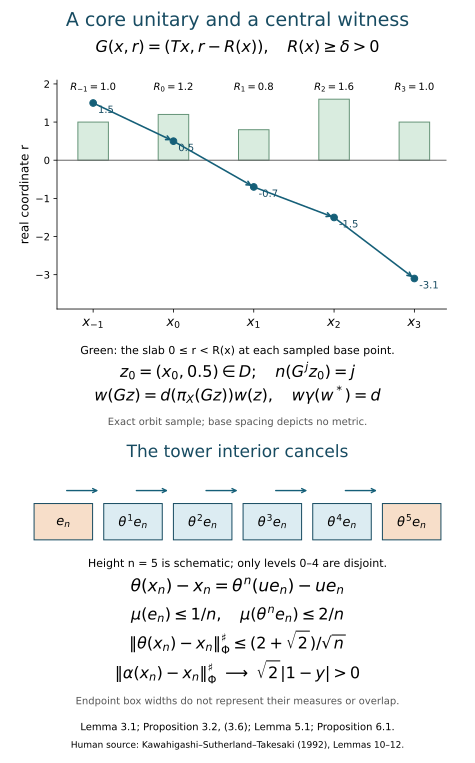
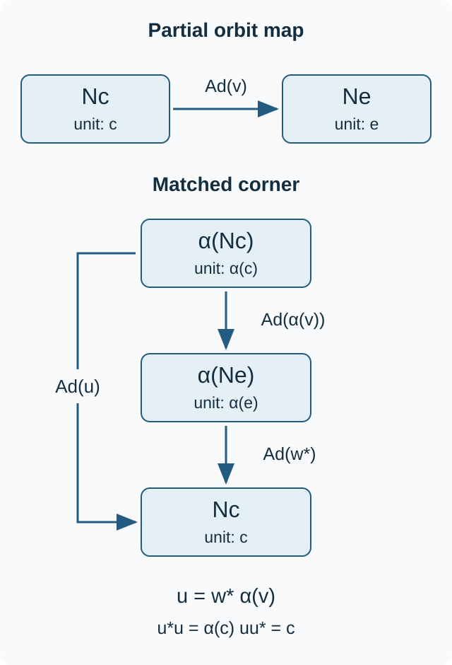
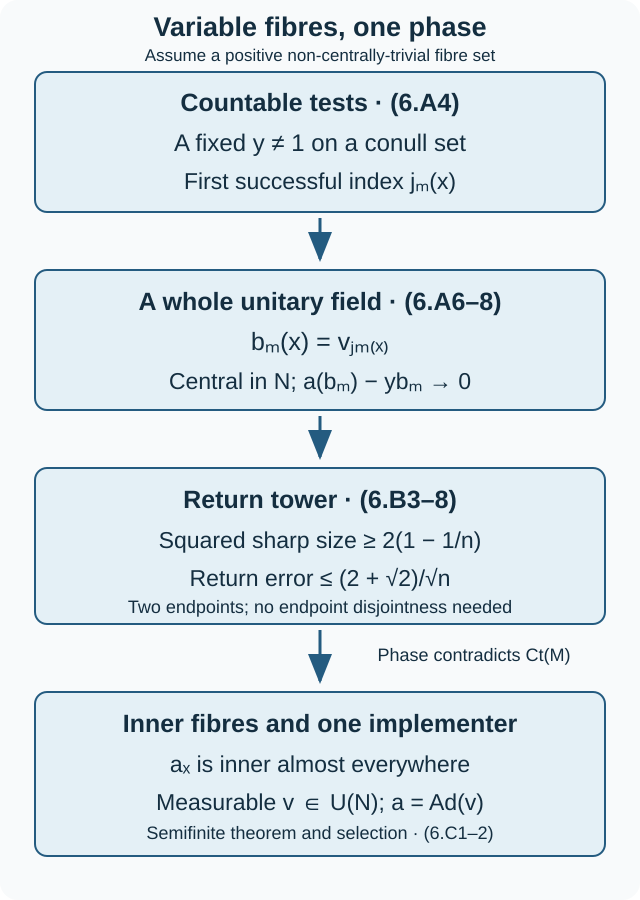

# Centrally trivial automorphisms and core normalizers

*Written by GPT-6.1 Sol (OpenAI), Ultra, October 2026; revised by GPT-6 Astra (OpenAI), Ultra, October 2026, with writing-AI self-checking under the stated prerequisites. New original text is public domain (CC0).*

## Introduction

A centrally trivial automorphism leaves every bounded central sequence asymptotically fixed. An extended-inner automorphism is implemented by a unitary in the continuous core, which can be much larger than the original factor. For an approximately finite-dimensional factor of type \({\rm III}_0\), these two descriptions give the same group.

The forward implication holds without approximate finite-dimensionality. We show directly that inner automorphisms arising from a central unitary sequence approach the identity on the core. For the reverse implication, a nonsingular tower transports a fibre eigenunitary through the coefficient algebra. Almost all of its support survives, while its two endpoint errors vanish. Central triviality therefore forces the fibre action to be inner. Finally, an explicit scalar unitary on the core's real-coordinate slab implements the remaining automorphism.

Basic references are [KST], [Connes] and [Takesaki II]. Section 2 proves the full-group criterion used in [KST, Lemma 8] through finite orbit intervals and a two-colour separation. Proposition 2.C and Corollary 2.D remove the implementing-unitary cocycle even when the central return roof varies. Propositions 2.E–F supply the two-central-corner comparison and the transport from a matched corner. Lemma 2.G and Theorem 2.H match the cuts using central triviality and a partial orbit map. Lemma 6.2, Proposition 6.3 and Corollary 6.4 use measurable phase witnesses in the variable automorphism field. The constant-field comparison of [KST, Lemma 9] is an additional input for the alternative normal-form route. The fibre phase-witness result is [KST, Lemma 11]; Section 2 proves the required ordinary-sequence conclusion from the programme relative-character theorem, retaining its full strong-stability scope. We use the proved semifinite conclusion of [Trace scaling on the hyperfinite semifinite factor](trace-scaling-on-the-hyperfinite-semifinite-factor.md), Theorem 4.2, with its stated tensor-absorption hypotheses. For the finite-factor result use Centrally trivial automorphisms and decreasing AFD factors, Lemma 4.1 and Theorem 4.2: their displaced tail-unitary proof gives \({\rm Ct}(R)={\rm Inn}(R)\). That finite conclusion is distinct from the semifinite theorem consumed here. [Normal tensor tests and tracial GNS identifications](../foundations/normal-tensor-and-tracial-product-foundations.md), TF1 and TF4, supply the normal tensor-functional and central-sequence transfer used below. Standard form, modular spectral calculus, continuous-core construction, whole-field realization and measurable selection retain their stated foundational prerequisites. The complete type \({\rm III}_0\) target is [Takesaki III, XVIII.2.8(ii)], including its formulation in every faithful-state chart.

All factors have separable predual. Strong-star convergence of a bounded sequence is tested by a faithful normal state \(\varphi\), using
\[
\|x\|_\varphi^{\sharp\,2}
=\varphi(x^*x)+\varphi(xx^*).
\tag{0.1}
\]
There is no factor \(1/2\) in this convention. A bounded sequence is *central* when \(\|[x_n,\omega]\|\to0\) for every \(\omega\in M_*\). Write \({\rm Ct}(M)\) for the automorphisms fixing all such sequences asymptotically. Write \(\widetilde M\) for the continuous core and
\[
\begin{gathered}
{\rm Cnt}_r(M)
=\{\operatorname{Ad}(v)|_M:
\\
v\in\mathcal U(\widetilde M),\
vMv^*=M\}.
\end{gathered}
\tag{0.2}
\]
The canonical-core normalizer theorem identifies this group with the automorphisms whose canonical extensions are inner. We retain that theorem and core naturality as prerequisites; the canonical extension extends the automorphism itself.

*Figure 1. The top panel is an exact sample along one indexed orbit, with roofs \(1,1.2,0.8,1.6,1\); it displays the negative real-coordinate shift and target coefficient in Lemma 3.1 and Proposition 3.2. Horizontal base spacing depicts no metric. The bottom panel is an algebraic height-five schematic for Lemma 5.1 and Proposition 6.1: only the first five levels are required to be disjoint, and box widths depict neither measures nor endpoint overlap. The displayed limits use (0.1), including its factor \(2\). Human source for the tower mechanism: [KST, Lemmas 10–12]. Reproducible plotting source accompanies the figure.*

[Open the full-size vector figure](../figures/core-normalizer-mechanisms.svg) · [Reproducible plotting source](../figures/draw_core_normalizer_mechanisms.py).

## 1. A central unitary sequence becomes trivial on the core

**Lemma 1.1.** If \((u_n)\) is a central sequence of unitaries of \(M\), then \(\operatorname{Ad}(\pi(u_n))\to{\rm id}\) in the \(u\)-topology of the regular continuous core \(M\rtimes_{\sigma^\varphi}\mathbb R\).

**Proof.** Work in the standard form \(H,J,\mathcal P\) of \(M\), with faithful state vector \(\xi_\varphi\) and modular operator \(\Delta_\varphi\). Predual centrality gives \(\operatorname{Ad}(u_n)\to{\rm id}\) in the \(u\)-topology. Its canonical standard-form unitary is
\[
K_n=u_nJu_nJ.
\tag{1.1}
\]
For a positive normal functional \(\omega\), the natural-cone square-root inequality
\(\|\xi_\omega-\xi_\eta\|^2\le\|\omega-\eta\|\) shows \(K_n\xi_\omega\to\xi_\omega\). The cone's linear span is dense, so \(K_n\to1\) strongly. Since the \(K_n\) are unitaries, their adjoints also converge strongly.

Tomita's identity gives
\[
\begin{aligned}
\Delta_\varphi^{1/2}u_n\xi_\varphi
&=Ju_n^*J\xi_\varphi,\\
\|(\Delta_\varphi^{1/2}-1)u_n\xi_\varphi\|
&=\|(K_n-1)\xi_\varphi\|\longrightarrow0.
\end{aligned}
\tag{1.2}
\]
For the second equality, put \(Q_n=Ju_n^*J\) and multiply the difference \(Q_n-u_n\) on the left by \(Q_n^*\). Left and right multiplication commute.

For \(r>0\) and real \(t\),
\[
|r^{it}-1|
\le4\max(1,|t|)\,|\sqrt r-1|.
\tag{1.3}
\]
Indeed, on \(1/2\le\sqrt r\le2\), use
\(|\log r|\le4|\sqrt r-1|\) and
\(|e^{ia}-1|\le|a|\). Outside this interval the right side is at least \(2\), which bounds the left side. Spectral calculus applied to (1.2), followed by the same argument for \(u_n^*\), proves
\[
\sup_{|t|\le L}
\|\sigma_t^\varphi(u_n)-u_n\|_\varphi^\sharp
\longrightarrow0
\quad(L<\infty).
\tag{1.4}
\]
On bounded sets, the faithful-state sharp norm gives the strong-star topology.

Represent the core on \(L^2(\mathbb R;H)\), with
\((\pi(a)\zeta)(r)=\sigma_{-r}^\varphi(a)\zeta(r)\) and the real implementing group acting by translation. Put
\[
\begin{gathered}
P_n=1\otimes u_n,\\
A_n=1\otimes Ju_nJ,\\
Z_n=\pi(u_n)A_n.
\end{gathered}
\tag{1.5}
\]
The constant right multiplier \(A_n\) commutes with every left fibre algebra and with translation, so \(A_n\in\widetilde M'\). Equation (1.4) and bounded dominated convergence imply \(\pi(u_n)-P_n\to0\) strongly-star. The varying multiplier requires care:
\[
\begin{aligned}
Z_n-P_nA_n
&=A_n(\pi(u_n)-P_n),\\
(Z_n-P_nA_n)^*
&=A_n^*(\pi(u_n)^*-P_n^*).
\end{aligned}
\tag{1.6}
\]
Both multipliers are on the left and have norm one. Thus both differences converge strongly to zero. Since \(P_nA_n=1\otimes K_n\), we obtain \(Z_n\to1\) strongly-star. Moreover \(\operatorname{Ad}(Z_n)\) and \(\operatorname{Ad}(\pi(u_n))\) agree on the core. Strong convergence of \(Z_n\) and \(Z_n^*\) implies norm convergence on fixed vector functionals; their linear span is norm dense in the predual. This proves the lemma. \(\square\)

**Proposition 1.2.** For every factor with separable predual,
\[
{\rm Cnt}_r(M)\subset{\rm Ct}(M).
\tag{1.7}
\]

**Proof.** Let \(v\) be a fixed core normalizer and \(a_n=\pi(u_n)\). The unitaries \(Z_n\) constructed in Lemma 1.1 converge strongly-star to \(1\) and have the same adjoint actions on the core as \(a_n\). Thus \(Z_n v Z_n^*\to v\) and \(Z_n^*vZ_n\to v\) strongly-star, by joint strong multiplication on bounded sets. This gives the required convergence for both the forward and inverse inner actions. Use
\[
\begin{aligned}
[v,a_n]
&=a_n(a_n^*va_n-v),\\
[v,a_n]^*
&=a_n^*(v^*-a_nv^*a_n^*).
\end{aligned}
\tag{1.8}
\]
Again, the moving unitary is on the left. Hence the commutator converges strongly-star to zero, and \(\operatorname{Ad}(v)(u_n)-u_n\to0\).

Every bounded central sequence is a linear combination of four central unitary sequences. To see this, split it into real and imaginary parts, rescale to selfadjoint contractions \(a_n\), and write
\(a_n=(w_n+w_n^*)/2\), where
\(w_n=a_n+i(1-a_n^2)^{1/2}\).
For polynomials, predual commutators are bounded by a fixed multiple of \(\|[a_n,\omega]\|\); uniform polynomial approximation handles the continuous square-root function. Thus the \(w_n\) are central. Linearity completes the proof. \(\square\)

This argument uses standard form and modular/core basics. It does not use a general continuity theorem for the canonical-extension map.

## 2. The precise type III zero normal form

For an AFD factor of type \({\rm III}_0\), use a faithful lacunary weight with infinite multiplicity. Its discrete decomposition has the form
\[
\begin{gathered}
M=N\rtimes_\theta\mathbb Z,\\
N=R_\infty\overline\otimes C,\\
C=L^\infty(X,\mu),\\
UaU^*=\theta(a),\\
\tau(\theta(a))=\tau(\rho a),\\
0<\rho\le q<1,\\
R=-\log\rho\ge\delta=-\log q>0.
\end{gathered}
\tag{2.1}
\]
Here \(R_\infty\) is the hyperfinite semifinite factor, \(\tau\) is the coefficient trace, and \(\mu\) is a probability representative of the centre's measure class. The point transformation \(T\) is ergodic, aperiodic and nonsingular, with
\(\theta(f)=f\circ T^{-1}\) on \(C\). It preserves the measure class; it need not preserve \(\mu\).

The base is nonatomic in this normal form. An atom in an ergodic nonsingular base would have a conull countable orbit; its suspension would then be concentrated on one real orbit. This contradicts proper ergodicity of the type \({\rm III}_0\) flow of weights. This is the nonatomic-center argument in the discrete-decomposition prerequisite, *The trace-contracting discrete decomposition of type III zero factors*, following (21). Thus the tower below uses the entire permitted type \({\rm III}_0\) class, rather than an added restriction on its base.

**Proposition 2.A (detecting the full group).** Let \(T\) be an aperiodic nonsingular automorphism of a standard probability space \((X,\mu)\), and let \(S\) be another nonsingular automorphism. Write \([T]\) for the group of transformations taking almost every point into its \(T\)-orbit. Then \(S\in[T]\) if and only if
\[
\begin{gathered}
\|f_n\circ T^{-1}-f_n\|_2\longrightarrow0
\\
\Longrightarrow\quad
\|f_n\circ S^{-1}-f_n\|_2\longrightarrow0
\end{gathered}
\tag{2.A1}
\]
for every uniformly bounded sequence in \(L^\infty(X,\mu)\). If \(S\notin[T]\), the failure is witnessed by functions with values in \(\{-1,1\}\). No invariant probability measure or bound on Radon–Nikodym derivatives is required.

**Proof.** Choose Borel representatives on a common invariant conull set for the group generated by \(T\) and \(S\); remove the null periodic set and its countably many translates. A standard Borel space has a countable separating family, so fix an injective Borel code
\(c:X\to\{0,1\}^{\mathbb N}\). The construction below uses only its finite prefixes.

First construct short finite orbit intervals with a small set of endpoints. Fix an integer \(n\ge2\). For each \(x\), let \(m(x)\) be the least positive integer such that the first \(m(x)\) bits of \(c(x)\) distinguish \(x\) from all \(T^k x\), \(0<|k|<n\). Aperiodicity makes \(m(x)\) finite; the defining finite comparisons make it Borel. The pair consisting of \(m(x)\) and that prefix is a countable Borel colouring of the graph joining \(x\) to those \(T^k x\): points with the same colour cannot be neighbours. Enumerate its colour classes as \(C_1,C_2,\ldots\), and define
\[
\begin{aligned}
B_1&=C_1,\\
B_j&=C_j\setminus
\bigcup_{0<|k|<n}T^k\!
\left(\bigcup_{i<j}B_i\right),\\
B&=\bigcup_{j\ge1}B_j.
\end{aligned}
\tag{2.A2}
\]
All these sets are Borel. Distinct markers in \(B\) on one orbit are at least \(n\) steps apart. Every point either enters \(B\) at its colour step or has an earlier marker fewer than \(n\) steps away. Thus markers occur infinitely in both directions on every orbit. Consecutive markers have distance at most \(2n-1\): a gap of at least \(2n\) would leave its point \(n\) steps after the first marker at distance at least \(n\) from every marker.

The sets \(B,TB,\ldots,T^{n-1}B\) are disjoint. Consequently one of them, denoted \(D_n\), has \(\mu(D_n)\le1/n\). Translating the marker set preserves its spacing and covering properties. Partition each orbit into the intervals starting at one \(D_n\)-marker and ending just before the next. Their lengths lie between \(n\) and \(2n-1\). The map to the preceding marker is explicitly
\[
\begin{aligned}
r_n(x)&=\min\{j\ge0:T^{-j}x\in D_n\},\\
q_n(x)&=T^{-r_n(x)}x,\\
0&\le r_n(x)\le2n-2.
\end{aligned}
\tag{2.A3}
\]
It is Borel and constant on each such finite interval. Outside \(D_n\), \(x\) and \(T^{-1}x\) have the same preceding marker. Hence every set \(A\) that is a union of these intervals satisfies
\[
A\mathbin{\triangle}TA\subset D_n,
\qquad
\mu(A\mathbin{\triangle}TA)\le n^{-1}.
\tag{2.A4}
\]
This estimate uses the chosen probability measure itself. It does not replace nonsingularity by measure preservation.

Suppose now that \(S\notin[T]\). The Borel set
\[
\begin{gathered}
E=\{x:S^{-1}x\notin\{T^k x:k\in\mathbb Z\}\},\\
d=\mu(E)>0
\end{gathered}
\tag{2.A5}
\]
has positive measure: the corresponding failure set for \(S\) is \(S^{-1}E\), and \(S\) is nonsingular. For \(x\in E\), the markers \(q_n(x)\) and \(q_n(S^{-1}x)\) differ, since each belongs to its argument's orbit. Partition \(X\) by the first \(\ell\) bits of \(c\). As \(\ell\) increases, the sets on which these two markers belong to different cells increase to their inequality set, whose measure is at least \(d\). Choose a finite prefix length for which the different-cell set has measure greater than \(d/2\).

Colour each cell of that finite partition independently with either zero or one, with equal probabilities. Let \(A\) contain those \(x\) whose marker \(q_n(x)\) has colour one. This is a union of finite orbit intervals. At a point whose two markers lie in different cells, the colours disagree with probability \(1/2\); otherwise they agree. Averaging over the finitely many colourings gives
\[
\mathbb E_{\rm colours}\,\mu(A\mathbin{\triangle}SA)
>d/4.
\tag{2.A6}
\]
The equality underlying this bound is just a finite sum of integrals of indicator functions. Thus at least one colouring gives a set \(A_n\) with displacement greater than \(d/4\); choose the first such colouring in a fixed finite enumeration. Set \(z_n=1-2\,1_{A_n}\). Equations (2.A4) and (2.A6) yield
\[
\begin{aligned}
\|z_n\circ T^{-1}-z_n\|_2^2&\le4/n,\\
\|z_n\circ S^{-1}-z_n\|_2^2&>d.
\end{aligned}
\tag{2.A7}
\]
These uniformly bounded selfadjoint unitaries contradict (2.A1). Their first displacement also tends to zero along every free ultrafilter, while the second stays bounded below; the same witness therefore applies to the ultrafilter formulation of the criterion.

Conversely, suppose \(S\in[T]\), and let \((f_n)\) be uniformly bounded and satisfy the first limit in (2.A1). On a probability space, uniformly bounded functions converge to zero in \(L^2\) if and only if they converge to zero in measure: split the integral over the set where their modulus exceeds a fixed positive threshold. Nonsingularity and absolute continuity of each finite measure \(\mu\circ T^{-k}\) show that composition by any fixed \(T^k\) preserves convergence in measure. A finite telescoping sum therefore gives
\[
\begin{gathered}
f_n\circ T^k-f_n\longrightarrow0
\quad\hbox{in measure},\\
k\in\mathbb Z\ \hbox{fixed}.
\end{gathered}
\tag{2.A8}
\]
There is a measurable integer function \(k(x)\) with \(S^{-1}x=T^{k(x)}x\): its level sets are the Borel equality sets, which are disjoint by aperiodicity and cover a conull set. For \(\varepsilon>0\) and \(K\ge1\),
\[
\begin{aligned}
&\mu\{|f_n\circ S^{-1}-f_n|>\varepsilon\}\\
&\quad\le\mu\{|k|>K\}\\
&\qquad+\sum_{|j|\le K}
\mu\{|f_n\circ T^j-f_n|>\varepsilon\}.
\end{aligned}
\tag{2.A9}
\]
Take the upper limit in \(n\), then let \(K\) tend to infinity. The resulting convergence in measure, together with uniform boundedness, gives the second \(L^2\) limit. This proves both directions. \(\square\)

In the centre \(C=L^\infty(X,\mu)\), bounded \(L^2(\mu)\) convergence is strong-star convergence in its multiplication representation. Indeed, convergence in measure and a common bound imply convergence against every integrable vector density, by truncating the density and using the preceding \(L^2\) criterion. Thus Proposition 2.A is the full-group criterion for asymptotically \(\theta\)-invariant central sequences used in [KST, Lemma 8]. It applies to every nonsingular aperiodic base in (2.1), and supplies this criterion without a measurable-field classification assumption.

**Corollary 2.B (implementing the base correction).** In (2.1), suppose that \(\alpha\in{\rm Ct}(M)\) preserves \(N\). Then there is a unitary \(v\in M\) normalizing \(N\) such that \(\operatorname{Ad}(v^*)\alpha\) is the identity on \(C\).

**Proof.** Write \(\alpha(f)=f\circ S^{-1}\) on \(C\). A bounded asymptotically \(\theta\)-invariant sequence in \(C\) is exactly central in \(N\), and the converse part of Proposition 4.1 makes it central in \(M\). That converse uses Fourier coefficients and normal functionals, not the normal form (2.2). Central triviality and Proposition 2.A therefore give \(S\in[T]\).

Put
\[
\begin{gathered}
F_k=\{x:Sx=T^k x\},\qquad p_k=1_{F_k},\\
v_k=U^k p_k,\qquad k\in\mathbb Z .
\end{gathered}
\tag{2.B1}
\]
The \(F_k\) form a measurable partition modulo null sets. Their images \(T^kF_k=SF_k\) also partition \(X\). Thus the \(v_k\) have pairwise orthogonal initial projections \(p_k\) and pairwise orthogonal final projections \(\theta^k(p_k)\), with both projection sums equal to one. For each vector, squared norms of the corresponding tails are the tails of the sums of its squared projection norms. The finite sums consequently converge strongly-star to a unitary
\[
v=\sum_{k\in\mathbb Z}U^kp_k .
\tag{2.B2}
\]
For \(f\in C\), all off-diagonal terms vanish, and
\[
\begin{aligned}
vfv^*&=\sum_k\theta^k(p_k f)\\
&=f\circ S^{-1}=\alpha(f).
\end{aligned}
\tag{2.B3}
\]
The second equality follows on \(T^kF_k\) by substituting \(S^{-1}x=T^{-k}x\). The same diagonal calculation gives \(vNv^*\subset N\): \(p_k a p_j=0\) for \(a\in N\) and \(k\ne j\). Applying it to \(v^* a v\), using the orthogonal central range projections, gives the reverse inclusion. Bounded finite sums and strong closure justify these identities for every \(a\in N\). Hence \(v\) normalizes \(N\), and (2.B3) proves the assertion. \(\square\)

Corollary 2.B applies once \(N\) is preserved. The following cocycle argument arranges \(\alpha(U)=U\); the constant-field alternative requires its further equivariant comparison input.

**Proposition 2.C (removing a cocycle with a varying return roof).** For the coefficient system \((N,\theta,\tau,\rho)\) in (2.1), every specified \(c\in\mathcal U(N)\) has the form
\[
c=z^*\theta(z),\qquad z\in\mathcal U(N).
\tag{2.C1}
\]
In particular, the central density \(\rho\) need not be constant. The proof uses the whole suspension trace of ZDC, Sections 1, 5–6 and the real trace-scaling cocycle theorem, with its complete linking-algebra proof in CST, Sections 1–5.

**Proof.** We give the transfer, including the noncommuting product order and the return to \(N\). Write \(R=-\log\rho\), as in (2.1), and form
\[
\begin{gathered}
A=L^\infty(\mathbb R,ds)\,\overline\otimes\,N,\\
(\ell_tX)(s)=X(s-t),\qquad \overline a=1\otimes a .
\end{gathered}
\tag{2.C2}
\]
The normal deck automorphism \(\Gamma\) sends \(\overline a\) to \(\overline{\theta(a)}\). On the centre its point map is
\((s,x)\mapsto(s-R(x),Tx)\). Explicitly, it is the composition of \(\mathrm{id}\otimes\theta\) with translation of the real coordinate by the central function \(R\circ T^{-1}\). The latter is implemented on the full direct-integral Hilbert space by
\(\xi(s,x)\mapsto\xi(s+R(T^{-1}x),x)\); scalar Fubini makes this an onto unitary, with the opposite translation as inverse. Thus \(\Gamma\) is a normal automorphism of the whole algebra, not merely a rule on selected sections. It commutes with every \(\ell_t\).

Let
\[
\begin{gathered}
E=\{(s,x):0\le s<R(x)\},\qquad p=1_E,\\
p_n=\Gamma^n(p),\qquad n\in\mathbb Z,\qquad P=A^\Gamma .
\end{gathered}
\tag{2.C3}
\]
The positive lower bound on \(R\) makes every deck orbit meet \(E\) exactly once, by the real-coordinate crossing argument of Lemma 3.1. Hence the \(p_n\) are orthogonal central projections summing to one. Restriction \(X\mapsto pX\) identifies \(P\) normally with \(pA\), with normal inverse
\[
Y\longmapsto\sum_{n\in\mathbb Z}\Gamma^n(Y).
\tag{2.C4}
\]
Orthogonal central supports give strong-star convergence, preserve products and adjoints, and bound the sum by \(\|Y\|\). The inverse identities hold on each support. Both maps preserve bounded increasing positive suprema. This verifies the full algebra and its normal inverse.

We recall why the suspension trace scales, retaining all positive values. On \(A\), let \(\Sigma=ds\otimes\tau\) and let
\(\Xi=\Sigma_{e^{-s}}\). These faithful normal semifinite traces are constructed by bounded scalar cuts and finite-\(\tau\) compressions in ZDC1. Central translation preserves \(\Sigma\), so
\[
\begin{gathered}
\Sigma\Gamma=\Sigma_\rho,\qquad
\Gamma^{-1}(e^{-s})=e^R e^{-s},\\
\Xi\Gamma=\Sigma_{\rho e^R e^{-s}}=\Xi .
\end{gathered}
\tag{2.C5}
\]
Here and below a central density is interpreted by increasing bounded spectral cutoffs. Since \(\rho e^R=1\), this calculation cancels central functions before evaluating any weight; it does not cancel infinite numerical values.

The trace on the fixed algebra is
\[
\widetilde\tau(X)=\Xi(pX),\qquad X\in P_+.
\tag{2.C6}
\]
Via (2.C4) it is the restriction of \(\Xi\) to the central corner \(pA\), so it is faithful and normal. If \(a\) is a finite-\(\tau\) projection, then
\(\Xi(p\overline a)=\tau((1-e^{-R})a)\le\tau(a)\).
Such projections increase to the strip unit, proving semifiniteness. For another deck fundamental domain \(D\), split \(D\) into its intersections with the deck translates of \(E\). Deck invariance of \(\Xi\), fixedness of \(X\), and nonnegative normal summation give
\(\Xi(1_DX)=\Xi(pX)\), including infinity. Taking \(D=E-t\), and using \(\ell_t(1_{E-t})=p\), proves
\[
\begin{aligned}
\widetilde\tau(\ell_tX)
&=\Xi\bigl(\ell_t(1_{E-t}X)\bigr)\\
&=e^{-t}\widetilde\tau(X).
\end{aligned}
\tag{2.C7}
\]
Thus \(\ell|_P\) satisfies the exact trace law required by CST. Real translations are point-strong-star continuous in the multiplication representation, and their restriction to the invariant von Neumann algebra \(P\) has the same continuity.

Let \((c_n)_{n\in\mathbb Z}\) be the integer cocycle generated by \(c_1=c\):
\[
\begin{gathered}
c_0=1,\qquad c_{m+n}=c_m\theta^m(c_n),\\
c_{-n}=\theta^{-n}(c_n^*)\quad(n>0).
\end{gathered}
\tag{2.C8}
\]
Define a unitary on the full product by
\[
V=\sum_{n\in\mathbb Z}p_n\,\overline{c_n^*}.
\tag{2.C9}
\]
Each summand is unitary on its central support \(p_n\). Orthogonal squared vector tails give convergence of the series and its adjoint, and show \(V^*V=VV^*=1\). The identity
\(c_{n+1}=c\,\theta(c_n)\), valid for all integers, gives the exact order
\[
\begin{aligned}
\Gamma(V)
&=\sum_n p_{n+1}\,\overline{\theta(c_n^*)}\\
&=\sum_n p_{n+1}\,\overline{c_{n+1}^*c}
=V\overline c.
\end{aligned}
\tag{2.C10}
\]
Now put \(C_t=V\ell_t(V^*)\). Because \(\overline c\) is constant in the real coordinate,
\[
\begin{aligned}
\Gamma(C_t)
&=V\overline c\,\ell_t(\overline{c^*}V^*)=C_t,\\
C_s\ell_s(C_t)&=V\ell_{s+t}(V^*)=C_{s+t}.
\end{aligned}
\tag{2.C11}
\]
Thus \(C_t\in\mathcal U(P)\), and it is a strongly continuous cocycle for \(\ell|_P\). These are identities in the whole algebra for every real parameter. No evaluation of a measurable field at a chosen height is involved.

CST now supplies \(b\in\mathcal U(P)\) with
\(C_t=b^*\ell_t(b)\) for every \(t\). Multiplication on the indicated sides gives
\[
\ell_t(bV)=\ell_t(b)\ell_t(V)=bV .
\tag{2.C12}
\]
The fixed algebra of real translation on \(L^\infty(\mathbb R)\overline\otimes N\) is \(1\otimes N\). To see the assertion on the full algebra, slice by any \(\eta\in N_*\): the resulting bounded scalar function is translation invariant, hence almost everywhere constant by scalar Fubini. A normal probability slice in the real coordinate recovers those constants as one element of \(N\); product normal functionals separate the tensor algebra. Consequently \(bV=\overline z\) for a unitary \(z\in N\). Since \(\Gamma(b)=b\), (2.C10) yields
\[
\overline{\theta(z)}
=\Gamma(bV)=bV\overline c=\overline{zc}.
\tag{2.C13}
\]
This proves (2.C1). Telescoping then gives
\(c_n=z^*\theta^n(z)\) for every integer \(n\). \(\square\)

The classical trace-contracting stability statement is [Connes–Takesaki, III.5.1(i), pp. 544–545](https://www.jstage.jst.go.jp/article/tmj1949/29/4/29_4_524/_article/-char/en). The argument here specifies its application to the variable central roof in (2.1), through the normal suspension and the real cocycle theorem. Their modular, trace-density and projection foundations remain part of its prerequisite chain.

**Corollary 2.D (fixing the implementing unitary).** Suppose \(\beta\in\operatorname{Aut}(M)\) preserves \(N\) in (2.1) and is the identity on \(C\). Then there is \(z\in\mathcal U(N)\) such that
\(\gamma=\operatorname{Ad}(z)\beta\) preserves \(N\), fixes \(C\) pointwise, and satisfies
\[
\gamma(U)=U,\qquad
\gamma|_N\,\theta=\theta\,\gamma|_N.
\tag{2.D1}
\]

**Proof.** Put \(c=\beta(U)U^*\). For \(f\in C\),
\[
cfc^*
=\beta(U)\theta^{-1}(f)\beta(U)^*
=\beta(f)=f.
\tag{2.D2}
\]
We need the whole commutant \(C'\cap M=N\). The Fourier argument in Lemma 4.2 supplies it before its last step: if \(x\) commutes with \(C\), its coefficient \(a_k=E(xU^{-k})\in N\) satisfies
\[
f a_k=a_k\theta^k(f)\quad(f\in C).
\tag{2.D3}
\]
For \(k\ne0\), a countable point-separating family on the aperiodic base makes the central support of \(a_k\) vanish. Thus all nonzero coefficients are zero, and normal circle Fejér averaging gives \(x=E(x)\in N\). The reverse inclusion holds because \(C=Z(N)\). In particular, \(c\in\mathcal U(N)\).

Choose \(z\) from Proposition 2.C, so \(c=z^*\theta(z)\). Then
\[
\begin{aligned}
\gamma(U)&=z\,c\,U z^*\\
&=z\,c\,\theta(z^*)U=U .
\end{aligned}
\tag{2.D4}
\]
Conjugation by \(z\in N\) preserves \(N\) and fixes \(C\). Applying \(\gamma\) to \(UaU^*=\theta(a)\) proves the commutation assertion in (2.D1). \(\square\)

**Proposition 2.E (the two central corners).** Let \(M\) have separable predual, let \(\psi\) be a faithful normal semifinite lacunary weight of infinite multiplicity, and let \(\alpha\in{\rm Aut}(M)\). Put
\[
 \begin{gathered}
 N=M_\psi,\qquad \chi=\psi\circ\alpha^{-1},\\
 Q=M_\chi=\alpha(N).
 \end{gathered}
 \tag{2.E1}
\]
There are nonzero projections \(c,e\in Z(N)\) and a partial isometry \(w\in M\) such that
\[
 \begin{gathered}
 w^*w=c,\qquad ww^*=\alpha(e),\\
 w(Nc)w^*=Q\alpha(e)=\alpha(Ne).
 \end{gathered}
 \tag{2.E2}
\]
Both corner maps, conjugation by \(w\) and by \(w^*\), are normal inverses. The assertion allows \(c\ne e\).

The spectral comparison is the first part of [KST, Lemma 5, pp. 108–109]. Its exact programme inputs are balanced weights, BC1–3 and BC5, real spectral filters, RSF1–4, and the narrow-polar and countable-copy construction, LAC3. We write the two-algebra corner maps explicitly.

**Proof.** The action spectrum of \(\sigma^\psi\) has a gap about zero. The equality with the logarithmic modular spectrum, including the complete finite domain, is MG0–1. The singleton converse, SS0–3 identifies the zero-frequency subspace with the fixed algebra. Choose \(\delta>0\) so that the closed spectral subspace on \([-\delta,\delta]\) is \(N\). Normal isomorphism covariance gives the same gap and the fixed algebra \(Q\) for \(\chi\).

On \(M_2(M)\) form the faithful normal semifinite weight
\[
 \Theta((a_{ij}))=\chi(a_{11})+\psi(a_{22})
 \quad((a_{ij})\ge0).
 \tag{2.E3}
\]
BC1–3 prove this assertion on the whole positive cone, fix the two diagonal projections under \(\sigma^\Theta\), and identify the two diagonal actions. Thus \(Y=ME_{12}\) is a nonzero weak-star closed invariant subspace. RSF4 says that, for every fixed positive band radius, the narrow spectral pieces span \(Y\) weak-star. In particular there are \(b\in\mathbb R\) and \(0\ne x\in M\) with
\[
 \begin{gathered}
 xE_{12}\in M_2(M)^{\sigma^\Theta}(I),\\
 I=[b-\delta/4,b+\delta/4].
 \end{gathered}
 \tag{2.E4}
\]
This chooses a nonzero band element, not an assumed modular eigenvector.

For \(a\in N\), the product \((xE_{12})(aE_{22})(x^*E_{21})\) has spectrum in \(I-I=[-\delta/2,\delta/2]\). It lies in the first diagonal corner, where the gap puts it in \(QE_{11}\). Reverse the two corners and use \(d\in Q\). The adjoint and product theorems RSF3 therefore give
\[
 xNx^*\subseteq Q,\qquad x^*Qx\subseteq N.
 \tag{2.E5}
\]
In particular \(h=(x^*x)^{1/2}\in N\), \(k=(xx^*)^{1/2}\in Q\). Write \(x=uh\), with \(p=u^*u\in N\) and \(q=uu^*\in Q\). The two contraction nets satisfy
\[
\begin{gathered}
x(h+\varepsilon)^{-1}\longrightarrow u,\\
x^*(k+\varepsilon)^{-1}\longrightarrow u^*\\
\hbox{strongly*}.
\end{gathered}
\tag{2.E6}
\]
Their strong-star convergence follows from the scalar functions \(t/(t+\varepsilon)\) on the positive operators \(h,k\), tending boundedly to their support projections. Equation (2.E5), applied after multiplication by the bounded inverse factors in their respective fixed algebras, gives
\[
 uNu^*\subseteq Q,\qquad u^*Qu\subseteq N.
 \tag{2.E7}
\]
The limits are bounded strong limits of elements of the indicated von Neumann algebras. These two inclusions prove the full equality
\[
 u(pNp)u^*=qQq.
 \tag{2.E8}
\]
Indeed \(d\in qQq\) has preimage \(u^*du\in pNp\), and \(u(u^*du)u^*=d\).

Let \(c=z_N(p)\) and \(d=z_Q(q)\) be the central supports. We need filling families in both fixed algebras, even if \(p\) or \(q\) is finite. Here is the countable-copy argument from LAC3 with its hypotheses. In
\[
 \begin{gathered}
 B=Nc\bar\otimes B(\ell^2\mathbb N),\\
 P=c\otimes E_{11},\qquad P'=p\otimes1.
 \end{gathered}
 \tag{2.E9}
\]
the projection \(P\) is properly infinite because \(Nc\) is. The two disjoint scalar shifts make \(P'\) properly infinite. Both have full central support. The tensor product of a faithful normal state on \(Nc\) with a strictly positive summable diagonal state is faithful: zero value on a positive element forces every positive diagonal compression to vanish, hence every matrix entry to vanish. Thus \(B\) is countably decomposable. Projection comparison, PC3, PC5 and PC7 gives \(P\sim P'\). Transport the orthogonal projections \(p\otimes E_{jj}\), which fill \(P'\), across this equivalence. Each resulting projection in \(PBP=Nc\) is equivalent to \(p\). To see that the implementing equivalence lies in this corner, first join the given equivalence to the matrix unit identifying \(p\otimes E_{jj}\) with \(p\otimes E_{11}\); its initial and final projections are then both under \(P\).

Applying the same argument to \(Qd,q\) gives partial isometries \(a_j\in N\), \(b_j\in Q\) with
\[
 \begin{gathered}
 a_j^*a_j=p,\qquad \sum_j a_ja_j^*=c,\\
 b_j^*b_j=q,\qquad \sum_j b_jb_j^*=d,
 \end{gathered}
 \tag{2.E10}
\]
where each family of final projections is orthogonal. Define
\[
 w=\sum_{j\ge1}b_jua_j^*.
 \tag{2.E11}
\]
Its summands have the orthogonal initial projections \(a_ja_j^*\) and orthogonal final projections \(b_jb_j^*\). PC1's squared-norm tail calculation proves strong-star convergence, \(w^*w=c\), and \(ww^*=d\).

The full matrix entries establish surjectivity, not only the diagonal entries. For \(A\in Nc\), finite partial sums give
\[
 w_mAw_m^*
 =\sum_{i,j\le m}b_i\,
       u(a_i^*Aa_j)u^*\,b_j^*\in Qd.
 \tag{2.E12}
\]
Every \(a_i^*Aa_j\) belongs to \(pNp\), so (2.E8) applies also when \(i\ne j\). The sums are bounded by \(\|A\|\) and converge strongly to \(wAw^*\), giving \(w(Nc)w^*\subseteq Qd\). Interchanging the two filling families and using the inverse in (2.E8) gives \(w^*(Qd)w\subseteq Nc\). These inclusions and the support identities make the conjugations inverse onto maps. They are normal because multiplication on either side by a fixed bounded operator is ultraweakly continuous.

Finally \(Q=\alpha(N)\), so \(e=\alpha^{-1}(d)\) is a nonzero central projection of \(N\). This proves (2.E2). \(\square\)

**Proposition 2.F (transport from a matched corner).** Suppose in addition that \(M\) is a type III factor and that there are \(0\ne e\in Z(N)\) and \(u\in M\) with
\[
 \begin{gathered}
 u^*u=\alpha(e),\qquad uu^*=e,\\
 u\alpha(Ne)u^*=Ne.
 \end{gathered}
 \tag{2.F1}
\]
Then an inner perturbation of \(\alpha\) preserves the centralizer of a faithful normal semifinite lacunary weight of infinite multiplicity on \(M\).

**Proof.** Since the predual is separable, \(M\) is countably decomposable. PC8 gives an isometry \(v\in M\) with \(v^*v=1\), \(vv^*=e\). The normal corner isomorphism \(F(x)=vxv^*\), with inverse \(F^{-1}(a)=v^*av\), defines
\[
 \widetilde\psi(x)=\psi(vxv^*)\quad(x\ge0).
 \tag{2.F2}
\]
MG2 proves that restriction to \(eMe\) is faithful normal semifinite and that its modular action is the restriction of \(\sigma^\psi\); it does not assume \(\psi(e)<\infty\). Transport by \(F\) therefore gives
\[
 \begin{gathered}
 \sigma_t^{\widetilde\psi}
      =F^{-1}\sigma_t^\psi F,\\
 M_{\widetilde\psi}=v^*(Ne)v.
 \end{gathered}
 \tag{2.F3}
\]
The centralizer is properly infinite because \(e\) is central in the properly infinite algebra \(N\). Restricting the original action to its invariant corner cannot enlarge its spectrum: every annihilating Fourier filter still annihilates that corner. Conjugation by \(F\) preserves the spectrum. Thus the same zero-frequency gap holds for \(\widetilde\psi\), and MG1 identifies it with lacunarity of the full modular operator.

Set
\[
 W=v^*u\alpha(v).
 \tag{2.F4}
\]
Using (2.F1), its two products are
\[
 \begin{aligned}
 W^*W&=\alpha(v^*)u^*eu\alpha(v)=1,\\
 WW^*&=v^*u\alpha(e)u^*v=1.
 \end{aligned}
 \tag{2.F5}
\]
For \(a\in Ne\),
\[
 W\alpha(v^*av)W^*=v^*u\alpha(a)u^*v.
 \tag{2.F6}
\]
The onto equality in (2.F1) now proves
\[
 ({\rm Ad}(W)\circ\alpha)(M_{\widetilde\psi})
       =M_{\widetilde\psi}.
 \tag{2.F7}
\]
This is the isometric transport in [KST, Lemma 6, pp. 109–110], with its weight, spectrum, support and inverse maps retained. \(\square\)

Proposition 2.E supplies two possibly different central cuts. To use Proposition 2.F one still needs a matched cut as in (2.F1). Equivalence of projections alone does not imply that conjugation identifies their whole coefficient algebras. In particular the mixed matrix entries in (2.E12) are part of the proof. The following partial orbit argument supplies a matched cut under central triviality. The equivariant constant-field theorem has a separate role in the normal form below.

**Lemma 2.G (detecting a partial orbit map).** Let \(T\) have the hypotheses of Proposition 2.A. Let \(D,E\subseteq X\) be measurable and let \(S:D\to E\) be an invertible nonsingular map modulo null sets. Suppose that every sequence of measurable functions \(z_n:X\to\{-1,1\}\) satisfies
\[
 \begin{gathered}
 \|z_n\circ T^{-1}-z_n\|_{L^2(X)}\longrightarrow0\\
 \Longrightarrow\
 \|z_n\circ S^{-1}-z_n\|_{L^2(E)}\longrightarrow0.
 \end{gathered}
 \tag{2.G1}
\]
Then \(Sx\) belongs to the \(T\)-orbit of \(x\) for almost every \(x\in D\). This is the partial full group of \(T\); it imposes no equality of the measures of \(D\) and \(E\).

**Proof.** Take the Borel models and the marker maps \(q_n\) constructed in (2.A2)–(2.A4). Their construction uses only \(T\) and the probability representative \(\mu\), so it applies without extending \(S\) to \(X\). If the conclusion fails, nonsingularity makes
\[
 \begin{gathered}
 B=\{y\in E:S^{-1}y\notin\{T^k y:k\in\mathbb Z\}\},\\
 d=\mu(B)>0.
 \end{gathered}
 \tag{2.G2}
\]
For every \(y\in B\), \(q_n(y)\ne q_n(S^{-1}y)\). As in the proof of Proposition 2.A, choose a finite prefix of the separating Borel code so that these two markers lie in different cells on a subset of \(B\) of measure greater than \(d/2\). Colour its finitely many cells independently with two colours. The function \(z_n\) takes values \(1,-1\) according to the colour of its marker. The expectation of
\[
 \int_E
 |z_n(S^{-1}y)-z_n(y)|^2\,d\mu(y)
 \tag{2.G3}
\]
is greater than \(d\): different cells have different colours with probability \(1/2\), and the squared difference is then \(4\). Some colouring therefore makes (2.G3) greater than \(d\). Meanwhile the global marker estimate gives
\[
 \|z_n\circ T^{-1}-z_n\|_{L^2(X)}^2\le4/n.
 \tag{2.G4}
\]
This contradicts (2.G1). All choices involve a finite partition at each \(n\); no measure-preserving assumption or bounded Radon–Nikodym derivative was used. \(\square\)

**Theorem 2.H (central triviality matches the central cuts).** Let \(\psi\) be the lacunary weight giving (2.1), and let \(\alpha\in{\rm Ct}(M)\). There is a nonzero central projection \(c\in Z(N)\) and a partial isometry \(u\in M\) such that
\[
 \begin{gathered}
 u^*u=\alpha(c),\qquad uu^*=c,\\
 u\alpha(Nc)u^*=Nc.
 \end{gathered}
 \tag{2.H1}
\]
Consequently an inner perturbation of \(\alpha\) preserves the centralizer of a faithful normal semifinite lacunary weight of infinite multiplicity. After choosing that weight's discrete decomposition, further inner perturbations fix its center pointwise and its integer implementing unitary.

**Proof.** Apply Proposition 2.E to obtain \(c,e,w\), and define the normal corner isomorphism
\[
 \begin{aligned}
 B:Nc&\longrightarrow Ne,\\
 B(a)&=\alpha^{-1}(waw^*).
 \end{aligned}
 \tag{2.H2}
\]
It sends the entire center \(Cc\) onto \(Ce\). In the standard measure model write \(c=1_D\), \(e=1_E\). The normal isomorphism of these commutative algebras is represented by a nonsingular measurable isomorphism \(S:D\to E\), with
\[
 B(fc)=(f\circ S^{-1})e
 \quad(f\in C).
 \tag{2.H3}
\]
Here a function on \(E\) is extended by zero outside \(E\). The standard measure-model correspondence is the same one used in Proposition 2.A, now on its two measurable corners.

Take any sequence \(z_n:X\to\{-1,1\}\) with the first limit in (2.G1). The bounded \(L^2\)/strong-star equivalence after Proposition 2.A gives \(\theta(z_n)-z_n\to0\) strongly-star. Because \(z_n\in C\), it commutes with every normal functional on \(N\): for a central projection this follows by decomposing that functional over its two central corners, and bounded central functions follow by uniform simple-function approximation. The converse part of Proposition 4.1 therefore makes \((z_n)\) a central unitary sequence in \(M\). That converse uses only Fourier coefficients and the predual circle action, independently of (2.2).

Centrality implies \([w,z_n]\to0\) strongly-star. For completeness, the first standard-form argument of Lemma 1.1 gives \({\rm Ad}(z_n)\to{\rm id}\) and \({\rm Ad}(z_n^*)\to{\rm id}\) pointwise strongly-star on \(M\). The identities
\[
 \begin{aligned}
 [z_n,w]&=z_n(w-z_n^*wz_n),\\
 [z_n,w]^*&=z_n^*(z_nw^*z_n^*-w^*)
 \end{aligned}
 \tag{2.H4}
\]
place each moving unitary on the left, where its norm is one. They give the asserted commutator convergence without multiplying a strong-null sequence on the right by an uncontrolled varying operator. Central triviality also gives \(\alpha(z_n)-z_n\to0\) strongly-star.

Put \(d_n=B(z_nc)-z_ne\in Ce\). Since \(ww^*=\alpha(e)\), its image under \(\alpha\) has the exact decomposition
\[
 \begin{aligned}
 \alpha(d_n)
 ={}&(wz_n-z_nw)w^*\\
    &+(z_n-\alpha(z_n))\alpha(e).
 \end{aligned}
 \tag{2.H5}
\]
Both terms tend strongly-star to zero. Normal automorphisms and their inverses preserve that convergence on bounded sets: test \(a_n^*a_n\) and \(a_na_n^*\) against the transported normal positive functionals. Hence \(d_n\to0\) strongly-star. The central measure model and (2.H3) convert this to the second limit in (2.G1). Lemma 2.G now proves that \(S\) is a partial orbit map.

For \(k\in\mathbb Z\), set
\[
 \begin{gathered}
 D_k=\{x\in D:Sx=T^k x\},\qquad p_k=1_{D_k},\\
 q_k=\theta^k(p_k).
 \end{gathered}
 \tag{2.H6}
\]
Aperiodicity makes the \(D_k\) disjoint, and their union is \(D\) modulo null sets. Since \(S\) is invertible onto \(E\), the sets \(T^kD_k=SD_k\) partition \(E\). Thus the \(p_k\) and \(q_k\) are separately orthogonal central families with sums \(c\) and \(e\).

The partial version of (2.B2) is
\[
 v=\sum_{k\in\mathbb Z}U^kp_k,\qquad
 v^*v=c,\quad vv^*=e.
 \tag{2.H7}
\]
Its finite sums converge strongly-star: the squared norms of the vector tails and adjoint-vector tails are controlled by the corresponding tails of the two orthogonal projection families. It transports the whole coefficient corners. For \(a\in Nc\), centrality of the \(p_k\) eliminates mixed terms and gives
\[
 vav^*=\sum_k\theta^k(p_ka)\in Ne.
 \tag{2.H8}
\]
For \(b\in Ne\), the reverse formula is
\[
 v^*bv=\sum_k\theta^{-k}(q_kb)\in Nc.
 \tag{2.H9}
\]
These are bounded strong-star sums on orthogonal central corners. The identities \(\sum p_k=c\), \(\sum q_k=e\) show that the two formulas are inverse, normal and onto. Here the target pieces are central and fill \(e\); the conclusion concerns all of \(Ne\).

Now combine this partial orbit implementer with the actual comparison \(w\):
\[
 u=w^*\alpha(v).
 \tag{2.H10}
\]
Its support computations retain the order of the noncommuting factors:
\[
 \begin{aligned}
 u^*u
 &=\alpha(v^*)\alpha(e)\alpha(v)=\alpha(c),\\
 uu^*
 &=w^*\alpha(e)w=c.
 \end{aligned}
 \tag{2.H11}
\]
Moreover the two onto corner identities give
\[
 \begin{aligned}
 u\alpha(Nc)u^*
 &=w^*\alpha(v(Nc)v^*)w\\
 &=w^*\alpha(Ne)w=Nc.
 \end{aligned}
 \tag{2.H12}
\]
This proves (2.H1), with the matched cut \(c\) itself. Proposition 2.F now supplies the transported lacunary weight and an inner perturbation preserving its centralizer.

Inner perturbations preserve membership in \({\rm Ct}(M)\), by Proposition 1.2 and the normal transport of central sequences. Apply the discrete-decomposition theorem to the transported weight, then Corollary 2.B to remove the center action and Corollary 2.D, using Proposition 2.C, to fix the implementing unitary. These operations use the full varying central return density. The further equivariant constant-field comparison is not a premise of this proof. \(\square\)

*Figure 2.* The arrows are normal isomorphisms of the full coefficient corners, with the initial and final projections shown at the vertices. Equations (2.H7)–(2.H9) construct \(v\); (2.E2) supplies \(w\); (2.H10)–(2.H12) give the matched map \(u\). The diagram has no metric or measure scale. The spectral comparison antecedent is [KST, Lemma 5, pp. 108–109]; the orbit criterion is the argument in Proposition 2.A, whose classical context is [KST, Lemma 8]. The present matching uses central triviality before the corner transport. [Editable vector source](../figures/matched-central-corners.svg).

Theorem 2.H has the centrally trivial hypothesis required for the type \({\rm III}_0\) theorem. It does not assert a matched-cut normalization for an arbitrary automorphism. The constant automorphism field in (2.2) is still the distinct equivariant comparison input.

The corrections in Corollaries 2.B and 2.D are inner perturbations. They preserve central triviality: inner automorphisms fix central sequences by Proposition 1.2, and an automorphism transports a central sequence to a central sequence. Theorem 2.H gives the initial lacunary centralizer preservation under central triviality. The equivariant constant-field comparison is the additional input in the following reduction.

**Constant-field alternative (under the equivariant comparison input).** If \(\alpha\in{\rm Ct}(M)\), an inner perturbation, choice of the decomposition (2.1), and measurable fibre coordinates may be chosen so that
\[
\alpha(U)=U,\qquad
\alpha|_N=\alpha_0\otimes{\rm id}_C.
\tag{2.2}
\]
Consequently \(\alpha|_N\) commutes with \(\theta\). This is the combined normalization and constant-field conclusion of [KST, Lemmas 8–9]. Proposition 2.A supplies the full-group criterion, Corollary 2.B implements the centre correction, and Proposition 2.C with Corollary 2.D fixes the implementing unitary at the full varying-density scope. Proposition 2.E gives the full comparison between two centralizer corners; Proposition 2.F transports a matched corner back to the factor. Theorem 2.H supplies the matched cut under central triviality by detecting the partial center map and composing its orbit implementer with the full corner comparison. The semifinite action-field comparison required for the constant fibre automorphism remains a named dependency. Choosing isomorphisms between the individual fibres alone does not establish the equivariant constant-field assertion.

**Phase-witness lemma.** Let \(Q\) be any strongly stable factor with separable predual. If \(\gamma\notin{\rm Ct}(Q)\), there are \(y\in\mathbb T\setminus\{1\}\) and an ordinary central unitary sequence \((u_m)\) in \(Q\) with \(\gamma(u_m)-yu_m\to0\) strongly-star. In particular, for \(Q=R_\infty\) and \(\gamma=\alpha_0\),
\[
\alpha_0(u_m)-yu_m\longrightarrow0
\quad\hbox{strongly-star}.
\tag{2.3}
\]

**Proof.** For the integer action generated by \(\gamma\), its centrally trivial kernel is \(p\mathbb Z\), with either \(p\ge2\), or \(p=0\) denoting the subgroup \(\{0\}\). Take \(y=e^{2\pi i/p}\) in the first case and \(y=-1\) in the second. Then the character \(k\mapsto y^k\) is trivial on this kernel. [Relative character eigenunitaries](relative-character-eigenunitaries.md), Theorem 4.1 with relative algebra \(\mathbb C1\), gives, for any free \(\omega\), a unitary \(V\in Q_\omega\) with \(\gamma^\omega(V)=yV\).

The exact unitary-lifting theorem in that lesson's centralizer provider gives bounded representatives \(v_j\in\mathcal U(Q)\) that centralize along \(\omega\). Fix a faithful normal state \(\varphi\) and norm-dense predual tests \((\eta_k)\). At step \(m\), intersect the finitely many \(\omega\)-large sets on which
\[
\begin{gathered}
\|[v_j,\eta_k]\|<m^{-1}\quad(k\le m),\\
\|\gamma(v_j)-yv_j\|_\varphi^\sharp<m^{-1}.
\end{gathered}
\tag{2.4}
\]
Choose \(j(m)>j(m-1)\) in that intersection and set \(u_m=v_{j(m)}\). Freeness permits the increasing choice; the uniform unitary bound extends centrality from the dense tests to all normal functionals. The second estimate is ordinary strong-star convergence. This proves the full lemma. For its present application, \(R_\infty\cong R\overline\otimes B(\ell^2)\) is strongly stable: interleave the two countable tracial matrix-site sets in \(R\overline\otimes R\), and use TF2–TF3 of the tensor companion for the specified normal extension. Tensoring its GNS unitary with the unchanged \(B(\ell^2)\) leg gives \(R\overline\otimes R_\infty\cong R_\infty\). \(\square\)

[KST, Lemma 11] is the historical source for this result. Its model-splitting argument is an alternative proof route. The argument above uses the supplied relative-character and exact-lift proofs, with their centralizer and tower foundations; it does not substitute finite-factor spectral information for the general statement.

We prove the remaining steps explicitly. They apply to every separable AFD \({\rm III}_0\) factor under these named inputs, with no restriction to a particular base transformation or fibre automorphism.

## 3. A core implementer from a real-coordinate slab

Let \(E:M\to N\) be the coefficient expectation and \(\psi=\tau\circ E\) the dual weight. Its modular action fixes \(N\) and satisfies
\[
\sigma_t^\psi(U)=U\rho^{it}.
\tag{3.1}
\]
In the continuous core the algebra generated by \(N\) and the real implementing unitaries is \(N\overline\otimes L^\infty(\mathbb R)\). Write \(\lambda_t(x,r)=e^{itr}\). Conjugation by \(U\) gives
\[
\begin{aligned}
\gamma|_N&=\theta,\\
\gamma(\lambda_t)
&=\theta(\rho)^{-it}\lambda_t.
\end{aligned}
\tag{3.2}
\]
For example, \(\lambda_tU\lambda_t^*=U\rho^{it}\) implies \(U^*\lambda_tU=\rho^{it}\lambda_t\), which gives the second identity. The induced point map is
\[
G(x,r)=(Tx,r-R(x)).
\tag{3.3}
\]
Indeed, pullback by \(G^{-1}\), evaluated at \((Tx,r)\), sends \(e^{itr}\) to \(e^{it(r+R(x))}\). This agrees with (3.2), since \(-\log\rho(x)=R(x)\). The point map itself decreases the real coordinate.

**Lemma 3.1.** The measurable slab
\[
D=\{(x,r):0\le r<R(x)\}
\tag{3.4}
\]
meets each \(G\)-orbit exactly once, up to the fixed conull set where all iterates are defined.

**Proof.** Forward iterates decrease \(r\) by at least \(\delta\); backward iterates increase it by at least \(\delta\). There is therefore a unique crossing from a nonnegative real coordinate to a negative one. The point immediately before that crossing lies in \(D\). No later or earlier point does. The integer crossing time is measurable because each finite hitting-time condition is measurable. Thus write uniquely
\[
\begin{gathered}
z=G^{n(z)}z_0,\quad z_0\in D,\\
n(Gz)=n(z)+1.
\end{gathered}
\tag{3.5}
\]
\(\square\)

**Proposition 3.2.** Suppose \(\beta|_N={\rm id}\) and \(\beta(U)=dU\), where \(d\in\mathcal U(C)\). Then its canonical extension is inner.

**Proof.** The automorphism preserves \(\psi\), so its extension fixes the \(\lambda_t\). Define a central unitary \(w\) of \(N\overline\otimes L^\infty(\mathbb R)\) by \(w=1\) on \(D\) and
\[
w(Gz)=d(\pi_X(Gz))w(z).
\tag{3.6}
\]
For \(z=G^nz_0\), the explicit formulas are
\[
w(G^nz_0)=
\begin{cases}
\displaystyle\prod_{j=1}^n d(\pi_X(G^jz_0)),
&n>0,\\[2pt]
1,&n=0,\\[2pt]
\displaystyle\prod_{j=n+1}^0 d(\pi_X(G^jz_0))^*,
&n<0.
\end{cases}
\tag{3.7}
\]
Every product is finite on its measurable integer-label sector. Formula (3.6) gives \(w\gamma(w^*)=d\). Consequently \(\operatorname{Ad}(w)\) fixes the coefficient algebra and the \(\lambda_t\), and sends \(U\) to \(dU\). These generators generate the core, so
\[
\widetilde\beta=\operatorname{Ad}(w).
\tag{3.8}
\]
\(\square\)

For the circle dual automorphism \(\beta_z(U)=zU\), the implementer is simply \(w_z=z^{n(\cdot)}\). Proposition 1.2 therefore proves \(\beta_z\in{\rm Ct}(M)\) for every \(z\in\mathbb T\).

## 4. Central sequences in the coefficient algebra

**Proposition 4.1.** A bounded central sequence in \(M\) is equivalent strongly-star to a bounded central sequence \((a_n)\) in \(N\) satisfying \(\theta(a_n)-a_n\to0\) strongly-star. Conversely every such coefficient sequence is central in \(M\).

**Proof.** Since each \(\beta_z\) is centrally trivial, bounded dominated convergence for the circle average gives
\[
\begin{gathered}
E(x_n)-x_n
=\int_{\mathbb T}(\beta_z(x_n)-x_n)\,dz
\\
\longrightarrow0
\quad\hbox{strongly-star}.
\end{gathered}
\tag{4.1}
\]
One can estimate the sharp norm by the integral of sharp norms; the integrand is uniformly bounded.

For \(\eta\in N_*\), put \(\widehat\eta=\eta\circ E\). Bimodularity gives
\[
\|[E(x_n),\eta]\|
\le\|[x_n,\widehat\eta]\|\longrightarrow0.
\tag{4.2}
\]
Also \(E(Ux_nU^*)=\theta(E(x_n))\). Centrality makes \(Ux_nU^*-x_n\to0\) strongly-star, and normal conditional expectations preserve bounded strong-star convergence by Kadison's inequality. This proves the forward direction.

For the converse define
\[
E_k(x)=E(xU^{-k})U^k,\qquad k\in\mathbb Z.
\tag{4.3}
\]
The normal functionals \(\omega\circ E_k\), as \(\omega\in M_*\) and \(k\in\mathbb Z\) vary, have norm-dense linear span in \(M_*\). Indeed, Fejér averaging of the norm-continuous predual circle action converges in norm and each average is a finite Fourier sum.

Fix \(k,\omega\), and let \(b=E(xU^{-k})\), so \(\|b\|\le\|x\|\). The \(k\)-th coefficient of \(xa_n-a_nx\) is
\[
\begin{aligned}
(b\theta^k(a_n)-a_nb)U^k
={}&b(\theta^k(a_n)-a_n)U^k\\
&+(ba_n-a_nb)U^k.
\end{aligned}
\tag{4.4}
\]
The first term, paired with \(\omega\), is uniformly small for \(\|b\|\le1\): multiplication of a fixed normal functional by a bounded strong-star null sequence tends to zero in norm. The second is bounded by the predual commutator of \(a_n\) with the fixed normal functional \(b\mapsto\omega(bU^k)\) on \(N\). Fixed-power telescoping gives \(\theta^k(a_n)-a_n\to0\) for every positive or negative \(k\). Norm density and the uniform bound \(2\sup_n\|a_n\|\) complete the proof. \(\square\)

**Lemma 4.2 (the discrete relative commutant).** In (2.1), \(N'\cap M=C\).

**Proof.** Let \(x\in N'\cap M\) and \(b_k=E(xU^{-k})\). Commutation with \(f\in C\) gives
\[
f b_k=b_k\theta^k(f)\qquad(f\in C).
\tag{4.5}
\]
For \(k\ne0\), choose a countable family of measurable sets separating points on a standard conull model of \(X\). Applying (4.5) to their indicators shows that the central support of \(b_k\) is contained in the fixed-point set of \(T^k\): outside that set one of the indicators differs from its translate and forces the corresponding part of \(b_k\) to vanish. Aperiodicity makes that fixed-point set null, so \(b_k=0\). Normal circle Fejér averaging recovers \(x\) from its coefficients; hence \(x=b_0\in N\). Commutation with \(N\) now gives \(x\in Z(N)=C\). The reverse inclusion is immediate. \(\square\)

## 5. A nonsingular tower with small endpoints

**Lemma 5.1.** For every \(n\ge2\) there is a central projection \(e_n\in C\) such that
\[
\begin{gathered}
e_n,\theta(e_n),\ldots,\theta^{n-1}(e_n)
\\
\hbox{are mutually orthogonal},\\
\mu\left(\sum_{j=0}^{n-1}\theta^j(e_n)\right)
\ge1-\frac1n,\\
\mu(e_n)\le\frac1n,\qquad
\mu(\theta^n(e_n))\le\frac2n.
\end{gathered}
\tag{5.1}
\]
Here \(\mu\) denotes the probability functional on \(C\).

**Proof.** First prove a set version for an aperiodic ergodic nonsingular transformation \(S\). We first prove exactly the forward-hitting property needed below. For a measurable set \(A\) of positive measure, let
\[
 B=X\setminus\bigcup_{j\ge0}S^{-j}A,
 \qquad W=B\setminus S(B).
\]
Then \(S(B)\subset B\): a forward iterate of a point in \(S(B)\) cannot hit \(A\), since that would give a forward hit from its preimage in \(B\). The sets \(S^k(B)\), for \(k\in\mathbb Z\), form a nested family. Consequently their successive differences \(S^k(W)\) are pairwise disjoint. If \(\mu(W)>0\), nonatomicity splits \(W=W_1\sqcup W_2\) into two positive measurable pieces. The sets \(\bigcup_{k\in\mathbb Z}S^k(W_i)\) are disjoint, invariant and positive, contradicting ergodicity. Thus \(W\) is null. Nonsingularity makes \(B\) invariant modulo null sets, so ergodicity gives \(\mu(B)\in\{0,1\}\). Since \(B\cap A=\varnothing\), only \(\mu(B)=0\) is possible. Every positive set is therefore hit at a nonnegative time from almost every point.

By nonatomicity and absolute continuity of the finitely many measures \(\mu\circ S^{-j}\), choose \(A\) of positive measure with
\[
\mu(S^{-j}A)<\frac1{2n^2},
\qquad 0\le j<2n.
\tag{5.2}
\]
Let \(h(x)=\min\{j\ge0:S^jx\in A\}\), finite almost everywhere, and put
\(F=\{h=kn:k\ge1\}\).
The sets \(F,S^{-1}F,\ldots,S^{-(n-1)}F\) are disjoint: before the next hit on \(A\), hitting times decrease by one, and two positive multiples of \(n\) cannot occur less than \(n\) steps apart. These levels cover \(\{h\ge n\}\).

Choose \(j_0\in\{0,\ldots,n-1\}\) with \(\mu(S^{-j_0}F)\le1/n\), and set \(B=S^{-j_0}F\). Its first \(n\) inverse-image levels remain disjoint and cover \(\{h\ge2n\}\). The complement of that set has measure less than \(1/n\) by (5.2). Finally,
\[
S^{-n}F\subset F\cup\{h<n\}.
\tag{5.3}
\]
After shifting by \(j_0\), the extra set is contained in \(\bigcup_{r=0}^{2n-1}S^{-r}A\), so
\(\mu(S^{-n}B)\le1/n+1/n=2/n\).

Now take \(S=T^{-1}\). Since \(\theta(1_B)=1_{TB}\), its projection levels are exactly the inverse-image levels for \(S\). Set \(e_n=1_B\). This proves (5.1), with the action-on-functions convention of Section 2. \(\square\)

The choice of the small set in (5.2) uses only finitely many absolute-continuity tests: choose \(\varepsilon>0\) such that \(\mu(B)<\varepsilon\) forces every \(\mu(S^{-j}B)<1/(2n^2)\) in that finite range, then take \(0<\mu(A)<\varepsilon\) by nonatomicity. For the coverage statements, if \(h(x)\ge n\), subtract its residue modulo \(n\); if \(h(x)\ge2n\), choose the congruent integer in \(\{j_0,\ldots,j_0+n-1\}\). The remaining positive multiple of \(n\) is the hitting time after that shift. This proves each coverage assertion without measure preservation.

Only the first \(n\) levels must be disjoint. The two endpoints \(e_n,\theta^n(e_n)\) need not be disjoint; the estimates below do not assume that they are.

## 6. The tower forces the fibre action to be inner

**Proposition 6.1.** In the normal form (2.2), central triviality of \(\alpha\) implies central triviality of \(\alpha_0\).

**Proof.** Suppose otherwise and choose (2.3). Fix a faithful normal state \(\varphi_0\) on \(R_\infty\), put \(\Phi=\varphi_0\otimes\mu\), and choose a norm-dense sequence \((\eta_k)\) in \(N_*\).

For each height \(n\), first choose \(e_n\) from Lemma 5.1. Then choose \(m=m(n)\) large enough to satisfy the finite packet
\[
\begin{gathered}
\|\theta^j((\alpha_0(u_m)-yu_m)\otimes1)\|_\Phi^\sharp
\le n^{-2},\\
\|[u_m\otimes1,\eta_k\circ\theta^j]\|
\le n^{-2},\\
0\le j<n,\qquad 1\le k\le n.
\end{gathered}
\tag{6.1}
\]
TF1 and TF4 of the tensor companion justify this step on the possibly nontracial coefficient algebra: for product functionals the commutator of \(u_m\otimes1\) is the tensor product of the original commutator and the second functional. Their norm-dense span and the uniform unitary bound give centrality for every element of \(N_*\). Likewise tensor amplification preserves bounded strong-star convergence, first on elementary Hilbert vectors and then by their density. Each transported state and functional is fixed while \(m\) tends to infinity. Thus strong-star convergence and predual centrality permit the choice. No invariance of \(\Phi\) under \(\theta\) is used.

Define
\[
\begin{gathered}
x_n=\sum_{j=0}^{n-1}
\theta^j((u_{m(n)}\otimes1)e_n),
\\
f_n=\sum_{j=0}^{n-1}\theta^j(e_n).
\end{gathered}
\tag{6.2}
\]
The central supports are disjoint and each summand is unitary on its support. Therefore
\[
\begin{gathered}
\|x_n\|\le1,\\
x_n^*x_n=x_nx_n^*=f_n,\\
\|x_n\|_\Phi^\sharp
\ge\sqrt{2(1-1/n)}.
\end{gathered}
\tag{6.3}
\]
A central projection may be moved through a normal functional without adding a commutator. Pulling each summand back by \(\theta^j\) and using (6.1) gives \(\|[x_n,\eta_k]\|\le1/n\) for \(k\le n\). Hence \((x_n)\) is central in \(N\).

The interior levels cancel in the \(\theta\)-defect:
\[
\begin{aligned}
\theta(x_n)-x_n
&=\theta^n((u_m\otimes1)e_n)\\
&\quad -(u_m\otimes1)e_n.
\end{aligned}
\tag{6.4}
\]
For a partial unitary supported on a central projection \(e\), its squared \(\Phi\)-sharp norm is \(2\mu(e)\). The triangle inequality and the two endpoint bounds give
\[
\|\theta(x_n)-x_n\|_\Phi^\sharp
\le\frac{2+\sqrt2}{\sqrt n}
\longrightarrow0.
\tag{6.5}
\]
Proposition 4.1 now makes \((x_n)\) central in \(M\).

Because \(\alpha\) fixes the centre and commutes with \(\theta\), (6.1) also gives
\[
\|\alpha(x_n)-yx_n\|_\Phi^\sharp
\le\frac1n.
\tag{6.6}
\]
Extend \(\Phi\) to \(M\) by \(\Phi\circ E\); on \(N\) its sharp norm is unchanged. Equations (6.3) and (6.6) imply
\[
\begin{gathered}
\|\alpha(x_n)-x_n\|_\Phi^\sharp\\
\ge |1-y|\sqrt{2(1-1/n)}-\frac1n\\
\longrightarrow\sqrt2\,|1-y|>0.
\end{gathered}
\tag{6.7}
\]
This contradicts \(\alpha\in{\rm Ct}(M)\). \(\square\)

In fact, (6.6) and the upper bound \(\|x_n\|_\Phi^\sharp\le\sqrt2\) also show that the left side of (6.7) converges to \(\sqrt2|1-y|\).

Theorem 4.2 of the semifinite lesson gives \({\rm Ct}(R_\infty)={\rm Inn}(R_\infty)\) under its full tensor-absorption prerequisites. Thus \(\alpha_0=\operatorname{Ad}(v)\) for some \(v\in\mathcal U(R_\infty)\).

**Lemma 6.2 (assemble a phase sequence in a variable field).** Let \(Q\) be a strongly stable factor with separable predual, and put \(A=L^\infty(X,\mu)\bar\otimes Q\), where \(\mu\) is a standard probability measure. Let \(T\) be ergodic and nonsingular. Suppose Borel fields \(a_x,\rho_x\in\operatorname{Aut}(Q)\) satisfy
\[
 a_{Tx}\rho_x=\rho_xa_x
 \quad\hbox{almost everywhere}.
 \tag{6.A1}
\]
Write \(a\) for the center-fixing automorphism of \(A\) with field \(a_x\). If the set where \(a_x\notin{\rm Ct}(Q)\) has positive measure, there are a fixed \(y\ne1\) and a central sequence \(b_m\in\mathcal U(A)\) such that
\[
 a(b_m)-yb_m\longrightarrow0
 \quad\hbox{strongly-star}.
 \tag{6.A2}
\]
No constancy of the automorphism field is assumed.

**Proof.** The phase-witness lemma in Section 2 supplies a phase from the countable set
\[
 \mathcal L=\{-1\}\cup
 \{e^{2\pi i/p}:p=2,3,\ldots\}
 \tag{6.A3}
\]
for every automorphism outside \({\rm Ct}(Q)\). Fix a faithful normal state \(\varphi_Q\), a norm-dense sequence \((\eta_i)\) in \(Q_*\), and a strong-star dense sequence \((v_l)\) in \(\mathcal U(Q)\).

For a fixed normal functional, its left and right module actions are norm continuous on bounded strong-star sets. On a vector functional this follows by estimating the appropriate vector and adjoint-vector differences; approximate a general normal functional in norm by finite sums of vector functionals and use the common operator bound. It follows that \(v\mapsto\|[v,\eta_i]\|\) is continuous on the unitary group. The phase seminorm for each fixed normal automorphism is also continuous there.

For \(y\in\mathcal L\), define
\[
 \begin{gathered}
 E_y=\bigcap_{m\ge1}\ \bigcup_{l\ge1}\bigl\{x:\\
 \|[v_l,\eta_i]\|<m^{-1}\quad(1\le i\le m),\\
 \|a_x(v_l)-yv_l\|_{\varphi_Q}^{\sharp}
       <m^{-1}\bigr\}.
 \end{gathered}
 \tag{6.A4}
\]
Each \(E_y\) is Borel. The first inequalities involve fixed scalars; the last is Borel by the automorphism-field realization and normality of the state. The strict inequalities and density of the \(v_l\) show that \(x\in E_y\) exactly when \(a_x\) has an ordinary central unitary sequence with phase \(y\). Conversely, the first successful index for each \(m\) supplies that sequence; the bound on unitaries extends the centrality tests from the dense family to the whole predual.

This property is invariant under normal conjugacy: conjugation transports all predual tests and bounded strong-star convergence. Equation (6.A1) therefore makes every \(E_y\) invariant modulo null sets. A centrally trivial automorphism cannot have a nontrivial phase sequence, since the sharp norm of \((1-y)v\), for a unitary \(v\), is \(\sqrt2|1-y|\). Consequently
\[
 \begin{gathered}
 \{x:a_x\notin{\rm Ct}(Q)\}=\bigcup_{y\in\mathcal L}E_y\\
 \hbox{modulo null sets}.
 \end{gathered}
 \tag{6.A5}
\]
The positive-measure hypothesis, countability and ergodicity give one fixed \(y\) for which \(E_y\) is conull.

On that conull set, let \(j_m(x)\) be the first index satisfying the tests in (6.A4), and set
\[
 b_m(x)=v_{j_m(x)}.
 \tag{6.A6}
\]
The first-successful-index sets are Borel, so \(b_m\) is a countably valued measurable unitary field. Give it the value \(1\) on the null complement. The full tensor-field realization places \(b_m\) in \(\mathcal U(A)\).

For \(g\in L^1(X,\mu)\) and \(i\le m\), integration of the pointwise commutator estimate gives
\[
 \|[b_m,g\otimes\eta_i]\|
 \le m^{-1}\|g\|_1.
 \tag{6.A7}
\]
Indeed, evaluate the commutator on any measurable contraction field and bound its integral by the pointwise predual norms. Finite sums of these product functionals are norm dense in \(A_*\), and \(\|b_m\|=1\), so \((b_m)\) is central in \(A\). With the faithful product state \(\Phi=\mu\otimes\varphi_Q\), the second test gives
\[
 \begin{aligned}
 &\|a(b_m)-yb_m\|_\Phi^{\sharp\,2}\\
 &\quad=\int_X
   \|a_x(b_m(x))-yb_m(x)\|_{\varphi_Q}^{\sharp\,2}
   \,d\mu(x)\\
 &\le m^{-2}.
 \end{aligned}
 \tag{6.A8}
\]
The common bound and faithfulness of \(\Phi\) imply (6.A2). \(\square\)

The countable phase tests are the mechanism in Measurable phase witnesses, (CTK.17)–(CTK.19). The tensor-field and predual identifications are Theorem 9.1, with its separable-fibre proof. Lemma 6.2 first assembles a sequence in the entire coefficient algebra; the next proposition uses the height-\(n\) tower already proved in Section 5.

**Proposition 6.3 (the tower tests a variable automorphism field).** Suppose \(\alpha\in{\rm Ct}(M)\) preserves \(N\), fixes \(C\) pointwise and fixes \(U\) in (2.1). Then almost every fibre automorphism of \(a=\alpha|_N\) is centrally trivial.

**Proof.** Use the full coefficient-field identification \(N=L^\infty(X,\mu)\bar\otimes Q\), \(Q=R_\infty\). Since \(\alpha(U)=U\), \(a\theta=\theta a\). The center-fixing automorphism \(a\) has a Borel field \(a_x\); the return action has Borel transports \(\rho_x\), with
\[
 \begin{gathered}
 (\theta z)(Tx)=\rho_x(z(x)),\\
 a_{Tx}\rho_x=\rho_xa_x.
 \end{gathered}
 \tag{6.B1}
\]
Here the measurable coordinates concern the whole algebras and their normal inverses. The construction in The whole coefficient field and its automorphisms, through (MAI.5), supplies exactly this realization before its later trace-preservation argument. In a standard representation the canonical implementer of a base-fixing automorphism commutes with the diagonal and is decomposable. Localizing its intertwining identities on a countable dense family, then deleting the exceptional sets and all their integer translates, gives (6.B1) on one invariant conull set. Trace preservation by \(a\) is not required here.

Suppose the conclusion fails. The strong-stability verification after (2.4) applies to \(Q\), so Lemma 6.2 gives one phase \(y\ne1\) and central unitaries \(b_m\in N\) with \(a(b_m)-yb_m\to0\) strongly-star. Fix the faithful product state \(\Phi\), and choose norm-dense tests \((\xi_k)\) in \(N_*\).

For each \(n\), choose \(e_n\) from Lemma 5.1. Choose \(m=m(n)\) so that
\[
 \begin{gathered}
 \|\theta^j(a(b_m)-yb_m)\|_\Phi^\sharp<n^{-2},\\
 \|[b_m,\xi_k\circ\theta^j]\|<n^{-2},\\
 0\le j<n,\qquad 1\le k\le n.
 \end{gathered}
 \tag{6.B2}
\]
There are finitely many fixed normal-functional and state tests at this stage. Normal transport and the two convergences of Lemma 6.2 give the choice.

Put
\[
 \begin{gathered}
 X_n=\sum_{j=0}^{n-1}\theta^j(b_{m(n)}e_n),\\
 f_n=\sum_{j=0}^{n-1}\theta^j(e_n).
 \end{gathered}
 \tag{6.B3}
\]
All coefficients now belong to \(N\); they need not be constant fields. Centrality and orthogonality of the supports give
\[
 \begin{gathered}
 \|X_n\|\le1,\qquad X_n^*X_n=X_nX_n^*=f_n,\\
 \|X_n\|_\Phi^\sharp\ge\sqrt{2(1-1/n)}.
 \end{gathered}
 \tag{6.B4}
\]
For a central projection \(e\), \(\|[be,\eta]\|\le\|[b,\eta]\|\): restrict the commutator functional to the central corner. Pulling the summands of (6.B3) back by \(\theta^j\) gives \(\|[X_n,\xi_k]\|\le1/n\) for \(k\le n\). Thus \((X_n)\) is central in \(N\).

Its return defect has only the two endpoints,
\[
 \theta(X_n)-X_n
 =\theta^n(b_{m(n)}e_n)-b_{m(n)}e_n.
 \tag{6.B5}
\]
The endpoint estimates in (5.1) give exactly
\[
 \|\theta(X_n)-X_n\|_\Phi^\sharp
 \le(2+\sqrt2)n^{-1/2}.
 \tag{6.B6}
\]
No disjointness of these two endpoint projections is used. The converse of Proposition 4.1 makes \((X_n)\) central in \(M\).

Since \(a\) fixes \(e_n\) and commutes with \(\theta\), (6.B2) gives
\[
 \|a(X_n)-yX_n\|_\Phi^\sharp\le n^{-1}.
 \tag{6.B7}
\]
The state \(\Phi\circ E\) on \(M\) has the same sharp norm on \(N\). Therefore
\[
 \begin{aligned}
 &\|\alpha(X_n)-X_n\|_{\Phi\circ E}^\sharp\\
 &\quad\ge |1-y|\sqrt{2(1-1/n)}-n^{-1}\\
 &\quad\longrightarrow\sqrt2|1-y|>0,
 \end{aligned}
 \tag{6.B8}
\]
contradicting central triviality. This proves the assertion for the entire variable field. \(\square\)

**Corollary 6.4 (assemble the coefficient implementer).** Under the semifinite theorem \({\rm Ct}(R_\infty)={\rm Inn}(R_\infty)\), the restriction \(a\) in Proposition 6.3 is inner on all of \(N\).

**Proof.** Proposition 6.3 and Theorem 4.2 of the semifinite lesson make \(a_x\) inner almost everywhere. Choose a strong-star dense sequence \((q_i)\) in the unit ball of \(Q\). The unitary group of \(Q\) is Polish in its strong-star topology: it is a closed subset of the complete metrizable contraction ball, with both identities \(v^*v=vv^*=1\) imposed. The relation
\[
 \begin{gathered}
 \mathcal I=\{(x,v)\in X\times\mathcal U(Q):\\
 vq_iv^*=a_x(q_i)\quad\hbox{for every }i\}
 \end{gathered}
 \tag{6.C1}
\]
is Borel and has nonempty sections almost everywhere. Apply the complete selection proof Choose a witness after completing the measure, (SCF.11)–(SCF.13), and take its Borel representative off one null set. This supplies a measurable field \(v(x)\in\mathcal U(Q)\), hence a unitary \(v\in N\). Normality and bounded strong-star continuity extend (6.C1) from the countable dense family to every element of \(Q\), at every retained point. For every bounded measurable field \(z\) we obtain
\[
 \begin{gathered}
 a(z)(x)=v(x)z(x)v(x)^*,\\
 a=\operatorname{Ad}(v)\text{ on }N.
 \end{gathered}
 \tag{6.C2}
\]
This is equality on the full coefficient algebra, with inverse \(\operatorname{Ad}(v^*)\). \(\square\)

*Figure 3.* The measurable tests are (6.A4); the coefficient sequence is (6.A6)–(6.A8); the tower and its exact error bounds are (6.B3)–(6.B8); the whole-algebra implementer is (6.C1)–(6.C2). The arrows indicate logical implications, with no metric or measure scale. The human tower antecedent is [KST, Lemmas 10–12]; the programme variable-field comparison is (CTK.17)–(CTK.25) in Central triviality and the core-inner kernel. [Editable vector source](../figures/variable-phase-and-tower.svg).

These arguments establish coefficient innerness using the variable field itself. The constant-field normal form (2.2) and Proposition 6.1 remain an alternative under their stated equivariant comparison input. Their additional classification theorem is not needed for Propositions 6.3 and Corollary 6.4; the standard-field, phase-witness, semifinite and measurable-selection foundations used here retain their own transitive proof obligations.

## 7. The full equality and its consequence for periods

**Theorem 7.1.** For every AFD factor of type \({\rm III}_0\) with separable predual, under the stated standard-form, discrete-normalization, measurable-field, selection, semifinite and strong-stability inputs,
\[
{\rm Ct}(M)={\rm Cnt}_r(M).
\tag{7.1}
\]

**Proof using the variable field.** Proposition 1.2 gives the core-normalizer inclusion. For the converse, Theorem 2.H and Corollaries 2.B–2.D give normalized coordinates in which \(\alpha\) preserves \(N\), fixes \(C\) and fixes \(U\). Proposition 6.3 and Corollary 6.4 give a unitary \(v\in N\) with \(\alpha|_N=\operatorname{Ad}(v)\).

Set \(\beta=\operatorname{Ad}(v^*)\alpha\). It fixes \(N\) pointwise, and both \(\beta(U)\) and \(U\) implement \(\theta\). Lemma 4.2 gives
\[
 d=\beta(U)U^*\in\mathcal U(C).
 \tag{7.0a}
\]
Proposition 3.2 then supplies the slab implementer \(w_d\) for \(\widetilde\beta\). Core functoriality gives
\[
 \widetilde\alpha=\operatorname{Ad}(v w_d).
 \tag{7.0b}
\]
For the original coordinates, if the normalized map is \(\alpha=\operatorname{Ad}(h)J\alpha_{\rm original}J^{-1}\), the exact implementer is \(\widetilde J^{-1}(h^*v w_d)\). Normal core naturality therefore gives the original automorphism a core normalizer. This proves (7.1) without requiring the automorphism field to be constant. \(\square\)

**Alternative proof under (2.2).** Proposition 1.2 proves one inclusion. For the other, take \(\alpha\in{\rm Ct}(M)\) and put it in (2.2), retaining the earlier inner perturbations. Proposition 6.1 and the semifinite theorem give the coefficient implementer \(v\otimes1\).

Remove it and write \(\beta=\operatorname{Ad}(v^*\otimes1)\alpha\). Then \(\beta|_N={\rm id}\). Both \(\beta(U)\) and \(U\) implement \(\theta\) on \(N\), so \(d=\beta(U)U^*\) belongs to \(N'\cap M=C\), by Lemma 4.2. Thus \(\beta(U)=dU\). Proposition 3.2 constructs \(w_d\) with \(\widetilde\beta=\operatorname{Ad}(w_d)\).

Core functoriality and the canonical extension of an inner automorphism give
\[
\widetilde\alpha
=\operatorname{Ad}((v\otimes1)w_d)
\tag{7.2}
\]
in the normalized coordinates. More explicitly, let \(J:M_{\rm original}\to M\) be the normal coordinate isomorphism and let the normalized map be \(\alpha=\operatorname{Ad}(h)J\alpha_{\rm original}J^{-1}\). If \(V=(v\otimes1)w_d\), then the core unitary \(\widetilde J^{-1}(h^*V)\) implements the canonical extension of \(\alpha_{\rm original}\). Here \(\widetilde J\) is the normal canonical-core isomorphism extending \(J\); its intertwining and inverse properties are the retained core-naturality input. Its restriction normalizes \(M_{\rm original}\), so \(\alpha_{\rm original}\in{\rm Cnt}_r(M_{\rm original})\). \(\square\)

The equivalent central-cocycle description is proved in the [core proof companion](../foundations/core-fixed-points-and-central-cocycles.md), Sections 1–4, with classical antecedent [Takesaki II, XII.6]. To make that additional input precise, fix any faithful normal state \(\varphi\), identify its core with the canonical core, and let \(\vartheta_s\) be the dual flow. For the implementer \(V\) just constructed,
\[
\begin{gathered}
c_s=V^*\vartheta_s(V)\in
\mathcal U(Z(\widetilde M)),\\
c_{s+t}=c_s\vartheta_s(c_t).
\end{gathered}
\tag{7.3}
\]
The first identity follows because the dual flow fixes \(M\) pointwise: \(V\) and \(\vartheta_s(V)\) implement the same action on \(M\), and \(M'\cap\widetilde M=Z(\widetilde M)\). The second follows by applying the dual flow twice. The standard extended-modular construction in the \(\varphi\)-chart supplies a normalizing unitary \(V_c^\varphi\) with \(\vartheta_s(V_c^\varphi)=V_c^\varphi c_s\); its restriction is the extended modular automorphism \(\overline\sigma_c^\varphi\). Therefore \(u=V(V_c^\varphi)^*\) is dual-flow fixed and belongs to \(M\), giving
\[
\alpha=\operatorname{Ad}(u)\,
\overline\sigma_c^\varphi.
\tag{7.4}
\]
Conversely, this form has a core normalizer \(uV_c^\varphi\) and hence is centrally trivial by Proposition 1.2. Since the chart identification is canonical, the description holds for every faithful normal state. For the realization just used, the [core proof companion](../foundations/core-fixed-points-and-central-cocycles.md), Section 3, (C1)–(C25), works in any chosen weight chart, including every faithful normal state. It chooses \(P_\varphi=\log h_\varphi\), with \(\vartheta_s(P_\varphi)=P_\varphi-s\), and realizes \(c\) in the abelian algebra generated by \(Z(\widetilde M)\) and the spectral projections of \(P_\varphi\). In particular \(V_c^\varphi\) commutes with the modular implementing group. Centrality of \(c_s\) makes both \(V_c^\varphi x(V_c^\varphi)^*\) and \((V_c^\varphi)^*xV_c^\varphi\) fixed by the dual flow for \(x\in M\); the fixed-point theorem therefore proves both normalizing inclusions. If a different realizer is chosen, its product with \((V_c^\varphi)^*\) is dual-flow fixed, so the change is a left unitary of \(M\), absorbed in \(u\) in (7.4). This proves that the displayed existence assertion does not depend on that choice, without asserting a continuous choice of realizers.

The exact fixed-point proof is Section 1 of the [core proof companion](../foundations/core-fixed-points-and-central-cocycles.md), (A11)–(A14). Its Section 2 supplies the faithful-state relative-commutant proof (R8)–(R24) and the arbitrary-algebra corner extension (R25)–(R30), with normal chart transport for other weights. These are separate programme proofs: bounded tensor normality alone supplies neither identity. Their standard-form, KMS, continuous-core and general spectral foundations remain attached; (7.3)–(7.4) do not certify those transitive foundations.

Together with the [module-kernel proof](inner-approximations-compatible-with-a-crossed-product.md), this supplies both group equalities and the central-cocycle formulation for separable AFD \({\rm III}_0\) factors. Their transitive generic inputs still require course-wide closure.

Automorphisms carry central sequences to central sequences and preserve bounded strong-star convergence. Thus composition, inversion and conjugation preserve central triviality, so \({\rm Ct}(M)\) is a normal subgroup. For any automorphism \(\alpha\), define \(p_a(\alpha)\) as the least positive \(p\) with \(\alpha^p\in{\rm Ct}(M)\), and set it to \(0\) if no such integer exists. Normality and Theorem 7.1 show
\[
\begin{gathered}
\{k\in\mathbb Z:\alpha^k\in{\rm Cnt}_r(M)\}
\\
=
\begin{cases}
p_a(\alpha)\mathbb Z,&p_a(\alpha)>0,\\
\{0\},&p_a(\alpha)=0.
\end{cases}
\end{gathered}
\tag{7.5}
\]
Thus a finite positive asymptotic period supplies a core implementer for \(\widetilde{\alpha^p}\). The unpowered extension \(\widetilde\alpha\) is inner only when \(\alpha\) itself is centrally trivial. The [period-two example](lifting-flow-symmetries-to-factor-automorphisms.md), Section 7, distinguishes these statements. Formula (7.5) includes the zero-period branch; it does not establish the complete outer-conjugacy invariant or its completeness.

## 8. Exercises with complete solutions

**Exercise 8.1 (a varying multiplier).** Explain why \(b_n\to0\) strongly and \(\|c_n\|\le1\) do not by themselves imply \(b_nc_n\to0\) strongly. Give an example and identify the extra property used in (1.6).

**Solution.** On \(\ell^2(\mathbb N)\), let \(b_n\) project onto the \(n\)-th basis vector and let \(c_n\) interchange the first and \(n\)-th basis vectors. Then \(b_n\to0\) strongly but \(b_nc_ne_1=e_n\) has norm one. In (1.6) the multiplier commutes with the difference, so it can be moved to the left. For each fixed \(\xi\), \(\|c_nb_n\xi\|\le\|b_n\xi\|\to0\); the displayed adjoint identity handles strong-star convergence separately.

**Exercise 8.2 (the spectral constant).** Prove (1.3) with the displayed constant, and explain why both \(u_n\) and \(u_n^*\) must be tested in Lemma 1.1.

**Solution.** Put \(s=\sqrt r\). On \([1/2,2]\), the derivative of \(2\log s\) has absolute value at most \(4\), so \(|\log r|\le4|s-1|\). Use \(|e^{it\log r}-1|\le|t||\log r|\). Outside this interval \(|s-1|\ge1/2\), and \(4\max(1,|t|)|s-1|\ge2\ge|r^{it}-1|\). The estimate for \(u_n\) controls \(\varphi((\sigma_t(u_n)-u_n)^*(\sigma_t(u_n)-u_n))\); the estimate for \(u_n^*\) controls the other half of (0.1). Both are required for strong-star convergence.

**Exercise 8.3 (the slab sign).** Starting from (3.1), derive (3.2) and check the point map (3.3) at a point \((Tx,r)\).

**Solution.** The crossed-product relation is \(\lambda_tU\lambda_t^*=U\rho^{it}\), hence \(U^*\lambda_tU=\rho^{it}\lambda_t\). Applying \(\operatorname{Ad}(U)\) yields \(U\lambda_tU^*=\theta(\rho)^{-it}\lambda_t\). The inverse of \(G(x,r)=(Tx,r-R(x))\) is \(G^{-1}(Tx,r)=(x,r+R(x))\). Its pullback sends \(\lambda_t\) to \(e^{it(r+R(x))}\), exactly \(\rho(x)^{-it}e^{itr}\). Reversing the point-map sign would give the wrong modular coefficient.

**Exercise 8.4 (negative labels).** Verify (3.6) for every negative integer label using (3.7). Deduce the implementer for a scalar \(d=z\).

**Solution.** If \(n<-1\), the product for \(n+1\) omits the first factor \(d(\pi_X(G^{n+1}z_0))^*\) from the product for \(n\); multiplying the latter by its inverse \(d(\pi_X(G^{n+1}z_0))\) gives the former. For \(n=-1\), the product is \(d(\pi_X(z_0))^*\), so multiplication by \(d(\pi_X(z_0))\) gives \(w(z_0)=1\). Positive labels are checked by appending one factor. For \(d=z\), positive labels give \(z^n\) and negative labels give \((\bar z)^{-n}=z^n\). Thus \(w_z=z^{n(\cdot)}\) and \(w_z\gamma(w_z^*)=z\).

**Exercise 8.5 (tower orientation).** Suppose \(\theta(f)=f\circ T^{-1}\). Which set transformation must be used in the inverse-image tower proof to obtain the projections \(\theta^j(e)\)?

**Solution.** For \(e=1_B\), \(\theta^j(e)=1_{T^jB}\). Taking \(S=T^{-1}\) gives \(S^{-j}B=T^jB\). Thus the set proof must use \(S\), including its endpoint \(S^{-n}B\). Taking \(S=T\) instead would construct \(\theta^{-j}(e)\); its endpoint estimate would concern the wrong direction.

**Exercise 8.6 (two endpoints).** Derive (6.5) without assuming the two endpoint supports are disjoint.

**Solution.** Each endpoint is a unitary restricted to its central support. Its squared sharp norm is twice the support measure. The first has norm at most \(\sqrt{2/n}\), and the last at most \(\sqrt{4/n}=2/\sqrt n\). Apply the triangle inequality to (6.4). This gives \((2+\sqrt2)/\sqrt n\) regardless of overlap. Using a Pythagorean identity without endpoint disjointness would be unjustified.

**Exercise 8.7 (a finite packet).** Why may \(m(n)\) satisfy all of (6.1) even when \(\theta\) changes the product state? Explain how the packet proves centrality for every normal functional.

**Solution.** There are finitely many pairs \((j,k)\) at a fixed height \(n\). Each transported phase error tends strongly-star to zero, hence has small sharp norm for the fixed transported state; each transported predual commutator tends to zero in norm. Take the maximum of the finitely many thresholds. Summing \(n\) defects bounded by \(n^{-2}\) gives \(n^{-1}\) on each of the first \(n\) tests. Given \(\eta\in N_*\), choose a fixed \(\eta_k\) close in norm. Since \(\|x_n\|\le1\), the extra commutator has norm at most \(2\|\eta-\eta_k\|\). First let \(n\to\infty\), then improve the approximation. No invariant state or uniform estimate over infinitely many tests is needed.

**Exercise 8.8 (the zero-period branch).** Prove (7.5), including \(p_a(\alpha)=0\), and identify exactly which extension acquires an inner implementer when \(p_a(\alpha)=p>1\).

**Solution.** The set of integers whose powers lie in the normal subgroup \({\rm Ct}(M)\) is a subgroup of \(\mathbb Z\). If it has a positive element, division with remainder by its least positive element \(p\) shows it equals \(p\mathbb Z\). If it has no positive element, it has no negative element either, since the subgroup is closed under negation; it is therefore \(\{0\}\). Theorem 7.1 replaces \({\rm Ct}(M)\) by \({\rm Cnt}_r(M)\). For \(p>1\), \(\widetilde{\alpha^p}=(\widetilde\alpha)^p\) is inner. The extension \(\widetilde\alpha\) is not inner, because that would put \(\alpha\) in \({\rm Ct}(M)\) and give \(p=1\).

## References

[KST] Y. Kawahigashi, C. E. Sutherland and M. Takesaki, *The structure of the automorphism group of an injective factor and the cocycle conjugacy of discrete abelian group actions*, Acta Mathematica **169** (1992), 105–130. [Publisher record](https://doi.org/10.1007/BF02392758); [Project Euclid](https://projecteuclid.org/euclid.acta/1485890685). Lemmas 7–12 and the type \({\rm III}_0\) proof of Theorem 1.

[Connes] A. Connes, *Outer conjugacy classes of automorphisms of factors*, Annales scientifiques de l'École Normale Supérieure **8** (1975), 383–419. [Primary journal record](https://www.numdam.org/item/ASENS_1975_4_8_3_383_0/).

[Takesaki II] M. Takesaki, *Theory of Operator Algebras II*, Springer, 2003, standard-form and modular-crossed-product foundations, and XII.6.11–6.15, printed pp. 448–452, for canonical functoriality, the core relative commutant, extended unitaries and their central-cocycle description. The exact programme proofs used for realization and relative commutants are identified in Section 7. [Publisher record](https://doi.org/10.1007/978-3-662-10451-4).

[Takesaki III] M. Takesaki, *Theory of Operator Algebras III*, Springer, 2003, XVIII.2.8(ii), printed p. 326, and Exercise XVIII.2.3 and 4(a), printed p. 328. Sources for the full type \({\rm III}_0\) equality, every-faithful-state central-cocycle formulation and integer preimage of the centrally trivial subgroup. The module-kernel assertion of XVIII.2.8(i) remains in the separate linked lesson. [Publisher record](https://doi.org/10.1007/978-3-662-10453-8).
