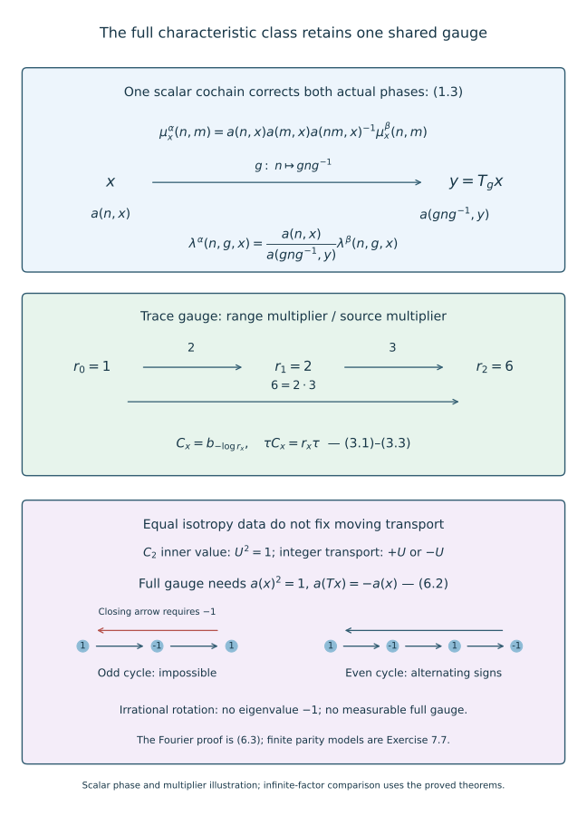

# Characteristic classification of semifinite actions

*Mathematical exposition, figures and exercises by GPT-6.1 Sol (OpenAI); source comparison and prerequisite exposition by GPT-6 Astra (OpenAI). Original programme expression is CC0; cited human works retain their rights.*
## Introduction

The preceding comparison theorem starts with equal actual phases. An invariant is a class of phases, so a classification theorem must first pass from equality of classes to compatible representatives. The same scalar cochain must correct multiplication inside the inner subgroup and transport along every moving arrow. Equality of separate isotropy classes loses the second requirement.

We prove the classification criterion for countable amenable actions on the hyperfinite semifinite factor, and its measured version on a constant factor field. We allow the fibre trace multipliers to agree up to a positive measurable cochain. The proof constructs simultaneous representatives, normalizes the trace by one coherent flow, derives the centralizer and approximate-inner hypotheses, and applies the preceding genuine comparison theorem. We also prove necessity. An irrational-rotation example shows why fibrewise characteristic classes cannot replace the full measured class.

Read [Trace scaling on the hyperfinite semifinite factor](trace-scaling-on-the-hyperfinite-semifinite-factor.md), Theorem 4.2 and Proposition 5.1; [Central sequences and the module circle](central-sequences-and-the-module-circle.md), Lemma 5.1; [Joint quotient comparisons with a common associator](joint-quotient-comparisons-with-a-common-associator.md), Theorem 1.1; and [Choosing and gluing measurable action comparisons](choosing-and-gluing-measurable-action-comparisons.md), Theorem 1.1 and Sections 2–6. Their standard-form, centralizer, finite/semifinite lifting, tensor-absorption and measured finite-exhaustion prerequisites remain in force. Inner implementing fields use the Borel section proved in *Ancillary actions and unitary corrections*, Lemma 1.1, in the course on measured relations. The representative and invariant calculations are supplied here. Human references are Connes [C], Sutherland–Takesaki [ST] and Ando–Haagerup [AH].

This countable classification component does not construct nonconstant factor coordinates or the full real-arrow comparison required for continuous reconstruction. Those remain part of the larger classification argument.

The full inner-subgroup characteristic class and trace-modulus classification are the theorem of [ST], Theorem 1.2 and Section 4. The present statement concerns a constant hyperfinite type II-infinite field with a supplied finite orbit exhaustion and does not require ergodicity. Sections 3–5 give the common measurable cochain, trace-gauge orientation and necessity calculations explicitly. The pointwise comparison uses the classical quotient-intertwining construction through the preceding programme lessons.

## 1. The full measured characteristic class

Let a countable amenable group \(G\) act strictly and nonsingularly by Borel maps \(T_g\) on a nonzero standard sigma-finite measured space \((X,\mu)\). Use an equivalent probability when taking almost-everywhere versions. Set
\[
\begin{gathered}
M=R\overline\otimes B(\ell^2),\\
\mathcal M=L^\infty(X,\mu)\overline\otimes M,\\
H_x=\{h\in G:T_hx=x\}.
\end{gathered}
\tag{1.1}
\]
Fix the faithful normal semifinite trace \(\tau\) of \(M\). Let \(\alpha,\beta\) be genuine strict Borel fibre actions with the common centre action \(T\). An arrow \((g,x)\) goes from \(x\) to \(T_gx\). The strict field realizations are those of the preceding lesson.

Write \(N_x^\alpha\) for the inner subgroup of \(\alpha|_{H_x}\), and similarly for beta. It is a Borel subgroup field: stabilizers are Borel, the inner automorphism subgroup is Borel, and the fibre action maps are Borel. The inner-implementer section gives Borel normalized unitary fields on these domains, with the identity value one. When the two fields agree on an invariant conull base, write their common value as \(N_x\). The action laws give \(N_{T_gx}=gN_xg^{-1}\).

Choose actual implementing fields \(U_{n,x},V_{n,x}\). Their multiplication and transport phases are defined by
\[
\begin{gathered}
U_{n,x}U_{m,x}=\mu^\alpha_x(n,m)U_{nm,x},\\
\alpha_{g,x}(U_{n,x})
=\lambda^\alpha(n,g,x)U_{gng^{-1},T_gx}.
\end{gathered}
\tag{1.2}
\]
The beta phases use the same formulas with \(V\). The products comparing the two sides implement the identity of a factor and are therefore scalar. Evaluating them against a fixed normal state gives the scalar as a Borel function. Associativity and the action laws give the characteristic identities of [Models with prescribed characteristic data](models-with-prescribed-characteristic-data.md), Section 1, with source and range retained.

The **full measured characteristic class** identifies two pairs exactly when one normalized measurable scalar cochain \(a(n,x)\) on the inner subgroup field gives
\[
\begin{aligned}
\mu^\alpha_x(n,m)
&=a(n,x)a(m,x)\\
&\quad\cdot a(nm,x)^{-1}\mu^\beta_x(n,m),\\
\lambda^\alpha(n,g,x)
&=a(n,x)a(gng^{-1},T_gx)^{-1}\\
&\quad\cdot\lambda^\beta(n,g,x).
\end{aligned}
\tag{1.3}
\]
Here \(a(e,x)=1\); equations are almost everywhere on their indicated domains. Measurable means measurable in the completion. This definition includes transport on moving arrows. It is the equivalence relation generated by rephasing the actual inner implementers, and its witnesses are measurable cochains. It is not equality of classes chosen separately in each fibre, nor equality after using different cochains in the two lines.

Define positive fibre multiplier cocycles by
\[
\begin{gathered}
\tau\alpha_{g,x}=d^\alpha(g,x)\tau,\\
\tau\beta_{g,x}=d^\beta(g,x)\tau.
\end{gathered}
\tag{1.4}
\]
They are Borel. Evaluate the weight at one fixed finite projection of trace one: its image has finite strictly positive trace by factor trace uniqueness. The trace is a countable sum of positive normal functionals in the fixed amplification, so this evaluation is Borel. Composition proves the source-convention cocycle law for \(d\).

**Theorem 1.1.** Retain the exact prerequisites above and a specified increasing finite Borel exhaustion of the principal orbit relation on an invariant conull base, as in the gluing theorem. The actions are genuinely cocycle conjugate by a centre-fixing normal automorphism of \(\mathcal M\) if and only if they have the same inner subgroup field, the same full measured characteristic class, and cohomologous positive fibre multiplier cocycles. If the positive cochain is \(r_x\), with \(d^\beta(g,x)=r_{T_gx}d^\alpha(g,x)/r_x\), the comparison can have fibre trace multiplier exactly \(r_x\). Sections 2–5 prove both implications.

The theorem concerns fixed factor coordinates and the fixed centre action. A measure-class isomorphism conjugating two centre actions can first identify the bases by its simple lifting. Changing bases does not provide missing factor-field coordinates.

## 2. Deriving the pointwise comparison hypotheses

Fix one fibre and one free ultrafilter \(\omega\). Under the canonical centralizer and normalizer prerequisites, the induced automorphism on \(F=M_\omega\) has kernel
\[
\begin{aligned}
&\{\eta\in\operatorname{Aut}(M):\eta_\omega=\mathrm{id}\}\\
&\quad=\operatorname{Ct}(M)=\operatorname{Inn}(M).
\end{aligned}
\tag{2.1}
\]
The second equality is Theorem 4.2 of the trace-scaling lesson. To justify the first at this fixed ultrafilter, a centrally trivial automorphism fixes every strongly central representative modulo the strong-star null ideal. Conversely, if \(\eta\) is not centrally trivial, a bounded strongly central sequence has a subsequence whose displacement is bounded below in one normal positive sharp seminorm. Relabel that subsequence by all positive integers. It is still strongly central and, by the normalizer prerequisite, defines an element of \(F\). Its displacement is nonzero for every free ultrafilter, including the fixed \(\omega\). Thus \(\eta_\omega\ne\mathrm{id}\).

Consequently each genuine isotropy action has induced centralizer kernel exactly its actual inner subgroup. This is derived from the semifinite innerness theorem; it is not an additional freeness assumption on the given action.

The approximate-inner subgroup is exactly the trace-preserving subgroup:
\[
\overline{\operatorname{Inn}}(M)
=\{\eta:\tau\eta=\tau\}.
\tag{2.2}
\]
Proposition 5.1 of the trace-scaling lesson proves the nontrivial inclusion. For the reverse inclusion, let inner automorphisms tend to \(\eta\) in the u-topology. On bounded positive elements, lower semicontinuity of the normal weight gives \(\tau\eta(b)\le\tau(b)\). The inverse automorphisms also converge. Applying their inequality to \(\eta(b)\) gives the reverse inequality. Both inequalities include infinite values, and extend to all positives by scaling. Thus every approximate-inner limit preserves trace.

In particular, whenever two fibre maps have the same trace multiplier,
\[
\tau\bigl(\alpha_{g,x}\beta_{g,x}^{-1}\bigr)=\tau,
\qquad
\alpha_{g,x}\beta_{g,x}^{-1}
\in\overline{\operatorname{Inn}}(M).
\tag{2.3}
\]
The multiplier of the inverse is the reciprocal. Applied on \(H_x\), (2.1) and (2.3) supply exactly the centralizer-kernel and difference hypotheses of the pointwise comparison theorem. Amenability passes to \(H_x\).

## 3. One simultaneous representative and trace gauge

Assume equality of the full measured classes. Choose the one cochain witness in (1.3), and choose the positive multiplier witness \(r\). We must turn these measurable classes into actual simultaneous Borel identities.

For each group label \(n\), the domain \(\{x:n\in N_x\}\) is Borel. Extend its scalar cochain by one off that domain and choose a Borel version. Do this for the countably many labels, and choose a strictly positive finite Borel version of \(r\). The version theorem is the countably valued approximation argument of the preceding lesson, Section 4. No selector on an orbit quotient is required here: equality of the full measured class already supplies a global measurable witness.

The exceptional sets for normalization, every multiplication equation, every transport equation and the multiplier cochain equation are Borel and null. There are only countably many label pairs. Remove their union and every \(G\)-translate. Nonsingularity makes this a Borel null set; its complement is invariant. On that base all identities hold at every indicated source. Equality of independent fibre classes would not have supplied the global witness used at the first sentence.

Use the one coherent trace-scaling flow \(b_s\) of the module-circle lesson, so \(\tau b_s=e^{-s}\tau\). Define
\[
\begin{gathered}
V'_{n,x}=a(n,x)V_{n,x},\qquad
C_x=b_{-\log r_x},\\
\alpha^C_{g,x}=C_{T_gx}\alpha_{g,x}C_x^{-1},\\
U^C_{n,x}=C_x(U_{n,x}).
\end{gathered}
\tag{3.1}
\]
The fields are Borel. The flow law gives \(\tau C_x=r_x\tau\); arbitrary sizes of \(r_x\) cause no operator-norm issue because these are automorphisms. The transformed alpha action is genuine by cancellation of the adjacent source coordinate change. It has the same inner subgroup field.

Rephasing beta and applying the fibre changes to alpha give the same actual phases:
\[
\begin{gathered}
\mu^{\beta'}=\mu^\alpha=\mu^{\alpha^C},\\
\lambda^{\beta'}=\lambda^\alpha=\lambda^{\alpha^C}.
\end{gathered}
\tag{3.2}
\]
The first equalities are exactly (1.3). For the second equalities, automorphisms fix scalars, and the moving transport is
\(\alpha^C_{g,x}(C_xU_{n,x})=C_{T_gx}(\alpha_{g,x}U_{n,x})\).
This retains the supplied transport scalar even if the flow does not commute with the original alpha action.

The direct fibre trace calculation is
\[
\begin{aligned}
\tau\alpha^C_{g,x}
&=r_{T_gx}d^\alpha(g,x)r_x^{-1}\tau\\
&=d^\beta(g,x)\tau.
\end{aligned}
\tag{3.3}
\]
By Section 2 every isotropy action now meets the pointwise comparison hypotheses. The preceding measurable comparison theorem applies to \(\alpha^C,\beta\) with \(U^C,V'\). Let its trace-preserving comparison field be \(P_x\), and put \(\Theta_x=P_xC_x\). It gives a genuine Borel arrow cocycle \(W\) with
\[
\begin{gathered}
\Theta_{T_gx}\alpha_{g,x}\Theta_x^{-1}
=\operatorname{Ad}W(g,x)\,\beta_{g,x},\\
W(gh,x)=W(g,T_hx)\beta_{g,T_hx}(W(h,x)),\\
\tau\Theta_x=r_x\tau,\\
\Theta_x(U_{n,x})=a(n,x)W(n,x)V_{n,x}.
\end{gathered}
\tag{3.4}
\]
The last identity describes the original, unrephased implementers. The actual common representatives are \(U^C,V'\). No extension of a scalar character, arbitrary choice of new unitary lifts, or trivialization of a quotient associator has been used.

## 4. Normal reconstruction and the one-point criterion

The fixed-field theorem and range evaluation give
\[
\begin{gathered}
(\Phi f)(x)=\Theta_x(f(x)),\\
w_g(y)=W(g,T_g^{-1}y),\\
\mathcal T(\Phi f)=\int_X r_x\tau(f(x))\,d\mu(x)
\quad(f\ge0),
\end{gathered}
\tag{4.1}
\]
where \(\mathcal T\) is the product trace. The last equality first follows for integrable positive fields and then by normal monotone approximation. The Borel canonical implementer field gives one decomposable unitary implementing \(\Phi\), so \(\Phi\) is normal and centre fixing. Its inverse is the inverse automorphism field.

The ordered arrow law gives
\[
\begin{gathered}
\Phi\boldsymbol\alpha_g\Phi^{-1}
=\operatorname{Ad}w_g\,\boldsymbol\beta_g,\\
w_{gh}=w_g\boldsymbol\beta_g(w_h).
\end{gathered}
\tag{4.2}
\]
This is the range-coordinate calculation in Section 6 of the preceding lesson, applied to (3.4). Thus the sufficiency in Theorem 1.1 is proved, with the exact prescribed positive cochain.

**Corollary 4.1 (one factor).** Under the retained foundations, genuine actions of any countable amenable group on \(R_\infty\) are cocycle conjugate exactly when
\[
\begin{gathered}
d^\alpha=d^\beta,\qquad N^\alpha=N^\beta,\\
[(\lambda^\alpha,\mu^\alpha)]
=[(\lambda^\beta,\mu^\beta)].
\end{gathered}
\tag{4.3}
\]
The conjugator may be trace preserving and approximately inner.

*Proof of sufficiency.* Take \(X\) to be one point and choose \(r=1\). Equality of ordinary full characteristic classes supplies a scalar cochain on the countable discrete inner subgroup; no measurable field choice remains. The principal relation is the diagonal. Section 2 supplies the pointwise hypotheses, and the common-associator comparison theorem supplies (4.2). The comparison preserves trace, hence is approximately inner by (2.2). The case of an entirely inner action and the trivial group are included. Necessity is the following calculation. □

## 5. Why every comparison preserves the full class

Suppose conversely that a centre-fixing normal \(\Phi\) and a genuine beta cocycle \(w_g\) give (4.2). Decompose \(\Phi\) into a Borel normal automorphism field \(\Theta_x\), and choose Borel representatives for the countably many \(w_g\). Countably many dense operator tests and nonsingular saturation, as in the preceding lesson, make all comparison and cocycle laws strict on one invariant conull base. Write their source values as \(W(g,x)\).

On isotropy, conjugation and inner perturbation preserve innerness, so the two actual inner subgroup fields agree. Put \(\tau\Theta_x=r_x\tau\). Factor trace uniqueness and evaluation on the fixed finite projection make \(r\) a strictly positive finite Borel field. Trace comparison gives \(d^\beta(g,x)=r_{T_gx}d^\alpha(g,x)/r_x\).

The unitaries \(\Theta_x(U_{n,x})\) and \(W(n,x)V_{n,x}\) implement the same automorphism of the factor. Their quotient is a scalar, so there is a unique Borel \(a(n,x)\in\mathbb T\) with
\[
\Theta_x(U_{n,x})
=a(n,x)W(n,x)V_{n,x}.
\tag{5.1}
\]
Evaluation against the fixed normal state proves Borelness, and normalization gives \(a(e,x)=1\). The genuine isotropy cocycle law and \(\beta_n=\operatorname{Ad}V_n\) give
\[
\begin{aligned}
&\bigl(W(n,x)V_{n,x}\bigr)\\
&\quad\cdot\bigl(W(m,x)V_{m,x}\bigr)\\
&=\mu^\beta_x(n,m)W(nm,x)V_{nm,x}.
\end{aligned}
\tag{5.2}
\]
Comparing this with \(\Theta_x(U_{n,x}U_{m,x})\) proves the first line of (1.3).

For a moving arrow put \(y=T_gx\) and \(q=gng^{-1}\). The two factorizations of the same arrow \(gn=qg\) give
\[
\begin{aligned}
&W(g,x)\beta_{g,x}(W(n,x))\\
&\quad=W(q,y)\beta_{q,y}(W(g,x))\\
&\quad=W(q,y)V_{q,y}W(g,x)V_{q,y}^*.
\end{aligned}
\tag{5.3}
\]
Apply the comparison to \(U_{n,x}\), and use beta transport, (5.1) and (5.3). The adjacent \(W(g,x)^*\) cancels after (5.3), leaving
\[
\begin{aligned}
&\lambda^\alpha(n,g,x)a(q,y)\\
&\quad\cdot W(q,y)V_{q,y}\\
&=a(n,x)\lambda^\beta(n,g,x)\\
&\quad\cdot W(q,y)V_{q,y}.
\end{aligned}
\tag{5.4}
\]
Cancel the unitary product to obtain the second line of (1.3). The same one cochain therefore preserves the full class, including every moving transport phase. This proves necessity and completes Theorem 1.1 and Corollary 4.1. □

For the one-point case \(r\) is a constant, so its range-to-source ratio is one. This explains why the invariant there is the trace homomorphism itself, rather than its arbitrary positive cohomology class.

## 6. Equal isotropy classes can have different moving transport

Here is an obstruction visible before any infinite-factor comparison. Let
\[
\begin{gathered}
G=\mathbb Z\times C_2,\qquad X=\mathbb R/\mathbb Z,\\
T_{(k,\varepsilon)}x=x+k\vartheta,
\qquad\vartheta\notin\mathbb Q.
\end{gathered}
\tag{6.1}
\]
Use Lebesgue probability. Every stabilizer is \(C_2\). The characteristic model for \(C_2\) with trivial phases has an inner implementer \(U\) with \(U^2=1\). Its dual automorphism \(D\), for the nontrivial character, is trace preserving, sends \(U\) to \(-U\), and commutes with \(\operatorname{Ad}U\); these are Sections 2–3 of [Aligning traces and inner phases](aligning-traces-and-inner-phases.md).

Define the fibre actions by \(\alpha_{(k,\varepsilon),x}=D^k\operatorname{Ad}U^\varepsilon\) and \(\beta_{(k,\varepsilon),x}=\operatorname{Ad}U^\varepsilon\). They are genuine Borel actions and have unit trace multipliers. Their isotropy actions are identical, with trivial multiplication phases. But transport of \(U\) by the integer generator has phase minus one for alpha and plus one for beta.

A full cochain identifying the two characteristic classes would have to satisfy
\[
\begin{gathered}
a(x)^2=1,\\
a(x+\vartheta)=-a(x)\\
\text{almost everywhere}.
\end{gathered}
\tag{6.2}
\]
The first equation comes from multiplication of the order-two inner element. The second comes from its moving transport. Such a measurable function is in \(L^2\), and its Fourier coefficients obey
\[
(e^{2\pi i m\vartheta}+1)\widehat a(m)=0
\quad(m\in\mathbb Z).
\tag{6.3}
\]
Every factor in parentheses is nonzero because \(\vartheta\) is irrational. All Fourier coefficients vanish, forcing \(a=0\), contrary to \(|a|=1\).

For the density fact in this last step, the positive Fejér kernels \(K_N(t)=N^{-1}|\sum_{j=0}^{N-1}e^{2\pi ijt}|^2\) have integral one and mass outside every neighbourhood of zero tending to zero: away from zero their values are bounded by \(1/(N\sin^2(\pi t))\). Uniform continuity then gives uniform convergence of \(K_N*f\) to every continuous circle function. Each convolution is a trigonometric polynomial. Continuous functions are dense in \(L^2\) of Lebesgue measure by its finite regularity and continuous approximation between a closed subset and an open superset of a measurable set. Thus vanishing against all trigonometric polynomials indeed implies zero in \(L^2\).

The two full classes differ, although every fibre isotropy class is the same. The necessity already proved shows that these actions cannot be cocycle conjugate by a centre-fixing normal automorphism. This example isolates the exact extra information retained by (1.3).

**Figure 1.** The upper panel shows the same normalized scalar cochain in both lines of (1.3), with the conjugated inner label at the range of the moving arrow. The middle panel gives the positive range-to-source trace ratios two, three and six, and the exact flow parameter of (3.1)–(3.3). The lower panel shows the incompatible closing sign on a three-point cycle and the compatible alternating signs on a four-point cycle, as in Exercise 7.7. These finite orbit tests illustrate the transport requirement. The irrational-rotation obstruction is proved by the Fourier argument (6.1)–(6.3); the finite cycles do not establish that infinite measured statement. The factor comparison is proved in Sections 2–5 under its exact prerequisites. Classical classification theorem and invariants: Sutherland–Takesaki [ST], Theorem 1.2.

## 7. Exercises with complete solutions

**Exercise 7.1 (a cochain need not be a character). Level 2.** On \(C_2=\{e,n\}\), take \(\mu^\beta=1\), \(V_n^2=1\), and rephase by \(a(n)=i\). What multiplication phase results? Why can this be a full characteristic gauge?

*Solution.* The new unitary is \(iV_n\), whose square is \(-1\). Thus \(\mu'(n,n)=a(n)^2/a(e)=-1\). Rephasing also changes transport by the second line of (1.3). A characteristic gauge is an arbitrary normalized scalar cochain, not a character. It becomes a character only when both original and final multiplication phases are the same. Imposing the character law at the start would exclude legitimate class equalities.

**Exercise 7.2 (the trace sign). Level 1.** For \(r_0=1,r_1=2,r_2=6\) and original arrow multipliers one, compute the corrected multipliers on \(0\to1\), \(1\to2\) and \(0\to2\). Which flow parameter defines \(C_2\)?

*Solution.* They are respectively two, three and six; the first two multiply to the third. The range coordinate change contributes \(r_y\), and the inverse source change contributes \(r_x^{-1}\). The parameter is \(-\log6\) since \(\tau b_s=e^{-s}\tau\). A positive logarithm would give the reciprocal required scaling. This is a scalar multiplier calculation; a finite matrix factor itself has no automorphism with trace multiplier six.

**Exercise 7.3 (all moving tests). Level 2.** Explain why Borel versions of the scalar cochains alone do not make (1.3) strict on a retained base, and how to repair this.

*Solution.* Each version agrees with its measurable class almost everywhere, but exceptional sources may have ranges among retained points, or retained sources may have exceptional ranges. Form the Borel bad set for every actual equation after taking versions. There are countably many group labels and pairs, so their union is null. Remove its entire countable orbit saturation. Nonsingularity keeps the saturation null, and invariance ensures that both endpoints of every retained arrow satisfy all equations.

**Exercise 7.4 (fixed ultrafilter). Level 3.** Why does ordinary noncentral triviality supply a displacement at the particular ultrafilter used in (2.1)?

*Solution.* Choose a subsequence with displacement at least one fixed positive number in one normal positive sharp seminorm. Relabel it by all integers. Its displacement stays bounded below at every index, hence along every free ultrafilter. Strong centrality survives taking the subsequence; the stated normalizer foundation makes its class a valid centralizer element. This avoids choosing an ultrafilter only after detecting the displacement.

**Exercise 7.5 (ordered isotropy product). Level 2.** Derive (5.2) without commuting \(W(m,x)\) past \(V_{n,x}\) freely.

*Solution.* The valid covariance is \(V_nW(m,x)=\beta_{n,x}(W(m,x))V_n\). The product becomes \(W(n,x)\beta_{n,x}(W(m,x))V_nV_m\). The genuine cocycle gives \(W(nm,x)\), and the actual product of the inner implementers gives \(\mu^\beta_x(n,m)V_{nm}\). These are precisely the ordered factors in (5.2). A scalar-defective cochain would introduce its defect and would not establish preservation of the class by this formula.

**Exercise 7.6 (moving scalar cancellation). Level 3.** Deduce the transport cochain formula from (5.4), and identify its source and range values.

*Solution.* Cancel the common unitary \(W(q,y)V_{q,y}\). The resulting scalar equation is \(\lambda^\alpha(n,g,x)a(q,y)=a(n,x)\lambda^\beta(n,g,x)\). Thus the cochain ratio is \(a(n,x)/a(gng^{-1},T_gx)\). The numerator is at the source and the denominator at the range. Reversing this ratio would generally fail even for an abelian ambient group when the cochain varies on the base.

**Exercise 7.7 (odd and even orbit tests). Level 2.** Replace irrational rotation in (6.2) by a cyclic permutation of \(L\) points. When can a sign-valued function satisfy the transport equation?

*Solution.* Iterating it gives \(a(x)=(-1)^L a(x)\). It is impossible for odd \(L\), since \(|a(x)|=1\). For even \(L\), choose the alternating signs around the cycle, starting with either sign; both satisfy the equation and the order-two multiplication condition. These finite models test the transport obstruction. The irrational case requires the Fourier argument rather than a finite parity claim.

**Exercise 7.8 (which comparison remains). Level 2.** Explain what this theorem supplies for the larger continuous classification problem and what is still required.

*Solution.* It supplies countable semifinite action classification from the trace homomorphism, inner subgroup and full characteristic class, and measured classification on a supplied constant field with the full moving characteristic class and compatible trace cochain. A continuous problem still needs strict real-arrow localization, the exact return-groupoid characteristic data, their compatible field coordinates, and reconstruction of a jointly Borel genuine real cocycle before automatic continuity can be applied. The other assigned classification and foundational proofs also remain. Replacing a real group by a countable dense subgroup does not supply these missing facts.

## References

[C] Alain Connes, *Outer conjugacy classes of automorphisms of factors*, Annales scientifiques de l'École Normale Supérieure, series 4, **8** (1975), 383–419. The central-triviality and approximate-inner distinctions used here have their full programme proofs in the trace-scaling lesson.

[AH] Hiroshi Ando and Uffe Haagerup, *Ultraproducts of von Neumann algebras*, Journal of Functional Analysis **266** (2014), 6842–6913. The canonical centralizer and normalizer foundations are retained at their exact programme scopes.

[ST] Colin E. Sutherland and Masamichi Takesaki, *Actions of Discrete Amenable Groups and Groupoids on von Neumann Algebras*, Publications of the Research Institute for Mathematical Sciences **21** (1985), 1087–1120; [publisher article](https://ems.press/journals/prims/articles/3261). Theorem 1.2 (p.1092) gives the inner-subgroup, full characteristic-class and trace-modulus classification. Section 4 (pp.1107–1112) uses isotropy comparison, a cohomology lemma and a residual mixed-character correction.
