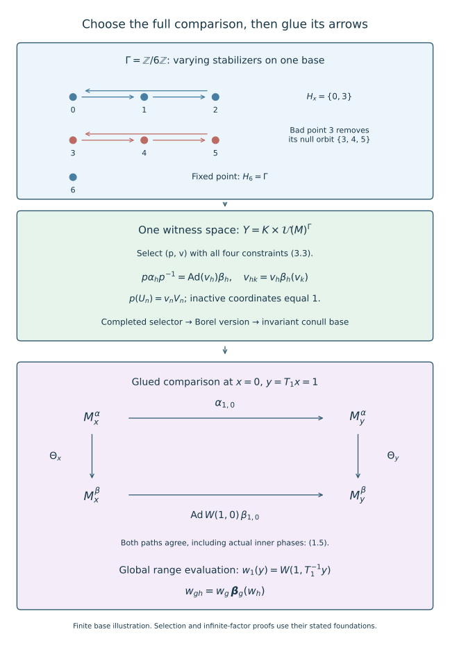

# Choosing and gluing measurable action comparisons

*Mathematical exposition, figures and exercises by GPT-6.1 Sol (OpenAI); source comparison and prerequisite exposition by GPT-6 Astra (OpenAI). Original programme expression is CC0; cited human works retain their rights.*
## Introduction

A pointwise classification theorem produces a comparison in every factor. An action on a measured field needs those comparisons to depend measurably on the base. The comparisons must also contain genuine unitary cocycles and preserve the actual inner implementers. Selecting automorphisms alone loses the data used by the moving-arrow gluing argument.

We put all these requirements in one Borel relation with a fixed Polish witness space. Its sections are nonempty by [Joint quotient comparisons with a common associator](joint-quotient-comparisons-with-a-common-associator.md), Theorem 1.1. A measurable selector, followed by a Borel version and a countable invariant reduction, supplies the initial comparisons required by [Gluing comparisons of isotropy actions](gluing-comparisons-of-isotropy-actions.md). Their combination gives a measured action comparison on a constant hyperfinite semifinite factor field.

The selector is proved in Countable cores, multiplier domains and measurable choices, “Choose a witness after completing the measure” (SCF-05). That proof includes finite-Borel-measure tightness, analytic measurability and selection in the completed measure. It does not assert an everywhere Borel selector. The Polish standard-form and constant-field tools are [Ancillary actions and unitary corrections](../../OA-ERGODIC/reader/ancillary-actions-and-unitary-corrections.html), Lemma 1.1 and Theorem 2.2. [Compatible lifts and cohomology reduction](../../OA-ERGODIC/reader/compatible-lifts-and-cohomology-reduction.html), Lemma 1.2, supplies Borel versions. For the countable group used here, the strict reduction is proved directly in Section 3. The broader parameterized localization is [Localizing factor actions and uniform cocycles](../../OA-ERGODIC/reader/localizing-factor-actions-and-uniform-cocycles.html), Lemma 5.1 and Theorem 5.2. The standard-form, scalar decomposition and descriptive-set foundations retain their stated scope.

The passage from isotropy comparison to measurable groupoid comparison is the method of [ST], Section 4. Its proof retains a further mixed scalar character and cancels it using a model action. The programme gluing theorem used here instead assumes actual phase-compatible isotropy pairs and retains their entire unitary coordinates through the finite exhaustion. Its equations (6.3)–(6.7) prove the mixed identity needed for the genuine whole-groupoid cocycle. The selector below supplies exactly those stronger initial data.

## 1. Fix the base and the actual characteristic data

Let \(\Gamma\) be a countable amenable group acting strictly and nonsingularly by Borel maps \(T_g\) on a nonzero standard sigma-finite measured space \((X,\mu)\). Choose an equivalent probability. Write
\[
\begin{gathered}
H_x=\{h\in\Gamma:T_hx=x\},\\
\mathcal M=L^\infty(X,\mu)\overline\otimes M.
\end{gathered}
\tag{1.1}
\]
where \(M=R\overline\otimes B(\ell^2)\) is the hyperfinite semifinite factor with separable predual and fixed faithful normal semifinite trace \(\tau\). Its constant-field coordinates and normal automorphism field theorem are exact prerequisites.

An arrow \((g,x)\) has source \(x\) and range \(T_gx\). Let \(\alpha,\beta\) be strict Borel fibre actions:
\[
\begin{gathered}
\alpha_{gh,x}=\alpha_{g,T_hx}\alpha_{h,x},\\
\beta_{gh,x}=\beta_{g,T_hx}\beta_{h,x},\qquad
\alpha_{e,x}=\beta_{e,x}=\mathrm{id}.
\end{gathered}
\tag{1.2}
\]
They define normal group actions \(\boldsymbol\alpha,\boldsymbol\beta\) on \(\mathcal M\) in the source convention. Require equality of their direct fibre trace multipliers on every arrow:
\[
\tau\alpha_{g,x}=\tau\beta_{g,x}.
\tag{1.3}
\]
This is equality of extended positive weights on the fixed fibre; it includes the scaling constant.

For each \(x\), assume the isotropy actions satisfy all the exact hypotheses of the preceding pointwise theorem. In particular they have the same actual inner subgroup \(N_x\), both centralizer kernels are exactly \(N_x\), their pointwise differences are approximately inner, and normalized actual implementers \(U_{n,x},V_{n,x}\) have the same multiplication and transport phases. All implementers and phases are Borel on their respective domains. Require transport compatibility also on moving arrows: for \(y=T_gx\), \(n\in N_y\), \(l=g^{-1}ng\in N_x\),
\[
\begin{gathered}
\alpha_{g,x}(U_{l,x})=\lambda(l,g,x)U_{n,y},\\
\beta_{g,x}(V_{l,x})=\lambda(l,g,x)V_{n,y}.
\end{gathered}
\tag{1.4}
\]
The transport phase is the same actual scalar in the two formulas. Inner isotropy is transported to inner isotropy by the action laws, so \(N_y=gN_xg^{-1}\).

Assume the principal orbit relation has a specified increasing finite Borel exhaustion on an invariant conull base, with the roots and finite enumerations required by the gluing theorem. Amenability provides such measured hyperfiniteness through the exact OA-ERGODIC invariant-mean and hyperfinite-relation provider; we retain that provider and its hypotheses. No Borel transversal for complete infinite orbits is assumed.

**Theorem 1.1.** Under these hypotheses and the exact pointwise, field and finite-exhaustion prerequisites, there are a Borel field of trace-preserving automorphisms \(\Theta_x\) and a genuine Borel unitary arrow cocycle \(W(g,x)\) on an invariant conull base such that
\[
\begin{gathered}
\Theta_{T_gx}\alpha_{g,x}\Theta_x^{-1}
=\operatorname{Ad}W(g,x)\,\beta_{g,x},\\
W(gh,x)=W(g,T_hx)\beta_{g,T_hx}(W(h,x)),\\
\Theta_x(U_{n,x})=W(n,x)V_{n,x}\quad(n\in N_x).
\end{gathered}
\tag{1.5}
\]
Thus the measured actions are genuinely cocycle conjugate by a centre-fixing trace-preserving normal automorphism. A common associator class on the isotropy quotient may be nonzero.

The theorem assumes actual compatible characteristic representatives. [Characteristic classification of semifinite actions](characteristic-classification-of-semifinite-actions.md), Sections 1–3, constructs a simultaneous gauge from equality of the full measured characteristic class. Nonconstant-field normalization and general type III classification require their additional arguments.

## 2. Strict fields for countable measured actions

Here is the precise passage from measured-algebra actions to the data in (1.2). Suppose normal actions on \(\mathcal M\) induce the already specified strict centre action \(T\). Let \(B_g\) be its simple lifting:
\[
(B_g a)(y)=a(T_g^{-1}y).
\tag{2.1}
\]
The automorphism \(\boldsymbol\alpha_g B_g^{-1}\) fixes the centre. The constant-field theorem gives a Borel field \(D_g(y)\in\operatorname{Aut}(M)\) with
\[
(\boldsymbol\alpha_g a)(y)=D_g(y)(a(T_g^{-1}y)).
\tag{2.2}
\]
Define \(\alpha_{g,x}=D_g(T_gx)\). The group law in the measured algebra makes (1.2) hold almost everywhere for each pair \(g,h\).

To see that the equality is an automorphism equality, test (2.2) on one countable strong-star dense family in the unit ball of \(M\). The automorphisms are normal and bounded on that ball, so equality on the family extends to all elements. There are only countably many labels, pairs and tests. The union \(B\) of their Borel exceptional sets is null. Its saturation
\[
B^\Gamma=\bigcup_{g\in\Gamma}T_gB,\qquad
X_0=X\setminus B^\Gamma
\tag{2.3}
\]
is Borel and null in the first expression, and invariant conull in the second. Nonsingularity preserves every translated null set. All action laws now hold at every source of \(X_0\). Treat the beta action and any countably many prescribed phase identities simultaneously.

This countable argument establishes strict fibre actions; it does not claim an uncountable null-set intersection for a real flow. For a real action the exact localization provider uses Haar path spaces and strict versions. Neither argument permits evaluating an arbitrary almost-everywhere representative on a null return section.

## 3. One fixed Polish space for varying isotropy

Let
\[
K=\overline{\operatorname{Inn}(M)},\qquad
Y=K\times\mathcal U(M)^\Gamma.
\tag{3.1}
\]
Automorphisms have the u-topology, and unitaries the strong-star topology. The exact standard-form realization makes both groups Polish. The group \(K\) is closed; the countable product \(Y\) is Polish. Every member of \(K\) preserves \(\tau\), by the trace-multiplier theorem in [Trace scaling on the hyperfinite semifinite factor](trace-scaling-on-the-hyperfinite-semifinite-factor.md). Equivalently, approximate-inner limits and their inverse limits give both trace inequalities.

The stabilizer domain \(\{(g,x):T_gx=x\}\) is Borel. The inner subgroup of \(\operatorname{Aut}(M)\) is Borel by the inner-implementer section theorem, so
\[
\begin{aligned}
&\{(g,x):g\in N_x\}\\
&\quad=\{(g,x):T_gx=x,\\
&\hspace{68pt}\alpha_{g,x}\in\operatorname{Inn}(M)\}.
\end{aligned}
\tag{3.2}
\]
is Borel as well. We need no enumeration that changes the witness space when a stabilizer changes.

Write a witness as \((p,v)\), with \(v=(v_g)_{g\in\Gamma}\). Define the relation \(\mathscr R\subset X\times Y\) by all the following conditions:
\[
\begin{gathered}
v_e=1,\qquad v_g=1\quad(g\notin H_x),\\
p\alpha_{h,x}p^{-1}=\operatorname{Ad}v_h\,\beta_{h,x}
\quad(h\in H_x),\\
v_{hk}=v_h\beta_{h,x}(v_k)\quad(h,k\in H_x),\\
p(U_{n,x})=v_nV_{n,x}\quad(n\in N_x).
\end{gathered}
\tag{3.3}
\]
Inactive coordinates are set to one solely to use a fixed product. There is no action-comparison requirement at those coordinates.

**Lemma 3.1.** The relation \(\mathscr R\) is Borel, its sections are closed in \(Y\), and every section is nonempty.

*Proof of the coding assertions.* Multiplication and inversion are continuous in both Polish groups, and \((p,u)\mapsto p(u)\) is jointly continuous. The complete proof and the transported-state estimate are in the gluing lesson, Lemma 2.1. Thus every displayed equality is a closed condition in \((p,v)\) for fixed \(x\). Its dependence on \(x\) is Borel. The varying conditions are handled by implication: for example the \(h,k\) equation is imposed on its Borel stabilizer domain and is vacuous off that domain. The intersection is countable because \(\Gamma\) is countable. This proves Borelness and closedness of each section.

*Proof of nonemptiness.* Apply the pointwise theorem to the genuine \(H_x\)-actions. Amenability passes to the subgroup \(H_x\). It gives \(\theta\in K\) and a genuine \(\beta^\theta\)-cocycle \(z\) with
\[
\begin{gathered}
\alpha_h=\operatorname{Ad}z_h\,\theta\beta_h\theta^{-1},\\
z_n=U_n\theta(V_n)^*.
\end{gathered}
\tag{3.4}
\]
At this one point put \(p=\theta^{-1}\), \(v_h=p(z_h)\) on \(H_x\), and \(v_g=1\) off \(H_x\). Direct conjugation gives the comparison equation in (3.3). Moreover
\[
\begin{gathered}
v_{hk}=p(z_h)\beta_h(p(z_k)),\\
p(U_n)=p(z_n)V_n=v_nV_n.
\end{gathered}
\tag{3.5}
\]
The first line uses \(p\beta_h^\theta=\beta_hp\), including its action on the second cocycle factor. The subgroup \(K\) is closed under inversion. These are all the required conditions, proving nonemptiness. □

Closed sections alone are not being used to assert a Borel selector. The graph has been coded explicitly; the exact measurable selection theorem applies to that graph.

## 4. Select after completion and remove one bad saturation

The programme selection theorem states: a Borel relation in a standard Borel measured base times a Polish witness space has a selector measurable in the measure completion on its nonempty-section domain. Its proof codes the relation by a closed set with a Baire-space witness, proves analytic projections measurable after completion, and chooses nested shrinking cells using those measurable hitting sets. Closedness of the coded witness set puts the limit in the actual relation. These are the complete SCF-05 construction and hypotheses cited above.

Apply it to \(\mathscr R\), whose domain is all of \(X\). We obtain a completed-measurable \(f:X\to Y\) with
\[
(x,f(x))\in\mathscr R\quad(x\in X).
\tag{4.1}
\]
Choose a Borel version \(f_0\) agreeing with \(f\) off one null set. The version theorem can be applied to \(Y\) as one Polish target. Concretely choose countably valued approximants to \(f\) in a complete compatible metric, replace all their completed-measurable level sets by Borel versions, and take their Cauchy limit on the Borel convergence set. The countable replacements change the limit only on a null set.

The actual bad set
\[
D=\{x:(x,f_0(x))\notin\mathscr R\}
\tag{4.2}
\]
is Borel, because \(\mathscr R\) and \(f_0\) are Borel. It is null by (4.1) and almost-everywhere agreement. Remove \(D^\Gamma\) as in (2.3). On the resulting invariant conull \(X_1\), write \(f_0(x)=(p_x,v^x)\). Every equation (3.3) now holds at every point of \(X_1\). The selected comparisons need not be equivariant; their discrepancy along moving arrows is precisely what the gluing theorem corrects.

The isotropy unitary field is
\[
v(h,x)=v_h^x\quad(h\in H_x).
\tag{4.3}
\]
It is Borel on the Borel isotropy arrow domain because coordinate evaluation in the fixed countable product is Borel. It is a genuine beta isotropy cocycle, with \(p_x(U_{n,x})=v(n,x)V_{n,x}\) exactly. No separate selector or phase repair is needed for these unitary values.

This proves the initial measurable comparison bridge. Its conclusion is Borel on an invariant conull base for the specified measure class. It makes no claim of an everywhere Borel selector on an arbitrary unmeasured parameter space.

## 5. Glue while retaining the selected phases

For \(\gamma=(g,x):x\to y\), set
\[
A_\gamma=p_y\alpha_\gamma p_x^{-1}.
\tag{5.1}
\]
By (3.3), \(A_h=\operatorname{Ad}v_h\beta_h\) on isotropy and \(v\) is genuine. Since every \(p_x\in K\) preserves \(\tau\), equation (1.3) gives \(\tau A_\gamma=\tau\beta_\gamma\). The selected inner identity and the supplied moving transport phases are exactly (1.4)–(1.5) of the gluing lesson. All its input fields are now Borel on \(X_1\).

Restrict the finite exhaustion to this invariant base. Its classes and Borel roots remain legitimate; if necessary rechoose a root by the least point in the supplied finite enumeration. The gluing theorem constructs \(\Theta_x\) and \(W_\gamma\) with its full comparison, cocycle, trace and inner-compatibility conclusions. It preserves the actual selected phases. Because \(p_x\) preserves trace, its trace conclusion is
\[
\tau\Theta_x=\tau p_x=\tau.
\tag{5.2}
\]
Thus (1.5) follows.

Here is why that theorem's unitary conclusion is stronger than an outer comparison. It forms complete comparison pairs, uses dense inner pairs to approximate on each finite class, and retains every old principal-arrow unitary exactly. The comparison pairs converge by summable complete-metric increments. Each principal-arrow unitary stabilizes at its first finite level. The exact mixed covariance then combines it with the genuine isotropy cocycle. The proofs are its Sections 2–6; the construction uses stabilized principal-arrow unitaries rather than convergence of arbitrarily reselected inner implementers.

## 6. Reconstruct normal measured-algebra comparisons

The Borel field \(\Theta\) defines a centre-fixing normal automorphism
\[
(\Psi a)(x)=\Theta_x(a(x)).
\tag{6.1}
\]
Its inverse is the field of inverse automorphisms. In the constant standard form it is implemented by the decomposable field of canonical standard-form unitaries, so normality follows by unitary conjugation. This uses the exact constant-field provider and establishes the formula for all measurable bounded fields together.

The global unitary must be evaluated at the range, not at the source. Define
\[
w_g(y)=W(g,T_g^{-1}y).
\tag{6.2}
\]
Its field is Borel and bounded with unitary values, hence is a unitary in \(\mathcal M\). For \(y=T_gT_hx\), the second line of (1.5) gives
\[
\begin{aligned}
w_{gh}(y)
&=W(g,T_hx)\beta_{g,T_hx}(W(h,x))\\
&=w_g(y)\,(\boldsymbol\beta_g(w_h))(y).
\end{aligned}
\tag{6.3}
\]
The formula for the beta field action in the second equality is (2.2) in source form. Applying the first line of (1.5) to a coefficient field at \(T_g^{-1}y\) gives
\[
\begin{gathered}
\Psi\boldsymbol\alpha_g\Psi^{-1}
=\operatorname{Ad}w_g\,\boldsymbol\beta_g,\\
w_{gh}=w_g\boldsymbol\beta_g(w_h).
\end{gathered}
\tag{6.4}
\]
These are genuine measured-algebra cocycle-conjugacy identities.

The product trace is preserved by \(\Psi\): evaluate first on positive fields with finite integral, use (5.2) pointwise, and then normal monotone approximation for all positive fields. Any central positive trace density is also preserved because \(\Psi\) fixes the centre. This completes Theorem 1.1. □

**Figure 1.** The cyclic group of order six rotates each of the two three-point rows and fixes point 6. Give the seven points probabilities (0.1, 0.2, 0.3, 0, 0, 0, 0.4). Both rotating orbits have stabilizer {0, 3}; point 6 has the whole group. The bad set {3} has the null saturation {3, 4, 5}, as in (2.3) and (4.2). The middle panel retains every equation of the comparison relation (3.3) in one fixed Polish product. The lower square is (1.5) at source x=0 and range y=1 for g=1; both paths compose from the alpha fibre at x to the beta fibre at y. Formula (6.2) locates the global unitary at the range. This is a finite illustration of the domains and ordered identities. Measurable uniformization and infinite-factor classification are established by the displayed arguments and their exact providers, rather than by this finite model. Human context: Sutherland–Takesaki, cited below.

## 7. What the comparison supplies to later reconstruction

The proof now supplies initial Borel isotropy comparisons and full measured gluing in constant semifinite coordinates with actual aligned characteristic phases and direct multipliers. The conclusion does not depend on a vanishing quotient associator.

For a continuous real action, the programme's strict localization theorem and suspension model are still needed before restriction to the return section. Once a strict full-arrow comparison with a jointly Borel genuine unitary field has been constructed, its range evaluation defines a Borel unitary cocycle in the measured algebra. The map
\[
t\longmapsto(w_t,\boldsymbol\beta_t)
\in\mathcal U(\mathcal M)\rtimes\operatorname{Aut}(\mathcal M)
\tag{7.1}
\]
is a Borel homomorphism. Automatic continuity then makes it continuous. This final implication has its complete provider proof in *Localizing factor actions and uniform cocycles*, Lemma 4.2, and its exact crossed-product application in [Comparing trace-scaling flows over their centres](comparing-trace-scaling-flows-over-their-centres.md), Sections 4–5. The countable selection argument alone does not produce the required real-arrow comparison.

The characteristic-classification lesson supplies the simultaneous gauge from the full measured invariant. Nonconstant-field normal forms, continuous reconstruction and the other classification and foundational arguments retain their separate scope.

## 8. Exercises with complete solutions

**Exercise 8.1 (varying stabilizers). Level 2.** Let a cyclic group of order six rotate a three-point orbit and fix another point. Identify the stabilizers and explain why (3.1) still uses one witness space.

*Solution.* On the three-point orbit the stabilizer is the subgroup \(\{0,3\}\), of order two. At the fixed point it is the whole group. The witness space has six unitary coordinates in either case. Equations (3.3) impose cocycle and comparison constraints only on active labels and set the others to one. The Borel stabilizer predicate changes the constraints without changing the ambient Polish product.

**Exercise 8.2 (inverse orientation). Level 2.** Derive both identities (3.5) from the pointwise theorem.

*Solution.* Apply \(p=\theta^{-1}\) to \(z_{hk}=z_h\beta_h^\theta(z_k)\). Since \(p\beta_h^\theta=\beta_hp\), the result is \(v_{hk}=v_h\beta_h(v_k)\). The prescribed inner value gives \(p(z_n)=p(U_n)V_n^*\), so \(p(U_n)=v_nV_n\). Applying \(p\) to the pointwise automorphism comparison yields \(p\alpha_hp^{-1}=\operatorname{Ad}v_h\beta_h\). Keeping \(\theta\) instead of its inverse would not give this orientation.

**Exercise 8.3 (closed tests). Level 3.** Explain why the last equation of (3.3) is closed for fixed \(x,n\) and why its varying domain causes no coding problem.

*Solution.* Joint continuity of automorphism evaluation on bounded strong-star sets makes \(p\mapsto p(U_{n,x})\) continuous. Right multiplication by the fixed unitary \(V_{n,x}\) is continuous, so equality is closed. The predicate \(n\in N_x\) is Borel by (3.2); the condition is the union of its complement with the Borel equality set. For fixed \(x\) it is either that closed equality or all of \(Y\). Countably many labels preserve both the Borel graph and closed sections.

**Exercise 8.4 (one bad point can remove an orbit). Level 2.** Why is deleting only \(D\) in (4.2) insufficient? Show that its saturation remains null.

*Solution.* A moving arrow can carry a retained good point into a point of \(D\), where its target comparison is invalid. Remove every \(T_gD\). Each is Borel null by nonsingularity; their countable union is Borel null. The group law makes the union invariant, so its complement contains both endpoints of every retained arrow. In a finite null three-point orbit, one bad point therefore removes all three, as it should.

**Exercise 8.5 (inner phases are a separate equation). Level 2.** For a trivial action of \(\mathbb Z\), let \(U_n=V_n=1\). Does \(p=\mathrm{id}\), \(v_n=i^n1\) belong to the compatible comparison relation?

*Solution.* It implements the trivial action and is a genuine unitary cocycle, since it is a scalar character. But the inner compatibility equation requires \(1=v_n\) for every \(n\). It fails at \(n=1\). Thus genuine cocycle and automorphism comparison do not by themselves preserve the actual characteristic representatives. Encoding the last line of (3.3) excludes this comparison.

**Exercise 8.6 (trace through two fibre gauges). Level 2.** Prove the trace alignment for (5.1) if the common direct multiplier on \(\gamma\) is \(m_\gamma\).

*Solution.* Since \(p_x,p_y\) and their inverses preserve \(\tau\), one has \(\tau p_y\alpha_\gamma p_x^{-1}=m_\gamma\tau p_x^{-1}=m_\gamma\tau\). This is exactly \(\tau\beta_\gamma\). The gluing theorem preserves \(\tau p_x\), which equals \(\tau\), so the final \(\Theta_x\) also preserves trace. Equality of multipliers, rather than equality modulo inner automorphisms alone, is needed on the moving arrows.

**Exercise 8.7 (source and range). Level 3.** Derive (6.3) and explain what goes wrong with \(w_g(y)=W(g,y)\).

*Solution.* At range \(y=T_gT_hx\), the source for the \(gh\)-arrow is \(x\). Its first component has source \(T_hx=T_g^{-1}y\), so (1.5) gives the first line of (6.3). Also \(w_h(T_g^{-1}y)=W(h,x)\); applying the beta fibre map at \(T_g^{-1}y\) gives exactly the second factor. The proposed formula \(W(g,y)\) instead evaluates the arrow whose source is the range variable. It represents a different field and need not implement the global comparison or satisfy its cocycle law.

**Exercise 8.8 (continuous reconstruction). Level 3.** Which additional facts are required to apply (7.1) to a real flow?

*Solution.* One needs a jointly Borel strict comparison on the real transformation groupoid, with an everywhere genuine arrow cocycle on its invariant conull model, and a continuous measured-algebra beta action. Range evaluation must give a Borel map to the Polish unitary group. The semidirect multiplication is then exactly the genuine cocycle identity, making (7.1) a Borel homomorphism; automatic continuity applies. Countable isotropy selection, or separate fixed-time almost-everywhere identities, does not supply these facts.

## References and exact scope

The selection argument uses OA-MOD SCF-05 at the linked source, including its proof of finite-measure tightness. The topology, field realization and strictification tools have the exact OA-ERGODIC providers named in the introduction. The new relation, inverse orientation, simultaneous invariant reduction and gluing application are proved in this lesson. The pointwise comparison and the complete finite-exhaustion gluing proof are linked course lessons.

[ST] Colin E. Sutherland and Masamichi Takesaki, *Actions of Discrete Amenable Groups and Groupoids on von Neumann Algebras*, Publications of the Research Institute for Mathematical Sciences **21** (1985), 1087–1120; [publisher article](https://ems.press/journals/prims/articles/3261). Theorem 1.2 (p.1092) gives the inner-subgroup, full characteristic-class and trace-modulus classification. Section 4 (pp.1107–1112) uses isotropy comparison, a cohomology lemma and a residual mixed-character correction.
