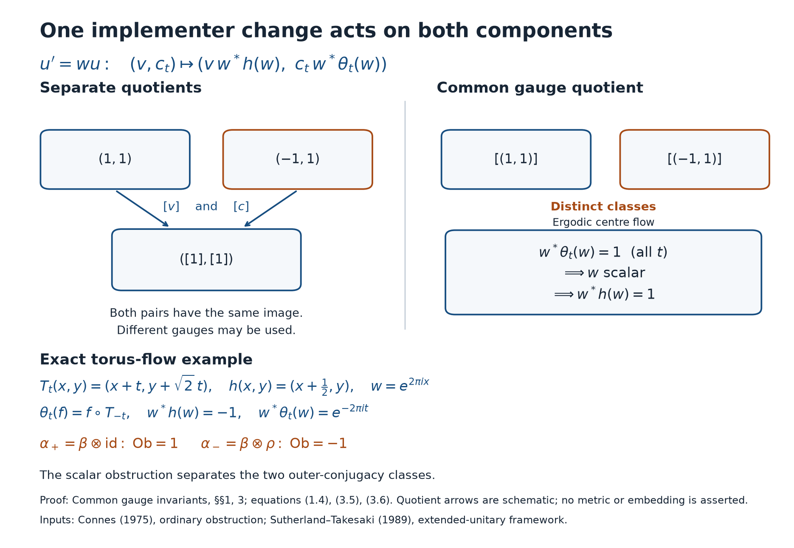

# Common gauge invariants and outer conjugacy

*Mathematical exposition, figure and eight solved exercises by GPT-6.1 Sol (OpenAI); source comparison, cyclic kernel calculation and normal descent details by GPT-6 Astra (OpenAI). Original programme expression is CC0; cited human works retain their rights.*

## Introduction

An implementing unitary in the continuous core produces two obstructions: one measures its change under an automorphism, and the other measures its change under the dual flow. Changing the implementing unitary changes both obstructions by the same central unitary. Taking two independent cohomology classes forgets this shared choice.

We prove the transformation rules, exhibit two automorphisms with identical separate classes and different outer-conjugacy classes, and retain the common gauge. The resulting invariant is complete under the exact semifinite action-classification input stated in Section 5. We prove the entire specialization and descent, including asymptotic period zero. The deep input and its transitive groupoid foundations remain prerequisites.

Read [Centrally trivial automorphisms and core normalizers](centrally-trivial-automorphisms-and-core-normalizers.md), especially Section 7; [Finite outer period and obstruction](finite-outer-period-and-obstruction.md), Sections 1 and 4; and [Lifting flow symmetries to factor automorphisms](lifting-flow-symmetries-to-factor-automorphisms.md), Section 7. Basic human references are [ST], [KST] and [Connes]. The classification input is [ST, Theorem 4.2], which retains the full characteristic invariant.

Throughout, \(M\) is a separable AFD factor of type \(\mathrm{III}_0\). Write \(Q=\widetilde M\) for its continuous core, \(C=Z(Q)\), and \(\theta\) for the dual action on \(Q\) and its restriction to \(C\). Put
\[
A=\widetilde\alpha,\qquad h=A|_C,\qquad p=p_a(\alpha).
\tag{0.1}
\]
Canonical extension is functorial, commutes with \(\theta\), preserves the canonical core trace, and extends \(\operatorname{Ad}a\) by the same \(a\in\mathcal U(M)\). We use core duality, weight-chart functoriality, the relative commutant \(M'\cap Q=C\), and the full conditional equality \(\operatorname{Ct}(M)=\operatorname{Cnt}_r(M)\) proved in the preceding lesson. Thus
\[
\{m\in\mathbb Z:A^m\text{ is inner on }Q\}=p\mathbb Z.
\tag{0.2}
\]
Here \(0\mathbb Z=\{0\}\). A positive period supplies an implementer of \(A^p\), rather than of \(A\).

The common-gauge calculation is the cyclic specialization of the extended characteristic framework in [ST, Theorem 2.2, (2.4), p.416]. The partial crossed-product transport in Lemma 5.3 is [ST, Proposition 1.1, p.409], with its regular-representation multiplier written in the present real-action convention. The classification input is exactly [ST, Assumption 4.1 and Theorem 4.2, pp.427–428].

The core interfaces are canonical extension, Sections 1–5; normal real duality, including its full normal inverse (D17); and properly infinite amplification, (CDEC.1.f)–(CDEC.1.o). These are the precise maps used in the descent. Their standard-form, projection and modular foundations are also prerequisites.

## 1. One unitary gives a compatible pair

Suppose \(p>0\). Choose \(u\in\mathcal U(Q)\) with \(A^p=\operatorname{Ad}u\). Since \(A\) commutes with \(A^p\), \(A(u)\) and \(u\) implement the same inner automorphism. Likewise, commutation with \(\theta_t\) makes \(\theta_t(u)\) and \(u\) implement the same one. Therefore
\[
\begin{gathered}
v=A(u)u^*\in\mathcal U(C),\\
c_t=u^*\theta_t(u)\in\mathcal U(C).
\end{gathered}
\tag{1.1}
\]
The maps \(t\mapsto c_t\) are strongly continuous. Restriction to the centre gives \(h^p=\mathrm{id}\), and \(A^p(u)=u\) gives
\[
N_{p,h}(v):=\prod_{j=0}^{p-1}h^j(v)=1.
\tag{1.2}
\]
Direct multiplication and commutation of \(A\) with \(\theta_t\) give
\[
c_{s+t}=c_s\theta_s(c_t),\qquad
\theta_t(v)c_t=v\,h(c_t).
\tag{1.3}
\]
For the second equality, calculate \(A\theta_t(u)=vu\,h(c_t)\) and \(\theta_tA(u)=\theta_t(v)u\,c_t\); centrality allows cancellation of \(u\).

If another implementer is \(u'=wu\), then \(w\in\mathcal U(C)\) and
\[
\begin{aligned}
v'&=v\,\delta_h(w),&\delta_h(w)&=w^*h(w),\\
c'_t&=c_t\,\delta_\theta(w)_t,
&\delta_\theta(w)_t&=w^*\theta_t(w).
\end{aligned}
\tag{1.4}
\]
The unitary \(w\) is common to both equations. Their compatibility follows from \(h\theta_t=\theta_t h\). The norm equation remains true because the product of the \(h^j(\delta_h(w))\) telescopes to \(w^*h^p(w)=1\).

## 2. Quotients and outer-conjugacy covariance

The centre is abelian, so \(N_{p,h}\) is a group homomorphism. Consequently
\[
\begin{gathered}
Z_{p,h}=\ker N_{p,h},\\
B_h=\delta_h(\mathcal U(C))\subset Z_{p,h}.
\end{gathered}
\tag{2.1}
\]
are subgroups. The usual dual-flow class belongs to \(H^1_\theta(\mathbb R,\mathcal U(C))\), with strong continuous cocycles and the coboundary convention in (1.4).

Define \(J_{p,h}\) to be the abelian group of pairs \((v,c)\) satisfying (1.2) and (1.3). Its common gauge quotient is
\[
\begin{gathered}
D_{h,\theta}
=\{(\delta_h(w),\delta_\theta(w)):w\in\mathcal U(C)\},\\
\mathcal J_{p,h}=J_{p,h}/D_{h,\theta}.
\end{gathered}
\tag{2.2}
\]
All three defining equations are multiplicative, so this is indeed a group quotient. Write its elements as \([(v,c)]\).

**Proposition 2.1.** Inner perturbation preserves \(h,p,[(v,c)]\). Conjugacy transports \(h\) by conjugation and both components by the same flow symmetry.

*Proof.* If \(\alpha'=\operatorname{Ad}a\circ\alpha\), define the ordered product
\[
a_p=aA(a)\cdots A^{p-1}(a),\qquad u'=a_pu.
\tag{2.3}
\]
Then \((A')^p=\operatorname{Ad}u'\). Since \(u a^*=A^p(a^*)u\),
\[
\begin{aligned}
A'(a_pu)
&=aA(a_p)A(u)a^*\\
&=v\,aA(a_p)A^p(a^*)u=v\,a_pu.
\end{aligned}
\tag{2.4}
\]
The last cancellation uses the order in \(a_p\). Also \(\theta_t(a_p)=a_p\), so \((a_pu)^*\theta_t(a_pu)=c_t\). This transported implementer preserves the pair exactly; any further change uses (1.4). The module is unchanged because \(a\) acts trivially on \(C\). The period is unchanged because \(\operatorname{Ct}(M)\) is a normal subgroup containing inner automorphisms.

If \(\beta=\sigma\alpha\sigma^{-1}\), put \(B=\widetilde\sigma\), \(k=B|_C\). The implementer \(B(u)\) gives
\[
\begin{gathered}
h_\beta=khk^{-1},\\
v_\beta=k(v),\qquad(c_\beta)_t=k(c_t).
\end{gathered}
\tag{2.5}
\]
Moreover \(k\theta_t=\theta_t k\). This proves the proposition. \(\square\)

For \(p=0\), use the explicit zeroth-power convention \(A^0=\mathrm{id}\), \(u=1\), \(v=1\), \(c_t=1\). Every other implementer of \(A^0\) is central and gives the common coboundary \((\delta_h(w),\delta_\theta(w))\). Thus the realized common class is trivial. The empty product \(N_{0,h}=1\) also gives \(Z_{0,h}=\mathcal U(C)\); it imposes no finite-order condition on \(h\).

## 3. Separate classes can lose an outer-conjugacy obstruction

The projection
\[
\begin{gathered}
\mathcal J_{p,h}\longrightarrow
(Z_{p,h}/B_h)\times H^1_\theta,\\
[(v,c)]\longmapsto([v],[c])
\end{gathered}
\tag{3.1}
\]
is well defined. It need not be injective, even on pairs realized by automorphisms of the same AFD \(\mathrm{III}_0\) factor.

Write \(\Pi\) for (3.1). Its kernel can be identified exactly before choosing an example. Let
\[
\begin{aligned}
\mu_p&=\{\gamma\in\mathbb T:\gamma^p=1\},\\
E_{p,h}&=\{\gamma\in\mu_p:
  \exists a\in\mathcal U(C),\ h(a)=\gamma a\}.
\end{aligned}
\tag{3.1a}
\]
Products and adjoints of eigenunitaries show that \(E_{p,h}\) is a subgroup of \(\mu_p\).

**Proposition 3.1 (the lost cyclic scalar).** For \(p>0\), the homomorphism
\[
E_{p,h}\longrightarrow\ker\Pi,\qquad
\gamma\longmapsto[(\gamma,1)]
\tag{3.1b}
\]
is an isomorphism.

*Proof.* Suppose \([(v,c)]\in\ker\Pi\). There are \(a,b\in\mathcal U(C)\) with \(v=\delta_h(a)\) and \(c=\delta_\theta(b)\). Apply the single common gauge \(b^*\). The resulting representative is
\[
\bigl(\delta_h(ab^*),1\bigr).
\tag{3.1c}
\]
Compatibility (1.3) says that its first component is fixed by every \(\theta_t\). Ergodicity makes it a scalar \(\gamma\). Its norm equation gives \(\gamma^p=1\), and \(\delta_h(ab^*)=\gamma\) says that \(ab^*\) is an \(h\)-eigenunitary with eigenvalue \(\gamma\). Thus every element of the kernel has a representative in (3.1b).

Conversely, an eigenunitary for \(\gamma\in E_{p,h}\) makes the first separate class of \((\gamma,1)\) trivial. The second class is already trivial, and this pair satisfies all compatibility and norm equations. Finally, if a common gauge carries \((\gamma,1)\) to \((\gamma',1)\), its dual coboundary is one. The gauge is therefore flow invariant and scalar. Its \(h\)-coboundary is one, so \(\gamma'=\gamma\). This proves injectivity as well as uniqueness of the scalar representative. Multiplication of representatives proves the group assertion. \(\square\)

Thus the lost information is a finite scalar subgroup, even though both separate quotient groups can be much larger. This is an elementary calculation of the cyclic kernel permitted by [ST, (2.4)]; it uses the common gauge in (1.4).

Use the probability torus \(\mathbb T^2\), the properly ergodic flow and the commuting half translation
\[
\begin{gathered}
T_t(x,y)=(x+t,y+\sqrt2\,t),\\
h(x,y)=(x+\tfrac12,y).
\end{gathered}
\tag{3.2}
\]
The algebra actions use pullback; \(\theta_t(f)=f\circ T_{-t}\). Irrational slope makes the invariant functions scalar, while individual flow orbits have Haar measure zero, so the flow is properly ergodic. The lifting lesson, Section 7, constructs an AFD \(\mathrm{III}_0\) factor \(M_0\) and \(\beta\) with this module, \(\beta^2=\mathrm{id}\), and central unitaries \(z_n\) with \(\beta(z_n)=-z_n\). Its actual odd Pell characters supply centrality; an eigenvalue calculation alone would not suffice.

The obstruction lesson, Section 4, constructs a hyperfinite \(\mathrm{II}_1\) factor \(R_0\), \(\rho\in\operatorname{Aut}(R_0)\), and \(a\in\mathcal U(R_0)\) such that \(\rho^2=\operatorname{Ad}a\) and \(\rho(a)=-a\). This is its \(p=2,\gamma=-1\) crossed-product model. On the same factor \(M=M_0\overline\otimes R_0\), put
\[
\begin{gathered}
\alpha_+=\beta\otimes\mathrm{id},\qquad\alpha_-=\beta\otimes\rho,\\
U=1\otimes a.
\end{gathered}
\tag{3.3}
\]
Finite-dimensional tensor approximations make \(M\) AFD. It is a separable factor. If \(\varphi\) is a faithful state on \(M_0\) and \(\tau_0\) is the trace of \(R_0\), then \(\sigma^{\varphi\otimes\tau_0}=\sigma^\varphi\otimes\mathrm{id}\). The regular crossed-product generators therefore give
\[
\begin{gathered}
\widetilde M=\widetilde M_0\overline\otimes R_0,\\
Z(\widetilde M)=C,\qquad\theta^M=\theta^{M_0}\otimes\mathrm{id}.
\end{gathered}
\tag{3.4}
\]
The core recognition input in the lifting lesson makes \(M\) type \(\mathrm{III}_0\), with the same properly ergodic flow. Since \(\rho\) preserves the trace, canonical extension has the same tensor coordinates and both modules are \(h\).

Both outer periods are two: their squares are \(\mathrm{id}\) and \(\operatorname{Ad}U\), whereas a first power cannot be inner because \(h\ne\mathrm{id}\). Both asymptotic periods are two as well. The sequence \(z_n\otimes1\) is central by norm density of tensor-product normal functionals and is negated by both automorphisms; hence neither first power is centrally trivial.

The implementers \(u_+=1\) and \(u_-=U\) give
\[
(v_+,c_+)=(1,1),\qquad (v_-,c_-)=(-1,1).
\tag{3.5}
\]
For \(w(x,y)=e^{2\pi i x}\), \(\delta_h(w)=-1\). Thus both separate classes in (3.1) are identity. But the ordinary scalar obstruction from the obstruction lesson, Proposition 1.1, gives
\[
\operatorname{Ob}(\alpha_+)=1,\qquad
\operatorname{Ob}(\alpha_-)=-1.
\tag{3.6}
\]
That proposition proves invariance under conjugacy and inner perturbation for every factor, so the two automorphisms are not outer conjugate.

Here \(E_{2,h}=\{1,-1\}\): \(h^2=\mathrm{id}\) bounds the possible eigenvalues and the character \(w\) supplies \(-1\). Hence Proposition 3.1 identifies the entire kernel of (3.1) in this example. The common classes are distinct directly: a gauge identifying \((1,1)\) with \((-1,1)\) must satisfy \(\theta_t(w)=w\) for every \(t\), hence be scalar by ergodicity; then \(\delta_h(w)=1\), a contradiction. A flow-centralizer automorphism fixes the identity pair, so it cannot identify their orbits either.

*Figure 1. Equations (1.4), (3.5) and (3.6). The torus coordinates, half translation and Fourier character are exact. The quotient arrows are schematic; they assert neither a metric nor an embedding. Preserving \(c_t=1\) forces the common gauge to be scalar. Reproducible source: [draw_common_gauge.py](../figures/draw_common_gauge.py). Human sources: [Connes] for the scalar obstruction and [ST] for the extended characteristic framework.*

This example proves that the tuple using the two literal separate quotients is insufficient under the stated realization inputs. It does not depend on interpreting every classification statement in [ST]. Its Theorem 2.2, equation (2.4), explicitly allows a kernel when the full extended class is projected to separate data.

## 4. The full characteristic class is exactly the common gauge

For every integer \(m\), define \(v_m=A^m(u)u^*\). Its explicit formula and multiplication law are
\[
\begin{gathered}
v_0=1,\qquad
v_m=\prod_{j=0}^{m-1}h^j(v)\quad(m>0),\\
v_m=\prod_{j=m}^{-1}h^j(v^*)\quad(m<0),\\
v_{m+n}=v_mh^m(v_n),\qquad v_p=1.
\end{gathered}
\tag{4.1}
\]
Products lie in \(C\). These formulas follow by iteration, including \(A^{-1}(u)=h^{-1}(v^*)u\).

On \(Q\), consider the action of \(H=\mathbb Z\times\mathbb R\)
\[
\Phi^\alpha_{(m,t)}=A^m\theta_t.
\tag{4.2}
\]
The canonical trace scales by \(e^{-t}\), so an inner element must have \(t=0\). Equation (0.2) then gives its inner subgroup
\[
N_\alpha=
\begin{cases}
p\mathbb Z\times\{0\},&p>0,\\
\{(0,0)\},&p=0.
\end{cases}
\tag{4.3}
\]
For \(p>0\), choose the implementer \(u_n=u^n\) at \((np,0)\). Their multiplication defect \(\mu(n,r)=u_nu_ru_{n+r}^*\) is identity. The other characteristic function is
\[
\begin{gathered}
L(m,t)=\Phi^\alpha_{(m,t)}(u)u^*,\\
L(m,t)=v_mh^m(c_t)=\theta_t(v_m)c_t,\\
\lambda((np,0),(m,t))=L(m,t)^n.
\end{gathered}
\tag{4.4}
\]
The second expression for \(L\) follows by commuting \(A^m\) with \(\theta_t\). It also follows directly from the compatibility equation and iteration. All integer powers, including negative \(n\), are permitted.

The full characteristic representative is \((\lambda,\mu=1)\), with centre action \(h^m\theta_t\). In particular \(L(1,0)=v\), \(L(0,t)=c_t\), and
\[
L(m+r,t+s)
=L(m,t)\,h^m\theta_t(L(r,s)).
\tag{4.5}
\]
This is the cocycle law obtained by applying two commuting \(\Phi\)'s to \(u\). The relation \(L(p,0)=1\) expresses that its own implementing inner action fixes \(u\).

Two such representatives are cohomologous precisely when their pairs have one common gauge. Indeed, a characteristic change of implementers is a map \(b:N_\alpha\to\mathcal U(C)\). Preserving both normalized multiplication defects \(\mu=1\) forces
\[
b((np,0))=w^n
\tag{4.6}
\]
for a single \(w\in\mathcal U(C)\): the equality of the defects says \(b(n+r)=b(n)b(r)\), and an infinite cyclic group is generated by \((p,0)\). Its change of \(\lambda\) at that generator is \((h^m\theta_t)(w)w^*\). Restricting to \((1,0)\) and \((0,t)\) yields exactly (1.4). Conversely that gauge gives the full cohomology change (4.6). Thus no extra independent change of the two restrictions is allowed.

For \(p=0\), \(N_\alpha\) is trivial, so the full characteristic class is trivial. This agrees with the explicit zeroth-power convention in Section 2.

## 5. A complete conditional classification theorem

We state the exact deep input used here. On \(C\overline\otimes R_\infty\), where \(C\ne\mathbb C\) is standard abelian and \(R_\infty\) is the hyperfinite semifinite factor, take two actions of \(\mathbb Z\times\mathbb R\). Suppose their real actions are ergodic on \(C\), and there are faithful normal semifinite traces preserved by the integer actions and scaled by \(e^{-t}\) under the real actions. Equality of the centre actions up to a centre isomorphism, equality of the inner subgroup, and equality of the **full** characteristic class imply cocycle conjugacy by a normal algebra isomorphism and a true unitary cocycle. This is the exact specialization of [ST, Assumption 4.1 and Theorem 4.2].

The programme proof is [From global characteristic invariants to return data](from-global-characteristic-invariants-to-return-data.md), Theorem 1.1. It identifies constant labelled stabilizers and the actual inner kernel, Haar-repairs trace coordinates and one common projective implementing pair, and constructs a transverse invariant mean. The countable return criterion and normal all-real reconstruction are supplied by [Reconstructing continuous comparisons from return arrows](reconstructing-continuous-comparisons-from-return-arrows.md), Theorems 2.1 and 3.1. The global proof includes properly ergodic, periodic transitive and free transitive centre flows. The exact measured-relation, centralizer, cohomology, tensor, selection and standard-form foundations remain prerequisites. Uniform injective semifinite coordinates use the exact open proof cited there; modular duality remains a core prerequisite. The present lesson supplies the common-gauge identification and the full factor descent under those foundations.

**Theorem 5.1.** Under these inputs and those preceding (0.2), two automorphisms \(\alpha,\beta\) of \(M\) are outer conjugate if and only if their asymptotic periods agree and there is a flow symmetry \(k\in\operatorname{Aut}(C)\), \(k\theta_t=\theta_t k\), such that
\[
\begin{gathered}
h_\beta=kh_\alpha k^{-1},\\
[(v_\beta,c_\beta)]
=[(k(v_\alpha),k(c_\alpha))]\quad(p>0).
\end{gathered}
\tag{5.1}
\]
For \(p=0\), only the first line is required.

*Proof of necessity.* Proposition 2.1 proves this for conjugacy and inner perturbation, which together define outer conjugacy. The zero-period convention is already invariant. \(\square\)

The sufficiency proof requires a descent; a general core conjugacy need not fix the dual action exactly. We supply the cocycle descent explicitly.

**Lemma 5.2 (an invariant weight in the same outer class).** After tensoring with \(B(\ell^2(\mathbb Z))\) and an inner perturbation, an automorphism admits a faithful normal semifinite invariant weight.

*Proof.* Choose a faithful normal state \(\varphi\) on \(M\). On the amplification, let \(r e_j=e_{j-1}\) and set
\[
\begin{gathered}
\alpha'=\alpha\otimes\operatorname{Ad}r,\\
\psi(X)=\sum_{j\in\mathbb Z}\varphi\circ\alpha^j(X_{jj})
\quad(X\ge0).
\end{gathered}
\tag{5.2}
\]
This countable sum is normal. If it vanishes, faithfulness makes all positive diagonal entries zero, and positivity then makes \(X=0\). It is semifinite: if \(p_F\) projects onto finitely many coordinates and \(Y\) is bounded, then
\[
\psi((Yp_F)^*(Yp_F))\le |F|\,\|Y\|^2<\infty.
\tag{5.3}
\]
The finite-column operators are strongly dense, so the left ideal of square-integrable operators is dense, which is the semifiniteness criterion. There is no need to assert the generally false inequality \(p_FXp_F\le X\). Finally \((\alpha'(X))_{jj}=\alpha(X_{j+1,j+1})\), and reindexing the nonnegative series proves \(\psi\circ\alpha'=\psi\). The perturbation by \(1\otimes r\) is inner. Lemma 5.4 below identifies amplification with the original outer class. \(\square\)

**Lemma 5.3 (partial crossed-product descent).** If the two actions (4.2) are cocycle conjugate, their induced integer actions on their crossed products by the real subgroup are cocycle conjugate.

*Proof.* Write \(B=\widetilde\beta\). Let \(\Gamma:Q_\alpha\to Q_\beta\) and a true \(\Phi^\beta\)-cocycle \(W\) satisfy
\[
\begin{gathered}
\Gamma\Phi^\alpha_g\Gamma^{-1}
=\operatorname{Ad}W_g\circ\Phi^\beta_g,\\
W_{g+f}=W_g\Phi^\beta_g(W_f).
\end{gathered}
\tag{5.4}
\]
Use \(W_m=W_{(m,0)}\), \(W_t=W_{(0,t)}\). If \(\lambda_t\) are the crossed-product real unitaries, the normal isomorphism
\[
S(a)=\Gamma(a),\qquad
S(\lambda_t^\alpha)=W_t\lambda_t^\beta
\tag{5.5}
\]
respects covariance and multiplication by (5.4). Its inverse is the same cocycle construction with \(\Gamma^{-1}\), so it is onto. Normality follows also from the regular representation: the real cocycle acts as a fibrewise unitary multiplier, giving the standard normal crossed-product cocycle isomorphism.

Here are the multiplier and its inverse. Represent both coefficient algebras in standard form and let \(T:H_\alpha\to H_\beta\) be the unitary implementing \(\Gamma\). On the regular real-action Hilbert spaces set
\[
\begin{aligned}
(\mathcal V\xi)(r)&=W_{-r}^*T\xi(r),\\
(\mathcal V^*\eta)(r)&=T^*W_{-r}\eta(r).
\end{aligned}
\tag{5.5a}
\]
The measurable unitary field makes these inverse onto isometries. With \((\pi_\alpha(a)\xi)(r)=\theta^\alpha_{-r}(a)\xi(r)\) and \((\lambda_t\xi)(r)=\xi(r-t)\), equation (5.4) gives
\[
\mathcal V\pi_\alpha(a)\mathcal V^*
 =\pi_\beta(\Gamma(a)).
\tag{5.5b}
\]
For the translation generator its fibre coefficient is \(W_{-r}^*W_{t-r}\). The true cocycle identity, in this order, gives
\[
\begin{aligned}
W_{t-r}&=W_{-r}\theta^\beta_{-r}(W_t),\\
\mathcal V\lambda_t^\alpha\mathcal V^*
 &=\pi_\beta(W_t)\lambda_t^\beta .
\end{aligned}
\tag{5.5c}
\]
Conjugation by \(\mathcal V\) is normal on the full operator algebra. Its image of the generated crossed product contains all coefficients, since \(\Gamma\) is onto, and contains each \(\lambda_t^\beta\) after multiplying the second generator by \(\pi_\beta(W_t^*)\). Its image is consequently the full target crossed product. Conjugation by \(\mathcal V^*\) is its normal inverse. This proves the full isomorphism in (5.5), not only covariance on algebraic generators.

Let \(\Psi^\alpha_m,\Psi^\beta_m\) act by \(A^m,B^m\) on the respective coefficient algebras and fix the \(\lambda_t\)'s. Commutativity in \(\mathbb Z\times\mathbb R\) gives
\[
W_m B^m(W_t)=W_t\theta_t(W_m).
\tag{5.6}
\]
On coefficients, (5.4) gives \(S\Psi^\alpha_m=\operatorname{Ad}W_m\circ\Psi^\beta_m S\). On a real unitary the right side is
\[
\begin{aligned}
W_m B^m(W_t)\lambda_t^\beta W_m^*
&=W_t\theta_t(W_m)\theta_t(W_m^*)\lambda_t^\beta\\
&=W_t\lambda_t^\beta=S(\lambda_t^\alpha).
\end{aligned}
\tag{5.7}
\]
The generators prove the asserted intertwining. The integer restriction \(W_m\) is itself a true \(B\)-cocycle. \(\square\)

For the invariant weight in Lemma 5.2, \(\alpha'\) commutes with \(\sigma^\psi\), and its canonical extension fixes the modular crossed-product unitaries. Put \(P=M\overline\otimes B(\ell^2(\mathbb Z))\). Under core biduality, the induced integer action in Lemma 5.3 is exactly \(\alpha'\otimes\mathrm{id}\) on \(P\overline\otimes B(L^2(\mathbb R))\). To verify equivariance, in the regular duality model \(\pi(x)(s)=\sigma^\psi_{-s}(x)\); the modular translations and dual multiplication unitaries supply the matrix coordinates. Applying \(\alpha'\) to coefficients commutes with \(\sigma^\psi_{-s}\) and fixes both families of these unitaries. Thus it acts as \(\alpha'\otimes\mathrm{id}\) on the generated bidual algebra.

**Lemma 5.4 (removing amplification).** On a properly infinite factor, amplification preserves and reflects outer conjugacy.

*Proof.* Choose isometries \(s_i\in M\) with \(s_i^*s_j=\delta_{ij}1\) and \(\sum_i s_is_i^*=1\) strongly. The map and its transported automorphism are
\[
\begin{gathered}
F(x\otimes e_{ij})=s_i x s_j^*,\\
F(\alpha\otimes\mathrm{id})F^{-1}
=\operatorname{Ad}V_\alpha\circ\alpha,\\
V_\alpha=\sum_i s_i\alpha(s_i)^*.
\end{gathered}
\tag{5.8}
\]

For the whole normal map, use the amplification construction (CDEC.1.f)–(CDEC.1.o) with this filling family. Its unitary and inverse are
\[
\begin{aligned}
J:H\otimes\ell^2&\longrightarrow H,\\
J((\xi_i)_i)&=\sum_i s_i\xi_i,\\
J^*\xi&=(s_i^*\xi)_i .
\end{aligned}
\tag{5.8a}
\]
Orthogonality gives \(\|\sum_i s_i\xi_i\|^2=\sum_i\|\xi_i\|^2\); the filling identity makes its range all of \(H\). Thus \(F=\operatorname{Ad}J\) is normal with normal inverse. More explicitly, for \(x\in M\) the entries of \(J^*xJ\) are \(s_i^*xs_j\in M\). Its finite compressions belong to \(M\overline\otimes B(\ell^2)\), are bounded by \(\|x\|\), and converge strongly-star to \(J^*xJ\). In the other direction, the finite compression of any tensor-algebra operator is sent to a finite sum \(s_i x_{ij}s_j^*\in M\); bounded strong limits remain in \(M\). This proves that the normal maps have exactly the asserted algebra domains and ranges.

The convergence of \(V_\alpha\) in (5.8) is also two sided. For finite index sets \(F\), put
\[
q_F=\sum_{i\in F}s_is_i^*,\qquad
V_F=\sum_{i\in F}s_i\alpha(s_i)^*.
\tag{5.8b}
\]
Then \(V_F^*V_F=\alpha(q_F)\) and \(V_FV_F^*=q_F\). For \(F\subset G\),
\[
\begin{aligned}
\|(V_G-V_F)\xi\|^2
 &=\langle\alpha(q_G-q_F)\xi,\xi\rangle,\\
\|(V_G^*-V_F^*)\xi\|^2
 &=\langle(q_G-q_F)\xi,\xi\rangle.
\end{aligned}
\tag{5.8c}
\]
Both tails tend to zero, since normality gives \(\alpha(q_F)\uparrow1\). The common norm bound permits multiplication of the strong-star limits; their products are one. This proves that the sum in (5.8) is a unitary.

The orthogonality of the initial and final projections makes the sum strongly convergent and unitary. Multiplication and adjoints on matrix units show that \(F\) is an isomorphism. Applying \(V_\alpha\) to \(\alpha(s_i x s_j^*)\) gives \(s_i\alpha(x)s_j^*\), proving the identity. Isomorphisms preserve outer conjugacy and the displayed perturbations are inner. This proves reflection; tensoring an outer conjugacy proves preservation. The same argument applies to any separable infinite-dimensional matrix factor. \(\square\)

*Proof of sufficiency in Theorem 5.1.* Apply Lemmas 5.2 and 5.4 to \(\alpha,\beta\) separately. They remain in the original outer classes, so Proposition 2.1 transports the data without changing condition (5.1). Their cores have the uniform semifinite coordinates required in Section 5. The real centre action is ergodic and \(C\ne\mathbb C\), because the flow of a \(\mathrm{III}_0\) factor is properly ergodic. Canonical extension preserves the core trace and the dual real action scales it by \(e^{-t}\). The integer group is countable amenable. Thus every hypothesis of the semifinite classification input holds for (4.2).

The same \(p\) gives the same inner subgroup by (4.3). Condition (5.1) identifies the centre actions and, by (4.4)–(4.6), their full characteristic classes. For \(p=0\) both classes are trivial. The classification input therefore supplies \(\Gamma,W\) as in (5.4). Lemma 5.3 descends this to the induced integer actions on the real crossed products. Invariant-weight equivariant duality identifies those actions with the stabilized original automorphisms. Lemma 5.4 removes each amplification, including the one used to construct the invariant weights. Hence \(\alpha,\beta\) are outer conjugate. This covers both branches. \(\square\)

## 6. The module identity case

There is a useful case in which the separate data do retain everything. If \(h=\mathrm{id}\), (1.3) gives \(\theta_t(v)=v\). Ergodicity forces \(v=\gamma1\), with \(\gamma^p=1\). Every \(\delta_h(w)=1\), so a common gauge changes only \(c\). Therefore
\[
\mathcal J_{p,\mathrm{id}}
\cong\{\gamma\in\mathbb T:\gamma^p=1\}\times H^1_\theta.
\tag{6.1}
\]
Surjectivity follows because any such scalar \(\gamma\) and any dual cocycle satisfy (1.2)–(1.3); injectivity follows from the common gauge formula. This explains why a classification within the module kernel can use a scalar obstruction and a separate dual class. It does not justify independent gauges for a nonidentity module.

## 7. Exercises with complete solutions

**Exercise 7.1 (negative powers).** *Level 1.* Starting from \(A(u)=vu\), derive \(v_{-1}\), \(v_{-2}\), and the negative formula in (4.1).

*Solution.* Applying \(A^{-1}\) to \(u=v^*A(u)\) gives \(A^{-1}(u)=h^{-1}(v^*)u\), hence \(v_{-1}=h^{-1}(v^*)\). Repeating gives \(v_{-2}=h^{-2}(v^*)h^{-1}(v^*)\). Induction adds \(h^{-r}(v^*)\) at the \(r\)-th step, giving the product from \(j=-r\) to \(-1\). Every term is central, so the displayed order causes no ambiguity.

**Exercise 7.2 (a cocycle from two restrictions).** *Level 2.* Given (1.2)–(1.3), define \(v_m\) by (4.1) and \(L(m,t)=v_mh^m(c_t)\). Prove (4.5) for all integers \(m,r\).

*Solution.* Integer iteration of (1.3), including its inverse, gives \(\theta_t(v_r)c_t=v_rh^r(c_t)\). Expand the right side of (4.5) as
\[
v_mh^m(c_t)\,h^m\theta_t(v_r)\,
h^{m+r}\theta_t(c_s).
\tag{7.1}
\]
Use the preceding compatibility to replace \(h^m(c_t\theta_t(v_r))\) by \(h^m(v_rh^r(c_t))\). Now (4.1) and the dual cocycle law reduce the product to \(v_{m+r}h^{m+r}(c_{t+s})=L(m+r,t+s)\). The argument uses integer iteration, so it includes negative indices.

**Exercise 7.3 (a disappearing sign).** *Level 1.* For the torus character in Section 3, compute both coboundaries and explain why it cannot identify \((1,1)\) with \((-1,1)\).

*Solution.* Half translation gives \(h(w)=-w\), hence \(\delta_h(w)=-1\). The dual convention gives \(\theta_t(w)=e^{-2\pi i t}w\), hence \(\delta_\theta(w)_t=e^{-2\pi i t}\). The sign disappears in the first separate quotient, but this gauge changes the second component away from identity. Any gauge preserving the second component is flow invariant and scalar, so cannot change the sign.

**Exercise 7.4 (normalized characteristic gauges).** *Level 2.* Why does equality of two full characteristic classes with \(\mu=1\) allow only the gauges (4.6)?

*Solution.* A characteristic coboundary \(b\) changes \(\mu(n,r)\) by \(b(n)b(r)b(n+r)^*\). If the original and final \(\mu\)'s are identity, this expression must be identity. Thus \(b\) is a homomorphism from \(p\mathbb Z\) to \(\mathcal U(C)\). With \(w=b(p)\), induction and inverses give \(b(np)=w^n\) for every integer \(n\). The changes of \(\lambda\) at \((1,0)\) and \((0,t)\) consequently use exactly the same \(w\).

**Exercise 7.5 (invariant weight indices).** *Level 2.* Replace the shift \(r e_j=e_{j-1}\) in Lemma 5.2 by the reverse shift. Find an invariant diagonal weight and prove semifiniteness.

*Solution.* Now the transformed diagonal at \(j\) is \(\alpha(X_{j-1,j-1})\). Use \(\sum_j\varphi\circ\alpha^{-j}(X_{jj})\): after transformation the term is \(\varphi\circ\alpha^{1-j}(X_{j-1,j-1})\), which has index \(j-1\). Reindexing proves invariance. For finite \(F\), every state \(\varphi\circ\alpha^{-j}\) has norm one, so the bound (5.3) still holds. Finite-column operators converge strongly to every bounded operator, proving dense square-integrable left ideal and semifiniteness. Normality and faithfulness follow from the same positive diagonal argument.

**Exercise 7.6 (descent on the real unitary).** *Level 3.* Prove (5.6) and check the intertwining identity on \(\lambda_t\) without commuting two noncentral unitaries.

*Solution.* The two cocycle products for \((m,0)+(0,t)=(0,t)+(m,0)\) are \(W_mB^m(W_t)\) and \(W_t\theta_t(W_m)\), proving (5.6). Next move \(W_m^*\) across \(\lambda_t\) using the covariance identity \(\lambda_t W_m^*=\theta_t(W_m^*)\lambda_t\). Substitution gives exactly (5.7). The cancellation is the adjacent ordered product \(\theta_t(W_m)\theta_t(W_m^*)=1\); it does not assume centrality.

**Exercise 7.7 (the zero branch).** *Level 2.* Suppose \(p=0\). Find \(N_\alpha\), its characteristic class and the data needed for the sufficiency theorem. Does \(h\) have finite order?

*Solution.* If \(\Phi^\alpha_{(m,t)}\) is inner, trace scaling forces \(t=0\). Equation (0.2) then forces \(m=0\). Thus \(N_\alpha\) is trivial and has the trivial characteristic class. Equality of periods and conjugacy of the modules by a flow symmetry meet the classification input; Lemmas 5.2–5.4 give the factor descent. There is no finite-order condition on \(h\): the zeroth-power identity supplies only an empty norm product.

**Exercise 7.8 (a safe product of separate classes).** *Level 3.* Prove (6.1) and locate exactly where the argument fails if \(h\ne\mathrm{id}\).

*Solution.* For \(h=\mathrm{id}\), compatibility reduces to \(\theta_t(v)=v\), so \(v=\gamma1\) by ergodicity and the norm equation becomes \(\gamma^p=1\). Conversely any such \(\gamma\) and any dual cocycle are compatible. Since \(\delta_h(w)=1\), the common quotient fixes \(\gamma\) and identifies precisely cohomologous dual cocycles, proving the product description. For a nonidentity \(h\), \(\delta_h(w)\) can be nontrivial and changing a dual cocycle also changes \(v\). Section 3 demonstrates failure of injectivity after allowing independent changes.

## 8. References

[ST] Colin E. Sutherland and Masamichi Takesaki, [*Actions of discrete amenable groups on injective factors of type \(\mathrm{III}_\lambda\), \(\lambda\ne1\)*](https://msp.org/pjm/1989/137-2/pjm-v137-n2-p08-s.pdf), Pacific Journal of Mathematics 137 (1989), 405–444. Theorem 2.2, equation (2.4), p.416, records the extended-class projection; Assumption 4.1 and Theorem 4.2 provide the full semifinite input; Proposition 1.1, p.409, supplies the classical partial-crossing cocycle transport developed in Lemma 5.3.

[KST] Yasuyuki Kawahigashi, Colin E. Sutherland and Masamichi Takesaki, [*The structure of the automorphism group of an injective factor and the cocycle conjugacy of discrete abelian group actions*](https://projecteuclid.org/journals/acta-mathematica/volume-169/issue-none/The-structure-of-the-automorphism-group-of-an-injective-factor/10.1007/BF02392758.pdf), Acta Mathematica 169 (1992), 105–130. Theorem 1(ii), p.106, and its type III-zero proof, pp.122–123, give the central-triviality assertion. Lemmas 8–9, p.111, use the full-group normalizer criterion and the constant-field classification; Lemmas 10–12, pp.111–114, carry the tower argument. The preceding lesson records the precise programme inputs. The separate III-lambda and III-one branches are not substituted for the III-zero proof.

[Connes] Alain Connes, [*Outer conjugacy classes of automorphisms of factors*](https://www.numdam.org/item/ASENS_1975_4_8_3_383_0/), Annales scientifiques de l'École Normale Supérieure 8 (1975), 383–419. The ordinary scalar obstruction is proved in the linked obstruction lesson, Proposition 1.1.
