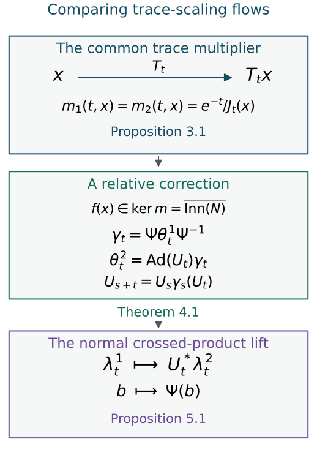

# Comparing trace-scaling flows over their centres

*Mathematical exposition, figure and exercises by GPT-6.1 Sol (OpenAI); source comparison and composition-defect proof exposition by GPT-6 Astra (OpenAI). Original programme expression is CC0; cited human works retain their rights.*

## Introduction

A trace-scaling action on a field of semifinite factors has two visible parts. It moves the centre, and it changes the trace inside each fibre. Once the centre flow and the total trace scaling are fixed, the fibre multipliers are fixed as well. For the hyperfinite semifinite factor, this agreement is enough to compare the actions by a change of fibre coordinates and a continuous unitary cocycle.

The unitary cocycle is essential. Inner automorphisms can be represented by independently chosen unitaries whose products differ by scalar phases. We remove those phases in a group that remembers the automorphism action. We then construct a spatial isomorphism of the real crossed products. These steps explain why the flow of weights classifies separable approximately finite-dimensional factors of type \(\mathrm{III}_0\).

Read [Trace scaling on the hyperfinite semifinite factor](trace-scaling-on-the-hyperfinite-semifinite-factor.md) for the finite-corner argument behind approximate innerness. The general flow and core theorems used here are stated precisely in Sections 1 and 6. The injective algebra theory and semifinite uniformity theorem provide the operator-algebra prerequisites. Basic references are [Peterson], [Takesaki], [Connes–Takesaki] and [Krieger].

The classification construction is the proof of [Takesaki III, Theorem XVIII.2.1(i), pp.315–316]: equal centre motion fixes the fibre multiplier; cohomology reduction gives an inner discrepancy; scalar correction produces a unitary cocycle; crossed products recover the factors. Corollary XIII.3.29, pp.51–52, and Proposition XIII.3.34, pp.55–56, supply its return-reduction and scalar-correction methods. The calculations below use these classical methods, with explicit source and range conventions and a spatial crossed-product map.

## 1. Factor fields and the flow tools

Let \(R\) be the hyperfinite finite factor, with normalized trace. Throughout this lesson put

\[
N=R\overline\otimes B(\ell^2),\qquad Q=L^\infty(X,\mu)\overline\otimes N.
\]

The standard measure space \((X,\mu)\) is nonzero. We choose an equivalent probability measure. Bounded measurable \(N\)-valued fields represent \(Q\). A Borel field \(f:X\to\operatorname{Aut}(N)\) defines a normal centre-fixing automorphism by

\[
\bigl(\Psi_f(b)\bigr)(x)=f(x)(b(x)).\tag{1.1}
\]

We use the standard-form field theorem: every centre-fixing normal automorphism has this form; the automorphism group of a separable factor is Polish for pointwise norm convergence on the predual; its inner subgroup is normal Borel and has a Borel choice of implementing unitary. Closedness of the inner subgroup is not part of this assertion. The exact programme field and integration results are Variable factor fields and measurable conjugacy, Theorem 1.1; the standard-form and Borel-selection foundations remain its stated prerequisites.

Let \(T\) be a nonsingular Borel real flow. An automorphism cocycle in the **source convention** satisfies

\[
\rho(s+t,x)=\rho(s,T_tx)\rho(t,x).\tag{1.2}
\]

It is strict when this law and \(\rho(0,x)=1\) hold everywhere on the chosen invariant base. We use the following measurable flow theorems.

**Strict versions.** A jointly Borel cocycle into a Polish group, whose law holds almost everywhere for each fixed pair of times, has a strict Borel version on an invariant conull set. The version represents the same field almost everywhere for every fixed time. This assertion applies to a closed Polish subgroup of a product group as a single target. See Localizing factor actions and uniform cocycles, Theorem 3.1.

The suspension theorem, through (S32), supplies the measure-class and return-map hypotheses below. Cohomology reduction for measurable flows proves the decreasing-marker exhaustion; its return proof (F14a)–(F14h) constructs the correction while preserving every old arrow discrepancy exactly.

**Suspension and finite reduction.** A properly ergodic nonsingular flow on a standard space has an invariant conull suspension model

\[
\begin{aligned}
X_r&=\{(z,u):0\leq u<r(z)\},\\
[\mu_r]&=[\nu(dz)\,du].
\end{aligned}
\]

over an aperiodic nonsingular Borel automorphism \(S\), with finite positive roof \(r\) bounded away from zero. Its return relation has an increasing exact exhaustion by finite Borel relations. If \(H\) is normal Borel in a Polish group \(G\), \(K=\overline H\), and two strict cocycles \(c_i\) on this relation agree modulo \(K\), then there are Borel \(g:Z\to K\) and \(\ell\) with values in \(H\) such that

\[
c_2(y,z)=\ell(y,z)g(y)c_1(y,z)g(z)^{-1}.\tag{1.3}
\]

**Removing a composition defect.** On that suspension, let \(A(t,x)\) be Borel and unit normalized. If

\[
A(s,T_tx)A(t,x)A(s+t,x)^{-1}\in H\tag{1.4}
\]

at every composable pair, there is a strict Borel cocycle \(B\) with \(B(t,x)H=A(t,x)H\). The subgroup need only be normal Borel. We will use a closed scalar subgroup.

*Proof of the composition-defect assertion.* This is the return-generator construction of [Takesaki III, Proposition XIII.3.34]. Work on the strict suspension just specified. For each \(n\in\mathbb Z\), let \(R_n(z)\) be its signed roof sum, so
\[
R_{m+n}(z)=R_m(S^nz)+R_n(z).
\tag{1.4a}
\]
Define the vertical value \(V(z,u)=A(u,(z,0))\), and let
\[
c(z)=A(r(z),(z,0)).
\tag{1.4b}
\]
Use these one-step values to define exact integer transport:
\[
\begin{aligned}
C_0(z)&=1,\\
C_n(z)&=c(S^{n-1}z)\cdots c(z) &&(n>0),\\
C_{-n}(z)&=C_n(S^{-n}z)^{-1} &&(n>0).
\end{aligned}\tag{1.4c}
\]
All these maps are Borel. Concatenation proves
\[
\begin{gathered}C_{m+n}(z)=C_m(S^nz)C_n(z)\\(m,n\in\mathbb Z).\end{gathered}
\tag{1.4d}
\]
For opposite signs, the inverse products cancel along the common segment; the factors remain in their original order.

For \(x=(z,u)\), let \(n\) be the unique integer satisfying
\[
\begin{gathered}R_n(z)\le u+t<R_{n+1}(z),\\v=u+t-R_n(z),\\T_tx=(S^nz,v).\end{gathered}
\tag{1.4e}
\]
The positive lower roof bound ensures existence and uniqueness, including negative times. The countably many Borel inequalities make \(n\) and \(v\) Borel. Set
\[
B(t,(z,u))=V(S^nz,v)\,C_n(z)\,V(z,u)^{-1}.
\tag{1.4f}
\]
This is Borel on each integer-crossing set and hence on the whole arrow space. For two successive arrows, the two vertical factors at their shared endpoint cancel. Equation (1.4d) combines the return factors, proving the exact cocycle law for \(B\). At time zero the return count is zero and the value is \(1\).

Let \(q:G\to G/H\) be the algebraic quotient map. No topology or measurable selection on this quotient is used. Condition (1.4) says exactly that \(q(A)\) is an arrow homomorphism. Its values on successive returns give
\[
\begin{gathered}q(C_n(z))=q(A(R_n(z),(z,0)))\\(n\in\mathbb Z).\end{gathered}
\tag{1.4g}
\]
For negative \(n\), use the inverse-arrow identity for \(q(A)\). Factor the arrow from \(x\) to \(T_tx\) into descent to the section, signed returns, and ascent. Applying its homomorphism law and (1.4g) gives
\[
q(B(t,x))=q(A(t,x)).
\tag{1.4h}
\]
Thus \(B(t,x)A(t,x)^{-1}\in H\) at every arrow. This correction is Borel as a \(G\)-valued map whose range lies in the Borel subgroup \(H\). Neither closedness of \(H\) nor a limiting argument in \(H\) is needed. The construction uses the strict pointwise defect condition; fixed-time almost-everywhere data must first be repaired before restriction to the section. \(\square\)

These statements include their null-set hypotheses. Restriction to the return section is legitimate for a strict cocycle. A formula true almost everywhere for each fixed time cannot simply be evaluated on that section, which is null in the ambient suspension measure.

Strict localization of a continuous action \(\theta\) on \(Q\), with centre action \(b\mapsto b\circ T_{-t}\), gives

\[
\bigl(\theta_t b\bigr)(T_tx)=\rho(t,x)(b(x)).\tag{1.5}
\]

The cocycle is strict on an invariant conull model and represents each fixed-time action. We also use automatic continuity: a Borel homomorphism into a Polish group from \(\mathbb R\) is continuous. Applied to \(\mathcal U(Q)\rtimes\operatorname{Aut}(Q)\), this makes a Borel unitary cocycle for a continuous action strongly continuous. The proof is Localizing factor actions and uniform cocycles, Lemma 4.2.

## 2. The trace multiplier identifies the correct subgroup

Fix the n.s.f. trace \(\tau_N\) on \(N\). For \(a\in\operatorname{Aut}(N)\) define its direct trace multiplier by

\[
\tau_N\circ a=m(a)\tau_N,\qquad m(a)>0.\tag{2.1}
\]

Proportionality of n.s.f. traces on a semifinite factor makes this well-defined. Composition multiplies the numbers \(m(a)\).

**Lemma 2.1.** The multiplier is continuous and onto \((0,\infty)\). Moreover

\[
\overline{\operatorname{Inn}(N)}=\ker m.\tag{2.2}
\]

*Proof.* Let \(a_n\to a\) in the automorphism topology and choose a projection \(p\) of trace one. Canonical standard-form implementation gives strong convergence \(a_n(p)\to a(p)\). Lower semicontinuity of the trace gives

\[
m(a)\leq\liminf_n m(a_n).
\]

The inverses converge too, so

\[
m(a)^{-1}\leq\liminf_n m(a_n)^{-1}.
\]

The second inequality gives \(\limsup_n m(a_n)\leq m(a)\), proving convergence. The topology is metrizable, so this proves continuity.

Inner automorphisms preserve trace. Continuity therefore puts their closure inside \(\ker m\). Conversely, the finite-corner alignment in [Trace scaling on the hyperfinite semifinite factor](trace-scaling-on-the-hyperfinite-semifinite-factor.md) makes an inner perturbation of every trace-preserving automorphism equal to \(\delta\otimes\mathrm{id}\), with \(\delta\in\operatorname{Aut}(R)\). Every such \(\delta\) is approximately inner. Tensor its inner approximants with the identity and use norm density of product normal functionals. Undoing the inner perturbations proves (2.2).

For surjectivity choose a finite projection \(p\) of trace \(c>0\). The corner \(pNp\), with trace \(\tau_N/c\), is isomorphic to \(R\). A complete matrix-unit system based at \(p\) identifies \(N\) with \(pNp\overline\otimes B(\ell^2)\). Extending a normalized-trace-preserving isomorphism \(R\to pNp\) through these matrix units gives a normal automorphism whose multiplier is \(c\). Equality of traces on the finite matrix corners extends to all positives by normality. \(\square\)

Write

\[
\begin{aligned}
G&=\operatorname{Aut}(N),\\
H&=\operatorname{Inn}(N),\\
K&=\ker m.
\end{aligned}
\]

The group \(K\) is closed normal. It is a proper subgroup of \(G\): an automorphism of multiplier two cannot be approximately inner. We will compare two cocycles modulo \(K\), then reduce their discrepancy to \(H\) itself.

The trace Radon–Nikodym theorem says that two n.s.f. traces on \(Q\) differ by a nonsingular positive density affiliated with its centre. Relative to the product trace this is a measurable function \(c(x)\) with \(0<c(x)<\infty\) almost everywhere:

\[
\tau_c(b)=\int_X c(x)\tau_N(b(x))\,d\mu(x).\tag{2.3}
\]

The measurable-selection theorem for standard Borel spaces gives, on a conull base, a Borel field \(d(x)\) with \(m(d(x))=c(x)\). The constraint is Borel by continuity of \(m\), and its fibres are nonempty by surjectivity. Consequently

\[
\begin{aligned}
\tau_c\circ\Psi_d^{-1}&=\tau,\\
\tau(b)&=\int_X\tau_N(b(x))\,d\mu(x).
\end{aligned}\tag{2.4}
\]

Indeed the inverse fibre multiplier is \(c(x)^{-1}\). This permits two specified traces to be put in the same product coordinates without moving the centre.

## 3. The centre motion determines the fibre multiplier

Use the point-image measure derivative

\[
\begin{gathered}J_t=\frac{d(\mu\circ T_t)}{d\mu},\\(\mu\circ T_t)(E)=\mu(T_tE).\end{gathered}\tag{3.1}
\]

Its defining change of variables is

\[
\int_X b(T_tx)J_t(x)\,d\mu(x)=\int_X b(y)\,d\mu(y)\tag{3.2}
\]

for every nonnegative measurable \(b\). This fixes the direction of the derivative.

**Proposition 3.1.** Suppose \(\theta\) has strict localization \(\rho\) and scales the product trace by \(\tau\theta_t=e^{-t}\tau\). Then, for almost every \(x\) for each fixed \(t\),

\[
m(\rho(t,x))=\frac{e^{-t}}{J_t(x)}.\tag{3.3}
\]

*Proof.* Choose \(p\in N\) with \(\tau_N(p)=1\). Apply localization and (3.2) to the positive field \(1_E\otimes p\). They give

\[
\tau\theta_t(1_E\otimes p)=\int_E J_t(x)m(\rho(t,x))\,d\mu(x).
\]

Trace scaling makes the left side \(e^{-t}\mu(E)\). Equality for every measurable \(E\) implies \(J_t m(\rho(t,\cdot))=e^{-t}\) almost everywhere. \(\square\)

For comparison, the derivative chain rule reads

\[
J_{s+t}(x)=J_s(T_tx)J_t(x)\tag{3.4}
\]

almost everywhere for each fixed pair. Formula (3.3) has the same source-oriented cocycle law. The scalar fibre motion is determined jointly by the total scaling and the change of base measure.

## 4. Comparing the two actions

**Theorem 4.1.** Let \(\theta^1,\theta^2\) be continuous real actions on \(Q\) with the same properly ergodic centre flow \(T\). Suppose they scale the same product trace by \(e^{-t}\). There are a centre-fixing trace-preserving normal automorphism \(\Psi\) and a strongly continuous unitary cocycle \(U\) for \(\gamma_t=\Psi\theta^1_t\Psi^{-1}\) such that

\[
\theta^2_t=\operatorname{Ad}(U_t)\gamma_t,\qquad U_{s+t}=U_s\gamma_s(U_t).\tag{4.1}
\]

*Proof: keep the relative condition strict.* Proposition 3.1 gives equal fibre multipliers for each fixed time. Consider the closed Polish subgroup

\[
L=\{(p_1,p_2)\in G^2:m(p_1)=m(p_2)\}.
\]

Replace the pair of localized fields by the identity pair wherever it lies outside \(L\). This gives a Borel \(L\)-valued version with the same field class for each fixed time. For any fixed pair of times the cocycle law still holds almost everywhere: the finitely many altered source and range sets are null, and the flow is nonsingular.

Apply the strict-version theorem with target \(L\). Its components \(\rho_1,\rho_2\) now have equal multipliers on **every** arrow, and still represent the original actions. Thus

\[
\rho_2(t,x)\rho_1(t,x)^{-1}\in K\tag{4.2}
\]

on one invariant conull model. Separate strictifications would not supply this joint condition.

*Proof: compare the return arrows.* Use the suspension from Section 1. For \(x=(z,u)\) and \(T_tx=(y,v)\), where \(y=S^nz\), put

\[
\begin{aligned}
a_i(z,u)&=\rho_i(u,(z,0)),\\
c_i(y,z)&=\rho_i(R_n(z),(z,0)).
\end{aligned}
\]

Here \(R_n(z)\) is the signed sum of roofs from \(z\) to \(S^nz\). The return relation is aperiodic, so its integer label is unique. Descending to height zero, making the return, and ascending to height \(v\) gives

\[
\rho_i(t,x)=a_i(y,v)c_i(y,z)a_i(z,u)^{-1}.\tag{4.3}
\]

Use finite-relation reduction (1.3) to obtain \(g:Z\to K\) and \(\ell\) with values in \(H\). Define

\[
f(z,u)=a_2(z,u)g(z)a_1(z,u)^{-1}.\tag{4.4}
\]

The vertical multipliers agree, so \(m(f)=1\). Equation (1.1) defines a normal trace-preserving \(\Psi=\Psi_f\). The localization of \(\gamma\) is

\[
\Gamma(t,x)=f(T_tx)\rho_1(t,x)f(x)^{-1}.
\]

Substitute (4.3) and (4.4), keeping the order of the factors. Equation (1.3) then gives

\[
\begin{aligned}\rho_2(t,x)&=h(t,x)\Gamma(t,x),\\h(t,x)&=a_2(y,v)\ell(y,z)a_2(y,v)^{-1}\in H.\end{aligned}\tag{4.5}
\]

Normality of \(H\) gives the inclusion. It holds at every arrow of the retained suspension, including arrows based on the return section.

*Proof: correct the implementing phases.* Choose Borel unitaries \(w(t,x)\) implementing \(h(t,x)\), with \(w(0,x)=1\). Work in

\[
\begin{aligned}
P&=\mathcal U(N)\rtimes G,\\
(u,A)(v,B)&=(uA(v),AB).
\end{aligned}\tag{4.6}
\]

Strictness of \(\rho_2\) and \(\Gamma\) implies

\[
\begin{aligned}
&w(s,T_tx)\Gamma(s,T_tx)(w(t,x))\\
&\qquad{}\cdot w(s+t,x)^*\in\mathbb T1.
\end{aligned}\tag{4.7}
\]

The product implements the identity automorphism; factoriality makes it scalar. Therefore \(A(t,x)=(w(t,x),\Gamma(t,x))\) satisfies (1.4) for the closed normal subgroup

\[
H'=\{(\zeta1,\mathrm{id}):\zeta\in\mathbb T\}.
\]

The explicit composition-defect construction (1.4a)–(1.4h) gives a strict cocycle \((u(t,x),\Gamma(t,x))\) in the same \(H'\) cosets. Its second component is exactly \(\Gamma\) and its first has the same inner automorphism as \(w\). In particular

\[
u(s+t,x)=u(s,T_tx)\Gamma(s,T_tx)(u(t,x)).\tag{4.8}
\]

Define the measured-algebra unitary by

\[
U_t(y)=u(t,T_{-t}y).\tag{4.9}
\]

Equations (4.5) and (4.8) give both identities in (4.1) for every pair of times. Joint Borel fields give a Borel map into \(\mathcal U(Q)\). The map \(t\mapsto(U_t,\gamma_t)\) is a Borel homomorphism into the Polish semidirect group. Automatic continuity makes \(U\) strongly continuous. \(\square\)

The automorphism cocycles were first compared modulo approximately inner automorphisms. Their corrected difference is actually inner, and its unitaries compose exactly after the scalar repair.

*Figure 1. Proposition 3.1 fixes the common fibre multiplier. Theorem 4.1 supplies the centre-fixing map \(\Psi\) and the genuine cocycle \(U\). Proposition 5.1 lifts this comparison to the crossed products; the adjoint on \(U_t\) is determined by the displayed regular representation. These are algebraic arrows, not drawings of the underlying measure space. The general core and flow mechanisms are due to Takesaki and Connes–Takesaki.*

## 5. The crossed-product isomorphism is spatial

**Proposition 5.1.** In Theorem 4.1 there is a normal isomorphism

\[
Q\rtimes_{\theta^1}\mathbb R\ \cong\ Q\rtimes_{\theta^2}\mathbb R
\]

whose coefficient map is \(\Psi\) and whose group-unitary map is

\[
\lambda^1_t\longmapsto U_t^*\lambda^2_t.\tag{5.1}
\]

*Proof.* Transport \(\theta^1\) through \(\Psi\) and compare \(\gamma\) with \(\theta^2\) on the same algebra. In a faithful normal representation on \(\mathcal H\), use the regular models on \(L^2(\mathbb R;\mathcal H)\):

\[
\begin{aligned}(\pi_\gamma(b)\xi)(r)&=\gamma_{-r}(b)\xi(r),\\(\lambda_t\xi)(r)&=\xi(r-t).\end{aligned}\tag{5.2}
\]

The second coefficient representation is

\[
\pi_2(b)(r)=U_{-r}\gamma_{-r}(b)U_{-r}^*.
\]

The multiplication operator \((D\xi)(r)=U_{-r}\xi(r)\) is unitary and satisfies \(D\pi_\gamma(b)D^*=\pi_2(b)\). On translations its multiplier is \(U_{-r}U_{t-r}^*\). The cocycle identity gives

\[
U_{t-r}=U_{-r}\gamma_{-r}(U_t),
\]

and hence

\[
\begin{aligned}U_{-r}U_{t-r}^*&=\theta^2_{-r}(U_t^*),\\D\lambda_tD^*&=\pi_2(U_t^*)\lambda_t.\end{aligned}\tag{5.3}
\]

Conjugation by \(D\) is a normal spatial map between the generated algebras. Its range contains the second coefficient algebra and all translations, since multiplication by \(\pi_2(U_t)\) recovers \(\lambda_t\) from (5.3). Thus it is onto. Transporting the coefficients back through \(\Psi\) proves (5.1). \(\square\)

## 6. Recovering a type III0 factor from its flow

Recall the general continuous-core facts used in this section. For a separable type III factor \(M\) and a faithful normal state \(\varphi\), the core

\[
C(M)=M\rtimes_{\sigma^\varphi}\mathbb R
\]

is a separable semifinite algebra of type II-infinite. It has a canonical n.s.f. trace and dual action satisfying

\[
\begin{aligned}
\tau\theta_t&=e^{-t}\tau,\\
C(M)\rtimes_\theta\mathbb R&\cong M\overline\otimes B(L^2\mathbb R).
\end{aligned}\tag{6.1}
\]

Changing the state gives trace-preserving equivariant core coordinates. A normal factor isomorphism induces such an isomorphism of cores. The restriction of \(\theta\) to \(Z(C(M))\) is the flow of weights. For type III0 its standard measured model is properly ergodic. These are the continuous-core, duality and subtype-recognition prerequisites from [Takesaki] and [Connes–Takesaki]. The equality of flows here means a measure-class conjugacy intertwining each real time, with no reparameterization.

**Theorem 6.1.** Two approximately finite-dimensional type III0 factors with separable predual are normally isomorphic if and only if their flows of weights are conjugate.

*Proof.* Necessity follows from intrinsic-core functoriality and restriction to the centres.

For sufficiency, approximately finite-dimensional algebras are injective. The real line is amenable, so the amenable crossed-product theorem makes each core injective. The semifinite uniformity proof, Lemma 6.1 and Theorem 6.2, identifies it, over its centre, with \(L^\infty(X_i)\overline\otimes N\).

A conjugacy of the centre flows identifies their standard bases and measure classes. Choose a common probability representative. The trace Radon–Nikodym theorem and (2.4) then put the two canonical traces into the same product coordinates. These coordinate changes fix the centre. Both transported actions therefore have centre flow \(T\) and trace scaling \(e^{-t}\).

Apply Theorem 4.1 and Proposition 5.1. They identify the crossed products of the two cores by their dual actions. Duality (6.1) gives

\[
M_1\overline\otimes B(L^2\mathbb R)\cong M_2\overline\otimes B(L^2\mathbb R).\tag{6.2}
\]

A countably decomposable type III factor is properly infinite. It admits isometries \((v_j)\) with orthogonal ranges whose projections sum strongly to one. The map

\[
b\otimes e_{ij}\longmapsto v_i b v_j^*\tag{6.3}
\]

is a normal isomorphism from \(M\overline\otimes B(\ell^2)\) onto \(M\); its inverse matrix coefficients are \(v_i^* b v_j\). Thus each factor absorbs the type-I algebra in (6.2). Cancelling those amplifications gives \(M_1\cong M_2\). \(\square\)

This classification uses proper ergodicity in the return-relation comparison. A centre action concentrated on one orbit belongs to a different core type situation. The next examples make that distinction visible.

## 7. Exercises with complete solutions

Levels 1, 2 and 3 mean direct computation, a proof using the lesson, and a synthesis of several steps, respectively.

**Exercise 7.1. Gaussian change of variables.** *Level 1.* Let \(T_tx=x+t\) on the real line and \(d\mu=\pi^{-1/2}e^{-x^2}\,dx\). Compute \(J_t\) and the multiplier prescribed by (3.3). Verify their source-oriented cocycle laws. Does this give a type III0 flow?

*Solution.* The point-image measure has density \(e^{-(x+t)^2}\) relative to Lebesgue measure, so

\[
J_t(x)=e^{-2xt-t^2},\qquad m(t,x)=e^{2xt+t^2-t}.
\]

For \(J\), the exponents in \(J_s(x+t)J_t(x)\) add to \(-2x(s+t)-(s+t)^2\). For \(m\) they add to \(2x(s+t)+(s+t)^2-(s+t)\). These are the required laws, and \(J_t m(t,\cdot)=e^{-t}\). The real-line translation flow is concentrated on a single orbit. It is a change-of-variables example, not a properly ergodic type III0 flow.

**Exercise 7.2. Changing the probability representative.** *Level 2.* Let \(d\nu=c\,d\mu\), with \(c\) finite, strictly positive and measurable. Compute the point-image derivative relative to \(\nu\) and its prescribed fibre multiplier. Explain how a fibre gauge gives the same formula.

*Solution.* For nonnegative \(b\), change variables using \(\mu\) to obtain

\[
\begin{aligned}
&\int b(T_tx)c(x)J_t^\nu(x)\,d\mu(x)\\
&\qquad=\int b(y)c(y)\,d\mu(y).
\end{aligned}
\]

Comparison with (3.2) gives

\[
\begin{aligned}
J_t^\nu(x)&=\frac{c(T_tx)}{c(x)}J_t^\mu(x),\\
m_\nu(t,x)&=\frac{c(x)}{c(T_tx)}m_\mu(t,x).
\end{aligned}
\]

Select a fibre gauge \(d(x)\) with multiplier \(c(x)^{-1}\). The product traces satisfy \(\tau_\nu\Psi_d=\tau_\mu\). The conjugated localization \(d(T_tx)\rho(t,x)d(x)^{-1}\) has multiplier \(c(T_tx)^{-1}m_\mu(t,x)c(x)\), exactly as above. Changing the base measure alone would leave a weighted trace; the fibre gauge restores product coordinates.

**Exercise 7.3. A quadratic scalar phase.** *Level 1.* Given a genuine \(\gamma\)-cocycle \(U_t\), put \(w_t=e^{it^2}U_t\). Compute its twisted multiplication defect and correct it.

*Solution.* Automorphisms fix scalars, so

\[
w_s\gamma_s(w_t)=e^{i(s^2+t^2)}U_{s+t}=e^{-2ist}w_{s+t}.
\]

The correction \(e^{-it^2}w_t=U_t\) removes the defect. The inner automorphism of \(w_t\) is the same as that of \(U_t\), so their actions agree even though only the latter unitaries obey the cocycle law.

**Exercise 7.4. Why the semidirect product appears.** *Level 2.* Suppose \(\rho_2=\operatorname{Ad}(w)\Gamma\) and both automorphism fields are strict. Prove (4.7) and verify normality of \(H'\) in (4.6).

*Solution.* The action law for \(\rho_2\) gives

\[
\begin{gathered}
B=w(s,T_tx)\Gamma(s,T_tx)(w(t,x)),\\
\begin{aligned}
\operatorname{Ad}(B)\Gamma(s+t,x)&=\rho_2(s+t,x)\\
&=\operatorname{Ad}(w(s+t,x))\\
&\quad\circ\Gamma(s+t,x).
\end{aligned}
\end{gathered}
\]

Cancel \(\Gamma(s+t,x)\). The resulting implementing-unitary ratio is central in \(N\), hence scalar, which is (4.7). Every automorphism fixes \(\zeta1\), and conjugation by every unitary fixes it too. Thus \((\zeta1,\mathrm{id})\) is central in the semidirect group. It is closed and normal. The semidirect multiplication keeps the term \(\Gamma(s,T_tx)(w(t,x))\) that ordinary unitary multiplication would omit.

**Exercise 7.5. Noncommuting finite generators.** *Level 3.* Let

\[
X=\begin{pmatrix}0&1\\1&0\end{pmatrix},\qquad Z=\begin{pmatrix}1&0\\0&-1\end{pmatrix}.
\]

Put \(V_t=e^{itX}\), \(W_t=e^{itZ}\), \(\gamma_t=\operatorname{Ad}W_t\) and \(U_t=V_tW_t^*\). Verify the cocycle law and the spatial multiplier in (5.3). Show that \(U\) is generally not an ordinary one-parameter group.

*Solution.* Keeping the factors in order,

\[
\begin{aligned}U_s\gamma_s(U_t)&=V_sW_s^*W_sV_tW_t^*W_s^*\\&=V_{s+t}W_{s+t}^*=U_{s+t}.\end{aligned}
\]

Also \(\operatorname{Ad}(U_t)\gamma_t=\operatorname{Ad}V_t=\theta_t\). Thus

\[
U_{-r}U_{t-r}^*=V_{-r}W_tV_{t-r}^*=\theta_{-r}(U_t^*),
\]

using \(V_{t-r}^*=V_t^*V_{-r}^*\). This is the multiplier that produces \(U_t^*\lambda_t\) in (5.1).

For failure of an ordinary group law, write \(Y=\begin{pmatrix}0&-i\\i&0\end{pmatrix}\), so \(XZ=-iY\). Then

\[
\begin{aligned}
U_{\pi/4}&=\tfrac12(I+iX-iY-iZ),\\
U_{\pi/2}&=-iY.
\end{aligned}
\]

The square of the first matrix has trace \(-1\), whereas the second matrix has trace zero. Hence \(U_{\pi/4}^2\ne U_{\pi/2}\). This finite example checks the twisting and lift orientation; it does not have a properly ergodic centre.

**Exercise 7.6. Trace scaling cannot be approximately inner.** *Level 2.* Let \(a\) have multiplier two. Prove that no sequence of inner automorphisms converges to \(a\). Explain why agreement of the two multipliers, rather than inner density in all of \(G\), is the hypothesis used in Theorem 4.1.

*Solution.* Every inner automorphism has multiplier one, and Lemma 2.1 makes the multiplier continuous. Any such limit would therefore have multiplier one, contradicting \(m(a)=2\). The two localized actions instead have the same multiplier at every arrow after joint strictification. Their quotient lies in \(\ker m=\overline H\). Finite-relation reduction changes coordinates until that quotient lies in \(H\). No approximate-inner assertion for an individual trace-scaling fibre automorphism is required.

**Exercise 7.7. Cancel the type-I amplification.** *Level 3.* Let \(M\) have isometries \(v_i\) as in (6.3). Prove normality and surjectivity of that map, including the inverse coefficient formula.

*Solution.* In a faithful normal representation on \(\mathcal H\), the map \(V:\mathcal H\otimes\ell^2\to\mathcal H\) defined by \(V(\xi\otimes e_i)=v_i\xi\) is isometric because \(v_i^*v_j=\delta_{ij}1\). The range projections sum strongly to one, so it is onto and hence unitary. Conjugation by \(V\) gives (6.3) and is normal.

For \(b\in M\), the coefficients of \(V^*bV\) are \(v_i^*bv_j\in M\). Its finite matrix compressions therefore belong to \(M\overline\otimes B(\ell^2)\) and converge strongly to \(V^*bV\). Thus the inverse lies in that tensor product. This proves surjectivity and the inverse formula. Conversely the images of elementary matrices belong to \(M\), and normality extends this inclusion to the entire tensor product. Applying the same argument to both factors in (6.2) cancels the amplifications.

## References

[Peterson] Jesse Peterson, *Notes on operator algebras*, 2015. [Open notes](https://math.vanderbilt.edu/peters10/teaching/spring2015/OperatorAlgebras.pdf). Borel and operator-topology foundations.

[Takesaki] Masamichi Takesaki, *Duality for crossed products and the structure of von Neumann algebras of type III*, Acta Mathematica 131 (1973), 249–310. [Journal record](https://doi.org/10.1007/BF02392041).

[Connes–Takesaki] Alain Connes and Masamichi Takesaki, *The flow of weights on factors of type III*, Tohoku Mathematical Journal 29 (1977), 473–575. [Journal record](https://doi.org/10.2748/tmj/1178240493). [Corrections](https://doi.org/10.2748/tmj/1178229923).

[Krieger] Wolfgang Krieger, *On ergodic flows and the isomorphism of factors*, Mathematische Annalen 223 (1976), 19–70. [Journal record](https://doi.org/10.1007/BF01360278).

[Takesaki III] Masamichi Takesaki, *Theory of Operator Algebras III*, Encyclopaedia of Mathematical Sciences 127, Springer, 2003. [Publisher record](https://doi.org/10.1007/978-3-662-10453-8). Corollary XIII.3.29 (pp.51–52), Proposition XIII.3.34 (pp.55–56), and the proof of Theorem XVIII.2.1(i) (pp.315–316) give the actual reduction, scalar correction and classification constructions used here.
