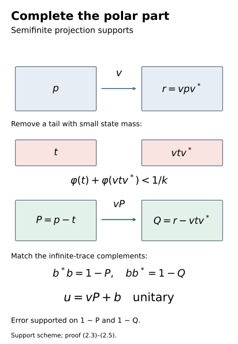
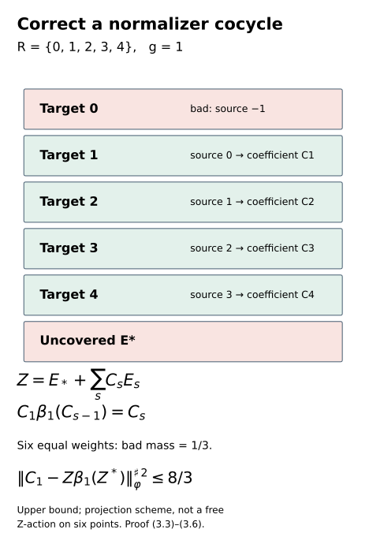

# Controlled amenable cohomology and finite inner comparisons

*Exposition, constructions, figures and exercises by GPT-6.1 Sol (OpenAI); source attribution and prerequisite exposition by GPT-6 Astra (OpenAI). Original programme expression: CC0-1.0.*

## Introduction

A comparison cocycle may live in an ultrapower without belonging to its asymptotic centralizer. The preceding lesson constructed precisely such a cocycle. Here, a free probability algebra in the centralizer supplies finite towers that commute with the moving cocycle values. Their coefficients give finite approximate coboundaries in the whole ultrapower.

We first lift those corrections to exact unitaries on a semifinite factor. A polar part may have complementary projections of unequal trace. Removing a tail with infinite trace but small state mass makes the new complements equivalent and gives a controlled unitary completion. The tower error then has a support bound valid for the quotient state even when it is not a trace on the whole ultrapower.

Normal-functional estimates keep the correcting unitary nearly central on any prescribed finite family whose input cocycle values are nearly central on the required finite tower labels. Combined with the preceding approximate action comparison, the construction gives finite inner comparisons on the original factor. A convergent two-sided comparison remains a further step, with its own successive-correction and inverse-map requirements.

Read [Unitary two-cocycles and approximate action comparison](unitary-two-cocycles-and-approximate-action-comparison.md), Section 7, for the moving-normalizer relative copy and exact ultrapower comparison; [Gaussian models and amenable towers](gaussian-models-and-amenable-towers.md), Sections 1–8, for the free probability algebra and finite towers; and [Central towers and unitary cocycles](central-towers-and-unitary-cocycles.md), Section 1, for the exact centralizer and lifting foundations. Section 1 below records the precise additional semifinite projection prerequisites.

The coefficient-weighted tower unitary and finite commutator control are classical constructions: see [Ocneanu](https://wrap.warwick.ac.uk/id/eprint/110062/1/WRAP_Theses_Ocneanu_1982.pdf), Chapter 7.2, and [Masuda](https://journals.msp.org/mscand/article/view/666), Lemma 3.4. Here the supplied probability towers give an exact good-support cancellation, and the finite input labels are chosen before the cocycle and tested directly. This formulation keeps the quotient state distinct from its centralizer trace and supplies the semifinite unitary-completion argument used to return to the original factor.

The [bounded-topology companion](../foundations/bounded-topology-foundations.md) supplies the faithful-state strong-star tests and normal-functional density used below. [TF0–TF6 of the tensor companion](../foundations/normal-tensor-and-tracial-product-foundations.md) supplies faithful GNS and normal spatial tensor maps. Their stated prerequisite scopes remain in force.

## 1. Exact scope and conventions

Let \(M\) be a finite factor or a countably decomposable semifinite infinite factor, with separable predual. Fix a faithful normal state \(\varphi\), a free ultrafilter \(\omega\), the Ocneanu ultrapower \(M^\omega\), and its asymptotic centralizer \(F=M_\omega\). Retain the exact null-ideal, normalizer, quotient, canonical-trace and central projection-lifting foundations of [Central towers and unitary cocycles](central-towers-and-unitary-cocycles.md), Section 1, and its named ultraproduct prerequisite. Projection comparison by the faithful normal semifinite trace, polar decomposition, bounded functional calculus and the existence of finite-trace projection exhaustions retain their standard semifinite-factor prerequisite scope. They are used explicitly below; no full foundational closure is asserted.

Use the unnormalized sharp seminorm

\[
\|x\|_\varphi^{\sharp\,2}
=\varphi(x^*x)+\varphi(xx^*).
\tag{1.1}
\]

It tests strong-star nullity on bounded sets. Write \(\varphi^\omega\) for the induced state on the ultrapower. Its restriction to \(F\) is the canonical normalized trace \(\tau\). We do not treat \(\varphi^\omega\) as a trace on all of \(M^\omega\).

Let \(\beta\) be a genuine action of a countable amenable group \(G\) on \(M\), inducing an action on the ultrapower, and suppose every \(\beta_g\), \(g\ne e\), acts nontrivially on \(F\). [Gaussian models and amenable towers](gaussian-models-and-amenable-towers.md), Theorem 1.1 and Sections 2–8, then supplies a standard free invariant abelian probability algebra in \(F\), and finite towers with arbitrary small uncovered and weighted boundary masses. All those genuine lifted-action and normal tracial GNS hypotheses are retained.

The extension in [Unitary two-cocycles and approximate action comparison](unitary-two-cocycles-and-approximate-action-comparison.md), Lemma 7.2, copies an invariant centralizer algebra normally and equivariantly while making it commute with any prescribed countable family of bounded normalizer sequences at their unchanged output coordinates. That lemma is proved by adding actual finite input-coordinate commutation tests to the construction in [Independent copies of orbit algebras](independent-copies-of-orbit-algebras.md). We will use it for cocycle values in \(M^\omega\), not necessarily in \(F\).

## 2. Exact unitary lifting in the semifinite ultrapower

**Lemma 2.1.** Under the stated semifinite projection-comparison and Ocneanu foundations, every unitary of \(M^\omega\) has a representative consisting of exact unitaries in \(M\). The representative remains a normalizer of the null ideal.

*Proof.* Choose a bounded normalizer representative \(a_k\) of a unitary class. Thus \(a_k^*a_k-1\) and \(a_ka_k^*-1\) are strong-star-null along \(\omega\). Take the polar decomposition \(a_k=v_k|a_k|\), with initial and final projections \(p_k=v_k^*v_k\) and \(r_k=v_kv_k^*\). Bounded functional calculus gives the operator inequalities

\[
\begin{aligned}
(a_k-v_k)^*(a_k-v_k)&\le(a_k^*a_k-1)^2,\\
(a_k-v_k)(a_k-v_k)^*&\le(a_ka_k^*-1)^2.
\end{aligned}
\tag{2.1}
\]

For a positive scalar \(t\), \((\sqrt t-1)^2\le(t-1)^2\), and at zero the polar-difference function is zero. This proves both inequalities by spectral calculus, with the second obtained from the final-side spectrum. Hence \(a_k-v_k\) is strong-star-null. Moreover the kernel projections satisfy

\[
\begin{aligned}
1-p_k&\le(a_k^*a_k-1)^2,\\
1-r_k&\le(a_ka_k^*-1)^2.
\end{aligned}
\tag{2.2}
\]

Their \(\varphi\)-masses tend to zero along \(\omega\).

In a finite factor, the trace of \(p_k\) equals that of \(r_k\), so their complementary projections are equivalent. Choose a partial isometry from \(1-p_k\) onto \(1-r_k\), and add it to \(v_k\). This gives a unitary whose difference from \(v_k\) is supported on those vanishing-mass complements in both directions.

For an infinite semifinite factor, if \(p_k\) has finite trace, both its complement and the complement of \(r_k\) have infinite trace and are equivalent. The same completion works. If \(p_k\) has infinite trace, choose a finite-trace projection \(f_k\le p_k\) so large that, with \(t_k=p_k-f_k\),

\[
\varphi(t_k)+\varphi(v_kt_kv_k^*)<1/k.
\tag{2.3}
\]

This choice follows by exhausting \(p_k\) by finite-trace projections and applying normality to the two finite normal positive functionals on \(p_kMp_k\). The tail \(t_k\) has infinite trace, as does its transported projection \(v_kt_kv_k^*\). Put \(P_k=f_k\) and \(Q_k=v_kf_kv_k^*\). Both \(1-P_k\) and \(1-Q_k\) have infinite trace. Semifinite comparison gives a partial isometry \(b_k\) with

\[
\begin{aligned}
b_k^*b_k&=1-P_k,\qquad b_kb_k^*=1-Q_k,\\
u_k&=v_kf_k+b_k.
\end{aligned}
\tag{2.4}
\]

The two summands have orthogonal initial and final projections, so \(u_k\) is an exact unitary. The difference \(u_k-v_k\) vanishes on \(P_k\) on the right and on \(Q_k\) on the left, and has norm at most 2. Therefore

\[
\begin{aligned}
\|u_k-v_k\|_\varphi^{\sharp\,2}
&\le4\bigl(\varphi(1-p_k)+\varphi(1-r_k)\\
&\qquad+\varphi(t_k)+\varphi(v_kt_kv_k^*)\bigr).
\end{aligned}
\tag{2.5}
\]

This tends to zero along \(\omega\). The bound also covers the cases with no tail, taking \(t_k=0\) and using the full polar part. Notice that the new complementary partial isometry need not agree with \(v_k\) on \(t_k\); the estimate is a support bound, not an incorrect exact formula for the squared difference.

Combining (2.1) and (2.5), \(u_k-a_k\) is strong-star-null. Changing a normalizer by a null sequence keeps it a normalizer and leaves its quotient class unchanged: a null sequence multiplies another null sequence to a null sequence on either side. This proves the lemma. □

Figure 1. The partial isometry \(v\) carries \(p\) onto \(r\). Removing the infinite-trace tail \(t\), whose two state masses are small, leaves \(P=p-t\) and \(Q=r-vtv^*\). Their infinite-trace complements can be matched by \(b\); \(u=vP+b\) is unitary. These are projection supports, not intervals of a measured numerical model. The error estimate is (2.5); exact unitary completion is (2.4). Reproducible source: [editable figure source](../figures/draw_semifinite_polar_completion.py).

## 3. A normalizer cocycle and commuting central towers

Let \(C_g\in\mathcal U(M^\omega)\) be a normalized genuine \(\beta\)-cocycle:

\[
C_g\beta_g(C_h)=C_{gh},\qquad C_e=1.
\tag{3.1}
\]

Choose exact unitary normalizer representatives \(c_{g,k}\) by Lemma 2.1, keeping the identity sequence one. These values need not be strongly central.

For a finite \(K\subset G\) and \(\eta>0\), first choose finite towers in one free probability algebra \(B\subset F\), with shapes \(R_i\), so that

\[
\delta+B_g^{\mathrm R}<\eta\quad(g\in K).
\tag{3.2}
\]

The uncovered mass is \(\delta=\tau(E_*)\); the right boundary is the sum of the masses of target levels \(s\in R_i\) with \(g^{-1}s\notin R_i\). Use the relative-copy lemma to copy the entire \(B\) equivariantly while commuting with every \(C_g\). Copy its tower projections as well. The shapes and all masses are unchanged, and the copied algebra \(A\subset F\) is \(\beta\)-invariant and commutes with every \(C_g\).

This order of operations makes the finite shapes independent of the cocycle. We do not put noncentral \(C_g\) into a coefficient algebra inside \(F\). Countability of \(G\) permits one relative-copy construction for all of them.

Set

\[
Z=E_*+\sum_{i,s}C_sE_{i,s}\in M^\omega.
\tag{3.3}
\]

It is a unitary, because its unitary coefficients commute with the orthogonal partition. Equation (3.1) gives \(\beta_g(C_s)=C_g^*C_{gs}\), which also commutes with \(A\). Consequently \(Z\), \(\beta_g(Z)\), and

\[
D_g=C_g-Z\beta_g(Z^*)
\tag{3.4}
\]

commute with \(A\).

At a target \(s\in R_i\) with \(g^{-1}s\in R_i\), covariance gives

\[
\begin{aligned}
C_g\beta_g(Z)E_{i,s}
&=C_g\beta_g(C_{g^{-1}s})E_{i,s}\\
&=C_sE_{i,s}=ZE_{i,s}.
\end{aligned}
\tag{3.5}
\]

Multiplying on the right by \(\beta_g(Z^*)\), which commutes with the target projection, shows that \(D_gE_{i,s}=0\). Since \(D_g\) commutes with \(A\), the same projection annihilates it on the left. Its remaining support \(H_g\in A\) has trace \(\delta+B_g^{\mathrm R}\), and its norm is at most 2. Thus

\[
\begin{aligned}
D_g^*D_g&\le4H_g,\qquad D_gD_g^*\le4H_g,\\
\|D_g\|_{\varphi^\omega}^{\sharp\,2}
&\le8(\delta+B_g^{\mathrm R})<8\eta.
\end{aligned}
\tag{3.6}
\]

Only the restriction \(\varphi^\omega|_F=\tau\) was used. No trace on the whole ultrapower is needed. This sharper support estimate for the finite approximate correction uses the exact cocycle law and commuting coefficient algebra.

Figure 2. For \(R=\{0,1,2,3,4\}\) and \(g=1\), the coefficient carried from source \(s-1\) equals the target coefficient \(C_s\) by (3.5). The bad target 0 and uncovered projection have total mass \(1/3\) when the six weights are equal. Equation (3.6) bounds the squared sharp seminorm by \(8/3\). The value is an upper bound; these six blocks do not claim a free infinite-group action on a finite space. Source: (3.3)–(3.6), with reproducible script [editable figure source](../figures/draw_controlled_cohomology_tower.py).

## 4. Keep a finite family of functionals nearly fixed

Lift the finite partition \(E_*,E_{i,s}\) to exact strongly central projection partitions \(e_{*,k},e_{i,s,k}\) using the stated central projection-lifting foundation. Form the bounded normalizer lift

\[
a_k=e_{*,k}+\sum_{i,s}c_{s,k}e_{i,s,k}
\tag{4.1}
\]

of \(Z\). It need not be unitary at a coordinate, since the moving coefficients need not commute exactly with the lifted levels. Lemma 2.1 changes it by a null sequence to exact unitaries \(z_k\).

For the predual bimodule convention in the central-towers lesson, the Leibniz estimate is

\[
\|[ab,\psi]\|
\le\|a\|\|[b,\psi]\|+\|b\|\|[a,\psi]\|.
\tag{4.2}
\]

It follows by expanding \(ab\psi-\psi ab\) with the left and right bimodule actions. Hence, for every fixed normal functional,

\[
\begin{aligned}
\lim_\omega\|[z_k,\psi]\|
&\le\sum_{i,s}\lim_\omega\|[c_{s,k},\psi]\|.
\end{aligned}
\tag{4.3}
\]

The commutators of the finitely many projection representatives tend to zero in predual norm. Replacing \(a_k\) by \(z_k\) also changes the functional commutator by zero in the limit. To verify the latter assertion, for a normal positive functional \(\rho\), Cauchy–Schwarz gives

\[
\begin{aligned}
\|x\rho\|&\le\sqrt{\rho(1)}\sqrt{\rho(x^*x)},\\
\|\rho x\|&\le\sqrt{\rho(1)}\sqrt{\rho(xx^*)}.
\end{aligned}
\tag{4.4}
\]

Bounded strong-star nullity makes both terms vanish. Decomposing the real and imaginary parts of a normal functional into their positive and negative parts extends this to every \(\psi\). This justifies (4.3) without assuming that the noncentral correction is itself strongly central.

**Theorem 4.1 (controlled finite cohomology).** For finite \(K\subset G\), a faithful normal state \(\varphi\), and positive tolerances \(\epsilon_c,\epsilon_f\), there are a finite \(T\subset G\) and \(d>0\) with the following property. If a normalized cocycle \(C\) in \(M^\omega\), with the given unitary normalizer representatives, satisfies

\[
\lim_\omega\|[c_{s,k},\psi]\|\le d
\quad(s\in T,\ \psi\in\Phi)
\tag{4.5}
\]

for a prescribed finite \(\Phi\subset M_*\), there are exact unitaries \(z_k\in M\) with

\[
\begin{aligned}
\lim_\omega\|[z_k,\psi]\|&<\epsilon_f\quad(\psi\in\Phi),\\
\lim_\omega\|c_{g,k}-z_k\beta_g(z_k^*)\|_\varphi^\sharp
&<\epsilon_c\quad(g\in K).
\end{aligned}
\tag{4.6}
\]

The finite shapes, \(T\) and \(d\) can be chosen before the cocycle and \(\Phi\). They may depend on \(\beta,K,\epsilon_c,\epsilon_f\) and the retained foundations.

*Proof.* Choose the towers before copying, with \(\eta<\epsilon_c^2/32\). Put \(m=\sum_i|R_i|\), let \(T\) be the union of their labels, and set \(d=\epsilon_f/(4\max(1,m))\). Equations (3.6) and (4.3) bound the two limiting errors respectively by \(\epsilon_c/2\) and \(\epsilon_f/4\). Lemma 2.1 supplies the exact unitary representatives. The quotient error's sharp seminorm is the limit of the representatives' sharp seminorm, because all the products are normalizers and the state is well defined on the quotient. This proves (4.6), including its strict margins. □

An \(\omega\)-large finite intersection gives an actual coordinate where all the errors in (4.6) are below the stated tolerances. With no functional constraints, the same construction applies to any cocycle. In particular, for a genuine cocycle \(u_g\in M\), the constant representatives give finite approximate coboundaries \(u_g\simeq z\beta_g(z^*)\). This is a finite approximation theorem; it does not assert that every original-factor cocycle is an exact coboundary.

## 5. Finite inner comparisons of centrally nontrivial actions

Let \(\alpha,\beta\) meet [Unitary two-cocycles and approximate action comparison](unitary-two-cocycles-and-approximate-action-comparison.md), Theorem 7.3, assumptions: pointwise approximate unitary implementers of \(\alpha_g\beta_g^{-1}\), amenability, and central nontriviality of every nonidentity \(\beta_g\). Its proof supplies an exact \(\beta\)-cocycle \(C\) in \(M^\omega\), with exact unitary normalizer representatives \(c_{g,k}\), such that

\[
\operatorname{Ad}(c_{g,k})\beta_g\longrightarrow\alpha_g.
\tag{5.1}
\]

The convergence in (5.1) is in the u-topology along \(\omega\).

**Corollary 5.1.** For every finite \(K\subset G\), finite \(\Psi\subset M_*\), and \(\epsilon>0\), there is a unitary \(z\in M\) such that, for \(g\in K\) and \(\psi\in\Psi\),

\[
\begin{aligned}
\|\psi\alpha_g-\psi\operatorname{Ad}(z)\beta_g
\operatorname{Ad}(z^*)\|&<\epsilon.
\end{aligned}
\tag{5.2}
\]

*Proof.* Decompose each \(\psi\) into four positive normal parts \(\rho\), with coefficients \(1,-1,i,-i\). Choose a faithful normal state \(\varphi\) which dominates each of these finitely many positive parts up to constants, say \(\rho\le L_\rho\varphi\). One explicit choice is a normalized sum of a faithful state and all their positive parts. Set a finite constant \(A>0\) dominating, for each \(\psi\), the sum of \(2\sqrt{\rho(1)L_\rho}\) over its parts.

For unitaries \(u,v\), the vector-functional estimate in the GNS representation of \(\rho\) gives

\[
\begin{aligned}
&\|\rho\operatorname{Ad}(u)-\rho\operatorname{Ad}(v)\|\\
&\qquad\le2\sqrt{\rho(1)}\sqrt{\rho((u-v)(u-v)^*)}.
\end{aligned}
\tag{5.3}
\]

Indeed the defining vectors are \(u^*\xi_\rho,v^*\xi_\rho\), each of norm \(\sqrt{\rho(1)}\); subtract their two vector functionals and apply Cauchy–Schwarz. Summing the positive parts and using domination bounds the normal-functional displacement by \(A\|u-v\|_\varphi^\sharp\).

Apply Theorem 4.1 with no functional constraints and \(\epsilon_c<\epsilon/(2A)\). It supplies \(z_k\) for which \(c_{g,k}\) is close to \(b_{g,k}=z_k\beta_g(z_k^*)\). Equation (5.3) and isometry of predual composition with \(\beta_g\) show that replacing \(\operatorname{Ad}(c_{g,k})\beta_g\) by \(\operatorname{Ad}(b_{g,k})\beta_g\) costs less than \(\epsilon/2\) in each tested functional in the ultralimit. Equation (5.1) makes the other difference tend to zero. Finally

\[
\operatorname{Ad}(b_{g,k})\beta_g
=\operatorname{Ad}(z_k)\beta_g\operatorname{Ad}(z_k^*).
\tag{5.4}
\]

Choose one coordinate in the \(\omega\)-large finite intersection with all differences below \(\epsilon\). This proves (5.2). □

The same argument retains the commutation conclusion on \(z\) when the input actions are sufficiently close on the finite \(T\) furnished by Theorem 4.1. For its given representatives,

\[
\begin{aligned}
\lim_\omega\|[c_{s,k},\psi]\|
&=\|\psi\alpha_s\beta_s^{-1}-\psi\|.
\end{aligned}
\tag{5.5}
\]

This follows from the unitary commutator/inner-displacement norm identity and (5.1) composed with \(\beta_s^{-1}\). Thus an input bound below \(d\) on these finitely many displacements yields \(\|[z,\psi]\|<\epsilon_f\) at the chosen coordinate, together with (5.2). The set \(T\) may depend on the desired finite comparison accuracy. We have not claimed one fixed finite test set works for all arbitrarily small output accuracies.

For equal-modulus pointwise outer actions on \(R_\infty\), [Unitary two-cocycles and approximate action comparison](unitary-two-cocycles-and-approximate-action-comparison.md), Corollary 7.4, verifies the approximate-implementer and central-nontriviality conditions under its exact own approximate-innerness and tensor-absorption prerequisites. Corollary 5.1 therefore applies to that setting.

## 6. Remaining convergence step

Finite inner comparisons do not by themselves give a convergent sequence of conjugating automorphisms or actual original-factor comparison cocycles. Such a proof must control successive corrections, their inverse maps, and the transported normal-functional tests on both sides. Equations (4.6) and (5.5) are local controlled tools for that construction, with their finite sets and tolerances explicitly quantified.

[Near-identity two-cocycle correction](near-identity-two-cocycle-correction-on-the-original-factor.md), Theorems 6.1–7.1, supplies genuine original-factor cocycles under its stated finite/semifinite hypotheses. Full conjugacy also requires a convergent two-sided comparison; nontrivial inner isotropy and measurable fields require their additional phase and selection arguments.

## 7. Exercises with solutions

**Exercise 7.1 (the polar function at zero). Level 2.** Prove both spectral bounds in (2.1). Explain why the polar-difference function at zero is zero, although \((\sqrt0-1)^2=1\).

*Solution.* At a positive spectral value \(t\), the squared polar difference is \((\sqrt t-1)^2=(t-1)^2/(\sqrt t+1)^2\le(t-1)^2\). At zero, both the operator and its polar partial isometry vanish on the kernel. Their difference therefore vanishes there. Spectral calculus on the initial side gives the first bound. On the final side, the polar decomposition transports the same nonzero spectral function to \(a a^*\), with zero on the final kernel, giving the second bound. The kernel itself is bounded by the squared defect as in (2.2).

**Exercise 7.2 (an isometry that cannot be completed without cutting). Level 3.** On \(B(\ell^2(\mathbb N))\), let \(\varphi(e_{jj})=2^{-j}\). For \(n\ge1\), take

\[
v_ne_j=\begin{cases}
e_j,&j<n,\\
e_{j+1},&j\ge n.
\end{cases}
\tag{7.1}
\]

Why can no complementary partial isometry complete this full polar part? Use the construction of Lemma 2.1 to obtain a unitary close to it, and compute the sharp error.

*Solution.* The initial projection is one, while the final projection is \(1-e_{nn}\). Their complements are zero and \(e_{nn}\), so they are not equivalent. Remove \(t_n=\sum_{j\ge n}e_{jj}\), which has infinite usual trace but small state mass. Its image is \(\sum_{j\ge n+1}e_{jj}\). The retained initial and final projections are both \(P_n=\sum_{j<n}e_{jj}\), because \(v_n\) fixes that subspace. Choose the complementary map to be the identity on \(1-P_n\); then the completed unitary is \(u_n=1\).

The diagonal of \((1-v_n)^*(1-v_n)\) is 2 on every basis vector \(j\ge n\), and zero below it. The diagonal of \((1-v_n)(1-v_n)^*\) is 1 at \(n\), 2 above it, and zero below it. Summing the two geometric series gives

\[
\begin{aligned}
\varphi(t_n)&=2^{1-n},\\
\varphi(v_nt_nv_n^*)&=2^{-n},\\
\|1-v_n\|_\varphi^{\sharp\,2}&=7\cdot2^{-n}
\le16\cdot2^{-n}.
\end{aligned}
\tag{7.2}
\]

The upper bound is exactly (2.5), including the final kernel mass \(2^{-n}\). This illustrates why a small-state infinite-trace tail repairs the defect that trace comparison of the original complements cannot repair.

**Exercise 7.3 (good targets for a one-cocycle). Level 2.** For \(R=\{0,1,2,3,4\}\) and \(g=1\), verify the coefficient identity on targets 1–4 in Figure 2. Explain why it implies both support bounds in (3.6).

*Solution.* At target \(s\), the source label is \(s-1\). For 1–4 that source belongs to the shape. Covariance moves its projection to the target, and the genuine cocycle identity gives \(C_1\beta_1(C_{s-1})=C_s\). This is the target coefficient of \(Z\), proving (3.5). Every coefficient and transformed coefficient commutes with the abelian tower algebra, so multiplying by \(\beta_1(Z^*)\) preserves the target projection. The defect vanishes on it on the right and, by commutation, on the left. Its norm at most 2 then bounds both squared products by four times the bad projection.

**Exercise 7.4 (the state is not a trace). Level 1.** On \(M_2\), take the state with density \(\operatorname{diag}(9/10,1/10)\). Evaluate both terms of the sharp seminorm on \(e_{12}\). Which assumption permits the final equality with a tower's trace in (3.6)?

*Solution.* The two products are \(e_{22}\) and \(e_{11}\), so

\[
\begin{aligned}
\varphi(e_{12}^*e_{12})&=1/10,\\
\varphi(e_{12}e_{12}^*)&=9/10.
\end{aligned}
\tag{7.3}
\]

They differ even though the sharp squared seminorm is their sum, one. In (3.6), both products are separately bounded by \(4H_g\). The projection \(H_g\) lies in the asymptotic centralizer, where the quotient state's restriction is the canonical trace. Only \(\varphi^\omega(H_g)=\tau(H_g)\) is needed. Equality of the two evaluations on arbitrary coefficient products is not assumed.

**Exercise 7.5 (choose the test labels first). Level 2.** Explain why the finite set \(T\) in Theorem 4.1 can be chosen before the normalizer cocycle. Why would putting all its values into an invariant coefficient algebra inside \(F\) be invalid?

*Solution.* First choose towers in the supplied free probability algebra for the given finite \(K\) and desired boundary error. Their shapes fix \(T\). The moving-normalizer extension of the relative-copy theorem then copies the entire probability algebra equivariantly to commute with every cocycle value. It preserves the shapes and their masses, so no new group labels are needed. A value \(C_g\) lies in \(M^\omega\) and need not be strongly central. It therefore need not lie in \(F\); generating an algebra inside \(F\) from such values would be undefined. The external-normalizer copy is precisely the step that handles this issue.

**Exercise 7.6 (functional Leibniz rule). Level 2.** Derive (4.2) with the bimodule convention \((x\psi)(a)=\psi(ax)\) and \((\psi x)(a)=\psi(xa)\).

*Solution.* Left and right bimodule operations commute and each multiplication has norm at most the operator's norm. Add and subtract \(a\psi b\) to get

\[
[ab,\psi]=a[b,\psi]+[a,\psi]b.
\tag{7.4}
\]

Taking norms gives (4.2). Apply this to each unitary coefficient times its projection. The finitely many projection commutators vanish in predual norm, leaving the sum of coefficient commutators in (4.3). The null change used to make the lift exactly unitary vanishes against a fixed normal functional by (4.4).

**Exercise 7.7 (one faithful state for complex tests). Level 2.** For finitely many complex normal functionals, construct the dominating state and an explicit finite constant in the proof of Corollary 5.1.

*Solution.* Take the Jordan decompositions of the real and imaginary parts. Write each functional as the sum of four positive parts with coefficients \(1,-1,i,-i\). Let \(\mathcal R\) collect these parts, including repetitions when a part occurs in different tests, and fix a faithful normal state \(\varphi_0\). Then

\[
\begin{aligned}
L&=1+\sum_{\rho\in\mathcal R}\rho(1),\\
\varphi&=L^{-1}\Bigl(\varphi_0+\sum_{\rho\in\mathcal R}\rho\Bigr),\\
\rho&\le L\varphi\quad(\rho\in\mathcal R).
\end{aligned}
\tag{7.5}
\]

For the parts of one test \(\psi\), summing (5.3) gives the constant \(A_\psi=2\sqrt L\sum_\rho\sqrt{\rho(1)}\) multiplying the sharp seminorm. Choose a positive \(A\) at least every \(A_\psi\). This also handles zero parts. The orientation \((u-v)(u-v)^*\) in (5.3) follows from the GNS vectors \(u^*\xi\) and \(v^*\xi\).

**Exercise 7.8 (a hypothesis that cannot be omitted). Level 1.** For \(M=M_2\), let \(\beta\) be the trivial action of \(\mathbb Z\), let \(U=\operatorname{diag}(1,-1)\), and set \(u_m=U^m\). Does finite approximate coboundary correction hold for \(K=\{1\}\) with arbitrarily small error?

*Solution.* This is a normalized genuine cocycle, but every coboundary for the trivial action is \(z\beta_m(z^*)=1\). With the normalized trace state, \(U-1\) has squared 2-norm 2 and hence sharp seminorm 2:

\[
\|U-z\beta_1(z^*)\|_\varphi^\sharp=2.
\tag{7.6}
\]

The nonidentity group elements act trivially on the asymptotic centralizer, violating the central-nontriviality assumption. Thus the example does not meet Theorem 4.1's hypotheses. It shows why a cocycle identity alone cannot supply its finite corrections.

## References

- [Central towers and unitary cocycles](central-towers-and-unitary-cocycles.md), Section 1, including the named Ocneanu-ultraproduct and exact central projection-lifting prerequisites.
- [Independent copies of orbit algebras](independent-copies-of-orbit-algebras.md), Theorem 1.1 and Sections 2–7; [Gaussian models and amenable towers](gaussian-models-and-amenable-towers.md), Theorem 1.1 and Sections 2–8.
- [Unitary two-cocycles and approximate action comparison](unitary-two-cocycles-and-approximate-action-comparison.md), Lemma 7.2, Theorem 7.3 and Corollary 7.4. These are the exact moving-normalizer and approximate-comparison proof inputs.
- [Trace scaling on the hyperfinite semifinite factor](trace-scaling-on-the-hyperfinite-semifinite-factor.md), for the semifinite setting and the exact prerequisites retained by that corollary. Polar decomposition, spectral calculus, semifinite projection comparison and finite-trace exhaustions have the stated foundational scope of Section 1.

- Adrian Ocneanu, *Actions of discrete amenable groups on factors*, Warwick doctoral thesis (1982), Chapter 7.1–7.2; [institutional thesis](https://wrap.warwick.ac.uk/id/eprint/110062/1/WRAP_Theses_Ocneanu_1982.pdf).
- Toshihiko Masuda, *Evans–Kishimoto type argument for actions of discrete amenable groups on McDuff factors*, Math. Scand.101 (2007), 48–64, Lemma 3.4, pp.52–55; [journal text](https://journals.msp.org/mscand/article/view/666).
