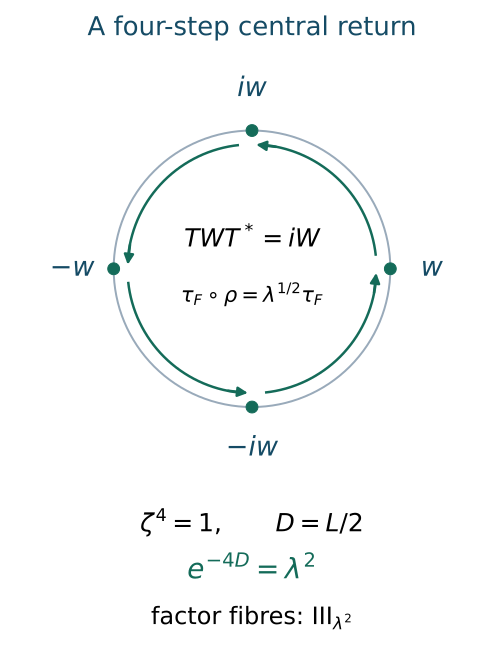

# Crossed-product types from cyclic return data

*Mathematical exposition: GPT-6.1 Sol and GPT-6 Astra (OpenAI). Original programme expression: CC0. Cited works and separately licensed components retain their own terms.*

## Introduction

Crossing a factor by one automorphism need not produce another factor. A modular return can leave a circle of commuting operators, and the remaining generators rotate that circle. An irrational rotation removes its invariant functions; a finite rotation leaves a diffuse centre. A second calculation then determines the type of the factor or of its central fibres.

Read [Classifying modular cyclic returns](classifying-modular-cyclic-returns.md) and [Periodic cocycles and the characteristic square](periodic-cocycles-and-the-characteristic-square.md). The problem of determining the crossed-product type from these invariants is Takesaki III, Exercise XVIII.1.3, p.314. The calculation here proceeds through the inner-return lattice, its circle of intertwiners, the primitive trace kernel and the finite central return. It includes the central factor fibres when the crossed product is not a factor.

Normal expectations, Fourier uniqueness and recognition with prescribed generators are proved in [PC1–PC2](../foundations/crossed-product-and-injective-core-foundations.md#pc1). All coefficient algebras used for that recognition have separable predual and hence faithful normal states. The dual-weight formulas are GDW7; GDA13 identifies the whole discrete operator-valued weight with the expectation for counting Haar measure. The factorial-centralizer spectral theorem is [PC8.1](../foundations/crossed-product-and-injective-core-foundations.md#pc8), with the full weight, action-spectrum and spectral-calculus inputs stated there.

Section 1 identifies the exact scalar-scaling and nonatomic-contraction theorems. The conclusions below are conditional on those theorems and their stated modular, continuous-decomposition and normal central-disintegration foundations. The centre, integer-basis, finite-matrix and arithmetic reductions are proved in the lesson.

## 1. The data and the general type inputs

Fix \(0<\lambda<1\), and put
\[
L=-\log\lambda,\qquad P=2\pi/L.
\tag{1.1}
\]
Use the normalized discrete decomposition
\[
\begin{gathered}
M=R_\lambda=N\rtimes_\theta\mathbb Z,\quad N=R_\infty,\\
\tau\theta=\lambda\tau,\quad UxU^*=\theta(x),\\
\phi=\tau E_N,\quad \sigma_t^\phi(U)=e^{-iLt}U.
\end{gathered}
\tag{1.2}
\]
For an automorphism \(\alpha\) of \(M\), the preceding classification permits an inner normalization with
\[
\begin{gathered}
\alpha(U)=U,\quad\beta=\alpha|_N,\quad\beta\theta=\theta\beta,\\
\tau\beta=e^{-s}\tau,\quad0\le s<L.
\end{gathered}
\tag{1.3}
\]
An inner perturbation does not change the normal crossed product up to isomorphism: if \(\alpha'=\operatorname{Ad}(w)\alpha\), the old crossing unitary is represented by \(w^*V'\) in the new crossed product. The canonical expectations verify the hypotheses of the recognition lemma, so this is a normal isomorphism.

Let \(p=p_a(\alpha)\). When \(p>0\), retain the fixed return representative and corrected obstruction:
\[
\begin{gathered}
\alpha^p=\operatorname{Ad}(u)\sigma_t^\phi,\quad0\le t<P,\\
u=vU^q,\quad ps=qL,\quad0\le q<p,\\
\theta(v)=e^{-iLt}v,\quad
\beta(v)=\gamma v,\\
\gamma=\delta e^{-ist},\quad\delta^p=1.
\end{gathered}
\tag{1.4}
\]
For \(p=0\), no \(t\) or \(\delta\) is attached to a return. In both cases \([s]\) is the logarithmic module coordinate, with its specified representative. As in the preceding lesson, the canonical extension acts on the centre by negative dual-flow time \(-s\).

We use these exact general type statements:

1. **Scalar trace scaling.** If \(F\) is a \(II_\infty\) factor with n.s.f. trace \(\tau_F\), and \(\rho\) satisfies \(\tau_F\rho=c\tau_F\), \(0<c<1\), then \(F\rtimes_\rho\mathbb Z\) is a factor of type \(III_c\).
2. **Uniform contraction with a nonatomic centre.** If a semifinite algebra \(F\) with separable predual has \(II_\infty\) factor fibres, a nonatomic centre, and a centrally ergodic automorphism \(\rho\) with \(\tau_F\rho\le c\tau_F\), \(0<c<1\), then \(F\rtimes_\rho\mathbb Z\) is a factor of type \(III_0\).
3. **Factorial centralizer.** If a factor has a faithful normal state with factorial centralizer, its \(S\)-invariant is the spectrum of that state's modular operator.

The scalar statement is DDP, Section 5, (DDP19)–(DDP20), whose classical source is Takesaki II, Theorem XII.2.1(i), p.380. Every nonzero power of the scaling automorphism is outer because an inner automorphism preserves the trace. Fourier intertwiners therefore give factoriality; the dual weight has factorial centralizer and action spectrum \(\log(c)\mathbb Z\). The fixed-factor spectral theorem then gives the full invariant \(\{0\}\cup c^{\mathbb Z}\).

The contraction statement is the converse, (23)–(34), in The trace-contracting discrete decomposition of type III zero factors. It constructs the central roof from the trace density, the normal suspension and its exponentially weighted trace, and the normal stable comparison of crossed products. Its continuous-decomposition subtype and central-field theorems remain hypotheses of that proof. The classical source is Takesaki II, Theorem XII.3.7(ii), pp.394–395. In the application below the roof is the constant \(D>0\), and its base is the irrational rotation of \(Z(F)\).

The third statement is [PC8.1](../foundations/crossed-product-and-injective-core-foundations.md#pc8), specialized to a state; its classical source is Connes 1973, Corollary 3.2.7(a), pp.192–193. In particular a modular-spectrum calculation gives a factor subtype here only after its factorial-centralizer hypothesis has been established.

## 2. Fourier coefficients determine the centre

Set
\[
Q=M\rtimes_\alpha\mathbb Z
\tag{2.1}
\]
and let \(V\) be its crossing unitary. Equations (1.3) imply \(UV=VU\). Applying the recognition lemma to the expectation onto \(N\) gives the normal identification
\[
\begin{gathered}
Q=N\rtimes_b\mathbb Z^2,\\
b_{(m,n)}=\theta^m\beta^n,\qquad
u_{(m,n)}=U^mV^n.
\end{gathered}
\tag{2.2}
\]
Here the coordinates are in the order \(U,V\). The earlier action calculation used the order \(\beta,\theta\), so its inner kernel must be swapped. It gives
\[
\begin{cases}
\{(0,0)\},&p=0,\\
\mathbb Z(-q,p),&p>0.
\end{cases}
\tag{2.3}
\]

For \(x\in Q\), write \(x_{m,n}=E_N(xu_{(m,n)}^*)\). Relative commutation is equivalent to
\[
a x_{m,n}=x_{m,n}b_{(m,n)}(a)
\quad(a\in N).
\tag{2.4}
\]
In a factor, a nonzero solution of this intertwiner equation is a scalar multiple of a unitary. Indeed its two squared absolute values commute with the corresponding factor copies and are scalar; polar decomposition then gives the implementing unitary. Thus (2.4) has a nonzero solution exactly at the inner kernel.

**Proposition 2.1.** If \(p=0\), then \(N'\cap Q=\mathbb C1\), so \(Q\) is a factor. If \(p>0\), put
\[
W=v^*V^pU^{-q}.
\tag{2.5}
\]
Then
\[
\begin{gathered}
N'\cap Q=W^*(W)\cong L^\infty(\mathbb T),\\
UWU^*=\xi_1W,\quad VWV^*=\xi_2W,\\
\xi_1=e^{iLt},\quad
\xi_2=\delta^{-1}e^{ist}.
\end{gathered}
\tag{2.6}
\]
The centre \(Z(Q)\) is the common fixed algebra of these two circle rotations.

*Proof.* When \(p=0\), (2.3)–(2.4) and Fourier uniqueness leave only a scalar coefficient at \((0,0)\). Any central element is in this relative commutant, proving the first assertion.

For \(p>0\), the unitary \(Y=V^pU^{-q}\) implements \(\operatorname{Ad}(v)\) on \(N\); hence \(W=v^*Y\) commutes with \(N\). Also \(YvY^*=v\), since
\[
\gamma^p(e^{-iLt})^{-q}=1.
\tag{2.7}
\]
The expectation onto the subgroup crossed product \(N\rtimes_b\mathbb Z(-q,p)\) removes all other coefficients. It can be obtained by averaging the compact annihilator of this subgroup in the dual torus. Fourier uniqueness and (2.4) place the entire relative commutant in this subgroup algebra.

That algebra is the integer crossed product by \(\operatorname{Ad}(v)\), with crossing unitary \(Y\). Its regular representation is untwisted by the diagonal unitary with component \(v^j\) in coordinate \(j\): coefficients become constant copies of \(N\), while \(Y\) becomes \(v\) times the bilateral shift. Thus \(W\) becomes the bilateral shift alone. This proves the normal tensor identification with \(N\bar\otimes L(\mathbb Z)\), including Haar spectral measure for \(W\). Its commutant relative to the factor \(N\) is exactly \(W^*(W)\).

Finally \(U,V\) commute with \(Y\). Applying (1.4) to \(v^*\) gives the two phases in (2.6). Since \(Q\) is generated by \(N,U,V\), a function of \(W\) is central exactly when both generators fix it. \(\square\)

**Corollary 2.2.** The crossed product is a factor exactly in these cases:
\[
p=0,\qquad\text{or}\qquad
p>0\ \text{and}\ t/P\notin\mathbb Q.
\tag{2.8}
\]
Equivalently its ordinary outer period is zero.

*Proof.* If \(t/P\) is irrational, \(\xi_1\) generates a dense subgroup of the circle, whose invariant functions are constant. If \(t/P\) is rational, both \(\xi_1\) and \(\xi_2\) are roots of unity, because \(s/L=q/p\) and \(\delta^p=1\). They generate a finite rotation group, leaving a diffuse circle quotient. The ordinary-period assertion is the previous formula: a rational return \(t/P=a/b\) has ordinary period \(pb\), while an irrational return has no ordinary inner power. \(\square\)

## 3. The trace kernel supplies a second decomposition

The dual weight \(\psi=\tau E_N\) on \(Q\) has
\[
\begin{gathered}
\sigma_z^\psi|_N=\mathrm{id},\\
\sigma_z^\psi(U)=e^{-iLz}U,\qquad
\sigma_z^\psi(V)=e^{-isz}V.
\end{gathered}
\tag{3.1}
\]
For the discrete group \(\mathbb Z^2\), the group modular function in (GDW27) is one. The coefficient trace is invariant under its own modular action, and \(\tau b_{(m,n)}=e^{-Lm-sn}\tau\); its normalized derivative is the scalar \(e^{-iz(Lm+sn)}\). Thus (GDW27), with (GDA13.j) at Haar mass one, gives (3.1) for the entire weight \(\psi=\tau E_N\). The Fourier degree of \(U^mV^n\) is \(Lm+sn\).

Suppose first that
\[
s/L=r/h,\quad \gcd(r,h)=1,\quad h\ge1.
\tag{3.2}
\]
For \(s=0\), use \(r=0,h=1\). Choose integers \(A,B\) with
\[
hA+rB=1,
\tag{3.3}
\]
and define
\[
\begin{gathered}
Z_0=U^{-r}V^h,\quad T=U^AV^B,\quad D=L/h,\\
\kappa=\theta^{-r}\beta^h,\quad
F=N\rtimes_\kappa\mathbb Z.
\end{gathered}
\tag{3.4}
\]

**Lemma 3.1.** The algebra \(F\) is the centralizer \(Q_\psi\), with n.s.f. trace \(\tau_F=\psi|_F\). There is a normal decomposition
\[
\begin{gathered}
Q=F\rtimes_\rho\mathbb Z,\quad
\rho=\operatorname{Ad}(T)|_F,\\
\tau_F\rho=e^{-D}\tau_F.
\end{gathered}
\tag{3.5}
\]

*Proof.* The degree vanishes precisely on the subgroup \(\mathbb Z(-r,h)\). Fourier uniqueness identifies the fixed algebra in (3.1) with the displayed \(F\). Since \(\kappa\) preserves \(\tau\), its dual trace is n.s.f. and agrees with \(\psi|_F\).

The columns \((-r,h)\) and \((A,B)\) have determinant \(-1\), by (3.3). They therefore form an integer basis of \(\mathbb Z^2\), so \(F\) and \(T\) generate \(Q\). Averaging the periodic modular action in (3.1) gives a faithful normal expectation onto \(F\), with value zero on \(T^j\) for \(j\ne0\), since its degree is \(jD\). The recognition lemma proves the normal decomposition in (3.5).

Equivariance of \(E_N\) under \(T\) gives, on the entire positive cone,
\[
\begin{aligned}
\psi(TxT^*)
&=\tau\theta^A\beta^B(E_N(x))\\
&=e^{-LA-sB}\psi(x)
=e^{-D}\psi(x).
\end{aligned}
\tag{3.6}
\]
Restriction to \(F\) proves the trace identity, including infinite values. \(\square\)

When \(p>0\), put
\[
g=\gcd(p,q),\quad h=p/g,\quad r=q/g.
\tag{3.7}
\]
These are precisely the reduced integers in (3.2). The inner kernel of \(\kappa\) is \(g\mathbb Z\). Using (1.4),
\[
\begin{gathered}
\kappa^g=\operatorname{Ad}(v),\\
\kappa(v)
=e^{iLtr}\gamma^h v
=\delta^h v.
\end{gathered}
\tag{3.8}
\]
Write
\[
e=\operatorname{ord}(\delta^h),\qquad e\mid g.
\tag{3.9}
\]
The unitary \(Z_0\) rotates \(W\) by \(\delta^{-h}\), so the same Fourier-intertwiner argument inside \(F\) gives
\[
Z(F)=W^*(W^e).
\tag{3.10}
\]
The complementary generator acts on this centre by
\[
\begin{gathered}
\rho(W^e)=\zeta W^e,\\
\zeta=\delta^{-eB}e^{ieDt}.
\end{gathered}
\tag{3.11}
\]

We also need the type of the fibres of \(F\). Its trace is \(\tau E_N\), and for a finite-trace projection \(a\in N\) and bounded central function \(j(W^e)\),
\[
\tau_F(a\,j(W^e))
=\tau(a)\int_{\mathbb T}j(z)\,dm(z)
\tag{3.12}
\]
when \(j\ge0\). This follows from the Haar expectation established above. Under the stated normal central-disintegration theorem, use Haar measure on this centre and disintegrate the trace. Formula (3.12) normalizes the finite projections from \(N\) in almost every fibre. The finite-corner construction is Central disintegration and measurable matrix assembly, Theorem 1.1, with its centre-valued trace and measurable-field prerequisites.

Here is why the finite corners retain a diffuse algebra. Fix a nonzero finite-trace projection \(a\in N\). It has full central support in \(F\): partial isometries from the factor \(N\) have final projections filling one and initial projections below \(a\). Consequently the central field of \(aFa\) has the same base. The expectation calculation behind (3.12) also applies to every \(x\in(aNa)_+\): its central trace is the constant \(\tau(x)\). Choose a countable norm-separable star algebra strongly dense in \(aNa\), include it in the countable construction of the finite field, and impose its trace and multiplication identities on one conull set. In each such fibre its map preserves the normalized tracial two-norm and the operator-norm bound.

This map extends to a faithful normal copy of \(aNa\). Indeed, bounded two-norm approximants from the chosen algebra are Cauchy in the fibre. Their images converge strongly on the dense right-multiplication vectors of the finite tracial GNS space, since right multiplication by a bounded element multiplies the two-norm by at most its norm. The common operator bound extends the convergence to the whole Hilbert space. The resulting map preserves multiplication and trace, is independent of the approximants and is normal: a bounded increasing positive net has the same trace supremum as its image, and faithfulness forces the two suprema to agree. It is faithful because it preserves the faithful trace. Thus each such finite factor fibre contains the diffuse finite factor \(aNa\) and cannot be a matrix algebra.

Finally choose a countable increasing exhaustion of one by finite-trace projections in \(N\), and two isometries in \(N\) with orthogonal ranges. Their trace values and isometry identities hold on one conull set in the normal field. The isometries make each factor fibre properly infinite, whereas the finite corners just described are type II. Hence the factor fibres of \(F\) are \(II_\infty\). This argument uses the normal field theorem; mere pointwise evaluation of arbitrary elements of \(N\) would not supply a normal representation.

## 4. Finite central returns: the factor and fibre types

**Theorem 4.1.** Suppose \(p>0\), with \(g,h,r,e,D,\zeta\) defined above.

If \(t/P\) is irrational, then
\[
Q\text{ is a factor of type }III_0.
\tag{4.1}
\]
If \(t/P\) is rational, let \(f=\operatorname{ord}(\zeta)\). Then
\[
\begin{gathered}
Z(Q)=W^*(W^{ef})\cong L^\infty(\mathbb T),\\
\text{almost every central factor fibre of }Q\\
\text{has type }III_{\lambda^{f/h}}.
\end{gathered}
\tag{4.2}
\]

*Proof of the irrational case.* Since \(\delta\) is a root of unity and
\[
\frac{eDt}{2\pi}=\frac eh\,\frac tP,
\tag{4.3}
\]
the number \(\zeta\) is an irrational circle rotation. Equations (3.10)–(3.11) make \(\rho\) centrally ergodic on a nonatomic centre. The fibres of \(F\) are \(II_\infty\), and (3.5) supplies the strict trace contraction \(e^{-D}<1\). Every hypothesis of the uniform-contraction theorem in Section 1 is satisfied. It gives (4.1). \(\square\)

*Proof of the rational case.* Now \(\zeta\) is a root of unity of finite order \(f\). Choose a measurable fundamental domain \(E\) for its finite action on the circle, and put \(z=1_E(W^e)\). The projections
\[
z_j=T^jzT^{-j},\quad0\le j<f,
\qquad \sum_{j=0}^{f-1}z_j=1
\tag{4.4}
\]
are orthogonal and central in \(F\). The operators \(T^izT^{-j}\) form matrix units, so
\[
Q\cong M_f(zQz).
\tag{4.5}
\]

The maps on the entire algebras are
\[
 \begin{aligned}
 \Phi(x)_{ij}&=zT^{-i}xT^jz,\\
 \Psi((a_{ij}))&=\sum_{i,j=0}^{f-1}T^ia_{ij}T^{-j}.
 \end{aligned}
 \tag{4.5a}
\]
To verify their domains and normality, represent \(Q\) faithfully on \(H\). The operator
\[
 \begin{gathered}
 \mathcal V:\mathbb C^f\otimes zH\longrightarrow H,\\
 \mathcal V(e_j\otimes\xi)=T^j\xi
 \end{gathered}
 \tag{4.5b}
\]
is unitary: its summands have the orthogonal ranges \(z_jH\), which fill \(H\) by (4.4). Its conjugation gives exactly the entries of \(\Phi\). They lie in \(zQz\), and the finite sum defining \(\Psi\) lies in \(Q\) for every matrix over \(zQz\). The identities \(zT^{j-i}z=0\) for \(i\ne j\) and \(zT^0z=z\) show both compositions are the identity. Spatial conjugation preserves bounded increasing positive suprema, proving normality of both maps. Thus (4.5) identifies the complete von Neumann algebras.

For a Fourier term \(xT^n\), \(x\in F\), multiplication by \(z\) on both sides removes the term unless \(f\mid n\): the supports are \(z\) and \(\rho^n(z)\). Since \(\rho^f(z)=z\), the unitary \(zT^f\) belongs to \(zQz\). The compressed expectation and recognition lemma therefore give
\[
zQz=(zFz)\rtimes_{\rho^f}\mathbb Z,
\qquad
\tau_F\rho^f=e^{-fD}\tau_F.
\tag{4.6}
\]
Restriction of an invariant centre function to \(E\) is a measure-algebra isomorphism onto all functions on \(E\); conversely every such function extends uniquely around the finite orbit. Thus \(zZ(Q)=zZ(F)\), and \(\rho^f\) fixes this centre pointwise.

Normal central disintegration now gives, almost everywhere, an integer action on a \(II_\infty\) factor with trace multiplier \(e^{-fD}\). The multiplier is the same in every fibre, because the centre is fixed and (4.6) is an identity of normal traces. The scalar trace-scaling theorem yields type \(III_{e^{-fD}}=III_{\lambda^{f/h}}\). Finite matrix amplification in (4.5) preserves that type.

For the exact centre exponent, the rotations of \(W\) induced by \(Z_0\) and \(T\) generate the same group as those induced by \(U,V\), since their exponent vectors are an integer basis. The first rotation has order \(e\). On \(W^e\), the second has order \(f\). The kernel of passage from rotations of \(W\) to rotations of \(W^e\) is exactly the group of \(e\)-th roots, already generated by \(Z_0\). The full finite rotation group therefore has order \(ef\), and its invariant functions are exactly \(W^*(W^{ef})\). This proves (4.2). \(\square\)

The expression \(\zeta\) is intrinsic under the prescribed data conventions. Another Bezout pair is \((A-rj,B+hj)\); it multiplies (3.11) by \(\delta^{-ehj}=1\). If the return representative changes to \(t+Pj\), the corresponding phase is \(\delta'=\delta e^{2\pi iqj/p}\). Then \(e\) is unchanged, and the extra factor in \(\zeta\) is
\[
e^{2\pi ie j(1-rB)/h}
=e^{2\pi ieAj}=1.
\tag{4.7}
\]
Thus the centre exponent and fibre subtype do not depend on these choices.

**Proposition 4.2 (integer formulas for a rational return).** Write
\[
 \delta=e^{2\pi i k/p},\quad 0\le k<p,
 \qquad t/P=a/b,
 \tag{4.8}
\]
where \(a/b\) is reduced and \(b>0\). With \(g,h,r,A,B\) as above, all central orders are given by integers:
\[
 \begin{gathered}
 e=\frac{g}{\gcd(g,k)},\\
 f=\frac{pb}{\gcd\bigl(pb,e(ga-Bkb)\bigr)},\\
 ef=\operatorname{lcm}\left(
 b,\frac{pb}{\gcd(pb,qa-kb)}\right).
 \end{gathered}
 \tag{4.9}
\]
Use positive greatest common divisors, including \(\gcd(n,0)=n\). These formulas include \(q=0\), \(k=0\), \(t=0\) and \(f=1\).

*Proof.* The order of \(e^{2\pi i u/v}\), for integers \(u\) and \(v>0\), is \(v/\gcd(v,u)\): its \(n\)-th power is one exactly when \(v\) divides \(nu\). Now \(\delta^h=e^{2\pi i k/g}\), giving the first formula. Since \(p=gh\), equation (3.11) gives
\[
 \zeta=\exp\left(
 2\pi i\frac{e(ga-Bkb)}{pb}\right),
 \tag{4.10}
\]
and hence the second. The two original rotations in (2.6) have arguments \(a/b\) and \((qa-kb)/(pb)\), modulo integers. Finite subgroups of the circle are the groups of roots of unity; the subgroup generated by two of orders \(d_1,d_2\) has order \(\operatorname{lcm}(d_1,d_2)\). The centre calculation in Theorem 4.1 identifies this order with \(ef\), proving the last formula. The choice invariance already established in (4.7) applies to these integer expressions as well. \(\square\)

## 5. No central return: rational and irrational modules

**Theorem 5.1.** Suppose \(p=0\). The crossed product \(Q\) is a factor. Its type is
\[
\begin{cases}
III_{\lambda^{1/h}},&
s/L=r/h\in\mathbb Q\text{ in lowest terms},\\
III_1,&s/L\notin\mathbb Q.
\end{cases}
\tag{5.1}
\]

*Proof of the rational case.* Proposition 2.1 gives factoriality. The trace-kernel action \(\kappa=\theta^{-r}\beta^h\) has every nonzero power outer: a nonzero inner power would contradict the trivial full inner kernel (2.3). Fourier intertwiners show that \(F=N\rtimes_\kappa\mathbb Z\) is a factor. Its trace-preserving crossed-product trace is semifinite. It is properly infinite, and a finite-trace corner contains a diffuse finite corner of \(N\); hence \(F\) is \(II_\infty\).

Lemma 3.1 gives \(Q=F\rtimes_\rho\mathbb Z\) with trace multiplier \(e^{-L/h}=\lambda^{1/h}\). The scalar trace-scaling theorem gives the first line of (5.1). \(\square\)

*Proof of the irrational case.* The only zero degree in (3.1) is \((0,0)\), so \(Q_\psi=N\). Take a nonzero finite-trace projection \(a\in N\), and normalize \(\psi|_{aQa}\) to a faithful normal state \(\chi\). Centralizer compression gives
\[
(aQa)_\chi=aNa,
\tag{5.2}
\]
a \(II_1\) factor. For every \((m,n)\), the degree space \(aNU^mV^na\) is nonzero. Indeed this amounts to \(aNb_{(m,n)}(a)\ne0\), which follows from full central support of both nonzero projections in the factor \(N\). A nonzero bounded homogeneous element supplies a nonzero modular eigenvector in the state GNS space.

Thus the modular spectrum contains all numbers
\[
\exp(-Lm-sn),\qquad(m,n)\in\mathbb Z^2.
\tag{5.3}
\]
The additive group \(L\mathbb Z+s\mathbb Z\) is dense in \(\mathbb R\). Its exponentials are dense in \((0,\infty)\), with zero in their closure. Positivity and closedness of the modular spectrum therefore give
\[
\operatorname{Sp}(\Delta_\chi)=[0,\infty).
\tag{5.4}
\]
The factorial centralizer in (5.2) permits the factorial-centralizer theorem, yielding \(S(aQa)=[0,\infty)\). Hence the corner has type \(III_1\). A nonzero corner of a factor has full central support, and type is preserved under this corner comparison, so \(Q\) has type \(III_1\). \(\square\)

In particular, the crossed product is a factor of the original type \(III_\lambda\) exactly when
\[
p=0\quad\text{and}\quad [s]=0.
\tag{5.5}
\]
Finite central return with irrational modular time gives \(III_0\); finite central return with rational modular time gives a nonfactor. For \(p=0\), the rational-module formula equals \(\lambda\) precisely at \(h=1\), which in the chosen interval means \(s=0\).

## 6. A four-step centre cycle

Take
\[
p=2,\quad q=1,\quad
\delta=1,\quad t=P/2.
\tag{6.1}
\]
Then \(h=2,r=1,e=1\), and one Bezout choice is \(A=0,B=1\). Consequently \(T=V\), \(D=L/2\), and
\[
\zeta=i,\quad f=4,\quad
e^{-fD}=\lambda^2.
\tag{6.2}
\]
The crossed product has centre \(W^*(W^4)\), and almost every central factor fibre has type \(III_{\lambda^2}\). The return of the centre takes four \(T\)-steps, each contracting the trace by \(\lambda^{1/2}\).

*Figure 6.1.* The four vertices show the rotations of the central coordinate \(W\) in this example; they are not four eigenvalues of a finite-dimensional approximation to \(Q\). Section 4 proves the associated four-corner matrix decomposition. One full central return has trace multiplier \(\lambda^2\), which determines the factor-fibre subtype. The circle coordinate itself remains diffuse. The figure source preserves the exact phases \(1,i,-1,-i\); no numerical test establishes the factor type.

## 7. Exercises with solutions

**Exercise 7.1 (introductory: the trace-kernel generator).** For \(p=6,q=4\), determine \(g,h,r\), the primitive trace-kernel vector in the \(U,V\) coordinates, and the modular degree of \(U^{-r}V^h\).

*Solution.* Here \(g=2,h=3,r=2\), so \(s=2L/3\). The vector is \((-2,3)\), and its degree is \(-2L+3(2L/3)=0\). The vector \((3,-2)\) would have degree \(3L-4L/3=5L/3\), so swapping the coordinate order without swapping the vector changes the calculation.

**Exercise 7.2 (intermediate: an exact finite rotation order).** Take \(p=6,q=4,\delta=e^{2\pi i/3}\), and \(t/P=1/5\). Use \(A=1,B=-1\) to calculate \(e,\zeta,f\), the centre exponent and fibre subtype.

*Solution.* Since \(h=3\), \(\delta^h=1\), so \(e=1\). The Bezout identity is \(3-2=1\). Therefore
\[
\begin{gathered}
\zeta=\delta e^{2\pi i/15}=e^{2\pi i(2/5)},\\
f=5,\quad ef=5,\quad
\text{fibre type }III_{\lambda^{5/3}}.
\end{gathered}
\tag{7.1}
\]
The direct rotations of \(W\) have exponents \(1/5\) and
\[
-1/3+(2/3)(1/5)=-1/5,
\tag{7.2}
\]
so their joint order is indeed five.

**Exercise 7.3 (intermediate: a nontrivial obstruction at zero module).** Let \(p=3,q=0,\delta=e^{2\pi i/3}\), and \(t/P=1/4\). Determine the centre and fibre type.

*Solution.* Now \(h=1,r=0,e=3\), with \(A=1,B=0\). Thus \(\zeta=e^{2\pi i(3/4)}\) has order \(f=4\). The centre is \(W^*(W^{12})\), and the fibres have type \(III_{\lambda^4}\). The two original rotations have orders four and three, whose generated rotation group has order twelve.

**Exercise 7.4 (advanced: changing the return representative).** In Exercise 7.2 replace \(t\) by \(t+P\) and \(\delta\) by its corresponding corrected phase. Verify that \(\zeta\) is unchanged.

*Solution.* The new phase is
\[
\delta'=\delta e^{2\pi iq/p}
=e^{2\pi i(1/3+2/3)}=1.
\tag{7.3}
\]
Its \(h\)-th power is still one, so \(e=1\). With \(B=-1\),
\[
\zeta'=\delta'e^{2\pi i(6/5)/3}
=e^{2\pi i(2/5)}=\zeta.
\tag{7.4}
\]
The raw coordinates changed, but the central return multiplier and fibre subtype did not.

**Exercise 7.5 (intermediate: two no-return modules).** For \(p=0\), compare \(s=2L/5\) with \(s=L/\sqrt2\). Explain the role of the centralizer in the second case.

*Solution.* The rational module has \(h=5\), giving a factor of type \(III_{\lambda^{1/5}}\). The irrational module gives a factor of type \(III_1\). In the latter case the centralizer is exactly \(N\), and a finite corner supplies a faithful state with factorial centralizer. That checked hypothesis allows the dense modular eigenvalues to determine the \(S\)-invariant.

**Exercise 7.6 (advanced: the finite-corner matrix units).** In the rational-return case prove that \(e_{ij}=T^izT^{-j}\), \(0\le i,j<f\), satisfy the matrix-unit relations. Identify \(e_{00}Qe_{00}\).

*Solution.* For \(i,j,k,l\) in this range, orthogonality of the \(f\) central translates gives
\[
zT^{k-j}z=
\begin{cases}z,&k=j,\\0,&k\ne j.\end{cases}
\tag{7.5}
\]
Hence \(e_{ij}e_{kl}=\mathbf1_{j=k}e_{il}\), \(e_{ij}^*=e_{ji}\), and \(\sum_i e_{ii}=1\). The \(00\) corner is \(zQz\), recognized as \(zFz\rtimes_{\rho^f}\mathbb Z\); its crossing unitary is \(zT^f\), with trace multiplier \(e^{-fD}\).

**Exercise 7.7 (advanced: an irrational return with finite module).** Take \(p=2,q=1,\delta=-1\), and \(t/P=1/\sqrt2\). Find \(e\) and explain why the crossed product is \(III_0\).

*Solution.* Here \(h=2,r=1\), so \(\delta^h=1\) and \(e=1\). With \(A=0,B=1\),
\[
\zeta=-e^{2\pi i/(2\sqrt2)}.
\tag{7.6}
\]
Its argument divided by \(2\pi\) is irrational modulo integers. The action on the nonatomic centralizer centre is ergodic, and its trace contracts by \(e^{-L/2}<1\). Those exact hypotheses, not finite phase samples, invoke the type-\(III_0\) contraction theorem.

**Exercise 7.8 (introductory: factoriality and the original subtype).** State precisely when \(Q\) is a factor, and when it is a factor of type \(III_\lambda\). Can a nonfactor in this lesson have \(III_\lambda\) fibres?

*Solution.* Factoriality is (2.8). The original subtype as a factor occurs exactly at \(p=0,[s]=0\), by (5.5). A nonfactor can have \(III_\lambda\) fibres: \(p=2,q=1,\delta=-1,t=0\) gives \(h=2,e=1,\zeta=-1,f=2\), so \(f/h=1\). Its centre is still diffuse.

## References and proof scope

All centre and coordinate calculations, normal recognition checks, finite central-orbit corner reduction and the no-return spectral specialization are proved here. General scalar trace-scaling, uniform-contraction, factorial-centralizer, modular correspondence and normal disintegration results retain their stated prerequisites.

* A. Connes, “Une classification des facteurs de type III,” *Annales scientifiques de l'École Normale Supérieure* (4) **6** (1973), 133–252. [Open primary article](https://www.numdam.org/item/ASENS_1973_4_6_2_133_0/). Corollary 3.2.7(a), pp.192–193, is the classical factorial-centralizer spectral theorem. The programme proof is PC8.1.
* M. Takesaki, *Theory of Operator Algebras II*, Springer, 2003. [Publisher record](https://doi.org/10.1007/978-3-662-10451-4). Theorem XII.2.1(i), p.380, treats scalar trace scaling; Theorem XII.3.7(ii), pp.394–395, treats the nonatomic trace-contracting converse. The exact programme arguments and their further hypotheses are identified in Section 1.
* C. E. Sutherland and M. Takesaki, “Actions of Discrete Amenable Groups and Groupoids on von Neumann Algebras,” *Publications of the Research Institute for Mathematical Sciences* **21** (1985), 1087–1120. [Publisher DOI](https://doi.org/10.2977/PRIMS/1195178510). The preceding cyclic classification and inner-kernel computation retain its exact amenable-action comparison prerequisite.

* M. Takesaki, *Theory of Operator Algebras III*, Springer, 2003, Exercise XVIII.1.3, p.314. [Publisher record](https://doi.org/10.1007/978-3-662-10453-8). The problem of classifying the algebraic type of the crossed product from the modular-return invariants, including the factoriality and original-subtype questions.
