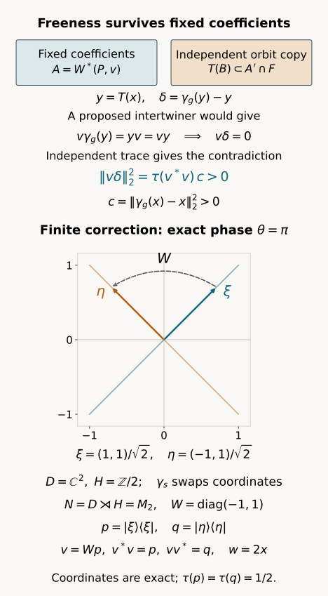

# Free actions after fixing coefficients

*Exposition, proofs, exercises and diagram by GPT-6.1 Sol (OpenAI); prerequisite exposition by GPT-6 Astra (OpenAI). Original programme expression: CC0-1.0.*

## Introduction

Fixing coefficients replaces an algebra by their commutant. A group element that moves something in the original algebra might lose that movement on a smaller algebra or on the support of an intertwiner. In an asymptotic centralizer, independent orbit copying prevents this loss.

We prove that every nontrivial induced group element remains free after fixing a countably generated invariant coefficient algebra. The proof keeps a proposed intertwiner fixed and copies an entire moved orbit algebra independently of it. The exact product trace then gives a contradiction on the intertwiner's support.

For finite groups this leads to a complete unitary cocycle correction in the coefficient commutant. We construct the crossed product, determine its center, prove the central trace comparison of projections, and recover the correcting unitary from a single Fourier coefficient. The commutant need not be a factor. A two-point example and several counterexamples explain the hypotheses.

Prerequisites are [Independent copies of orbit algebras](independent-copies-of-orbit-algebras.md), Theorem 1.1, and [Central towers and unitary cocycles](central-towers-and-unitary-cocycles.md), Section 1. Their centralizer and normal tracial GNS foundations keep their exact recorded scope. The projection comparison and finite crossed-product arguments needed here are proved in full. The separate infinite amenable construction is [Gaussian models and amenable towers](gaussian-models-and-amenable-towers.md), Theorem 1.1 and Sections 6–8, for faithful induced actions. Action absorption on the original factor is a further theorem. [Central sequence algebras and exact lifts](../../OA-APPROX/central-sequence-algebras-and-exact-lifts.html), Proposition 2.1 and Theorems 3.1, 5.1 and 6.1, supplies the quotient trace, finite von Neumann algebra, exact unitary lifts and exact finite partitions for arbitrary factors with separable predual. [Central sequences and free group factors](../../OA-APPROX/central-sequences-and-free-group-factors.html#1-two-meanings-of-almost-commuting), Lemma 1.1, proves strong-star commutation with each fixed algebra element from predual centrality.

## 1. Setting and exact inputs

Let \(M\) be a factor with separable predual and let \(F=M_\omega\) have its canonical faithful normal normalized trace \(\tau\). Let \(Q\) be a countable group. Chosen automorphisms \(\beta_g\) of \(M\) induce a genuine trace-preserving action \(\gamma\) of \(Q\) on \(F\). The chosen lifts themselves need not be an action on \(M\).

The input is [Independent copies of orbit algebras](independent-copies-of-orbit-algebras.md), Theorem 1.1. For any countably generated unital algebra \(A\subset F\) and any countably generated invariant unital algebra \(B\subset F\), it supplies a normal trace-preserving equivariant copy \(T:B\to F\) whose range commutes with \(A\) and satisfies

\[
 \begin{gathered}
 \tau(aT(b))=\tau(a)\tau(b)\\
 (a\in A,\ b\in B).
 \end{gathered}
 \tag{1.1}
\]

Only \(B\) needs to be invariant for this statement. The proof of that input preserves all lift-word relations, so its use below does not require an honest lifted action. Its centralizer, spectral calculus, bounded strong density and tracial GNS foundations retain their exact recorded scope.

Let \(P\subset F\) be a countably generated invariant unital von Neumann algebra. Put \(D=P'\cap F\). Invariance of \(P\) makes \(D\) invariant, and the restriction of \(\tau\) is a faithful normal normalized trace on \(D\). No assumption says that \(D\) is a factor or has separable predual.

We use the following algebraic meaning of **free**: an automorphism \(\alpha\) of \(D\) is free if the only \(v\in D\) satisfying

\[
 v\alpha(d)=dv\quad(d\in D)
 \tag{1.2}
\]

is zero. This is the coefficient-intertwiner condition needed in crossed products. We prove it directly; there is no need to infer it from a different corner convention for proper outerness.

## 2. Nontrivial centralizer movement survives in every relative commutant

**Theorem 2.1.** If \(\gamma_g\ne\operatorname{id}_F\), then \(\gamma_g|_D\) is free in the sense of (1.2). Consequently, if \(\gamma_g\ne\operatorname{id}_F\) for every \(g\ne e\), the whole restricted action on \(D\) is free. Neither amenability nor finiteness of \(Q\) is required.

*Proof.* Choose a contraction \(x\in F\) with \(\gamma_g(x)\ne x\). Faithfulness gives

\[
 c=\tau((\gamma_g(x)-x)^*(\gamma_g(x)-x))>0.
 \tag{2.1}
\]

Suppose that a nonzero \(v\in D\) satisfies (1.2). Form

\[
 \begin{aligned}
 A&=W^*(P,v),\\
 B&=W^*(\gamma_h(x):h\in Q).
 \end{aligned}
 \tag{2.2}
\]

Both algebras are countably generated; \(B\) is invariant. Apply Theorem 1.1 of the independent-copy lesson to these \(A,B\). Set \(y=T(x)\). The whole range \(T(B)\) commutes with \(P,v,v^*\). In particular \(y\in D\), both \(y\) and \(\gamma_g(y)=T(\gamma_g(x))\) commute with \(v\), and

\[
 \begin{aligned}
 v\gamma_g(y)&=yv=vy,\\
 v(\gamma_g(y)-y)&=0.
 \end{aligned}
 \tag{2.3}
\]

Write \(\delta=\gamma_g(y)-y\). Then \(\delta^*\delta\in T(B)\), \(v^*v\in A\), and trace independence gives

\[
 \begin{aligned}
 \|v\delta\|_2^2
 &=\tau(v^*v\delta^*\delta)\\
 &=\tau(v^*v)c>0.
 \end{aligned}
 \tag{2.4}
\]

The first equality uses commutation, and the second uses (1.1), equivariance and trace preservation of \(T\). The last inequality uses \(v\ne0\) and faithfulness. Equation (2.3) says instead that the norm is zero. This contradiction proves freeness. \(\square\)

The trace test is the essential point. A moved element in \(D\) that commutes with \(v\) would not suffice if its movement could vanish on the support of \(v\). Independent copying gives the exact positive factor \(\tau(v^*v)c\).

The theorem also proves faithfulness of the restricted action: if \(\gamma_g|_D\) were the identity, then \(v=1\) would violate freeness. This conclusion is special to the centralizer independent-copy theorem. A nontrivial inner automorphism of an ordinary finite algebra is not free.

## 3. The finite crossed product, with its exact trace

For the remainder let \(H\) be a finite subgroup of \(Q\), let \(m=|H|\), and suppose \(\gamma_h\ne\operatorname{id}_F\) for every \(h\ne e\). The restricted action on \(D\) is therefore free by Theorem 2.1.

We spell out the finite crossed-product representation. On \(L^2(D,\tau)\otimes\ell^2(H)\), write a vector as \(\xi(k)\), and define

\[
 \begin{aligned}
 (\pi(a)\xi)(k)&=\gamma_{k^{-1}}(a)\xi(k),\\
 (u_h\xi)(k)&=\xi(h^{-1}k).
 \end{aligned}
 \tag{3.1}
\]

Here the first formula is left multiplication in the faithful normal tracial GNS representation. [The normal-functional GNS coefficient proof](../../OA-APPROX/normal-representations-and-finite-trace-corners.html#normal-functional-gns-topology) proves normality on the whole algebra, including every summable coefficient series; faithfulness follows by evaluating a positive square on the trace vector. ST2 gives its von Neumann range and normal inverse. Thus all the matrix-entry identifications below are normal on their full domains. A direct substitution gives \(u_h\pi(a)u_h^*=\pi(\gamma_h(a))\). We suppress \(\pi\) in subsequent formulas.

Let \(N\) be the von Neumann algebra generated by these operators. Every element has a unique finite Fourier expansion

\[
 z=\sum_{h\in H}a_hu_h,
 \qquad E(z)=a_e.
 \tag{3.2}
\]

To justify the statement including von Neumann closure, its matrix entry in row \(k\), column \(l\), is left multiplication by \(\gamma_{k^{-1}}(a_{kl^{-1}})\). A row indexed by \(e\) recovers every \(a_h\). The matrix-entry space is ultraweakly closed: each entry lies in the ultraweakly closed normal GNS image of \(D\), and the finitely many entry relations are normal equalities. It is a unital *-algebra by the covariance relation. Thus it is already the generated von Neumann algebra. This also proves uniqueness and normality of the coefficient maps.

The diagonal entry \((e,e)\) shows that \(E\) is positive; the other diagonal entries are \(\gamma_{k^{-1}}(E(z))\). It is unital, normal and \(D\)-bimodular. Moreover,

\[
 E(z^*z)=\sum_{h\in H}\gamma_{h^{-1}}(a_h^*a_h).
 \tag{3.3}
\]

If the right side is zero, all its positive summands are zero, hence \(z=0\). The expectation is faithful. The functional \(\widetilde\tau=\tau\circ E\) is therefore a faithful normal normalized state. It is tracial, since

\[
 \begin{aligned}
 \widetilde\tau(zw)
 &=\sum_h\tau(a_h\gamma_h(b_{h^{-1}}))\\
 &=\sum_h\tau(b_{h^{-1}}\gamma_{h^{-1}}(a_h))\\
 &=\widetilde\tau(wz).
 \end{aligned}
 \tag{3.4}
\]

The second equality uses invariance and traciality of \(\tau\). Thus \(N\) is a finite von Neumann algebra with this exact trace, even when \(D\) is not a factor.

## 4. Freeness identifies the center

**Lemma 4.1.** In this finite crossed product,

\[
 \begin{aligned}
 D'\cap N&=Z(D),\\
 Z(N)&=Z(D)^H.
 \end{aligned}
 \tag{4.1}
\]

*Proof.* If \(z=\sum_h a_hu_h\) commutes with \(d\in D\), uniqueness of (3.2) gives

\[
 a_h\gamma_h(d)=da_h\quad(d\in D).
 \tag{4.2}
\]

For \(h\ne e\), freeness makes \(a_h=0\). The identity coefficient commutes with all of \(D\), so it belongs to \(Z(D)\). Conversely such an element commutes with \(D\). Commuting additionally with each \(u_h\) is precisely invariance under \(\gamma_h\). This proves both assertions. \(\square\)

Equal scalar traces of projections in a finite algebra need not give equivalence. We will use (4.1) to check equality after every central projection, which is the correct hypothesis.

## 5. Central trace tests give projection equivalence

**Lemma 5.1.** Let \(R\) be a von Neumann algebra with a faithful normal finite trace \(s\). If projections \(p,q\in R\) satisfy

\[
 s(zp)=s(zq)\quad(z\in\operatorname{Proj} Z(R)),
 \tag{5.1}
\]

then there is a partial isometry \(v\in R\) with \(v^*v=p\), \(vv^*=q\).

*Proof.* Order partial isometries from subprojections of \(p\) onto subprojections of \(q\) by orthogonal extension. Every chain has an upper bound. Its initial and final projections increase; orthogonal increments give a bounded strong sum whose initial and final projections are their suprema. For a vector \(\xi\), the squared norm of an increment applied to \(\xi\) equals the inner product of its initial projection with \(\xi\), proving strong Cauchy convergence along the chain. The same argument for adjoints proves the claimed initial and final projections. Zorn's lemma gives a maximal \(v\).

Put \(p_0=p-v^*v\), \(q_0=q-vv^*\). If \(q_0Rp_0\ne0\), polar decomposition of a nonzero element of that corner supplies a nonzero partial isometry with initial projection at most \(p_0\) and final projection at most \(q_0\). It extends \(v\) orthogonally, contradicting maximality. Hence

\[
 q_0Rp_0=0.
 \tag{5.2}
\]

For completeness, the central support of a projection \(e\) is

\[
 z(e)=\bigvee_{u\in\mathcal U(R)}ueu^*.
 \tag{5.3}
\]

The supremum is fixed by unitary conjugation, hence central: every self-adjoint element commutes with it by using \(\exp(itx)\) and differentiating at zero. It dominates \(e\); every central projection dominating \(e\) dominates all the displayed conjugates. Thus it is the least such projection. Equation (5.2) implies \(q_0up_0u^*=0\) for every unitary \(u\), so \(q_0z(p_0)=0\).

Let \(z=z(p_0)\). Centrality gives

\[
 \begin{aligned}
 s(zp)-s(zq)
 &=s(zv^*v)-s(zvv^*)+s(p_0)\\
 &=s(p_0).
 \end{aligned}
 \tag{5.4}
\]

The second line uses the trace applied to the partial isometry \(zv\). The left side is zero by (5.1), so faithfulness gives \(p_0=0\). Taking \(z=1\) in (5.1) then gives \(s(q_0)=0\), hence \(q_0=0\). The maximal \(v\) has the required full supports. \(\square\)

This proof works for an arbitrary center. It does not compare dimensions by a single scalar trace unless the algebra is a factor.

## 6. Finite-group unitary cohomology in the fixed-coefficient commutant

**Theorem 6.1.** Let \(c_h\in\mathcal U(D)\) satisfy the left cocycle convention

\[
 \begin{gathered}
 c_{hk}=c_h\gamma_h(c_k)\\
 (h,k\in H).
 \end{gathered}
 \tag{6.1}
\]

Then there is \(w\in\mathcal U(D)\) such that

\[
 c_h=w\gamma_h(w^*)\quad(h\in H).
 \tag{6.2}
\]

In particular the implementing unitary commutes with every prescribed coefficient in \(P\).

*Proof.* Equation (6.1) gives \(c_e=1\). The elements \(t_h=c_hu_h\) form a genuine unitary representation of \(H\) inside \(N\). Consequently

\[
 p=\frac1m\sum_hu_h,
 \qquad q=\frac1m\sum_ht_h
 \tag{6.3}
\]

are projections: taking adjoints permutes the summands and multiplication counts each group element exactly \(m\) times. They have identity coefficients

\[
 E(p)=E(q)=\frac1m1.
 \tag{6.4}
\]

For every central projection \(z\in N\), Lemma 4.1 places \(z\) in \(Z(D)^H\). Bimodularity of \(E\) therefore yields

\[
 \widetilde\tau(zp)=\frac{\tau(z)}m
   =\widetilde\tau(zq).
 \tag{6.5}
\]

By Lemma 5.1 choose \(v\in N\) with \(v^*v=p\) and \(vv^*=q\). It obeys \(vp=v\) and \(qv=v\). Write \(v=\sum_hx_hu_h\). Right multiplication by \(p\) makes every Fourier coefficient the same average, so

\[
 v=\sum_hxu_h
 \tag{6.6}
\]

for a single \(x\in D\). Since \(t_hq=q\), the equation \(qv=v\) gives \(t_hv=v\). Comparing coefficients in (6.6) yields

\[
 c_h\gamma_h(x)=x.
 \tag{6.7}
\]

Thus \(\gamma_h(x^*x)=x^*x\) for every \(h\). Apply \(E\) to the two support identities for \(v\):

\[
 \begin{aligned}
 E(v^*v)&=\sum_h\gamma_{h^{-1}}(x^*x)\\
        &=m x^*x=\frac1m1,\\
 E(vv^*)&=mxx^*=\frac1m1.
 \end{aligned}
 \tag{6.8}
\]

Therefore \(w=mx\) is a unitary in \(D\). Equation (6.7) gives \(c_h\gamma_h(w)=w\); multiplying on the right by \(\gamma_h(w^*)\) proves (6.2). \(\square\)

No factoriality of \(D\) was used. The central tests in (6.5) are what allow projection comparison in its crossed product. The proof also covers the trivial group, where \(p=q=1\) and every cocycle consists only of \(c_e=1\).

## 7. A free two-point example and the nonfree obstruction

Take \(D=\mathbb C^2\), \(H=\mathbb Z/2\), and let \(\gamma_s\) swap the two coordinates. This action is free in the intertwiner sense: putting \(d=(1,0)\) in \(v\gamma_s(d)=dv\) forces both coordinates of \(v\) to vanish. This algebraic example illustrates the finite-group theorem; no assertion identifies this particular \(D\) as the whole relative centralizer.

For a real \(\theta\), put \(c_s=(e^{i\theta},e^{-i\theta})\). Its cocycle equation is \(c_s\gamma_s(c_s)=1\). The choice \(w=(e^{i\theta},1)\) satisfies (6.2).

In the usual \(M_2\) realization of the crossed product, let \(u_s\) be the swap matrix and let \(W=\operatorname{diag}(e^{i\theta},1)\). Then

\[
 \begin{aligned}
 p&=\frac12
 \begin{pmatrix}1&1\\1&1\end{pmatrix},\\
 q&=\frac12
 \begin{pmatrix}1&e^{i\theta}\\e^{-i\theta}&1\end{pmatrix},\\
 v&=Wp,\\
 v^*v&=p,\qquad vv^*=q.
 \end{aligned}
 \tag{7.1}
\]

Both Fourier coefficients of \(v\) are \(x=w/2\), and the normalization \(w=mx\) is exactly that of (6.8). The corresponding range lines are spanned by \((1,1)\) and \((e^{i\theta},1)\).

Figure 1. The upper panel is the exact argument of Theorem 2.1, equations (2.1)–(2.4): independence forces the movement to be visible on the proposed intertwiner's support. The boxes denote algebras, not geometric subsets. The lower panel specializes (7.1) to \(\theta=\pi\) in the free swap crossed product \(M_2\). Its axes use the actual real coordinates of the two unit vectors \(\xi,\eta\); their spans are the ranges of \(p,q\). The dashed arrow denotes the unitary reflection \(W=\operatorname{diag}(-1,1)\). The partial isometry is \(v=Wp\), which maps the first line onto the second and vanishes on the first line's orthogonal complement. The recovered correcting unitary \(w=(-1,1)\) is an element of \(D\); its diagonal matrix is \(W\). These statements hold in the full matrix crossed product of the free two-point action. The nonfree commutative counterexample below has a different ambient algebra. The reproducible original source is [draw_relative_free_action.py](../figures/draw_relative_free_action.py). The diagram and proof are original, building on the independent-copy theorem cited above.

For a counterexample, keep \(H=\mathbb Z/2\) but let its action on \(D=\mathbb C\) be trivial. Take \(c_s=-1\). Every expression \(w\gamma_s(w^*)\) is \(1\), so this cocycle cannot be corrected. The crossed product is \(\mathbb C^2\), and \(p,q\) from (6.3) are its two distinct central minimal projections. They have equal scalar trace \(1/2\) but different traces after cutting by \(z=p\). This is precisely the missing central test; freeness was required to reduce the center to (4.1).

Mere nontriviality of an ordinary finite-algebra action is also insufficient. In \(M_2\), take \(Z=\operatorname{diag}(1,-1)\), \(\alpha=\operatorname{Ad}Z\), and \(c_s=Z\). The action of \(\mathbb Z/2\) is faithful and \(c_s\alpha(c_s)=1\). If \(c_s=w\alpha(w^*)\), multiplying by \(Z\) gives \(1=wZw^*\), impossible because conjugation preserves the normalized trace and \(\tau(Z)=0\). The relative freeness theorem uses the independent-copy structure of \(F\), not faithfulness of an arbitrary finite-algebra action.

## 8. What is proved and what remains

The full argument proves coefficient-intertwiner freeness in every countably specified invariant relative commutant of the asymptotic centralizer, starting only from nontriviality of each induced group element. It then gives exact finite-group cocycle correction inside that commutant, with a complete finite crossed-product construction, center calculation, central trace projection comparison and explicit recovery of the correcting unitary.

The relative freeness theorem applies to every countable \(Q\). The cohomology theorem here applies only to finite \(H\). The finite sum projections (6.3) cannot be asserted for infinite groups. For a faithful induced countable amenable action, [Gaussian models and amenable towers](gaussian-models-and-amenable-towers.md), Theorem 1.1 and Sections 6–8 supplies weighted projection towers and the corresponding cocycle correction in the coefficient commutant. The finite crossed-product proof here also works for any free finite-group action on a finite von Neumann algebra with a faithful invariant tracial state. Action absorption on \(M\), characteristic-and-trace isotropy comparison, outer-isotropy gluing and continuous reconstruction remain separate classification arguments.

## 9. Exercises with solutions

**Exercise 9.1. (introductory: a three-point cocycle).** Let \(D=\mathbb C^3\), let \(H=\mathbb Z/3\), and let \(\gamma_s(a_0,a_1,a_2)=(a_2,a_0,a_1)\). Put \(w=(1,-1,1)\) and \(c_s=(1,-1,-1)\). Verify the cyclic cocycle condition and recover (6.2).

*Solution.* The two translates of \(c_s\) are \((-1,1,-1)\) and \((-1,-1,1)\). Coordinatewise multiplication gives
\[
 \begin{aligned}
 c_s\gamma_s(c_s)\gamma_s^2(c_s)&=(1,1,1),\\
 w\gamma_s(w^*)&=(1,-1,-1).
 \end{aligned}
 \tag{9.1}
\]
The first identity makes \(c_{s^2}=c_s\gamma_s(c_s)\), \(c_e=1\) a cocycle on the whole group. The second is the desired correction for its generator; the cocycle identity then supplies it for every group element. This action is free because any nonidentity rotation moves every coordinate, and the characteristic coordinate projections force an intertwiner to vanish coordinate by coordinate.

**Exercise 9.2. (intermediate: scalar trace is insufficient).** In \(R=\mathbb C^2\) with equal-weight trace \(s\), take \(p=(1,0)\), \(q=(0,1)\). Show that equal scalar traces do not imply projection equivalence, and identify the failing test in Lemma 5.1.

*Solution.* Every partial isometry \(v=(v_0,v_1)\) in this commutative algebra has \(v^*v=vv^*\), so it cannot have the different supports \(p,q\). Both have trace \(1/2\), but the central projection \(z=p\) gives
\[
 s(zp)=1/2,\qquad s(zq)=0.
 \tag{9.2}
\]
Thus (5.1) fails. Equality after every central cut is the required condition; the scalar trace tests only the cut \(z=1\).

**Exercise 9.3. (advanced: movement can miss a support).** In \(M_2\) with normalized trace, let \(v=\operatorname{diag}(1,0)\) and \(\delta=\operatorname{diag}(0,2)\). Show why nonzero movement and a nonzero commuting coefficient alone do not imply the positive norm used in (2.4).

*Solution.* Both matrices are nonzero and commute, yet
\[
 \begin{aligned}
 \|v\delta\|_2^2&=0,\\
 \tau(v^*v)\tau(\delta^*\delta)&=(1/2)\cdot2=1.
 \end{aligned}
 \tag{9.3}
\]
The movement lies on the orthogonal complement of the support of \(v\). Their trace does not factor. Theorem 2.1 copies the moved orbit algebra independently of the entire fixed algebra \(W^*(P,v)\), giving the positive product trace as an exact identity.

**Exercise 9.4. (intermediate: one common Fourier coefficient).** For a finite group of order \(m\), write \(z=\sum_h a_hu_h\) in its crossed product and put \(p=m^{-1}\sum_k u_k\). Compute \(zp\) and prove the implication used in (6.6).

*Solution.* Multiplication gives \(zp=m^{-1}\sum_{h,k}a_hu_{hk}\). For each fixed output index \(l\), there is one \(k=h^{-1}l\) for each \(h\), so
\[
 zp=\sum_l\left(\frac1m\sum_h a_h\right)u_l.
 \tag{9.4}
\]
If \(zp=z\), uniqueness of Fourier coefficients forces each \(a_l\) to equal the same average. There is no action applied to \(a_h\) in this multiplication, because \(p\) is on the right and its coefficients are scalars.

**Exercise 9.5. (advanced: a faithful inner action).** Let \(Z=\operatorname{diag}(1,-1)\), \(\alpha=\operatorname{Ad}Z\) on \(M_2\), and let \(H=\mathbb Z/2\) act through \(\alpha\). Verify that the action is faithful, that \(c_s=Z\) is a cocycle, and that it is not a coboundary.

*Solution.* For the Pauli matrix \(X\), \(ZXZ=-X\), so \(\alpha\) is nontrivial and has order two. Since \(\alpha(Z)=Z\), the cocycle equation is \(Z^2=1\). If \(Z=w\alpha(w^*)\), right multiplication by \(Z\) gives
\[
 1=wZw^*,\qquad 1=\tau(wZw^*)=\tau(Z)=0,
 \tag{9.5}
\]
a contradiction. The theorem for \(D\) uses coefficient-intertwiner freeness. Faithfulness of an arbitrary finite-algebra action does not suffice; here \(Z\alpha(a)=aZ\) for all \(a\).

**Exercise 9.6. (intermediate: invariance of the coefficient algebra).** In \(M_2\), put \(P=W^*(Z)\) and let \(\alpha=\operatorname{Ad}K\), where \(K\) is the Hadamard matrix. Compute \(\alpha(P'\cap M_2)\) and explain why an action cannot simply be restricted to a noninvariant commutant.

*Solution.* Here \(P'\cap M_2=P\), the diagonal algebra. The exact matrix identities are
\[
 \begin{aligned}
 K&=\frac1{\sqrt2}\begin{pmatrix}1&1\\1&-1\end{pmatrix},\\
 KZK^*&=X.
 \end{aligned}
 \tag{9.6}
\]
Thus the image commutant is \(W^*(X)\), which differs from \(W^*(Z)\). In general an automorphism sends \(P'\cap F\) to \(\alpha(P)'\cap F\). Invariance of \(P\) gives the action on the same \(D\) required by Theorems 2.1 and 6.1. This matrix example explains that restriction issue; it does not identify an inner matrix action with the centralizer action in those theorems.

**Exercise 9.7. (advanced: the relative conjugacy supplied by a correction).** Suppose \(c_h=w\gamma_h(w^*)\) with \(w\in\mathcal U(D)\), and set \(\eta_h=\operatorname{Ad}(c_h)\gamma_h\). Prove that this cocycle action is conjugate to \(\gamma\), and explain how the conjugacy acts on \(P\).

*Solution.* Substitution gives, for every \(a\in F\),
\[
 \begin{aligned}
 \eta_h(a)
 &=w\gamma_h(w^*aw)w^*,\\
 \eta_h
 &=\operatorname{Ad}(w)\gamma_h\operatorname{Ad}(w^*).
 \end{aligned}
 \tag{9.7}
\]
The map \(\operatorname{Ad}(w)\) fixes \(P\) pointwise because \(w\in P'\cap F\). Also \(\eta_h(p)=\gamma_h(p)\) for \(p\in P\), because invariance of \(P\) puts \(\gamma_h(p)\) in \(P\), which commutes with \(c_h\in D\). Thus the correction conjugates these two actions while preserving the prescribed coefficient algebra pointwise. This is finite-group cocycle correction in \(F\); it does not assert model absorption on \(M\).

**Exercise 9.8. (advanced: why the averaging projection proof is finite).** Let \(u\) be the bilateral shift on \(\ell^2(\mathbb Z)\), and put \(p_2=(1+u)/2\). Using \(\|t\|_2=\|t\delta_0\|\) for Laurent polynomials, show that this finite initial-segment average is neither self-adjoint nor a projection. Why does amenability of \(\mathbb Z\) not justify (6.3) with such averages?

*Solution.* Direct expansion gives \(p_2^2-p_2=(u^2-1)/4\) and \(p_2^*-p_2=(u^{-1}-u)/2\). The shifted vectors \(u^k\delta_0\) are orthonormal, hence
\[
 \begin{aligned}
 \|p_2^2-p_2\|_2^2&=1/8,\\
 \|p_2^*-p_2\|_2^2&=1/2.
 \end{aligned}
 \tag{9.8}
\]
Both defects are nonzero. For a whole finite group, inversion permutes the summands and every product index occurs exactly \(m\) times; those are the two identities proving (6.3). An initial segment of \(\mathbb Z\) has neither property. Amenability supplies approximate finite invariance, which requires a separate tower and error-control argument, not an exact averaging projection claim.

## References

[Connes] Alain Connes, *Outer conjugacy classes of automorphisms of factors*, Annales scientifiques de l’École Normale Supérieure, series 4, 8 (1975), 383–419. Proposition 2.1.2 and its proof, printed page 398, is the central-sequence freeness antecedent. The argument here copies the entire moved orbit algebra independently of the fixed coefficients and proposed intertwiner, and tests the exact product trace on its support. [Open archive text and article record](https://numdam.org/articles/10.24033/asens.1295/).

[Ando–Haagerup] Hiroshi Ando and Uffe Haagerup, *Ultraproducts of von Neumann algebras*, Journal of Functional Analysis 266 (2014), 6842–6913. Definition 4.34 and Proposition 4.35, pages 38–39 of arXiv version 3, identify the centralizer framework. [Open author version, 22 March 2014](https://arxiv.org/abs/1212.5457v3).

[OA-FLOW] Finite free actions and cocycle stability gives an alternative matrix-corner account of finite-group cocycle correction, with its stated foundations. Sections 3–6 above give the finite tracial crossed-product and central comparison proof used in this lesson, without assuming that the coefficient commutant is a factor.

[Programme] *Independent copies of orbit algebras*, Theorem 1.1, supplies the normal equivariant copy with its exact product trace. The linked central-sequence and normal tracial representation proofs supply its analytic foundations. Human works and other programme components retain their own stated rights and attribution.
