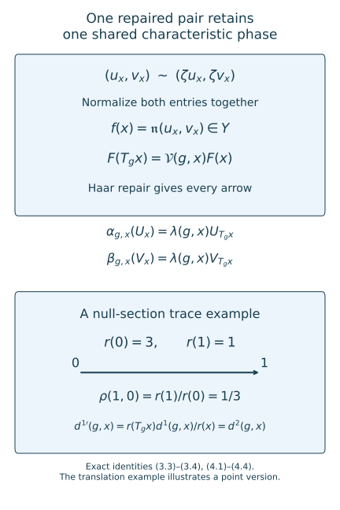

# From global characteristic invariants to return data

*Mathematical exposition, figures and exercises by GPT-6.1 Sol (OpenAI); source comparison and prerequisite exposition by GPT-6 Astra (OpenAI). Original programme expression is CC0; cited human works retain their rights.*
## Introduction

A continuous action has characteristic data in the centre of a von Neumann algebra. A countable return groupoid has scalar characteristic data at individual points. Passing between these descriptions requires more than evaluating a measurable function on a section: the section has ambient measure zero. A point version of a global implementer can fail precisely there.

We identify the actual stabilizers and inner kernel, align trace multipliers on every arrow, and repair two implementing unitaries in one common projective space. This preserves their shared characteristic gauge. An explicit transverse mean then supplies the finite return exhaustion. Combined with [Reconstructing continuous comparisons from return arrows](reconstructing-continuous-comparisons-from-return-arrows.md), the construction proves the global characteristic criterion for the integer–real actions needed in outer conjugacy. Properly ergodic, periodic transitive and free transitive centre flows are all included.

Read [Common gauge invariants and outer conjugacy](common-gauge-invariants-and-outer-conjugacy.md), Sections 1 and 4, and [Characteristic classification of semifinite actions](characteristic-classification-of-semifinite-actions.md), Sections 2–5. The exact programme prerequisites are the Haar essential-value repair in Localizing factor actions and uniform cocycles, Theorem 1.2; its constant-field localization Theorem 5.2; the Borel inner-unitary section in Ancillary actions and unitary corrections, Lemma 2.1; the compact centre model in Measurable actions and compact models, Theorem 4.1; the Lusin–Novikov and one-to-one Borel-image tools in the orbit and standard-Borel lessons; and the invariant-mean theorem in Invariant means on measured relations, Theorem 6.1. The latter converts a measured principal invariant mean into an increasing finite Borel exhaustion. The exact nonsingular suspension is A suspension from separated crossings, through (S32). Trace-normalized injective uniformity is supplied by Section 4 of the return-reconstruction lesson. Their central decomposition, standard-form, measure and finite-factor foundations remain explicit. Basic human references are [ST], [ST85] and [CFW].

The global criterion and the reduction through a countable section are due to Sutherland–Takesaki [ST], Assumption 4.1 and Theorem 4.2 (pp.427–431). Their proof identifies the stabilizers and inner kernel, compares the return characteristic and trace classes, and reconstructs the global comparison. The present cyclic specialization proves the three centre-flow alternatives, repairs the trace and the implementing pair on invariant conull domains, and supplies a transverse invariant mean. The common scalar quotient in Section 4 retains the relative phase of the two implementers. These details explain the classical classification mechanism.

## 1. The global comparison problem

Let \(L=\mathbb Z\times\mathbb R\). On two injective type II-infinite algebras with separable preduals, let \(\Phi^i\), \(i=1,2\), be continuous actions. Identify their centres equivariantly with a nontrivial standard abelian algebra \(C\). Suppose their real centre actions are ergodic, and specified faithful normal semifinite traces satisfy
\[
\sigma_i\Phi^i_{(m,t)}=e^{-t}\sigma_i.
\tag{1.1}
\]
Thus integer actions preserve trace. Each algebra is put into the trace-normalized coordinates of the preceding return lesson, Section 4, over one equivalent probability \(\mu\):
\[
\begin{gathered}
Q_i=L^\infty(X,\mu)\overline\otimes M,\\
M=R\overline\otimes B(\ell^2),\\
\sigma_i(a)=\int_X\tau(a(x))\,d\mu(x).
\end{gathered}
\tag{1.2}
\]
Centre identification does not require preservation of a preselected centre probability. The positive trace-density correction supplies (1.2) for the chosen common measure class.

Choose a common strict nonsingular centre action \(T\) and strict Borel factor actions \(\alpha,\beta\). The localization theorem applies simultaneously, using the product of the two Polish automorphism targets. Equivalently, apply its joint-representative construction to the two fields and its strict-version theorem to their pair. Every fixed group element retains its measured action. Our source convention is
\[
\begin{gathered}
(\Phi^1_g a)(T_gx)=\alpha_{g,x}(a(x)),\\
(\Phi^2_g a)(T_gx)=\beta_{g,x}(a(x)).
\end{gathered}
\tag{1.3}
\]
All fibre action laws are strict. Their direct positive multipliers are \(d^1(g,x),d^2(g,x)\).

The global inner subgroup is
\[
\begin{gathered}
N_i=\{g\in L:\Phi^i_g\text{ is inner}\},\\
N_i=p_i\mathbb Z\times\{0\},\qquad p_i\ge0.
\end{gathered}
\tag{1.4}
\]
Indeed, an inner automorphism preserves the specified trace, so (1.1) forces its real label to be zero. The remaining integer labels form a subgroup of \(\mathbb Z\). We use \(0\mathbb Z=\{0\}\).

For \(p_i>0\), choose a global unitary \(u_i\) implementing \(\Phi^i_{(p_i,0)}\). Use \(u_i^n\) at \((np_i,0)\); the multiplication phase is then one. The transport function
\[
\ell_i(g)=\Phi^i_g(u_i)u_i^*\in\mathcal U(C)
\tag{1.5}
\]
determines the full characteristic representative: its transport on \((np_i,0)\) is \(\ell_i(g)^n\). Commutation in \(L\) proves centrality and the centre-valued cocycle law.

**Theorem 1.1 (global characteristic criterion).** Under the exact retained factor, localization, suspension, measured-relation and pointwise-comparison foundations, the actions are cocycle conjugate by a normal isomorphism inducing the specified centre identification if and only if their global inner subgroups and full centre-valued characteristic classes agree. The comparison can preserve the specified traces. Its unitary cocycle is jointly Borel and its real restriction is strongly continuous.

For the sufficiency proof, put \(p=p_1=p_2\). When \(p>0\), equality of the normalized full classes means that one \(w\in\mathcal U(C)\) changes the second implementer so that
\[
\begin{gathered}
\Phi^1_g(u)=\ell(g)u,\\
\Phi^2_g(v)=\ell(g)v\quad(g\in L).
\end{gathered}
\tag{1.6}
\]
Here \(v=wu_2\), with the orientation of \(w\) chosen to give (1.6). To justify one gauge, a characteristic cochain preserving the two multiplication phases one must satisfy \(b(n+r)=b(n)b(r)\), hence \(b(np,0)=w^n\). This is the complete cyclic calculation in the common-gauge lesson, Section 4. For \(p=0\), both characteristic classes are trivial and no implementing pair is needed.

## 2. Stabilizers and the actual inner kernel

We first identify every isotropy label, including labels with nonzero real coordinate.

**Lemma 2.1 (the centre-flow alternatives).** On an invariant conull model, the nontrivial ergodic real centre action is either properly ergodic and free, transitive and free, or transitive with a positive period \(a\). In the transitive cases its model and measure class are respectively \(\mathbb R\) with Lebesgue measure or \(\mathbb R/a\mathbb Z\) with Haar measure.

*Proof.* Start with the continuous Polish centre model. Each real stabilizer is a closed subgroup of \(\mathbb R\). A closed subgroup is \(\{0\}\), \(a\mathbb Z\) for \(a>0\), or all of \(\mathbb R\): if its positive elements have positive infimum, closedness attains the least one and division with remainder proves the cyclic description; if the infimum is zero, arbitrarily small elements approximate every real number and closedness gives the whole group.

The stabilizer type and its least positive period are Borel functions. For the latter, the condition that there is a stabilizing time in \([1/n,k]\) is a closed compact-parameter projection in the continuous point model; taking countable such intervals gives the required Borel tests and infimum. These functions are invariant under all of \(L\), because \(L\) is abelian. Ergodicity makes their values constant almost everywhere; their actual level sets are invariant Borel. An all-real stabilizer would make the real centre action trivial, and ergodicity would make \(C\) scalar, contrary to the hypothesis.

If the common period is positive, the action factors through the compact circle group. Its orbits are compact. The Borel map taking a point to its compact orbit is invariant and takes values in the standard Borel space of closed subsets of the Polish model. For a fixed open set, an orbit hits it precisely when one of a countable dense set of circle parameters sends the point into it. This proves Borelness. Ergodicity makes this map constant almost everywhere: the pushforward zero-or-one probability on a standard Borel space is a point mass, by a countable separating code. Thus one orbit is conull.

If the stabilizer is zero, either one orbit is conull or the action is properly ergodic, by definition. In the latter case the exact suspension theorem gives the free aperiodic model of the preceding return lesson. In a transitive orbit, the orbit map from \(\mathbb R\), or its circle quotient, is a Borel bijection with Borel inverse by the one-to-one Borel-image theorem.

Finally a nonsingular probability on either translation space is equivalent to Haar measure. Average it against an everywhere positive integrable Haar density \(q\). Nonsingularity says every translate has exactly its null sets, so the average has those same null sets. Fubini gives the average a Haar density \(y\mapsto\int q(y-x)\,d\mu(x)\), which is positive everywhere and finite almost everywhere. Hence its Haar null class is exactly the original one. This proves the measure claim. \(\square\)

**Lemma 2.2 (constant countable stabilizers).** On an invariant conull Borel set, all centre stabilizers equal one countable abelian subgroup \(H\subset L\). In the properly ergodic case projection of \(H\) to \(\mathbb Z\) is injective. In the transitive free case \(H\cong\mathbb Z\); in the periodic transitive case \(H\cong\mathbb Z^2\).

*Proof.* In the free properly ergodic model, for each integer \(m\) the Borel relation
\[
\mathcal D_m=\{(x,t):T_{(m,t)}x=x\}
\tag{2.1}
\]
has at most one time above each \(x\). Lusin–Novikov makes its domain \(D_m\) Borel and its time \(t_m\) Borel. Both are invariant under every group label. Ergodicity makes \(D_m\) null or conull, and on a conull domain makes \(t_m\) almost everywhere constant. Retain its actual constant level set in the latter case and the complement of \(D_m\) in the former. There are only countably many integers. Their intersection is invariant Borel and conull and has a single stabilizer \(H\). Freeness makes the integer projection injective, so \(H\) is isomorphic to a subgroup of \(\mathbb Z\).

In a transitive model the commuting integer map is translation by some \(\kappa\): its value at the origin determines it at every real translate. Thus
\[
\begin{gathered}
H=\{(m,-m\kappa):m\in\mathbb Z\}
\quad(X=\mathbb R),\\
H=\{(m,-m\kappa+na):m,n\in\mathbb Z\}\\
\text{when }X=\mathbb R/a\mathbb Z.
\end{gathered}
\tag{2.2}
\]
In the second formula choose any real lift of \(\kappa\). The displayed parametrizations are injective and additive. This proves every assertion. \(\square\)

**Lemma 2.3 (global and fibre innerness agree).** After a further invariant conull reduction, the actual inner subgroup of each fibre isotropy action is exactly its global \(N_i\), at every retained point.

*Proof.* For \(h\in H\), the Borel inner-automorphism section makes
\[
E^i_h=\{x:\alpha^i_{h,x}\text{ is inner on }M\}
\tag{2.3}
\]
Borel. The strict action laws and commutativity give
\(\alpha^i_{h,T_gx}=\alpha^i_{g,x}\alpha^i_{h,x}(\alpha^i_{g,x})^{-1}\).
Consequently \(E^i_h\) is invariant under all of \(L\), and real ergodicity makes it null or conull. If conull, the exact Borel unitary section selects an implementing unitary field; its bounded direct integral is a unitary of \(Q_i\) implementing \(\Phi^i_h\). Conversely a global implementer decomposes into implementing fibre unitaries almost everywhere. Therefore \(E^i_h\) is conull exactly when \(h\in N_i\).

For each of the countably many \(h\in H\), retain \(E^i_h\) or its complement accordingly. Their intersection is invariant conull Borel. No real label was discarded because it was not an integer-time label. In particular, labels with nonzero real coordinate cannot belong to the resulting inner subgroup, by (1.1). \(\square\)

## 3. Trace agreement on every arrow

Global trace scaling initially gives fibre agreement only for each fixed group element, almost everywhere. We make it strict before restricting to a section.

Write \(j_g\) for the positive source derivative defined by \(\mu(T_gE)=\int_Ej_g(x)\,d\mu(x)\). Applying (1.1)–(1.3) to positive finite-trace constant operators multiplied by characteristic functions proves
\[
\begin{gathered}
j_g(x)d^i(g,x)=e^{-t},\\
\text{a.e. for each fixed }g=(m,t).
\end{gathered}
\tag{3.1}
\]
The finite projection of trace one detects the scalar multiplier. Hence \(d^1=d^2\) almost everywhere for each fixed \(g\). Their strict Borel ratio
\[
\rho(g,x)=\frac{d^2(g,x)}{d^1(g,x)}
\tag{3.2}
\]
is a positive cocycle and equals one in each fixed-parameter measured class.

Apply the exact Haar repair theorem to \(Y=(0,\infty)\), the constant section \(f=1\), and the Borel fibre bijections \(U(g,x)s=\rho(g,x)s\). Its hypotheses follow from the strict cocycle law. It supplies an invariant conull Borel domain and a positive Borel \(r\), with \(r=1\) almost everywhere, satisfying
\[
r(T_gx)=\rho(g,x)r(x)
\quad\text{for every }g,x.
\tag{3.3}
\]
Use the coherent trace-scaling flow of the module lesson to set \(C_x=b_{-\log r(x)}\). Its direct multiplier is \(r(x)\). Change only the first fibre coordinates:
\[
\begin{gathered}
\alpha'_{g,x}=C_{T_gx}\alpha_{g,x}C_x^{-1},\\
d^{1'}(g,x)=\frac{r(T_gx)}{r(x)}d^1(g,x)=d^2(g,x).
\end{gathered}
\tag{3.4}
\]
These laws hold on every arrow. Since \(r=1\) almost everywhere and \(b_0=\mathrm{id}\), the integrated coordinate change is identity. Thus \(\alpha'\) represents exactly the same global first action. Its individual values on an ambient-null section may change; that is precisely the necessary repair. Replace \(\alpha\) by \(\alpha'\).

For example, a positive field equal to three at height zero and one at other heights is one in the ambient measured algebra. Its ratio \(r(T_gx)/r(x)\) can nevertheless be nontrivial on return and vertical arrows. Equation (3.4) corrects it without assuming that a fixed-time identity held on height zero already.

## 4. Preserve one characteristic gauge

Assume \(p>0\). Choose Borel unitary fields \(u(x),v(x)\) representing the global pair in (1.6), extending them by unitary values on any initial null complement. Their individual scalar phases are expendable. Their relative phase must remain shared.

Choose countably many normal linear functionals \(\varphi_j\) which separate \(M\). For a unitary \(a\), let \(j(a)\) be the first index with \(\varphi_j(a)\ne0\), and put
\[
\begin{gathered}
z(a)=\frac{|\varphi_{j(a)}(a)|}{\varphi_{j(a)}(a)},\\
\mathfrak n(a,b)=(z(a)a,z(a)b).
\end{gathered}
\tag{4.1}
\]
The image \(Y\) of \(\mathfrak n\) is a Borel subset of \(\mathcal U(M)^2\): it is the countable union of the sets where the first nonzero functional on the first coordinate is a positive real number. Thus \(Y\) is standard Borel. It represents precisely the quotient by the diagonal scalar circle. Indeed
\(\mathfrak n(\zeta a,\zeta b)=\mathfrak n(a,b)\), and equality of normalized pairs implies one common scalar relating the original pairs.

On this one target define
\[
\mathcal V(g,x)(a,b)
=\mathfrak n\bigl(\alpha_{g,x}(a),\beta_{g,x}(b)\bigr).
\tag{4.2}
\]
They are Borel bijections with strict action law. Normalizing an intermediate pair multiplies both entries by one scalar; the automorphisms fix that scalar and the final normalization cancels it. The inverse is the corresponding inverse-arrow map.

Let \(f(x)=\mathfrak n(u(x),v(x))\). For each fixed \(g\), (1.6) and (1.3) multiply its two transported coordinates by the same scalar \(\ell(g)(T_gx)\), almost everywhere. Therefore
\[
\begin{gathered}
f(T_gx)=\mathcal V(g,x)f(x),\\
\text{a.e. for each fixed }g.
\end{gathered}
\tag{4.3}
\]
The Haar repair theorem supplies a Borel \(F=(U,V)\), equal to \(f\) almost everywhere, with exact equivariance at every arrow on an invariant conull domain.

Retain also the set on which \(U,V\) implement \(\alpha_{(p,0),x},\beta_{(p,0),x}\). This set is Borel, using countably many operator tests, and conull because \(F=f\) almost everywhere. It is invariant: conjugation by either fibre action transports the corresponding inner implementation, since \((p,0)\) fixes the base and commutes with every label. Thus its removal is legitimate for all real times.

Exact equality in the diagonal-scalar quotient gives one unique common scalar
\[
\begin{gathered}
\alpha_{g,x}(U_x)=\lambda(g,x)U_{T_gx},\\
\beta_{g,x}(V_x)=\lambda(g,x)V_{T_gx}.
\end{gathered}
\tag{4.4}
\]
It is jointly Borel: for a fixed normal state \(\omega\), evaluate
\(\lambda(g,x)=\omega(U_{T_gx}^*\alpha_{g,x}(U_x))\).
For all integers \(n\), take \(U_{n,x}=U_x^n\), \(V_{n,x}=V_x^n\). They have the same multiplication phase one and the same moving transport phase \(\lambda(g,x)^n\). On the full return groupoid these are the actual implementers of every inner isotropy label, by Lemma 2.3. For \(p=0\), the actual inner field is trivial and these statements require only the unit implementer one.

The construction repairs the pair before choosing scalar representatives on a section. Repairing its two entries independently would allow two unrelated phases and would not prove (4.4).

*Figure 1. Equations (3.3)–(3.4) and (4.1)–(4.4). The normalized-pair action and its common scalar are exact. The lower translation model has the point values in Exercise 7.2; it illustrates the trace-coordinate repair, rather than a properly ergodic classification example. Editable source: [draw_global_return_gauge.py](../figures/draw_global_return_gauge.py). Classical global-to-return criterion: [ST], Theorem 4.2. The two exact representative constructions are (3.3)–(3.4) and (4.1)–(4.4).*

## 5. A finite exhaustion from transverse averages

In the properly ergodic case use the supplied aperiodic suspension \(x=(z,u)\), \(0\le u<r_0(z)\), with \(r_0\ge\delta>0\). If its initial conull domain is only real invariant, intersect its translates by the countably many integer maps. Commutation preserves real invariance, so this is an invariant conull domain for all of \(L\). It contains whole real orbits and hence whole vertical fibres. The product suspension measure class makes the retained transverse base conull. Write \(q(x)=z\) and \(j(z)=(z,0)\). Let \(\mathcal H\) be the full labelled return groupoid and \(\mathcal R\) its endpoint relation. The preceding return lesson, Lemma 1.1, proves countability, Borelness and quasi-invariance for the transverse measure \(\nu\). Choose an equivalent probability on \(Z\).

For \(n\ge1\), use the explicit Haar probabilities on \(L\)
\[
P_n(m,t)=\frac{\mathbf1_{\{|m|\le n\}}\mathbf1_{\{|t|\le n\}}}{(2n+1)2n}.
\tag{5.1}
\]
Their translate defect satisfies, for \(h=(a,s)\),
\[
\begin{aligned}
\|P_n(\cdot-h)-P_n\|_1
&\le 2\min\left(1,\frac{|a|}{2n+1}\right)\\
&\quad+2\min\left(1,\frac{|s|}{2n}\right).
\end{aligned}
\tag{5.2}
\]
This follows by adding the two marginal defects; each uniform interval defect is its symmetric-difference length divided by its length. The bound tends to zero for every fixed label.

Put \(B_z(m,t,w)=\mathbf1_{\{q(T_{(m,t)}j(z))=w\}}\). Push these probabilities to the countable transverse orbit:
\[
p_n^z(w)=\sum_{m=-n}^n\int_{-n}^n
P_n(m,t)B_z(m,t,w)\,dt.
\tag{5.3}
\]
The weights are Borel parameter integrals and sum to one. They have finite support at each \(z\). For each of finitely many integers \(m\), the bounded real interval crosses only finitely many roofs, because all roofs are at least \(\delta\). No uniform bound on the resulting roof indices over \(z\) is needed.

For a return arrow with label \(h\) from \(z\) to \(y\), commutativity gives \(T_gj(y)=T_{g+h}j(z)\). Pushforward contracts total variation, so
\[
\sum_w|p_n^y(w)-p_n^z(w)|
\le\|P_n(\cdot-h)-P_n\|_1.
\tag{5.4}
\]
Let \(\mathcal B=L^\infty(\mathcal R,\nu_r)\) with range-counting measure, and \(\mathcal A=L^\infty(Z,\nu)\). Define
\[
A_n f(z)=\sum_{w\sim z}p_n^z(w)f(z,w).
\tag{5.5}
\]
These are measurable positive unital range-module maps. A range-counting null function vanishes at every arrow over almost every range, so their definition is independent of its representative.

For a nonsingular partial relation map \(\eta:D\to E\), Lusin–Novikov chooses a Borel labelled return arrow \(h(z)\) from \(z\) to \(\eta z\). Equation (5.4) bounds the difference between \(A_nL_\eta f\) and \(L_\eta A_nf\), at \(\eta z\), by
\[
\|f\|_\infty\|P_n(\cdot-h(z))-P_n\|_1\longrightarrow0.
\tag{5.6}
\]
The label may vary and be unbounded; convergence holds at each source, and the error is bounded by \(2\|f\|_\infty\). Dominated integration against every \(L^1\) test proves weak-star convergence to zero.

Take a pointwise weak-star cluster subnet of the maps (5.5) in the product of the appropriate \(L^\infty\) balls. Positivity, normalization, linearity and the range-module identity pass to the limit \(A\). Each \(L_\eta\) is weak-star continuous, by its nonsingular predual change-of-variables formula. Equation (5.6) proves \(AL_\eta=L_\eta A\) for every partial map, with the same cluster subnet. Thus \(A\) is a measured principal invariant mean. The exact invariant-mean theorem supplies an increasing finite Borel exhaustion on a transverse invariant conull set. Its null saturation and the product suspension measure retain an invariant conull ambient base, as in the preceding return lesson.

This argument averages the labelled group before passing to endpoint classes. It does not assume that the return maps form an action of one countable abelian group on \(Z\).

In either transitive model the section has one point. Its principal relation is finite already. In the circle case choose the representative height \(0\le u<a\); in the free case use the actual real coordinate \(u\). The isotropy groups are (2.2), and the vertical return formula \((m,t)\mapsto(m,t+u-v)\) retains all labels. They are countable amenable abelian groups. The properly ergodic stabilizer is a subgroup of \(\mathbb Z\) and is amenable as well; the abelian Følner proof in [Relative character eigenunitaries](relative-character-eigenunitaries.md), Lemma 2.1, applies.

## 6. Complete reconstruction and the factor consequence

On the properly ergodic return groupoid, Sections 2–4 give equal actual inner fields, equal strict trace multipliers, and the same actual multiplication and moving characteristic phases. Section 5 supplies its finite principal exhaustion. All remaining centralizer, cohomology, tensor and selection inputs are exactly those retained in the preceding return classification theorem. Apply its Theorem 2.1 with positive comparison cochain one. We obtain a trace-preserving return comparison and a genuine unitary return cocycle.

Its Theorem 3.1 reconstructs the normal centre-fixing comparison at every real arrow. The inverse is spatial as well, and the Borel semidirect-group homomorphism makes the real unitary restriction continuous. Equations (3.3)–(3.4) changed no measured first action or specified trace, so this compares the original global actions and proves sufficiency in Theorem 1.1.

For a transitive centre, apply the pointwise countable theorem to \(H\) at the single section point. Equivalently this is the preceding return theorem's principal one-point case. All inner labels and their phases are supplied by Sections 2–4. Its vertical reconstruction proof uses only the exact factorization through the section, not aperiodicity. Therefore that same proof applies in the circle and line models, with their stated height coordinates. Canonical spatial integration, inverse normality and automatic continuity give the same conclusion. This includes nonzero real isotropy in the periodic case.

*Necessity.* Suppose a normal \(\Gamma\) and genuine beta cocycle \(W_g\) compare the global actions. The induced centre map intertwines the centre actions; innerness is invariant under conjugacy and inner perturbation, so \(N_1=N_2\). For each \(n\in N\), the unitaries \(\Gamma(u_n)\) and \(W_n v_n\) implement the same automorphism. Their ratio is a central unitary \(b_n\). The ordered multiplication and moving-arrow cancellations of the characteristic lesson, equations (5.2)–(5.4), apply in the global algebra with central unitaries in place of scalars. The genuine cocycle law cancels the same adjacent factors. They show that this one \(b\) is a full characteristic coboundary, including transport by every real label. With normalized multiplication one, \(b_{np}=b_p^n\). This proves necessity and completes Theorem 1.1. \(\square\)

**Corollary 6.1 (the common-gauge outer criterion).** The sufficiency and necessity in the common-gauge lesson, Theorem 5.1, now use an internal proof of their integer–real characteristic-classification step. Under the retained centralizer, core, standard-form and measured-relation foundations, its criterion holds for every asymptotic period, including zero.

*Proof.* Its Section 4 identifies the full global characteristic class with the one common gauge on the power and dual cocycles. Core trace scaling meets (1.1), and trace-normalized injective uniformity supplies (1.2). Theorem 1.1 supplies the normal isomorphism and true full-group cocycle required in its Lemma 5.3. That lemma descends the integer action through the real crossed product; its invariant-weight calculation and Lemma 5.4 remove amplification. The zero-period branch has trivial \(N\) and requires no implementing pair. This is its original full specialization and descent. It does not prove the retained core or centralizer foundations, or classification of arbitrary factors. \(\square\)

## 7. Exercises with complete solutions

**Exercise 7.1 (a periodic isotropy lattice). Level 1.** On \(\mathbb R/3\mathbb Z\), let the integer map translate by \(2/5\). Find the stabilizer and the least positive integer \(m\) for which \((m,0)\) is in it. Is every stabilizer label eligible to be inner in a trace-scaling action?

*Solution.* It is \(H=\{(m,-2m/5+3n):m,n\in\mathbb Z\}\). A zero real label requires \(2m=15n\); the least positive solution is \(m=15,n=2\). Labels with nonzero real coordinate cannot be inner, since they scale the specified trace nontrivially. The actual global inner period can be a further multiple of 15 or zero; centre isotropy alone does not determine it.

**Exercise 7.2 (the bad trace version). Level 2.** For translations on \(\mathbb R\), let \(s(0)=3\) and \(s(x)=1\) elsewhere, and put \(\rho(t,x)=s(x+t)/s(x)\). Find the Haar-repaired positive section for the constant measured section one. Compute the coordinate ratio from \(0\) to \(1\).

*Solution.* The repair examines \(\rho(t,x)^{-1}=s(x)/s(x+t)\). For each \(x\), this equals \(s(x)\) for Haar-almost every \(t\), so the repaired section is \(r(x)=s(x)\). It is one almost everywhere but is three at zero. The ratio \(r(1)/r(0)=1/3\) equals \(\rho(1,0)\), exactly as required in (3.4). This translation model illustrates representatives; it is not a properly ergodic factor-classification example.

**Exercise 7.3 (one phase or two). Level 2.** Show that \(\mathfrak n\) identifies \((a,b)\) with \((\zeta a,\zeta b)\), but identifies \((\zeta a,\eta b)\) with \((a,b)\) only when \(\zeta=\eta\).

*Solution.* The first nonzero functional has the same index after multiplication by \(\zeta\), and its value is multiplied by \(\zeta\). Thus \(z(\zeta a)=\bar\zeta z(a)\). Both normalized coordinates in the first pair equal those of \((a,b)\). In the second pair the first is unchanged and the second is \(\bar\zeta\eta z(a)b\); equality and unitarity force \(\bar\zeta\eta=1\). The quotient remembers precisely the relative scalar phase needed in (4.4).

**Exercise 7.4 (a varying return label). Level 2.** In (5.6), why is it unnecessary to bound \(h(z)\) uniformly over the domain? Why would a claimed norm convergence of the operators be stronger than the proof?

*Solution.* Each \(h(z)=(a(z),s(z))\) has finite coordinates, so (5.2) tends to zero at that particular source. The difference is bounded by \(2\|f\|_\infty\), and the partial map is nonsingular. Against an integrable range test, dominated convergence proves weak-star convergence. A sequence of sources with real coordinate much larger than \(n\) can keep the pointwise defect near two, so the essential supremum need not tend to zero. The weak-star cluster argument requires exactly the tested convergence proved here.

**Exercise 7.5 (count the pushed weights). Level 1.** In the line model let \(T_{(m,t)}x=x+2m/5+t\), let \(j(z)=z\) for \(z\in\mathbb Z\), and let \(q(x)=\lfloor x\rfloor\). Write \(p_n^z(w)\) using interval lengths and prove its mass is one.

*Solution.* It is the sum, over \(-n\le m\le n\), of the length of
\[
\begin{aligned}
&[-n,n]\cap\\
&\quad[w-z-2m/5,w+1-z-2m/5)
\end{aligned}
\], divided by \((2n+1)2n\). For each fixed \(m\), these half-open intervals partition the real line; their intersection lengths sum to \(2n\). Summing over \(2n+1\) integer labels gives mass one. Only finitely many intervals meet the bounded time interval. This is a transitive coefficient model of the pushforward, not the properly ergodic suspension itself.

**Exercise 7.6 (innerness over a null section). Level 3.** Explain why finding a globally inner power does not validate an arbitrary unitary representative at the return section, and identify the two reductions that give the correct inner implementers there.

*Solution.* Global implementation is an almost-everywhere field equality; height zero is ambient null. Lemma 2.3 first identifies the actual inner subgroup on an invariant conull ambient domain, using Borel innerness and ergodicity. Section 4 then Haar-repairs the common projective implementing pair and retains its invariant Borel implementation set. These are statements on every arrow of the retained model. Its vertical fibres therefore meet the section with the correct actual implementers. No arbitrary point version was evaluated first.

**Exercise 7.7 (normalized full classes). Level 2.** For \(N=p\mathbb Z\times\{0\}\), prove that preserving multiplication phase one forces a characteristic cochain to be determined by a single central unitary. What is the zero-period case?

*Solution.* The changed multiplication phase is \(b_n b_r b_{n+r}^*\); setting it to one gives the homomorphism law. Its value \(w\) at \((p,0)\) gives \(b_{np}=w^n\), by positive induction and inverses. Every transport equation therefore changes by the same global gauge. If \(p=0\), \(N\) contains only the identity, its normalized cochain is one and its full characteristic class is trivial. The trace and outer-isotropy comparison still remain necessary.

**Exercise 7.8 (why Haar repair is reused twice). Level 3.** Specify the two standard Borel targets and their strict fibre actions. Explain why neither application asserts an uncountable union of null sets is null.

*Solution.* The trace target is \((0,\infty)\), with action \(s\mapsto\rho(g,x)s\). The characteristic target is the Borel normalized-pair space \(Y\), with action (4.2). Each initial section is equivariant almost everywhere for every fixed group element. The exact Haar theorem constructs its essential value from inverse-transported paths and proves equivariance on one invariant conull source set using the strict action law and right preservation of Haar null sets. These are two applications of the same proved theorem, with distinct precisely defined actions. Their finite intersection remains invariant conull.

## References

[Programme] Localizing factor actions and uniform cocycles, Theorems 1.2 and 5.2; Ancillary actions and unitary corrections, Lemma 2.1; Measurable actions and compact models, Theorem 4.1; and Invariant means on measured relations, Theorem 6.1, in the open ergodic-decomposition and measured-groupoid programme. Their exact applications and the global-to-return construction are proved in this lesson; their stated foundational prerequisites are retained.

[ST] Colin E. Sutherland and Masamichi Takesaki, *Actions of discrete amenable groups on injective factors of type* \(\mathrm{III}_\lambda\), \(\lambda\ne1\), Pacific Journal of Mathematics **137** (1989), 405–444. [Original paper](https://msp.org/pjm/1989/137-2/pjm-v137-n2-p08-s.pdf). Assumption 4.1 and Theorem 4.2 (pp.427–431) give the global integer–real criterion and its return-groupoid proof. Section 1.3 gives the characteristic reduction. The cyclic representative and transverse-mean calculations used here are written out in Sections 2–5.

[ST85] Colin E. Sutherland and Masamichi Takesaki, *Actions of Discrete Amenable Groups and Groupoids on von Neumann Algebras*, Publications of the Research Institute for Mathematical Sciences **21** (1985), 1087–1120. [Journal record](https://ems.press/journals/prims/articles/3261). Theorem 1.2 and Section 4 supply the classical countable groupoid classification used through the preceding programme proofs.

[CFW] Alain Connes, Jacob Feldman and Benjamin Weiss, *An amenable equivalence relation is generated by a single transformation*, Ergodic Theory and Dynamical Systems **1** (1981), 431–450. [Publisher record](https://doi.org/10.1017/S014338570000136X). The invariant-mean and measured-hyperfiniteness theorem is credited to these authors; its exact internal provider is stated above.
