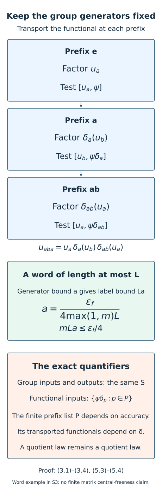

# Generator tests for cocycle stabilization

*Mathematical exposition and figures by GPT-6.1 Sol (OpenAI); source comparison and prerequisite exposition by GPT-6 Astra (OpenAI). Original programme expression is CC0; cited human works retain their rights.*
## Introduction

A finite tower correction tests a cocycle at every label in its tower shapes. Those labels may be long words. If each later comparison must include the next correction's labels, this creates a recursive enlargement of the tested group set. A genuine cocycle has additional structure: its value at a word is a product of generator values transported by successive action prefixes. This lesson proves the corresponding estimate in normal-functional norm.

We construct the towers in the subgroup generated by the requested finite group set. Their labels can therefore be written in those generators. The correction then needs cocycle commutators only at the original generators, against a larger finite family of normal functionals. The combinatorial prefix list and numerical threshold are uniform over the reference action's conjugacy and genuine cocycle perturbations. The functionals themselves are transported by the particular reference action.

The argument also applies to a genuine quotient cocycle with approximate coordinate cochains: equality of quotient classes makes the word error a null sequence, which disappears in every fixed functional commutator. It does not make those coordinate cochains genuine. The resulting action-comparison theorem removes the enlargement of group labels but retains accuracy-dependent functional tests. Genuine original-factor comparison cocycles are supplied by [Near-identity two-cocycle correction](near-identity-two-cocycle-correction-on-the-original-factor.md), Corollary 8.1; [Alternating comparisons](alternating-comparisons-with-convergent-cocycles.md), Sections 3–7, gives the compatible induction.

The generator-word reduction, prefix-functional tests and finite word-length threshold are the mechanism of [Masuda], Lemma 3.4, pp.52–55. Sections 2–4 below give the subgroup reduction, ordered word calculation and quotient-null error explicitly. The finite examples distinguish the transport directions and genuine quotient laws from coordinate laws.

The [bounded-topology companion](../foundations/bounded-topology-foundations.md) supplies faithful-state strong-star tests and normal-functional density; [TF0–TF6](../foundations/normal-tensor-and-tracial-product-foundations.md) supplies the normal spatial tensor interfaces. Their stated prerequisite scopes remain in force.

## 1. Setting and exact providers

Let \(M\) be a finite factor or a countably decomposable infinite semifinite factor with separable predual. Write \(F=M_\omega\subset M^\omega\). Retain the normalizer, null-ideal, canonical trace and exact lifting foundations in [Uniform towers and genuine cocycle stabilization](uniform-towers-and-genuine-cocycle-stabilization.md), Section 1, and its exact proof providers. Let \(G\) be countable amenable, and let \(\beta\) be a genuine action such that each \(\beta_g\), \(g\ne e\), acts nontrivially on \(F\).

For an automorphism \(\theta\) and a normalized genuine original-factor cocycle \(b\) for \(\beta^\theta=\theta\beta\theta^{-1}\), put

\[
\delta_g=\operatorname{Ad}(b_g)\beta^\theta_g.
\tag{1.1}
\]

The preceding lesson proves that \(\delta|_F\) is trace-preservingly conjugate to \(\beta|_F\), so the transported tower labels and their trace masses agree. We use its Theorem 4.1 for quotient cocycles and Corollary 5.1 for genuine cocycles on \(M\). Exact unitary lifting and normal-functional Cauchy–Schwarz are proved under their stated foundations in [Controlled amenable cohomology and finite inner comparisons](controlled-amenable-cohomology-and-finite-inner-comparisons.md), Lemma 2.1 and Sections 4–5. The approximate quotient action comparison is [Unitary two-cocycles and approximate action comparison](unitary-two-cocycles-and-approximate-action-comparison.md), Theorem 7.3. All these hypotheses remain in force.

Our bimodule convention is \((x\psi)(a)=\psi(ax)\), \((\psi x)(a)=\psi(xa)\). Composition \(\psi\delta_g\) is the normal functional \(a\mapsto\psi(\delta_g(a))\). Its norm equals \(\|\psi\|\). The sharp seminorm has no factor of one half:

\[
\|x\|_\rho^{\sharp\,2}=\rho(x^*x)+\rho(xx^*).
\tag{1.2}
\]

## 2. Choose towers within the generated subgroup

Fix a finite symmetric \(S\subset G\) containing \(e\), and let \(H=\langle S\rangle\). Every finite word considered below uses letters of \(S\), with multiplication in the written order. The subgroup \(H\) is amenable. Here is the finite-set verification needed for this application.

For finite \(K\subset H\) and \(\nu>0\), choose a finite nonempty Følner set \(E\subset G\) with

\[
\sum_{h\in K}|hE\mathbin{\triangle}E|<\nu|E|.
\tag{2.1}
\]

Decompose \(E\) among the left \(H\)-orbits \(Hr\) in \(G\). Each \(h\in H\) preserves each such orbit, so the left side of (2.1) is the sum of the corresponding boundary sums in those orbits. At least one nonempty component \(E_r=E\cap Hr\) satisfies

\[
\sum_{h\in K}|hE_r\mathbin{\triangle}E_r|<\nu|E_r|.
\tag{2.2}
\]

Otherwise summing the reverse inequalities would contradict (2.1). Right translation by \(r^{-1}\) gives a nonempty finite set in \(H\) with the same cardinality and every boundary ratio less than \(\nu\). This proves the required Følner criterion for \(H\). Countability and central nontriviality also pass to the restriction of \(\beta\).

Apply the finite-tower construction and the preceding uniform stabilization theorem to \(\beta|_H\), with output set \(S\), desired cocycle error \(\varepsilon_c>0\) and commutator error \(\varepsilon_f>0\). It supplies finite shapes \(R_i\subset H\). Write \(T=\bigcup_i R_i\) and \(m=\sum_i|R_i|\). Choose their bad masses below \(\varepsilon_c^2/32\), and use the threshold

\[
d_0=\frac{\varepsilon_f}{4\max(1,m)}.
\tag{2.3}
\]

For each \(t\in T\), choose one expression

\[
\begin{aligned}
t&=s_1(t)\cdots s_{\ell(t)}(t),\\
p_j(t)&=s_1(t)\cdots s_j(t),\quad p_0(t)=e.
\end{aligned}
\tag{2.4}
\]

The identity can use the empty word. Fix these words once. Let \(P\) consist of \(e\) and all their prefixes before the last letter; let \(L=\max(1,\max_{t\in T}\ell(t))\). Both \(P\) and \(L\) are finite. These choices use the reference action \(\beta|_H\), \(S\), the tower accuracy and the fixed word choices, before \(\theta,b\), the cocycle, the functionals or the tested states. Tower transport and relative copying preserve the same shapes, so no new words are required when those data change.

## 3. Transport the functional in the correct direction

**Lemma 3.1.** For any automorphism \(\gamma\), unitary \(x\) and normal functional \(\psi\),

\[
\|[\gamma(x),\psi]\|=\|[x,\psi\gamma]\|.
\tag{3.1}
\]

*Proof.* At \(a=\gamma(y)\), the functional on the left evaluates to \(\psi\gamma(yx-xy)\), which is the commutator on the right evaluated at \(y\). The automorphism maps the operator unit ball onto itself. Taking the supremum proves the equality. The functional is composed with \(\gamma\), not \(\gamma^{-1}\). □

**Lemma 3.2 (word estimate).** Let \(u\) be a normalized genuine \(\delta\)-cocycle on \(M\). For a word \(t=s_1\cdots s_l\) and its prefixes \(p_j=s_1\cdots s_j\),

\[
\begin{aligned}
u_t&=\prod_{j=1}^l\delta_{p_{j-1}}(u_{s_j}),\\
\|[u_t,\psi]\|&\le\sum_{j=1}^l
\|[u_{s_j},\psi\delta_{p_{j-1}}]\|.
\end{aligned}
\tag{3.2}
\]

The empty product is one and its commutator is zero.

*Proof.* Induction from \(u_{pq}=u_p\delta_p(u_q)\) gives the first line with the factors in exactly the displayed order. For the second, use

\[
[xy,\psi]=x[y,\psi]+[x,\psi]y.
\tag{3.3}
\]

Left and right multiplication by a unitary are isometries on the predual, so the commutator norm of a product of unitary factors is at most the sum of their commutator norms. Apply Lemma 3.1 to each factor in the first line of (3.2). Repeated prefixes or different words for the same group element cause no difficulty: one fixed word proves the bound. We never commute two letters or two cocycle values. □

Define the finite family

\[
\Psi_{\delta,P,\Phi}=
\{\psi\delta_p:\psi\in\Phi,\ p\in P\}.
\tag{3.4}
\]

It has at most \(|\Phi||P|\) members, all with the norms of their original functionals. The family depends on the particular action \(\delta\). Its combinatorial prefix list \(P\) was fixed independently of that action and of \(\Phi\).

**Example 3.3 (a noncommutative orientation check).** On \(M_3\), let \(q e_1=e_2\), \(q e_2=e_3\), \(q e_3=e_1\), let \(\gamma=\operatorname{Ad}(q)\), and let \(x\) interchange the first two basis vectors while fixing the third. Let \(\psi\) have trace density \(D=\operatorname{diag}(1/2,1/3,1/6)\). Its composition with \(\gamma\) has density \(q^*Dq\), whereas composition with \(\gamma^{-1}\) has density \(qDq^*\). The commutator norm of a flip of density entries \(a,b\) is \(2|a-b|\). Hence

\[
\begin{aligned}
\|[\gamma(x),\psi]\|&=1/3,\\
\|[x,\psi\gamma]\|&=1/3,\\
\|[x,\psi\gamma^{-1}]\|&=2/3.
\end{aligned}
\tag{3.5}
\]

This finite example checks Lemma 3.1. It does not model the centrally nontrivial action required by the tower theorem.

## 4. A genuine quotient law suffices for the limiting word estimate

**Lemma 4.1.** Let \(C\) be a normalized genuine \(\delta\)-cocycle in \(M^\omega\), with exact unitary normalizer representatives \(c_{g,k}\). Then, for every fixed word as above and \(\psi\in M_*\),

\[
\lim_\omega\|[c_{t,k},\psi]\|
\le\sum_{j=1}^l\lim_\omega
\|[c_{s_j,k},\psi\delta_{p_{j-1}}]\|.
\tag{4.1}
\]

*Proof.* The quotient cocycle law gives

\[
C_t=\prod_{j=1}^l\delta_{p_{j-1}}(C_{s_j}).
\tag{4.2}
\]

The same product of coordinate representatives is a bounded normalizer representative of that class, since the fixed induced automorphisms preserve the normalizer algebra. Thus

\[
e_k=c_{t,k}-\prod_{j=1}^l
\delta_{p_{j-1}}(c_{s_j,k})
\tag{4.3}
\]

is in the null ideal and is bounded by two. Such a bounded strong-star-null sequence satisfies \(\|[e_k,\psi]\|\to0\) along \(\omega\). For a positive normal functional \(\rho\), normal-functional Cauchy–Schwarz gives

\[
\|[e_k,\rho]\|\le
\sqrt{\rho(1)}\bigl(\|e_k\|_\rho+\|e_k^*\|_\rho\bigr).
\tag{4.4}
\]

For general \(\psi\), decompose it into its four positive normal parts and sum these vanishing bounds. Apply the product Leibniz estimate and Lemma 3.1 to the coordinate product in (4.3), then take its finite ultralimit. The additional commutator with \(e_k\) vanishes, proving (4.1). □

This proof uses the exact law in the quotient. If the law holds only approximately at a coordinate, its word error must be kept until it has been shown null. Conversely, the proof supplies no exact coordinate law: the error in (4.3) may be nonzero at every coordinate.

## 5. Stabilization with the original group set

**Theorem 5.1.** Fix \(\beta\), a finite symmetric \(S\ni e\) and \(\varepsilon_c,\varepsilon_f>0\). There are a finite prefix set \(P\subset\langle S\rangle\) and \(a>0\), independent of \(\theta,b,C,\Phi,\Omega\), with the following property. Let \(\delta\) be (1.1), \(C\) a normalized genuine quotient \(\delta\)-cocycle, \(\Phi\subset M_*\) finite, and \(\Omega\) a finite family of normal states. If

\[
\lim_\omega\|[c_{s,k},\chi]\|\le a
\quad(s\in S,\ \chi\in\Psi_{\delta,P,\Phi}),
\tag{5.1}
\]

there are exact unitaries \(z_k\) such that, for \(\psi\in\Phi\), \(g\in S\) and \(\rho\in\Omega\),

\[
\begin{aligned}
\lim_\omega\|[z_k,\psi]\|&<\varepsilon_f,\\
\lim_\omega\|c_{g,k}-z_k\delta_g(z_k^*)\|_\rho^\sharp
&<\varepsilon_c,\\
\lim_\omega\|z_k^*c_{g,k}\delta_g(z_k)-1\|_\rho^\sharp
&<\varepsilon_c.
\end{aligned}
\tag{5.2}
\]

One possible threshold, with the choices of Section 2, is

\[
a=\frac{d_0}{L}
=\frac{\varepsilon_f}{4\max(1,m)L}.
\tag{5.3}
\]

*Proof.* If \(S=\{e\}\), take \(P=\{e\}\), \(a=1\), \(z_k=1\); all conclusions are zero. Otherwise use the tower choices in \(H=\langle S\rangle\). For every \(t\in T\), Lemma 4.1 and (5.1) give

\[
\lim_\omega\|[c_{t,k},\psi]\|
\le\ell(t)a\le La=d_0.
\tag{5.4}
\]

These are precisely the label commutators required by the preceding lesson's Theorem 4.1 for the restricted action \(\delta|_H\). Its uniform transport applies to \(\beta|_H\), \(\theta\) and \(b|_H\). That theorem gives (5.2), including both nontracial residual bounds and its strict margins. This is a specialization of the already proved correction; the new word estimate verifies all of its finite input hypotheses from (5.1). □

**Corollary 5.2.** If \(u\) is a supplied normalized genuine \(\delta\)-cocycle on the entire group \(G\), replace the ultralimit condition (5.1) by the actual bound \(\|[u_s,\chi]\|\le a\). There is an actual unitary \(z\in M\), nearly central on \(\Phi\), for which

\[
v_g=z^*u_g\delta_g(z)
\tag{5.5}
\]

is a normalized genuine cocycle on all of \(G\), and \(\|v_g-1\|_\rho^\sharp<\varepsilon_c\) for \(g\in S,\rho\in\Omega\).

*Proof.* Constant representatives meet (5.1) by Lemma 3.2. The strict margins in (5.2) and finiteness select one actual coordinate. On every group pair, cancellation of \(\delta_g(z)\delta_g(z^*)\), followed by the supplied law for \(u\), proves \(v_g\delta_g(v_h)=v_{gh}\), exactly as in the preceding stabilization lesson, (5.3). This identity uses the full original cocycle, not merely its restriction to \(H\). Only the error requirements are restricted to \(S\). □

Figure 1. The top path spells the word aba in the symmetric generators a,b of S3. Its three factors are ordered as in (3.2), and its normal-functional tests are transported by e,a,ab. The lower boxes record the exact quantitative reduction (5.3)–(5.4) and the quantifier distinction. The displayed word is an algebraic example of the prefix mechanism, not an asserted tower shape or a centrally free finite matrix action. Source: Lemmas 3.1–3.2 and Theorem 5.1 above. Reproducible [figure source](../figures/draw_generator_prefix_tests.py).

## 6. Action comparison without new group labels

**Corollary 6.1.** Fix \(\beta\), a finite symmetric \(S\ni e\), finite output functionals \(\Xi\subset M_*\) and errors \(\varepsilon,\varepsilon_f>0\). There are finite \(P\subset\langle S\rangle\) and \(a>0\), independent of the action (1.1), with the following property. Let \(\Phi\subset M_*\) be any prescribed finite centrality family. Let \(\alpha\) admit the pointwise approximate unitary implementers of \(\alpha_g\delta_g^{-1}\) required by the earlier approximate-comparison theorem. If

\[
\|\chi\alpha_s-\chi\delta_s\|\le a
\quad(s\in S,\ \chi\in\Psi_{\delta,P,\Phi}),
\tag{6.1}
\]

there is an actual unitary \(z\) with \(\|[z,\psi]\|<\varepsilon_f\) for \(\psi\in\Phi\), and, for \(g\in S,\xi\in\Xi\),

\[
\|\xi\alpha_g-\xi\operatorname{Ad}(z)\delta_g
\operatorname{Ad}(z^*)\|<\varepsilon.
\tag{6.2}
\]

*Proof.* Choose a faithful normal state \(\rho\) dominating the four positive parts of each \(\xi\in\Xi\), with their finite normal-functional displacement constant \(A>0\), as in the preceding lesson, (5.5). This choice uses \(\Xi\), before \(\theta,b\) or \(\Phi\). Apply Theorem 5.1 with \(\varepsilon_c<\varepsilon/(2A)\), obtaining \(P,a\). The approximate-comparison theorem supplies a genuine quotient \(\delta\)-cocycle \(C\) with unitary representatives such that \(\operatorname{Ad}(c_{s,k})\delta_s\to\alpha_s\) in the u-topology along \(\omega\). For any fixed normal functional \(\chi\),

\[
\begin{aligned}
\lim_\omega\|[c_{s,k},\chi]\|
&=\|\chi\alpha_s\delta_s^{-1}-\chi\|\\
&=\|\chi\alpha_s-\chi\delta_s\|.
\end{aligned}
\tag{6.3}
\]

The last equality follows by precomposing the difference with \(\delta_s\), an isometry. Thus (6.1) verifies (5.1). Replacing \(c_{g,k}\) by \(z_k\delta_g(z_k^*)\) costs less than \(\varepsilon/2\) in every output functional in the ultralimit, by the correctly oriented two-unitary GNS estimate. The approximate-implementer error tends to zero. A finite intersection selects a coordinate with total error below \(\varepsilon\) and all desired commutators below \(\varepsilon_f\). The exact identity \(\operatorname{Ad}(z\delta_g(z^*))\delta_g=\operatorname{Ad}(z)\delta_g\operatorname{Ad}(z^*)\) yields (6.2). □

In this corollary the group values tested in (6.1) and (6.2) are the same set \(S\). This corrects the group-label recursion noted in [Two-sided convergence and transported cocycle limits](two-sided-convergence-and-transported-cocycle-limits.md), Section 7: cocycle words enlarge the functional family instead. For a conjugator row one can start with both finite families specified in that lesson, Section 3, then add their action-prefix compositions by (3.4).

The distinction between group values and functional prefixes is essential. The finite prefix list can depend on the desired output accuracy; its transported functionals also depend on the current action. This is not an accuracy-independent fixed input neighborhood. Moreover the comparison cocycle used in this proof is exact in the quotient. No genuine original-factor comparison cocycle was constructed by this argument. The genuine-input construction is Corollary 8.1 of the near-identity lesson; the alternating-comparison lesson constructs its summable unitary increments and compatible forward and inverse conjugators. Nontrivial inner isotropy, Borel selection and continuous reconstruction require their respective additional arguments.

## 7. Exercises with complete solutions

**Exercise 7.1 (subgroup Følner sets). Level 2.** Suppose \(K\subset H\), and a finite set \(E\subset G\) has \(\sum_{h\in K}|hE\triangle E|<\nu|E|\). Why does an arbitrary nonempty coset component of \(E\) not suffice? Prove that some component does suffice, including the direction of its translation into \(H\).

*Solution.* Individual components can have large boundary ratio even when the weighted total is small. The identity \(h(Hr)=Hr\) for \(h\in H\) decomposes each boundary over the same disjoint left orbits. If every nonempty component had boundary sum at least \(\nu\) times its size, summing would violate the strict global inequality. A component with smaller ratio therefore exists. Translate that component on the right by \(r^{-1}\); then \((Hr)r^{-1}=H\) and \((hE_r)r^{-1}=h(E_rr^{-1})\). Sizes and all boundaries are unchanged. Left translation by \(r^{-1}\) would instead involve conjugating the generators and is not the required reduction.

**Exercise 7.2 (noncommuting prefixes). Level 2.** Let a,b be the transpositions (12),(23) in S3. Expand a cocycle value at aba without interchanging factors. List the functionals in its commutator bound.

*Solution.* The successive prefixes are e,a,ab. Twice applying the exact cocycle law gives

\[
u_{aba}=u_a\delta_a(u_b)\delta_{ab}(u_a).
\tag{7.1}
\]

The sum of commutator norms uses \((u_a,\psi)\), \((u_b,\psi\delta_a)\) and \((u_a,\psi\delta_{ab})\). Since a and b do not commute, \(\delta_{ba}\) cannot replace \(\delta_{ab}\). The fact that aba=bab provides a second valid word estimate; it does not change the order in the first one.

**Exercise 7.3 (compute a threshold). Level 1.** Take \(m=12\), maximum chosen word length 3, and commutator tolerance \(\varepsilon_f\). Compute \(d_0,a\), the maximum label commutator bound and the tower correction's bound. Explain why the number of distinct labels need not equal 12.

*Solution.* With \(L=3\),

\[
\begin{aligned}
d_0&=\varepsilon_f/48,\qquad a=\varepsilon_f/144,\\
La&=\varepsilon_f/48,\qquad md_0=\varepsilon_f/4.
\end{aligned}
\tag{7.2}
\]

The first bound controls each chosen word of length at most three. The second sums once per tower level, as the correction requires. A group label can occur in multiple tower shapes, so \(|T|\) may be smaller than \(m\); replacing \(m\) by \(|T|\) in that last sum is unjustified. The residual-state accuracy is controlled separately by the bad projection masses.

**Exercise 7.4 (check the direction). Level 1.** Compute the two translated densities in Example 3.3 and all three commutator norms in (3.5).

*Solution.* The cyclic permutation gives

\[
\begin{aligned}
q^*Dq&=\operatorname{diag}(1/3,1/6,1/2),\\
qDq^*&=\operatorname{diag}(1/6,1/2,1/3).
\end{aligned}
\tag{7.3}
\]

Conjugating the (12) flip by q gives the (23) flip. Its commutator with D has trace norm \(2|1/3-1/6|=1/3\). The (12) flip with the first density has the same norm; with the second its norm is \(2|1/6-1/2|=2/3\). This distinguishes the forward composition of the functional in (3.1) from the inverse composition.

**Exercise 7.5 (a nonzero coordinate word error). Level 2.** Let \(G=\mathbb Z\) act trivially on \(M\), and at coordinate k define \(c_{n,k}=\exp(in^2/k)1\). Verify normalization and the exact quotient law. Is the coordinate law genuine? What is the word error at 2?

*Solution.* The identity value is one. For each fixed integer n, \(c_{n,k}\to1\) in operator norm, so every quotient value is one and the quotient law is exact. At a finite coordinate, however,

\[
\begin{aligned}
c_{1,k}^2-c_{2,k}&=(e^{2i/k}-e^{4i/k})1\ne0,\\
\|c_{1,k}^2-c_{2,k}\|&=2\sin(1/k)>0.
\end{aligned}
\tag{7.4}
\]

Thus no coordinate is a genuine cocycle, even though the word error is norm-null and all commutators vanish. The trivial action here isolates the logical issue in Lemma 4.1; it does not satisfy the centrally nontrivial tower hypothesis. The lemma's limiting estimate remains valid, and does not imply a coordinate cocycle law.

**Exercise 7.6 (the inverse value). Level 2.** For a genuine \(\delta\)-cocycle, determine its value at \(s^{-1}\). Explain why a symmetric generator set avoids an unstated inverse-control condition.

*Solution.* The cocycle law at \((s,s^{-1})\) gives \(u_s\delta_s(u_{s^{-1}})=1\). Apply \(\delta_{s^{-1}}\) after solving for the second factor:

\[
u_{s^{-1}}=\delta_{s^{-1}}(u_s^*).
\tag{7.5}
\]

Its commutator is tested using \(\psi\delta_{s^{-1}}\), with the adjoint functional if \(\psi\) is complex. Merely testing \(u_s\) on \(\psi\) would omit this transport. In Theorem 5.1, every inverse letter already belongs to S, so its own value is covered by (5.1), and no additional inverse argument is required there.

**Exercise 7.7 (convert the action input). Level 2.** Prove the last equality in (6.3) and identify the generator values and functional family actually required for (6.1).

*Solution.* Precompose the difference with \(\delta_s\). Then

\[
(\chi\alpha_s\delta_s^{-1}-\chi)\delta_s
=\chi\alpha_s-\chi\delta_s.
\tag{7.6}
\]

Precomposition is an isometry, proving equality of the norms. The action values are only those at s in S. For each original test \(\psi\in\Phi\), the required functionals are \(\chi=\psi\delta_p\) for the finite chosen prefixes p in P. The elements p are used to transport functionals; they are not additional group values at which the two actions are compared.

**Exercise 7.8 (what the changed quantifiers prove). Level 3.** Explain why Theorem 5.1 removes group-label recursion but does not give a fixed input neighborhood for every output accuracy, nor construct the genuine comparison rows needed by classification.

*Solution.* The same finite S occurs in both the input commutators and the output cocycle bounds. Longer tower labels are controlled through words in S. The chosen tower accuracy can change the shapes, maximum word length, prefix set and threshold. Consequently the input functional family and numerical bound can change when the desired residual accuracy changes. Its functionals also depend on the particular reference action through \(\delta_p\). These are finite quantified choices, not one universal neighborhood. Corollary 5.2 starts with an already genuine original-factor cocycle and preserves that property. Corollary 6.1 instead uses a genuine quotient cocycle; Exercise 7.5 shows why that does not make its coordinate cochains genuine. Neither result alone produces a compatible global induction with summable unitary corrections and two-sided conjugator convergence.

## References

The whole finite correction used here is proved in [Uniform towers and genuine cocycle stabilization](uniform-towers-and-genuine-cocycle-stabilization.md), Theorem 4.1 and Corollary 5.1, specialized to the amenable subgroup of Section 2. The quotient input and null-ideal preservation are [Unitary two-cocycles and approximate action comparison](unitary-two-cocycles-and-approximate-action-comparison.md), Lemma 7.1 and Theorem 7.3. The functional estimates are [Controlled amenable cohomology and finite inner comparisons](controlled-amenable-cohomology-and-finite-inner-comparisons.md), Sections 4–5. Each provider retains its stated foundational scope.

[Masuda] Toshihiko Masuda, *Evans–Kishimoto type argument for actions of discrete amenable groups on McDuff factors*, Mathematica Scandinavica 101 (2007), 48–64; [journal edition](https://journals.msp.org/mscand/article/view/666). Lemma 3.4, pp.52–55, for tower correction and generator-prefix tests. The cited locators refer to this journal edition.
