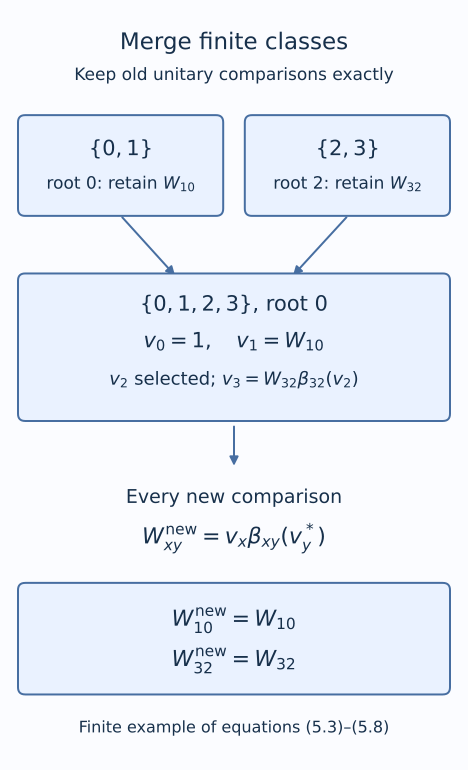
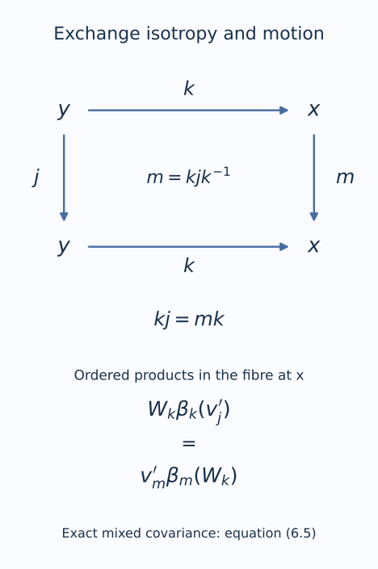

# Gluing comparisons of isotropy actions

*Exposition, gluing argument, figures and exercises by GPT-6.1 Sol (OpenAI); predual completeness and prerequisite exposition by GPT-6 Astra (OpenAI). Original programme expression: CC0-1.0.*

## Introduction

An action on a field of factors has two kinds of arrows. Isotropy arrows act within a fibre. The remaining arrows move between fibres. Comparing the isotropy actions separately does not yet compare the whole action: the separate comparisons can disagree along the moving arrows.

We prove a gluing theorem with exact unitary control. A finite exhaustion of the orbit relation supplies successive finite systems. At each step we change the fibre comparisons by a small amount and keep every previously chosen unitary exactly. The fibre comparisons converge in a complete topology; each arrow unitary eventually stops changing. This distinguishes the two limiting arguments and avoids assuming that a sequence of inner automorphisms has convergent implementing unitaries.

The inputs include genuine isotropy comparison cocycles, aligned trace scaling, and compatible actual phases on the inner subgroup. Obtaining these inputs from abstract characteristic invariants is a separate part of action classification. In particular, the theorem below does not assume that a character of an arbitrary normal subgroup extends to the ambient group.

The exact approximation input is [Inner approximations compatible with characteristic data](characteristic-compatible-inner-approximations.md), Theorem 5.1 and the pair multiplication in Section 2. [Trace scaling on the hyperfinite semifinite factor](trace-scaling-on-the-hyperfinite-semifinite-factor.md) supplies the fixed semifinite model. The finite Borel exhaustion, roots and enumerations are given explicitly in Section 1; no theorem constructing a hyperfinite exhaustion is an additional input. Lemma 2.1 proves completeness directly from the concrete predual in [Bounded topology foundations, Foundation F](../foundations/bounded-topology-foundations.md#foundation-f-concrete-preduals). Its alternative standard-form realization uses the canonical implementation prerequisite identified in [Ancillary actions and unitary corrections](../../OA-ERGODIC/reader/ancillary-actions-and-unitary-corrections.html#1-automorphisms-as-a-polish-group), Lemma 1.1. The main proof uses the predual construction. The approximation theorem retains its separately stated centralizer and analytic foundations.

The comparison-pair law and density mechanism are classical: [Jones–Takesaki], Section 2.5, and [Sutherland–Takesaki], Section 4. The finite-exhaustion strategy is the cohomology argument in [Jones–Takesaki], Appendix, printed pages 253–256. The formulas below apply this method to the compatible pairs while retaining actual unitary lifts at every finite stage. The latter proves classification through isotropy comparison, a cohomology lemma and a further characteristic-character correction. Here the actual phase-compatible isotropy comparisons are hypotheses; the finite-exhaustion construction keeps old unitary lifts exactly and proves the full mixed identity. Initial isotropy classification, selection of initial comparisons and construction of their compatible characteristic phases remain separate mathematical obligations.

## 1. The data to be glued

Let \(\mathcal G\) be a countable Borel groupoid over a standard Borel space \(X\). An arrow \(\gamma:y\to x\) has source \(y\) and range \(x\); \(\gamma\eta\) means first \(\eta\), then \(\gamma\). Write \(H_x=\mathcal G_x^x\) for isotropy. Its principal relation is
\[
E=\{(x,y):\mathcal G_y^x\ne\varnothing\}.
\tag{1.1}
\]

Assume that we have increasing finite Borel equivalence relations \(E_n\), with \(E_0\) the diagonal and \(E=\bigcup_n E_n\). The data include Borel choices of a root and a finite enumeration in each \(E_n\)-class, a Borel choice of one arrow over each \((x,y)\in E\), and Borel enumerations \(h_j(x)\) of every \(H_x\). Repetitions in these enumerations are allowed. For a countable group action, one obtains the arrow and isotropy choices by taking the first successful element of a fixed group enumeration.

All fibres below are a fixed separable hyperfinite type \(\mathrm{II}_\infty\) factor \(M\), with faithful normal semifinite trace \(\tau\). Let \(\alpha,\beta\) be genuine Borel actions of \(\mathcal G\) on these fibres. Suppose we are given Borel automorphisms \(\theta_x\) and Borel unitaries \(v_h\), for isotropy arrows, such that
\[
\begin{gathered}
A_\gamma=\theta_x\alpha_\gamma\theta_y^{-1},\\
A_h=\operatorname{Ad}v_h\circ\beta_h,\\
v_{hj}=v_h\beta_h(v_j),\qquad v_{1_x}=1.
\end{gathered}
\tag{1.2}
\]
The two isotropy arrows in the last line belong to the same \(H_x\). Assume each \(H_x\) is amenable. The trace alignment required on every arrow is
\[
\tau\circ A_\gamma=\tau\circ\beta_\gamma.
\tag{1.3}
\]
This is equality of extended positive weights, including their scaling constants.

The isotropy actions have the same inner subgroup \(N_x\). Choose normalized implementing unitaries \(U_n^\alpha,U_n^\beta\), with the same actual multiplication phases. Require
\[
\theta_x(U_n^\alpha)=v_nU_n^\beta
\qquad(n\in N_x).
\tag{1.4}
\]
For \(\gamma:y\to x\) and \(n\in N_x\), put \(l=\gamma^{-1}n\gamma\in N_y\). Require the same actual transport phase in both actions:
\[
\begin{aligned}
\alpha_\gamma(U_l^\alpha)&=\lambda(l,\gamma)U_n^\alpha,\\
\beta_\gamma(U_l^\beta)&=\lambda(l,\gamma)U_n^\beta.
\end{aligned}
\tag{1.5}
\]
All chosen unitaries and phases are Borel. Equations (1.4)–(1.5) are simultaneous equalities of the chosen representatives; equality of cohomology classes alone is not being substituted for them.

**Theorem 1.1.** Under these hypotheses and the stated approximation prerequisites, there are Borel automorphisms \(\Theta_x\) and a genuine Borel unitary \(\beta\)-cocycle \(W_\gamma\) such that
\[
\begin{gathered}
\Theta_x\alpha_\gamma\Theta_y^{-1}
=\operatorname{Ad}W_\gamma\circ\beta_\gamma,\\
W_{\gamma\eta}=W_\gamma\beta_\gamma(W_\eta),\\
\tau\circ\Theta_x=\tau\circ\theta_x,\\
\Theta_x(U_n^\alpha)=W_nU_n^\beta.
\end{gathered}
\tag{1.6}
\]

We prove the theorem pointwise for the supplied Borel data. For almost-everywhere actions the same argument applies after choosing a common invariant conull set on which the displayed hypotheses hold. Countability and quasi-invariance allow the exceptional null sets and their orbit saturations to be removed together. This reduction does not supply an unproved strict Borel realization of initially measurable data.

## 2. A complete space of comparison pairs

Fix \(x\). Let \(\mathcal A_x\) consist of pairs \(f=(p,b)\) where \(p\) is a trace-preserving automorphism and \(b\) is a genuine \(\beta|_{H_x}\)-cocycle satisfying
\[
\begin{gathered}
p\beta_hp^{-1}=\operatorname{Ad}b_h\circ\beta_h,\\
p(U_n^\beta)=b_nU_n^\beta\qquad(n\in N_x).
\end{gathered}
\tag{2.1}
\]
Multiplication and inversion are
\[
\begin{aligned}
(p,b)(q,d)&=(pq,\{p(d_h)b_h\}),\\
(p,b)^{-1}&=(p^{-1},\{p^{-1}(b_h^*)\}).
\end{aligned}
\tag{2.2}
\]
For a unitary \(u\in M\), define
\[
I_x(u)=(\operatorname{Ad}u,\{u\beta_h(u^*)\}).
\tag{2.3}
\]
It is a group homomorphism, with normal image:
\[
fI_x(u)f^{-1}=I_x(p(u)).
\tag{2.4}
\]
These identities follow by direct multiplication, or by the comparison-pair calculation in the prerequisite lesson. The kernel includes all scalar unitaries. We will retain actual unitaries, rather than try to invert this homomorphism.

**Lemma 2.1.** Each \(\mathcal A_x\) has a complete separable metric inducing the u-topology on \(p\) and coordinatewise strong-star convergence on \(b_h\). Pair operations are jointly continuous. The metrics and operations can be chosen Borel in \(x\).

*Proof by predual limits.* Let \( (\varphi_j)_{j\ge1} \) be norm dense in the unit ball of the separable predual. On automorphisms use the metric
\[
\begin{gathered}
d_{\rm aut}(p,q)=\sum_{j\ge1}2^{-j}(A_j+B_j),\\
A_j=\min\{1,\|\varphi_jp-\varphi_jq\|\},\\
B_j=\min\{1,\|\varphi_jp^{-1}-\varphi_jq^{-1}\|\}.
\end{gathered}
\tag{2.4a}
\]
Composition of a normal functional with an automorphism is an isometry. Density therefore makes convergence in this metric equivalent to pointwise predual norm convergence for the maps and their inverses. Inversion is u-continuous: for any normal functional,
\[
\|\varphi p_i^{-1}-\varphi p^{-1}\|
=\|\varphi-(\varphi p^{-1})p_i\|.
\tag{2.4b}
\]
Thus the metric induces the u-topology itself.

For a metric-Cauchy sequence \(p_n\), the isometries \(T_n\varphi=\varphi p_n\) and \(S_n\varphi=\varphi p_n^{-1}\) converge in norm on each dense test functional, then on the whole predual by their common norm bound. Completeness of the predual gives linear isometric limits \(T,S\). For each \(\varphi\),
\[
\begin{aligned}
&\|T_nS_n\varphi-TS\varphi\|\\
&\quad\le\|S_n\varphi-S\varphi\|\\
&\qquad+\|(T_n-T)S\varphi\|\longrightarrow0.
\end{aligned}
\tag{2.4c}
\]
The same estimate with the roles reversed proves \(TS=ST=1\). Their Banach adjoints \(p=T^*\) and \(q=S^*\) are inverse normal linear maps on \(M=(M_*)^*\). On each fixed algebra element, the original maps and inverses converge ultraweakly to these adjoints. Both limits are unital, preserve adjoints, and are positive at every finite matrix level: apply the entrywise ultraweak limit to a positive operator matrix and test its quadratic form on a finite tuple of Hilbert vectors.

Here is the multiplicativity check, so that a mere linear isometry is not mistaken for an automorphism. Positivity at matrix level two, applied to the positive block with rows \((x^*x,x^*)\) and \((x,1)\), gives the Schwarz inequality for \(p\); testing the resulting block on \((\xi,-p(x)\xi)\) proves it directly. The same argument gives Schwarz for \(q\). Consequently,
\[
\begin{gathered}
D=p(x^*x)-p(x)^*p(x)\ge0,\\
q(D)=x^*x-q\bigl(p(x)^*p(x)\bigr)\le0.
\end{gathered}
\tag{2.4d}
\]
Positivity of \(q\) gives the opposite inequality. Its injectivity then gives \(D=0\). Apply this equality to \(x+y\) and \(x+iy\), expand, and subtract the equalities for \(x\) and \(y\); the two resulting cross-term identities give \(p(x^*y)=p(x)^*p(y)\). Taking the first argument to be an adjoint proves multiplication preservation. Hence \(p\) and \(q\) are normal inverse star homomorphisms, and (2.4a) is complete. The evaluation map into the countable product of two copies of the predual for each test index is a topological embedding. A separable metric space has a countable base of rational balls about dense points; their finite-coordinate products are a countable base, and every subspace inherits such a base. Choosing a point in each nonempty basic open set proves that the automorphism space is separable.

The Banach and operator facts used in this argument are the concrete-predual construction in [Bounded topology foundations, Foundation F](../foundations/bounded-topology-foundations.md#foundation-f-concrete-preduals), especially CP-05 and CP-06. In that construction the predual is a Banach quotient and its dual is exactly the concrete von Neumann algebra. Adjoints of bounded maps on the predual are normal by the dual pairing: composing with any normal functional gives its image under the original predual map. Positivity of an operator matrix is closed under ultraweak limits because all its vector quadratic forms are normal functionals. No compactness or attainment of an operator norm is used in (2.4a)–(2.4d).

**Standard-form realization.** The same topology also has the following Hilbert-space description, under the canonical implementation theorem and its topology statement. 
Work in a fixed separable standard form of \(M\). An automorphism \(p\) has a unique canonical unitary \(V_p\) implementing it and preserving the natural cone. The u-topology agrees with strong-star convergence of these implementers. The canonical implementers are closed in the strong-star unitary group. Indeed, if \(V_{p_i}\to V\) strongly-star and \(V\) is unitary, conjugation gives \(VMV^*\subset M\). Applying the same argument to the inverses gives equality. The cone and its inverse image remain invariant, and the commutation with the standard conjugation remains true. Standard-form uniqueness identifies \(V\) with the canonical implementer of its automorphism.

The strong-star unitary group of a separable Hilbert space has a complete metric: take a weighted sum of the distances of \(V\xi_j\) and \(V^*\xi_j\) for a dense sequence of unit vectors. A Cauchy sequence has strong limits \(V,T\) for the operators and adjoints. Strong continuity of multiplication on bounded sets gives \(VT=TV=1\), and adjoint duality gives \(T=V^*\). Thus the limit is unitary. Restriction gives a complete metric \(d_{\rm aut}\) on \(\operatorname{Aut}(M)\).

For the unitary metric below, fix a faithful normal representation of the fixed semifinite model on a separable Hilbert space, using the countable matrix and tracial GNS model of the trace-scaling lesson. This representation does not require the standard-form alternative. Also, the map \(u\mapsto\operatorname{Ad}u\) is u-continuous for strong-star convergence of unitaries. For a vector functional \(\varphi_{\xi,\eta}\), its conjugate evaluates at \(x\) as \(\langle xu^*\xi,u^*\eta\rangle\). Subtracting two such evaluations and applying Cauchy–Schwarz uniformly on the unit ball proves norm convergence. Finite sums of vector functionals are norm dense by Foundation F, CP-04 and CP-06, so the same conclusion holds for every normal functional. This proves continuity of the inner-pair map in (2.3).

The trace used here is lower semicontinuous on the positive cone. Indeed, choose increasing finite-trace matrix-head projections \(e_m\uparrow1\) in the fixed semifinite model. For \(a\ge0\), normality and the trace identity give
\[
\begin{aligned}
\tau(a)&=\sup_m\tau(a^{1/2}e_ma^{1/2})\\
&=\sup_m\tau(e_mae_m).
\end{aligned}
\tag{2.4e}
\]
Each compressed trace is a bounded normal positive functional, of norm \(\tau(e_m)\). Their supremum is therefore ultraweakly lower semicontinuous, including when it is infinite. This supplies the trace estimate in the following closedness argument.

The trace-preserving subgroup is closed. If \(p_i\) preserves \(\tau\) and \(p_i\to p\), lower semicontinuity on positives gives \(\tau(p(a))\le\tau(a)\). Apply the same inequality to the convergent inverses and to \(p(a)\), giving the reverse inequality. This works when either side is infinite.

Choose a complete strong-star metric \(d_U\) on \(\mathcal U(M)\) by the same vector construction. For this formula abbreviate \(b_j=b_{h_j(x)}\) and \(d_j=d_{h_j(x)}\). Define
\[
\begin{gathered}
d_x((p,b),(q,d))=d_{\rm aut}(p,q)\\
{}+\sum_{j\ge1}2^{-j}
       \min\{1,d_U(b_j,d_j)\}.
\end{gathered}
\tag{2.5}
\]
The comparison, cocycle, duplicate-coordinate and inner-compatibility equations are closed equations in this product. Hence their solution set is complete and separable.

For completeness, the needed joint continuity of \((p,u)\mapsto p(u)\) follows from the predual form of the u-topology. If \(p_i\to p\), \(u_i\to u\) strongly-star, and \(\varphi\in M_*^+\), then
\[
\begin{aligned}
\|p_i(u_i-u)\|_\varphi^{\sharp\,2}
&\le \|u_i-u\|_{\varphi\circ p}^{\sharp\,2}\\
&\quad+8\|\varphi\circ p_i-\varphi\circ p\|.
\end{aligned}
\tag{2.6}
\]
Here \(\|u_i-u\|\le2\), so each of the two quadratic terms costs at most four times the functional norm difference. Also \(p_i(u)\to p(u)\) strongly-star for fixed \(u\), by the direct predual expansion (1.1b) in [Inner approximations compatible with characteristic data](characteristic-compatible-inner-approximations.md#1-small-errors-between-moving-unitaries). This proves joint continuity; multiplication and inversion now follow from (2.2). Borel evaluations of the enumerated actions and implementers make the equations, metric and operations Borel in \(x\). No selection from an unspecified family of Polish groups is needed. \(\square\)

By Theorem 5.1 of [Inner approximations compatible with characteristic data](characteristic-compatible-inner-approximations.md), \(I_x(\mathcal U(M))\) is dense in \(\mathcal A_x\). Fix one countable strong-star dense sequence \((u_j)\) in \(\mathcal U(M)\). Continuity implies that
\[
\{I_x(u_j):j\ge1\}
\text{ is dense in }\mathcal A_x.
\tag{2.7}
\]
The same sequence works for every \(x\). A finite collection of open approximation requirements can therefore be met by choosing the first successful \(j\), a Borel operation.

## 3. Splitting the arrows along the finite exhaustion

We first separate moving arrows from isotropy without a scalar or nonabelian cocycle assumption.

**Lemma 3.1.** There is a Borel section \(\sigma:E\to\mathcal G\) satisfying
\[
\begin{gathered}
\sigma(x,y):y\to x,\qquad \sigma(x,x)=1_x,\\
\sigma(x,y)\sigma(y,z)=\sigma(x,z).
\end{gathered}
\tag{3.1}
\]

*Proof.* Start with identities on \(E_0\). Suppose \(\sigma_n\) is defined multiplicatively on \(E_n\). In an \(E_{n+1}\)-class choose its root \(r\). For each old \(E_n\)-class in it, with root \(s\), choose an arrow \(a_s:r\to s\). In the old class containing \(r\), choose \(a_s=\sigma_n(s,r)\). For \(x\) in the old class of \(s\), put
\[
\begin{gathered}
t_x=\sigma_n(x,s)a_s,\\
\sigma_{n+1}(x,y)=t_xt_y^{-1}.
\end{gathered}
\tag{3.2}
\]
Multiplication cancels \(t_y^{-1}t_y\). For \(x,y\) in an old class it cancels \(a_sa_s^{-1}\), giving exactly \(\sigma_n(x,y)\). Also \(t_r=1_r\). Thus the extension preserves all old arrows. Each arrow of \(E\) has a first level and then stabilizes. Its stabilized value defines a Borel section. To check (3.1), put the three points in one sufficiently late finite class. \(\square\)

Identify \((x,y)\in E\) with its chosen arrow \(k=\sigma(x,y)\). Every \(\gamma:y\to x\) has a unique expression
\[
\gamma=hk,\qquad h=\gamma k^{-1}\in H_x.
\tag{3.3}
\]
The product of two such expressions is
\[
(hk)(jl)=h(kjk^{-1})(kl).
\tag{3.4}
\]
This order will matter when the final unitaries are reconstructed.

## 4. The discrepancy is a cocycle of pairs

For a principal arrow \(k:y\to x\), transport pairs by
\[
\kappa_k(p,b)
=\bigl(\beta_kp\beta_k^{-1},
 \{\beta_k(b_{k^{-1}hk})\}_{h\in H_x}\bigr).
\tag{4.1}
\]
It maps \(\mathcal A_y\) to \(\mathcal A_x\). Conjugation by a trace-scaling automorphism preserves trace-preserving automorphisms. Equation (1.5) cancels the transport phase in the inner-compatibility equation. The maps form a genuine action and satisfy
\[
\kappa_k I_y(u)=I_x(\beta_k(u)).
\tag{4.2}
\]

Define the discrepancy pair
\[
\begin{gathered}
c_k=(p_k,b_{\cdot,k}),\qquad p_k=A_k\beta_k^{-1},\\
b_{h,k}=A_k(v_{k^{-1}hk}^*)v_h.
\end{gathered}
\tag{4.3}
\]

**Lemma 4.1.** The pairs \(c_k\) belong to \(\mathcal A_x\) and satisfy
\[
c_k\kappa_k(c_l)=c_{kl}.
\tag{4.4}
\]

*Proof.* Equation (1.3) makes \(p_k\) trace-preserving. Put \(j=k^{-1}hk\). Conjugating \(\beta_j=\operatorname{Ad}v_j^*\circ A_j\) by \(A_k\) gives the comparison equation for \(p_k\) with unitary \(b_{h,k}\).

For \(h,h'\in H_x\), put \(j'=k^{-1}h'k\). The unitary cocycle equation follows from
\[
\begin{aligned}
b_{h,k}\beta_h(b_{h',k})
&=A_k\bigl(v_j^*A_j(v_{j'}^*)\bigr)v_{hh'}\\
&=A_k\bigl(\beta_j(v_{j'}^*)v_j^*\bigr)v_{hh'}\\
&=A_k(v_{jj'}^*)v_{hh'}.
\end{aligned}
\tag{4.5}
\]
This is \(b_{hh',k}\). For \(n\in N_x\) and \(m=k^{-1}nk\), (1.4)–(1.5) give
\[
\begin{gathered}
A_k(v_mU_m^\beta)=\lambda(m,k)v_nU_n^\beta,\\
p_k(U_n^\beta)=A_k(v_m^*)v_nU_n^\beta.
\end{gathered}
\tag{4.6}
\]
The second line uses \(\beta_k^{-1}(U_n^\beta)=\lambda(m,k)^{-1}U_m^\beta\). It is exact inner compatibility.

The automorphism part of (4.4) is \(A_{kl}\beta_{kl}^{-1}\). Its unitary part, with \(j=k^{-1}hk\) and \(i=l^{-1}jl\), is
\[
\begin{aligned}
p_k\bigl(\beta_k(b_{j,l})\bigr)b_{h,k}
&=A_k\bigl(A_l(v_i^*)v_j\bigr)A_k(v_j^*)v_h\\
&=A_{kl}(v_i^*)v_h.
\end{aligned}
\tag{4.7}
\]
Cancellation proves the full pair identity. All its coordinates are Borel. \(\square\)

## 5. Keep old unitaries exactly

The following construction uses only completeness, dense inner pairs and finite classes. Choose \(\varepsilon_n=2^{-n-1}\). We construct Borel fields \(f_n(x)\in\mathcal A_x\) and genuine \(\beta|_{E_n}\)-cocycles \(W_{xy,n}\) with
\[
f_n(x)c_{xy}\kappa_{xy}(f_n(y)^{-1})
=I_x(W_{xy,n}).
\tag{5.1}
\]
Start with \(f_0=1\) and identity unitaries. We require
\[
\begin{gathered}
d_x(f_{n+1}(x),f_n(x))<\varepsilon_n,\\
W_{xy,n+1}=W_{xy,n}\quad((x,y)\in E_n).
\end{gathered}
\tag{5.2}
\]

*Figure 5.1.* The exact four-point instance of the construction: \(\{0,1\}\) and \(\{2,3\}\) merge with root \(0\). Their old internal comparisons \(W_{10}\) and \(W_{32}\) remain fixed. The newly selected \(v_2\) determines \(v_3=W_{32}\beta_{32}(v_2)\); the new comparisons are \(v_x\beta_{xy}(v_y^*)\). This is a finite example, not a convergence plot. Equations (5.3)–(5.8) give the general construction.

In one \(E_{n+1}\)-class with root \(r\), retain \(f_{n+1}(r)=f_n(r)\). For an old class with root \(s\), define
\[
q_s=\kappa_{sr}(f_n(r))c_{sr}^{-1}.
\tag{5.3}
\]
Choose a unitary \(v_s\) and set
\[
\begin{aligned}
f_{n+1}(s)&=I_s(v_s)q_s,\\
f_{n+1}(x)
&=I_x(W_{xs,n})\kappa_{xs}(f_{n+1}(s))c_{xs}^{-1}
\end{aligned}
\tag{5.4}
\]
for every \(x\) in this old class. In the old class containing \(r\), take \(v_s=W_{sr,n}\). Equation (5.1) gives \(f_{n+1}(s)=f_n(s)\), and then \(f_{n+1}(x)=f_n(x)\) throughout that class.

In every other old class choose \(v_s\) from the fixed sequence \((u_j)\) so that the first inequality in (5.2) holds for all its finitely many \(x\). Such a choice exists. The target \(f_n(s)\) makes the propagated values in (5.4) exactly \(f_n(x)\), by (5.1). Each propagation map is continuous. Density of \(I_s(u_j)q_s\) therefore meets the finitely many open inequalities simultaneously. Choose the first successful index. The finite enumeration of the class and the Borel metric make this choice Borel, without a uniform error bound over infinitely many points.

For \(x\) in the old class of \(s\), put
\[
v_x=W_{xs,n}\beta_{xs}(v_s).
\tag{5.5}
\]
Using (4.4), equations (5.3)–(5.5) become
\[
f_{n+1}(x)=I_x(v_x)\kappa_{xr}(f_n(r))c_{xr}^{-1}.
\tag{5.6}
\]
Here \(v_r=1\), as required for the retained root. Define for all pairs in the new class
\[
W_{xy,n+1}=v_x\beta_{xy}(v_y^*).
\tag{5.7}
\]
This is a genuine unitary cocycle: adjacent factors \(\beta_{xy}(v_y^*)\beta_{xy}(v_y)\) cancel. Substitution of (5.6) into (5.1) cancels the root terms, using the cocycle law for \(c\), and leaves \(I_x(v_x\beta_{xy}(v_y^*))\).

For \(x,y\) in the same old class, substitution of (5.5) gives
\[
\begin{aligned}
W_{xy,n+1}
&=W_{xs,n}\beta_{xy}(W_{ys,n}^*)\\
&=W_{xy,n}.
\end{aligned}
\tag{5.8}
\]
The \(v_s\) factors cancel because \(\beta_{xy}\beta_{ys}=\beta_{xs}\). The second equality is the old genuine cocycle law. Equality here is of actual unitaries; no scalar representative is changed.

**Proposition 5.1.** There are a Borel field \(f_x\in\mathcal A_x\) and a genuine Borel \(\beta|_E\)-cocycle \(W_{xy}\) such that
\[
f_xc_{xy}\kappa_{xy}(f_y^{-1})=I_x(W_{xy}).
\tag{5.9}
\]

*Proof.* For each fixed \(x\), (5.2) and summability make \(f_n(x)\) Cauchy in the complete fixed-fibre metric. Its limit is a compatible pair \(f_x\). Limits of its automorphism and countably many unitary coordinates are Borel in their fixed ambient Polish spaces. For \((x,y)\in E\), choose its first finite level and use its stabilized unitary from (5.2). This defines a Borel \(W_{xy}\). Every composable triple lies in one sufficiently late finite class, where its genuine cocycle law already holds. Finally pass to the limit in (5.1) by joint continuity. Its right side is eventually constant. \(\square\)

No convergence of \(v_s\) or of any independently reselected unitary lift was used. The fixed old lifts in (5.8) remove that problem at each finite step.

## 6. Reconstruct the whole groupoid cocycle

Write \(f_x=(p_x,b^x)\). Set
\[
\Theta_x=p_x\theta_x,\qquad
v'_h=p_x(v_h)b_h^x.
\tag{6.1}
\]
The pair multiplication verifies that \(v'\) is a genuine isotropy cocycle and implements \(\Theta_x\alpha_h\Theta_x^{-1}\). For a principal arrow \(k:y\to x\), let \(A'_k=\Theta_x\alpha_k\Theta_y^{-1}\). The automorphism part of (5.9) gives
\[
A'_k=\operatorname{Ad}W_k\circ\beta_k.
\tag{6.2}
\]
The unitary part gives the stronger identity
\[
A'_k(v'_{k^{-1}hk}{}^*)v'_h
=W_k\beta_h(W_k^*).
\tag{6.3}
\]
To verify this part directly, the unitary coordinate of \(f_xc_k\kappa_k(f_y^{-1})\) is
\[
\begin{aligned}
&p_x\bigl(A_k(p_y^{-1}(b_j^{y*}))\bigr)
  p_x(A_k(v_j^*))p_x(v_h)b_h^x,\\
&\hspace{30mm}j=k^{-1}hk.
\end{aligned}
\tag{6.4}
\]
Expanding \(A'_k(v_j'{}^*)v'_h\) gives exactly this order of factors. Thus (6.3) retains the full pair data, not just the automorphism part.

Use (6.2) in (6.3), take the adjoint of the expression containing \(v'_j{}^*\), and rearrange. For \(j\in H_y\), with \(m=kjk^{-1}\), the result is
\[
W_k\beta_k(v'_j)=v'_m\beta_m(W_k).
\tag{6.5}
\]
This exact mixed covariance is what is needed to join the two kinds of arrows.

*Figure 6.1.* The arrow equality \(kj=(kjk^{-1})k\) and the unitary equality (6.5) describe the same exchange. Both paths start at \(y\) and end at \(x\). The unitary products are evaluated in the fibre at \(x\). They are exact identities, not commutation of unrelated unitaries. Equations (6.6)–(6.7) use this exchange to multiply arbitrary arrows.

For the unique expression \(\gamma=hk\) from (3.3), define
\[
W_\gamma=v'_h\beta_h(W_k).
\tag{6.6}
\]
It implements the comparison on \(\gamma\). To prove the full cocycle law, let \(\eta=jl\), and put \(m=kjk^{-1}\). Then (6.5) and the two existing genuine cocycle laws give
\[
\begin{aligned}
W_\gamma\beta_\gamma(W_\eta)
&=v'_h\beta_h\bigl(W_k\beta_k(v'_j)
                         \beta_{kj}(W_l)\bigr)\\
&=v'_h\beta_h(v'_m)
                  \beta_{hm}\bigl(W_k\beta_k(W_l)\bigr)\\
&=v'_{hm}\beta_{hm}(W_{kl})\\
&=W_{\gamma\eta}.
\end{aligned}
\tag{6.7}
\]
Every factor lies in the correct fibre. Borelness follows from the Borel decomposition (3.3). This proves comparison and genuine cocycle in (1.6).

## 7. Trace scaling and the phase hypothesis

Each \(p_x\) preserves \(\tau\), so \(\tau\Theta_x=\tau\theta_x\). The prescribed fibre trace gauge has survived the gluing. This does not construct a trace gauge that was absent from (1.3).

For an inner isotropy element, (1.4), (2.1) and (6.1) give
\[
\begin{aligned}
\Theta_x(U_n^\alpha)
&=p_x(v_n)p_x(U_n^\beta)\\
&=p_x(v_n)b_n^xU_n^\beta\\
&=v'_nU_n^\beta=W_nU_n^\beta.
\end{aligned}
\tag{7.1}
\]
Thus the actual chosen inner implementers, with their multiplication and transport phases, are retained. Theorem 1.1 is proved.

The phase requirement cannot be dropped from the density step. For the trivial action of \(\mathbb Z\), the pair \((\mathrm{id},\{i^m1\})\) compares the action with itself. Every inner pair has cocycle value one at every integer. Hence it cannot approximate this prescribed pair.

A further distinction appears for nonabelian groups. In the quaternion group \(Q_8\), its central subgroup \(\{1,-1\}\) has a character sending \(-1\) to \(-1\). This character cannot extend to \(Q_8\): the commutator of the generators \(i,j\) is \(-1\), while every character into the abelian group \(\mathbb T\) is one on every commutator. Consequently the abelian character-extension lemma alone cannot turn arbitrary isotropy comparisons into (1.4)–(1.5). Initial amenable isotropy classification and simultaneous characteristic-phase alignment require their own arguments. The gluing construction proves what happens once those exact inputs have been obtained.

## 8. Exercises with complete solutions

**Exercise 8.1. Preserve a nonabelian section. Level 2.** In (3.2), show that old arrows are unchanged even if the isotropy groups are nonabelian.

*Solution.* For \(x,y\) in the old class of \(s\), the new arrow is \(\sigma_n(x,s)a_sa_s^{-1}\sigma_n(s,y)\). The adjacent inverse factors cancel without reordering. Multiplicativity of \(\sigma_n\) leaves \(\sigma_n(x,y)\). For three points the middle \(t_y^{-1}t_y\) cancels in the same way. No commuting isotropy factors are assumed.

**Exercise 8.2. The inverse pair. Level 2.** Verify the inverse in (2.2), including its unitary component.

*Solution.* Multiplying \((p,b)\) by the proposed inverse gives automorphism identity and unitary \(p(p^{-1}(b_h^*))b_h=b_h^*b_h=1\). Multiplication in the other order gives \(p^{-1}(b_h)p^{-1}(b_h^*)=1\). The comparison and compatibility equations are preserved by inversion as explained before (2.4), so this is an inverse within \(\mathcal A_x\).

**Exercise 8.3. A transported inner phase. Level 2.** Verify that (4.1) preserves (2.1) on \(n\in N_x\).

*Solution.* Put \(m=k^{-1}nk\) and \(\lambda=\lambda(m,k)\). Apply \(\beta_kp\beta_k^{-1}\) to \(U_n^\beta\). Since \(\beta_k^{-1}(U_n^\beta)=\lambda^{-1}U_m^\beta\), compatibility in the source fibre gives \(\lambda^{-1}\beta_k(b_mU_m^\beta)=\beta_k(b_m)U_n^\beta\). The scalar \(\lambda\) cancels exactly. This is the transported compatibility with its actual unitary coordinate.

**Exercise 8.4. Why the adjoint in the discrepancy? Level 3.** Derive the automorphism comparison for \(p_k\) in (4.3).

*Solution.* Write \(j=k^{-1}hk\). Then \(p_k\beta_hp_k^{-1}=A_k\beta_jA_k^{-1}\). The isotropy comparison gives \(\beta_j=\operatorname{Ad}v_j^*\circ A_j\), so this is \(\operatorname{Ad}A_k(v_j^*)\circ A_h\). Substitute \(A_h=\operatorname{Ad}v_h\circ\beta_h\) to obtain the ordered implementing unitary \(A_k(v_j^*)v_h\). Using \(v_j\) instead would reverse the initial isotropy comparison.

**Exercise 8.5. Finite simultaneous approximation. Level 3.** Explain why a single \(v_s\) can meet all the inequalities for an old finite class in (5.4).

*Solution.* For each of its finitely many \(x\), the inverse image of the open \(\varepsilon_n\)-ball about \(f_n(x)\) under the continuous propagation map is an open set containing \(f_n(s)\). Their finite intersection is an open neighborhood of \(f_n(s)\). The dense set \(I_s(u_j)q_s\) meets it. The first index satisfying all finitely many Borel inequalities is Borel. An infinite intersection would not justify this argument.

**Exercise 8.6. Freeze the old unitary. Level 3.** Prove the first equality in (5.8) from (5.5) and (5.7).

*Solution.* Expand the new unitary as \(W_{xs,n}\beta_{xs}(v_s)\beta_{xy}(\beta_{ys}(v_s^*)W_{ys,n}^*)\). Since \(\beta_{xy}\beta_{ys}=\beta_{xs}\), the middle factors are \(\beta_{xs}(v_sv_s^*)=1\). The remaining product is \(W_{xs,n}\beta_{xy}(W_{ys,n}^*)\). The old cocycle equation \(W_{xy,n}\beta_{xy}(W_{ys,n})=W_{xs,n}\) proves exact equality with \(W_{xy,n}\).

**Exercise 8.7. The mixed exchange. Level 3.** Derive (6.5) from (6.3).

*Solution.* With \(h=m=kjk^{-1}\), substitute \(A'_k=\operatorname{Ad}W_k\circ\beta_k\) into (6.3). Multiply on the left by \(W_k^*\) to obtain \(\beta_k(v_j'{}^*)W_k^*v'_m=\beta_m(W_k^*)\). Taking adjoints gives \(v_m'{}^*W_k\beta_k(v'_j)=\beta_m(W_k)\). Multiplying on the left by \(v'_m\) gives (6.5), with precisely the stated order.

**Exercise 8.8. A character that cannot extend. Level 2.** Verify the quaternion example and identify the part of Theorem 1.1 that it cautions against replacing by an abelian extension lemma.

*Solution.* In \(Q_8\), \(i^2=j^2=-1\) and \(ij=-ji\). Hence \(iji^{-1}j^{-1}=-1\). Any homomorphism into \(\mathbb T\) sends this commutator to one. The character of \(\{1,-1\}\) that sends \(-1\) to \(-1\) therefore has no extension. The example concerns constructing phase-compatible initial comparisons such as (1.4); it does not contradict the gluing theorem, which explicitly assumes the actual compatible comparisons and transport phases.

## References

[Jones–Takesaki] Vaughan F. R. Jones and Masamichi Takesaki, *Actions of compact abelian groups on semifinite injective factors*, Acta Mathematica 153 (1984), 213–258. Section 2.5, printed pages 242–245, gives comparison pairs, the pair multiplication law and the relative-density argument. Its abelian scalar-character correction has distinct hypotheses. The Appendix, printed pages 253–256, presents the Bures–Connes–Krieger–Sutherland cohomology theorem, preserving earlier corrections during a summable finite-exhaustion argument. It credits Sutherland\'s 1976 lecture notes; those notes are not an additional proof provider here. [Article identifier](https://doi.org/10.1007/BF02392378) · [Complete archive PDF](https://archive.ymsc.tsinghua.edu.cn/pacm_download/117/6360-11511_2006_Article_BF02392378.pdf).

[Sutherland–Takesaki] Colin E. Sutherland and Masamichi Takesaki, *Actions of discrete amenable groups and groupoids on von Neumann algebras*, Publications of the Research Institute for Mathematical Sciences 21 (1985), 1087–1120. Section 4, printed pages 1107–1112, treats isotropy comparison, characteristic-compatible pairs, density and the residual characteristic-character correction in classification. The finite construction and mixed cocycle calculations above prove gluing from the actual compatible data stated in Section 1. [Open publisher article and PDF](https://ems.press/journals/prims/articles/3261).

[Programme] The linked approximation and trace lessons and concrete-predual companion supply the proof inputs stated above, with their own classical sources and component terms. The standard-form alternative retains the general canonical implementation prerequisite stated by the measured-relations provider. Human works retain their own expression rights; access does not confer reproduction permission.
