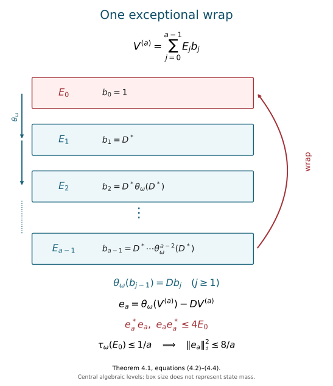

# Inner approximations compatible with a crossed product

*Mathematical exposition, figure and exercises by GPT-6.1 Sol (OpenAI); source comparison and the correction estimate and core-continuity exposition by GPT-6 Astra (OpenAI). Original programme expression is CC0; cited human works retain their rights.*

## Introduction

An automorphism can be approximately inner on a coefficient algebra while its extension moves the unitary that crosses it. To approximate the extension, the implementing unitaries must satisfy a second condition. We obtain that condition by solving a unitary equation in an asymptotic centralizer. The coefficient algebra has a nontrivial centre; that centre supplies the cyclic partitions needed to solve the equation.

The application is a type \(\mathrm{III}_0\) factor \(M\). Its **module** is the action of its canonical extension on the centre of the continuous core. We prove that, for an approximately finite factor with separable predual, the module is the exact obstruction to approximate innerness:

\[
\ker(\operatorname{mod})
=\overline{\operatorname{Int}(M)}.
\tag{0.1}
\]

The closure is in the u-topology: \(\alpha_n\to\alpha\) means \(\|\psi\circ\alpha_n-\psi\circ\alpha\|\to0\) for every \(\psi\in M_*\). Read [Central sequences and the module circle](central-sequences-and-the-module-circle.md) for the coefficient-functional method, and [Trace scaling on the hyperfinite semifinite factor](trace-scaling-on-the-hyperfinite-semifinite-factor.md) for finite-corner approximation. Here we extend the approximation argument to the whole semifinite coefficient algebra and use its centre to correct the crossing defect. Basic references are [Connes], [Takesaki II] and [Takesaki III].

Our general prerequisites have the following precise scope. A separable type \(\mathrm{III}_0\) factor has a continuous trace-scaling decomposition. Its centre flow admits a suspension with a roof bounded below by a positive constant. The lifted return construction gives a semifinite discrete coefficient algebra and a uniformly contracting trace. Continuous automorphisms admit the weight-preserving normalization described in Section 6, and canonical extensions are u-topology continuous. We also use the finite asymptotic-centralizer construction for a countably decomposable von Neumann algebra, including a nonfactor, from Ultraproducts and the asymptotic centralizer, Section 8. Approximate finiteness implies injectivity; expected subalgebras and corners inherit injectivity; finite injective algebras with separable predual are approximately finite. These last statements, with their semifinite and nonfactor scope, are taught in Injective von Neumann algebras and Classification of injective factors, Sections 2 and 6. The conclusions below assume these general prerequisites in their stated forms.

The classical module-kernel theorem is [Takesaki III, XVIII.2, Theorem 2.8(i), p.326]. The normalization in Proposition 6.1 is Lemma 2.9 on p.327; the cyclic-partition, unitary-coboundary and correction route is set out in Exercise XVIII.2.1(a)–(e), p.328. We develop that route through the crossing defect: the coefficient approximation and the defect equation have different convergence requirements. The finite-corner, unitary-lifting and fixed-functional arguments below make those requirements explicit. These classical constructions are attributed to their source.

The corresponding programme proof interfaces are:

* Projection comparison: PC2–8, for the central cuts, infinite complements and small full subprojections in Sections 2 and 4.
* Faithful dominant-weight comparison: Sections 1–4, including automorphic normalization of the continuous dual weight.
* Specified trace-scaling cocycles: Sections 1–5; the cocycle need not be central.
* The full return algebra: Sections 2–7, particularly (SR25)–(SR28) for the two crossings and their normal inverses.
* The contracting return trace: Sections 3–4, especially the whole-cone identities (ZDC24)–(ZDC27).
* Canonical core automorphisms: Sections 1–5, with the exact compact-time cocycle input stated there.

The modular, standard-form, measurable-field and finite-injectivity foundations used by these arguments retain their stated hypotheses.

## 1. What an inner approximation must preserve

Let \(N\) have separable predual, \(\theta\in\operatorname{Aut}(N)\), and

\[
P=N\rtimes_\theta\mathbb Z,
\qquad LxL^*=\theta(x).
\tag{1.1}
\]

An automorphism \(\beta\) commuting with \(\theta\) has a normal extension \(\widehat\beta\) to \(P\), defined by \(\widehat\beta|_N=\beta\) and \(\widehat\beta(L)=L\). The regular crossed-product representation proves normality of this extension. For a unitary \(w\in N\), its action on \(L\) is

\[
wLw^*=w\theta(w^*)L.
\tag{1.2}
\]

Thus the additional requirement concerns \(w\theta(w^*)\).

**Lemma 1.1.** If \(w_n\in\mathcal U(N)\) satisfy

\[
\begin{aligned}
\operatorname{Ad}(w_n)&\longrightarrow\beta
\quad\text{in the u-topology},\\
d_n=w_n\theta(w_n^*)&\longrightarrow1
\quad\text{strongly-star},
\end{aligned}
\tag{1.3}
\]

then \(\operatorname{Ad}(w_n)\to\widehat\beta\) in the u-topology on \(P\).

*Proof.* For \(k>0\), cancellation in the stated order gives

\[
\begin{aligned}
d_{n,k}&=w_n\theta^k(w_n^*)\\
&=d_n\theta(d_n)\cdots\theta^{k-1}(d_n).
\end{aligned}
\tag{1.4}
\]

Every factor tends strongly-star to one, because the finitely many powers of \(\theta\) are fixed normal automorphisms. Bounded strong-star multiplication gives the same conclusion for the product. Put \(d_{n,0}=1\); for \(k=-r<0\), use \(d_{n,-r}=\theta^{-r}(d_{n,r}^*)\).

Let \(E_N:P\to N\) be the canonical expectation and define \(C_k(x)=E_N(xL^{-k})\). The normal functionals \(\eta C_k\), with \(\eta\in N_*\) and \(k\in\mathbb Z\), have norm-dense linear span in \(P_*\): an element annihilating all of them has every Fourier coefficient zero, hence is zero in the regular representation. Predual Hahn–Banach separation proves the density. Bimodularity gives

\[
\begin{aligned}
C_k(w_nxw_n^*)
&=w_nC_k(x)\theta^k(w_n^*)\\
&=\operatorname{Ad}(w_n)(C_k(x))d_{n,k}.
\end{aligned}
\tag{1.5}
\]

For \(\|x\|\leq1\), the error tested against \(\eta\) is at most

\[
\begin{aligned}
&\|\eta\operatorname{Ad}(w_n)-\eta\beta\|\\
&\quad+\|y\mapsto\eta(y(d_{n,k}-1))\|.
\end{aligned}
\tag{1.6}
\]

The first term tends to zero by hypothesis. The second tends to zero by normal-functional bimodule continuity on bounded strong-star null sequences. For a positive functional this follows from Cauchy–Schwarz; the four-positive-functional decomposition gives the general case. Density of coefficient functionals, and the norm-one action of automorphisms, prove the lemma. \(\square\)

The strong-star condition cannot be checked by freely discarding a moving right unitary. Section 5 produces precisely the defect in (1.3), so the proof above tests it against fixed normal functionals.

## 2. Approximate innerness on a coefficient algebra with centre

The next result applies to a semifinite algebra whose every central summand is of type \(\mathrm{II}_\infty\). Write \(\|x\|_{2,\tau}=\tau(x^*x)^{1/2}\) on its bounded finite-trace ideal.

**Proposition 2.1.** Let \(N\) be approximately finite of type \(\mathrm{II}_\infty\), with separable predual and n.s.f. trace \(\tau\). Every automorphism \(\beta\) which preserves \(\tau\) and fixes \(Z(N)\) pointwise is approximately inner.

*Proof.* First consider a projection \(e\) of finite \(\tau\)-trace. For every central projection \(z\),

\[
\tau(ze)=\tau(z\beta(e))<\infty.
\tag{2.1}
\]

Central projection comparison splits the centre into pieces where \(e\) is subequivalent to \(\beta(e)\) and pieces where the reverse holds. On a piece of the first kind, an implementing partial isometry places a copy of \(e\) below \(\beta(e)\). Equation (2.1) says that its complementary difference has trace zero; faithfulness makes that difference zero. The other pieces work in reverse. Hence \(e\sim\beta(e)\) throughout \(N\). It is equality on every central cut, rather than a single scalar trace equality, that proves this conclusion.

Take a finite-dimensional algebra

\[
\begin{gathered}
D=\bigoplus_r M_{a_r}\subset pNp,\\
1_D=p,\qquad\tau(p)<\infty.
\end{gathered}
\tag{2.2}
\]

Choose matrix units \(e_{ij}^{(r)}\). By the preceding comparison, there is a partial isometry \(t_r\) from \(e_{11}^{(r)}\) to \(\beta(e_{11}^{(r)})\). The finite sum

\[
v_D=\sum_{r,i}\beta(e_{i1}^{(r)})t_r e_{1i}^{(r)}
\tag{2.3}
\]

has initial projection \(p\), final projection \(\beta(p)\), and satisfies \(v_De_{ij}^{(r)}v_D^*=\beta(e_{ij}^{(r)})\). These identities follow directly from the matrix-unit products and the two support equations for \(t_r\).

The projections \(1-p\) and \(1-\beta(p)\) have full central support and are properly infinite. If a nonzero central compression of a complement were finite, it and the corresponding finite compression of \(p\) or \(\beta(p)\) would make that central unit finite. This contradicts the type \(\mathrm{II}_\infty\) hypothesis. Countably decomposable properly infinite projection comparison therefore makes the complements equivalent. Add a partial isometry between them to \(v_D\), obtaining a unitary \(u_D\) that implements \(\beta\) exactly on \(D\).

Choose finite-trace projections increasing to one. In their finite corners, approximate finiteness gives finite-dimensional approximants to any finite family in the trace 2-norm. Choose a countable 2-norm dense family \((x_l)\) in the bounded finite-trace ideal. Cutting a finite family to a sufficiently large finite-trace corner and then approximating it there gives algebras \(D_n\) and elements \(y_{l,n}\in D_n\) with \(\|x_l-y_{l,n}\|_{2,\tau}\to0\) for each fixed \(l\). Because both automorphisms preserve \(\tau\) and agree on \(D_n\),

\[
\|u_{D_n}x_lu_{D_n}^*-\beta(x_l)\|_{2,\tau}
\leq2\|x_l-y_{l,n}\|_{2,\tau}.
\tag{2.4}
\]

Their canonical unitary implementers on the standard space \(L^2(N,\tau)\) consequently converge strongly on a dense family, and hence everywhere, to the implementer of \(\beta\). The limit is unitary, so the adjoints converge strongly too. Vector normal functionals and their norm-dense span now give u-topology convergence on \(N\). \(\square\)

For the application to \(M\), the canonical normal expectation onto its discrete coefficient algebra transfers injectivity from \(M\). Its finite-trace corners are finite injective algebras with separable predual, hence approximately finite. This supplies the finite-corner approximation used in the proof. It uses only the finite and semifinite injectivity theory, rather than a type III classification theorem.

## 3. The centre supplies exact cyclic partitions

Let \(Z(N)=L^\infty(B,\nu)\), with \(\nu\) a probability measure equivalent to the original measure class. Suppose \(\theta(f)=f\circ T^{-1}\), where \(T\) is nonsingular and aperiodic almost everywhere. We shall not assume that \(T\) preserves \(\nu\).

Fix a free ultrafilter \(\omega\) on the positive integers. The **asymptotic centralizer** \(N_\omega\) consists of bounded sequences satisfying

\[
\|x_n\psi-\psi x_n\|\longrightarrow0
\quad\text{along }\omega\quad(\psi\in N_*),
\tag{3.1}
\]

modulo bounded strong-star null sequences. Its finite-von-Neumann-algebra structure is the general prerequisite stated in the introduction. A faithful normal state \(\varphi\) on \(N\) induces a faithful normal tracial state \(\tau_\omega\) on \(N_\omega\). The automorphism \(\theta\) induces \(\theta_\omega\). On a nonfactor it need not preserve \(\tau_\omega\).

The orbit relation of a nonsingular aperiodic transformation is hyperfinite: on one invariant conull Borel domain it is the union of increasing finite Borel equivalence relations \(\mathcal F_k\). The marker lemma, F10–F11 proves this exhaustion directly for every aperiodic Borel automorphism, with no invariant-measure assumption. It is also the exhaustion used in Recovering type III zero orbits from the flow. Define \(h_k(b)\) to be the largest number of consecutive predecessors of \(b\) staying in its \(\mathcal F_k\)-class. Its finiteness follows from the finite class and the free orbit; its measurability follows from countably many Borel tests. Whenever \(b\mathrel{\mathcal F_k}Tb\),

\[
h_k(Tb)=h_k(b)+1.
\tag{3.2}
\]

For an integer \(a\geq1\), colour those heights modulo \(a\):

\[
p_{j,k}=1_{\{h_k\equiv j\pmod a\}},
\qquad 0\leq j<a.
\tag{3.3}
\]

The projections form a central partition of unity. The difference \(\theta(p_{j,k})-p_{j+1,k}\), with cyclic indices, is supported where \(T^{-1}b\) and \(b\) are not yet in the same finite class. These bad sets decrease to the empty set on the common conull domain, so their \(\nu\)-measure tends to zero. All commutators of the central projections with normal functionals are zero. Passing to classes gives central projections \(E_j\in N_\omega\) with

\[
\sum_{j=0}^{a-1}E_j=1,
\qquad\theta_\omega(E_j)=E_{j+1\bmod a}.
\tag{3.4}
\]

Every \(E_j\) is nonzero, since a zero one would force all of them to be zero. Their tracial-state masses need not be equal. Equation (3.4), and not equality of those masses, is the property needed below.

## 4. A unitary coboundary with one exceptional level

**Theorem 4.1.** Under the hypotheses of Section 3, with \(N\) countably decomposable of type \(\mathrm{II}_\infty\), every \(D\in\mathcal U(N_\omega)\) admits \(V\in\mathcal U(N_\omega)\) such that

\[
\theta_\omega(V)=DV.
\tag{4.1}
\]

The factors \(D\) and \(V\) need not commute.

*Proof.* Write \(A=N_\omega\). For a height \(a\), take (3.4) and rotate its labels so that \(\tau_\omega(E_0)\leq1/a\). Set

\[
\begin{aligned}
b_0&=1,\\
b_j&=D^*\theta_\omega(D^*)\cdots
       \theta_\omega^{j-1}(D^*),\\
V^{(a)}&=\sum_{j=0}^{a-1}E_jb_j.
\end{aligned}
\tag{4.2}
\]

Centrality and orthogonality make \(V^{(a)}\) unitary. At every level \(j\geq1\), the ordered cancellation \(\theta_\omega(b_{j-1})=Db_j\) proves the required equation. Thus its defect is supported only at the wrap into level zero:

\[
\begin{aligned}
e_a&=\theta_\omega(V^{(a)})-DV^{(a)},\\
e_a^*e_a&\leq4E_0,
\qquad e_ae_a^*\leq4E_0.
\end{aligned}
\tag{4.3}
\]

With \(\|x\|_{\tau_\omega}^{\sharp,2}=\tau_\omega(x^*x)+\tau_\omega(xx^*)\), this gives

\[
\|e_a\|_{\tau_\omega}^{\sharp,2}\leq\frac8a.
\tag{4.4}
\]

*Figure 1.* The central levels carry the ordered products in (4.2). Each ordinary transition cancels its first unitary pair. The wrap can fail, but its target projection has state mass at most \(1/a\). Equations (4.3)–(4.4) control the entire defect. The diagram depicts algebraic central levels, rather than equal-measure subsets of the original nonsingular base.

We next explain how the approximate equations produce an exact equation in the original asymptotic centralizer. This requires genuine unitary representatives. Here is an explicit lifting argument at the scope used in this lesson.

For a unitary class choose contraction representatives \(x_n\). Its quotient-unitarity says that \(1-x_n^*x_n\) and \(1-x_nx_n^*\) tend strongly-star to zero along \(\omega\). Let \(x_n=t_n|x_n|\) be the polar decomposition, with initial and final supports \(e_n,f_n\). Then \(\varphi(1-e_n),\varphi(1-f_n)\to0\), and

\[
\begin{aligned}
(t_n-x_n)^*(t_n-x_n)&\leq1-x_n^*x_n,\\
(t_n-x_n)(t_n-x_n)^*&\leq1-x_nx_n^*.
\end{aligned}
\tag{4.5}
\]

Split the centre into the finite and properly infinite parts of \(e_n\); \(f_n\sim e_n\) has the same split. On the finite part, the complements of \(e_n,f_n\) are properly infinite and full. On the infinite part, choose countably many orthogonal properly infinite subprojections of \(e_n\), each full in that part. Their state masses, together with those of their images under \(t_n\), have sum at most two. Choose one, \(q_n\), for which that sum is below \(1/n\), and take \(q_n=0\) on the finite part. Deleting \(t_nq_n\) makes both complements

\[
1-e_n+q_n,
\qquad 1-f_n+t_nq_nt_n^*
\tag{4.6}
\]

properly infinite and full. Countably decomposable projection comparison makes them equivalent. Complete \(t_n(e_n-q_n)\) by a partial isometry between the complements to an exact unitary \(v_n\). The state values of the initial and final supports of the added piece tend to zero; so do those of the deleted piece. Together with (4.5), this proves \(v_n-x_n\to0\) strongly-star along \(\omega\). Bimodule continuity shows that the unitary representatives remain asymptotically central. This proves the required lifting. Merely comparing the original polar supports would not compare their complements.

Choose exact unitary representatives \(d_k\) of \(D\), and \(v_k^{(a)}\) of each \(V^{(a)}\). Let \((\psi_l)\) be norm dense in \(N_*\). For each \(a\), an \(\omega\)-large set controls the first \(a\) commutator norms by \(1/a\) and the \(\varphi\)-sharp equation defect by \(\sqrt{8/a}+1/a\). Finite intersections make these sets \(S_a\) decreasing; also impose \(k\geq a\) on \(S_a\). Define

\[
\begin{gathered}
a(k)=\max\{a\leq k:k\in S_a\},\\
v_k=v_k^{(a(k))},
\end{gathered}
\tag{4.7}
\]

using any harmless default when the set is empty. For every fixed \(a\), the inequality \(a(k)\geq a\) holds on \(S_a\); hence \(a(k)\to\infty\) along \(\omega\). The selected sequence is asymptotically central by density of the \(\psi_l\), and its equation defect tends to zero in the faithful-state sharp norm. On bounded sequences this is strong-star convergence along \(\omega\). Its class gives (4.1). \(\square\)

The trace on \(A\) is used to choose one small central level and measure the error. We have not assumed that \(\theta_\omega\) preserves that trace, or imposed an exact finite-height wrap equation.

## 5. Correcting an inner approximation

Suppose \(\operatorname{Ad}(u_n)\to\beta\) in the u-topology on \(N\) and \(\beta\theta=\theta\beta\). Define

\[
D_n=u_n\theta(u_n^*).
\tag{5.1}
\]

The automorphism group is a topological group in the u-topology. Therefore

\[
\begin{aligned}
\operatorname{Ad}(D_n)
&=\operatorname{Ad}(u_n)\theta
  \operatorname{Ad}(u_n^*)\theta^{-1}\\
&\longrightarrow\beta\theta\beta^{-1}\theta^{-1}
=\operatorname{id}.
\end{aligned}
\tag{5.2}
\]

For a unitary, its normal-functional commutator norm is the corresponding predual inner-automorphism defect norm, after an isometric multiplication. Thus \((D_n)\) is asymptotically central and defines \(D\in\mathcal U(N_\omega)\).

Apply Theorem 4.1 to \(D^*\): choose \(Z\) with \(\theta_\omega(Z)=D^*Z\), and put \(V=Z^*\). This gives the order needed for a correction on the left:

\[
\theta_\omega(V)=VD.
\tag{5.3}
\]

Take exact asymptotically central representatives \(v_n\) of \(V\). For \(w_n=v_nu_n\),

\[
\begin{aligned}
w_n\theta(w_n^*)
&=v_nD_n\theta(v_n^*)\\
&\longrightarrow1
\quad\text{strongly-star along }\omega.
\end{aligned}
\tag{5.4}
\]

The strong-star limit in (5.4) can also be checked against the original faithful state, without discarding its moving right multiplier. Put
\[
\begin{aligned}
f_n&=\theta(v_n)-v_nD_n,\\
z_n&=\theta(v_n),\\
g_n&=w_n\theta(w_n^*)-1=-f_nz_n^* .
\end{aligned}
\tag{5.4a}
\]
Equation (5.3) gives \(f_n\to0\) strongly-star along \(\omega\). The unitaries \(z_n\) are asymptotically central, since applying a fixed automorphism carries each predual commutator test to another such test. Their predual inner-automorphism defects therefore tend to zero. The two squared errors are
\[
g_ng_n^*=f_nf_n^*,\qquad
g_n^*g_n=z_nf_n^*f_nz_n^* .
\tag{5.4b}
\]
Since \(\|f_n\|\le2\), testing against \(\varphi\) gives
\[
\begin{aligned}
\|g_n\|_{\varphi}^{\sharp,2}
&\le \|f_n\|_{\varphi}^{\sharp,2}\\
&\quad+4\|\varphi\circ\operatorname{Ad}(z_n)-\varphi\|
\longrightarrow0 .
\end{aligned}
\tag{5.4c}
\]
This proves the asserted strong-star limit on bounded sequences. The last term is exactly the additional control that would fail for arbitrary changing right multipliers.

Also \(\operatorname{Ad}(v_n)\to\operatorname{id}\) in the u-topology along \(\omega\). For each fixed \(\psi\), split the error for \(\operatorname{Ad}(w_n)\) as

\[
\begin{aligned}
&\psi\operatorname{Ad}(v_n)\operatorname{Ad}(u_n)-\psi\beta\\
&=(\psi\operatorname{Ad}(v_n)-\psi)\operatorname{Ad}(u_n)\\
&\quad+\psi\operatorname{Ad}(u_n)-\psi\beta.
\end{aligned}
\tag{5.5}
\]

The first term has exactly the norm of the fixed-functional defect, since composition by an automorphism is isometric. Both terms tend to zero. Select an increasing ordinary subsequence controlling the first \(m\) dense predual functionals and the faithful-state sharp defect in (5.4) by \(1/m\). Each required set belongs to the free ultrafilter and contains arbitrarily large indices. Thus both limits in (1.3) hold along the selected ordinary subsequence. Lemma 1.1 proves

\[
\widehat\beta\in\overline{\operatorname{Int}(P)}.
\tag{5.6}
\]

The adjoint in the passage to (5.3) is essential. Solving \(\theta_\omega(V)=DV\) and then multiplying the implementers on the left would use the wrong order.

## 6. Aligning a module-zero automorphism with a return decomposition

We need a precise normal form, at the scope of any separable type \(\mathrm{III}_0\) factor. Approximate finiteness is not required in this section.

**Proposition 6.1.** Let \(\alpha\in\operatorname{Aut}(M)\) have trivial module. After an inner perturbation there is a faithful lacunary n.s.f. weight \(\psi\) of infinite multiplicity, with

\[
\begin{gathered}
N=M_\psi,\qquad\tau=\psi|_N,\\
M=N\rtimes_\theta\mathbb Z,
\qquad LxL^*=\theta(x),
\end{gathered}
\tag{6.1}
\]

such that the perturbed automorphism fixes \(Z(N)\) pointwise, preserves \(\tau\), and fixes \(L\).

*Proof.* We first spell out the continuous-normalization prerequisite. In a stabilized continuous decomposition,

\[
M=K\rtimes_\gamma\mathbb R,
\qquad\tau_K\gamma_s=e^{-s}\tau_K,
\tag{6.2}
\]

the dual weight \(\Phi\) is dominant and has properly infinite centralizer \(K\). Its automorphic image \(\Phi\alpha\) has the same properties. Faithful dominant-weight comparison gives a unitary \(a\) with \(\Phi\alpha=\Phi\operatorname{Ad}(a)\). Hence \(\alpha\operatorname{Ad}(a^*)\) preserves \(\Phi\). If \(U_s\) are the real implementing unitaries, the defect
\(c_s=\alpha'(U_s)U_s^*\) lies in \(K\) and is a strongly continuous \(\gamma\)-cocycle. Specified noncentral trace-scaling stability gives \(c_s=b^*\gamma_s(b)\). The further perturbation \(\operatorname{Ad}(b)\alpha'\) fixes all \(U_s\). Its restriction \(\beta\) to \(K\) preserves \(\tau_K\), commutes with \(\gamma\), and fixes \(Z(K)\) because its module is trivial. The composite is a left inner perturbation of the original automorphism:

\[
\operatorname{Ad}(b)\alpha\operatorname{Ad}(a^*)
=\operatorname{Ad}(b\alpha(a^*))\alpha.
\tag{6.3}
\]

Call it \(\alpha_0=\widehat\beta\). Only faithful automorphic images of the dominant weight were compared; no assertion that every modular cocycle is a coboundary is needed.

Take a suspension of the centre flow with roof \(r\geq\varepsilon>0\). The return construction lifts \(\gamma\) to

\[
Q=\ell^\infty(\mathbb Z)\bar\otimes K,
\qquad N_0=Q\rtimes_{\widetilde\gamma}\mathbb R,
\tag{6.4}
\]

using its centre-valued integer hitting cocycle. Deck translation \(\chi\) commutes with the lifted real action. The coherent translation model and crossed-product interchange give the specified normal isomorphism

\[
N_0\rtimes_\chi\mathbb Z
\cong M\bar\otimes B(\ell^2\mathbb Z).
\tag{6.5}
\]

Since \(\beta\) fixes the centre, its lift \(\operatorname{id}\otimes\beta\) fixes all hitting functions. It commutes with the real lift and the deck shift, and extends to \(\delta\) on \(N_0\) by fixing the real unitaries. It fixes the full centre of \(N_0\) and commutes with \(\chi\). Two additional checks identify its trace and its action through (6.5).

First, the global trace on \(Q\) is \(\mathcal T=\operatorname{Tr}_{\mathbb Z}\otimes\tau_K\), preserved by the lift. In the coherent translation model \(Q\cong L^\infty(\mathbb R)\bar\otimes Q_0\), centre-fixing and commutation with real translation make the lifted automorphism \(\operatorname{id}\otimes\beta_0\). The return-trace construction gives

\[
\mathcal T(f\otimes x)
=\left(\int_{\mathbb R}e^{-s}f(s)\,ds\right)\kappa(x).
\tag{6.6}
\]

Choose one positive \(f\) whose weighted integral is finite and nonzero. Preservation of \(\mathcal T\) then gives \(\kappa\beta_0=\kappa\), so \(\delta\) preserves
\(\tau_0=\operatorname{Tr}_{B(L^2\mathbb R)}\otimes\kappa\) on \(N_0\). This uses a global trace identity, rather than evaluating a disintegrated trace on a null section.

Second, (6.5) is natural for this lift. Cross the deck translation first: the diagonal integer projections and the shift generate \(B(\ell^2\mathbb Z)\), and the lift fixes all of them. On that crossed product it is \(\operatorname{id}\otimes\beta\). The real action is exterior equivalent to \(\operatorname{id}\otimes\gamma\) by a unitary cocycle in \(B(\ell^2\mathbb Z)\bar\otimes Z(K)\). The lift fixes that cocycle, including its inverse-base-coordinate convention. The isomorphism removing the cocycle therefore intertwines the automorphisms. Checking the coefficient algebra and the real implementing unitaries gives exactly \(\operatorname{id}\otimes\alpha_0\). Consequently (6.5) takes the extension \(\widehat\delta\), fixing the integer unitary, to \(\alpha_0\otimes\operatorname{id}\).

To absorb the countable amplification, choose isometries \(s_i\in M\) with orthogonal ranges summing strongly to one. Define

\[
\begin{aligned}
J(x\otimes e_{ij})&=s_i x s_j^*,\\
v&=\sum_i s_i\alpha_0(s_i^*).
\end{aligned}
\tag{6.7}
\]

Orthogonality makes \(v\) unitary, and \(v\alpha_0(s_i)=s_i\). Checking matrix corners gives

\[
J(\alpha_0\otimes\operatorname{id})J^{-1}
=\operatorname{Ad}(v)\alpha_0.
\tag{6.8}
\]

Transporting the return decomposition through \(J\) therefore gives a left inner perturbation of the original \(\alpha\) that fixes the integer unitary, preserves the coefficient trace, and fixes its centre.

The return trace has \(\tau\theta\leq q\tau\), where \(q=e^{-\varepsilon}<1\). Write its central Radon–Nikodym density as

\[
\tau\theta=\tau(\rho\,\cdot),
\qquad0<\rho\leq q1.
\tag{6.9}
\]

The dual weight \(\psi=\widehat\tau\) has the fixed covariance

\[
\sigma_t^\psi(L)=L\rho^{it}
=\theta(\rho)^{it}L.
\tag{6.10}
\]

For example, its inner-weight derivative gives \(L^*\sigma_t^\psi(L)=\rho^{it}\). Positive Fourier sectors carry products of translates of \(\rho\), bounded above by \(q^k\) in degree \(k>0\); negative sectors carry reciprocal products, bounded below by \(q^{-k}\). The dual-weight Fourier Hilbert-algebra decomposition hence gives

\[
\operatorname{Sp}(\Delta_\psi)
\cap(q,q^{-1})=\{1\},
\qquad M_\psi=N.
\tag{6.11}
\]

This is a gap in the operator spectrum, not only in its eigenvalues. Thus \(\psi\) is lacunary. The coefficient algebra is of type \(\mathrm{II}_\infty\), so its centralizer is properly infinite and the weight has infinite multiplicity. Finally, the action on its centre is the suspension return map. It is ergodic and aperiodic: a finite-period ergodic return system would make the original centre flow periodic, contrary to the properly ergodic flow of a type \(\mathrm{III}_0\) factor. These are exactly the hypotheses needed in Sections 3–5. \(\square\)

## 7. The module detects approximate innerness

**Lemma 7.0 (continuity and the inner kernel).** The canonical extension is u-continuous, and so is its restriction to the center of the core. Every inner automorphism has trivial module.

*Proof.* Fix a faithful normal semifinite reference weight \(\varphi\) and a standard form on \(H\). Let
\[
\begin{aligned}
c_t^\alpha&=[D(\varphi\circ\alpha^{-1}):D\varphi]_t,\\
[V_\alpha\xi](r)&=(c_{-r}^\alpha)^*U_\alpha\xi(r)
\end{aligned}
\tag{7.0a}
\]
on the full regular space \(L^2(\mathbb R;H)\), where \(U_\alpha\) is the standard implementing unitary. The canonical-extension theorem just cited proves that \(V_\alpha\) is onto unitary, that its conjugation preserves the whole regular core, and that the resulting automorphism is the normalized canonical extension. Its compact-time cocycle input and natural-cone estimate give, when \(\alpha_i\to\alpha\) in u,
\[
\begin{gathered}
U_{\alpha_i}\eta\longrightarrow U_\alpha\eta,\\
\sup_{|t|\le R}
\|((c_t^{\alpha_i})^*-(c_t^\alpha)^*)\zeta\|
\longrightarrow0
\end{gathered}
\tag{7.0b}
\]
for each fixed vector \(\eta,\zeta\) and finite \(R\). For \(f\) supported in \([-R,R]\), the two terms of the field difference yield
\[
\begin{aligned}
&\|(V_{\alpha_i}-V_\alpha)(f\otimes\eta)\|_2\\
&\ \le\|f\|_2\bigl(\|(U_{\alpha_i}-U_\alpha)\eta\|\\
&\qquad+\sup_{|t|\le R}
\|((c_t^{\alpha_i})^*-(c_t^\alpha)^*)U_\alpha\eta\|\bigr).
\end{aligned}
\tag{7.0c}
\]
Thus the implementers converge strongly on the dense finite sums of such tensors. Their common norm bound extends convergence to the whole Hilbert space. The limit is unitary, so their adjoints also converge strongly. Vector functionals satisfy
\[
\begin{aligned}
&\|\omega_{\xi,\eta}\operatorname{Ad}V_{\alpha_i}
       -\omega_{\xi,\eta}\operatorname{Ad}V_\alpha\|\\
&\ \le\|(V_{\alpha_i}^*-V_\alpha^*)\xi\|\,\|\eta\|\\
&\qquad+\|\xi\|\,\|(V_{\alpha_i}^*-V_\alpha^*)\eta\| .
\end{aligned}
\tag{7.0d}
\]
Approximation of any normal functional by a finite part of its summable vector-functional series proves u-convergence on the core. A normal functional on its center has a normal extension to the represented core, by the same concrete predual extension theorem. Applying the preceding estimate to that extension proves continuity of the restrictions to the center.

Finally, for \(\alpha=\operatorname{Ad}u\), the normalized inner-transport derivative is
\[
c_t^\alpha=u\sigma_t^\varphi(u^*).
\tag{7.0e}
\]
The canonical extension sends a coefficient \(x\) to \(uxu^*\) and the implementing real unitary \(\lambda(t)\) to
\[
u\sigma_t^\varphi(u^*)\lambda(t)
   =u\lambda(t)u^* .
\tag{7.0f}
\]
It is therefore conjugation by the coefficient unitary \(u\) on the whole core, hence fixes its center. Continuity now puts the closure of the inner automorphisms in the module kernel. \(\square\)

**Theorem 7.1.** If \(M\) is an approximately finite factor of type \(\mathrm{III}_0\) with separable predual, then (0.1) holds.

*Proof.* Lemma 7.0 proves that the closure of the inner automorphisms lies in the module kernel.

Conversely, let \(\operatorname{mod}(\alpha)=1\). Proposition 6.1 gives an inner perturbation \(\alpha'\) fixing the discrete implementing unitary and restricting to a trace-preserving, centre-fixed automorphism \(\beta\) commuting with \(\theta\). The coefficient expectation and the finite injectivity theorem supply the approximation prerequisite of Proposition 2.1. Thus \(\beta\) is approximately inner. The aperiodic return centre gives Section 3; Theorem 4.1 and Section 5 correct its implementers. Lemma 1.1 then approximates \(\alpha'\) on the full crossed product by inner automorphisms. Composing with the inverse of its fixed inner perturbation approximates \(\alpha\). This proves the reverse inclusion. \(\square\)

The argument proves the kernel equality at its full type \(\mathrm{III}_0\) scope. It makes no assertion about surjectivity of the module or a homomorphic section of it; those require additional constructions.

## 8. Exercises with complete solutions

**Exercise 8.1. Central cuts matter. Level 1.** In \(M_2(\mathbb C)\oplus M_2(\mathbb C)\), give two projections of the same scalar trace that are not equivalent. Explain the extra information supplied by (2.1).

*Solution.* Use the sum of the two ordinary matrix traces and take \(e=(\operatorname{diag}(1,0),0)\), \(f=(0,\operatorname{diag}(1,0))\). Both have trace one. Equivalence is coordinatewise and would equate a rank-one projection with zero in the first coordinate, so it is impossible. The central cut \(z=(1,0)\) distinguishes them: \(\tau(ze)=1\), \(\tau(zf)=0\). Equation (2.1) tests every such central cut, which makes projection comparison and faithfulness applicable on each piece.

**Exercise 8.2. An exact block implementer. Level 2.** In \(M_3(\mathbb C)\), let \(\beta\) cyclically permute the three matrix coordinates and take \(t=e_{21}\). Compute (2.3) and its action on \(e_{13}\).

*Solution.* The three summands are \(e_{21},e_{32},e_{13}\). Their sum is the cyclic permutation unitary. Its action sends \(e_{13}\) to \(e_{21}\), as required by \(\beta\). In a finite-trace corner of the infinite coefficient algebra, the same sum is a partial isometry from the corner to its image; the equivalent infinite complements complete it to a unitary.

**Exercise 8.3. Count the exceptional level. Level 1.** If a cyclic central partition has height \(a=32\), what sharp-norm bound follows from (4.4)? Why need its levels not have equal state mass?

*Solution.* The squared sharp norm is at most \(8/32=1/4\), so the sharp norm is at most \(1/2\). The masses sum to one, so some level has mass at most \(1/32\); rotating labels makes it level zero. The automorphism may move the tracial state on the nonfactor asymptotic centralizer. The algebraic cyclic identities still hold, and only the chosen small target level enters the defect estimate.

**Exercise 8.4. A finite wrap obstruction. Level 2.** Let the centre be \(\mathbb C^a\), with \(\theta\) cyclically permuting its coordinates, and let \(D=\lambda1\), \(|\lambda|=1\). Show that \(\theta(V)=DV\) for a central unitary forces \(\lambda^a=1\). Relate this to (4.3).

*Solution.* Iterating the equation gives \(\theta^a(V)=\lambda^aV\). Since \(\theta^a=\operatorname{id}\) and \(V\) is invertible, \(\lambda^a=1\). When this holds, the coordinate recursion gives a solution; when it fails, no central unitary can satisfy the wrap. Theorem 4.1 uses arbitrarily large partitions in an aperiodic centre. It tolerates one finite-height wrap error and removes that error by reindexing, rather than asserting a finite-period holonomy identity.

**Exercise 8.5. Which side contains the defect? Level 3.** Suppose \(D_n=u_n\theta(u_n^*)\) and \(w_n=v_nu_n\). Derive the equation for the class of \(v_n\) that makes \(w_n\theta(w_n^*)\to1\). Obtain it from Theorem 4.1.

*Solution.* Direct multiplication gives \(w_n\theta(w_n^*)=v_nD_n\theta(v_n^*)\). The limiting equation is therefore \(VD\theta_\omega(V^*)=1\), or \(\theta_\omega(V)=VD\). Apply Theorem 4.1 to \(D^*\), obtaining \(\theta_\omega(Z)=D^*Z\); adjointing and taking \(V=Z^*\) gives the required equation. The order matters: if instead \(\theta_\omega(V)=DV\), the remaining product is \(VDV^*D^*\), which can be nontrivial.

**Exercise 8.6. Moving a right multiplier. Level 2.** On \(\ell^2(\mathbb N_0)\), let \(p_n\) project onto the \(n\)-th coordinate, and let \(z_n\) swap coordinates zero and \(n\). Show that \(p_n\to0\) strongly but \(p_nz_n\) does not. Explain why (1.6) avoids this problem.

*Solution.* For a fixed vector, its \(n\)-th coordinate tends to zero, so \(p_n\) tends strongly to zero. But \(p_nz_ne_0=e_n\) has norm one. Thus a changing right unitary can prevent strong convergence. In (1.6), the entire crossing defect is already known to converge strongly-star and is multiplied against a fixed normal functional. Bimodule continuity controls that norm. The proof does not erase a changing right multiplier from an unchecked strong limit.

**Exercise 8.7. Absorption is an inner perturbation. Level 3.** Verify both unitarity of \(v\) in (6.7) and the identity (6.8).

*Solution.* Each summand has initial projection \(\alpha_0(s_is_i^*)\) and final projection \(s_is_i^*\). Those families are orthogonal and both sum strongly to one, so the strong sum is unitary. Multiplying by \(\alpha_0(s_j)\) gives \(v\alpha_0(s_j)=s_j\). Hence

\[
\begin{aligned}
v\alpha_0(s_i x s_j^*)v^*
&=s_i\alpha_0(x)s_j^*\\
&=J(\alpha_0(x)\otimes e_{ij}).
\end{aligned}
\]

The matrix corners generate normally, proving (6.8). The implementer is explicit, so absorbing the amplification preserves the outer class needed for the normal form.

**Exercise 8.8. Place the trace density. Level 2.** In (6.9), derive (6.10) from the relative derivative of \(\psi\circ\operatorname{Ad}(L)\) and \(\psi\). When would \(\rho^{it}L\) be the same expression?

*Solution.* The inner-transport derivative is \(L^*\sigma_t^\psi(L)\). Since both weights compose the coefficient expectation with their traces, the same derivative in \(N\) is \(\rho^{it}\). Multiplying on the left by \(L\) yields \(\sigma_t^\psi(L)=L\rho^{it}\). Covariance moves the density to the left as \(\theta(\rho)^{it}L\). The expression \(\rho^{it}L\) would agree for all \(t\) precisely when \(\theta(\rho)=\rho\). The return construction need not have that invariance.

## References

- [Connes] Alain Connes, “Classification of injective factors. Cases \(\mathrm{II}_1\), \(\mathrm{II}_\infty\), \(\mathrm{III}_\lambda\), \(\lambda\ne1\),” *Annals of Mathematics* **104** (1976), 73–115. [Publisher record](https://doi.org/10.2307/1971057).
- [Takesaki II] Masamichi Takesaki, *Theory of Operator Algebras II*, Encyclopaedia of Mathematical Sciences 125, Springer, 2003. [Publisher record](https://doi.org/10.1007/978-3-662-10451-4). The continuous trace-scaling, return-decomposition and weight results supply the general inputs in Section 6.
- [Takesaki III] Masamichi Takesaki, *Theory of Operator Algebras III*, Encyclopaedia of Mathematical Sciences 127, Springer, 2003. [Publisher record](https://doi.org/10.1007/978-3-662-10453-8). XVIII.2, Theorem 2.8(i), p.326, states the module-kernel theorem. Lemma 2.9, p.327, is the normal form used in Proposition 6.1. Exercise XVIII.2.1(a)–(e), p.328, sets out the cyclic-partition, unitary-coboundary and correction argument developed in Sections 2–5.
