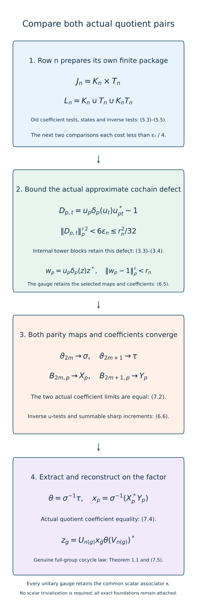

# Joint quotient comparisons with a common associator

*Mathematical exposition, figures and exercises by GPT-6.1 Sol (OpenAI); source comparison and prerequisite exposition by GPT-6 Astra (OpenAI). Original programme expression is CC0; cited human works retain their rights.*
## Introduction

The preceding lesson reconstructed a genuine full-group comparison from an exact comparison of quotient maps and actual coefficients. It classified the case in which their common scalar associator is a coboundary. A nonzero associator cannot be removed by an ordinary unitary gauge. We now compare the two quotient pairs together without removing it.

The finite tool corrects an approximately multiplicative cochain on a centrally nontrivial quotient. Its tower estimate keeps the cochain's actual multiplication errors. A coefficient estimate bounds those errors using the difference of the two actual coefficients and commutators against explicitly chosen normal functionals. Each row prepares all its tower labels and coefficient tests before the next two comparisons are selected. This gives convergent unitary cochains and both inverse conjugator rows. The actual coefficient limits agree, so the preceding reconstruction theorem applies.

Read [Quotient associators and reconstruction of comparisons](quotient-associators-and-genuine-comparison-reconstruction.md), Sections 1–6; [Gaussian models and amenable towers](gaussian-models-and-amenable-towers.md), Theorem 1.1; [Controlled amenable cohomology and finite inner comparisons](controlled-amenable-cohomology-and-finite-inner-comparisons.md), Lemma 2.1 and Section 4; [Alternating comparisons with convergent cocycles](alternating-comparisons-with-convergent-cocycles.md), Section 4; and [Two-sided convergence and transported cocycle limits](two-sided-convergence-and-transported-cocycle-limits.md), Theorem 2.1 and Lemmas 4.1–4.2. Their exact finite/semifinite lifting and topology foundations remain attached.

The approximate-cochain correction, finite preparation of two subsequent comparisons, transported old states and coefficients, action-preserving gauge, and convergence of both actual coefficient limits are the classical strategy in [Masuda], Lemma 5.2 and Section 6. The estimates below use the programme’s exact internal towers, weighted squared sharp norms and two original-factor coefficient pairs. The scalar associator is retained throughout. These calculations explain and apply the classical strategy; they do not establish a new comparison method.

## 1. The general matched-phase classification component

Let the finite or countably decomposable infinite semifinite factor, separable predual, countable amenable group, common actual inner subgroup and actual implementing phases satisfy Section 1 of the preceding lesson. Require both induced centralizer actions to have kernel exactly that inner subgroup. Put \(Q=G/N\), and let \((\rho^\alpha,c^\alpha)\), \((\rho^\beta,c^\beta)\) be its two normalized left-section pairs. They satisfy, with the same normalized scalar three-cocycle \(\kappa\),

\[
\begin{gathered}
\rho_p\rho_q=\operatorname{Ad}c(p,q)\rho_{pq},\\
\rho_p(c(q,r))c(p,qr)\\
=\kappa(p,q,r)c(p,q)c(pq,r).
\end{gathered}
\tag{1.1}
\]

No scalar trivialization is assumed.

**Theorem 1.1.** Under these exact hypotheses there are an approximately inner automorphism \(\theta\) and a normalized genuine original-factor \(\beta^\theta\)-cocycle \(z\) such that

\[
\begin{gathered}
\alpha_g=\operatorname{Ad}z_g\,\beta_g^\theta,\\
z_n=U_n\theta(V_n)^*\quad(n\in N).
\end{gathered}
\tag{1.2}
\]

This closes the matched-phase original-factor comparison for arbitrary common associator under the stated foundations. Measurable field selection, continuous reconstruction, general type III lifting and transitive foundational closure have their own additional hypotheses and arguments. It does not assert genuine coordinate lifts with the unchanged inner values from the approximate construction. The conjugator and its actual cocycle are constructed together.

## 2. Finite joint comparisons between all constructed pairs

For any normalized unitary cochain \(a\), define

\[
\begin{gathered}
\rho_p^a=\operatorname{Ad}a_p\,\rho_p,\\
c^a(p,q)=a_p\rho_p(a_q)c(p,q)a_{pq}^*.
\end{gathered}
\tag{2.1}
\]

The preceding gauge calculation proves (1.1) with the same \(\kappa\). There is no requirement that \(a\) be a cocycle. Conjugation by \(\operatorname{Ad}q\) is itself a gauge:

\[
\begin{gathered}
h_p=q\rho_p(q^*),\\
c^h(p,r)=q c(p,r)q^*.
\end{gathered}
\tag{2.2}
\]

To check the coefficient equality, expand \(h_p\rho_p(h_r)c(p,r)h_{pr}^*\). The adjacent \(\rho_p(q^*)\rho_p(q)\) cancels. Then \(\rho_p\rho_r(q^*)=c(p,r)\rho_{pr}(q^*)c(p,r)^*\) leaves exactly the second line. Successive unitary gauges compose in their displayed order:

\[
(\rho^a,c^a)^b=(\rho^{ba},c^{ba}).
\tag{2.3}
\]

Indeed,

\[
\begin{aligned}
&b_p\rho_p^a(b_r)c^a(p,r)b_{pr}^*\\
&=b_pa_p\rho_p(b_ra_r)c(p,r)(b_{pr}a_{pr})^*
\end{aligned}
\]

Thus every row below is an arbitrary unitary gauge of its original quotient pair, even when it is represented using a separate inner conjugator.

**Lemma 2.1.** Between any opposite-side rows there are normalized ordinary unitary cochains giving arbitrarily accurate simultaneous finite action and actual coefficient comparisons. More precisely, for a source \((\delta,d)\), target \((\lambda,l)\), finite labels \(L\), finite pairs \(J\), finite functionals \(\Xi\) and \(b>0\), choose \(u\) so that

\[
\begin{gathered}
\Lambda_p=\operatorname{Ad}u_p\,\delta_p,\\
e(p,q)=u_p\delta_p(u_q)d(p,q)u_{pq}^*,\\
\|\chi\Lambda_p-\chi\lambda_p\|<b,\\
\|(e(p,q)-l(p,q))\chi\|<b,\\
\|\chi(e(p,q)-l(p,q))\|<b.
\end{gathered}
\tag{2.4}
\]

Here the last three lines range over their specified finite labels, pairs and functionals. Additional faithful sharp tests on coefficient differences may be imposed at the same time.

*Proof.* The preceding lesson, (6.2), provides an ordinary simultaneous action and coefficient comparison between the original pairs. If the source and target gauges are \(a,b\), replace its comparison cochain \(x_p\) by \(b_px_pa_p^*\). In the ultrapower this gives exact joint equality by (2.3), with all fixed coefficients in their original positions. At ordinary coordinates, fixed multiplication and fixed automorphisms preserve bounded strong-star convergence. The action convergence follows by composition with the fixed inner perturbations and their predual isometries. Strong-star nullity gives both normal-functional errors by Cauchy–Schwarz and the positive-part decomposition in the controlled lesson, (4.4). One sufficiently large common coordinate meets the finite union of tests. The original comparison can be taken in either direction because both centralizer kernels satisfy the hypothesis. □

## 3. Towers correct approximately multiplicative cochains

We first record the factorization needed for constants. For a bounded \(E\in F\) and \(a\in M\), every normal functional satisfies

\[
\psi^\omega(aE)=\psi(a)\tau(E).
\tag{3.1}
\]

To prove this, take a bounded strongly central representative \(E_k\). Its ultraweak ultralimit exists by predual duality. Strong centrality makes that limit commute with every constant element of \(M\); the factor property makes it scalar. Evaluating the faithful state identifies the scalar as \(\tau(E)\), by the canonical centralizer-trace foundation. Evaluating \(x\mapsto\psi(ax)\) gives (3.1). In particular every normal state restricts to the same normalized trace on \(F\).

Let \(\delta_p\) be normalized original-factor automorphisms inducing a genuine centrally nontrivial action of \(Q\) on \(F\). They need not multiply on \(M\). Fix finite \(K\ni e\), positive \(r,c\), finite normal states \(\Omega\) and finite normal functionals \(\Phi\). Choose the Gaussian theorem's finite shapes with uncovered plus right-boundary mass \(h_p<r^2/128\), for every \(p\in K\). This is possible by choosing both separate masses below \(r^2/256\). Put \(T=\bigcup_iR_i\) and \(m=\sum_i|R_i|\).

For a normalized constant unitary cochain \(u\), set

\[
\begin{gathered}
Z=E_*+\sum_{i,t\in R_i}u_tE_{i,t},\\
D_{p,t}=u_p\delta_p(u_t)u_{pt}^*-1,\\
W_p=u_p\delta_p(Z)Z^*.
\end{gathered}
\tag{3.2}
\]

The tower algebra lies in \(F\), so it commutes with every constant coefficient and its images. It is invariant under the induced action. Thus \(Z\) and every \(\delta_p(Z)\) are unitaries commuting with it. On an internal target \(s=pt\in R_i\), exact covariance and orthogonality give

\[
(W_p-1)E_{i,pt}=D_{p,t}E_{i,pt}.
\tag{3.3}
\]

The remaining support has trace \(h_p\), and the error has norm at most two there. Orthogonal blocks give both positive-square inequalities. Apply (3.1) to each good block and the trace restriction to the bad support:

\[
\begin{aligned}
\|W_p-1\|_{\rho^\omega}^{\sharp\,2}
&\le\sum_{i,t,\,pt\in R_i}\tau(E_{i,pt})
\|D_{p,t}\|_\rho^{\sharp\,2}\\
&\quad+8h_p.
\end{aligned}
\tag{3.4}
\]

No trace on \(M\) or all of \(M^\omega\) was used. Exact unitary lifting in the stated finite/semifinite scope gives \(z_k\) representing \(Z\). Lift the partition to strongly central projections, form its finite sum with the constant coefficients and use the null polar repair as in the controlled lesson. The Leibniz argument there gives \(\lim_\omega\|[z_k,\psi]\|\le\sum_{i,t}\|[u_t,\psi]\|\).

**Lemma 3.1.** If \(\|D_{p,t}\|_\rho^{\sharp\,2}<r^2/32\) for \(p\in K,t\in T,\rho\in\Omega\), and \(\|[u_t,\psi]\|<c/(8\max(1,m))\) for \(t\in T,\psi\in\Phi\), then one exact unitary coordinate \(z\in M\) satisfies

\[
\begin{gathered}
w_p=u_p\delta_p(z)z^*,\\
\|w_p-1\|_\rho^\sharp<r,\\
\|[z,\psi]\|<c.
\end{gathered}
\tag{3.5}
\]

*Proof.* Equation (3.4) is strictly below \(3r^2/32\), hence below \(r^2/4\). The limiting commutator bound is below \(c/8\). Exact lifting, normalizer multiplication and one ultrafilter-large finite intersection give the two stated strict inequalities. The shapes are selected before \(u,\Phi,\Omega\); their errors depend on \(K,r\). This argument retains the approximate defects rather than silently imposing a genuine cocycle law. □

## 4. Actual coefficient errors bound the cochain defect

Fix a source pair \((\delta,d)\) and a unitary cochain \(u\). At a pair \((p,t)\), write

\[
\begin{gathered}
C=u_p\delta_p(u_t)d(p,t)u_{pt}^*,\\
E=C-d(p,t),\quad v=u_{pt},\\
D=u_p\delta_p(u_t)u_{pt}^*-1\\
=Cvd(p,t)^*v^*-1.
\end{gathered}
\tag{4.1}
\]

Both \(C\) and \(d=d(p,t)\) are actual unitaries. Their phases are retained. The bimodule convention is \((x\psi)(a)=\psi(ax)\), \((\psi x)(a)=\psi(xa)\). Moving \(v^*\) past \(\rho\), then \(v\) past \(d^*\rho\), gives the first bound below. For the second, separate \(\rho E\), then move \(v\) past \(\rho d\). Unit multiplication is an isometry on the predual:

\[
\begin{aligned}
\|D\rho\|&\le\|E(d^*\rho)\|\\
&\quad+\|[v,d^*\rho]\|+\|[v,\rho]\|,\\
\|\rho D\|&\le\|\rho E\|\\
&\quad+\|[v,\rho d]\|+\|[v,\rho]\|.
\end{aligned}
\tag{4.2}
\]

All coefficient multipliers in these test functionals are from the old source pair. None depends on the unknown output cochain. If each term on the right is below \(b\), the normal-functional estimate of the alternating lesson, (4.1), and \(\|D\|\le2\) give

\[
\|D\|_\rho^{\sharp\,2}<12b.
\tag{4.3}
\]

In the induction we will have each coefficient and commutator error below \(\varepsilon/2\); the sharper resulting bound is \(6\varepsilon\). It is enough to choose

\[
\varepsilon\le\frac{r^2}{192},\qquad
\varepsilon\le\frac{c}{4\max(1,m)}.
\tag{4.4}
\]

The first inequality ensures the strict input bound of Lemma 3.1. The second ensures its tower-label commutator bound because the input errors are strictly below \(\varepsilon/2\).

## 5. Prepare each row before its next two comparisons

Fix a faithful state \(\varphi\), a dense predual sequence \(\psi_j\), and increasing finite symmetric \(K_n\ni e\) exhausting \(Q\). Put \(a_n=\eta_n=2^{-n}\). Start with the beta pair at row \(-1\) and alpha pair at row 0. Write every row as

\[
\begin{gathered}
\gamma_{n,p}=\vartheta_n\rho_p^\xi\vartheta_n^{-1},\\
R_{n,p}=\operatorname{Ad}B_{n,p}\,\gamma_{n,p},\\
c_n(p,q)=B_{n,p}\gamma_{n,p}(B_{n,q})\\
\quad\cdot\vartheta_n(c^\xi(p,q))B_{n,pq}^*.
\end{gathered}
\tag{5.1}
\]

Here \(\xi=\alpha\) on even rows and \(\xi=\beta\) on odd rows; \(\vartheta_n\) is inner and \(B_n\) is a normalized arbitrary unitary cochain. Initially both are identities. The exact row associator remains \(\kappa\), by Section 2. Its induced centralizer action is the original side's action, since constant inner gauges act identically there.

After constructing row \(n\ge0\), choose

\[
r_n=a_{n+2}/8,\qquad c_n^{\rm tol}=a_{n+2}^2/256.
\tag{5.2}
\]

To control its later cumulative unitary increment, prepare the same finite states and functionals as the alternating estimate:

\[
\begin{aligned}
\Omega_n&=\{\varphi\}\cup
\{\varphi\operatorname{Ad}(B_{n,p}^*):p\in K_n\},\\
\Phi_n&=\Omega_n\cup\{B_{n,p}\varphi,\varphi B_{n,p}:p\in K_n\}\\
&\quad\cup\{\psi_j,\psi_j\vartheta_n^{-1}:j\le n+2\}.
\end{aligned}
\tag{5.3}
\]

For \(R_n|_F\), choose the Section 3 shapes for \(K_n,r_n\), obtaining \(T_n,m_n\). Take a positive number

\[
\varepsilon_n=\min\left\{
\frac{r_n^2}{192},\frac{c_n^{\rm tol}}{4\max(1,m_n)}\right\}.
\tag{5.4}
\]

Store the complete source package

\[
\begin{aligned}
L_n&=K_n\cup T_n\cup K_nT_n,\\
J_n&=K_n\times T_n,\\
\Xi_n&=\Phi_n\cup
\{c_n(p,t)^*\rho,\rho c_n(p,t):\\
&\hspace{28mm}(p,t)\in J_n,\rho\in\Omega_n\}.
\end{aligned}
\tag{5.5}
\]

All sets are finite and are known now. The incoming comparison from the next row will satisfy

\[
\begin{gathered}
\|\chi R_{n+1,l}-\chi R_{n,l}\|<\varepsilon_n/4,\\
\|(c_{n+1}(p,t)-c_n(p,t))\chi\|<\varepsilon_n/4,\\
\|\chi(c_{n+1}(p,t)-c_n(p,t))\|<\varepsilon_n/4,
\end{gathered}
\tag{5.6}
\]

for the labels, pairs and functionals in this package. The following comparison will meet the same bounds relative to row \(n+1\). This will supply both errors needed to change row \(n\). Tower labels may depend on the already constructed source; no future set is invoked.

## 6. Construct all rows and retain both comparisons

First apply Lemma 2.1 from beta to alpha to construct row 1 satisfying the stored row-0 package and the finite dense action and coefficient tests with tolerance \(\eta_1\). Put \(B_1=u_1,\vartheta_1=\mathrm{id}\), and prepare row 1.

Suppose rows through \(n-1\) exist, with \(n\ge2\). The source is \((\delta,d)=(R_{n-2},c_{n-2})\), and target is row \(n-1\). Apply Lemma 2.1 once to choose \(u_n\). Require its resulting pair \((\Lambda,e)\) to meet the target within

\[
\begin{gathered}
\eta_n\quad\text{on }p\in K_n,\ j\le n,\\
\eta_n\quad\text{in faithful sharp norm on }K_n^2,\\
\varepsilon_{n-1}/4\quad\text{on package }n-1,\\
\varepsilon_{n-2}/4\quad\text{on package }n-2.
\end{gathered}
\tag{6.1}
\]

The first line uses action tests \(\psi_j\); the next line uses actual coefficients. Each package means every action and bilateral coefficient test from (5.6), now relative to the target. Their finite union and smallest positive accuracy are legitimate inputs to Lemma 2.1.

Write \(\varepsilon=\varepsilon_{n-2}\). The previous row's incoming estimates and the last line of (6.1) give

\[
\begin{gathered}
\|[u_{n,l},\chi]\|
=\|\chi\Lambda_l-\chi\delta_l\|<\varepsilon/2,\\
\|(e(p,t)-d(p,t))\chi\|<\varepsilon/2,\\
\|\chi(e(p,t)-d(p,t))\|<\varepsilon/2.
\end{gathered}
\tag{6.2}
\]

The equality in the first line follows by precomposing with \(\delta_l^{-1}\) and the unitary displacement/commutator norm identity. The labels \(pt\) lie in \(L_{n-2}\), and the functionals \(\rho,d(p,t)^*\rho,\rho d(p,t)\) lie in \(\Xi_{n-2}\). Therefore (4.2) gives

\[
\|u_{n,p}\delta_p(u_{n,t})u_{n,pt}^*-1\|_\rho^{\sharp\,2}
<6\varepsilon\le r_{n-2}^2/32.
\tag{6.3}
\]

The input commutators at \(T_{n-2}\) are also strictly below \(c_{n-2}^{\rm tol}/(8\max(1,m_{n-2}))\). Lemma 3.1 gives a unitary \(z_n\), with all prepared commutators below \(c_{n-2}^{\rm tol}\), and all the output \(w_{n,p}\) below \(r_{n-2}\) on \(K_{n-2},\Omega_{n-2}\). Set

\[
\begin{gathered}
w_{n,p}=u_{n,p}\delta_p(z_n)z_n^*,\\
\vartheta_n=\operatorname{Ad}z_n\,\vartheta_{n-2},\\
B_{n,p}=w_{n,p}z_nB_{n-2,p}z_n^*,\\
R_n=\Lambda,\qquad c_n=e.
\end{gathered}
\tag{6.4}
\]

These definitions preserve both the already selected maps and their actual coefficients. To check the latter, conjugate the source pair by \(\operatorname{Ad}z_n\), then gauge it by \(w_n\). Substitute the first line of (6.4) and use \(\delta_p\delta_q=\operatorname{Ad}d(p,q)\delta_{pq}\). Adjacent inverse pairs cancel to give

\[
\begin{gathered}
w_{n,p}\delta_p^{z_n}(w_{n,q})\operatorname{Ad}z_n(d(p,q))w_{n,pq}^*\\
=u_{n,p}\delta_p(u_{n,q})d(p,q)u_{n,pq}^*.
\end{gathered}
\tag{6.5}
\]

Its maps equal \(\operatorname{Ad}u_n\delta\) by the same cancellation. Combining with the old \(B\)-gauge proves the exact representation (5.1) for the new row. No genuine law for \(B_n\) or \(u_n\) has been introduced.

The alternating lesson, Lemma 4.1, is a unitary estimate and needs no cocycle law. With the states in (5.3) it gives the following bounds, where the last two range over \(j\le n\):

\[
\begin{gathered}
\|B_{n,p}-B_{n-2,p}\|_\varphi^\sharp<a_n
\quad(p\in K_{n-2}),\\
\|\psi_j\vartheta_n-\psi_j\vartheta_{n-2}\|<c_{n-2}^{\rm tol},\\
\|\psi_j\vartheta_n^{-1}-\psi_j\vartheta_{n-2}^{-1}\|<c_{n-2}^{\rm tol}.
\end{gathered}
\tag{6.6}
\]

The transported inverse test was prepared before \(z_n\) was chosen. Both resulting comparisons remain \((\Lambda,e)\), so (6.1) still holds. Its third line gives (5.6) for package \(n-1\). Prepare the new row \(n\) now. This completes the induction.

**Figure 1.** Row n prepares every label, product label, old coefficient multiplier, state and inverse test before the next two comparisons, (5.3)–(5.6). Their action and actual coefficient errors bound the approximate cochain defect, (4.2) and (6.2)–(6.3). Exact internal towers give the weighted estimate (3.4); the action-retaining gauge preserves both chosen comparisons, (6.5). Summable increments give both parity limits and their common actual coefficient, (6.6)–(7.2). The extraction order (7.3)–(7.4) then permits full-group reconstruction. Every row retains the common scalar associator, including a nonzero class. The figure records the exact choice dependencies and proved estimates, not a numerical convergence experiment. Classical comparison strategy: Masuda, Lemma 5.2 and Section 6. Sections 2–7 give the exact-tower estimates and coefficient identities used here.

## 7. The common coefficient limit and full-group reconstruction

The increment tolerances in (6.6) are summable. The two-sided convergence theorem and bounded strong-star completeness give

\[
\begin{gathered}
\vartheta_{2m}\to\sigma,\quad\vartheta_{2m+1}\to\tau,\\
B_{2m,p}\to X_p,\quad B_{2m+1,p}\to Y_p.
\end{gathered}
\tag{7.1}
\]

The conjugators and their inverses converge in the u-topology; \(\sigma,\tau\) are approximately inner. The cochains converge strongly-star to actual normalized unitaries. For each fixed label the bounds apply eventually, with tails bounded by its parity sum of \(a_n\).

Apply the moving-map and bounded-product lemmas to (5.1). Each parity has a limiting quotient map and actual coefficient. The first two lines of (6.1) make the opposite limits agree: dense predual action tests extend by isometry, and the faithful sharp coefficient difference tends to zero. Consequently

\[
\begin{gathered}
\Gamma_p=\operatorname{Ad}X_p\,\rho_p^{\alpha,\sigma}
=\operatorname{Ad}Y_p\,\rho_p^{\beta,\tau},\\
C(p,q)=X_p\rho_p^{\alpha,\sigma}(X_q)\sigma(c^\alpha(p,q))X_{pq}^*\\
=Y_p\rho_p^{\beta,\tau}(Y_q)\tau(c^\beta(p,q))Y_{pq}^*.
\end{gathered}
\tag{7.2}
\]

The notation \(\rho^{\alpha,\sigma}=\sigma\rho^\alpha\sigma^{-1}\) keeps the automorphism and group labels separate. Define

\[
\theta=\sigma^{-1}\tau,\qquad x_p=\sigma^{-1}(X_p^*Y_p).
\tag{7.3}
\]

The approximately inner automorphisms form a normal subgroup, as proved in the alternating lesson, Section 2. Thus \(\theta\) is approximately inner. To check the actual coefficient equation, let \(h_p=X_p^*Y_p\). The first line of (7.2) gives \(\rho_p^{\alpha,\sigma}=\operatorname{Ad}h_p\rho_p^{\beta,\tau}\). Inserting this identity and the second line of (7.2), in that order, yields

\[
\begin{aligned}
&h_p\rho_p^{\beta,\tau}(h_q)\tau(c^\beta(p,q))h_{pq}^*\\
&=\rho_p^{\alpha,\sigma}(X_q^*)X_p^*C(p,q)X_{pq}\\
&=\sigma(c^\alpha(p,q)).
\end{aligned}
\tag{7.4}
\]

Transport by \(\sigma^{-1}\). This is exactly the joint quotient comparison (4.1) of the preceding lesson, including its actual coefficient rather than merely its adjoint action. Theorem 4.1 there reconstructs

\[
z_g=U_{n(g)}x_{\bar g}\theta(V_{n(g)})^*.
\tag{7.5}
\]

Its genuine full-group law uses the common actual multiplication and transport phases, with both cancellations explicitly proved there. It proves (1.2). If \(Q\) is trivial, take \(\theta=\mathrm{id}\) and \(z_n=U_nV_n^*\) directly. This completes Theorem 1.1 for every common associator. □

For the hyperfinite infinite semifinite factor, the trace and characteristic gauge inputs therefore give the corresponding matched-characteristic cocycle-conjugacy component. Their exact approximation, absorption and centrally-trivial-equals-inner prerequisites remain explicit. [Choosing and gluing measurable action comparisons](choosing-and-gluing-measurable-action-comparisons.md) supplies measured selection at its constant-field hypotheses. Continuous reconstruction requires its additional argument.

## 8. Worked exercises

**Exercise 8.1 (why the induced action suffices). Level 2.** Why may Section 3 use quotient lifts that do not multiply on the original factor?

*Solution.* The Gaussian tower theorem assumes a genuine centrally nontrivial action on \(F\), allowing nonmultiplicative original-factor lifts. Its covariance is used only on tower projections there. The constant coefficient images still commute with those projections. Equation (3.3) keeps the actual cochain multiplication defect; no original-factor action law is inserted.

**Exercise 8.2 (the mixed factorization). Level 3.** Prove (3.1) for a complex normal functional, without assuming the state is tracial on \(M\).

*Solution.* The ultraweak ultralimit of a strongly central representative commutes with every element of the factor, so it is a scalar multiple of one. Evaluating the fixed faithful state identifies the scalar as the canonical centralizer trace. The normal functional \(x\mapsto\psi(ax)\), complex or positive, then evaluates the same ultralimit. This proves (3.1). Neither cyclicity nor a trace on \(M\) is needed.

**Exercise 8.3 (the two multiplication errors). Level 3.** Derive the first bound of (4.2), specifying both commutators and every norm-one multiplier.

*Solution.* Start with \(D\rho=Cvd^*v^*\rho-\rho\). Replace \(v^*\rho\) by \(\rho v^*\), costing \(\|[v^*,\rho]\|=\|[v,\rho]\|\), since \(Cvd^*\) is unitary. Replace \(v(d^*\rho)\) by \((d^*\rho)v\), costing \(\|[v,d^*\rho]\|\), since the outside factors \(C,v^*\) are unitary. The remaining difference is \((C-d)d^*\rho=E(d^*\rho)\), whose norm is the first term. These operations apply to predual bimodule elements, not to a false commutation identity in \(M\).

**Exercise 8.4 (include the product label). Level 2.** Why does the package contain \(K_nT_n\), in addition to the requested labels and tower labels?

*Solution.* The cochain defect at \((p,t)\) contains \(u_{pt}\). Equation (4.2) needs its commutators with \(\rho,d(p,t)^*\rho,\rho d(p,t)\). The two finite action comparisons control these commutators at the product label \(pt\). Omitting that label leaves precisely the needed estimate unavailable.

**Exercise 8.5 (check all constants). Level 2.** Verify the tower and commutator margins from (5.4), (6.2) and (6.3).

*Solution.* Each of the three terms in either bound of (4.2) is below \(\varepsilon/2\), so their sum is below \(3\varepsilon/2\). Multiplying their combined sum by \(\|D\|\le2\) gives the strict squared-sharp bound \(6\varepsilon\le r^2/32\). The bad mass contributes less than \(8r^2/128=r^2/16\), so (3.4) is below \(3r^2/32\). Also \(\varepsilon/2\le c/(8\max(1,m))\); summing the \(m\) tower-label commutators stays below \(c/8\). Both margins survive one unitary-lift coordinate selection.

**Exercise 8.6 (the gauge retains the coefficient). Level 3.** Expand (6.5). Where is the quotient pair's first identity required?

*Solution.* Adjacent conjugating \(z_n,z_n^*\) factors cancel. The remaining product is \(u_p\delta_p(u_q)\delta_p\delta_q(z_n)d(p,q)\delta_{pq}(z_n^*)u_{pq}^*\). Replace \(\delta_p\delta_q(z_n)\) by \(d(p,q)\delta_{pq}(z_n)d(p,q)^*\). The coefficient and transported inverse pairs then cancel, leaving the right side of (6.5). No scalar associator was removed.

**Exercise 8.7 (why cochains need not become cocycles). Level 2.** What replaces the genuine-cocycle limit law from the centrally nontrivial alternating lesson?

*Solution.* Every row retains the exact gauge expression (5.1) for its actual coefficient. Strong-star convergence of the cochains and u-convergence of both conjugator directions pass this expression to each parity limit. The simultaneous adjacent coefficient comparisons make those two expressions equal, as in (7.2). That equality gives the exact joint quotient comparison; full-group reconstruction then supplies the genuine cocycle law. A genuine quotient cocycle law for the individual \(B_n\) is neither needed nor asserted.

**Exercise 8.8 (the final orientation). Level 3.** Derive (7.4) and identify the inner-subgroup values of the reconstructed cocycle.

*Solution.* Use \(h_p=X_p^*Y_p\) and \(h_p\rho_p^{\beta,\tau}(X_q^*)=\rho_p^{\alpha,\sigma}(X_q^*)h_p\). The beta expression for \(C\) makes the first product in (7.4) equal \(\rho_p^{\alpha,\sigma}(X_q^*)X_p^*CX_{pq}\). Insert the alpha expression for \(C\); both adjacent inverse factors cancel, leaving \(\sigma(c^\alpha)\). After transporting by \(\sigma^{-1}\), reconstruction uses the normalized identity quotient label to give \(z_n=U_n\theta(V_n)^*\). The occurrence of the constructed \(\theta\) is essential.

## References and scope

The proof uses the exact linked course providers and their retained foundations. Its finite cochain and coefficient estimates, finite look-ahead schedule and general joint comparison are supplied above. The pointwise matched-phase conclusion retains its exact finite/semifinite foundational hypotheses.

[Masuda] Toshihiko Masuda, *Unified approach to classification of actions of discrete amenable groups on injective factors*, [author preprint, arXiv:1006.1176v1](https://arxiv.org/abs/1006.1176v1), 7 June 2010. Sections 3–4 (pp.6–10) give quotient lifts and simultaneous approximate coefficient comparison; Lemma 5.2 and Section 6 (pp.11–17) give approximate-cochain correction and joint intertwining. The locators refer to this version. Its canonical-core conventions and general type III scope are broader than the original-factor hypotheses here.
