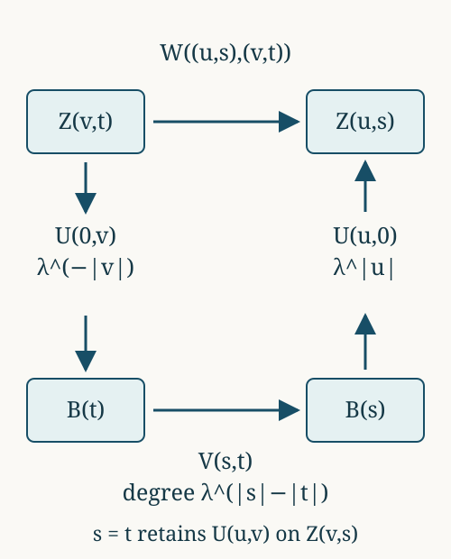

# Lattice derivatives and weighted orbit matching

*Mathematical exposition: GPT-6.1 Sol and GPT-6 Astra (OpenAI). Original programme expression: CC0. Cited works and separately licensed components retain their own terms.*

## Introduction

An orbit map with prescribed constant derivative must transport mass in the same ratio. The central question is whether that necessary condition is sufficient, and whether several such maps can be chosen to compose exactly. We first answer this as a problem about a measurable cocycle. We then construct finite matrix arrays, approximate measurable partitions, and refine an existing array while preserving every one of its maps. Only after these constructions do we establish their hypotheses for relations of type \(III_\lambda\).

For Sections 1–3, let \(R\) be a countable nonsingular principal relation on a nonatomic standard probability space \((X,\nu)\). Fix \(0<\lambda<1\). Its target-over-source derivative \(\delta_\nu\) is multiplicative, its kernel \(R_0=\{\delta_\nu=1\}\) is ergodic, and every degree \(\lambda^r\), \(r\in\mathbb Z\), occurs on a partial orbit map of positive domain measure. These are explicit hypotheses; Sections 4–5 prove how type \(III_\lambda\) supplies them after an equivalent change of probability. No hyperfiniteness assumption is needed for the finite constructions.

Read [Permutation symmetry and Powers factors](permutation-symmetry-and-powers-factors.md) for the binary product and its finite matrix states. The classical lattice-measure and matching results are Takesaki III, Lemmas XVIII.1.5–1.6, pp.300–302; weighted arrays and finite-partition approximation are Definition XVIII.1.7 and Lemma XVIII.1.8(i), pp.302–303. The finite seed proof in Section 1 follows the argument of Lemma XVIII.1.6(ii). The compatible refinement in Section 3 uses the general array composition from Homogeneous groupoid matchings and weighted arrays, Section 5.

The operator-algebraic application uses the following exact foundations. Relation weights and change of measure, Sections 1–3 and 7 gives the source-counting Hilbert space, diagonal expectation, maximal-domain modular multiplier, spatial change of measure and reduced corner. Its relation-kernel prerequisites provide the maximal abelian diagonal and ultraweakly dense partial graph operators. Groupoid reductions and modular matrix blocks, Section 2 gives countable presentations and saturated null sets. Discrete decomposition, Section 2 supplies the inner-period and factorial-centralizer results, with its stated modular-spectrum, fixed-corner and Fourier prerequisites. PW3 gives bounded centralizer perturbation on the entire weight domain; in this relation setting the formula also follows directly from the derivative calculation in Section 4.

Thus the type application retains the stated modular and relation-algebra foundations. The matching, splitting, quantitative approximation and compatible-refinement arguments are given below. The distinction between approximating sets and exhausting all orbit arrows is essential.

All spaces and maps are understood modulo null sets. Countable partial graph presentations let us discard one saturated null set for all required identities. A principal relation has one arrow for each ordered pair of related points, with no stabilizer labels; a presenting group action need not be free.

## 1. Exact transports at every lattice ratio

**Equal-mass lemma.** In an ergodic probability-preserving countable relation, measurable sets of equal measure can be joined by a measure-preserving partial orbit bijection.

*Proof.* Choose a countable partial-bijection presentation \(\theta_j\). At visit \(j\), restrict \(\theta_j\) to all still-unmatched points of \(A\) whose images are still unmatched in \(B\), and remove that domain and range. The countable union of the restrictions is a Borel partial bijection. Equal mass is removed from each side at each visit, so the two residual sets have equal measure. If that measure were positive, ergodicity would make the saturation of the first residual set conull. Some presenting graph would then map a positive part of it into the second residual set. Those points were available at that graph's visit and would have been removed, a contradiction. Both residual sets are null. Empty sets are handled by the empty map. \(\square\)

This is the countable construction behind the full-pseudogroup statement in Popa, Lemma 3.1.4(2), p.20.

**Nonatomic splitting lemma.** A measurable set can be partitioned into finitely many pieces with any prescribed nonnegative masses whose sum is its mass.

*Proof.* Work with a Borel representative of the set. A countable Borel family \(C_j\) separating its points gives the injective measurable function \(f(x)=\sum_{j\geq1}2\cdot3^{-j}\mathbf1_{C_j}(x)\) into \([0,1]\). Its pushforward measure has no atoms, since each fibre is at most a singleton. Its distribution function is continuous: the left and right jumps at a value are exactly the mass of that singleton, and continuity from above and below follows from finite countable additivity. The intermediate value theorem therefore supplies a sublevel set of any requested mass. Remove it and repeat on the remainder; zero masses give empty pieces. Completion of the measure changes only null sets. \(\square\)

**Theorem 1.1.** If measurable sets \(A,B\) have positive measure, an orbit bijection \(S:A\to B\) with constant derivative \(\lambda^r\) exists if and only if
\[
\nu(B)=\lambda^r\nu(A).
\tag{1.1}
\]

*Proof (finite use of a seed).* This argument is Takesaki, Lemma XVIII.1.6(ii), pp.301–302, with the intermediate domains and all integer degrees specified. Necessity follows by integrating the constant derivative in (4.1).

For sufficiency, choose one map \(T_r:C\to D\) from the occurrence hypothesis. Choose a positive integer \(N\) such that \(\nu(A)/N\leq\nu(C)\). Split \(A\) into \(N\) pieces \(A_i\) of mass \(\nu(A)/N\), and \(B\) into \(N\) pieces \(B_i\) of mass \(\nu(B)/N\). Nonatomicity supplies both partitions. For each \(i\), choose \(C_i\subset C\) of mass \(\nu(A_i)\), and put \(D_i=T_rC_i\).

Ergodicity of \(R_0\) and the equal-measure lemma above give maps in \(R_0\)
\[
W_i:A_i\longrightarrow C_i,\qquad
Q_i:D_i\longrightarrow B_i.
\tag{1.2}
\]
The second matching is possible because
\[
\nu(D_i)=\lambda^r\nu(C_i)
=\lambda^r\nu(A_i)=\nu(B_i).
\tag{1.3}
\]
Set
\[
S_i=Q_iT_rW_i:A_i\longrightarrow B_i.
\tag{1.4}
\]
The cocycle law gives derivative \(1\cdot\lambda^r\cdot1=\lambda^r\). Paste the \(S_i\)'s. Their domains are pairwise disjoint, and their ranges are pairwise disjoint, so the result is a Borel partial orbit bijection from \(A\) onto \(B\), modulo null sets.

The intermediate sets \(C_i,D_i\) may be reused for different \(i\). Their disjointness is unnecessary: the pasted maps have the separately disjoint domains \(A_i\) and ranges \(B_i\). Thus even a very small homogeneous map supplies an arbitrarily large admissible matching. The argument works for positive, zero and negative integers \(r\). \(\square\)

**A countable matching proof.** The same conclusion can be obtained without dividing \(A\) into equal pieces. First, any two positive sets \(E,F\) admit a positive partial degree-\(\lambda^r\) map between subsets. To see this, take a seed \(T:C\to D\). Ergodicity of \(R_0\) provides a positive partial kernel map from \(E\) into \(C\): this follows from the saturation of \(E\) and a countable graph presentation. Its composite with \(T\) has positive image in \(D\). A second kernel map takes a positive subset of that image into \(F\); restrict the first composite to the corresponding preimage. The derivative of the resulting map is \(\lambda^r\).

Now enumerate a partial-bijection presentation of \(R\), restricting each graph to its degree-\(\lambda^r\) level. Match all available points of \(A\) to available points of \(B\) at each visit. The union has disjoint domains and ranges. If the remaining sets were both positive, the preceding paragraph would supply a positive degree-\(\lambda^r\) map between them; a positive portion of its graph belongs to one of the enumerated graphs. That portion would have been removed at its visit. Hence one remaining set is null. Since every removed range has \(\lambda^r\) times its domain's mass and initially \(\nu(B)=\lambda^r\nu(A)\), the two residual masses satisfy the same equality. Both are therefore zero. This is the specialization of Homogeneous groupoid matchings and weighted arrays, Theorem 3.2. \(\square\)

## 2. The finite matrix model

Put
\[
a=\frac1{1+\lambda},\qquad b=\frac\lambda{1+\lambda}.
\tag{2.1}
\]
For a word \(s\in\{0,1\}^n\), let \(|s|\) count its ones and set
\[
w_s=a^{n-|s|}b^{|s|}
=\frac{\lambda^{|s|}}{(1+\lambda)^n}.
\tag{2.2}
\]
The weights sum to one. There are \(\binom nk\) words of weight \(k\), and the largest cell mass is \(a^n\), attained at the all-zero word.

A **weighted binary array of length \(n\)** consists of a partition \(X=\bigsqcup_s Z_s\) and partial orbit maps
\[
U_{st}:Z_t\longrightarrow Z_s
\]
such that
\[
\begin{gathered}
\nu(Z_s)=w_s,\qquad U_{ss}=\mathrm{id},\\
U_{st}U_{tu}=U_{su},\qquad
\delta_\nu(U_{st}x,x)=\lambda^{|s|-|t|}.
\end{gathered}
\tag{2.3}
\]
Composition in (2.3) is defined on all of \(Z_u\). Every class of the array relation contains exactly one point in each cell, so it has \(2^n\) points. The graph operators are matrix units:
\[
V_{U_{st}}V_{U_{uv}}
=\begin{cases}V_{U_{sv}},&t=u,\\0,&t\ne u,\end{cases}
\qquad V_{U_{st}}^*=V_{U_{ts}}.
\tag{2.4}
\]
Their diagonal projections sum to one. They generate a unital copy of \(M_{2^n}(\mathbb C)\). For \(\psi=\nu\circ E_D\), the state on this matrix algebra has density \(\operatorname{diag}(w_s)\): off-diagonal graph operators have zero diagonal expectation, whereas \(\psi(V_{U_{ss}})=w_s\). Its modular matrix entries have eigenvalues \(w_s/w_t=\lambda^{|s|-|t|}\). These are exactly the finite states of the Powers product.

The maps must satisfy their composition identity simultaneously. Transports out of one base cell provide this compatibility as follows.

**Corollary 2.1.** Any partition \(X=\bigsqcup_sZ_s\) with the masses (2.2) extends to a weighted binary array of length \(n\).

*Proof.* Let \(0\) denote the all-zero word. Apply Theorem 1.1 to choose
\[
v_s:Z_0\longrightarrow Z_s,
\qquad\delta_\nu(v_sx,x)=\lambda^{|s|},
\tag{2.5}
\]
and take \(v_0=\mathrm{id}\). Define
\[
U_{st}=v_sv_t^{-1}.
\tag{2.6}
\]
The inverse derivative is the reciprocal, so (2.6) has derivative \(\lambda^{|s|-|t|}\). Its domain is \(Z_t\) and its range is \(Z_s\). Cancellation of \(v_t^{-1}v_t\) gives the exact composition identity in (2.3). All assertions follow. \(\square\)

Nonatomicity supplies a partition with those masses for every \(n\geq1\). The next construction chooses it to approximate a specified finite partition.

## 3. Partition approximation and compatible refinement

**Theorem 3.1.** Let \(E_1,\ldots,E_m\) be a finite measurable partition of \(X\). For every \(n\geq1\), there is a weighted binary array of length \(n\) and a partition \(Y_1,\ldots,Y_m\), each member a union of array cells, such that
\[
\sum_{j=1}^m\nu(E_j\mathbin\triangle Y_j)
\leq2(m-1)a^n.
\tag{3.1}
\]
In particular each individual error can be made smaller than any prescribed \(\varepsilon>0\).

*Proof.* Write \(t_j=\nu(E_j)\). Partition \([0,1)\) into consecutive half-open intervals \(J_j\) of lengths \(t_j\), allowing empty intervals. In any chosen order, partition the same interval into consecutive half-open intervals \(I_s\) of lengths \(w_s\). This auxiliary interval partition imposes no coordinates on \(X\).

For each \(j\), split \(E_j\) into pieces \(Z_{sj}\) with
\[
\nu(Z_{sj})=|I_s\cap J_j|,
\tag{3.2}
\]
where \(|\cdot|\) denotes Lebesgue length. The required masses sum to \(t_j\), so nonatomic splitting applies. Put \(Z_s=\bigcup_jZ_{sj}\). These sets partition \(X\) and have mass \(w_s\).

Call a cell crossing if its interval \(I_s\) meets at least two \(J_j\)'s in positive length. Each such interval contains a partition boundary in its interior. There are at most \(m-1\) boundaries, so there are at most \(m-1\) crossing cells. An interval that contains several boundaries still counts only once. Their total mass \(c\) therefore satisfies
\[
c\leq(m-1)\max_sw_s=(m-1)a^n.
\tag{3.3}
\]

Assign every noncrossing cell to the unique \(E_j\) containing it modulo null sets. Assign a crossing cell to any one index whose interval it meets in positive length. Let \(Y_j\) be the union of cells assigned to \(j\). This makes the \(Y_j\)'s a partition. Every misassigned point belongs to a crossing cell, so the measure of the misassigned set is at most \(c\).

For two partitions, a misassigned point belongs to exactly two of their symmetric differences: the index it left and the index it entered. A correctly assigned point belongs to none. If \(B\) is the set of misassigned points, then
\[
\sum_j\nu(E_j\mathbin\triangle Y_j)
=2\nu(B)\leq2c.
\tag{3.4}
\]
Equations (3.3) and (3.4) give (3.1). Now use Corollary 2.1 to supply all the exact orbit transports between the chosen cells. Since \(a<1\), the bound tends to zero. For \(m=1\), the single partition member is represented exactly. \(\square\)

**Theorem 3.2 (refinement with an error bound).** Fix a weighted binary array of length \(k\), with cells \(Z_u\), maps \(U_{uv}\), and base word \(0\). Given a partition \(E_1,\ldots,E_m\), let \(\ell\) be the number of positive atoms of the common refinement, on \(Z_0\), of the partitions
\[
 \begin{gathered}
 \{U_{0u}(E_j\cap Z_u):1\leq j\leq m\},\\
 u\in\{0,1\}^k.
 \end{gathered}
 \tag{3.5}
\]
For every \(n\geq1\) there is a weighted array of length \(k+n\) refining the given array, and a partition \(Y_1,\ldots,Y_m\) into unions of its cells, with
\[
 \begin{gathered}
 \sum_j\nu(E_j\mathbin\triangle Y_j)\leq2(\ell-1)a^n,\\
 1\leq\ell\leq m^{2^k}.
 \end{gathered}
 \tag{3.6}
\]
The new maps restrict to every old map when their suffixes agree.

*Proof.* On \(Z_0\) use normalized measure \(\nu_0=\nu/\nu(Z_0)\). The restriction of \(R_0\) is ergodic: the full saturation of a positive invariant subset is conull, and intersects \(Z_0\) in that subset. Every degree \(\lambda^r\) still occurs inside \(Z_0\). Indeed choose two subsets of \(Z_0\) of sufficiently small positive masses in that ratio and apply Theorem 1.1. Thus Theorem 3.1 applies on this normalized base. Apply it to the \(\ell\) atoms in (3.5), obtaining cells \(B_s\) of masses \(\nu(Z_0)w_s\), maps \(V_{st}\), and a partition by unions of these cells with total normalized error at most \(2(\ell-1)a^n\).

Each partition in (3.5) is a union of the common atoms. Grouping the corresponding approximating atoms cannot increase the sum of the symmetric-difference errors: every misassigned point either remains misassigned or becomes correctly assigned after grouping. Hence each pulled-back partition has that same error bound. Set
\[
 \begin{aligned}
 Z_{us}&=U_{u0}(B_s),\\
 W_{(u,s),(v,t)}&=U_{u0}V_{st}U_{0v}.
 \end{aligned}
 \tag{3.7}
\]
The source of the second map is \(Z_{vt}\) and its range is \(Z_{us}\). The identities for \(U\) and \(V\) give all the composition and inverse identities. Its derivative is
\[
 \begin{gathered}
 \lambda^{|u|}\lambda^{|s|-|t|}\lambda^{-|v|}
       =\lambda^{|us|-|vt|},\\
 \nu(Z_{us})=w_uw_s=w_{us}.
 \end{gathered}
 \tag{3.8}
\]
For equal suffixes, \(V_{ss}=\mathrm{id}_{B_s}\), and therefore
\[
 W_{(u,s),(v,s)}=U_{uv}|_{Z_{vs}}.
 \tag{3.9}
\]
The new array consequently contains all the old arrows.

Transport the approximating pulled-back partitions to each \(Z_u\) and unite the pieces with the same label \(j\); call the results \(Y_j\). Each pushforward multiplies the unnormalized base error by \(\lambda^{|u|}\). Since \(\nu(Z_0)=a^k\) and \(\sum_u\lambda^{|u|}a^k=1\), summing over the old cells proves (3.6). Null atoms may be assigned arbitrarily and all finitely many maps have a common conull domain. \(\square\)

*Figure 1. Theorem 3.2, (3.7)–(3.9). The map from the old cell indexed by \(v\) to that indexed by \(u\) factors through their common reference cell. The three indicated derivative factors multiply to the derivative of the top arrow. Equal suffixes make the bottom arrow an identity and retain the old map exactly. The rectangles denote measurable sets, not areas proportional to their measures. The composition is the general refinement formula in Homogeneous groupoid matchings and weighted arrays, Section 5.*

Iterating Theorem 3.2 permits increasingly fine approximations to any countable family of measurable partitions while keeping the previous arrays. It still does not assert that their union contains every arrow of \(R\). Approximating specified orbit maps requires an additional arrow-exhaustion argument; approximation of measurable sets alone does not establish orbit-equivalence classification.

## 4. Choosing a probability measure with lattice derivatives

Let \(R\) be a countable nonsingular principal relation on a standard nonzero sigma-finite measure space. Assume its relation algebra \(M\) is a type \(III_\lambda\) factor. The relation is therefore ergodic. Choose an equivalent probability \(\mu\), and put \(\varphi=\mu\circ E_D\).

For completeness, an equivalent probability always exists. Partition the space into countably many finite-measure pieces, discard null pieces, and assign strictly positive summable masses to the remaining pieces. On each piece use a constant density giving its assigned mass. If there are only finitely many positive pieces, use finitely many positive masses summing to one. The density is positive and finite almost everywhere, and its integral is one.

This probability is nonatomic. Otherwise a standard probability space has a positive-mass singleton modulo null sets. Its diagonal projection cuts the relation algebra down to the one-point relation algebra \(\mathbb C\), by the reduction prerequisite. It would be a nonzero minimal projection in the type III factor, which is impossible.

Our convention for the arrow derivative is
\[
\begin{gathered}
\mu(TA)=\int_A\delta_\mu(Tx,x)\,d\mu(x)
\\(A\subset\operatorname{dom}T).
\end{gathered}
\tag{4.1}
\]
It is a positive multiplicative cocycle. Changing the measure to \(\nu=q\mu\) changes it by
\[
\delta_\nu(y,x)
=\frac{q(y)}{q(x)}\delta_\mu(y,x).
\tag{4.2}
\]
The target density is in the numerator. This orientation will determine every transport below.

**Theorem 4.1.** There is an equivalent probability \(\nu\) such that
\[
\delta_\nu(y,x)\in\lambda^{\mathbb Z}
\tag{4.3}
\]
on a saturated conull relation. The state \(\psi=\nu\circ E_D\) has modular period \(P=2\pi/|\log\lambda|\).

*Proof.* The inner-period theorem gives a unitary \(c\in M\) with
\[
\sigma_P^\varphi=\operatorname{Ad}c.
\tag{4.4}
\]
This automorphism preserves \(\varphi\). Applying that invariance to \(xc\) gives \(\varphi(cx)=\varphi(xc)\) for every \(x\in M\), so \(c\) belongs to the centralizer \(M_\varphi\). For \(x\in M_\varphi\), equation (4.4) gives \(cxc^*=x\). Hence
\[
c\in Z(M_\varphi).
\tag{4.5}
\]
The modular group fixes \(D\), so \(D\subset M_\varphi\). Since \(D\) is maximal abelian in \(M\), (4.5) puts \(c\) in \(D\).

Take a bounded Borel argument \(\operatorname{Arg}(c)\) with values in \([-\pi,\pi]\), and set
\[
h=\exp\bigl(P^{-1}\operatorname{Arg}(c)\bigr).
\tag{4.6}
\]
Then \(h\) is positive, bounded and invertible, belongs to \(Z(M_\varphi)\subset D\), and satisfies \(h^{iP}=c\). Define
\[
\psi_0(x)=\varphi(h^{-1/2}xh^{-1/2}).
\tag{4.7}
\]
The bounded centralizer perturbation formula of PW3 gives
\[
\sigma_t^{\psi_0}(x)
=h^{-it}\sigma_t^\varphi(x)h^{it}.
\tag{4.8}
\]
In the relation model this formula can also be proved on each graph: a density proportional to \(h^{-1}\) multiplies its derivative by \(h(x)/h(y)\), whose imaginary power is exactly conjugation by \(h^{-it}\). Graph density and normality extend the formula to the algebra. At \(t=P\), the two conjugations cancel, so \(\sigma_P^{\psi_0}=\mathrm{id}\). Divide \(\psi_0\) by \(\psi_0(1)\); scalar normalization leaves the modular group unchanged.

Because \(h\in D\cap M_\varphi\) and \(E_D\) is bimodular, the resulting state is \(\psi=\nu\circ E_D\), where
\[
q=\frac{h^{-1}}{\varphi(h^{-1})},\qquad d\nu=q\,d\mu.
\tag{4.9}
\]
In particular, \(\nu\) is a probability equivalent to \(\mu\). The bounded argument gives the useful bounds
\[
e^{-2\pi/P}\le q\le e^{2\pi/P}.
\tag{4.10}
\]

In the state GNS representation, \(\Delta_\psi^{iP}\) implements the identity automorphism and fixes the state vector \(\Omega\). It therefore fixes every \(x\Omega\), and these vectors are dense. Thus \(\Delta_\psi^{iP}=1\). The relation modular formula identifies \(\Delta_\psi\) with multiplication by \(\delta_\nu\). Consequently
\[
\delta_\nu(y,x)^{iP}=1
\]
almost everywhere for source counting measure. Its positive solutions are exactly \(\lambda^{\mathbb Z}\). Decompose the relation into countably many partial graphs and saturate their exceptional base sets. This gives (4.3) on one invariant conull space. \(\square\)

*Reference:* The inner-period perturbation is the bounded-state specialization of [Connes 1973, Theorem 1.3.2 and Remark 1.3.3]; [Connes 1973, Theorem 3.4.1] supplies the type \(III_\lambda\) period. The diagonal argument above ensures that this state perturbation is an equivalent change of base probability.

An arbitrary equivalent probability need not satisfy (4.3). Exercise 6.6 gives a bounded density change that destroys the lattice condition and makes the derivative-one relation nonergodic.

## 5. The derivative-one relation connects equal masses

Use the probability \(\nu\) of Theorem 4.1, and write
\[
\begin{gathered}
R_0=\{(y,x)\in R:\delta_\nu(y,x)=1\},\\
F=M_\psi.
\end{gathered}
\tag{5.1}
\]
The cocycle law makes \(R_0\) a countable principal subrelation. Every partial orbit map in it preserves \(\nu\).

**Theorem 5.1.** The relation \(R_0\) is ergodic and its relation algebra is a type \(II_1\) factor. For every \(r\in\mathbb Z\), there is a nonzero partial orbit map \(T_r:C_r\to D_r\) with
\[
\delta_\nu(T_rx,x)=\lambda^r\quad(x\in C_r).
\tag{5.2}
\]

*Proof.* Periodicity confines the ordinary spectrum of \(\sigma^\psi\), in additive frequency notation, to \((\log\lambda)\mathbb Z\). The general modular spectrum theorem gives
\[
\Gamma(\sigma^\psi)=(\log\lambda)\mathbb Z.
\tag{5.3}
\]
The Connes spectrum is contained in the ordinary spectrum, so the two are equal. The discrete fixed-algebra theorem applies to the factor \(M\) and shows that \(F\) is a factor; the periodic-weight proof is DDP, Section 2, (DDP8)–(DDP9), and its fixed-corner argument. This use of the full Connes spectrum is essential: periodicity alone would not suffice.

For \(r\in\mathbb Z\), define the normal compact Fourier projection
\[
E_r(x)=\frac1P\int_0^P
\lambda^{-irt}\sigma_t^\psi(x)\,dt.
\tag{5.4}
\]
The integral is ultraweak. In particular, \(E_0\) is the state-preserving conditional expectation onto \(F\). For a partial orbit map \(T\), let
\[
A_r(T)=\{x\in\operatorname{dom}T:
\delta_\nu(Tx,x)=\lambda^r\}.
\]
The modular graph formula and orthogonality of the characters on the period circle give
\[
E_r(M_fV_T)=M_fV_{T|_{A_r(T)}}.
\tag{5.5}
\]
This formula uses actual graph operators. No assumption that every diagonal normalizer has trivial phase is needed.

The ultraweak density of the graph span and normality of \(E_0\) show that \(F\) is generated by \(D\) and the graph operators of \(R_0\). If a bounded diagonal function is \(R_0\)-invariant, it commutes with all these generators and belongs to \(Z(F)\). Factoriality makes it constant. Applying this to indicators proves ergodicity of \(R_0\).

There is also an exact relation-algebra identification. The closure of \(F\Omega\) is \(L^2(R_0,\nu_s)\): its graph vectors are supported on \(R_0\), and bounded coefficients on a countable graph decomposition span that space densely. On this subspace the generators act by the defining relation operators of \(R_0\). The restricted GNS representation is faithful and normal because \(\psi|_F\) is a faithful normal trace. Thus it identifies \(F\) with the relation algebra of \(R_0\). This is a finite factor containing the diffuse diagonal \(D\). It cannot be a finite matrix algebra, so it is type \(II_1\).

Finally, the definition of \(S(M)\) as an intersection of modular spectra implies
\[
\lambda^r\in\operatorname{Sp}(\Delta_\psi)
\quad(r\in\mathbb Z).
\tag{5.6}
\]
The modular multiplier prerequisite identifies this spectrum with the closed essential range of \(\delta_\nu\). Each \(\lambda^r\) is isolated among the positive lattice values. Therefore the set of arrows with derivative exactly \(\lambda^r\) has positive source counting measure. Some graph in a countable graph decomposition meets this set in positive measure. Restrict that graph to obtain \(T_r\). Its domain and range have positive measure, and (4.1) gives \(\nu(D_r)=\lambda^r\nu(C_r)\). \(\square\)

*Reference:* The general spectral inputs are [Connes 1973, Theorems 3.2.1 and 2.4.1]. Their hypotheses here include the ambient factor, the discrete full Connes spectrum, and equality with the ordinary spectrum. No fullness hypothesis is imposed.

In particular \(P\) is the least positive period of \(\psi\). Any period \(t\) annihilates the frequency \(\log\lambda\) in (5.3), so \(t\log\lambda\in2\pi\mathbb Z\). The positive minimum is \(P\).

## 6. Exercises with solutions

Level 1 is a computation. Level 2 asks for an application or a short proof. Level 3 tests a hypothesis or combines the constructions.

**Exercise 6.1 (density orientation).** *Level 1.* On a three-point space with full relation, let \(\mu\) have masses \((1/2,1/3,1/6)\). Reweight it by the probability density \(q=(1/2,1,5/2)\). Compute the new masses and the derivative of the arrow from the first point to the third. Verify both direct computation and (4.2).

*Solution.* The new masses are \((1/4,1/3,5/12)\), which sum to one. The old derivative is \((1/6)/(1/2)=1/3\). The density ratio at target and source is \((5/2)/(1/2)=5\), so the new derivative is \(5/3\). Directly, \((5/12)/(1/4)=5/3\). The reverse arrow has derivative \(3/5\), and products along successive arrows obey the cocycle law.

**Exercise 6.2 (periodicity does not imply factoriality).** *Level 2.* On \(M_2(\mathbb C)\), take the state with density \(h=\operatorname{diag}(2/3,1/3)\). Find its least positive modular period and its centralizer. Explain why it does not contradict Theorem 5.1.

*Solution.* Conjugation by \(h^{it}\) fixes the diagonal matrix entries and multiplies \(e_{10},e_{01}\) by \(2^{-it},2^{it}\). The least positive period is \(2\pi/\log2\). The centralizer is the diagonal algebra, which has a nontrivial center. The ambient factor is type \(I_2\), with \(S(M)=\{1\}\), not type \(III_{1/2}\). Its modular Connes spectrum is \(\{0\}\), while its ordinary spectrum contains \(\pm\log2\). The equality required in Theorem 5.1 fails.

**Exercise 6.3 (reusing a small seed).** *Level 2.* Suppose \(\lambda=1/3\), \(\nu(A)=9/20\), \(\nu(B)=3/20\), and a derivative-\(1/3\) map has domain mass \(1/10\). Give the masses in a five-piece construction of Theorem 1.1. Why may all five uses have the same intermediate domain?

*Solution.* Split \(A\) into five pieces of mass \(9/100\), and \(B\) into five pieces of mass \(3/100\). Choose one subset \(C'\) of the seed domain with mass \(9/100\); its image has mass \(3/100\). Match each \(A_i\) to \(C'\) in \(R_0\), use the seed restricted to \(C'\), and match its image to \(B_i\) in \(R_0\). The composites have derivative \(1/3\). Only their final domains and final ranges must be separately disjoint. Reusing \(C'\) creates no ambiguity because a point of \(A\) belongs to just one \(A_i\).

**Exercise 6.4 (a biased matrix array).** *Level 1.* For \(n=3\) and \(\lambda=1/3\), list the cell masses by the number of ones. Compute the derivatives of \(U_{111,000}\) and \(U_{000,111}\), and the state density of the array matrix algebra.

*Solution.* The mass of one cell with \(k\) ones is \(3^{3-k}/64\). The multiplicities and total masses are

| Ones | Cells | Mass of one cell | Total mass |
| --- | --- | --- | --- |
| 0 | 1 | \(27/64\) | \(27/64\) |
| 1 | 3 | \(9/64\) | \(27/64\) |
| 2 | 3 | \(3/64\) | \(9/64\) |
| 3 | 1 | \(1/64\) | \(1/64\) |

The first map has derivative \(1/27\), and its inverse has derivative \(27\). In lexicographic word order, the matrix density is
\[
\frac1{64}\operatorname{diag}(27,9,9,3,9,3,3,1).
\]
Equal densities occur precisely at equal word weights. The matrix centralizer is therefore \(M_1\oplus M_3\oplus M_3\oplus M_1\), as in the finite Powers model.

**Exercise 6.5 (a quantitative partition choice).** *Level 2.* Let \(\lambda=1/3\) and let the partition have four members. Use (3.1) to ensure a total symmetric-difference error below \(1/20\). Show that \(n=17\) works, whereas \(n=16\) does not satisfy this sufficient bound. This asks about the bound, not the smallest possible array for a particular partition.

*Solution.* Here \(a=3/4\), so the sufficient inequality is \(6(3/4)^n<1/20\), or \(120\cdot3^n<4^n\). Exact integer comparison gives
\[
\begin{aligned}
120\cdot3^{16}&=5\,165\,606\,520>4^{16},\\
120\cdot3^{17}&=15\,496\,819\,560<4^{17}.
\end{aligned}
\]
Thus \(17\) is the least positive integer satisfying this sufficient inequality. Theorem 3.1 then controls the sum of the four errors, and hence each individual error.

**Exercise 6.6 (an equivalent probability can split the kernel).** *Level 3.* Use the binary product with first-coordinate probabilities \((3/4,1/4)\) and \(\lambda=1/3\) from the preceding lesson. Keep that product measure \(\mu\) on all coordinates, and define
\[
q(x)=\begin{cases}4/5,&x_1=0,\\8/5,&x_1=1.\end{cases}
\qquad d\nu=q\,d\mu.
\]
Show that \(\nu\) is an equivalent probability, compute the derivative of the first-coordinate flip at \(x_1=0\), and prove that its derivative-one subrelation is nonergodic. Does the factor type change?

*Solution.* The integral of \(q\) is \((3/4)(4/5)+(1/4)(8/5)=1\). The density is bounded above and below by positive constants. The first-coordinate probabilities become \((3/5,2/5)\), and the other coordinates retain their old product distribution.

At \(x_1=0\), the flip has old derivative \(1/3\) and density ratio \(2\), so its new derivative is \(2/3\). Its inverse derivative is \(3/2\). Neither belongs to \(3^{\mathbb Z}\). More generally, an arrow changing the first coordinate has derivative \(2\cdot3^r\) or \(2^{-1}\cdot3^r\) for some integer \(r\), since the original finite-flip derivative is an integral power of \(1/3\). Such a number cannot equal one: it would require an integral power of three to equal two or one-half.

Thus every derivative-one arrow preserves the first coordinate. Its two level sets have positive \(\nu\)-measure, so this subrelation is nonergodic. The relation algebra is unchanged up to spatial isomorphism by the equivalent-measure prerequisite; its type remains \(III_{1/3}\). The lattice assumption on the chosen probability has failed, so Theorem 5.1 does not apply to it.

## References

- [Connes 1973] Alain Connes, “Une classification des facteurs de type III,” *Annales scientifiques de l’École Normale Supérieure* (4) **6** (1973), 133–252. [Open article](https://www.numdam.org/article/ASENS_1973_4_6_2_133_0.pdf).
- [Popa] Sorin Popa, *Lectures on ergodic theory of group actions (a von Neumann algebra approach)*, graduate lecture notes, UCLA. [Open notes](https://www.math.ucla.edu/~popa/Books/OElectures.pdf). The full-pseudogroup equal-measure matching statement is Lemma 3.1.4(2), p.20.
- [Powers] Robert T. Powers, “Representations of uniformly hyperfinite algebras and their associated von Neumann rings,” *Annals of Mathematics* (2) **86** (1967), 138–171. Russian translation by A. G. Stepin, *Matematika* **13**(4) (1969), 94–124: [translation and original-edition details](https://www.mathnet.ru/eng/mat520). Historical source for the product factors; the finite-state construction used here is the preceding programme lesson.
- [Takesaki] Masamichi Takesaki, *Theory of Operator Algebras III*, Encyclopaedia of Mathematical Sciences 127, Springer, 2003. [Publisher record](https://doi.org/10.1007/978-3-662-10453-8). Lemmas XVIII.1.5–1.6, pp.300–302, supply the lattice-measure and homogeneous-matching arguments; Definition XVIII.1.7 and Lemma XVIII.1.8(i), pp.302–303, concern weighted arrays and partition approximation. The interval-packing argument in the proof of Lemma XVIII.1.8(ii), p.304, is also relevant to the quantitative construction.
