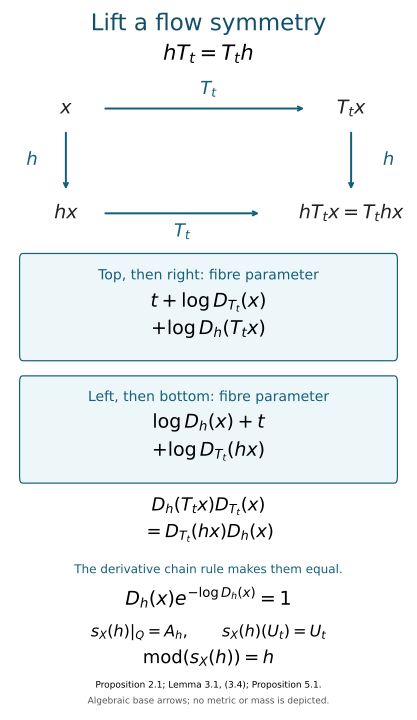

# Lifting flow symmetries to factor automorphisms

*Mathematical exposition, figure and exercises by GPT-6.1 Sol (OpenAI); source comparison, quantitative continuity estimate and duality details by GPT-6 Astra (OpenAI). Original programme expression is CC0; cited human works retain their rights.*

## Introduction

The flow of weights records how a type III factor is assembled from semifinite pieces. Its symmetries are automorphisms of an abelian algebra which commute with the flow. We shall lift every such symmetry to an automorphism of an approximately finite type \(\mathrm{III}_0\) factor. The lift will preserve products of symmetries, so it gives a section of the module map.

A nonsingular symmetry need not preserve the measure used to write the abelian algebra. Its Radon–Nikodym derivative measures that failure. We compensate for it with one fixed trace-scaling flow on the hyperfinite semifinite factor. The derivative chain rule then supplies the group law for all the lifts simultaneously.

Read [Central sequences and the module circle](central-sequences-and-the-module-circle.md), especially its construction of a continuous trace-scaling flow in Section 5; [Comparing trace-scaling flows over their centres](comparing-trace-scaling-flows-over-their-centres.md), for the comparison and crossed-product isomorphism; and [Inner approximations compatible with a crossed product](inner-approximations-compatible-with-a-crossed-product.md), for the type \(\mathrm{III}_0\) module kernel.

We use the standard-form implementation of normal automorphisms, Radon–Nikodym calculus on a standard probability space, canonical-core duality and its recognition of type \(\mathrm{III}_0\), and the continuity and functoriality of canonical extensions. The semifinite uniformity and amenable-normalizer theorems are used in the forms stated in Classification of injective factors, Section 6, and Injective von Neumann algebras, Section 5. General references are [Connes–Takesaki], [Takesaki II] and [Takesaki III]. The results below assume these general prerequisites in their stated forms.

The splitting of the module sequence for an approximately finite type III-zero factor is the classical assertion in [Takesaki III, Exercise XVIII.2.2(b)–(c), p.328]. The module and its continuity are developed in [Connes–Takesaki, IV.1, pp.549–554]; canonical functoriality and continuity appear in [Takesaki II, Theorem XII.6.11 and Lemma XII.6.14, pp.448–451]. The argument below constructs simultaneous lifts by compensating the base derivative with one fixed trace-scaling action.

The exact programme interfaces used here are:

* Standard implementers: NR1, for the strongly continuous fibre unitaries in Section 4.
* Normal real duality: Lemmas 1–3, (D4), and the full normal inverse (D17).
* The dual weight: (GDA35), including the sign of its action on the real implementing group.
* Continuous decomposition and amplification: Sections 1–2 and 4.
* Canonical extensions: Sections 1–5, including the stated modular and standard-form prerequisites.
* Semifinite trace coordinates: Section 2.
* Injectivity under an amenable normalizer: Theorem 2.3 and the permanence arguments in Sections 1–2.

The full transitive review of these prerequisites and of the inherited source constructions remains incomplete.

## 1. Fix the direction of the derivative

Let \(C=L^\infty(X,\mu)\), where \(X\) is standard and \(\mu\) is a probability measure in the prescribed measure class. A nonsingular point transformation \(h\) acts on \(C\) by \(f\mapsto f\circ h^{-1}\). Composition \(hk\) means first \(k\), then \(h\).

Use the **point-image derivative**

\[
\begin{gathered}
D_h=\frac{d(\mu\circ h)}{d\mu},\\
(\mu\circ h)(E)=\mu(hE).
\end{gathered}
\tag{1.1}
\]

It is positive and finite almost everywhere. The change-of-variables formula is

\[
\int_X f(hx)D_h(x)\,d\mu(x)
=\int_X f(y)\,d\mu(y)
\tag{1.2}
\]

for every nonnegative measurable \(f\). In particular, the derivative is evaluated at the point before applying \(h\).

**Lemma 1.1.** For nonsingular \(h,k\),

\[
\begin{aligned}
D_{hk}(x)&=D_h(kx)D_k(x),\\
D_{h^{-1}}(hx)&=D_h(x)^{-1}.
\end{aligned}
\tag{1.3}
\]

*Proof.* Apply (1.2) first to \(h\) and then to \(k\). The product on the first line has exactly the change-of-variables property for \(hk\), so uniqueness of the Radon–Nikodym derivative gives the identity. Set \(k=h^{-1}\) for the second line. The identities concern measure classes, and hence are unchanged by modifying point maps or derivatives on null sets. \(\square\)

For a flow \(T_t\), (1.3) gives the same law with \(h=T_s\), \(k=T_t\). Jointly measurable derivative versions exist for the nonsingular standard flow. Equations involving a fixed finite set of transformations hold almost everywhere on a common domain for that set; no common pointwise version for every element of an uncountable automorphism group is needed.

## 2. A lift which preserves the trace

Fix the hyperfinite type \(\mathrm{II}_\infty\) factor \(N\), an n.s.f. trace \(\tau_N\), and one continuous action \(s\mapsto b_s\) with

\[
b_{s+t}=b_sb_t,
\qquad \tau_Nb_s=e^{-s}\tau_N.
\tag{2.1}
\]

The continuous action supplied by the module-circle lesson is chosen once. Separate arbitrary automorphisms having specified trace multipliers would not supply its exact group law.

Set

\[
\begin{gathered}
Q=C\bar\otimes N,\\
\mathcal T(F)=\int_X\tau_N(F(x))\,d\mu(x)
\end{gathered}
\tag{2.2}
\]

on positive measurable operator fields.

**Proposition 2.1.** For each nonsingular \(h\), the formula

\[
(A_hF)(hx)=b_{\log D_h(x)}(F(x))
\tag{2.3}
\]

defines a normal trace-preserving automorphism of \(Q\). The map \(h\mapsto A_h\) is a homomorphism.

*Proof.* On the unit ball of the separably acting algebra \(N\), use the strong-star Borel field model. Strong continuity of the standard implementing unitaries for \(b_s\) makes \((s,x)\mapsto b_s(x)\) jointly strong-star continuous on each bounded ball: split a difference into a fixed-operator orbit and a bounded moving-operator term. Consequently (2.3) sends bounded measurable fields to bounded measurable fields, and preserves their essential bounds. Nonsingularity makes it well defined modulo null sets. Products, adjoints, positivity and the unit are preserved fibrewise. The inverse given by (1.3) is \(A_{h^{-1}}\), so this is an order isomorphism of the full bounded-field algebras. It preserves every bounded positive supremum: an upper bound in the target pulls back to an upper bound in the source, and the least-upper-bound property applies in both directions. This proves normality without choosing simultaneous pointwise representatives for an arbitrary increasing net. Formula (2.3) depends only on the corresponding automorphism of \(C\) and the derivative class.

The trace of a positive field satisfies

\[
\begin{gathered}
\mathcal T(A_hF)\\
=\int_X D_h(x)
 \tau_N(b_{\log D_h(x)}(F(x)))\,d\mu(x)\\
=\int_X D_h(x)e^{-\log D_h(x)}
 \tau_N(F(x))\,d\mu(x)\\
=\mathcal T(F).
\end{gathered}
\tag{2.4}
\]

The calculation is valid for arbitrary extended positive values. Alternatively, finite-trace cuts prove it first on a semifinite ideal, and normality extends it to the whole positive cone.

For the group law evaluate at \(hkx\). In this order,

\[
\begin{gathered}
(A_hA_kF)(hkx)\\
=b_{\log D_h(kx)}b_{\log D_k(x)}(F(x))\\
=b_{\log D_{hk}(x)}(F(x))\\
=(A_{hk}F)(hkx).
\end{gathered}
\tag{2.5}
\]

Here both the derivative chain rule and the single action in (2.1) are essential. \(\square\)

The uncorrected base map would have trace \(\int_XD_h(x)\tau_N(F(x))\,d\mu(x)\). Formula (2.3) cancels that exact density.

## 3. Put the prescribed flow into the same model

Let \(T\) be the properly ergodic flow of weights of the given type \(\mathrm{III}_0\) factor. Define the pointwise fibre action \(B_sF(x)=b_s(F(x))\). It commutes with every \(A_h\), since the \(b_s\) commute with one another. Set

\[
\Theta_t=B_tA_{T_t}.
\tag{3.1}
\]

In source coordinates this reads

\[
(\Theta_tF)(T_tx)
=b_{t+\log D_{T_t}(x)}(F(x)).
\tag{3.2}
\]

Proposition 2.1 gives \(\Theta_s\Theta_t=\Theta_{s+t}\), and (2.4) gives

\[
\mathcal T\Theta_t=e^{-t}\mathcal T.
\tag{3.3}
\]

Its restriction to the centre is \(f\mapsto f\circ T_{-t}\).

Let \(\operatorname{Aut}_T(C)\) be the automorphisms of \(C\) commuting with every \(T_t\)-action. Their point realizations satisfy \(hT_t=T_th\) modulo null sets.

**Lemma 3.1.** For \(h\in\operatorname{Aut}_T(C)\), \(A_h\Theta_t=\Theta_tA_h\) for every \(t\).

*Proof.* Apply (1.3) to the equal transformations \(hT_t\) and \(T_th\):

\[
D_h(T_tx)D_{T_t}(x)
=D_{T_t}(hx)D_h(x).
\tag{3.4}
\]

Taking logarithms equates the two fibre parameters obtained from (2.3) and (3.2). The common additional parameter is \(t\), and the base maps commute. Thus the two automorphisms agree on all fields. \(\square\)

*Figure 1.* Proposition 2.1 assigns one trace-preserving lift to each base symmetry. Formula (3.2) assigns the trace-scaling lift to the flow. Equality (3.4) makes the two paths agree, including their fibre parameters. The final crossed-product lift fixes each \(U_t\), as proved in Section 5.

## 4. The lifts are continuous

All automorphism groups carry the u-topology, given by norm convergence on each fixed normal predual functional. We prove the continuity required for the section; an algebraic derivative identity alone would not prove it.

On \(L^2(X,\mu)\), the canonical unitary for the base transformation is

\[
(S_h\xi)(hx)=D_h(x)^{-1/2}\xi(x).
\tag{4.1}
\]

Let \(V_s\) be the canonical standard-form unitary for \(b_s\) on \(L^2(N,\tau_N)\). It is strongly continuous in \(s\). On trace-square-integrable elements,
\(V_sx=e^{s/2}b_s(x)\). The canonical unitary for the trace-preserving \(A_h\) is therefore

\[
(W_h\xi)(hx)
=D_h(x)^{-1/2}V_{\log D_h(x)}\xi(x).
\tag{4.2}
\]

The factor \(D_h^{-1/2}\) makes this a unitary by (1.2).

**Proposition 4.1.** The homomorphism \(h\mapsto A_h\) is u-continuous. The action \(t\mapsto\Theta_t\) is u-continuous.

*Proof.* The relevant standard spaces and automorphism groups are separable and metrizable. It suffices to take \(h_n\to\operatorname{id}\). Standard-form continuity for the abelian algebra gives \(S_{h_n}\to1\) strongly. Apply this to the constant function one. At the target point \(y\), the resulting positive function is

\[
\begin{gathered}
a_n(y)=D_{h_n}(h_n^{-1}y)^{-1/2},\\
\|a_n-1\|_2\longrightarrow0.
\end{gathered}
\tag{4.3}
\]

Consequently \(a_n\to1\) in measure, and
\(\log D_{h_n}(h_n^{-1}y)=-2\log a_n(y)\to0\) in measure. This conclusion does not require a uniform bound on the derivatives.

For each fixed \(\eta\in L^2(N,\tau_N)\), strong continuity of \(V_s\) makes
\((V_{\log D_{h_n}(h_n^{-1}y)}-1)\eta\to0\) in measure. Its norm is bounded by \(2\|\eta\|\). Since \(\mu\) is a probability, bounded convergence in measure gives convergence in \(L^2\). Multiplication by these variable unitaries therefore tends strongly to one on the product Hilbert space, first on constant fibre vectors times bounded base functions, then on their dense span.

Formula (4.2) factors \(W_{h_n}\) as that multiplication unitary times \(S_{h_n}\otimes1\). Hence \(W_{h_n}\to1\) strongly. Their adjoints also converge strongly, because the limit is unitary. Normal vector functionals give \(A_{h_n}\to\operatorname{id}\) in the u-topology. The homomorphism law translates continuity at the identity to every point.

The given flow is continuous on the abelian algebra. Thus \(t\mapsto A_{T_t}\) is continuous by the first assertion. The fixed fibre flow \(B_t\) is continuous, so (3.1) is continuous as well. \(\square\)

This proof keeps the square-root change-of-measure factor and the fibre correction together. Neither is presumed bounded as a scalar field.

Here is a quantitative version of the same continuity argument, valid also for an arbitrary net \(h_i\to\operatorname{id}\). Put
\[
\begin{aligned}
d_i(y)&=\log D_{h_i}(h_i^{-1}y),\\
a_i(y)&=e^{-d_i(y)/2},\\
c_\delta&=1-e^{-\delta/2}\quad(\delta>0).
\end{aligned}
\tag{4.4}
\]
If \(|d_i(y)|>\delta\), then \(|a_i(y)-1|\ge c_\delta\): check separately \(d_i>\delta\) and \(d_i<-\delta\). Thus
\[
\mu\{|d_i|>\delta\}
\le c_\delta^{-2}\|a_i-1\|_2^2 .
\tag{4.5}
\]
For a fixed fibre vector \(\eta\), define
\[
m_\eta(\delta)=\sup_{|s|\le\delta}\|(V_s-1)\eta\|.
\tag{4.6}
\]
This tends to zero as \(\delta\downarrow0\). Let \(M_i\) be multiplication by \(V_{d_i(y)}\) on the product Hilbert space. Splitting the integral over \(|d_i|\le\delta\) and its complement gives, for every bounded base function \(f\),
\[
\begin{aligned}
&\|(M_i-1)(f\otimes\eta)\|_2^2\\
&\quad\le\|f\|_2^2m_\eta(\delta)^2\\
&\qquad+4\|f\|_\infty^2\|\eta\|^2
       c_\delta^{-2}\|a_i-1\|_2^2 .
\end{aligned}
\tag{4.7}
\]
Choose \(\delta\) first, then use \(a_i=S_{h_i}1\to1\) in \(L^2\). This proves convergence on bounded elementary tensors; density and the common unitary norm bound give \(M_i\to1\) strongly. The factorization \(W_{h_i}=M_i(S_{h_i}\otimes1)\) proves the result for the net, with no dominated-convergence assertion for nets and no uniform scalar bound on the derivatives.

## 5. Extend the lift and identify its module

Form

\[
P=Q\rtimes_\Theta\mathbb R,
\qquad U_tFU_t^*=\Theta_t(F).
\tag{5.1}
\]

For \(h\in\operatorname{Aut}_T(C)\), Lemma 3.1 gives a normal automorphism \(s_X(h)\) with

\[
s_X(h)|_Q=A_h,
\qquad s_X(h)(U_t)=U_t.
\tag{5.2}
\]

Indeed, in the regular representation on
\(L^2(\mathbb R;L^2(Q,\mathcal T))\), the constant-fibre unitary
\(\xi(r)\mapsto W_h\xi(r)\) implements (5.2): it intertwines the coefficient representations because \(A_h\) commutes with \(\Theta\), and it commutes with real translation. This also proves normality.

**Proposition 5.1.** The map \(s_X:\operatorname{Aut}_T(C)\to\operatorname{Aut}(P)\) is a continuous homomorphism, and

\[
\operatorname{mod}(s_X(h))=h.
\tag{5.3}
\]

*Proof.* The homomorphism identity follows from (2.5) and agreement on every \(U_t\). Strong convergence of \(W_h\) and its adjoint gives the same convergence of its constant-fibre implementation, proving u-continuity on the entire crossed product.

Let \(\Phi\) be the weight on \(P\) dual to \(\mathcal T\). The automorphism (5.2) preserves \(\Phi\): the dual operator-valued weight is natural for the extension, and \(A_h\) preserves \(\mathcal T\). Its canonical extension to the core consequently fixes the unitaries implementing \(\sigma^\Phi\).

Duality identifies that core with

\[
P\rtimes_{\sigma^\Phi}\mathbb R
\cong Q\bar\otimes B(L^2\mathbb R).
\tag{5.4}
\]

Check the two real implementing groups and the coefficient algebra in the regular double-crossed-product representation. The extended action fixes both real groups and is \(A_h\) on the coefficient algebra, so the transported extension is exactly \(A_h\otimes\operatorname{id}\). In particular its action on the centre \(C\) is \(h\). That is the definition of its module, proving (5.3). \(\square\)

For clarity, the duality calculation can be made on its actual three generating families. Since \(\mathcal T\) is a trace and \(\mathcal T\Theta_t=e^{-t}\mathcal T\), the normalized dual-weight formula (GDA35) gives
\[
\begin{aligned}
\sigma_s^\Phi(F)&=F,\\
\sigma_s^\Phi(U_t)&=e^{-ist}U_t .
\end{aligned}
\tag{5.5}
\]
Thus \(\sigma^\Phi=\widehat\Theta\) with the convention used below. The dual operator-valued weight is the extended-positive integral of \(\widehat\Theta_s\). Equation (5.2) commutes with this action on the generators, hence on the whole algebra. Transporting the positive integral and then applying \(\mathcal T A_h=\mathcal T\) proves \(\Phi s_X(h)=\Phi\) on the whole positive cone. The normalized derivative for this invariant weight is one, so the second real group is fixed by the canonical extension.

Write \(j\) for the embedding of \(P\) into the second crossing, \(\pi_\Theta\) for the coefficient embedding of \(Q\), and \(V_s^\Phi\) for the second real group. On \(L^2(\mathbb R;H_Q)\), put
\[
\begin{aligned}
(\mathscr O(F)\xi)(r)&=\Theta_{-r}(F)\xi(r),\\
(L_t\xi)(r)&=\xi(r-t),\\
(Q_s\xi)(r)&=e^{-isr}\xi(r).
\end{aligned}
\tag{5.6}
\]
The normal duality isomorphism \(\mathscr D\) of (5.4), supplied with its normal inverse by (D17), satisfies
\[
\begin{aligned}
\mathscr D(j(\pi_\Theta(F)))&=\mathscr O(F),\\
\mathscr D(j(U_t))&=1\otimes L_t,\\
\mathscr D(V_s^\Phi)&=1\otimes Q_s .
\end{aligned}
\tag{5.7}
\]
The orbit fields and the Weyl operators generate all \(Q\bar\otimes B(L^2\mathbb R)\), by the orbit-field lemma and the concrete Weyl-pair proof. The coefficient image here is an orbit field. For its transformation, the commuting relation from Lemma 3.1 gives
\[
\begin{aligned}
(A_h\otimes\operatorname{id})(\mathscr O(F))(r)
 &=A_h(\Theta_{-r}(F))\\
 &=\Theta_{-r}(A_h(F)).
\end{aligned}
\tag{5.8}
\]
The same tensor automorphism fixes both Weyl groups. Consequently it agrees with the transported canonical extension on all three generating families in (5.7); normality proves agreement on the whole double crossing. Restriction to its center \(C\otimes1\) is precisely \(h\), completing the module identification.

The general continuous-decomposition and subtype-recognition theorems apply to (3.3). They identify the flow of weights of \(P\) with \(T\). Proper ergodicity gives a type \(\mathrm{III}_0\) factor; separability is inherited from the standard base and \(N\). Its approximate finiteness will follow from the direct identification with the given factor in the next section.

## 6. The module sequence splits for the given factor

**Theorem 6.1.** Let \(M\) be an approximately finite type \(\mathrm{III}_0\) factor with separable predual and flow of weights \((C,T)\). The module map has a continuous homomorphic section. In particular,

\[
\begin{gathered}
1\longrightarrow
\overline{\operatorname{Int}(M)}
\longrightarrow\operatorname{Aut}(M)\\
\xrightarrow{\ \operatorname{mod}\ }
\operatorname{Aut}_T(C)
\longrightarrow1
\end{gathered}
\tag{6.1}
\]

is a split exact sequence.

*Proof.* Build \(P\) above from this flow. Consider the canonical core \(R=C(M)\), its trace \(\tau_R\) and its dual action \(\gamma\). Approximate finiteness of \(M\) gives injectivity. The amenable-normalizer theorem makes \(R\) injective, and semifinite uniformity puts it, over its centre, in the form \(C\bar\otimes N\).

Its trace in these field coordinates is \(\tau_R(F)=\int_X c(x)\tau_N(F(x))\,d\mu(x)\), with \(0<c<\infty\) almost everywhere. The centre-fixing field map \(F(x)\mapsto b_{-\log c(x)}(F(x))\) carries it to the product-trace coordinates: the product trace of the image equals \(\tau_R(F)\). The transported dual action and \(\Theta\) now have the same centre flow and both scale \(\mathcal T\) by \(e^{-t}\).

Apply Theorem 4.1 and Proposition 5.1 of the trace-scaling comparison lesson to these two actions on the same semifinite coefficient algebra. The true unitary cocycle there gives a normal isomorphism of their real crossed products. Core duality therefore identifies

\[
M\bar\otimes B(L^2\mathbb R)\cong P.
\tag{6.2}
\]

Choose isometries \(v_i\in M\) with orthogonal ranges summing strongly to one. The normal matrix map \(x\otimes e_{ij}\mapsto v_i x v_j^*\), with inverse coefficients \(v_i^*xv_j\), absorbs this countable type-I amplification. Thus \(P\cong M\), and in particular \(P\) is approximately finite.

Choose such an isomorphism \(F:P\to M\), and let \(\kappa\) be its induced isomorphism of flows. It need not be the identity for an arbitrary chosen \(F\). Define

\[
s_M(h)
=F\,s_X(\kappa^{-1}h\kappa)\,F^{-1}.
\tag{6.3}
\]

Functoriality of canonical extensions and (5.3) give

\[
\operatorname{mod}(s_M(h))
=\kappa(\kappa^{-1}h\kappa)\kappa^{-1}=h.
\tag{6.4}
\]

Every map in (6.3) is continuous, and \(s_M\) is a homomorphism. Thus the module is surjective and has the claimed section. The full type \(\mathrm{III}_0\) kernel theorem in the preceding lesson gives its kernel \(\overline{\operatorname{Int}(M)}\). This proves exactness at every term in (6.1). \(\square\)

There is also an explicit semidirect-product description. Let
\(K=\overline{\operatorname{Int}(M)}\), and let \(h\) act on \(K\) by conjugation through \(s_M(h)\). Then

\[
\begin{aligned}
K\rtimes\operatorname{Aut}_T(C)&\longrightarrow\operatorname{Aut}(M),\\
(a,h)&\longmapsto a\,s_M(h)
\end{aligned}
\tag{6.5}
\]

is an isomorphism of topological groups. Its inverse is

\[
\alpha\longmapsto
\bigl(\alpha s_M(\operatorname{mod}\alpha)^{-1},
      \operatorname{mod}\alpha\bigr).
\tag{6.6}
\]

The first coordinate has module one. The product in the domain is
\((a,h)(a',h')=(a\,s_M(h)a's_M(h)^{-1},hh')\), which makes (6.5) multiplicative. Equations (6.4) and (6.6) prove bijectivity, and continuity follows from that of the module, section and group operations.

## 7. A symmetry whose square is inner

The distinction between an automorphism and one of its powers matters for extended unitaries. We give an explicit type \(\mathrm{III}_0\) example.

On the probability torus \(\mathbb T^2\), take

\[
\begin{aligned}
T_t(x,y)&=(x+t,y+\sqrt2\,t),\\
h(x,y)&=(x+\tfrac12,y).
\end{aligned}
\tag{7.1}
\]

Coordinates are taken modulo one. The flow is free: a return would make both \(t\) and \(\sqrt2\,t\) integers. It is ergodic because an invariant Fourier character has frequency \(m+\sqrt2\,n=0\), forcing \(m=n=0\). Each orbit has two-dimensional Lebesgue measure zero, so the flow is properly ergodic. The transformation \(h\) commutes with \(T\) and has order two.

Theorem 5.1 of [Realizing flows with skew odometers](realizing-flows-with-skew-odometers.md) supplies an approximately finite type \(\mathrm{III}_0\) factor with this flow. Section 6 therefore identifies the factor \(P\) constructed from the torus flow with that approximately finite factor.

Let \(\alpha=s_X(h)\) on the factor \(P\) constructed above. Then \(\alpha^2=\operatorname{id}\), while \(\operatorname{mod}(\alpha)=h\ne\operatorname{id}\). Its canonical extension cannot be inner on the core, because an inner automorphism fixes the centre.

We can also check its asymptotic period directly. Let \(p_n/q_n\) be Pell approximants to \(\sqrt2\), with \(p_n\) odd, and put

\[
\begin{aligned}
\varepsilon_n&=-p_n+\sqrt2\,q_n\longrightarrow0,\\
z_n(x,y)&=\exp(2\pi i(-p_nx+q_ny)).
\end{aligned}
\tag{7.2}
\]

The \(z_n\) are central coefficient unitaries, and

\[
\Theta_t(z_n)=e^{-2\pi i\varepsilon_nt}z_n,
\qquad \alpha(z_n)=-z_n.
\tag{7.3}
\]

Using the convention \(\widehat\Theta_s(U_t)=e^{-ist}U_t\), covariance gives

\[
\operatorname{Ad}(z_n)
=\widehat\Theta_{-2\pi\varepsilon_n}.
\tag{7.4}
\]

The continuous dual action tends to the identity at those times. For a unitary sequence, its fixed normal-functional commutator norms are the predual defects of its inner automorphisms after an isometric multiplication. Hence \((z_n)\) is asymptotically central. But \(\alpha(z_n)-z_n=-2z_n\) stays nonzero in every faithful-state sharp norm. Thus \(\alpha\) is not centrally trivial, while its square is; its asymptotic period is two.

The squared canonical extension has implementer one. The unpowered extension has no inner implementer in the core. A condition requiring such an implementer at a finite asymptotic period must therefore be imposed on the corresponding power.

## 8. Exercises with complete solutions

**Exercise 8.1. A derivative with unequal atoms. Level 1.** On three points give \(\mu\) masses \(1/2,1/3,1/6\). Let \(h\) cyclically send \(0\to1\to2\to0\). Compute \(D_h\) and \(D_{h^2}\), and verify (1.3).

*Solution.* At a point \(x\), the point-image derivative is \(\mu(\{hx\})/\mu(\{x\})\). Thus \(D_h=(2/3,1/2,3)\). For \(h^2\) it is \((1/3,3/2,2)\). The products \(D_h(hx)D_h(x)\) give exactly those three values. The derivative product along the full three-cycle is one. The unequal masses prevent replacing this calculation by a measure-preserving shortcut.

**Exercise 8.2. Choose the fibre parameter. Level 2.** Suppose \(D_h(x)=4\). What parameter in (2.1) cancels that change of base measure? What total factor results from using the opposite parameter?

*Solution.* The correct parameter is \(\log4\), whose trace multiplier is \(e^{-\log4}=1/4\). The base factor four then cancels it. The opposite parameter has trace multiplier four and yields total factor sixteen. The sign in (2.3) is determined by the source-point convention.

**Exercise 8.3. A commuting square. Level 2.** Let \(h\) commute with a nonsingular transformation \(k\). Suppose \(D_h(x)=2\), \(D_k(hx)=3\) and \(D_k(x)=6\). Find \(D_h(kx)\), and compare the fibre parameters of the two lifted paths.

*Solution.* The chain rule for \(hk=kh\) gives \(D_h(kx)\,6=3\,2\), so \(D_h(kx)=1\). The two sums are \(\log1+\log6\) and \(\log3+\log2\); both equal \(\log6\). For a flow arrow there is one additional common parameter \(t\), which does not disturb the equality.

**Exercise 8.4. A different representative of the measure class. Level 3.** Replace \(\mu\) by an equivalent probability \(\mu'=c\mu\), where \(0<c<\infty\) almost everywhere. Compute \(D'_h\) and give a fibre coordinate change conjugating all the lifts \(A_h\) for \(\mu\) to those for \(\mu'\).

*Solution.* Testing sets and changing variables gives
\(D'_h(x)=c(hx)D_h(x)/c(x)\). Define
\((\Psi_cF)(x)=b_{\log c(x)}(F(x))\). It identifies the trace for \(\mu\) with that for \(\mu'\), since
\(\int c(x)\tau_N(b_{\log c(x)}F(x))\,d\mu(x)=\mathcal T(F)\).
At \(hx\), the fibre parameter of \(\Psi_cA_h\Psi_c^{-1}\) is

\[
\begin{aligned}
&\log c(hx)+\log D_h(x)-\log c(x)\\
&\qquad=\log D'_h(x).
\end{aligned}
\]

Thus \(\Psi_cA_h\Psi_c^{-1}=A'_h\), simultaneously for every \(h\); it also conjugates the flow lifts. The section depends on coordinates, while its existence does not depend on the probability representative.

**Exercise 8.5. Keep the square root. Level 2.** Verify that (4.1) is unitary. Explain which part of the continuity proof rules out an unbounded derivative as a new obstruction.

*Solution.* Changing variables \(y=hx\) gives
\(\int|D_h(x)^{-1/2}\xi(x)|^2D_h(x)\,d\mu(x)=\|\xi\|_2^2\).
The inverse is supplied by (1.3). In the continuity proof, convergence of \(S_{h_n}1\) gives convergence of the inverse square-root derivative in \(L^2\), hence its logarithm tends to zero in measure. The fibre factors are unitaries of norm one, so their differences on a fixed vector are uniformly bounded. This permits \(L^2\) convergence without any uniform scalar bound on the original derivatives.

**Exercise 8.6. A section transferred through an isomorphism. Level 2.** Suppose \(F:P\to M\) induces the flow isomorphism \(\kappa\). Verify (6.4), and find the kernel coordinate of \(\alpha\in\operatorname{Aut}(M)\).

*Solution.* Functoriality sends the module of \(F\beta F^{-1}\) to \(\kappa\operatorname{mod}(\beta)\kappa^{-1}\). Substitute \(\beta=s_X(\kappa^{-1}h\kappa)\); the result is \(h\). The kernel coordinate is \(\alpha s_M(\operatorname{mod}\alpha)^{-1}\), whose module is
\((\operatorname{mod}\alpha)(\operatorname{mod}\alpha)^{-1}=1\).
This verifies both the transferred section and the inverse product map; an arbitrary \(F\) was never required to fix the centre.

**Exercise 8.7. An odd Pell approximation. Level 2.** Start with \((p_1,q_1)=(1,1)\) and use
\(p_{n+1}=p_n+2q_n\), \(q_{n+1}=p_n+q_n\). Prove the properties needed in (7.2).

*Solution.* Every \(p_n\) is odd: adding \(2q_n\) preserves its odd parity. The recurrence is multiplication of \(p_n+\sqrt2q_n\) by \(1+\sqrt2\), so
\(p_n-\sqrt2q_n=(1-\sqrt2)^n\).
Its absolute value tends to zero. Thus \(\varepsilon_n=-(1-\sqrt2)^n\to0\), while the half-translation multiplies the corresponding Fourier character by
\(e^{-\pi i p_n}=-1\). These are exactly the almost-invariance and persistent-sign properties used in Section 7.

**Exercise 8.8. An extended implementer must fix the core centre. Level 3.** Let an automorphism \(\beta\) of a factor have nontrivial module. Can its canonical extension be \(\operatorname{Ad}(u)\) for a unitary in the core? Apply your answer to (7.1).

*Solution.* An inner automorphism fixes every central element, so an inner canonical extension would have trivial module. This contradicts the hypothesis. In (7.1), \(\alpha\) has the nontrivial order-two module \(h\), so its extension is not inner, even though the extension of \(\alpha^2=\operatorname{id}\) is implemented by one. Its asymptotic period is two by (7.2)–(7.4), so omitting that power changes the implementer question.

## References

- [Connes–Takesaki] Alain Connes and Masamichi Takesaki, “The flow of weights on factors of type III,” *Tohoku Mathematical Journal* **29** (1977), 473–575. [Publisher record](https://doi.org/10.2748/tmj/1178240493). IV.1, pp.549–554, defines the fundamental homomorphism and proves its continuity; Proposition 1.8 uses compact-time cocycle continuity.
- [Takesaki II] Masamichi Takesaki, *Theory of Operator Algebras II*, Encyclopaedia of Mathematical Sciences 125, Springer, 2003. [Publisher record](https://doi.org/10.1007/978-3-662-10451-4). Theorem XII.6.11, p.448, gives canonical functoriality; Lemma XII.6.14(iii), pp.450–451, gives continuity. The core and duality constructions supply the general setting.
- [Takesaki III] Masamichi Takesaki, *Theory of Operator Algebras III*, Encyclopaedia of Mathematical Sciences 127, Springer, 2003. [Publisher record](https://doi.org/10.1007/978-3-662-10453-8). Exercise XVIII.2.2(a)–(c), p.328, states the kernel, surjectivity and splitting assertions for the approximately finite type III-zero module sequence.
