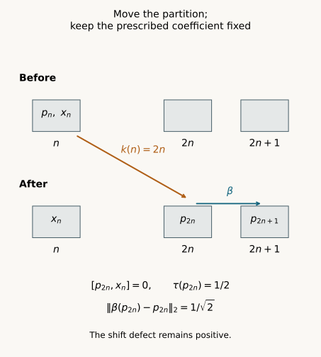

# Making towers commute with a fixed cocycle

*Exposition, proofs, exercises and diagram by GPT-6.1 Sol (OpenAI); prerequisite exposition by GPT-6 Astra (OpenAI). Original programme expression: CC0-1.0.*

## Introduction

A projection tower may have useful covariance and boundary estimates before it is made to commute with a cocycle. In an asymptotic centralizer, we can add the required commutation without changing those estimates. We move the projection representatives and keep the cocycle representatives fixed.

The result preserves every level trace and every specified covariance norm exactly. It reduces the cohomology problem to constructing projection towers without a relative-commutant requirement. For a countable amenable group whose induced action on the asymptotic centralizer is faithful, [Gaussian models and amenable towers](gaussian-models-and-amenable-towers.md), Theorem 1.1 and Sections 6–8 supplies the projection construction. Proposition 2.1 below remains valid for every induced countable-group action, without a faithfulness or amenability assumption.

Prerequisites are [Central towers and unitary cocycles](central-towers-and-unitary-cocycles.md), Section 1, for the asymptotic centralizer, its canonical trace, exact finite-partition lifting and strong-star commutation with fixed elements; [From approximate cocycles to exact coboundaries](from-approximate-cocycles-to-exact-coboundaries.md), Theorem 2.1, for the fixed-cocycle diagonal; and [Correcting approximate relative towers](correcting-approximate-relative-towers.md), Theorem 3.1, for the weighted error estimate. The first lesson's Section 3 contains the single-automorphism relative reindexing mechanism. We extend it here to preserve all the stated defects.

[Central sequence algebras and exact lifts](../../OA-APPROX/central-sequence-algebras-and-exact-lifts.html), Proposition 2.1 and Theorems 3.1, 5.1 and 6.1, supplies the quotient trace, finite von Neumann algebra, exact unitary lifts and exact finite partitions for arbitrary factors with separable predual. [Central sequences and free group factors](../../OA-APPROX/central-sequences-and-free-group-factors.html#1-two-meanings-of-almost-commuting), Lemma 1.1, proves strong-star commutation with each fixed algebra element from predual centrality. The relative coordinate-selection antecedent is [Connes], Lemma 2.1.4, printed page 399. The argument below preserves all the specified covariance norms, including positive defects, while keeping each prescribed coefficient fixed.

## 1. What is fixed and what can move

Let \(M\) be a factor with separable predual, let \(\omega\) be a free ultrafilter on \(\mathbb N\), and put \(F=M_\omega\). Fix a faithful normal state \(\varphi\) on \(M\). The canonical faithful normal tracial state of \(F\) is \(\tau\). Write
\[
 \begin{aligned}
 \|a\|_\varphi^\sharp
 &=\bigl(\varphi(a^*a)+\varphi(aa^*)\bigr)^{1/2},\\
 \|X\|_2^2&=\tau(X^*X).
 \end{aligned}
 \tag{1.1}
\]
A bounded strongly central sequence satisfies
\[
 \lim_{k\to\omega}\|x_k\psi-\psi x_k\|=0
 \qquad(\psi\in M_*).
 \tag{1.2}
\]
For a strongly central representative \((x_k)\) of \(X\), the quotient trace gives
\[
 \begin{aligned}
 \tau(X)&=\lim_{k\to\omega}\varphi(x_k),\\
 \|X\|_2^2&=\lim_{k\to\omega}\varphi(x_k^*x_k),\\
 \lim_{k\to\omega}\|x_k\|_\varphi^\sharp
 &=\sqrt2\,\|X\|_2.
 \end{aligned}
 \tag{1.3}
\]
The last equality uses traciality to identify the limits of both squared terms. Vanishing of the sharp seminorm means strong-star nullity for a bounded sequence. For a strongly central sequence, its quotient class then vanishes.

Let \(Q\) be countable. Fix automorphisms \(\beta_g\) of \(M\) inducing an action \(\gamma\) of \(Q\) on \(F\). The chosen lifts need not multiply as an action on \(M\). Automorphisms preserve strong centrality, so the coordinate expressions below represent the indicated elements of \(F\).

Let \(P_a\), for \(a\) in a finite set \(L\), be a projection partition of \(1\) in \(F\). Let \(A_1,A_2,\ldots\) be a countable prescribed family in \(F\). Choose bounded strongly central representatives \(a_{j,n}\) of each \(A_j\), once and for all.

We will choose new representatives of the projections. The coefficient representing \(A_j\) at output coordinate \(n\) will always be \(a_{j,n}\).

## 2. Preserving traces and all covariance norms

**Proposition 2.1.** There is a projection partition \(P'_a\) of \(1\) in \(F\), commuting with every \(A_j\), such that
\[
 \tau(P'_a)=\tau(P_a)
 \qquad(a\in L),
 \tag{2.1}
\]
\[
 \begin{aligned}
 \|\gamma_g(P'_a)-P'_b\|_2
 &=\|\gamma_g(P_a)-P_b\|_2\\
 &\qquad(g\in Q,\ a,b\in L).
 \end{aligned}
 \tag{2.2}
\]
In particular, every exact covariance relation is retained. Positive covariance defects remain the same positive numbers.

*Proof.* Lift \(P_a\) to exact projection partitions \(p_{a,k}\) of \(1\) in \(M\), for every \(k\), with each sequence strongly central along \(\omega\). Enumerate \(Q\) as \(g_1,g_2,\ldots\); for a finite group use repetitions. Choose a norm-dense sequence \((\psi_l)\) in the unit ball of \(M_*\). Set
\[
 \begin{aligned}
 t_a&=\tau(P_a),\\
 d_{g,a,b}&=\|\gamma_g(P_a)-P_b\|_2^2,\\
 h_{g,a,b,k}&=\beta_g(p_{a,k})-p_{b,k}.
 \end{aligned}
 \tag{2.3}
\]
The sequences \(h\) are bounded and strongly central. Equation (1.3) gives
\[
 \begin{aligned}
 \lim_{k\to\omega}\varphi(p_{a,k})&=t_a,\\
 \lim_{k\to\omega}\varphi(h_{g,a,b,k}^*h_{g,a,b,k})
 &=d_{g,a,b}.
 \end{aligned}
 \tag{2.4}
\]

For each output coordinate \(n\), choose an input coordinate \(k(n)\geq n\) satisfying the following finite list:
\[
 \begin{gathered}
 \|[p_{a,k(n)},\psi_l]\|<1/n\\
 (a\in L,\ l\leq n),
 \end{gathered}
 \tag{2.5}
\]
\[
 \begin{gathered}
 \|[p_{a,k(n)},a_{j,n}]\|_\varphi^\sharp<1/n\\
 (a\in L,\ j\leq n),
 \end{gathered}
 \tag{2.6}
\]
\[
 |\varphi(p_{a,k(n)})-t_a|<1/n
 \qquad(a\in L),
 \tag{2.7}
\]
\[
 \begin{gathered}
 \left|\varphi(h_{g_l,a,b,k(n)}^*h_{g_l,a,b,k(n)})
       -d_{g_l,a,b}\right|<1/n\\
 (l\leq n,\ a,b\in L).
 \end{gathered}
 \tag{2.8}
\]
Every individual requirement holds on a set in \(\omega\). For (2.5) this follows from predual centrality; for (2.7)–(2.8) it follows from (2.4). For (2.6), \(n\) is fixed while the input coordinate is chosen. The finitely many \(a_{j,n}\) are thus fixed elements of \(M\). Strong centrality implies strong-star commutation with those elements. The condition \(k\geq n\) is cofinite and belongs to \(\omega\). A finite intersection of these sets remains in \(\omega\), so the choice is possible.

Put
\[
 p'_{a,n}=p_{a,k(n)}.
 \tag{2.9}
\]
At every coordinate these are an exact projection partition. For each fixed \(l\), (2.5) tends to zero ordinarily as \(n\to\infty\). For any normal functional \(\psi\) in the unit ball,
\[
 \begin{aligned}
 \|[p'_{a,n},\psi]\|
 &\leq\|[p'_{a,n},\psi_l]\|\\
 &\quad+2\|\psi-\psi_l\|.
 \end{aligned}
 \tag{2.10}
\]
Take the limit, then approximate \(\psi\) by \(\psi_l\); scaling treats every normal functional. Thus \(p'\) is strongly central and defines a partition \(P'_a\) in \(F\).

For each fixed \(j\), (2.6) tends to zero. Its commutator sequence is strongly central because both factors are bounded and strongly central. Vanishing of the sharp seminorm makes its quotient class zero. Hence \([P'_a,A_j]=0\).

Equation (2.7) gives (2.1). For \(g=g_l\) and fixed \(a,b\), the new representative of the covariance difference is
\[
 \begin{aligned}
 \beta_g(p'_{a,n})-p'_{b,n}
 &=h_{g,a,b,k(n)}.
 \end{aligned}
 \tag{2.11}
\]
Both terms use the same input coordinate. Equation (2.8) shows that the squared quotient norm of this sequence is \(d_{g,a,b}\). Taking square roots proves (2.2). \(\square\)

The new partition lies in the commutant of the von Neumann algebra generated by all the \(A_j\): the commutant of a projection is ultraweakly closed and contains those generators and their adjoints. No invariance of that algebra under \(\gamma\) was used.

The coordinate choice depends on this partition and this prescribed family. We do not assert that arbitrary coordinate substitutions define a canonical automorphism of \(F\). Substituting \(a_{j,k(n)}\) for the prescribed coefficient would move it; (2.6) controls the original \(a_{j,n}\).

## 3. The weighted tower consequence

Let \(V\) be a unitary \(\gamma\)-cocycle. Choose finitely many finite nonempty shapes \(S_i\subset Q\) and mutually orthogonal projections \(E_{i,s}\), for \(s\in S_i\). Set
\[
 \begin{aligned}
 E_0&=1-\sum_{i,s}E_{i,s},\\
 \delta&=\tau(E_0).
 \end{aligned}
 \tag{3.1}
\]
For \(g\in Q\), define
\[
 \begin{aligned}
 B_g^{\mathrm L}
 &=\sum_i\sum_{\substack{s\in S_i\\gs\notin S_i}}
     \tau(E_{i,s}),\\
 B_g^{\mathrm R}
 &=\sum_i\sum_{t\in S_i\setminus gS_i}
     \tau(E_{i,t}),
 \end{aligned}
 \tag{3.2}
\]
\[
 \eta_g=\sum_i\sum_{\substack{s\in S_i\\gs\in S_i}}
    \|\gamma_g(E_{i,s})-E_{i,gs}\|_2.
 \tag{3.3}
\]

**Corollary 3.1.** The projections can be replaced by a partition \(E'\) commuting with every \(V_q\), with
\[
 \begin{aligned}
 \delta'&=\delta,&
 (B_g^{\mathrm L})'&=B_g^{\mathrm L},\\
 (B_g^{\mathrm R})'&=B_g^{\mathrm R},&
 \eta'_g&=\eta_g.
 \end{aligned}
 \tag{3.4}
\]
The element
\[
 Z=\sum_{i,s}V_sE'_{i,s}+E'_0
 \tag{3.5}
\]
is unitary and satisfies
\[
 \begin{aligned}
 \|V_g-Z\gamma_g(Z^*)\|_2
 &\leq\eta_g+\sqrt{B_g^{\mathrm L}}\\
 &\quad+\sqrt{B_g^{\mathrm R}}+2\sqrt{\delta}.
 \end{aligned}
 \tag{3.6}
\]

*Proof.* Append \(E_0\) to the levels to obtain a full finite partition. Apply Proposition 2.1 with the countable prescribed family consisting of all the \(V_q\), retaining their fixed representatives. Equation (2.1) preserves the residual and both boundary masses, since they are finite sums of individual traces. Equation (2.2) preserves every interior covariance norm and hence their finite sum \(\eta_g\). This proves (3.4).

Each summand \(V_sE'_{i,s}\) is unitary on its projection corner, because that level commutes with \(V_s\). Distinct summands and the residual have orthogonal initial and final projections. Thus \(Z^*Z=ZZ^*=1\). Theorem 3.1 of “Correcting approximate relative towers”, with commutation contribution \(\kappa=0\), proves (3.6). \(\square\)

**Corollary 3.2.** Suppose that, for every finite \(D\subset Q\) and every \(\epsilon>0\), there are shapes and orthogonal levels as above, with no relative-commutant requirement, satisfying
\[
 \begin{gathered}
 \eta_g<\epsilon/4,\\
 B_g^{\mathrm L},B_g^{\mathrm R}<\epsilon^2/64,\\
 \delta<\epsilon^2/64
 \qquad(g\in D).
 \end{gathered}
 \tag{3.7}
\]
Then every unitary \(\gamma\)-cocycle in \(F\) is an exact coboundary.

*Proof.* Fix the cocycle. Corollary 3.1 gives a unitary whose error on \(D\) is strictly less than
\[
 \epsilon/4+\epsilon/8+\epsilon/8+\epsilon/4
 =3\epsilon/4<\epsilon.
 \tag{3.8}
\]
This is the finite approximate equation for that fixed cocycle. Theorem 2.1 of “From approximate cocycles to exact coboundaries” gives one exact solution for all \(Q\). Its diagonal keeps the same prescribed cocycle representatives. \(\square\)

For the faithful induced action of a countable amenable group, [Gaussian models and amenable towers](gaussian-models-and-amenable-towers.md), Theorem 1.1 and Sections 6–8 proves the required projection existence. Use its coefficient algebra consisting of the scalars and choose both its uncovered-trace tolerance and weighted boundary tolerance to be
\[
 t=\frac{\min\{1,\epsilon^2\}}{256}.
 \tag{3.9}
\]
The resulting finite towers have exact interior covariance, so every covariance contribution is zero. Both weighted boundary masses and the uncovered trace are less than this positive tolerance, which is strictly smaller than the squared-error threshold in (3.7). Corollary 3.2 therefore applies. The same Gaussian lesson proves cohomology in a prescribed countably generated invariant coefficient commutant directly in Theorem 8.1. Its faithfulness and amenability hypotheses are needed for that existence theorem; they are not added to Proposition 2.1 or to the conditional criterion of Corollary 3.2. The distinction between finite shapes and actual projections remains essential.

## 4. Two coordinates in an exact tensor model

Let \(R\) be the bilateral infinite tensor product of \(M_2(\mathbb C)\) with its normalized product trace. Tensor sites are indexed by integers. Let \(p_k\) be the rank-one diagonal projection at site \(k\), and \(x_n\) the exchange unitary at site \(n\).

Both moving-tail sequences are strongly central. They commute eventually with every fixed finite tensor. Finite-tensor densities give a norm-dense family of normal functionals in the product-trace representation, so the predual estimate (2.10) extends centrality to all normal functionals.

The original partition \((p_n,1-p_n)\) need not commute with the prescribed \((x_n)\). At a coincident site,
\[
 \begin{gathered}
 [p,x]=
 \begin{pmatrix}0&1\\-1&0\end{pmatrix},\\
 [p,x]^*[p,x]=1,\qquad\|[p,x]\|_2^2=1.
 \end{gathered}
 \tag{4.1}
\]
Choosing \(k(n)=2n\) moves both pieces of the partition but keeps \(x_n\) at site \(n\). For every positive \(n\), the two sites are distinct, so
\[
 [p_{2n},x_n]=0,\qquad\tau(p_{2n})=1/2.
 \tag{4.2}
\]

Let \(\beta\) be the right tensor shift, so \(\beta(p_k)=p_{k+1}\). Distinct sites are independent under the product trace. Before and after this substitution,
\[
 \begin{aligned}
 \|\beta(p_k)-p_k\|_2^2
 &=\tau(p_{k+1})+\tau(p_k)\\
 &\quad-2\tau(p_{k+1}p_k)\\
 &=1-2(1/4)=1/2.
 \end{aligned}
 \tag{4.3}
\]
The covariance defect stays \(1/\sqrt2\). This example illustrates relative commutation while preserving a positive defect; it does not create an exact shift tower.

*Figure 1.* The rows show the first partition projection and the fixed coefficient before and after \(k(n)=2n\). The complementary partition projection is implicit. The rightmost \(p_{2n+1}\) is the shift image \(\beta(p_{2n})\), rather than an additional level of that partition. Equations (4.1)–(4.3) give the commutator, trace and preserved covariance norm exactly. This is a tensor-site schematic; the gaps do not represent a metric. The original reproducible drawing source is [draw_relative_tower_reindexing.py](../figures/draw_relative_tower_reindexing.py).

## 5. Exercises with complete solutions

**Exercise 5.1. The residual projection. Level 1.** Explain why Corollary 3.1 first appends the residual.

*Solution.* The orthogonal levels may sum to less than \(1\). Their complement makes a finite partition of \(1\), to which exact partition lifting applies. Proposition 2.1 then preserves the residual trace as an individual level trace, giving \(\delta'=\delta\).

**Exercise 5.2. Ordered pairs. Level 2.** Explain why preserving all the quantities \(d_{g,a,b}\) suffices for the tower errors.

*Solution.* Every interior relation has the form \(\gamma_g(E_{i,s})-E_{i,gs}\), an ordered pair of levels. Equation (2.2) preserves its norm. The definition of \(\eta_g\) is a finite sum of those norms. All boundary and residual terms instead depend on the traces preserved by (2.1). For a fixed finite \(D\), one could test only its required ordered pairs; the full enumeration also preserves every \(g\in Q\).

**Exercise 5.3. Moving coefficients and uniform rates. Level 3.** Does (2.6) assume one input-coordinate rate of convergence for all the \(a_{j,n}\)?

*Solution.* It does not. For a fixed output coordinate \(n\), only finitely many \(a_{j,n}\) are tested. Each is a fixed element while \(k\) is chosen. Their convergence rates can depend on \(n\). The finite intersection accommodates that dependence. For each fixed \(j\), the resulting output bound \(1/n\) tends to zero.

**Exercise 5.4. Predual density. Level 1.** Prove the extension from the dense normal-functional family.

*Solution.* A projection has operator norm at most \(1\). Left or right multiplication of a functional by that projection has norm at most the functional's norm. Thus the commutator with \(\psi-\psi_l\) has norm at most \(2\|\psi-\psi_l\|\), giving (2.10). First choose a dense approximant within an arbitrary tolerance, then take the limit in \(n\). Scaling treats functionals outside the unit ball.

**Exercise 5.5. Monotonicity. Level 2.** Must \(k(n)\) increase strictly?

*Solution.* No. The output centrality and numerical limits follow from the tests (2.5)–(2.8), irrespective of monotonicity. If desired, the additional input condition \(k>k(n-1)\) is cofinite for a fixed \(n\), so it can be imposed without changing the finite-intersection proof.

**Exercise 5.6. Moving both objects. Level 2.** What happens if the tensor example moves the prescribed \(x_n\) to \(x_{2n}\) too?

*Solution.* Both objects again occupy the same site. Equation (4.1) gives
\[
 \|[p_{2n},x_{2n}]\|_2^2=1.
 \tag{5.1}
\]
The commutator has not decreased. The successful construction keeps the coefficient at site \(n\), as in (4.2).

**Exercise 5.7. A positive defect. Level 1.** Can Proposition 2.1 turn a positive covariance defect into zero?

*Solution.* Its equality (2.2) retains the exact numerical value. The tensor example retains \(1/\sqrt2\) by (4.3). A zero defect remains zero; a positive one remains positive. The required projection-existence theorem must provide sufficiently small defects before reindexing is used.

**Exercise 5.8. The strict budget. Level 2.** Verify the finite bound and its exact-cohomology consequence.

*Solution.* The four contributions in (3.6) are strictly less than \(\epsilon/4,\epsilon/8,\epsilon/8,\epsilon/4\), respectively. Their sum is strictly less than \(3\epsilon/4<\epsilon\), as in (3.8). Since this holds for each finite \(D\) and tolerance with the same prescribed cocycle, the fixed-cocycle centralizer diagonal provides one exact solution for the whole countable group.

## References

[Connes] Alain Connes, *Outer conjugacy classes of automorphisms of factors*, Annales scientifiques de l’École Normale Supérieure, series 4, 8 (1975), 383–419. Lemma 2.1.4, printed page 399, gives the cyclic relative-partition reindexing argument; Theorem 2.1.3, printed pages 399–400, gives its cyclic cocycle application. The finite tests above preserve every specified countable-action covariance norm, rather than only an error tending to zero. [Open archive text and article record](https://numdam.org/articles/10.24033/asens.1295/).

[Programme] The linked central-sequence proofs supply the quotient, lifting and commutation inputs. The weighted error theorem and fixed-cocycle diagonal give Corollaries 3.1–3.2. *Gaussian models and amenable towers*, Theorem 1.1 and Sections 6–8, supplies projection existence under its faithful induced amenable-action hypotheses. Each programme text retains its stated authorship and component terms; human works retain their own rights.
