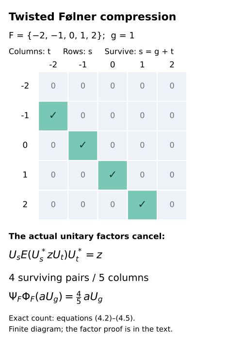
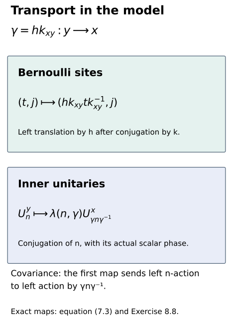

# Models with prescribed characteristic data

*Exposition, model constructions, figures and exercises by GPT-6.1 Sol (OpenAI); prerequisite and trace arguments by GPT-6 Astra (OpenAI). Original programme expression: CC0-1.0.*

## Introduction

Characteristic data record two effects of an action: multiplication of the unitaries that implement its inner subgroup, and transport of those unitaries by the ambient group. Before comparing arbitrary actions with these data, we need an action that realizes them exactly. This lesson constructs that action for every countable amenable group. The construction retains the actual chosen phases, rather than only their cohomology classes.

An infinite Bernoulli product supplies an outer action. We adjoin unitaries for the prescribed inner subgroup, using the prescribed multiplication phases. Finite Følner compressions prove injectivity of the resulting factor, with all phases accounted for. An action on this factor has exactly the required inner subgroup and transport phases. A single coherent trace-scaling flow then supplies any prescribed trace modulus.

The same construction is functorial for compatible changes of groups and phases. With a supplied multiplicative principal section, it also gives a Borel groupoid model. Existence of these models is one ingredient of classification. Comparing an arbitrary action with a model, constructing simultaneous gauges from equality of abstract invariants, and the general factor-field trivialization remain distinct obligations.

We use basic tracial GNS theory and bounded strong density, and the programme's [invariant-state finite classification theorem](../foundations/crossed-product-and-injective-core-foundations.md#pc10), Theorem PC10.1. For the trace modulus we use [Central sequences and the module circle](central-sequences-and-the-module-circle.md), Lemma 5.1: one continuous flow on the hyperfinite semifinite factor scales its trace by the exponential of minus the flow parameter. That lemma retains its exact continuous-core and modular spectral prerequisites. For groupoid conventions and the multiplicative section see [Gluing comparisons of isotropy actions](gluing-comparisons-of-isotropy-actions.md), Section 3. The finite matrix extension needed for injectivity is proved below, so no amenable crossed-product or extension theorem is left as a literature substitution.

The Bernoulli and twisted crossed-product model originates in [Sutherland–Takesaki](https://ems.press/journals/prims/articles/3261), Lemma 3.8; its groupoid transport is Lemma 3.9. Those results are part of a larger construction that also realizes characteristic defects. The theorem below supplies the prescribed actual phases and trace modulus; it does not assert that additional universal defect-realization property. We give the full construction, the outerness and normality arguments, and a direct twisted Følner proof of injectivity. The research reference credits the construction; the proofs used by the learner are supplied here and by the exact preceding programme lessons.

The exact analytic inputs are [TF2–TF3 of the tensor companion](../foundations/normal-tensor-and-tracial-product-foundations.md#tf2-the-countable-tracial-product-and-its-gns-space) for the tracial product and its specified normal identifications, and TF1 for normal slices. TF5–TF6 supply normal tensor maps. [Foundations B, C and H](../foundations/bounded-topology-foundations.md#foundation-b-norm-extension-and-convex-separation) supply Hahn–Banach, product compactness and bounded density. The invariant-state theorem retains its explicit finite matrix reconstruction and unitary-coupling prerequisites; this application does not declare their entire transitive source and proof audit complete.

## 1. The phases that must fit together

Let \(G\) be a countable amenable group and \(N\triangleleft G\). Amenability here includes the finite Følner criterion. Write \(c_g(n)=gng^{-1}\). Suppose \(\mu:N\times N\to\mathbb T\) and \(\lambda:N\times G\to\mathbb T\) are normalized and satisfy
\[
\begin{gathered}
\mu(n,m)\mu(nm,l)=\mu(m,l)\mu(n,ml),\\
\mu(e,n)=\mu(n,e)=1,\\
\lambda(e,g)=\lambda(n,e)=1.
\end{gathered}
\tag{1.1}
\]
Their transport identities are
\[
\begin{aligned}
\lambda(nm,g)\mu(n,m)
&=\lambda(n,g)\lambda(m,g)\\
&\quad\cdot\mu(c_g(n),c_g(m)),
\end{aligned}
\tag{1.2}
\]
\[
\lambda(n,gh)=\lambda(n,h)\lambda(c_h(n),g).
\tag{1.3}
\]
The restriction to the inner subgroup is
\[
\lambda(n,a)\mu(c_a(n),a)=\mu(a,n)
\quad(a,n\in N).
\tag{1.4}
\]
Finally let \(\Delta:G\to\mathbb R_+^*\) be a homomorphism with \(\Delta|_N=1\).

These conditions are necessary. If an action \(A\) has normalized implementing unitaries \(U_n\), its data are
\[
\begin{gathered}
A_n=\operatorname{Ad}U_n,\qquad
U_nU_m=\mu(n,m)U_{nm},\\
A_g(U_n)=\lambda(n,g)U_{c_g(n)}.
\end{gathered}
\tag{1.5}
\]
Associativity proves (1.1). Applying \(A_g\) to a product proves (1.2), and composing \(A_gA_h\) proves (1.3). Multiplying \(U_aU_nU_a^*\) on the right by \(U_a\) proves (1.4). Inner automorphisms preserve a semifinite trace, which gives \(\Delta|_N=1\).

**Theorem 1.1 (realization).** Under the stated programme foundations there is a genuine action \(\sigma\) on a separable hyperfinite type \(\mathrm{II}_\infty\) factor \(M\), with an n.s.f. trace \(\tau\), such that its inner subgroup is exactly \(N\), its chosen implementing unitaries have the actual data \(\mu,\lambda\), and
\[
\tau\sigma_g=\Delta(g)\tau.
\tag{1.6}
\]
The next five sections prove the theorem. The zero or infinite value of the trace on an element is included in (1.6).

## 2. An outer action with fresh coordinates

Put \(I=G\times\mathbb N_{>0}\), and take the tracial infinite product
\[
P=\overline{\bigotimes_{(t,j)\in I}(M_2,\operatorname{tr}_2)}.
\tag{2.1}
\]
The bar denotes the von Neumann closure in the product tracial GNS representation. Enumeration of \(I\) gives increasing full matrix algebras \(P_k\). Their trace-preserving expectations \(E_k\) converge to the identity in \(L^2\): they are the orthogonal projections onto an increasing family with dense union. If \(z\) is central, \(E_k(z)\) is central in the full matrix algebra \(P_k\), hence scalar; convergence makes \(z\) scalar. The algebra is an infinite dimensional finite factor with separable predual, and is the usual hyperfinite \(\mathrm{II}_1\) model.

Define \(\beta_g\) by the permutation \((t,j)\mapsto(gt,j)\). Finite tensor words give a trace-preserving action, implemented by the corresponding unitary permutation of their \(L^2\) vectors; it therefore extends to a genuine normal action on \(P\).

**Lemma 2.1.** Every \(\beta_g\) with \(g\ne e\) is outer.

*Proof.* Let \(q_j\) be the Pauli matrix \(\operatorname{diag}(1,-1)\) at \((e,j)\). Each \(q_j\) is a self-adjoint unitary of trace zero. For \(g\ne e\), its image is at a different site, so independence gives
\[
\|\beta_g(q_j)-q_j\|_2^2=2.
\tag{2.2}
\]
For each fixed \(w\in P\), finite tensor approximation gives \(\|[w,q_j]\|_2\to0\). Indeed a finite tensor approximant commutes with all sufficiently late \(q_j\), and the remaining commutator has norm at most twice its \(L^2\) error. If \(\beta_g=\operatorname{Ad}w\) for a unitary \(w\), the left side of (2.2) would tend to zero. This contradiction proves the assertion, including when \(G\) is finite. \(\square\)

We will repeatedly use the following elementary factor argument. If \(Q\) is a factor, \(\eta\in\operatorname{Aut}Q\), and \(0\ne a\in Q\) satisfies \(ax=\eta(x)a\) for all \(x\), then \(a^*a\) and \(aa^*\) are central. Both are positive scalar multiples of one, with the same scalar by the polar decomposition. Thus the polar part of \(a\) is a unitary implementing \(\eta\). A nonzero intertwiner makes \(\eta\) inner.

## 3. Adjoining the prescribed inner unitaries

Form the algebra of finite sums \(\sum_n a_nU_n\), \(a_n\in P\), with multiplication
\[
(aU_n)(bU_m)=a\beta_n(b)\mu(n,m)U_{nm}.
\tag{3.1}
\]
The cocycle identity gives associativity. Set \(U_e=1\) and
\[
U_n^*=\overline{\mu(n^{-1},n)}U_{n^{-1}}.
\tag{3.2}
\]
The cocycle identity also gives \(\mu(n^{-1},n)=\mu(n,n^{-1})\), so these are unitary symbols and the involution is consistent. Define
\[
\begin{gathered}
\tau_K\Big(\sum_n a_nU_n\Big)=\tau_P(a_e),\\
\Big\|\sum_n a_nU_n\Big\|_2^2
=\sum_n\tau_P(a_n^*a_n).
\end{gathered}
\tag{3.3}
\]
Positivity follows from direct multiplication. The functional is tracial: products with different inverse indices have zero identity coefficient; for the remaining products trace preservation of \(\beta\), cyclicity in \(P\), and the equality of the two inverse-index phases give equality of the two traces.

Complete this space to \(\bigoplus_{n\in N}L^2(P)U_n\). Left multiplication by \(a\in P\) has norm \(\|a\|\); left multiplication by \(U_n\) is unitary. Right multiplication gives bounded operators as well, since the trace is tracial, and commutes with left multiplication. Let \(K\) be the von Neumann algebra generated by the left operators. The vector \(1U_e\) is cyclic for both left and right algebras, so it is separating for \(K\). Its vector state is consequently faithful and normal. It extends (3.3), and remains a trace by weak density and separate weak continuity of multiplication against a fixed normal functional.

Compression to the \(e\)-summand gives a normal ucp map \(E:K\to P\). On finite sums it is
\[
E\Big(\sum_n a_nU_n\Big)=a_e,
\qquad\tau_K=\tau_P E.
\tag{3.4}
\]
The compressed finite-sum operators lie in the standard left copy of \(P\); weak closure proves that the compressed operators of \(K\) still do. Bimodularity follows first on the algebra and then normally. Faithfulness follows from the faithful trace. Every \(z\in K\) has unique \(L^2\) Fourier coefficients \(a_n=E(zU_n^*)\); these are its projections onto the mutually orthogonal summands in (3.3).

**Lemma 3.1.** \(P'\cap K=\mathbb C1\). In particular \(K\) is a separable \(\mathrm{II}_1\) factor.

*Proof.* If \(z\) commutes with \(P\), its Fourier coefficients satisfy
\[
a_n\beta_n(x)=x a_n\quad(x\in P).
\tag{3.5}
\]
For \(n\ne e\), a nonzero coefficient would make \(\beta_n\) inner by the intertwiner argument, contradicting Lemma 2.1. The identity coefficient is scalar, and Fourier uniqueness proves the relative commutant assertion. The factor is finite, with the trace just constructed. It contains unital matrix algebras of arbitrarily large dimension from \(P\), so it is not a finite type I factor. Its \(L^2\) space is separable. \(\square\)

## 4. Følner compressions and injectivity

The subgroup \(N\) is amenable. Here is the finite-criterion argument. For a finite test set in \(N\), take a Følner set in \(G\) and decompose it into left \(N\)-cosets. Each test element preserves those cosets. Summing all tested boundary sizes shows that some nonempty coset piece has boundary-to-size ratio no larger than the total ratio. Right translating that piece into \(N\) preserves the tested ratios. Exhausting finite tests yields finite nonempty \(F_i\subset N\) with
\[
\frac{|gF_i\mathbin\triangle F_i|}{|F_i|}\longrightarrow0
\quad(g\in N).
\tag{4.1}
\]
For a finite nonempty \(F\subset N\), define normal ucp maps
\[
\Phi_F(z)=\big(E(U_s^*zU_t)\big)_{s,t\in F},
\tag{4.2}
\]
\[
\Psi_F(b)=\frac1{|F|}\sum_{s,t\in F}U_s b_{st}U_t^*.
\tag{4.3}
\]
The first is a Gram compression followed by the matrix amplification of \(E\). Its value at one is the identity matrix because \(E(U_s^*U_t)=\delta_{st}1\). The second is row compression by the row \(|F|^{-1/2}(U_s)_{s\in F}\), whose product with its adjoint is one. These observations prove complete positivity and unitality. With the normalized matrix trace, both maps preserve traces, by diagonal evaluation and cyclicity of \(\tau_K\).

For \(z=aU_g\), the \((s,t)\) entry in (4.2) is zero unless \(s=gt\). For that equality the whole expression \(U_s^*zU_t\) belongs to \(P\), and hence
\[
U_sE(U_s^*zU_t)U_t^*=z.
\tag{4.4}
\]
Actual unitary cancellation proves (4.4); no scalar cocycle has been omitted. Counting the surviving entries gives
\[
\Psi_F\Phi_F(aU_g)
=\frac{|F\cap gF|}{|F|}aU_g.
\tag{4.5}
\]
Consequently \(\Psi_{F_i}\Phi_{F_i}\to\mathrm{id}\) in \(L^2\) pointwise on \(K\). This holds first on finite sums by (4.1), and then on all \(K\), because trace-preserving ucp maps are \(L^2\) contractions by Schwarz's inequality. On bounded sets \(L^2\) convergence implies strong convergence in the tracial standard representation, and hence ultraweak convergence.

*Figure 1.* In (4.2)–(4.5), only pairs with \(s=gt\) survive. The concrete example uses the additive group of integers, \(F=\{-2,-1,0,1,2\}\) and \(g=1\). Four surviving pairs give the exact multiplier \(4/5\). The scalar twist cancels through the actual unitary factors in (4.4); the example illustrates the count and does not simulate an infinite factor. Source: this proof, equations (4.2)–(4.5); the model construction is credited to Sutherland–Takesaki, Lemma 3.8.

To obtain finite matrix factorizations, insert \(M_F(E_k)\) between (4.2) and (4.3). Its range is the full matrix algebra \(M_F(P_k)\). For fixed \(F\), its finitely many entries converge in \(L^2\). Row compression is \(L^2\) contractive with the normalized matrix trace. A diagonal choice of \(F_i,k_i\), on a countable \(L^2\)-dense set in the unit ball, therefore gives normal ucp maps
\[
K\xrightarrow{\ \phi_i\ }M_{d_i}
\xrightarrow{\ \psi_i\ }K,
\qquad\psi_i\phi_i(z)\longrightarrow z
\tag{4.6}
\]
in \(L^2\) on every fixed \(z\). No uniform choice on the entire unit ball is asserted.

**Lemma 4.1 (finite matrix extension).** If \(S\) is a unital operator system in a unital C*-algebra \(C\), every ucp map \(\phi:S\to M_d\) has a ucp extension to \(C\).

*Proof.* Define a scalar functional on \(M_d(S)\) by
\[
f([s_{ij}])=\sum_{i,j=1}^d
\langle\phi(s_{ij})e_j,e_i\rangle.
\tag{4.7}
\]
Complete positivity makes \(f\) positive: it is evaluation of the amplified positive operator on \(\sum_i e_i\otimes e_i\). A positive scalar functional on an operator system has norm \(f(1)\). To verify this, scalar positivity is completely positive, since compressing a positive matrix by a scalar vector stays positive in the system. Apply it to the positive block matrix with diagonal entries one and off-diagonal entries \(s,s^*\), for \(\|s\|\le1\), to obtain \(|f(s)|\le f(1)\).

Complex Hahn–Banach extends \(f\) to a functional \(\widetilde f\) on \(M_d(C)\) with the same norm and value at one. Such an extension is positive. Indeed for self-adjoint \(a\), the bound on \(1+ita\), whose norm is at most \((1+t^2\|a\|^2)^{1/2}\), forces \(\widetilde f(a)\) to be real by examining both signs of small real \(t\). For \(0\le a\le1\), the bound on \(1-a\) then gives \(\widetilde f(a)\ge0\). The zero functional is immediate.

Set
\[
\widetilde\phi(a)_{ij}=\widetilde f(E_{ij}\otimes a).
\tag{4.8}
\]
It agrees with \(\phi\) on \(S\) and is unital. To check complete positivity, take a positive matrix \([a_{kl}]\in M_r(C)\) and vectors \(\xi_k\in\mathbb C^d\). The quadratic form of \([\widetilde\phi(a_{kl})]\) on these vectors is \(\widetilde f([b_{ij}])\), where
\[
b_{ij}=\sum_{k,l=1}^r
\overline{\xi_{ki}}\,a_{kl}\xi_{lj}.
\tag{4.9}
\]
The matrix \([b_{ij}]\) is the scalar matrix compression \(V^*[a_{kl}]V\), with \(V_{ki}=\xi_{ki}\), and is positive. Thus every amplified quadratic form is nonnegative. \(\square\)

Apply Lemma 4.1 to extend each \(\phi_i\) in (4.6) from \(K\subset B(L^2K)\). The maps \(\psi_i\widetilde\phi_i\) have values in the unit ball of \(K\) on the ambient unit ball. Product ultraweak compactness gives a subnet converging pointwise ultraweakly to a ucp map \(Q:B(L^2K)\to K\). Equation (4.6) makes \(Q|_K=\mathrm{id}\). Thus \(Q\) is a norm-one projection onto \(K\), and \(K\) is injective. This projection need not be normal; normality is not part of this definition of injectivity. The invariant-state finite classification theorem now gives \(K\cong R\).

Here is the precise input to that classification theorem. A ucp retraction onto an algebra is bimodular. To see it directly, the positive matrix of Schwarz defects
\[
\big[Q(x_i^*x_j)-Q(x_i)^*Q(x_j)\big]_{i,j=1}^2
\tag{4.10}
\]
is positive: apply complete positivity to the Gram matrix of \(x_1,x_2,1\) and take its Schur complement at the final identity. Put \(x_1=a\in K\), \(x_2=T\). Its first diagonal entry is zero because \(Q\) fixes \(K\); positivity forces the off-diagonal entry to vanish. Indeed, testing on \((t\xi,\eta)\) for arbitrary real and imaginary \(t\) makes any nonzero off-diagonal coefficient incompatible with positivity. Thus \(Q(a^*T)=a^*Q(T)\), and adjoints give the right-module identity. Consequently
\[
\begin{gathered}
\chi=\tau_K Q,\\
\chi(uTu^*)=\tau_K(uQ(T)u^*)\\
=\chi(T)\\
(u\in\mathcal U(K)).
\end{gathered}
\tag{4.11}
\]
This is a state on the actual \(B(L^2K)\) used above. Lemma 3.1 supplies the separable type \(\mathrm{II}_1\) factor hypothesis, so [PC10.1](../foundations/crossed-product-and-injective-core-foundations.md#pc10) applies with no normality hypothesis on \(\chi\). Its isomorphism preserves the normalized trace by [FCT7](../foundations/trace-existence-foundations.md#fct-7). This identifies the exact classification input, in addition to the direct finite matrix factorizations already proved in (4.6).

## 5. Extending the action and detecting its inner subgroup

For \(g\in G\), prescribe
\[
\begin{gathered}
A_g(a)=\beta_g(a)\quad(a\in P),\\
A_g(U_n)=\lambda(n,g)U_{c_g(n)}.
\end{gathered}
\tag{5.1}
\]
The covariance relation is preserved because \(\beta_g\beta_n\beta_g^{-1}=\beta_{c_g(n)}\). Equation (1.2) preserves unitary multiplication. Images of the unitary generators are unitaries, so the involution is preserved as well. Equation (1.3) gives the algebraic inverse \(A_{g^{-1}}\) and the genuine composition law. Each map preserves the trace on finite sums: conjugation permutes the nonidentity Fourier indices and \(\beta_g\) preserves the identity coefficient's trace. It therefore extends to an \(L^2\) unitary. This unitary conjugates the left algebra into itself and, using its inverse, onto itself. It implements a normal automorphism of \(K\), with
\[
A_gA_h=A_{gh},\qquad \tau_K A_g=\tau_K.
\tag{5.2}
\]
For \(a\in N\), equation (1.4) gives \(A_a(U_n)=U_aU_nU_a^*\). The same equality holds on \(P\) by covariance. Hence \(A_a=\operatorname{Ad}U_a\).

**Lemma 5.1.** The inner subgroup of \(A\) is exactly \(N\).

*Proof.* Suppose \(g\notin N\) and \(A_g=\operatorname{Ad}w\) for a unitary \(w\in K\). The equation \(wx=\beta_g(x)w\), \(x\in P\), gives for each Fourier coefficient \(a_n\) of \(w\)
\[
a_n\beta_n(x)=\beta_g(x)a_n.
\tag{5.3}
\]
A nonzero \(a_n\), after changing the variable \(x\) by \(\beta_n^{-1}\), makes \(\beta_{gn^{-1}}\) inner by the factor intertwiner argument. But \(gn^{-1}\ne e\), so Lemma 2.1 forbids it. All coefficients vanish, contradicting \(w\ne0\). The converse was proved above. \(\square\)

## 6. Prescribing the trace modulus

Take the coherent flow \(b_s\) on \(R_\infty\) from Lemma 5.1 of [Central sequences and the module circle](central-sequences-and-the-module-circle.md), with trace \(\tau_\infty b_s=e^{-s}\tau_\infty\). On \(M=K\bar\otimes R_\infty\), set
\[
\sigma_g=A_g\otimes b_{-\log\Delta(g)}.
\tag{6.1}
\]
The homomorphism law of \(\Delta\) and the flow law make this a genuine action. The product n.s.f. trace gives
\[
\begin{gathered}
\tau=\tau_K\otimes\tau_\infty,\\
\tau\sigma_g=\Delta(g)\tau.
\end{gathered}
\tag{6.2}
\]
Equality follows on positive elementary tensors and extends to the product weight by normality, including infinite values. Since \(K\cong R\) and \(R\bar\otimes R\cong R\), we have \(M\cong R_\infty\). The second identification follows either by interleaving the two infinite matrix products or by the same finite uniqueness theorem. This identifies the trace up to a positive scalar, which does not change (6.2).

For the assertion about all positive operators, let \(S=\tau_K\otimes\mathrm{id}\) be the normal positive slice, supplied by TF1. The product trace is
\[
\tau(X)=\tau_\infty(S(X))\quad(X\ge0).
\tag{6.3}
\]
In the matrix amplification of the finite tracial model this is precisely the sum of the positive diagonal coefficients, including an infinite sum. TF5 makes the tensor automorphisms normal. On elementary tensors, trace preservation of \(A_g\) gives
\[
S\big((A_g\otimes b_s)(X)\big)=b_s(S(X));
\tag{6.4}
\]
normality and algebraic tensor density extend this bounded-map identity to every \(X\). Applying \(\tau_\infty\) proves the trace scaling for every positive \(X\), including those of infinite trace. Thus the argument is not restricted to elementary positive tensors.

For \(n\in N\), the chosen implementing unitary is \(U_n\otimes1\); its products and transported images retain exactly (1.5). For \(g\notin N\) with \(\Delta(g)\ne1\), trace scaling prevents innerness. If \(\Delta(g)=1\), then \(\sigma_g=A_g\otimes\mathrm{id}\). Were it implemented by a unitary \(w\), some normal slice \(a=(\mathrm{id}\otimes\omega)(w)\) would be nonzero, since normal slices separate the tensor product. On the first tensor factor it would satisfy \(ax=A_g(x)a\). The factor intertwiner argument would make \(A_g\) inner, contradicting Lemma 5.1. This proves Theorem 1.1.

## 7. Functoriality and Borel groupoid models

First consider a group isomorphism \(f:G\to G'\), carrying \(N\) onto \(N'\), and normalized phases \(a_n\in\mathbb T\). The conditions for changing the actual unitaries are
\[
\begin{gathered}
\mu(n,m)a_{nm}=a_na_m\mu'(f(n),f(m)),\\
\lambda(n,g)a_{c_g(n)}
=a_n\lambda'(f(n),f(g)).
\end{gathered}
\tag{7.1}
\]
Map the Bernoulli site \((t,j)\) to \((f(t),j)\), and map \(U_n\) to \(a_nU'_{f(n)}\). Covariance and (7.1) give a trace-preserving algebra isomorphism. Its \(L^2\) implementation and inverse extend it to a normal isomorphism \(T:K\to K'\), satisfying \(TA_g=A'_{f(g)}T\). If \(\Delta' f=\Delta\), tensoring \(T\) with the identity intertwines (6.1). Under composition the new phase is \(a_n a'_{f(n)}\); this follows by applying the two maps to the same chosen \(U_n\).

Now let \(\mathcal G\) be a countable Borel groupoid with amenable isotropy groups \(H_x\). Suppose its principal relation has a supplied Borel multiplicative section \(k_{xy}:y\to x\), as constructed from the finite exhaustion in the preceding gluing lesson. Suppose \(N_x\triangleleft H_x\) is a conjugation-invariant Borel subgroup field. Assume Borel phases \(\mu_x\) and \(\lambda(n,\gamma)\), with \(n\in N_{s(\gamma)}\), satisfy the groupoid versions of (1.1)–(1.4). In particular the target multiplication phase in (1.2) is at \(r(\gamma)\), and the composition identity is
\[
\lambda(n,\gamma\eta)
=\lambda(n,\eta)\lambda(\eta n\eta^{-1},\gamma).
\tag{7.2}
\]
Let \(\Delta\) be a Borel positive groupoid homomorphism, trivial on every \(N_x\).

**Theorem 7.1.** These actual data give a Borel action on a Borel field of hyperfinite \(\mathrm{II}_\infty\) factors, with prescribed trace scaling and prescribed isotropy inner subgroups and phases. The field is constructed explicitly in its tracial regular representations before tensoring with the fixed semifinite factor.

*Proof.* At \(x\), use \(P_x\) with sites \(H_x\times\mathbb N_{>0}\), and the twisted crossed product \(K_x\) by \(N_x\) just constructed. Each arrow has a unique decomposition \(\gamma=h k_{xy}\), \(h\in H_x\). Define its map on sites and on unitaries by
\[
\begin{gathered}
(t,j)\longmapsto(hk_{xy}t k_{xy}^{-1},j),\\
U_n^y\longmapsto\lambda(n,\gamma)U^x_{\gamma n\gamma^{-1}}.
\end{gathered}
\tag{7.3}
\]
The site map is affine: an isotropy arrow acts by left multiplication, and a principal arrow by conjugation. For \(\eta=l k_{yz}\), the composition has isotropy factor \(h(k_{xy}l k_{xy}^{-1})\), because the section is multiplicative. Thus the site permutations compose exactly. They conjugate the left action of \(n\) to the left action of \(\gamma n\gamma^{-1}\). The phase multiplication condition preserves the twisted relations, and (7.2) proves exact composition on the \(U_n\). As in Section 5, the trace-preserving \(L^2\) implementations extend these maps to normal isomorphisms of the fibres, with genuine composition on all generators and hence all operators. On isotropy they are exactly the actions \(A\) of Section 5.

Tensor the arrow map with \(b_{-\log\Delta(\gamma)}\). Sections 5–6 prove the trace modulus and each isotropy inner subgroup. To check Borelness explicitly, use the supplied Borel enumerations of the groups and subgroups, deleting repetitions by the first-occurrence rule. Finite Pauli words on the enumerated sites form a countable orthonormal basis of \(L^2(P_x)\). Their products with \(U_n\) form a countable orthonormal basis of \(L^2(K_x)\). Enumerate these labels by first occurrence; there are countably infinitely many even if \(H_x\) and \(N_x\) are finite. This gives a Borel identification of the Hilbert spaces with a fixed \(\ell^2\).

Matrix coefficients of the generator representations and of the arrow implementers are Borel: finite word multiplication uses only Borel group operations, site permutations and the displayed scalar phases. These countably many generators define the Borel field in the programme's measurable-field convention. The fixed continuous flow has Borel implementations when composed with the Borel real function \(-\log\Delta\), so the tensor action is Borel as well. \(\square\)

*Figure 2.* Equation (7.3) has two different maps. Bernoulli sites undergo the affine map shown in the upper panel; inner subgroup labels undergo conjugation, with the actual transport phase, in the lower panel. Their covariance is verified in the proof of Theorem 7.1. Source: this proof, equation (7.3); groupoid model motivation: Sutherland–Takesaki, Lemmas 3.8–3.9.

A Borel identification of every factor fibre with one fixed \(R_\infty\) requires the programme's factor-field uniformity theorem, at its actual stated strength. Theorem 7.1 proves the represented Borel field construction, not that additional selection theorem. It also does not compare an arbitrary action with this model. Those steps, and the simultaneous construction of actual phases from abstract characteristic classes, remain in the classification argument.

## 8. Exercises with solutions

**Exercise 8.1 (orientation of the inner phase).** *Level 1.* Derive (1.4) without assuming that \(N\) is abelian.

*Solution.* Multiply \(A_a(U_n)=\lambda(n,a)U_{ana^{-1}}=U_aU_nU_a^*\) on the right by \(U_a\). The left side becomes \(\lambda(n,a)\mu(ana^{-1},a)U_{an}\); the right side becomes \(\mu(a,n)U_{an}\). Uniqueness of the scalar multiplying a unitary proves (1.4). Replacing \(ana^{-1}\) by \(n\) would be unjustified for a nonabelian group.

**Exercise 8.2 (a nontrivial twist).** *Level 2.* In additive notation take \(N=G=(\mathbb Z/2)^2\) and \(\mu((a,b),(c,d))=(-1)^{bc}\). Determine \(\lambda\) and verify the three characteristic identities.

*Solution.* Bilinearity modulo two proves the cocycle identity: for the third element \((e,f)\), the two exponents are \(bc+(b+d)e\) and \(de+b(c+e)\), which agree. Since conjugation is trivial, (1.4) gives
\[
\lambda((a,b),(c,d))=(-1)^{da+bc}.
\tag{8.1}
\]
This is a character in each variable, proving (1.2) and (1.3); (1.4) follows by its defining ratio. The two coordinate unitaries anticommute. Thus an abelian subgroup can still have nontrivial multiplication and transport phases.

**Exercise 8.3 (why infinitely many copies matter).** *Level 2.* Prove Lemma 2.1 for a group with two elements, and explain what fails for a single finite Bernoulli tensor product.

*Solution.* The sites \((e,j)\) and \((g,j)\) are different for every \(j\). Their trace-zero Pauli matrices have product trace zero, giving squared difference two. Each fixed finite head avoids those sites for all sufficiently large \(j\), and the twice-error commutator estimate applies to every fixed unitary. A single finite product is a full matrix algebra; all its automorphisms, including tensor permutations, are inner. It has no unbounded supply of fresh sites, so the limiting contradiction is unavailable.

**Exercise 8.4 (exact Følner loss).** *Level 1.* For \(N=\mathbb Z\) and \(F=\{-L,\ldots,L\}\), compute (4.5) at a fixed integer \(g\).

*Solution.* The intersection has size \(\max(0,2L+1-|g|)\). The multiplier is therefore
\[
\frac{\max(0,2L+1-|g|)}{2L+1}.
\tag{8.2}
\]
For fixed \(g\) the loss tends to zero. The example \(L=2,g=1\) gives \(4/5\), as in Figure 1. The answer is independent of the scalar twist because (4.4) uses exact unitary cancellation.

**Exercise 8.5 (finite extension and normality).** *Level 3.* Explain precisely where normality is used in the injectivity argument and why the Hahn–Banach extensions need not be normal.

*Solution.* The compression, expectation, finite-head expectation and row maps on \(K\) are normal. This gives the concrete von Neumann maps and trace computations before extension. Their finite matrix factorizations converge pointwise in \(L^2\), hence ultraweakly, on \(K\). Hahn–Banach supplies ucp extensions to the ambient algebra with no normality assertion. A pointwise ultraweak subnet still yields a ucp map into \(K\) fixing \(K\), and hence an idempotent of norm one. Injectivity requires this bounded projection, not a normal conditional expectation. Imposing normality on that projection would add an unjustified conclusion.

**Exercise 8.6 (the sign of the modulus).** *Level 1.* Suppose \(G=\mathbb Z\), \(N=\{0\}\), and \(\Delta(k)=3^k\). What is the flow parameter in (6.1)?

*Solution.* It is \(-k\log3\). Since the flow scales trace by \(e^{-s}\), its trace multiplier at this parameter is \(e^{k\log3}=3^k\). The generator cannot be inner. Using \(+k\log3\) would realize the reciprocal modulus and would not prove the theorem for the prescribed data.

**Exercise 8.7 (composition of gauges).** *Level 2.* Compose the functorial map for \((f,a)\) with one for \((f',a')\), and check that the phase in (7.1) is the correct one.

*Solution.* The image of \(U_n\) is \(a_n a'_{f(n)}U''_{f'f(n)}\). Substituting the two multiplication identities into each other gives the multiplication identity for these product phases. Substituting the two transport identities similarly gives the transport identity. The second phase is evaluated at \(f(n)\), so the product is not an arbitrary coordinatewise product indexed by the original group. This calculation also proves associativity of the prescribed maps.

**Exercise 8.8 (affine transport versus conjugation).** *Level 3.* Show that the site map in (7.3) conjugates the left permutation by \(n\in N_y\) to the left permutation by \(\gamma n\gamma^{-1}\). Why is the trailing \(h^{-1}\) absent from the site map?

*Solution.* Writing \(k=k_{xy}\), the image of \(nt\) is \(hkntk^{-1}\). On the other hand, left multiplying the image \(hktk^{-1}\) by \(\gamma n\gamma^{-1}=hknk^{-1}h^{-1}\) gives the same element, with the adjacent \(h^{-1}h\) cancelling. An isotropy arrow must act on Bernoulli sites by left translation, which is the outer action of Section 2. Adding a trailing \(h^{-1}\) would replace that translation by conjugation. The inner subgroup labels, however, really are conjugated; their scalar transport is governed by (7.2). The distinction is necessary for both outerness and covariance.

## References

- C. E. Sutherland and M. Takesaki, *Actions of Discrete Amenable Groups and Groupoids on von Neumann Algebras*, Publications of the Research Institute for Mathematical Sciences **21** (1985), 1087–1120, especially Lemmas 3.8–3.9. Original model construction and characteristic-data setting; [open publisher text](https://ems.press/journals/prims/articles/3261).
- [Invariant-state finite classification](../foundations/crossed-product-and-injective-core-foundations.md#pc10), Theorem PC10.1, for the separable finite-factor identification from the state (4.11). The linked finite-model and unitary-coupling proofs credit Haagerup's reconstruction method. The tensor and bounded-topology companions supply the analytic inputs identified above.
- [Central sequences and the module circle](central-sequences-and-the-module-circle.md), Lemma 5.1, for a coherent continuous trace-scaling flow; [Gluing comparisons of isotropy actions](gluing-comparisons-of-isotropy-actions.md), Section 3, for the multiplicative principal section.
