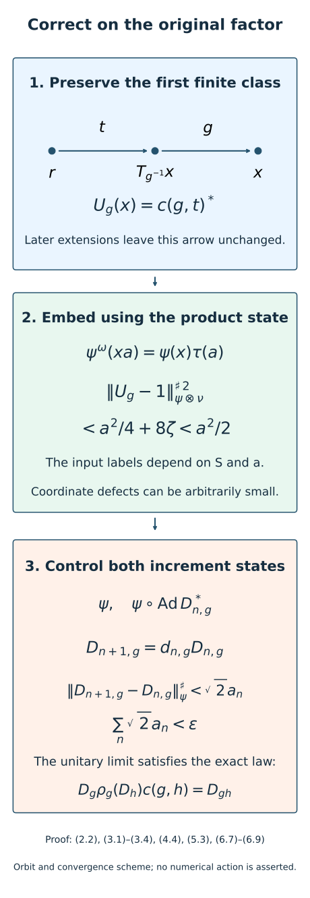

# Near-identity two-cocycle correction on the original factor

*Exposition, constructions, figures and exercises by GPT-6.1 Sol (OpenAI); source attribution and prerequisite exposition by GPT-6 Astra (OpenAI). Original programme expression: CC0-1.0.*

## Introduction

An exact equation in an ultrapower need not hold at any coordinate. The approximate comparison already constructed in this course therefore still needs a correction on the original factor. We supply that correction, including a finite near-identity estimate.

The key is to keep two kinds of accuracy separate. A first finite orbit relation determines how small the correcting unitary is. Extending its multiplicative section to the whole orbit relation preserves every old arrow. The resulting exact equation in a tensor algebra can then be lifted with arbitrarily small finite coordinate defects without changing the original near-identity bound. This separation makes a convergent induction possible.

The induction keeps the original coefficient coordinates and uses both a fixed state and its transport by the cumulative unitary. Its limit consists of actual unitaries in the original factor. We then apply the result to lift an ultrapower cocycle to genuine coordinate cocycles, providing genuine inputs for the subsequent comparison construction. Global conjugacy, nontrivial inner-subgroup phases and Borel initial selection require their respective additional arguments.

The convergence mechanism in Sections 5–6 is classical: Ocneanu’s thesis, Theorem 7.6 and Sections 7.7–7.8, controls both fixed and transported states when multiplying successive corrections. The finite-root tensor construction in Sections 2–4 supplies the coordinate corrections here. The final two-stage comparison follows the strategy of Masuda, Proposition 3.2. These attributions concern the mathematical constructions as well as the statements.

## 1. Exact setting and providers

Let \(M\) be a finite factor or a countably decomposable infinite semifinite factor with separable predual. Fix a faithful normal state \(\varphi\) and a free ultrafilter \(\omega\). Retain the Ocneanu normalizer/null-ideal, faithful normal ultrapower state, canonical centralizer trace and lifting foundations stated in [Central towers and unitary cocycles](central-towers-and-unitary-cocycles.md), Section 1, and [Controlled amenable cohomology and finite inner comparisons](controlled-amenable-cohomology-and-finite-inner-comparisons.md), Sections 1–2. The latter's Lemma 2.1 supplies exact unitary representatives for every unitary of \(M^\omega\). We use bounded strong-star completeness, normal representations, spatial tensor products and bounded strong density with their recorded programme scope.

Let \(G\) be countable amenable. A normalized exact unitary cocycle action \((\rho,c)\) on \(M\) means

\[
\begin{gathered}
\rho_g\rho_h=\operatorname{Ad}c(g,h)\,\rho_{gh},\\
\rho_g(c(h,k))c(g,hk)\\
=c(g,h)c(gh,k),\\
\rho_e=\mathrm{id},\quad c(e,g)=c(g,e)=1.
\end{gathered}
\tag{1.1}
\]

The second line is an equality of actual unitaries, including their scalar phases. Inner automorphisms of \(M\) act identically on \(F=M_\omega\), because \(F\) commutes with the constant copy of \(M\). Consequently the maps induced by \(\rho_g\) form a genuine trace-preserving action \(\gamma\) on \(F\). Assume \(\gamma_g\) is nontrivial for every \(g\ne e\).

[Gaussian models and amenable towers](gaussian-models-and-amenable-towers.md), Theorem 1.1, supplies a \(\gamma\)-invariant abelian algebra \(A\subset F\), normally identified with \(L^\infty(X,\nu)\), carrying a free probability-preserving action \(T\). Its statement permits the chosen lifts \(\rho_g\) to fail the action law on \(M\). [Invariant means on measured relations](../../OA-ERGODIC/reader/invariant-means-on-measured-relations.html#6-increasing-finite-relations), OA-ERGODIC, Corollary 6.2, supplies an increasing finite Borel exhaustion of this principal orbit relation on an invariant conull set. Its hypotheses are met by countability, amenability and the standard probability model; ergodicity is unnecessary. The root selectors exist by that owner's finite-class selector provider. Keep all those explicit prerequisites.

Fix this algebra, its probability model and its exhaustion once for the induced action \(\gamma\). Every subsequent inner perturbation of the \(\rho_g\) induces the same \(\gamma\), so the same choices remain available. No coordinate cochain is declared genuine merely because its quotient class is genuine.

For a normal state \(\psi\), use the unnormalized sharp seminorm

\[
\|x\|_\psi^{\sharp\,2}
=\psi(x^*x)+\psi(xx^*).
\tag{1.2}
\]

Its squared value on a difference of unitaries is at most 8. On bounded sets the faithful \(\varphi\)-sharp seminorm tests strong-star convergence.

## 2. The constant factor and a central probability algebra form a tensor product

**Lemma 2.1.** Multiplication gives a unital normal faithful isomorphism

\[
\begin{aligned}
J:M\overline\otimes A&\longrightarrow W^*(M,A)\subset M^\omega,\\
J(x\otimes a)&=xa.
\end{aligned}
\tag{2.1}
\]

For every normal state \(\psi\) on \(M\), its induced ultrapower functional restricts under \(J\) to \(\psi\otimes\tau|_A\).

*Proof.* The two algebras commute. If \((a_k)\) represents \(a\in A\), the scalar ultraweak limit in [Independent copies of orbit algebras](independent-copies-of-orbit-algebras.md), Section 2, is \(a_k\to\tau(a)1\) along \(\omega\). Applying the fixed normal functional \(y\mapsto\psi(xy)\) gives

\[
\psi^\omega(xa)=\psi(x)\tau(a)
\quad(x\in M,\ a\in A).
\tag{2.2}
\]

Use the faithful normal state \(\Phi=\varphi^\omega\) on \(M^\omega\), with GNS vector \(\xi\). Let \(K\) be the closure of the span of \(xa\xi\). In (2.3) use the convention that the inner product is linear in its second variable. The [tensor companion](../foundations/normal-tensor-and-tracial-product-foundations.md#tf0-the-hilbert-tensor-operations-used-below) supplies faithful normal GNS representations and spatial products. For finite sums, commutation and (2.2) give

\[
\langle x a\xi,y b\xi\rangle
=\varphi(x^*y)\tau(a^*b).
\tag{2.3}
\]

Thus the map from the algebraic product of the two GNS spaces onto this span is isometric and has dense range in \(K\). The subspace \(K\) reduces both commuting algebras, since it is invariant under them and their adjoints. Under the isometry their restrictions are the faithful normal tensor representations of \(M\) and \(A\).

Restriction of \(P=W^*(M,A)\) to \(K\) is normal and faithful. For faithfulness, an element whose restriction is zero kills \(\xi\), and then \(\Phi(p^*p)=0\); faithfulness of \(\Phi\) gives \(p=0\). A faithful normal representation of a von Neumann algebra identifies it normally with its von Neumann image. That image is generated by the two tensor representations, hence is the spatial tensor algebra. This proves (2.1). Finally both sides of the asserted state identity are normal and agree on the algebraic tensor product by (2.2). Bounded strong density extends the equality to the whole tensor algebra. □

This argument uses a product state rather than a trace on \(M^\omega\). The state on the whole ultrapower generally is not tracial. The automorphism induced by \(\rho_g\) on this tensor image corresponds to \(\rho_g\otimes\eta_g\), where \(\eta_g f=f\circ T_{g^{-1}}\), because it has these values on the two generating algebras.

## 3. Preserve one finite correction while extending to every orbit arrow

Write \(E=\bigcup_r E_r\) for the supplied increasing finite orbit relations. Work on their common invariant conull space where the action is free. For \((x,y)\in E\), let \(\kappa(x,y)\) be the unique group element with \(x=T_{\kappa(x,y)}y\). This label is Borel: each of its level sets is the graph of one of the countably many Borel action maps.

Set \(B_{xy}=\rho_{\kappa(x,y)}\) and \(c_{xyz}=c(\kappa(x,y),\kappa(y,z))\). Equation (1.1) makes these an exact cocycle action on the principal relation. The associative unitary extension and compatible-root construction in [Unitary two-cocycles and approximate action comparison](unitary-two-cocycles-and-approximate-action-comparison.md), Sections 2–3, apply to these original-factor coefficient algebras; that theorem does not restrict its coefficient algebras to finite ones.

Choose any starting stage \(E_r\), with Borel root \(r(x)\). Its initial multiplicative section has coefficient

\[
\begin{gathered}
u^{(r)}_{xy}=c\bigl(\kappa(x,y),\kappa(y,r(x))\bigr)^*,\\
(x,y)\in E_r.
\end{gathered}
\tag{3.1}
\]

When two finite classes merge, let \(R\) be the new root and \(r_x\) the old root. The exact extension has

\[
\begin{aligned}
t_x&=u_{x r_x}\,c_{x r_x R},\\
u'_{xy}&=t_x c_{xyR}^* B_{xy}(t_y^*).
\end{aligned}
\tag{3.2}
\]

To see preservation directly, the old section \(S\) satisfies \(S_{xy}S_{y r_x}=S_{x r_x}\) on an old class. Hence \(S_{xy}L_y=L_x\), where \(L_x=S_{x r_x}(1,r_x,R)\). The new section \(L_xL_y^{-1}\) therefore equals \(S_{xy}\) on every old arrow. Associativity uses the actual second identity of (1.1); it cannot be inferred from equality modulo scalar phases.

Each arrow acquires its final value at a finite stage. Every composable pair and its product occur in one common later stage, which proves the exact equation for all final values. Starting from \(E_r\) instead of the diagonal omits only finitely many stages and still exhausts \(E\). Define the bounded Borel unitary field

\[
U_g(x)=u_{x,T_{g^{-1}}x}.
\tag{3.3}
\]

The simple-field strong-density argument of that lesson's Section 4 places this field in \(M\overline\otimes L^\infty(X)\). It applies to a separable-predual \(M\) in a faithful normal separable representation, with no finiteness assumption on \(M\). The inverse pullback and the final section law give

\[
\begin{aligned}
U_g(\rho_g\otimes\eta_g)(U_h)
 (c(g,h)\otimes1)&=U_{gh},\\
U_e&=1.
\end{aligned}
\tag{3.4}
\]

In particular, on every arrow already in \(E_r\), formula (3.1) continues to be the final value of (3.3). Later root choices never alter it. Lemma 2.1 transfers (3.4) to an exact unitary equation in \(M^\omega\).

## 4. Finite near-identity inputs independent of coordinate defect precision

Fix a finite set \(S\subset G\) and \(a>0\). There is a finite set \(L=L(S,a)\subset G\), chosen from the fixed probability model and independent of the cocycle coefficients and normal states, with the following property. For any finite family \(\Omega\) of normal states, if

\[
\begin{gathered}
\|c(g,t)-1\|_\psi^\sharp<a/2,\\
g\in S,\quad t\in L,\quad\psi\in\Omega,
\end{gathered}
\tag{4.1}
\]

the exact corrections \(U_g\) of (3.4) can be chosen so that

\[
\|U_g-1\|_{\psi\otimes\nu}^{\sharp\,2}<a^2/2
\quad(g\in S,\ \psi\in\Omega).
\tag{4.2}
\]

*Proof.* Choose \(0<\zeta<\min(1,a^2/32)\). Increasing exhaustion makes the measure of the set where \((x,T_{g^{-1}}x)\notin E_r\) tend to zero for each \(g\in S\). Choose one \(r\) so all these exceptional measures are less than \(\zeta/2\). On the good part, put

\[
t_g(x)=\kappa(T_{g^{-1}}x,r(x)).
\tag{4.3}
\]

This is a measurable map into a countable set. Its mass outside an increasing finite label set tends to zero. Choose one finite \(L\) so that, for every \(g\in S\), the set where the arrow is not in \(E_r\) or its root label is not in \(L\) has measure less than \(\zeta\). Include \(e\) if needed. All these choices depend on \(S,a\) and the fixed orbit model alone.

On the remaining set \(Q_g\), the preserved value is \(U_g(x)=c(g,t_g(x))^*\). Adjoining an adjoint does not change the sharp seminorm. Split \(Q_g\) into its finitely many label sets \(Q_{g,t}=Q_g\cap\{t_g=t\}\) and write \(b_{g,t,\psi}=\|c(g,t)-1\|_\psi^{\sharp\,2}\). Apply the product-state formula. On the complement the squared sharp seminorm is at most 8. Therefore

\[
\begin{aligned}
\|U_g-1\|_{\psi\otimes\nu}^{\sharp\,2}
&\le \sum_{t\in L}\nu(Q_{g,t})b_{g,t,\psi}\\
&\quad+8\nu(X\setminus Q_g)\\
&<a^2/4+8\zeta<a^2/2.
\end{aligned}
\tag{4.4}
\]

This holds simultaneously for every state in \(\Omega\), with the same label set and the same \(U\). The case \(S=\varnothing\) requires no near-identity inputs: use any initial finite stage. □

The coefficient test involves \(c(g,t)\) with the source-to-root label in (4.3), not its inverse. No assertion bounds \(c(g,h)\) uniformly for all \(h\). The exact tensor correction is what allows a fixed finite near-identity input to accompany arbitrarily accurate finite coordinate defects.

## 5. Select one coordinate, including the future transported states

For a normalized original-factor unitary family \(d_g\), define its perturbation by

\[
\begin{aligned}
\rho'_g&=\operatorname{Ad}d_g\,\rho_g,\\
c'(g,h)&=d_g\rho_g(d_h)c(g,h)d_{gh}^*.
\end{aligned}
\tag{5.1}
\]

Direct ordered multiplication using (1.1) proves both exact cocycle-action identities for \((\rho',c')\). It still induces the same \(\gamma\) on \(F\), since each \(d_g\) belongs to the original factor.

**Lemma 5.1 (one-coordinate correction).** Under (4.1), for any finite pair set \(P\subset G^2\), finite label set \(H\subset G\), finite normal-state family \(\Lambda\), and \(b>0\), there is a normalized original-factor family \(d_g\in\mathcal U(M)\), defined for every \(g\in G\), such that

\[
\begin{gathered}
\|d_g-1\|_\psi^\sharp<a,\\
g\in S,\quad\psi\in\Omega
\end{gathered}
\tag{5.2}
\]

and, for every \((g,h)\in P\), \(\lambda\in\Lambda\), and \(l\in H\),

\[
\begin{aligned}
\|c'(g,h)-1\|_\lambda^\sharp&<b,\\
\|c'(g,h)-1\|_{\lambda\circ\operatorname{Ad}d_l^*}^\sharp&<b.
\end{aligned}
\tag{5.3}
\]

The finite input set \(L(S,a)\) is independent of \(P,H,\Lambda,b\).

*Proof.* Transfer \(U\) through \(J\) and lift each \(J(U_g)\) to exact unitary normalizer representatives \(d_{g,k}\), with \(d_{e,k}=1\). Use one coordinate for the entire group family. Equation (3.4) says that

\[
\begin{aligned}
c'_k(g,h)-1
&=d_{g,k}\rho_g(d_{h,k})c(g,h)\\
&\quad\cdot d_{gh,k}^*-1
\end{aligned}
\tag{5.4}
\]

is strong-star-null along \(\omega\) for every fixed pair. It also represents zero after conjugation by the normalizer sequence \(d_{l,k}^*\). Hence its sharp seminorm tends to zero both for \(\lambda\) and for the moving state \(\lambda\circ\operatorname{Ad}d_{l,k}^*\). This last statement is a quotient multiplication argument with specified normalizers, not an unjustified uniformity claim for arbitrary moving states.

Equation (4.2) and Lemma 2.1 give a strict margin below \(a\) for the ultra-limit of each near-identity seminorm in (5.2). The finitely many requirements (5.2)–(5.3) thus hold on a common \(\omega\)-large set of coordinates. Choose one of them. All group values are taken at that coordinate, even the untested values. They are exact unitaries and normalized. Formula (5.1) is an exact cocycle action on \(M\), though its coefficient need not yet be one. □

This is the precise place where output defect precision is free to increase without changing the near-identity input labels. The moving-state tests in (5.3) will enforce the next step's input after its cumulative unitaries have actually been chosen.

## 6. A convergent original-factor strictification

**Theorem 6.1.** Every cocycle action (1.1) satisfying Section 1's centralizer-freeness and exact foundations admits a normalized family \(D_g\in\mathcal U(M)\) with

\[
D_g\rho_g(D_h)c(g,h)=D_{gh}
\quad(g,h\in G).
\tag{6.1}
\]

Moreover, fix finite \(S_0\subset G\) containing \(e\), finite normal-state family \(\Sigma\) containing the faithful state \(\varphi\), and \(\varepsilon>0\). There is a finite \(L_0\), depending on \(S_0,\varepsilon\) and the fixed induced orbit model, such that the finite inputs

\[
\begin{gathered}
\|c(g,t)-1\|_\psi^\sharp<a_0/2,\\
g\in S_0,\quad t\in L_0,\quad\psi\in\Sigma
\end{gathered}
\tag{6.2}
\]

give a solution with \(\|D_g-1\|_\psi^\sharp<\varepsilon\) for \(g\in S_0\), \(\psi\in\Sigma\). Here put \(q=\min(1,\varepsilon)\) and \(a_n=q2^{-n-3}\), so \(a_0=q/8\) and \(L_0=L(S_0,a_0)\).

*Proof of the estimate and construction.* Choose increasing finite \(S_n\) which exhaust \(G\). A requested finite set not containing \(e\) may first be enlarged by that identity, whose coefficient inputs are automatically zero. For each \(n\) choose \(L_n=L(S_n,a_n)\) by Section 4, using the same fixed orbit model. Put \(I_n=S_n\times L_n\). These finite sets are all specified before any coordinate correction is selected.

Start with \(D_{0,g}=1\) and \((\rho^{(0)},c^{(0)})=(\rho,c)\). In general require

\[
\begin{aligned}
\rho^{(n)}_g&=\operatorname{Ad}D_{n,g}\,\rho_g,\\
c^{(n)}(g,h)&=D_{n,g}\rho_g(D_{n,h})c(g,h)\\
&\quad\cdot D_{n,gh}^*.
\end{aligned}
\tag{6.3}
\]

All \(D_{n,g}\) are defined for every group label. The finite state family needed to control the next increment is

\[
\begin{aligned}
\Omega_n
&=\Sigma\cup\{\psi\circ\operatorname{Ad}D_{n,l}^*:\\
&\hspace{45pt}\psi\in\Sigma,\ l\in S_n\}.
\end{aligned}
\tag{6.4}
\]

Maintain \(\|c^{(n)}(g,t)-1\|_\chi^\sharp<a_n/2\) on \(I_n\) for \(\chi\in\Omega_n\). At \(n=0\), (6.4) equals \(\Sigma\), and this is exactly (6.2).

Apply Lemma 5.1 to the current cocycle action, with \(S=S_n\), \(a=a_n\), and \(\Omega=\Omega_n\). In its output pair set include \(I_{n+1}\) and \(K_{n+1}\times K_{n+1}\), where \(K_n\) is any increasing finite exhaustion of \(G\). Take \(H=S_{n+1}\) and

\[
\begin{aligned}
\Lambda_n
&=\Sigma\cup\{\psi\circ\operatorname{Ad}D_{n,l}^*:\\
&\hspace{45pt}\psi\in\Sigma,\ l\in S_{n+1}\}.
\end{aligned}
\tag{6.5}
\]

Choose \(b<\min(a_{n+1}/2,2^{-n-1})\). Let the selected correcting family be \(d_{n,g}\), and set

\[
D_{n+1,g}=d_{n,g}D_{n,g}.
\tag{6.6}
\]

The order of the adjoints gives the exact identity

\[
\begin{aligned}
\psi\circ\operatorname{Ad}D_{n+1,l}^*
&=(\psi\circ\operatorname{Ad}D_{n,l}^*)\\
&\quad\circ\operatorname{Ad}d_{n,l}^*.
\end{aligned}
\tag{6.7}
\]

These are precisely the moving states tested in (5.3). Thus the selected output coefficients satisfy the next input condition on \(I_{n+1}\) for every state in \(\Omega_{n+1}\). Formula (5.1) also gives (6.3) at \(n+1\), by ordered cancellation of the middle \(D_{n,g}^*D_{n,g}\). Its induced centralizer action is unchanged. There is no circular choice of a state after a coordinate has been selected: (5.3) imposed its explicit same-coordinate expression beforehand.

For \(e_{n,g}=d_{n,g}-1\) and \(g\in S_n\), exact multiplication gives

\[
\begin{aligned}
\|e_{n,g}D_{n,g}\|_\psi^{\sharp\,2}
&=(\psi\circ\operatorname{Ad}D_{n,g}^*)(e_{n,g}^*e_{n,g})\\
&\quad+\psi(e_{n,g}e_{n,g}^*)\\
&\le\|e_{n,g}\|_{\psi\circ\operatorname{Ad}D_{n,g}^*}^{\sharp\,2}\\
&\quad+\|e_{n,g}\|_\psi^{\sharp\,2}\\
&<2a_n^2.
\end{aligned}
\tag{6.8}
\]

Both states in the last line belong to \(\Omega_n\). Hence \(\|D_{n+1,g}-D_{n,g}\|_\psi^\sharp<\sqrt2 a_n\). Each fixed \(g\) eventually belongs to all \(S_n\), and \(\sum_n a_n<\infty\). Taking \(\psi=\varphi\) shows that \(D_{n,g}\) is bounded strong-star Cauchy. Its operator and adjoint converge strongly to mutually inverse limits, because multiplication is jointly strong continuous on bounded sets. The limit \(D_g\) is therefore an actual unitary in \(M\). Normalization gives \(D_e=1\).

Every fixed pair eventually belongs to \(K_n\times K_n\); its coefficient tends to one in the faithful sharp seminorm by the additional output tests. Pass to the bounded strong-star limit in (6.3), with the original fixed normal automorphism \(\rho_g\), to obtain (6.1). On \(S_0\) every increment has its estimate from the beginning, for every \(\psi\in\Sigma\). Therefore

\[
\|D_g-1\|_\psi^\sharp
\le\sum_{n\ge0}\sqrt2 a_n
=\frac{\sqrt2}{4}q<\varepsilon.
\tag{6.9}
\]

This proves the claimed near-identity statement.

*Proof of existence without a smallness hypothesis.* Use Lemma 5.1 once with \(S=\varnothing\), no near-identity inputs, and a finite output pair set \(I_1\). Ask for sufficiently small output coefficients in \(\Sigma\) and in \(\psi\circ\operatorname{Ad}d_{0,l}^*\) for the finitely many \(l\in S_1\). Put \(D_{1,g}=d_{0,g}\). This initializes (6.3)–(6.4) at stage 1. Run the same induction from that stage. A finite first increment does not affect tail Cauchy convergence. Its limit satisfies (6.1), although no near-identity estimate for the original unrestricted input is asserted. □

The finiteness or semifiniteness of \(M\) enters through the proved exact-unitary lifting lemma. No additional claim for arbitrary type III factors follows from this proof. The class of induced actions used here is the one covered by the explicitly supplied Gaussian and centralizer foundations; no missing foundational provider is declared closed.

## 7. A genuine ultrapower cocycle has genuine coordinate lifts

Let \(\beta\) be a genuine action satisfying Section 1's hypotheses, and let \(C_g\in\mathcal U(M^\omega)\) be a normalized genuine \(\beta\)-cocycle. Choose exact unitary normalizer representatives \(w_{g,k}\), with the identity representatives one. Put

\[
\begin{aligned}
\rho_{g,k}&=\operatorname{Ad}w_{g,k}\,\beta_g,\\
c_k(g,h)&=w_{g,k}\beta_g(w_{h,k})w_{gh,k}^*.
\end{aligned}
\tag{7.1}
\]

For every fixed \(k\), these are an exact normalized cocycle action on \(M\), by direct expansion from the genuine \(\beta\)-law. Its induced action on \(F\) is always \(\beta|_F\), since the coordinate unitaries are constant original-factor elements when that action is formed. This is distinct from the action on \(F\) induced by the whole moving sequence \((\rho_{g,k})\), which need not be \(\beta|_F\).

The quotient cocycle law gives

\[
c_k(g,h)-1\longrightarrow0
\quad\hbox{strong-star along }\omega.
\tag{7.2}
\]

**Theorem 7.1.** There are normalized genuine original-factor \(\beta\)-cocycles \(v_{g,k}\), with one full group family at each \(k\), such that

\[
(v_{g,k})_\omega=C_g
\quad(g\in G).
\tag{7.3}
\]

*Proof.* Choose increasing finite \(S_j\) exhausting \(G\), each containing \(e\). Apply Theorem 6.1's near-identity criterion with output error \(1/j\), output set \(S_j\), and \(\Sigma=\{\varphi\}\). Because the induced action in every coordinate is the same \(\beta|_F\), the finite input label set \(L_j\) and threshold can be fixed independently of \(k\). Equation (7.2) makes the input conditions hold on an \(\omega\)-large set \(A_j\). Replace these by decreasing finite intersections, additionally requiring \(k\ge j\).

Let \(r(k)\) be the largest \(j\le k\) with \(k\in A_j\), or zero if none exists. It tends to infinity along \(\omega\). For \(r(k)>0\), Theorem 6.1 gives an exact strictifying family \(D_{g,k}\) for (7.1), with \(\|D_{g,k}-1\|_\varphi^\sharp<1/r(k)\) on \(S_{r(k)}\). At other coordinates use its unrestricted existence assertion. At every coordinate take all labels from that single exact solution. Define

\[
v_{g,k}=D_{g,k}w_{g,k}.
\tag{7.4}
\]

The strictifying equation, not an approximate coordinate equation, gives

\[
\begin{aligned}
v_{g,k}\beta_g(v_{h,k})
&=D_{g,k}\rho_{g,k}(D_{h,k})
       c_k(g,h)w_{gh,k}\\
&=D_{gh,k}w_{gh,k}=v_{gh,k}.
\end{aligned}
\tag{7.5}
\]

For fixed \(g\), \(D_{g,k}-1\) is strong-star-null along \(\omega\). Right multiplication by the fixed normalizer representative family \(w_{g,k}\) preserves the null ideal. Thus \(v_{g,k}-w_{g,k}\) is null, and \(v_{g,k}\) remains a normalizer with the same quotient class. This proves (7.3) simultaneously for every countable group label. □

Normalization and all scalar phases are exact at every coordinate. The proof deliberately uses the unrestricted existence assertion outside the decreasing good sets, so its coordinate families are genuine there as well.

## 8. Genuine comparison cocycles from the earlier approximate implementers

**Corollary 8.1.** Under [Unitary two-cocycles and approximate action comparison](unitary-two-cocycles-and-approximate-action-comparison.md), Theorem 7.3's pointwise approximate-implementer hypothesis, and the finite/semifinite and centrally nontrivial reference-action hypotheses of this lesson, there are normalized genuine \(\beta\)-cocycles \(v^{(j)}_g\in M\) such that

\[
\begin{gathered}
\operatorname{Ad}v^{(j)}_g\,\beta_g\longrightarrow\alpha_g,\\
\hbox{in the u-topology for every }g.
\end{gathered}
\tag{8.1}
\]

*Proof.* That theorem supplies a genuine ultrapower \(\beta\)-cocycle implementing \(\alpha\) on the constant copy of \(M\), with exact unitary normalizer representatives whose implemented actions converge to \(\alpha\) along \(\omega\). Apply Theorem 7.1. The correcting \(D_{g,k}\) tends to one strongly-star, so its inner automorphism tends to the identity in the u-topology. For a normal state \(\psi\), normal-functional Cauchy–Schwarz gives

\[
\begin{aligned}
\|\psi\circ\operatorname{Ad}D-\psi\|
&=\|[D,\psi]\|\\
&\le\|D-1\|_\psi+\|D^*-1\|_\psi\\
&\le\sqrt2\,\|D-1\|_\psi^\sharp.
\end{aligned}
\tag{8.2}
\]

The equality follows by composing the commutator functional with an isometric multiplication by \(D^*\), with either sign convention giving the same norm. Every complex normal functional is a linear combination of four positive normal functionals, so the same convergence holds for all normal functionals. Composition with \(\operatorname{Ad}w_{g,k}\beta_g\) is isometric; insertion of \(\psi\circ\operatorname{Ad}D_{g,k}\) shows that the new implemented action retains the old limit.

Select increasing coordinates from finite \(\omega\)-large intersections for the first \(j\) group elements and a norm-dense list of normal functionals, with error below \(1/j\). Every selected family is already a genuine full-group cocycle, so there is no need to recover its coordinate laws by a limiting assertion. Norm density extends u-convergence to all normal functionals. □

The corollary supplies genuine comparison cocycles. To obtain global conjugacy one must additionally control both cumulative conjugator families, their inverses and their transported functional tests. Quotient phases and measurable or continuous fields require their respective extra hypotheses.

Figure 1. On an arrow already contained in the first finite class, the root label is \(t=\kappa(T_{g^{-1}}x,r(x))\) and the preserved coefficient is \(c(g,t)^*\). Product-state independence gives the good/bad bound with the unnormalized factor 8. Exact tensor correction permits arbitrary finite coordinate-defect accuracy. The two states in the lower panel control the left-corrected cumulative unitary, whose bounded strong-star limit satisfies the original-factor equation. This is an orbit and convergence scheme, not a numerical model or a claim of central freeness for a matrix action. Exact locators: (2.2), (3.1)–(3.4), (4.4), (5.3), (6.7)–(6.9). Reproducible source: [editable figure source](../figures/draw_original_factor_two_cohomology.py). Human mathematical context: [Ocneanu] and the programme finite-relation result credited to Connes–Feldman–Weiss.

## 9. Examples and complete worked exercises

**Exercise 9.1 (commutation is not enough). Level 2.** Let \(M=A=\mathbb C^2\) be the same algebra in one ambient copy of \(\mathbb C^2\), with the equally weighted state. Explain why its multiplication map from \(M\otimes A\) is not faithful, and identify the failed hypothesis of Lemma 2.1.

*Solution.* For \(p=(1,0)\), the nonzero elementary tensor \(p\otimes(1-p)\) multiplies to zero. The state of \(p(1-p)\) is zero while the product of the two separate state values is \(1/4\). Hence the product-state identity (2.2), rather than commutation alone, supplies the missing faithfulness. In Lemma 2.1 that identity follows from the scalar ultraweak limit of a strongly central representative in a factor. The shared algebra in this example has no such independence from itself.

**Exercise 9.2 (the finite root coefficient). Level 2.** For a free transitive action on the three-point space \(G=C_3\), with common root \(e\), derive the tensor correction's value at \(x\in G\). Check its full law for an arbitrary exact cocycle action on a separable coefficient algebra.

*Solution.* The source is \(g^{-1}x\), and its label from the root is that same group element. Thus \(U_g(x)=c(g,g^{-1}x)^*\). Put \(t=h^{-1}g^{-1}x\). The coefficient identity says \(\rho_g(c(h,t))c(g,ht)=c(g,h)c(gh,t)\). Taking the correctly ordered inverse of the first two factors and multiplying by \(c(g,h)\) gives \(c(g,ht)^*\rho_g(c(h,t)^*)c(g,h)=c(gh,t)^*\), which is exactly (3.4) at \(x\). This is a finite tensor calculation; it asserts no centrally free action on a finite-dimensional factor.

**Exercise 9.3 (a quantitative good-set bound). Level 1.** Suppose \(a=1/4\), the input sharp seminorms are at most \(1/8\), and the exceptional mass in (4.4) is at most \(1/1024\). Compute an upper bound for the squared output seminorm and compare it with \(a^2/2\).

*Solution.* The good part contributes at most \(1/64\), and the bad part at most \(8/1024=1/128\). Their sum is \(3/128\), which is less than \(a^2/2=1/32=4/128\). Thus the bound leaves a strict margin for coordinate selection. The factor 8 is correct for the unnormalized sharp seminorm: if a unitary equals \(-1\) on a projection of state mass \(b\), its difference from one has squared sharp seminorm \(8b\).

**Exercise 9.4 (the transported increment state). Level 2.** In \(M_2\), let \(\psi\) have density \(\operatorname{diag}(99/100,1/100)\), let \(D\) swap the two basis vectors, and put \(e=\operatorname{diag}(0,-2)\). Compare \(\|e\|_\psi^{\sharp\,2}\) and \(\|eD\|_\psi^{\sharp\,2}\), and verify the first two lines of (6.8).

*Solution.* Both \(e^*e\) and \(ee^*\) are \(\operatorname{diag}(0,4)\), giving \(\|e\|_\psi^{\sharp\,2}=8/100\). But \((eD)^*eD=\operatorname{diag}(4,0)\) and \(eDD^*e^*=\operatorname{diag}(0,4)\), so \(\|eD\|_\psi^{\sharp\,2}=4\). The transported state \(\psi\circ\operatorname{Ad}D^*\) has density \(\operatorname{diag}(1/100,99/100)\); its value on \(e^*e\) is \(396/100\), and adding \(\psi(ee^*)=4/100\) gives exactly 4. Here \(1+e\) is unitary, so this is an actual unitary-increment example. State transport cannot be dropped.

**Exercise 9.5 (why future moving states can be tested). Level 3.** Explain why the second line of (5.3) is available before selecting its coordinate, and why it would not follow merely from strong-star nullity against fixed states without the normalizer hypothesis.

*Solution.* The expression is \(\|d_{l,k}^*(c'_k(g,h)-1)d_{l,k}\|_\lambda^\sharp\). Its factor in parentheses represents zero, and the two other factors represent exact unitaries in the normalizer algebra. Their product therefore represents zero as well. This supplies a finite \(\omega\)-large condition at the same coordinate as all other requirements. Arbitrary moving unitaries need not preserve the Ocneanu null ideal; conjugation can move a small-state support to a large-state support. The proof tests this particular quotient product, rather than asserting uniformity over moving states.

**Exercise 9.6 (the induction's arithmetic). Level 2.** For \(0<\varepsilon\le1\), use \(a_n=\varepsilon2^{-n-3}\). Show that the cumulative near-identity bound is less than \(\varepsilon\), and identify the finite input threshold at stage zero.

*Solution.* The increment estimate is \(\sqrt2 a_n\), so their sum is \(\sqrt2\varepsilon/4\), since \(\sum_{n\ge0}2^{-n-3}=1/4\). This is strictly less than \(\varepsilon\). The first input coefficient threshold is \(a_0/2=\varepsilon/16\), tested on \(S_0\times L(S_0,\varepsilon/8)\) in each state of \(\Sigma\). The stage-zero labels need not anticipate every later output pair: Lemma 5.1 can test the arbitrarily chosen next finite pair set without changing this near-identity input.

**Exercise 9.7 (the missing free probability model). Level 3.** On scalar coefficients with trivial action of \((\mathbb Z/2)^2\), take \(c((a,b),(d,e))=(-1)^{bd}\). Explain why Theorem 6.1 does not assert that this cocycle is a scalar coboundary.

*Solution.* The coefficient is normalized and its exact cocycle equation follows from addition of the exponents modulo two. Its values on the two orders of \((1,0),(0,1)\) are 1 and \(-1\). A scalar coboundary on an abelian group is symmetric, so it cannot equal this coefficient. The induced centralizer action is trivial; Section 1's centrally nontrivial hypothesis and hence its free orbit model are absent. Introducing a separate free probability tensor factor would give a correction in that larger algebra, which is different from a correction inside the scalar algebra. Theorem 6.1 transfers a model already present in the specified ultrapower, under its stated hypotheses.

**Exercise 9.8 (exact coordinate laws require an actual correction). Level 2.** With the trivial action of \(\mathbb Z\), put \(w_{n,k}=\exp(i n^2/k)1\). Compute its coefficient defect and an exact correcting family. Explain what this elementary example illustrates without applying the central-freeness theorem to the trivial action.

*Solution.* Its coefficient is \(c_k(n,m)=\exp(-2i nm/k)1\). For fixed labels it tends to one, although \(w_{1,k}^2\ne w_{2,k}\) at every positive integer coordinate. The correcting family \(D_{n,k}=\exp(-i n^2/k)1\) makes \(D_{n,k}w_{n,k}=1\) exactly for every \(n,k\), and it tends to one for each fixed \(n\). This verifies the distinction between a quotient law and a law at every coordinate. It is a direct scalar calculation, not an application of Theorem 7.1's centrally nontrivial hypotheses.

## References

The exact finite-root and extension argument used here is the course's [Unitary two-cocycles and approximate action comparison](unitary-two-cocycles-and-approximate-action-comparison.md), Sections 2–4. The free probability model is [Gaussian models and amenable towers](gaussian-models-and-amenable-towers.md), Theorem 1.1, under its retained centralizer foundations. The finite exhaustion is the written OA-ERGODIC owner [Invariant means on measured relations](../../OA-ERGODIC/reader/invariant-means-on-measured-relations.html#6-increasing-finite-relations), Corollary 6.2, with its complete Proposition 2.1 and Theorem 6.1 proof; that programme result is reused, not reauthored here. Its countable amenable probability-preserving specialization gives exactly the finite relation used in Section 3.

[Ocneanu] Adrian Ocneanu, *Actions of discrete amenable groups on factors*, Warwick doctoral thesis (1982), Chapter 7, Sections 7.6–7.8; [institutional copy](https://wrap.warwick.ac.uk/id/eprint/110062/1/WRAP_Theses_Ocneanu_1982.pdf). Original-factor two-cohomology vanishing and quantitative near-identity correction are classical results. The proof above is supplied from the named programme providers; no copyrighted proof text is imported.

[Masuda] Toshihiko Masuda, *Evans–Kishimoto type argument for actions of discrete amenable groups on McDuff factors*, Mathematica Scandinavica 101 (2007), 48–64; [author preprint](https://arxiv.org/abs/math/0505311), Proposition 3.2 and Corollary 3.3 in the [journal edition](https://journals.msp.org/mscand/article/view/666). They identify genuine original-factor comparison cocycles as the input for the alternating classification argument.
