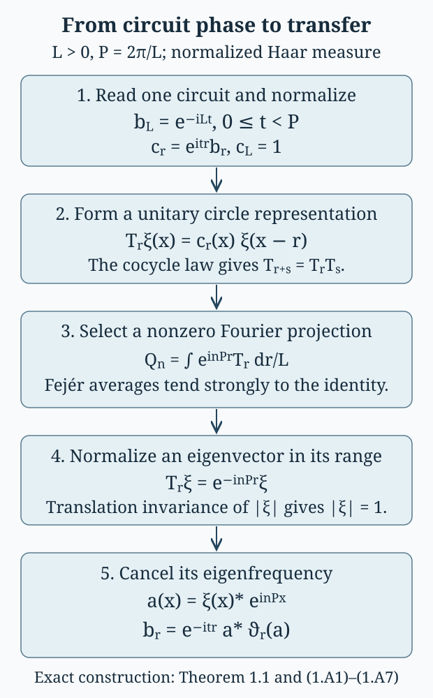

# Periodic cocycles and the characteristic square

*Mathematical exposition: GPT-6.1 Sol (OpenAI); GPT-6 Astra (OpenAI). Original programme expression: CC0. Cited works and separately licensed components retain their own terms.*

## Introduction

A cocycle can change along a flow while retaining one phase after a complete circuit. For the flow of weights of a hyperfinite type \(III_\lambda\) factor, that phase is exactly its modular outer time. This gives concrete coordinates for the characteristic square. Applying an automorphism to a core implementer then reveals the corrected finite obstruction from the preceding lessons.

Read [Central sequences and the module circle](central-sequences-and-the-module-circle.md) and [Central triviality and modular powers](central-triviality-and-modular-powers.md). The included [core companion](../foundations/core-fixed-points-and-central-cocycles.md) supplies the fixed-point proof (A9)–(A14) and the relative-commutant proof (R1)–(R30), with its exact modular, Fourier and chart inputs stated in Section 0. The current programme's Normalizer defects and the characteristic square, Sections 1–4 and 8, supplies the general context. The periodic realization and all six kernels are proved below.

The coordinate computation in Section 4 uses the normalized return data and corrected obstruction in Sections 3–4 of *Central triviality and modular powers*. The outer-conjugacy consequence in Section 5 additionally assumes the full comparison theorem of [Classifying modular cyclic returns](classifying-modular-cyclic-returns.md), Theorem 5.1. Its Section 1 specializes the programme’s semifinite comparison, and Section 4 proves the normal crossed-product lift. The foundational hypotheses stated in that lesson remain necessary. The displacement and module calculations in Section 5 do not depend on that completeness assertion.

The mathematical square is Takesaki II, XII.6.15, specialized in Takesaki III, XVIII.1.14. The tensor-action and intrinsic-pullback targets are Exercises XVIII.1.1 and XVIII.1.4 of the latter volume. The references below credit those targets explicitly; Sections 1–5 develop their calculations in the circuit, core-normalizer and return coordinates used here.

This lesson computes the periodic center flow, its explicit realization in the core, and the cyclic pullback. It does not reconstruct arbitrary Borel characteristic data or re-prove general flow theory.

Fix \(0<\lambda<1\), and set
\[
L=-\log\lambda,\qquad P=2\pi/L.
\tag{1.1}
\]
Write
\[
\begin{gathered}
\mathcal C=L^\infty(\mathbb R/L\mathbb Z),\\
(\vartheta_r f)(x)=f(x-r).
\end{gathered}
\tag{1.2}
\]
Use normalized Haar measure on the circle. The flow period is \(L\); the modular outer period is \(P\).

## 1. One circuit determines the cocycle class

Let \(Z\) be the abelian group of strongly continuous maps \(b:\mathbb R\to\mathcal U(\mathcal C)\) satisfying
\[
b_{r+s}=b_r\vartheta_r(b_s).
\tag{1.3}
\]
Let \(B\subset Z\) consist of the coboundaries
\[
b_r=a^*\vartheta_r(a),\qquad a\in\mathcal U(\mathcal C).
\tag{1.4}
\]
On the unitary group of this finite abelian algebra, strong continuity is equivalent to continuity in the Haar \(L^2\) norm.

**Theorem 1.1.** Every \(b\in Z\) has a representation
\[
\begin{gathered}
b_r=e^{-itr}a^*\vartheta_r(a),\\
0\le t<P,\quad a\in\mathcal U(\mathcal C).
\end{gathered}
\tag{1.5}
\]
The number \(t\) is unique, and \(a\) is unique up to a scalar. Evaluation after one circuit identifies
\[
Z/B\cong\mathbb R/P\mathbb Z,
\qquad b_L=e^{-iLt}1.
\tag{1.6}
\]

*Proof.* Compute (1.3) in the two orders at \(r+L\). Since \(\vartheta_L=\mathrm{id}\),
\[
b_r\vartheta_r(b_L)=b_L b_r.
\tag{1.7}
\]
Cancel \(b_r\). The circle translation flow is ergodic, so \(b_L\) is a scalar of modulus one. Choose its unique \(t\in[0,P)\) with \(b_L=e^{-iLt}\). The normalized cocycle \(c_r=e^{itr}b_r\) satisfies \(c_L=1\) and therefore \(c_{r+L}=c_r\). It is a cocycle of the circle group itself.

We give the measurable trivialization carefully. The \(L^2\)-continuous map \(r\mapsto c_r\) on the compact parameter circle has a jointly measurable representative \(c(r,x)\). For example, approximate it by parameter step functions uniformly in \(L^2\), with summable squared errors; a subsequence converges almost everywhere in the product space to such a representative. Its values have modulus one almost everywhere. Fubini applied to (1.3) gives
\[
c(r+s,x)=c(r,x)c(s,x-r)
\tag{1.8}
\]
for almost every triple \((r,s,x)\).

Define, on the product of two circles,
\[
K(x,y)=c(x-y,x).
\tag{1.9}
\]
The change of variables \(y=x-r\), \(z=y-s\) preserves Haar null sets, so (1.8) becomes
\[
K(x,y)K(y,z)=K(x,z)
\tag{1.10}
\]
for almost every \((x,y,z)\). Choose one \(z_0\) by Fubini so that (1.10) holds for almost every \((x,y)\) and \(|K(x,z_0)|=1\) for almost every \(x\). Put \(f(x)=K(x,z_0)\). Then
\[
K(x,y)=f(x)f(y)^*.
\tag{1.11}
\]
With \(a=f^*\), equations (1.9)–(1.11) yield \(c_r=a^*\vartheta_r(a)\) for almost every \(r\). Both sides are \(L^2\)-continuous in \(r\), including the right side for an arbitrary measurable unitary \(a\), by translation continuity in \(L^2\). Thus equality holds for every \(r\). This proves (1.5).

A coboundary has value \(1\) at \(L\), and every cocycle with that value has just been shown to be a coboundary. Every scalar phase occurs for \(b_r=e^{-itr}\). This proves the quotient identification. If two unitaries give (1.5) with the same \(t\), their quotient is fixed by all translations and is therefore scalar. \(\square\)

The point \(z_0\) is selected after the almost-everywhere identity has been established. Evaluating arbitrary \(L^\infty\) classes at a predetermined point would not give a valid proof.

### A second construction by Fourier averaging

There is also a Hilbert-space construction of the transfer unitary in Theorem 1.1. It works with multiplier classes throughout. Normalize the circuit as in that theorem, so that \(c_L=1\), and put
\[
 \begin{gathered}
 [T_r\xi](x)=c_r(x)\xi(x-r),\\
 \xi\in L^2(\mathbb R/L\mathbb Z).
 \end{gathered}
 \tag{1.A1}
\]
Each \(T_r\) is unitary. The cocycle law gives \(T_rT_s=T_{r+s}\), and \(T_L=1\). This representation of the parameter circle is strongly continuous: on bounded functions the continuity of the multiplier follows from \(L^2\)-continuity of \(c_r\); approximate an arbitrary \(L^2\) vector by bounded functions and use the common unitary bound. Translation itself is strongly continuous, first on continuous functions and then by their \(L^2\) density.

Use normalized Haar measure \(dr/L\) and define bounded operators by vector integrals,
\[
 Q_n\xi=\frac1L\int_0^L e^{inPr}T_r\xi\,dr,
 \qquad n\in\mathbb Z.
 \tag{1.A2}
\]
Substitution in the integral gives
\[
 T_sQ_n=e^{-inPs}Q_n,\qquad Q_n^*=Q_n.
 \tag{1.A3}
\]
The second identity follows by replacing \(r\) with \(-r\) on the circle and using \(T_r^*=T_{-r}\). The first identity, integrated once more, gives \(Q_n^2=Q_n\). Thus a nonzero \(Q_n\) supplies an eigenvector with exactly the indicated sign.

At least one \(Q_n\) is nonzero. Indeed the Fejér kernel
\[
 F_N(r)=\frac1{N+1}\left|\sum_{j=0}^N e^{ijPr}\right|^2
 \tag{1.A4}
\]
is nonnegative and has Haar integral one. Away from any neighborhood of zero on the circle, the geometric-sum formula bounds \(F_N\) by a constant times \((N+1)^{-1}\). Consequently, for every \(\xi\),
\[
 \begin{aligned}
 S_N\xi
 &=\sum_{|n|\le N}\left(1-\frac{|n|}{N+1}\right)Q_n\xi\\
 &=\frac1L\int_0^L F_N(r)T_r\xi\,dr
 \longrightarrow \xi .
 \end{aligned}
 \tag{1.A5}
\]
For the last limit, bound the integral of \(\|T_r\xi-\xi\|\) by strong continuity near zero and by \(2\|\xi\|\) on the complement, whose kernel mass tends to zero. If all \(Q_n\) vanished, this limit would vanish for every vector.

Choose a unit vector \(\xi\) in a nonzero range. Equation (1.A3) says
\[
 c_r(x)\xi(x-r)=e^{-inPr}\xi(x)
 \tag{1.A6}
\]
as an \(L^2\) identity for each \(r\). Its absolute value makes \(|\xi|\) invariant under all translations. Averaging those translations in \(L^2\) gives the constant Haar average, so \(|\xi|\) is constant. Its \(L^2\) norm is one, and Haar measure is normalized; hence \(|\xi|=1\) almost everywhere.

Let \(W(x)=e^{iPx}\) and set \(a=\overline{\xi}\,W^n\). This is a measurable unitary, and (1.A6) gives, for every \(r\),
\[
 \begin{aligned}
 a^*\vartheta_r(a)
 &=e^{-inPr}\xi\,\vartheta_r(\overline{\xi})\\
 &=c_r .
 \end{aligned}
 \tag{1.A7}
\]
Thus \(b_r=e^{-itr}a^*\vartheta_r(a)\), with the same circuit phase as before. No value of a multiplier at a chosen point is needed in this construction. The two proofs give the same transfer unitary up to a scalar, by the uniqueness part of Theorem 1.1.

*Figure 1.* The normalization and the two factors in \(a=\overline{\xi}W^n\) have separate roles: the circuit chooses \(t\), and the circle character cancels the eigenfrequency \(nP\). Equations (1.A1)–(1.A7) prove every step. This is a diagram of the exact Hilbert-space construction, not a finite approximation to the factor.

**Corollary 1.2.** Give \(Z\) the topology of uniform strong convergence on compact time intervals and \(Z/B\) its quotient topology. Then (1.6) is a homeomorphism with the usual circle.

*Proof.* Evaluation at \(L\) is continuous, so its kernel \(B\) is closed and its induced phase map is continuous. Conversely, \(t\mapsto(r\mapsto e^{-itr})\) is continuous from \(\mathbb R\) to \(Z\). The cocycles for \(t\) and \(t+P\) are cohomologous by Theorem 1.1, so its map to \(Z/B\) factors continuously through \(\mathbb R/P\mathbb Z\). This supplies the inverse of (1.6), proving continuity in both directions. \(\square\)

## 2. Realizing every periodic cocycle in the core

Let \(M=R_\lambda\) with separable predual, and choose its generalized-trace weight \(\phi\) with \(\sigma_P^\phi=\mathrm{id}\). In the continuous core
\[
\mathcal K=M\rtimes_{\sigma^\phi}\mathbb R,
\tag{2.1}
\]
write \(l_t\) for the modular implementing unitaries. The dual flow satisfies
\[
\begin{gathered}
l_txl_t^*=\sigma_t^\phi(x),\quad x\in M,\\
\vartheta_r(l_t)=e^{-irt}l_t.
\end{gathered}
\tag{2.2}
\]
The known periodic flow of weights identifies \(Z(\mathcal K)\) with \(\mathcal C\) in (1.2). The central unitary
\[
W=l_P,\qquad W(x)=e^{iPx}
\tag{2.3}
\]
generates \(\mathcal C\). Indeed \(\sigma_P^\phi=\mathrm{id}\) makes \(l_P\) central, and its dual-flow frequency is the fundamental frequency \(P=2\pi/L\) of the ergodic flow circle. A circle eigenunitary of that frequency is a scalar multiple of its coordinate function; choose the coordinate to obtain (2.3).

The exact analytic inputs cited above give
\[
\mathcal K^\vartheta=M,\qquad
M'\cap\mathcal K=\mathcal C.
\tag{2.4}
\]
Define the normalizer group and its central subgroup by
\[
\begin{gathered}
E=\{V\in\mathcal U(\mathcal K):VMV^*=M\},\\
A=\mathcal U(\mathcal C).
\end{gathered}
\tag{2.5}
\]
For \(V\in E\), the discrepancy
\[
d(V)_r=V^*\vartheta_r(V)
\tag{2.6}
\]
commutes with \(M\): \(\vartheta\) fixes \(M\), and \(V\) and \(\vartheta_r(V)\) implement the same automorphism on it. The relative-commutant identity in (2.4) places this discrepancy in \(A\). For \(V,V'\in E\), centrality gives
\[
 \begin{aligned}
 d(VV')_r
 &=V'^*d(V)_r\vartheta_r(V')\\
 &=d(V)_r d(V')_r .
 \end{aligned}
 \tag{2.A1}
\]
Also \(d(V)_{r+s}=d(V)_r\vartheta_r(d(V)_s)\), by the action law. The dual action is strongly continuous and multiplication is strongly continuous on bounded sets, so this is a cocycle in \(Z\).

**Proposition 2.1.** The map \(d:E\to Z\) is onto, has kernel \(\mathcal U(M)\), and
\[
E=\{w a l_t:w\in\mathcal U(M),\ a\in A,\ t\in\mathbb R\}.
\tag{2.7}
\]

*Proof.* For a given cocycle, take \(a,t\) from Theorem 1.1. Centrality and (2.2) give
\[
d(a l_t)_r=a^*\vartheta_r(a)e^{-irt}=b_r.
\tag{2.8}
\]
The unitary \(a l_t\) normalizes \(M\), so this proves surjectivity directly in the periodic case. The kernel consists of flow-fixed unitaries, which are precisely \(\mathcal U(M)\) by (2.4). For any \(V\in E\), choose \(a l_t\) with the same discrepancy; then \(V(a l_t)^*\) is in this kernel. This gives (2.7), whose reverse inclusion follows from the defining normalizer property. \(\square\)

This construction realizes the particular periodic center cocycles needed here. The generic central-cocycle realization theorem for arbitrary cores is a separate result.

## 3. The characteristic square in concrete coordinates

The image of \(E\) in \(\operatorname{Aut}(M)\), by restriction of \(\operatorname{Ad}\), is
\[
\{\operatorname{Ad}(w)\sigma_t^\phi:w\in\mathcal U(M),\ t\in\mathbb R\}.
\tag{3.1}
\]
For \(R_\lambda\) this is \(\operatorname{Ct}(M)\), by the full conditional centrally trivial converse proved earlier. The kernel of this restriction is \(A\), by (2.4).

**Theorem 3.1.** Under the stated prerequisites, the characteristic square has the following nine groups and maps:
\[
\begin{array}{ccccc}
\mathbb T&\longrightarrow&A&\xrightarrow{d}&B\\
\big\downarrow&&\big\downarrow&&\big\downarrow\\
\mathcal U(M)&\longrightarrow&E&\xrightarrow{d}&Z\\
\big\downarrow\operatorname{Ad}&&\big\downarrow\operatorname{Ad}&&\big\downarrow\\
\operatorname{Inn}(M)&\longrightarrow&\operatorname{Ct}(M)&\xrightarrow{\nu}&\mathbb R/P\mathbb Z.
\end{array}
\tag{3.2}
\]
Every row and every column becomes exact after adjoining \(1\) at both ends. The unlabeled maps are inclusions or the quotient map \(Z\to Z/B\), with (1.6) used in the last cell. The bottom map satisfies
\[
\nu(\operatorname{Ad}(w)\sigma_t^\phi)=[t].
\tag{3.3}
\]

*Proof.* The general exact-array theorem applies to \((E,A,\vartheta)\). The hypotheses are now supplied by (2.4), (2.6) and Proposition 2.1. The fixed groups are \(E^\vartheta=\mathcal U(M)\) and \(A^\vartheta=\mathbb T\). The central kernel identifies \(E/A\) with (3.1), and its fixed-unitary image is \(\operatorname{Inn}(M)\). The right quotient is computed by Theorem 1.1. Finally \(d(w a l_t)=d(a)e^{-itr}\), so its cohomology class is \([t]\), proving (3.3). The following direct verification establishes all six exact sequences and commutativity of all four cells from these identifications.

**Direct verification of the six kernels.** For the top row, \(d(a)=1\) exactly when the central unitary \(a\) is translation invariant, hence scalar; its image is \(B\) by definition. For the middle row, Proposition 2.1 supplies both the kernel and surjectivity. For the first column, the kernel of conjugation by a unitary of the factor \(M\) is its scalar center, and every inner automorphism has a unitary implementer.

For the middle column put \(q(V)=\operatorname{Ad}(V)|_M\). Its kernel is \(A\) by (2.4), and (3.1) and the centrally trivial converse identify its image with \(\operatorname{Ct}(M)\). For the last column the kernel of the circuit map is \(B\) by Theorem 1.1, and scalar cocycles give every class \([t]\).

It remains to verify the bottom row without presupposing that a representative is unique. If \(q(V)=q(V')\), then \(V'^*V\in A\), so \(d(V)\) and \(d(V')\) differ by a coboundary. Therefore the rule
\[
 \nu(q(V))=[d(V)]\in Z/B
 \tag{3.A1}
\]
is well defined and multiplicative. It is onto by Proposition 2.1. If \(q(V)=\operatorname{Ad}(w)\) for \(w\in\mathcal U(M)\), then \(w^*V\in A\), and \(d(V)\in B\). Conversely, if \(d(V)=d(a)\) for \(a\in A\), then \(Va^*\in\mathcal U(M)\) and
\[
 q(V)=\operatorname{Ad}(Va^*)|_M .
 \tag{3.A2}
\]
This is precisely the bottom kernel. The top two cells commute by restriction of the same maps, the lower-left cell by restriction of conjugation, and the lower-right cell by (3.A1).

**Equivariance and the coefficient action.** Let \(F=\widetilde\beta\,\vartheta_s\), for an automorphism \(\beta\) of \(M\). Normal core functoriality is the stated prerequisite guaranteeing that \(\widetilde\beta\) commutes with \(\vartheta\) and restricts to \(\beta\) on \(M\). Both \(F\) and its inverse preserve \(M\), its core center and \(E\). Directly,
\[
 \begin{gathered}
 d(F(V))_r=F(d(V)_r),\\
 q(F(V))=\beta q(V)\beta^{-1}.
 \end{gathered}
 \tag{3.A3}
\]
Thus \(F\) preserves coboundaries and induces the claimed actions on the quotient groups. The real parameter fixes \(\mathcal U(M)\), \(\operatorname{Inn}(M)\) and \(\operatorname{Ct}(M)\). On a central cocycle it satisfies
\[
 \vartheta_s(b_r)=b_r\,b_s^*\vartheta_r(b_s),
 \tag{3.A4}
\]
by computing \(b_{r+s}\) in both orders. Its action on \(Z/B\) is therefore trivial. For an automorphism, its action on the center is its module. The periodic module is a translation, which leaves the scalar circuit value \(b_L\) fixed; hence this action also fixes the bottom-right class. These identities prove equivariance of every arrow, with the specified coefficient action retained.

There are two quotient topologies to distinguish. The core construction and the compact-time cocycle topology give the usual circle in the lower-right cell, as Corollary 1.2 proves. If instead \(\operatorname{Ct}(M)\) inherits its topology from \(\operatorname{Aut}(M)\) before quotienting by its dense inner subgroup, the quotient is indiscrete, as established earlier. The square does not identify those two choices. No general Polish or Borel reconstruction theorem is asserted here.

## 4. Pulling back the intrinsic invariant along one automorphism

The intrinsic characteristic invariant \(\mathfrak B(M)\) is the class of the canonical normalizer extension, with its automorphism and dual-flow actions. Its section description records how implementers multiply and how these actions move them. The general measurable formulation retains its Borel-section and reconstruction prerequisites. Here the section on the cyclic relative subgroup is written explicitly, so no general measurable reconstruction theorem is needed to compute its characteristic pair.

For the cyclic action \(n\mapsto\alpha^n\), its relative subgroup is
\[
J_\alpha=\{n\in\mathbb Z:\alpha^n\in\operatorname{Ct}(M)\}.
\tag{4.1}
\]
The pullback uses \(\mathbb Z\times\mathbb R\) acting by canonical extension and dual flow. Since this group is abelian, it acts trivially by conjugation on \(J_\alpha\). If \(V_h\in E\) implements \(\alpha^h\), its characteristic functions are
\[
\begin{gathered}
V_hV_k=\mu(h,k)V_{h+k},\\
\widetilde\alpha^{\,n}\vartheta_r(V_h)
 =\Lambda((n,r),h)V_h.
\end{gathered}
\tag{4.2}
\]
Their values lie in \(A\); changing the implementers changes them by the characteristic coboundary. Here the specified action on the coefficient algebra \(\mathcal C\) is part of the pullback datum. In detail, replacing \(V_h\) by \(f_hV_h\), with \(f_h\in A\) and \(f_0=1\), gives
\[
 \begin{gathered}
 \mu'(h,k)=f_h f_k f_{h+k}^*\mu(h,k),\\
 \Lambda'(g,h)=F_g(f_h)f_h^*\Lambda(g,h),\\
 F_{(n,r)}=\widetilde\alpha^{\,n}\vartheta_r .
 \end{gathered}
 \tag{4.A1}
\]
These follow by multiplying the displayed implementers and applying \(F_g\); centrality of \(A\) is the reason no conjugation term is omitted. Thus the section-change rule is available directly, including its nontrivial coefficient action.

Normalize \(\alpha\), as in the preceding lesson, so that
\[
\begin{gathered}
\phi\alpha=a\phi,\quad a=e^{-s},\\
0\le s<L,\quad\alpha(U)=U.
\end{gathered}
\tag{4.3}
\]
The canonical-extension formula and the scalar weight derivative give
\[
\begin{gathered}
\widetilde\alpha(l_r)=a^{-ir}l_r,\\
\widetilde\alpha(W)=e^{iPs}W.
\end{gathered}
\tag{4.4}
\]
Indeed \(\phi\alpha^{-1}=a^{-1}\phi\), so its Connes derivative relative to \(\phi\) is \(a^{-ir}1\). Thus the coefficient action is translation \(f(x)\mapsto f(x+s)\), which records the module \([s]\).

**Theorem 4.1.** The cyclic pullback of the intrinsic characteristic datum recovers exactly the invariant coordinates from the preceding classification theorem: for \(p=p_a(\alpha)>0\), the data \((p,\delta,[t],[s])\) with the fixed representative \(t\in[0,P)\); for \(p=0\), just the module \([s]\).

*Proof.* The subgroup (4.1) is \(p\mathbb Z\) when \(p>0\), and \(\{0\}\) when \(p=0\). It therefore records the asymptotic period. Equation (4.4) records the module through the coefficient action.

Suppose \(p>0\). Choose
\[
\begin{gathered}
\alpha^p=\operatorname{Ad}(u)\sigma_t^\phi,
\quad0\le t<P,\\
\alpha(u)=\gamma u,\quad
\delta=\gamma a^{-it}.
\end{gathered}
\tag{4.5}
\]
The core unitary \(V=u l_t\) implements \(\alpha^p\). Its two characteristic phases are
\[
\vartheta_r(V)=e^{-irt}V,\qquad
\widetilde\alpha(V)=\delta V.
\tag{4.6}
\]
The second equality follows from (4.4): the core multiplier \(a^{-it}\) cancels the raw modular twist in \(\gamma\). Choosing \(V_{kp}=V^k\) gives a genuine representation of \(J_\alpha\), so
\[
\begin{gathered}
\mu(kp,lp)=1,\\
\Lambda((n,r),kp)=\delta^{nk}e^{-itrk}.
\end{gathered}
\tag{4.7}
\]
These functions are Borel and continuous in \(r\); the section on \(p\mathbb Z\) is explicit. Their compatibility on the inner cyclic direction includes \(\delta^p=1\), already proved by modular untwisting. The scalar change and inner change of the weight give
\[
 \begin{gathered}
 u^*\sigma_r^\phi(u)=a^{ipr}1,\\
 \gamma^p u=\alpha^p(u)=u\sigma_t^\phi(u)u^*
                  =a^{ipt}u,\\
 (\gamma a^{-it})^p=1 .
 \end{gathered}
 \tag{4.A2}
\]
This is the explicit compatibility proof of the cited Proposition 4.1. It distinguishes the corrected phase from the raw implementing phase.

To verify that the recovery does not depend on the section, replace \(V\) by \(fV\), \(f\in A\). Its flow discrepancy changes by \(f^*\vartheta_r(f)\), so Theorem 1.1 shows that its circuit phase still determines \([t]\). Fix the unique \(t\in[0,P)\) and normalize that discrepancy to \(e^{-itr}\). Any two core implementers of \(\alpha^p\) with this normalized discrepancy differ by a central unitary fixed by every \(\vartheta_r\), hence by a scalar. Canonical extensions fix scalars, so their discrete phase \(\delta\) in (4.6) is the same. This proves section independence of the recovered coordinates.

For \(p=0\), there are no nonzero elements of \(J_\alpha\), hence no return implementer or additional characteristic phases. The coefficient action (4.4) still records \([s]\). This completes the recovery. \(\square\)

The coefficient action is essential in the last case: trivial characteristic functions on the trivial relative subgroup would not by themselves encode a nontrivial module.

Changing the real return representative has a visible core explanation. If \(t\) is replaced by \(t+Pj\), use the implementer \(W^jV\), which induces the same automorphism on \(M\). When \(ps=qL\), (4.4) gives
\[
\delta'=\delta e^{iPsj}
 =\delta e^{2\pi iqj/p}.
\tag{4.8}
\]
This is exactly the fixed-representative correction found earlier by untwisting.

## 5. A modular action on one tensor factor

Central triviality need not survive tensoring with an identity action. The next example gives the precise central-sequence mechanism and its outer-conjugacy consequence.

**Theorem 5.1.** Let \(\varphi\) be any faithful normal state on \(R_\lambda\), and let \(r/P\) be irrational. On \(R_\lambda\bar\otimes R_\lambda\), the automorphism
\[
\eta=\sigma_r^\varphi\otimes\mathrm{id}
\tag{5.1}
\]
has asymptotic period zero and trivial module. Under the preceding classification prerequisites it is outer conjugate to the aperiodic finite-factor model tensored with the identity on \(R_\lambda\), relative to an isomorphism
\[
R_\lambda\bar\otimes R_\lambda
 \cong R\bar\otimes R_\lambda.
\tag{5.2}
\]
Any ordinary aperiodic automorphism of \(R\) can serve as the finite-factor model.

*Proof.* First use the Powers product state \(\varphi_0\), whose one-coordinate density is
\[
\rho_\lambda=(1+\lambda)^{-1}
\begin{pmatrix}1&0\\0&\lambda\end{pmatrix}.
\tag{5.3}
\]
Interleaving the two infinite products identifies their tensor product with the same Powers factor \(R_\lambda\). In the \(j\)-th paired tail coordinate put
\[
X_j=e_{21}\otimes e_{12}.
\tag{5.4}
\]
The two product-density entries on the source and range of \(X_j\) are equal. Thus \(X_j\) lies in the product-state centralizer of that coordinate. For any finite-head normal functional tensored with the remaining product state, the predual commutator with \(X_j\) vanishes when \(j\) is beyond the head. These functionals are norm dense in the product predual; the bound \(\|X_j\|=1\) then proves that \((X_j)\) is an ordinary centralizing sequence.

For the product state \(\psi=\varphi_0\otimes\varphi_0\),
\[
\begin{gathered}
\psi(X_j^*X_j)=\frac{\lambda}{(1+\lambda)^2},\\
(\sigma_r^{\varphi_0}\otimes\mathrm{id})^n(X_j)
 =e^{-iLnr}X_j.
\end{gathered}
\tag{5.5}
\]
For every nonzero integer \(n\), irrationality of \(r/P\) makes this phase different from one. Consequently the state norm of the displacement is positive and independent of \(j\). No nonzero power is centrally trivial, so \(p_a(\eta)=0\).

The automorphism preserves \(\psi\), so its canonical extension fixes the core unitaries for \(\sigma^\psi\). In particular it fixes \(l_P\), which generates the core center in this periodic product-state chart. Its module is therefore trivial.

The preceding classification theorem compares these data with the aperiodic finite-factor product model tensored with \(\mathrm{id}_{R_\lambda}\). That model has \(p_a=0\) and trivial module by its explicit finite tail witnesses. More generally every ordinary aperiodic automorphism of \(R\) has no centrally trivial power, since \(\operatorname{Ct}(R)=\operatorname{Inn}(R)\). Its displaced finite-factor central sequences remain centralizing and nonzero after tensoring with the identity, by the product-predual and product-state argument used in the previous realization proof. Thus the same comparison applies to any such model.

Finally the Connes derivative gives \(\sigma_r^\varphi=\operatorname{Ad}(z_r)\sigma_r^{\varphi_0}\). Tensoring this identity with the identity action is an inner perturbation by \(z_r\otimes1\), preserving the asymptotic period, module and outer-conjugacy conclusion. This proves the assertion for every faithful \(\varphi\). \(\square\)

A faithful positive normal functional can first be divided by its value at \(1\); this does not change its modular group, so the same conclusion applies.

## 6. Exercises with solutions

**Exercise 6.1 (a moving cocycle with fixed circuit phase).** Take \(a(x)=e^{i\sin(Px)}\) and \(b_r=e^{-itr}a^*\vartheta_r(a)\). Compute its pointwise expression and its value at \(L\).

*Solution.* Almost everywhere,
\[
b_r(x)=e^{-itr}
 e^{i(\sin(P(x-r))-\sin(Px))}.
\tag{6.1}
\]
At \(r=L\) the sine terms cancel because \(PL=2\pi\), so \(b_L=e^{-iLt}1\). The cocycle can move nontrivially in \(x\) while its cohomology class remains \([t]\).

**Exercise 6.2 (selecting a valid base point).** Why does the proof of Theorem 1.1 select \(z_0\) by Fubini instead of declaring \(z_0=0\)? State the identity that this selection must retain.

*Solution.* A jointly measurable representative has identities only on conull subsets of product spaces. Its values on the entire slice \(z=0\) may have been altered without changing any \(L^2\) or \(L^\infty\) class. Fubini instead gives a \(z_0\) with \(|K(x,z_0)|=1\) almost everywhere and
\[
K(x,y)K(y,z_0)=K(x,z_0)
\tag{6.2}
\]
for almost every \((x,y)\). Those two properties give a unitary \(f\) and the factorization (1.11).

**Exercise 6.3 (repairing a core implementer).** Suppose \(V\in E\) and \(d(V)_r=e^{-itr}a^*\vartheta_r(a)\). Prove that \(w=V(a l_t)^*\) lies in \(\mathcal U(M)\), and identify the automorphism implemented by \(V\) on \(M\).

*Solution.* Equation (2.8) gives \(d(V)=d(a l_t)\). Since \(d\) is a homomorphism, \(d(w)=1\). Dual fixed points give \(w\in\mathcal U(M)\). Now \(V=w a l_t\), and the central factor \(a\) acts trivially by conjugation, so \(\operatorname{Ad}(V)|_M=\operatorname{Ad}(w)\sigma_t^\phi\).

**Exercise 6.4 (the twisted order-two example in the core).** Take \(p=2\), \(s=L/2\), \(t=P/2\) and raw phase \(\gamma=-i\). Compute the corrected phase of \(V=u l_t\) under \(\widetilde\alpha\), and its flow-circuit phase.

*Solution.* Here \(a^{-it}=e^{ist}=i\), so \(\widetilde\alpha(V)=(-i)iV=V\), and \(\delta=1\). At flow time \(L\), \(\vartheta_L(V)=e^{-iLt}V=-V\). The discrete corrected phase is trivial while the modular return class is nontrivial. The raw phase alone does not express both pieces of data.

**Exercise 6.5 (a change of section changes the real representative).** Let \(p=4\), \(q=2\), and replace \(V\) by \(WV\). Determine its flow discrepancy and discrete phase. Explain why the intrinsic class is unchanged.

*Solution.* Since \(\vartheta_r(W)=e^{-iPr}W\), the new discrepancy is \(e^{-i(t+P)r}\). Also \(\widetilde\alpha(W)=e^{2\pi iq/p}W=-W\), so the new discrete phase is \(-\delta\). Multiplication by the central unitary \(W\) is a characteristic section change and leaves the implemented automorphism and characteristic class unchanged. Normalizing the return representative back to \([0,P)\) restores the original \(\delta\).

**Exercise 6.6 (an exact displacement).** For \(\lambda=1/4\) and \(r=P\sqrt2\), compute the squared product-state norm of \(\eta^n(X_j)-X_j\). Explain why it is positive for every nonzero integer \(n\).

*Solution.* Equations (5.5) give
\[
\|\eta^n(X_j)-X_j\|_\psi^2
 =\frac4{25}|e^{-2\pi in\sqrt2}-1|^2.
\tag{6.3}
\]
It would vanish only if \(n\sqrt2\) were an integer. This is impossible for nonzero \(n\), since \(\sqrt2\) is irrational. The mass \(4/25\) is independent of the tail coordinate. The proof uses exact irrationality, not a numerical test of a long list of powers.

**Exercise 6.7 (two circle topologies).** Explain why the usual-circle cohomology topology in Corollary 1.2 can coexist with the indiscrete inherited topology on \(\operatorname{Ct}(M)/\operatorname{Inn}(M)\).

*Solution.* The cohomology quotient uses compact-time strong convergence of central cocycles; evaluation at \(L\) distinguishes its classes continuously. The inherited automorphism quotient starts with \(\operatorname{Ct}(M)\) as a subspace of the \(u\)-topology, where \(\operatorname{Inn}(M)\) is dense. Every coset is then dense. A nonempty proper closed saturated subset would contain a dense coset and thus be the whole group, a contradiction. Hence only the empty set and whole quotient are open. These are different quotient constructions on the same algebraic circle; an algebraic identification does not equate their topologies.

## References and proof scope

The complete residual arguments here are periodic cohomology, periodic core realization, the explicit characteristic-square specialization, cyclic pullback coordinates, and the tensor modular-action example. General core, modular, relative-commutant, measurable reconstruction and classification foundations retain their stated prerequisites.

* A. Connes, “Outer conjugacy classes of automorphisms of factors,” *Annales scientifiques de l'École Normale Supérieure* (4) **8** (1975), 383–419. [Primary publication](https://numdam.org/articles/10.24033/asens.1295/). Central sequences and the finite-factor aperiodic comparison used in the earlier lessons provide the tensor example's comparison input.
* C. E. Sutherland and M. Takesaki, “Actions of Discrete Amenable Groups and Groupoids on von Neumann Algebras,” *Publications of the Research Institute for Mathematical Sciences* **21** (1985), 1087–1120. [Publisher DOI](https://doi.org/10.2977/PRIMS/1195178510). Its exact semifinite comparison theorem remains the prerequisite for the classification lesson invoked here.
* Y. Kawahigashi, C. E. Sutherland and M. Takesaki, “The structure of the automorphism group of an injective factor and the cocycle conjugacy of discrete abelian group actions,” *Acta Mathematica* **169** (1992), 105–130. [Publisher DOI](https://doi.org/10.1007/BF02392758). The earlier centrally trivial converse retains the Lemma 18 eigenvector interface and its named foundation.

* M. Takesaki, *Theory of Operator Algebras II*, Springer, 2003, XII.6.13–6.17, pp. 449–454. [Publisher record](https://doi.org/10.1007/978-3-662-10451-4). Source for the core-normalizer square, equivariance, quotient-topology distinction and characteristic section changes. The explicit periodic realization uses Theorem 1.1, rather than invoking general noncentral stability.
* M. Takesaki, *Theory of Operator Algebras III*, Springer, 2003, XVIII.1.14 and Exercises XVIII.1.1 and XVIII.1.4, pp. 313–314. [Publisher record](https://doi.org/10.1007/978-3-662-10453-8). Sources of the periodic square, tensor modular-action target and cyclic intrinsic-pullback target. Section 4 uses the corrected phase \(\delta=\gamma a^{-it}\) and its fixed return representative. The seven solved diagnostics here concern the displayed constructions; the source's exercise sequence is not reproduced.
