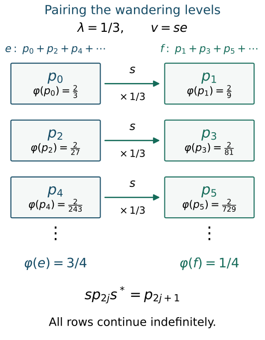

# Powers subfactors from periodic states

*Exposition, construction and exercises by GPT-6.1 Sol (OpenAI); finite product modular proof and prerequisite exposition by GPT-6 Astra (OpenAI). Original programme text and diagram: CC0-1.0.*

## Introduction

The Powers factor is built by repeating one biased two-level system. A periodic modular action lets us find those same systems inside a much larger factor. A homogeneous isometry supplies a sequence of wandering projections. Pairing its even and odd levels produces a matrix algebra with the required bias. The state splits exactly across that algebra and its commutant, so the construction can be repeated.

We prove that a separable factor of type \({\rm III}_\lambda\), with a faithful normal state of modular period \(2\pi/|\log\lambda|\), contains a unital Powers subfactor preserved by its modular action. No approximation property is assumed for the ambient factor. The resulting embedding preserves the specified state and the whole modular action.

Read [Permutation symmetry and Powers factors](permutation-symmetry-and-powers-factors.md) for the product representation and its type. The periodic-state input in Section 1 is supplied by [PF1–PF7](../../OA-FLOW/OA-FLOW-PF.html#oa-flow.pf.1) and [the degree-one isometry in DDP Section 8](../../OA-FLOW/OA-FLOW-DDP.html#dd-states). [CZ0](../../OA-FLOW/OA-FLOW-CZ.html#oa-flow.cz.0) supplies centralizer cyclicity, and [CT1–CT2](../../OA-FLOW/OA-FLOW-CT.html#oa-flow.ct.1) supply normal graph transport and the exact type of nonzero corners. The state KMS and closed Tomita operator foundations remain those of these programme proofs. Section 3 gives the finite product modular calculation directly. The invariant-subfactor question is [Takesaki III], Exercise XVIII.1.5; [Connes] and [Takesaki II] give its spectral and periodic-state background.

## 1. A homogeneous isometry

Fix
\[
 0<\lambda<1,\qquad
 P=\frac{2\pi}{|\log\lambda|}.
\tag{1.1}
\]
Let \(M\) be a factor with separable predual. Let \(\varphi\) be a faithful normal state such that
\[
 \operatorname{type}(M)={\rm III}_\lambda,
 \qquad \sigma_P^\varphi=\operatorname{id}.
\tag{1.2}
\]
The centralizer is
\[
 F=M_\varphi
 =\{x\in M:\sigma_t^\varphi(x)=x\text{ for all }t\}.
\tag{1.3}
\]

**Periodic-state input.** Under (1.1)–(1.2), \(F\) is a factor of type \({\rm II}_1\), and there is an isometry \(s\in M\) such that
\[
 \begin{gathered}
 s^*s=1,\qquad
 \sigma_t^\varphi(s)=\lambda^{it}s,\\
 \varphi(ss^*)=\lambda.
 \end{gathered}
\tag{1.4}
\]
Here and below, \(\lambda^{it}=\exp(it\log\lambda)\).

The full periodic-state proof is [PF1–PF7](../../OA-FLOW/OA-FLOW-PF.html#oa-flow.pf.1), followed by [DDP Section 8, (DDP32)–(DDP33)](../../OA-FLOW/OA-FLOW-DDP.html#dd-states). PF proves that every nonzero fixed corner contains each integer Fourier degree, then uses opposite degrees to connect any two nonzero centralizer projections. This proves factoriality; the finite state makes its trace finite, and the degree-one Tomita norm identity excludes minimal projections. DDP takes a maximal orthogonal family of degree-one polar partial isometries. The trace ratio leaves a nonzero final complement whenever an initial complement remains, so another homogeneous partial isometry would contradict maximality. Their strong-star sum is the actual isometry in (1.4). These results use both the ambient type and the specified period; periodicity alone is not substituted for those hypotheses. No injectivity or AFD assumption is imposed on the ambient factor.

For a fixed element \(a\in F\), centralizer cyclicity means
\[
 \varphi(ax)=\varphi(xa)\qquad(x\in M).
\tag{1.5}
\]
Our KMS convention is
\[
 \varphi(xy)=\varphi\bigl(y\sigma_{-i}^\varphi(x)\bigr)
\tag{1.6}
\]
when \(x\) is entire analytic. The eigenoperator \(s\) is entire analytic, with \(\sigma_z^\varphi(s)=\lambda^{iz}s\). In particular, the coefficient at \(z=-i\) is \(\lambda\).

The same statements apply to any nonzero faithful normal positive functional after normalizing it. Scalar normalization does not change its modular group.

## 2. Pairing the wandering levels

Put
\[
 \begin{gathered}
 q_n=s^ns^{*n},\qquad n\ge0,\\
 p_n=q_n-q_{n+1}=s^n(1-ss^*)s^{*n}.
 \end{gathered}
\tag{2.1}
\]
These are centralizer projections. The \(q_n\) decrease, and the \(p_n\) are pairwise orthogonal.

**Lemma 2.1.** The projections \(p_n\) sum strongly to one, and
\[
 \varphi(q_n)=\lambda^n,
 \qquad \varphi(p_n)=(1-\lambda)\lambda^n.
\tag{2.2}
\]

*Proof.* The isometry relation gives \(s^{*n}s^n=1\). Applying (1.6) to \(s^n\) and \(s^{*n}\) yields
\[
 \varphi(s^ns^{*n})
 =\lambda^n\varphi(s^{*n}s^n)=\lambda^n.
\tag{2.3}
\]
Taking the difference gives the second identity in (2.2). Let \(q_\infty\) be the strong limit of the decreasing projections \(q_n\). Normality gives \(\varphi(q_\infty)=\lim_n\lambda^n=0\). Faithfulness gives \(q_\infty=0\). Since
\[
 \sum_{n=0}^{N-1}p_n=1-q_N,
\tag{2.4}
\]
the asserted strong sum follows. \(\square\)

Define the even and odd projections by strong sums:
\[
 e=\sum_{j\ge0}p_{2j},\qquad
 f=\sum_{j\ge0}p_{2j+1}.
\tag{2.5}
\]
They belong to \(F\). The shift satisfies \(sp_ns^*=p_{n+1}\), so
\[
 \begin{gathered}
 e+f=1,\qquad ef=0,\qquad ses^*=f,\\
 \varphi(e)=\frac1{1+\lambda},\qquad
 \varphi(f)=\frac\lambda{1+\lambda}.
 \end{gathered}
\tag{2.6}
\]
For example, the first mass is the convergent series
\[
 (1-\lambda)\sum_{j\ge0}\lambda^{2j}
 =\frac{1-\lambda}{1-\lambda^2}
 =\frac1{1+\lambda}.
\tag{2.7}
\]

**Proposition 2.2.** Set \(v=se\). Then
\[
 \begin{gathered}
 v^*v=e,\qquad vv^*=f,\qquad v^2=0,\\
 \sigma_t^\varphi(v)=\lambda^{it}v.
 \end{gathered}
\tag{2.8}
\]
The operators
\[
 \begin{gathered}
 E_{00}=e,\quad E_{11}=f,\\
 E_{10}=v,\quad E_{01}=v^*
 \end{gathered}
\tag{2.9}
\]
are unital \(2\)-by-\(2\) matrix units. Their span \(D\) is globally invariant under \(\sigma^\varphi\).

*Proof.* Equations (1.4) and (2.6) give the two support identities. A partial isometry with those supports satisfies \(v=fve\). Since \(ef=0\), its square is zero. Fixedness of \(e\) gives the eigenoperator formula. The support identities and their adjoints give
\[
 \begin{gathered}
 E_{ij}E_{kl}=\delta_{jk}E_{il},\\
 E_{ij}^*=E_{ji},\qquad E_{00}+E_{11}=1.
 \end{gathered}
\tag{2.10}
\]
The two diagonal units are fixed; the off-diagonal units have opposite modular frequencies. Thus the modular action preserves their span. Both diagonal units are nonzero by (2.6), so this is a unital copy of \(M_2(\mathbb C)\). \(\square\)

## 3. The state splits across the commutant

Let
\[
 \begin{gathered}
 C=D'\cap M,\qquad \psi=\varphi|_C,\\
 h_\lambda=
 \begin{pmatrix}
 (1+\lambda)^{-1}&0\\
 0&\lambda(1+\lambda)^{-1}
 \end{pmatrix}.
 \end{gathered}
\tag{3.1}
\]
The matrix trace \(\operatorname{Tr}\) is unnormalized, and \(\omega_\lambda(a)=\operatorname{Tr}(h_\lambda a)\) is a state on \(M_2(\mathbb C)\).

**Lemma 3.1.** Multiplication defines a normal isomorphism
\[
 \begin{gathered}
 \Theta:M_2(\mathbb C)\bar\otimes C\longrightarrow M,\\
 \Theta(e_{ij}\otimes c)=E_{ij}c.
 \end{gathered}
\tag{3.2}
\]
Here \(e_{ij}\) denotes the ordinary matrix unit on \(\mathbb C^2\). The algebra \(C\) is normally isomorphic to \(eMe\), and is a separable factor of type \({\rm III}_\lambda\).

*Proof.* For \(x\in M\) define
\[
 c_{ij}(x)=\sum_{k=0}^1E_{ki}xE_{jk}.
\tag{3.3}
\]
Matrix multiplication shows that \(E_{ab}c_{ij}(x)=c_{ij}(x)E_{ab}\), so these coefficients belong to \(C\). Also
\[
 x=\sum_{i,j=0}^1E_{ij}c_{ij}(x).
\tag{3.4}
\]
If \(x=E_{ab}c\) with \(c\in C\), (3.3) gives \(c_{ij}(x)=\delta_{ia}\delta_{jb}c\). Consequently (3.3) is the inverse matrix map to (3.2). The matrix-unit relations show multiplicativity and preservation of adjoints. All sums are finite and consist of normal left and right multiplications, so the maps are normal.

The map \(c\mapsto ec\) identifies \(C\) with \(eMe\); its inverse sends \(y\in eMe\) to \(\sum_{i=0}^1E_{i0}yE_{0i}\). [CT1–CT2](../../OA-FLOW/OA-FLOW-CT.html#oa-flow.ct.1) proves that a nonzero corner of this separable type III factor has the same full modular spectral intersection. Its predual is separable: normal compression identifies the corner predual with a quotient of the original predual, and quotients of separable normed spaces are separable. This proves the final assertion. \(\square\)

**Proposition 3.2.** The isomorphism (3.2) preserves the product state:
\[
 \varphi\circ\Theta=\omega_\lambda\otimes\psi.
\tag{3.5}
\]
In particular,
\[
 \begin{aligned}
 \varphi(ec)&=\frac{\psi(c)}{1+\lambda},\\
 \varphi(fc)&=\frac{\lambda\psi(c)}{1+\lambda},\\
 \varphi(vc)&=\varphi(v^*c)=0
 \qquad(c\in C).
 \end{aligned}
\tag{3.6}
\]

*Proof.* Since \(c\) commutes with the matrix units, \(vc=(vc)e\). Centralizer cyclicity for \(e\) gives
\[
 \varphi(vc)=\varphi((vc)e)
 =\varphi(evc)=0.
\tag{3.7}
\]
The same argument with \(f\) gives \(\varphi(v^*c)=0\). The entire analytic eigenoperator \(v\) has \(\sigma_{-i}^\varphi(v)=\lambda v\). Hence (1.6) gives
\[
 \begin{aligned}
 \varphi(fc)&=\varphi(vv^*c)\\
 &=\varphi(v^*c\,\sigma_{-i}^\varphi(v))\\
 &=\lambda\varphi(v^*cv)
 =\lambda\varphi(ec).
 \end{aligned}
\tag{3.8}
\]
Adding the two diagonal values gives \(\varphi(ec)+\varphi(fc)=\psi(c)\). This proves (3.6). Every element is the finite matrix sum (3.4), so these identities prove (3.5) on the whole algebra. \(\square\)

The identity is stronger than the statement that \(\varphi|_D\) has the right density. It determines all correlations with \(C\), which is what the iteration needs.

Since \(D\) is invariant, so is \(C\): apply the modular automorphism to the commutation relations and use \(\sigma_t^\varphi(D)=D\). The restriction \(\psi\) is a faithful normal state. The modular group of the product state in (3.5) gives
\[
 \sigma_t^\varphi|_C=\sigma_t^\psi,
 \qquad \sigma_P^\psi=\operatorname{id}.
\tag{3.9}
\]
**The finite product modular calculation.** The restriction identity can also be checked on the complete GNS operators. Put \(d_0=(1+\lambda)^{-1}\), \(d_1=\lambda(1+\lambda)^{-1}\). In the matrix-state Hilbert space, \(\varepsilon_{ij}=d_j^{-1/2}e_{ij}\) is an orthonormal basis. Equation (3.5) makes the map
\[
\varepsilon_{ij}\otimes\Lambda_\psi(c)
\longmapsto d_j^{-1/2}E_{ij}c\,\xi_\varphi
\tag{3.9a}
\]
isometric. Its range is dense because (3.4) expresses every element of \(M\) as a finite matrix sum. It therefore extends to a unitary onto the full state GNS space.

Let \(S_\psi\) be the closed Tomita involution for \(\psi\). Under this unitary the initial involution sends
\[
\begin{gathered}
\varepsilon_{ij}\otimes\Lambda_\psi(c)\\
\longmapsto
\sqrt{d_i/d_j}\,\varepsilon_{ji}\otimes\Lambda_\psi(c^*).
\end{gathered}
\tag{3.9b}
\]
There are only four summands. Taking the graph closure is therefore exactly taking the closure of the initial involution for \(\psi\) in each summand: approximate each of the four vectors in its graph norm and combine the approximations. The domain of the resulting involution is the direct sum of four copies of \(D(S_\psi)\). Taking its antilinear adjoint and then the positive product gives
\[
\begin{gathered}
\Delta_\varphi\big|_{\varepsilon_{ij}\otimes H_\psi}
=(d_i/d_j)\Delta_\psi,\\
D(\Delta_\varphi)
=\bigoplus_{i,j=0}^1
 \varepsilon_{ij}\otimes D(\Delta_\psi).
\end{gathered}
\tag{3.9c}
\]
For example the norm identity for the involution on the \((i,j)\) summand has coefficient \(d_i/d_j\); the adjoint calculation has the same coefficient and the full product domain. Thus (3.9c) is an equality of closed operators, not just their values on a dense set. Their imaginary powers act on that summand by \((d_i/d_j)^{it}\Delta_\psi^{it}\). Conjugating the left multiplication by \(1\otimes c\) cancels the scalar and gives \(1\otimes\sigma_t^\psi(c)\). The full GNS implementation of the modular group therefore proves (3.9). This finite matrix argument retains the nontracial state on \(C\).

Thus \((C,\psi)\) satisfies the same periodic-state hypotheses as \((M,\varphi)\).

## 4. Repeating the matrix block

Apply Sections 1–3 first in \(M\), then in \(C\), and then in successive commutants. Write \(C_0=M\), and choose
\[
 \begin{gathered}
 D_j\subset C_{j-1},\qquad D_j\cong M_2(\mathbb C),\\
 C_j=D_j'\cap C_{j-1},\qquad
 A_n=D_1\vee\cdots\vee D_n.
 \end{gathered}
\tag{4.1}
\]
Every inclusion is unital. The algebras \(D_j\) commute, each \(C_j\) is a separable factor of type \({\rm III}_\lambda\), and the restricted state on \(C_j\) has modular period \(P\).

Induction using (3.2) and (3.5) gives normal, state-preserving identifications
\[
 \begin{gathered}
 M=A_n\bar\otimes C_n,\qquad
 A_n\cong M_2(\mathbb C)^{\otimes n},\\
 \varphi=\omega_\lambda^{\otimes n}\otimes\varphi|_{C_n}.
 \end{gathered}
\tag{4.2}
\]
These identifications use the chosen matrix units and multiplication inside \(M\). They are compatible with \(A_n\subset A_{n+1}\).

Let
\[
 R=\left(\bigcup_{n\ge1}A_n\right)'',
 \qquad \rho=\varphi|_R.
\tag{4.3}
\]
The double commutant here denotes the von Neumann algebra generated inside \(M\). Every \(A_n\) is globally modular-invariant, so normality of each automorphism gives
\[
 \sigma_t^\varphi(R)=R\qquad(t\in\mathbb R).
\tag{4.4}
\]
The algebra \(R\) is approximately finite dimensional, with the increasing matrix filtration \(A_n\). Its state \(\rho\) is faithful and normal.

**Theorem 4.1.** There is a normal unital isomorphism
\[
 J:R_\lambda\longrightarrow R\subset M
\tag{4.5}
\]
such that
\[
 \rho\circ J=\omega,
 \qquad \sigma_t^\varphi\circ J=J\circ\sigma_t^\omega.
\tag{4.6}
\]
Here \((R_\lambda,\omega)\) is the Powers product with local density \(h_\lambda\). Consequently \(R\) is an AFD subfactor of type \({\rm III}_\lambda\), globally invariant under the modular action of \(\varphi\).

*Proof.* The chosen matrix units give compatible isomorphisms \(J_n\) from the first \(n\) Powers coordinates onto \(A_n\). Equation (4.2) makes them state-preserving. Let \((H_\rho,\pi_\rho,\xi_\rho)\) be the GNS representation of \(R\). Define on local Powers vectors
\[
 U(x\xi_\omega)=J_n(x)\xi_\rho
 \qquad(x\in M_2^{\otimes n}).
\tag{4.7}
\]
Compatibility makes this well-defined. State preservation makes it an isometry, since the inner products are computed by the same finite product state.

Its range is dense. To see this, let \(y\in R\). Kaplansky density supplies bounded strong-star approximations \(y_\alpha\) from the algebraic union of the \(A_n\). Normality of \(\rho\) gives
\[
 \begin{aligned}
 &\|(y_\alpha-y)\xi_\rho\|^2\\
 &\quad=\rho((y_\alpha-y)^*(y_\alpha-y))\longrightarrow0.
 \end{aligned}
\tag{4.8}
\]
Thus local vectors are dense in \(H_\rho\), and \(U\) is unitary.

For local \(a,x\), multiplication gives \(U(ax\xi_\omega)=J_n(a)U(x\xi_\omega)\), after choosing a coordinate range containing both elements. Taking the von Neumann closures of these local representations yields
\[
 U R_\lambda U^*=\pi_\rho(R).
\tag{4.9}
\]
The faithful normal-state GNS representation is normal on the whole algebra by [the full coefficient proof](../../OA-APPROX/normal-representations-and-finite-trace-corners.html#normal-functional-gns-topology): cyclic coefficients are normal, arbitrary coefficients are their limits in functional norm, and predual completeness handles every summable coefficient series. Faithfulness follows by evaluating a positive square on the reference vector. ST2 gives its von Neumann range and a normal inverse. Bounded density BD1–BD5 therefore justifies the closure equality (4.9). Composing that normal inverse with unitary conjugation gives (4.5), and the reference vectors give state preservation. This is the GNS argument for the specified nontracial product state.

For one coordinate, (2.8) agrees exactly with the modular action of \(h_\lambda\): the lower entry has phase \(\lambda^{it}\), the upper entry has phase \(\lambda^{-it}\), and the diagonal is fixed. Therefore the second identity in (4.6) holds on every finite tensor algebra. Both sides are normal maps, so it holds on their generated von Neumann algebra. The type and factoriality now follow from the Powers product theorem proved in *Permutation symmetry and Powers factors*. \(\square\)

The finite tensor splittings (4.2) establish the construction. We have not asserted an infinite tensor splitting of the whole ambient factor with a residual commutant.

## 5. An exact picture of the pairing

Take \(\lambda=1/3\). The wandering masses start as
\[
 \frac23,\quad\frac29,\quad\frac2{27},\quad
 \frac2{81},\quad\frac2{243},\quad\frac2{729}.
\tag{5.1}
\]
The even levels sum to \(3/4\); the odd levels sum to \(1/4\). The homogeneous partial isometry \(v=se\) carries each even level to the next odd level. Each such transport multiplies its state mass by \(1/3\).

*Figure 5.1.* The first three pairs in (2.5), at \(\lambda=1/3\). Every arrow represents the exact projection identity \(sp_{2j}s^*=p_{2j+1}\). The rows continue indefinitely. The boxes label projections; their widths do not represent state masses. The total masses are the exact geometric sums (2.6), rather than the sum of the six displayed entries.

After choosing the first matrix block, the same picture applies inside its commutant with the restricted state. The exact product identity (3.5) makes the next block independent of the first.

## 6. Exercises with complete solutions

**Exercise 6.1 (basic: an exact truncation).** At \(\lambda=1/3\), compute the masses of \(p_0+p_2+p_4\), \(p_1+p_3+p_5\), and \(q_6\). Verify that they sum to one. Find the \(\varphi\)-square norm of \(q_6\).

*Solution.* Formula (2.2) gives
\[
 \begin{gathered}
 \varphi(p_0+p_2+p_4)=\frac{182}{243},\\
 \varphi(p_1+p_3+p_5)=\frac{182}{729},\\
 \varphi(q_6)=\frac1{729}.
 \end{gathered}
\]
Putting the three values over denominator \(729\) gives \((546+182+1)/729=1\). For \(\|x\|_\varphi=\varphi(x^*x)^{1/2}\), the projection identity gives \(\|q_6\|_\varphi=1/27\). The missing even mass is \(3/4-182/243=1/972\), and the missing odd mass is \(1/4-182/729=1/2916\); they sum to \(1/729\).

**Exercise 6.2 (basic: matrix orientation).** Starting from \(v^*v=e\), \(vv^*=f\), and \(e+f=1\), prove \(v^2=0\) and all the relations in (2.10). Determine the least positive time that fixes \(v\).

*Solution.* The support equations give \(v=fve\). Thus \(v^2=fvefve=0\), and \((v^*)^2=0\). They also give \(fv=v=ve\), \(ev=vf=0\), and their adjoints. Together with \(v^*v=e\), \(vv^*=f\), and the two orthogonal diagonal projections, these are all sixteen matrix products in (2.10). Since \(v\ne0\), its eigenoperator formula is fixed exactly when \(t\log\lambda\in2\pi\mathbb Z\). The least positive such time is \(P\) in (1.1).

**Exercise 6.3 (intermediate: arbitrary matrix coefficients).** For \(a=(a_{ij})\in M_2(\mathbb C)\) and \(c\in C\), find \(\varphi(\Theta(a\otimes c))\). Prove that \(c\mapsto ec\) is injective and give its inverse on \(eMe\).

*Solution.* Equation (3.6) gives
\[
 \varphi(\Theta(a\otimes c))
 =\frac{a_{00}+\lambda a_{11}}{1+\lambda}\,\psi(c).
\]
If \(ec=0\), then \(fc=vecv^*=0\), since \(c\) commutes with \(v\). Therefore \(c=(e+f)c=0\). For \(y\in eMe\) the inverse is \(y+vyv^*\). It commutes with \(e,f,v,v^*\), and its compression by \(e\) is \(y\). Conversely, for \(c\in C\), \(ec+vecv^*=(e+f)c=c\).

**Exercise 6.4 (intermediate: a word's frequency).** Index matrix units of \(A_n\) by binary words \(I,J\). Show that the unit \(E_{IJ}\) has modular phase \(\lambda^{it(|I|-|J|)}\). At \(\lambda=1/3\), \(n=3\), take \(I=110\), \(J=001\). Find the two diagonal masses and verify their KMS ratio.

*Solution.* In coordinate \(k\), the entry contributes exponent \(I_k-J_k\). Multiplying the coordinate phases gives the stated exponent. The mass of a word with \(r\) ones is \(\lambda^r/(1+\lambda)^n\). Therefore the two masses here are \(3/64\) and \(9/64\). Their ratio is \(1/3=\lambda^{|I|-|J|}\). The lower-to-higher orientation is consistent with \(\sigma_{-i}(E_{IJ})=\lambda^{|I|-|J|}E_{IJ}\) and \(E_{IJ}E_{JI}=E_{II}\).

**Exercise 6.5 (intermediate: biased marginals can be correlated).** On \(M_2\otimes M_2\), take the diagonal density with entries
\[
 H=\operatorname{diag}(19,5,5,3)/32
\]
in word order \(00,01,10,11\). Show that both marginals are \(\operatorname{diag}(3/4,1/4)\), while the state is not their product. Show that its modular action does not preserve \(M_2\otimes1\).

*Solution.* Summing either pair of marginal rows gives \((19+5)/32=3/4\) and \((5+3)/32=1/4\). But the probability of \(00\) is \(19/32\), whereas the product value is \(9/16=18/32\). For the entry \(e_{10}\otimes1\), conjugation by \(H^{it}\) gives
\[
 e_{10}\otimes
 \operatorname{diag}((5/19)^{it},(3/5)^{it}).
\]
The two positive ratios differ, so the diagonal multiplier is nonscalar for some real \(t\). At such a time the image is outside \(M_2\otimes1\). This example explains why the identities with every \(c\in C\) in (3.6) are needed, together with the exact homogeneous modular action.

**Exercise 6.6 (advanced: a larger biased block).** For an integer \(k\ge2\), group the wandering projections by their residues modulo \(k\):
\[
 e_i=\sum_{j\ge0}p_{kj+i},\qquad 0\le i<k.
\]
Prove that \(V_{ij}=s^ie_0s^{*j}\) are unital matrix units. Find their modular phases and state density. Give the density when \(k=3\), \(\lambda=1/2\).

*Solution.* Shifting levels gives \(e_i=s^ie_0s^{*i}\). These projections are orthogonal and sum to one. The operator \(s^ie_0\) has initial support \(e_0\) and final support \(e_i\). Distinct final supports are orthogonal, so
\[
 \begin{gathered}
 V_{ij}V_{ab}=\delta_{ja}V_{ib},\\
 V_{ij}^*=V_{ji},\qquad \sum_iV_{ii}=1.
 \end{gathered}
\]
The modular phase is \(\lambda^{it(i-j)}\). Geometric summation gives
\[
 \begin{gathered}
 \varphi(e_i)=\frac{\lambda^i}{Z_k},\\
 Z_k=1+\lambda+\cdots+\lambda^{k-1}.
 \end{gathered}
\]
Off-diagonal entries have zero state by centralizer cyclicity with their orthogonal supports. Thus the restricted density is \(\operatorname{diag}(1,\lambda,\ldots,\lambda^{k-1})/Z_k\). At \(k=3\), \(\lambda=1/2\), it is \(\operatorname{diag}(4/7,2/7,1/7)\). For \(c\) in the block's commutant, KMS applied to \(V_{i0}\) gives \(\varphi(e_ic)=\lambda^i\varphi(e_0c)\). Summing over \(i\) gives \(\varphi(e_0c)=\varphi(c)/Z_k\); off-diagonal correlations vanish by the same support argument. This proves the corresponding exact product-state splitting.

**Exercise 6.7 (advanced: the pairing is forced by the shift).** With \(s\) fixed as above, suppose a projection \(a\) satisfies \(a+sas^*=1\). Prove that \(a=e\), where \(e\) is the even projection in (2.5).

*Solution.* Substitute the equation for \(a\) into its right-hand side:
\[
 \begin{aligned}
 a&=1-sas^*\\
 &=1-ss^*+s^2as^{*2}\\
 &=p_0+s^2as^{*2}.
 \end{aligned}
\]
Iterating yields
\[
 a=\sum_{j=0}^{N-1}p_{2j}+s^{2N}as^{*2N}.
\]
The last term is a positive contraction dominated by \(q_{2N}\). Those projections tend strongly to zero by Lemma 2.1, so the remainder tends strongly to zero as well. Taking the strong limit gives \(a=\sum_{j\ge0}p_{2j}=e\). Conversely (2.6) verifies that \(e\) satisfies the equation.

## References

[Takesaki III] Masamichi Takesaki, *Theory of Operator Algebras III*, Encyclopaedia of Mathematical Sciences 127, Springer, 2003, Exercise XVIII.1.5, printed page 314. The exercise asks for an invariant AFD subfactor in the arbitrary separable type III-lambda factor with the specified faithful periodic state. The wandering-level construction, coefficient calculations and seven exercises above develop that question. [Publisher record](https://doi.org/10.1007/978-3-662-10453-8).

[Connes] Alain Connes, *Une classification des facteurs de type III*, Annales scientifiques de l'École Normale Supérieure, series 4, 6 (1973), 133–252, Theorem 2.4.1 and Lemma 2.4.2, printed pages 186–187. These give the discrete-spectrum and factorial-fixed-algebra connection used in the periodic-state background. The complete programme proof used here is PF, at the exact supplied period. [Open archive text](https://www.numdam.org/article/ASENS_1973_4_6_2_133_0.pdf).

[Takesaki II] Masamichi Takesaki, *Theory of Operator Algebras II*, Encyclopaedia of Mathematical Sciences 125, Springer, 2003, Section XII.2. Periodic weights and their centralizers are the classical background of the linked DDP exposition. [Publisher record](https://doi.org/10.1007/978-3-662-10451-4).

[Programme] [Permutation symmetry and Powers factors](permutation-symmetry-and-powers-factors.md), Sections 1–4, supplies the actual product GNS model, factorial centralizer and type. PF, DDP Section 8, CZ0 and CT1–CT2 supply the periodic-state and corner results identified above. The faithful normal-state GNS coefficient proof and ST2 supply the normal identification. Human works retain their own rights; the linked programme texts retain their stated authorship and component terms.
