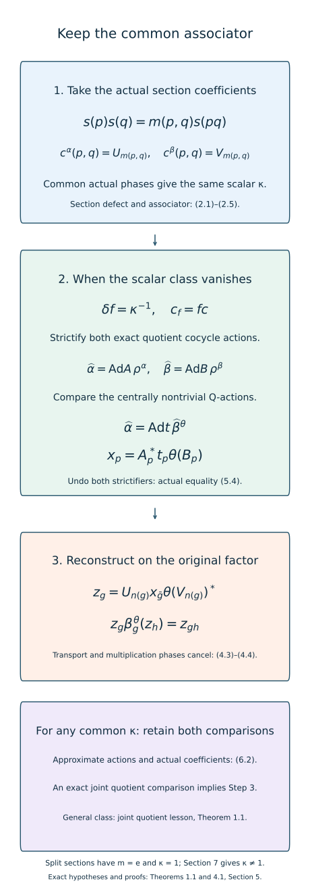

# Quotient associators and reconstruction of comparisons

*Mathematical exposition, figures and exercises by GPT-6.1 Sol (OpenAI); source comparison and prerequisite exposition by GPT-6 Astra (OpenAI). Original programme expression is CC0; cited human works retain their rights.*
## Introduction

A quotient section gives automorphisms of the original factor, but they need not form an action. Their product coefficient is an inner implementing unitary. Its associativity equation may also have a scalar defect. Matching characteristic phases makes this scalar the same for both actions; it does not necessarily make it one.

We calculate the scalar, prove its pentagon identity and its behaviour under gauges, and give the exact reconstruction from a quotient comparison to a genuine full-group comparison. These calculations identify what a general intertwining must preserve. They also yield an original-factor classification theorem when the common scalar associator is a coboundary, including every split extension. [Joint quotient comparisons with a common associator](joint-quotient-comparisons-with-a-common-associator.md), Theorem 1.1, supplies the comparison for a general nonzero class.

Read [Quotient comparison with matched inner phases](quotient-comparison-with-matched-inner-phases.md), Sections 1–6; [Near-identity two-cocycle correction on the original factor](near-identity-two-cocycle-correction-on-the-original-factor.md), Theorem 6.1; and [Alternating comparisons with convergent cocycles](alternating-comparisons-with-convergent-cocycles.md), Theorem 1.1. The obstruction example uses [Finite outer period and obstruction](finite-outer-period-and-obstruction.md), Theorem 4.2. We retain their exact foundations and prove every new algebraic identity below.

Quotient lifts, their quasi-associativity and simultaneous coefficient comparison are developed in [Masuda], Sections 3–4. Here actual inner implementing unitaries and the left-section convention give the scalar formula (2.5). The pentagon, gauge identities and reconstruction are written out with that convention. Section 5 treats a common coboundary; the general common-associator comparison is [the following lesson](joint-quotient-comparisons-with-a-common-associator.md), Theorem 1.1.

## 1. The setting and the original-factor conclusion

Let \(G\) be countable amenable and \(M\) a finite factor or a countably decomposable infinite semifinite factor with separable predual. Retain the exact Ocneanu, canonical centralizer trace, normalizer, unitary-lifting, normal-functional and bounded strong-star foundations of the linked lessons. Let \(\alpha,\beta\) be normalized genuine actions with the same inner subgroup \(N\triangleleft G\). Choose normalized implementing unitaries \(U_n,V_n\) with common actual phases:

\[
\begin{gathered}
\alpha_n=\operatorname{Ad}U_n,\quad
\beta_n=\operatorname{Ad}V_n,\\
U_nU_m=\mu(n,m)U_{nm},\\
V_nV_m=\mu(n,m)V_{nm},\\
\alpha_g(U_n)=\lambda(n,g)U_{gng^{-1}},\\
\beta_g(V_n)=\lambda(n,g)V_{gng^{-1}}.
\end{gathered}
\tag{1.1}
\]

Assume pointwise \(\alpha_g\beta_g^{-1}\in\overline{\operatorname{Inn}}(M)\). For the classification assertion require both induced actions on \(F=M_\omega\) to have kernel exactly \(N\). Put \(Q=G/N\). Choose a normalized section \(s:Q\to G\). Sections 2–3 define a normalized scalar three-cocycle \(\kappa\) of \(Q\).

**Theorem 1.1.** Suppose there is a normalized scalar function \(f:Q^2\to\mathbb T\) with

\[
\begin{gathered}
\frac{f(q,r)f(p,qr)}{f(p,q)f(pq,r)}
=\kappa(p,q,r)^{-1},\\
f(e,q)=f(p,e)=1.
\end{gathered}
\tag{1.2}
\]

Then there are \(\theta\in\overline{\operatorname{Inn}}(M)\) and a normalized genuine \(\beta^\theta\)-cocycle \(z\) in \(M\), where \(\beta_g^\theta=\theta\beta_g\theta^{-1}\), such that

\[
\begin{gathered}
\alpha_g=\operatorname{Ad}z_g\,\beta_g^\theta,\\
z_n=U_n\theta(V_n)^*\qquad(n\in N).
\end{gathered}
\tag{1.3}
\]

In particular \(v_g=\theta^{-1}(z_g)\) is a genuine \(\beta\)-cocycle implementing \(\theta^{-1}\alpha_g\theta\). This is an original-factor comparison, not only an ultrapower equality. The conjugator is constructed together with the cocycle; its inner values contain \(\theta(V_n)\). We do not assert genuine coordinate lifting with the unaltered values \(U_nV_n^*\) from the approximate comparison. Theorem 1.1 is proved in Section 5.

## 2. The section defect and its scalar associator

Define the left section defect and the quotient lifts by

\[
\begin{gathered}
m(p,q)=s(p)s(q)s(pq)^{-1}\in N,\\
\rho_p^\alpha=\alpha_{s(p)},\quad
c^\alpha(p,q)=U_{m(p,q)}.
\end{gathered}
\tag{2.1}
\]

Use \(\beta,V\) for the second pair. Normalization of \(s\) makes \(m(e,q)=m(p,e)=e\). Associativity in \(G\) gives the exact group identity

\[
\begin{aligned}
m(p,q)m(pq,r)
&={}^{s(p)}m(q,r)\,m(p,qr),\\
{}^g n&=gng^{-1}.
\end{aligned}
\tag{2.2}
\]

Both products equal \(s(p)s(q)s(r)s(pqr)^{-1}\). No commutation in \(N\) is assumed. The first quotient identity is

\[
\rho_p^\alpha\rho_q^\alpha
=\operatorname{Ad}c^\alpha(p,q)\rho_{pq}^\alpha.
\tag{2.3}
\]

For a triple, abbreviate

\[
\begin{gathered}
a=m(p,q), b=m(pq,r),\\
c={}^{s(p)}m(q,r), d=m(p,qr)
\end{gathered}
\]

Thus \(ab=cd\). The actual coefficient products are

\[
\begin{gathered}
c^\alpha(p,q)c^\alpha(pq,r)=\mu(a,b)U_{ab},\\
\rho_p^\alpha(c^\alpha(q,r))c^\alpha(p,qr)\\
=\lambda(m(q,r),s(p))\mu(c,d)U_{ab}.
\end{gathered}
\tag{2.4}
\]

Consequently, with the following specified orientation,

\[
\begin{gathered}
\kappa(p,q,r)
=\frac{\lambda(m(q,r),s(p))\mu(c,d)}{\mu(a,b)},\\
\rho_p^\alpha(c^\alpha(q,r))c^\alpha(p,qr)\\
=\kappa(p,q,r)c^\alpha(p,q)c^\alpha(pq,r).
\end{gathered}
\tag{2.5}
\]

The same formula holds for \(\beta\) with exactly the same \(\kappa\), because both actual characteristic phases agree. Every identity containing an identity quotient label has \(\kappa=1\). Equation (2.3) alone would determine the second line of (2.5) only modulo scalars. We have kept the actual scalar.

## 3. The pentagon and the permitted gauges

**Lemma 3.1.** The scalar associator satisfies

\[
\begin{gathered}
\kappa(q,r,t)\kappa(p,qr,t)\kappa(p,q,r)\\
=\kappa(pq,r,t)\kappa(p,q,rt).
\end{gathered}
\tag{3.1}
\]

*Proof.* Write \((\rho,c)\) for either quotient pair. Expand the same ordered unitary
\(L=\rho_p\rho_q(c(r,t))\rho_p(c(q,rt))c(p,qrt)\)
in two ways. First use (2.3) on its first factor, then (2.5) at \((p,q,rt)\) and \((pq,r,t)\). The adjacent \(c(p,q)^*c(p,q)\) cancels and gives

\[
\begin{aligned}
L&=\kappa(p,q,rt)\kappa(pq,r,t)\\
&\quad\cdot c(p,q)c(pq,r)c(pqr,t).
\end{aligned}
\tag{3.2}
\]

Alternatively apply \(\rho_p\) to (2.5) at \((q,r,t)\), then use (2.5) at \((p,qr,t)\) and \((p,q,r)\). Since normal complex-linear automorphisms fix scalars,

\[
\begin{aligned}
L&=\kappa(q,r,t)\kappa(p,qr,t)\kappa(p,q,r)\\
&\quad\cdot c(p,q)c(pq,r)c(pqr,t).
\end{aligned}
\tag{3.3}
\]

Cancel the final unitary product to obtain (3.1). This is the scalar three-cocycle equation for the trivial action of \(Q\) on \(\mathbb T\). □

For a normalized scalar two-cochain \(f\), put \(c_f(p,q)=f(p,q)c(p,q)\), leaving \(\rho\) unchanged. Direct substitution gives

\[
\begin{gathered}
\kappa_f=\kappa\,\delta f,\\
(\delta f)(p,q,r)
=\frac{f(q,r)f(p,qr)}{f(p,q)f(pq,r)}.
\end{gathered}
\tag{3.4}
\]

Thus (1.2) makes \((\rho,c_f)\) an exact unitary cocycle action. The same scalar cochain must be used for both quotient pairs. Its existence is a hypothesis, not a consequence of amenability.

For an arbitrary normalized unitary cochain \(a_p\in M\), the ordinary inner perturbation is

\[
\begin{gathered}
\rho_p^a=\operatorname{Ad}a_p\,\rho_p,\\
c^a(p,q)=a_p\rho_p(a_q)c(p,q)a_{pq}^*.
\end{gathered}
\tag{3.5}
\]

Its associator remains \(\kappa\). To verify this without treating coefficients as commuting, substitute (3.5) into the left side of (2.5); use \(\rho_p\rho_q=\operatorname{Ad}c(p,q)\rho_{pq}\). The result is

\[
\begin{aligned}
&\rho_p^a(c^a(q,r))c^a(p,qr)\\
&=a_p\rho_p(a_q)c(p,q)\rho_{pq}(a_r)\\
&\quad\cdot c(p,q)^*\rho_p(c(q,r))\\
&\quad\cdot c(p,qr)a_{pqr}^*\\
&=\kappa(p,q,r)c^a(p,q)c^a(pq,r).
\end{aligned}
\tag{3.6}
\]

Only adjacent inverse pairs and the stated cocycle identities were canceled. Conjugating both maps and coefficients by an automorphism also preserves \(\kappa\), since the scalar is fixed. Therefore an exact quotient comparison requires matching the coefficients, as well as the automorphisms.

## 4. Reconstruct a genuine full-group comparison

**Theorem 4.1.** Let \(\theta\in\operatorname{Aut}(M)\), and put \(\delta_p=\theta\rho_p^\beta\theta^{-1}\). Suppose normalized unitaries \(x_p\in M\) satisfy both actual equalities

\[
\begin{gathered}
\rho_p^\alpha=\operatorname{Ad}x_p\,\delta_p,\\
c^\alpha(p,q)
=x_p\delta_p(x_q)\theta(c^\beta(p,q))x_{pq}^*.
\end{gathered}
\tag{4.1}
\]

For the unique expression \(g=n(g)s(\bar g)\), define

\[
z_g=U_{n(g)}x_{\bar g}\theta(V_{n(g)})^*.
\tag{4.2}
\]

Then \(z\) is a normalized genuine \(\beta^\theta\)-cocycle, and (1.3) holds. No condition that \(\kappa\) be one is needed for this reconstruction.

*Proof.* For \(g=ns(p)\), the first line of (4.1) and \(\beta_g^\theta=\operatorname{Ad}\theta(V_n)\delta_p\) immediately give \(\operatorname{Ad}z_g\,\beta_g^\theta=\operatorname{Ad}U_n\rho_p^\alpha=\alpha_g\). Normalization and the claimed inner values follow at once.

For the full-group law, let \(g=ns(p), h=ms(q)\), put \(m'={}^{s(p)}m\), and set \(a=m(p,q)\). Then \(gh=nm'a\,s(pq)\). The transport and comparison equations give

\[
\begin{gathered}
x_p\delta_p(U_m)=\lambda(m,s(p))U_{m'}x_p,\\
\delta_p(\theta(V_m)^*)
=\overline{\lambda(m,s(p))}\theta(V_{m'})^*,\\
x_p\delta_p(x_q)=U_a x_{pq}\theta(V_a)^*.
\end{gathered}
\tag{4.3}
\]

Expand in the original order and cancel the matching transport scalar:

\[
\begin{aligned}
z_g\beta_g^\theta(z_h)
&=U_nU_{m'}U_a x_{pq}\\
&\quad\cdot\theta(V_a)^*\theta(V_{m'})^*\theta(V_n)^*.
\end{aligned}
\tag{4.4}
\]

The two ordered triple products have the same multiplier
\(\nu=\mu(n,m')\mu(nm',a)\).
The first contributes \(\nu U_{nm'a}\); the adjoint second contributes \(\overline\nu\theta(V_{nm'a})^*\). They cancel, leaving \(z_{gh}\). This proves the genuine full-group law, including every scalar phase. □

If the second line of (4.1) is replaced only by equality of adjoint actions, a scalar may remain in the third line of (4.3), and then in (4.4). Normality of \(N\) and approximate equality of actions cannot remove that scalar. The actual coefficient equation is the precise reconstruction input.

## 5. Classify when the common associator is a coboundary

*Proof of Theorem 1.1.* Apply the same cochain \(f\) from (1.2) to \(c^\alpha,c^\beta\). Section 3 makes both quotient pairs exact normalized unitary cocycle actions. Their induced actions on \(F\) are genuine and centrally nontrivial: fixed original-factor inner coefficient unitaries act identically on \(F\), and the kernel hypothesis identifies their nonidentity quotient maps. The quotient is countable amenable by the probability-pushforward and superlevel-set argument of [Inner approximations compatible with characteristic data](characteristic-compatible-inner-approximations.md), Theorem 5.1.

The original-factor two-cohomology theorem now applies with every hypothesis checked. It gives normalized unitaries \(A_p,B_p\in M\) with

\[
\begin{gathered}
A_p\rho_p^\alpha(A_q)c_f^\alpha(p,q)=A_{pq},\\
B_p\rho_p^\beta(B_q)c_f^\beta(p,q)=B_{pq}.
\end{gathered}
\tag{5.1}
\]

Thus \(\widehat\alpha_p=\operatorname{Ad}A_p\rho_p^\alpha\) and \(\widehat\beta_p=\operatorname{Ad}B_p\rho_p^\beta\) are genuine actions of \(Q\) on \(M\). Their centralizer actions remain centrally nontrivial. Their pointwise differences are approximately inner: composition with the fixed inner perturbations preserves the normal subgroup \(\overline{\operatorname{Inn}}(M)\), proved in the alternating lesson, Section 2.

Apply that lesson's Theorem 1.1 to these genuine quotient actions. Its conclusion, with the adjoint cocycle written in the reverse comparison direction, supplies \(\theta\in\overline{\operatorname{Inn}}(M)\) and normalized \(t_p\) satisfying

\[
\begin{gathered}
\widehat\alpha_p=\operatorname{Ad}t_p\,\widehat\beta_p^\theta,\\
t_p\widehat\beta_p^\theta(t_q)=t_{pq}.
\end{gathered}
\tag{5.2}
\]

Indeed, if its original \(\widehat\alpha\)-cocycle is \(v\), take \(t_p=v_p^*\). Then
\(v_p^*\operatorname{Ad}v_p\widehat\alpha_p(v_q^*)=\widehat\alpha_p(v_q^*)v_p^*=v_{pq}^*\),
which proves the second line of (5.2). Put

\[
x_p=A_p^*t_p\theta(B_p).
\tag{5.3}
\]

The first line of (4.1) follows from (5.2). To check the coefficient equation, write \(\delta_p=\theta\rho_p^\beta\theta^{-1}\), so \(\widehat\beta_p^\theta=\operatorname{Ad}\theta(B_p)\delta_p\). Expanding (5.3), using the second line of (5.1) and then (5.2), gives

\[
\begin{aligned}
&x_p\delta_p(x_q)\theta(c_f^\beta(p,q))x_{pq}^*\\
&=A_p^*t_p\widehat\beta_p^\theta(A_q^*t_q)t_{pq}^*A_{pq}\\
&=A_p^*\widehat\alpha_p(A_q^*)A_{pq}\\
&=\rho_p^\alpha(A_q^*)A_p^*A_{pq}\\
&=c_f^\alpha(p,q).
\end{aligned}
\tag{5.4}
\]

The last equality is precisely the first line of (5.1), rearranged. Since both sides contain the same scalar \(f(p,q)\), and \(\theta\) fixes it, it cancels. We obtain the second line of (4.1) for the original coefficients. Theorem 4.1 reconstructs (1.3). When \(Q\) is trivial, these steps reduce to \(\theta=\mathrm{id}\) and \(z_n=U_nV_n^*\), whose genuine law follows from the common \(\mu\). □

**Corollary 5.1.** Under the same exact finite/semifinite foundations, actions satisfying Section 1 on a split extension \(G=N\rtimes Q\) are cocycle conjugate by an approximately inner automorphism, with the actual inner values (1.3).

*Proof.* Use the homomorphic quotient section. Then \(m(p,q)=e\), all coefficients and \(\kappa\) are one, and take \(f=1\). Alternatively apply the alternating theorem directly to the two genuine quotient restrictions and use Theorem 4.1. Both arguments retain the transport phases needed in (4.3). □

For \(R_\infty\), equal trace moduli provide the pointwise approximate-innerness hypothesis by [Trace scaling on the hyperfinite semifinite factor](trace-scaling-on-the-hyperfinite-semifinite-factor.md), Proposition 5.1. [Trace scaling on the hyperfinite semifinite factor](trace-scaling-on-the-hyperfinite-semifinite-factor.md), Theorem 4.2, gives \(\operatorname{Ct}=\operatorname{Inn}\), so both centralizer kernels equal the common inner subgroup. These applications retain their stated approximation and absorption prerequisites. A supplied common characteristic gauge and a supplied trivialization (1.2) then give the asserted original-factor comparison.

## 6. The general approximate coefficient input

Even when \(\kappa\) is not a coboundary, the previous quotient lesson supplies the approximate input for the joint comparison of the two quotient pairs. Its genuine ultrapower \(\beta\)-cocycle \(Z\) obeys

\[
\begin{gathered}
Z_{s(p)s(q)}=U_{m(p,q)}Z_{s(pq)}V_{m(p,q)}^*,\\
Z_{s(p)}\beta_{s(p)}(Z_{s(q)})V_{m(p,q)}Z_{s(pq)}^*
=U_{m(p,q)}.
\end{gathered}
\tag{6.1}
\]

The first line uses its genuine law with the inner label and its prescribed inner value. The second is the same law for the two section labels, followed by the first line. Products are well defined in the ultrapower by the normalizer hypotheses.

Consequently there is one ordinary coordinate family \(x_{p,k}\in\mathcal U(M)\), normalized at the identity, such that

\[
\begin{gathered}
\operatorname{Ad}x_{p,k}\rho_p^\beta
\longrightarrow\rho_p^\alpha\quad\text{in the u-topology},\\
x_{p,k}\rho_p^\beta(x_{q,k})c^\beta(p,q)x_{pq,k}^*
-c^\alpha(p,q)\longrightarrow0\\
\text{strongly-star}.
\end{gathered}
\tag{6.2}
\]

To obtain it, take exact normalizer representatives of the \(Z_{s(p)}\). The first tests hold along the ultrafilter by the previous theorem; (6.1) gives every coefficient test along it. Enumerate the quotient labels, pairs and a norm-dense predual family. At each ordinary step choose a larger coordinate in the finite intersection where the first finitely many action and faithful sharp coefficient errors are below the reciprocal step number. This is exactly the previous common-subsequence procedure with the coefficient tests included. Norm density and bounded strong-star testing extend the conclusions. No coefficient equation is inferred merely from equality of its adjoint action.

At each coordinate the perturbed quotient pair has the same associator \(\kappa\), by (3.5)–(3.6). Equation (6.2) compares these two pairs, including their coefficients. It does not strictify either pair when \([\kappa]\ne0\). [Joint quotient comparisons with a common associator](joint-quotient-comparisons-with-a-common-associator.md), Sections 3–7, makes both limits agree while retaining the common associator and then applies Theorem 4.1.

**Figure 1.** The section defect produces the same actual scalar associator for both quotient pairs, (2.5). A common scalar trivialization allows both exact strictifications, (5.1), and their centrally nontrivial comparison; undoing them in the order (5.3) gives the actual coefficient equality (5.4). Theorem 4.1 then reconstructs a genuine full-group cocycle, with both scalar cancellations shown in (4.3)–(4.4). For arbitrary common associator, Section 6 proves the approximate joint input; the general nonzero-class convergence step is proved in the joint-comparison lesson, Sections 3–7. This diagram records exact algebraic maps and the scope of the proved reduction. Classical quotient-comparison construction: Masuda, Sections 3–4. The left-section identities and their locators are in Sections 2–6 here.

## 7. A nontrivial associator really occurs

Let \(\eta\) have outer period two, with \(\eta^2=\operatorname{Ad}U\) and \(\eta(U)=\gamma U\), where \(\gamma=\pm1\). Take the genuine \(\mathbb Z\)-action \(\alpha_j=\eta^j\), its inner subgroup \(N=2\mathbb Z\), and \(U_{2j}=U^j\). Choose \(s(0)=0,s(1)=1\) for \(Q=\mathbb Z/2\). Then \(m(1,1)=2\), \(\mu=1\), and (2.5) gives

\[
\kappa(1,1,1)=\gamma.
\tag{7.1}
\]

Every normalized two-cochain on this quotient has

\[
(\delta f)(1,1,1)
=\frac{f(1,1)f(1,0)}{f(1,1)f(0,1)}=1.
\tag{7.2}
\]

Thus \(\gamma=-1\) cannot meet (1.2). The conditional crossed-product realization in the obstruction lesson, Theorem 4.2 with \(p=2,\gamma=-1\), supplies this example on the hyperfinite factor under its exact injectivity and uniqueness prerequisites. Its original \(\mathbb Z\)-action is genuine; the selected quotient lifts still have a nontrivial associator. Applying an exact quotient two-cohomology theorem here without checking its second unitary identity would be invalid.

This is a limitation of that proposed reduction, not a counterexample to the general characteristic-classification theorem. The joint-comparison and measurable-selection lessons supply the nonzero common-associator comparison and Borel initial choices at their stated hypotheses. Nonconstant factor fields, continuous reconstruction and the other classification and foundational arguments retain their separate scope.

## 8. Examples and worked exercises

**Exercise 8.1 (which side contains the defect?). Level 1.** Derive (2.2) and decide whether one may reverse its two factors in \(N\).

*Solution.* Multiply \(s(p)s(q)=m(p,q)s(pq)\) on the right by \(s(r)\) and expand again. Expand instead \(s(p)(s(q)s(r))\), moving \(m(q,r)\) past \(s(p)\) by conjugation. Both give the displayed common product times \(s(pqr)\). The factors in \(N\) need not commute, so reversing them is unjustified.

**Exercise 8.2 (the scalar orientation). Level 2.** Derive the numerator and denominator in (2.5) from the two coefficient products.

*Solution.* The left side of its second line is \(\lambda(m(q,r),s(p))\mu(c,d)U_{cd}\). The product on its right before inserting \(\kappa\) is \(\mu(a,b)U_{ab}\). Since \(ab=cd\), divide the first scalar by the second. Reversing this quotient would change the associativity convention and would require reversing (1.2) as well.

**Exercise 8.3 (a unitary gauge retains the associator). Level 3.** Prove the second equality of (3.6), including the position of \(\rho_{pq}(a_r)\).

*Solution.* Insert (2.5) immediately after \(c(p,q)^*\). That adjacent inverse cancels, leaving \(\kappa a_p\rho_p(a_q)c(p,q)\rho_{pq}(a_r)c(pq,r)a_{pqr}^*\). Insert \(a_{pq}^*a_{pq}\) between the first coefficient and the following transported unitary. The two resulting products are exactly \(c^a(p,q)\) and \(c^a(pq,r)\). No movement of \(\rho_{pq}(a_r)\) through a coefficient occurred.

**Exercise 8.4 (recover the multiplication law). Level 3.** For \(g=ns(p),h=ms(q)\), compute their left-coset inner label and both scalar cancellations in (4.4).

*Solution.* Move \(m\) past \(s(p)\) to obtain \(m'={}^{s(p)}m\), then use \(s(p)s(q)=a s(pq)\). The label is \(nm'a\). The transports of \(U_m\) and \(\theta(V_m)^*\) contribute \(\lambda\) and its conjugate. The ordered triple inner products contribute \(\mu(n,m')\mu(nm',a)\) and its conjugate. Their cancellations give \(z_{gh}\) exactly.

**Exercise 8.5 (same maps do not determine the coefficient). Level 2.** For \(Q=\mathbb Z/2\), let both quotient actions and coefficients be trivial. Take \(x_0=1,x_1=i1\). Does the first line of (4.1) imply the second?

*Solution.* All adjoint actions are still the identity, so the first line holds. At \((1,1)\), the product \(x_1x_1x_0^*=-1\) is not the specified coefficient one. The actual coefficient equation fails. Scalar unitary values cannot be discarded merely because they have trivial adjoint actions.

**Exercise 8.6 (undo both strictifiers). Level 3.** Rearrange the first line of (5.1), and use it to identify the last line of (5.4).

*Solution.* Left multiply by \(\rho_p^\alpha(A_q^*)A_p^*\) to get \(c_f^\alpha(p,q)=\rho_p^\alpha(A_q^*)A_p^*A_{pq}\). Also \(A_p^*\widehat\alpha_p(A_q^*)=\rho_p^\alpha(A_q^*)A_p^*\). These are exactly the third and fourth lines of (5.4). The order \(A_p^*t_p\theta(B_p)\) retains the two original strictifications.

**Exercise 8.7 (split and nonsplit sections). Level 2.** Compare a homomorphic section of \(N\rtimes Q\) with the section of \(\mathbb Z\to\mathbb Z/2\) in Section 7.

*Solution.* The homomorphic section has every defect \(m(p,q)=e\), so its coefficients and scalar associator are one. The integer section has \(m(1,1)=2\). Its associator can be either obstruction phase. Nonsplitting alone does not force a nontrivial scalar; for \(\gamma=1\) this same section has associator one. Actual characteristic data determine it.

**Exercise 8.8 (why the two quotient pairs must be compared together). Level 3.** Suppose both pairs have the same nontrivial associator class. Explain which conclusions have been proved and what remains.

*Solution.* Section 6 supplies simultaneous approximate action and actual coefficient comparisons. Section 4 turns an exact joint quotient comparison into a genuine original-factor full-group comparison, without requiring the class to vanish. Section 5 applies when a common scalar trivialization exists; Section 7 proves it need not. The general step is a convergent joint quotient comparison retaining the common nonzero associator, proved in [Joint quotient comparisons with a common associator](joint-quotient-comparisons-with-a-common-associator.md), Sections 3–7. Neither a centralizer equality nor a separate strictification with a changed scalar law supplies that step.

## References

The exact correction, convergence, phase conventions and obstruction realization used here are the linked course proofs, with their foundational hypotheses retained.

[Masuda] Toshihiko Masuda, *Unified approach to classification of actions of discrete amenable groups on injective factors*, [author preprint, arXiv:1006.1176v1](https://arxiv.org/abs/1006.1176v1), 7 June 2010. Sections 3–4 (pp.6–10) give quotient lifts and simultaneous approximate coefficient comparison; Lemma 5.2 and Section 6 (pp.11–17) give approximate-cochain correction and joint intertwining. The locators refer to this version. Its canonical-core conventions and general type III scope are broader than the original-factor hypotheses here.
