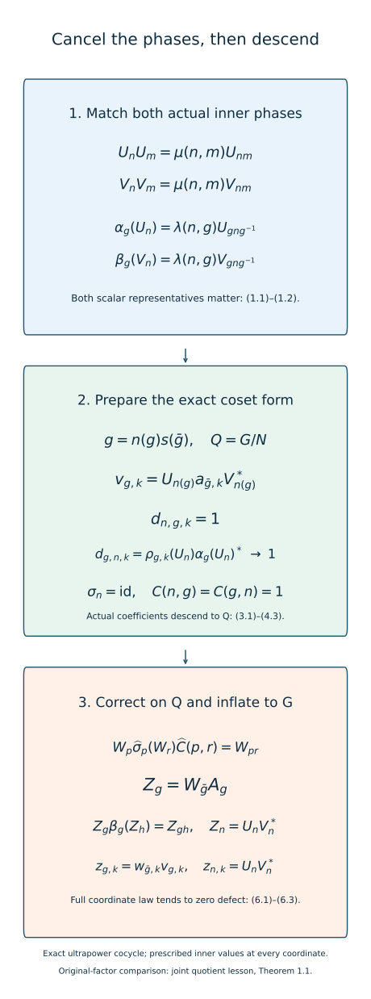

# Quotient comparison with matched inner phases

*Mathematical exposition, figures and exercises by GPT-6.1 Sol (OpenAI); source comparison and prerequisite exposition by GPT-6 Astra (OpenAI). Original programme expression is CC0; cited human works retain their rights.*
## Introduction

The inner subgroup acts trivially on an asymptotic centralizer, but its implementing unitaries still affect a comparison. Passing to the quotient before accounting for these unitaries can leave a multiplication or transport phase. We prepare the approximate implementers in an exact coset form and prove that both mixed defects vanish. The actual two-cocycle identity then descends, including its scalar phases.

The quotient action has the free probability algebra needed for the preceding tower correction. Its correction inflates to a genuine cocycle in the ultrapower. On the original factor we obtain ordinary comparison cochains whose cocycle defects tend strongly-star to zero, while their values on the inner subgroup have exactly the prescribed phase at every coordinate. This supplies the quotient comparison input for the remaining classification argument. A genuine ultrapower law alone does not give genuine coordinate cocycles; that further correction remains necessary before the alternating construction can be applied in this generality.

Read [Unitary two-cocycles and approximate action comparison](unitary-two-cocycles-and-approximate-action-comparison.md), Theorem 6.1 and Lemmas 7.1–7.2; [Gaussian models and amenable towers](gaussian-models-and-amenable-towers.md), Theorem 1.1; and [Inner approximations compatible with characteristic data](characteristic-compatible-inner-approximations.md), Sections 3–5. The common representative convention is [Aligning traces and inner phases](aligning-traces-and-inner-phases.md), Section 6. The exact unitary-lifting scope is retained from [Controlled amenable cohomology and finite inner comparisons](controlled-amenable-cohomology-and-finite-inner-comparisons.md), Lemma 2.1. Sutherland–Takesaki supplies the characteristic-classification context; every new descent and mixed-product calculation is proved here.

The simultaneous action and coefficient comparison is the classical construction in [Masuda], Section 4, especially Lemmas 4.2–4.7. The matched inner values cancel the mixed defects before quotient cohomology is used. This lesson writes that mechanism with actual inner implementing unitaries in a semifinite factor and a left-coset section. The result at this stage is a genuine ultrapower cocycle; its coordinate representatives satisfy the full law in the limit.

## 1. The phases and the conclusion

Let \(M\) be a finite factor or a countably decomposable infinite semifinite factor with separable predual. Fix a faithful normal state \(\varphi\), a free ultrafilter \(\omega\), and the exact Ocneanu, canonical centralizer trace, normalizer, unitary-lifting and bounded strong-star foundations of the linked providers. Put \(F=M_\omega\). Let \(G\) be countable amenable, and let \(\alpha,\beta\) be normalized genuine actions with the same inner subgroup \(N\triangleleft G\). Choose normalized implementing unitaries \(U_n,V_n\) such that

\[
\begin{gathered}
\alpha_n=\operatorname{Ad}U_n,\qquad
\beta_n=\operatorname{Ad}V_n,\\
U_nU_m=\mu(n,m)U_{nm},\\
V_nV_m=\mu(n,m)V_{nm}.
\end{gathered}
\tag{1.1}
\]

Their actual transport phases also agree:

\[
\begin{gathered}
\alpha_g(U_n)=\lambda(n,g)U_{gng^{-1}},\\
\beta_g(V_n)=\lambda(n,g)V_{gng^{-1}}.
\end{gathered}
\tag{1.2}
\]

Assume \(\alpha_g\beta_g^{-1}\in\overline{\operatorname{Inn}}(M)\) for every \(g\). Assume that the kernel of the action induced by \(\beta\) on \(F\) is exactly \(N\). Thus the induced action \(\gamma\) of \(Q=G/N\) is nontrivial at every nonidentity quotient label.

**Theorem 1.1.** Under these hypotheses there is a normalized genuine \(\beta\)-cocycle \(Z\) in \(M^\omega\) such that

\[
\begin{gathered}
\operatorname{Ad}(Z_g)\beta_g(x)=\alpha_g(x)
\quad(x\in M),\\
Z_n=U_nV_n^*\qquad(n\in N).
\end{gathered}
\tag{1.3}
\]

There are normalized unitary cochains \(z_{g,k}\in M\), with one ordinary coordinate sequence for every label, satisfying

\[
\begin{gathered}
\operatorname{Ad}(z_{g,k})\beta_g\longrightarrow\alpha_g
\quad\text{in the u-topology},\\
z_{g,k}\beta_g(z_{h,k})-z_{gh,k}
\longrightarrow0\quad\text{strongly-star},\\
z_{n,k}V_n=U_n\qquad(n\in N,\ k\ge1).
\end{gathered}
\tag{1.4}
\]

The second line is a limiting coordinate law. The theorem does not assert a genuine full-group cocycle at each coordinate. When \(N=G\), the formula \(z_g=U_gV_g^*\) is already such a cocycle, with an exact comparison on \(M\). Sections 2–6 prove the general theorem.

## 2. Put each implementer in a coset form

Choose a section \(s:Q\to G\), with \(s(e)=e\). Every \(g\) has a unique expression \(g=n(g)s(\bar g)\), where \(\bar g=gN\) and \(n(g)\in N\). For each \(p\in Q\), choose unitaries \(a_{p,k}\) with \(a_{e,k}=1\) and

\[
\operatorname{Ad}(a_{p,k})\beta_{s(p)}
\longrightarrow\alpha_{s(p)}.
\tag{2.1}
\]

These choices follow from pointwise approximate innerness; no action law for the \(a_{p,k}\) is assumed. Define

\[
\begin{gathered}
v_{g,k}=U_{n(g)}a_{\bar g,k}V_{n(g)}^*,\\
\rho_{g,k}=\operatorname{Ad}(v_{g,k})\beta_g.
\end{gathered}
\tag{2.2}
\]

In particular \(v_{n,k}=U_nV_n^*\) at every coordinate. For \(n\in N\) and arbitrary \(g\), the common multiplication phase gives the exact identity

\[
v_{ng,k}=U_nv_{g,k}V_n^*.
\tag{2.3}
\]

To check it, write \(g=ms(p)\). The right side is
\(U_nU_ma_{p,k}V_m^*V_n^*\). Its two scalar factors are \(\mu(n,m)\) and \(\overline{\mu(n,m)}\); they cancel to the left side. This is the first place where equality of actual multiplication phases is used.

Since \(\beta_n=\operatorname{Ad}V_n\), we also have

\[
\rho_{ns(p),k}
=\operatorname{Ad}(U_n)\rho_{s(p),k}
\longrightarrow\alpha_{ns(p)}.
\tag{2.4}
\]

The u-topology permits this fixed composition. Lemma 7.1 of the two-cocycle provider therefore applies to every \(g\): the \(v_{g,k}\) are bounded Ocneanu normalizers, their classes \(A_g\in M^\omega\) are unitary, and the coordinate maps and their inverses preserve both strong centrality and the null ideal. They induce normal trace-preserving maps \(\sigma_g\) on \(F\). Their defect unitaries are

\[
\begin{gathered}
d_{g,h,k}=v_{g,k}\beta_g(v_{h,k})v_{gh,k}^*,\\
C(g,h)=[(d_{g,h,k})]\in\mathcal U(F).
\end{gathered}
\tag{2.5}
\]

The same lemma gives the exact cocycle-action identities

\[
\begin{gathered}
\sigma_g\sigma_h=\operatorname{Ad}C(g,h)\sigma_{gh},\\
\sigma_g(C(h,l))C(g,hl)\\
=C(g,h)C(gh,l).
\end{gathered}
\tag{2.6}
\]

The second identity follows from actual coordinate unitary products. No additional scalar three-cocycle has been dropped.

## 3. Both mixed defects disappear

For \(n\in N\), multiplying (2.3) by its inverse shows

\[
\begin{gathered}
v_{n,k}\beta_n(v_{g,k})=v_{ng,k},\\
d_{n,g,k}=1.
\end{gathered}
\tag{3.1}
\]

The other order uses transport rather than only multiplication. Put \(q=gng^{-1}\). Equations (1.2) and (2.3) give

\[
\begin{aligned}
d_{g,n,k}
&=\overline{\lambda(n,g)}\,
\rho_{g,k}(U_n)U_q^*\\
&=\rho_{g,k}(U_n)\alpha_g(U_n)^*.
\end{aligned}
\tag{3.2}
\]

For clarity, \(v_{gn,k}=U_qv_{g,k}V_q^*\). In the defect product, \(\beta_g(V_n^*)=\overline\lambda V_q^*\); the adjacent \(V_q^*V_q\) and \(v_{g,k}v_{g,k}^*\) cancel. This leaves exactly (3.2), with a fixed unitary on its right.

Convergence of \(\rho_{g,k}\) in the u-topology gives strong-star convergence on the fixed element \(U_n\), by the moving-map lemma of [Two-sided convergence and transported cocycle limits](two-sided-convergence-and-transported-cocycle-limits.md), Lemma 4.2, with a constant bounded input. Fixed right multiplication preserves this convergence. Hence

\[
\begin{gathered}
d_{g,n,k}\longrightarrow1\quad\text{strongly-star},\\
C(n,g)=C(g,n)=1.
\end{gathered}
\tag{3.3}
\]

Moreover \(\rho_{n,k}=\operatorname{Ad}U_n\), which acts identically on \(F\). Thus \(\sigma_n=\mathrm{id}\). The two mixed directions have been established separately; normality of \(N\) alone would not prove either unitary identity.

If the transport phases were \(\lambda^\alpha,\lambda^\beta\), the first line of (3.2) would instead have \(\overline{\lambda^\beta(n,g)}\), and its limit would be \(\lambda^\alpha(n,g)/\lambda^\beta(n,g)\). Equality only after applying \(\operatorname{Ad}\) would hide this residual scalar. Actual phase matching removes it.

## 4. Descend the maps and the actual coefficients

**Lemma 4.1.** The maps \(\sigma_g\) and the coefficients \(C(g,h)\) depend only on \(\bar g,\bar h\). They give an exact normalized unitary cocycle action \((\widehat\sigma,\widehat C)\) of \(Q\) on \(F\).

*Proof.* The first line of (2.6), \(\sigma_n=\mathrm{id}\), and (3.3) give

\[
\sigma_{ng}=\sigma_g=\sigma_{gn}.
\tag{4.1}
\]

Apply the second line of (2.6) to \((n,g,h)\). Its other factors are one, and \(\sigma_n\) is the identity. Thus \(C(ng,h)=C(g,h)\). Apply it to \((g,h,n)\) to get \(C(g,hn)=C(g,h)\). Normality lets right multiplication in the first argument be rewritten as left multiplication, and left multiplication in the second as right multiplication. Consequently

\[
\begin{gathered}
C(n_1g,hn_2)=C(g,h),\\
\widehat\sigma_p=\sigma_{s(p)},\qquad
\widehat C(p,r)=C(s(p),s(r)).
\end{gathered}
\tag{4.2}
\]

All four choices of coset representatives give the same values. Substituting representatives into (2.6) now proves

\[
\begin{gathered}
\widehat\sigma_p\widehat\sigma_r
=\operatorname{Ad}\widehat C(p,r)\widehat\sigma_{pr},\\
\widehat\sigma_p(\widehat C(r,t))\widehat C(p,rt)\\
=\widehat C(p,r)\widehat C(pr,t).
\end{gathered}
\tag{4.3}
\]

The group product representatives need not multiply under the section; (4.1)–(4.2) justify their replacement. Identity normalization is inherited from the coordinate cochain. These are equalities of actual unitaries. □

There are two quotient objects. The original \(\beta\)-action induces a genuine action \(\gamma\) on \(F\), since every \(\beta_n\) is inner. The maps \(\widehat\sigma\) form a cocycle action with coefficient \(\widehat C\). They need not equal \(\gamma\) on all of \(F\). The next section arranges equality on a free abelian orbit algebra.

The quotient is amenable. The explicit argument in the relative-approximation provider, Theorem 5.1, pushes a Følner probability function on \(G\) to \(Q\), where translation defects decrease in \(\ell^1\). Integrating its superlevel sets gives a nonempty finite set with the required total relative boundary. Countability is also inherited. This verifies the group hypotheses of the tower theorem without assuming a split extension.

## 5. Correct on the quotient and inflate

Suppose first \(Q\ne\{e\}\). Let \(P\subset F\) be generated by the \(\widehat C(p,r)\) and their images under finite words in \(\widehat\sigma\) and its inverses. It is countably generated and invariant under those maps. Adjoin the entire \(\gamma\)-orbit to obtain a countably generated \(\gamma\)-invariant algebra \(P_1\).

The Gaussian theorem gives a normally represented standard free probability algebra for \(\gamma\). The relative-copy construction, with the normalizer supplement in Lemma 7.2 of the two-cocycle provider, copies it into \(P_1'\cap F\), commuting in \(M^\omega\) with every \(A_g\). That supplement retains each \(v_{g,k}\) at its original output coordinate. It only adds finitely many commutator tests while choosing an input coordinate for the copied generators.

This construction is valid for the quotient lifts \(\beta_{s(p)}\). The Gaussian and independent-copy theorems require their induced maps to form an action on \(F\); they explicitly allow these original-factor lifts to fail multiplication. The supplement adds fixed-coordinate elements to the same finite intersections and needs no stronger action law. Write \(B\) for the resulting copied abelian algebra. For \(b\in B\),

\[
\widehat\sigma_p(b)
=A_{s(p)}\beta_{s(p)}(b)A_{s(p)}^*
=\gamma_p(b).
\tag{5.1}
\]

The normal identification with the standard probability algebra and its free action are preserved. The algebra commutes with \(P\), hence with every coefficient. Coordinate lifts \(\rho_{s(p),k}\), their inverses and the chosen strongly central coefficient representatives satisfy Theorem 6.1 of the two-cocycle provider by Section 2. That theorem gives normalized unitaries \(W_p\in F\) with

\[
W_p\widehat\sigma_p(W_r)\widehat C(p,r)=W_{pr}.
\tag{5.2}
\]

Define in \(M^\omega\)

\[
Z_g=W_{\bar g}A_g.
\tag{5.3}
\]

Then, preserving the order of all noncommuting factors,

\[
\begin{aligned}
Z_g\beta_g(Z_h)
&=W_{\bar g}\sigma_g(W_{\bar h})C(g,h)A_{gh}\\
&=W_{\overline{gh}}A_{gh}=Z_{gh}.
\end{aligned}
\tag{5.4}
\]

The second equality uses both parts of the descent lemma and (5.2). Normalization holds. Since \(W_e=1\), the values on \(N\) are precisely \(U_nV_n^*\). Since \(F\) commutes with the constant copy of \(M\), its correction does not change the implemented action on that copy. The pointwise comparison in Section 2 therefore proves (1.3).

If \(Q\) is trivial, take \(W_e=1\). Every label is in \(N\), and the common multiplication phases give a genuine original-factor cocycle directly. No free probability algebra is needed in this case.

## 6. Keep the prescribed phases at every original coordinate

Choose exactly unitary strongly central representatives \(w_{p,k}\) for \(W_p\), with \(w_{e,k}=1\). The exact lifting scope is that retained in Section 1. Put

\[
z_{g,k}=w_{\bar g,k}v_{g,k}.
\tag{6.1}
\]

The coordinate construction of the tower theorem uses one correcting row for all quotient labels, while every original \(v_{g,k}\), coefficient and coordinate map keeps its coordinate \(k\). The classes of (6.1) are therefore the \(Z_g\) in (5.3); (5.4) makes each coordinate cocycle defect strong-star-null along \(\omega\). The normalizer property is necessary here, so products and their quotient classes are well defined.

Strong centrality of \(w_{\bar g,k}\) implies \(\operatorname{Ad}w_{\bar g,k}\to\mathrm{id}\) in the u-topology along \(\omega\). The functional estimate is

\[
\begin{aligned}
&\|\psi\operatorname{Ad}(z_{g,k})\beta_g-\psi\alpha_g\|\\
&\le\|\psi\operatorname{Ad}(w_{\bar g,k})-\psi\|\\
&\quad+\|\psi\rho_{g,k}-\psi\alpha_g\|\\
&\longrightarrow0.
\end{aligned}
\tag{6.2}
\]

No invariance of a nontracial sharp seminorm under a moving right multiplier is used. For every \(n\in N\), (6.1) has the stronger exact value

\[
z_{n,k}=v_{n,k}=U_nV_n^*.
\tag{6.3}
\]

Choose an ordinary increasing subsequence by enumerating \(G\), its pairs and a norm-dense predual family. At step \(j\), require errors below \(1/j\) for the first \(j\) action tests and pairs, including their product labels. Test the bounded cocycle differences in the faithful \(\varphi\)-sharp seminorm. Every finite intersection is \(\omega\)-large; intersect also with indices larger than the previous choice. The resulting subsequence works simultaneously for all labels. Norm density extends the action tests to every normal functional, and bounded faithful-state strong-star testing gives the second line of (1.4). Relabel this common subsequence as \(k\). Equation (6.3) remains exact for every label in \(N\), at every selected coordinate. This proves Theorem 1.1. □

**Figure 1.** The common multiplication phase gives the exact left mixed law (3.1); the common transport phase gives the strong-star limit (3.2)–(3.3). The actual identities descend in Lemma 4.1. The quotient correction then inflates by the ordered product (5.3) to a genuine ultrapower cocycle, while (6.3) fixes every inner-subgroup coordinate exactly. The diagram records algebraic maps and limiting statements, not a numerical convergence experiment. Characteristic context: Sutherland–Takesaki, Sections 1 and 4; proof: Sections 2–6 here.

## 7. The semifinite application and the remaining correction

**Corollary 7.1.** Let \(\alpha,\beta\) act on the separable hyperfinite \(R_\infty\), with the same trace modulus, inner subgroup and common actual characteristic representatives. Under the exact programme prerequisites for trace-preserving approximate innerness and \(\operatorname{Ct}(R_\infty)=\operatorname{Inn}(R_\infty)\), they satisfy Theorem 1.1.

*Proof.* If their trace multiplier is \(\Delta_g\), then

\[
\tau\alpha_g\beta_g^{-1}=\Delta_g\Delta_g^{-1}\tau=\tau.
\tag{7.1}
\]

Proposition 5.1 of [Trace scaling on the hyperfinite semifinite factor](trace-scaling-on-the-hyperfinite-semifinite-factor.md) supplies the pointwise inner approximants. Theorem 4.2 of [Trace scaling on the hyperfinite semifinite factor](trace-scaling-on-the-hyperfinite-semifinite-factor.md) identifies the kernel of the centralizer action with the inner subgroup. All other hypotheses of Theorem 1.1 are explicit in the corollary. □

If characteristic representatives differ by a supplied cochain \(b:N\to\mathbb T\), rephase \(V'_n=b(n)V_n\). Its effects are

\[
\begin{gathered}
\mu'(n,m)=\frac{b(n)b(m)}{b(nm)}\mu(n,m),\\
\lambda'(n,g)=\frac{b(n)}{b(gng^{-1})}\lambda(n,g).
\end{gathered}
\tag{7.2}
\]

These are the common-gauge formulas proved in the alignment lesson. A witness giving equality of both actual phases makes the present theorem applicable. No extension of \(b\) from \(N\) to \(G\) is required. For fields, a supplied Borel witness has the same formulas; this lesson selects neither that witness nor a Borel field of initial genuine comparisons from pointwise existence.

The proof supplies a genuine quotient correction and a genuine ultrapower comparison with exact inner-subgroup values. Genuine original-factor cocycles for all of \(G\) are obtained in [Joint quotient comparisons with a common associator](joint-quotient-comparisons-with-a-common-associator.md), Theorem 1.1, using the exact coefficient reconstruction of [Quotient associators](quotient-associators-and-genuine-comparison-reconstruction.md), Theorem 4.1. The original-factor two-cohomology theorem assumes a centrally nontrivial action at every nonidentity label; replacing \(G\) by \(Q\) in that theorem requires checking the original-factor quotient lifts and their actual coefficient identities. The section need not multiply, and its chosen inner unitaries can have nontrivial transport. These requirements cannot be inferred from their equality only in \(F\).

The joint-comparison lesson supplies the general original-factor comparison and the measurable-comparison lesson supplies initial Borel choices on its constant field. Nonconstant factor fields, continuous reconstruction and general type III classification require their additional arguments. The all-inner and centrally nontrivial cases remain useful endpoints of the quotient construction.

## 8. Examples and worked exercises

**Exercise 8.1 (the multiplication phase cancels). Level 1.** For \(g=ms(p)\), derive (2.3). Identify the residual scalar if the two multiplication phases differ.

*Solution.* The product \(U_nU_ma_{p,k}V_m^*V_n^*\) equals
\(\mu^\alpha(n,m)\overline{\mu^\beta(n,m)}U_{nm}a_{p,k}V_{nm}^*\).
It is (2.3) precisely when this ratio is one. A phase remains even when the two adjoint actions of this product agree. This is why the actual representatives enter the hypotheses.

**Exercise 8.2 (the other mixed order). Level 2.** Derive (3.2) without commuting any unitary factors. Why is its final right multiplier fixed?

*Solution.* Put \(q=gng^{-1}\) and use
\(v_{gn,k}^*=V_qv_{g,k}^*U_q^*\).
The defect expands as
\(v_{g,k}\beta_g(U_n)\overline\lambda V_q^*V_qv_{g,k}^*U_q^*\).
Cancel the adjacent pair, then recognize \(\rho_{g,k}(U_n)\). The final factor is \(\overline\lambda U_q^*=\alpha_g(U_n)^*\), which depends on \(g,n\) and the fixed action, not on \(k\). Strong-star convergence therefore needs no unproved moving-multiplier invariance.

**Exercise 8.3 (nonmatching transport persists). Level 2.** Let \(G=S_3\), \(N=A_3=\langle r\rangle\), and let a reflection \(s\) satisfy \(srs^{-1}=r^{-1}\). In the same action rephase \(U_{r^j}=\zeta^jV_{r^j}\), where \(\zeta=e^{2\pi i/3}\). Compute the transport ratio at \((r,s)\), and the limiting mixed defect.

*Solution.* The rephasing is a character on \(N\), so multiplication phases are unchanged. Formula (7.2) changes transport by
\(\zeta/\zeta^{-1}=\zeta^2\).
Thus the mixed defect has limit \(\zeta^2\), whose distance from one is \(\sqrt3\). It does not vanish. The actions may be identical and their abstract characteristic classes equal; the unmatched representatives must still be put in a common gauge before the descent.

**Exercise 8.4 (both arguments of the defect). Level 3.** Starting from (2.6) and (3.3), prove \(C(gn,h)=C(g,nh)=C(g,h)\).

*Solution.* The triples \((n,g,h)\) and \((g,h,n)\) give invariance under left multiplication in the first argument and right multiplication in the second. Write \(gn=(gng^{-1})g\) and \(nh=h(h^{-1}nh)\). Their inserted labels belong to \(N\), by normality. These rewritings give the requested two other invariances. No representative multiplication property of \(s\) is needed.

**Exercise 8.5 (a nonmultiplicative section). Level 2.** Take \(G=\mathbb Z\), \(N=3\mathbb Z\), \(Q=\mathbb Z/3\), and \(s(0)=0,s(1)=1,s(2)=2\). Which original map and coefficient appear when quotient labels \(2,2\) multiply?

*Solution.* Their chosen lifts sum to 4, while the product's representative is 1. The maps \(\sigma_4\) and \(\sigma_1\) coincide by (4.1), since 4 differs from 1 by the inner label 3. The quotient coefficient is \(C(2,2)\), and its cocycle identity uses the coset-invariant values of (4.2). One may replace the induced map on \(F\). This does not assert that the original-factor lifts \(\beta_4\) and \(\beta_1\) are equal: they differ by \(\operatorname{Ad}V_3\).

**Exercise 8.6 (the side of the correction). Level 3.** Prove (5.4). Explain what is wrong with correcting by \(A_gW_{\bar g}\) instead.

*Solution.* Inserting \(A_g^*A_g\) immediately after \(\beta_g(W_{\bar h})\) produces
\(W_{\bar g}\sigma_g(W_{\bar h})C(g,h)A_{gh}\), exactly the left side of (5.2) times \(A_{gh}\). The reverse-order correction would require moving \(W\) through \(A_g\); those two unitaries need not commute. Only the copied free abelian algebra was made to commute with every \(A_g\), not the correcting unitaries produced from the coefficients.

**Exercise 8.7 (the all-inner endpoint). Level 2.** When \(N=G\), verify the genuine law for \(z_g=U_gV_g^*\), including a nontrivial \(\mu\).

*Solution.* Since \(\beta_g=\operatorname{Ad}V_g\),

\[
\begin{aligned}
z_g\beta_g(z_h)
&=U_gU_hV_h^*V_g^*\\
&=\mu(g,h)U_{gh}\overline{\mu(g,h)}V_{gh}^*
=z_{gh}.
\end{aligned}
\tag{8.1}
\]

Moreover \(\operatorname{Ad}z_g\beta_g=\operatorname{Ad}U_g=\alpha_g\). This endpoint has an exact comparison on the original factor without a coordinate limit. The cancellation uses the common actual multiplication phase.

**Exercise 8.8 (what the coordinate conclusion permits). Level 3.** In (1.4), which values are exact at every coordinate, and which equations still require an additional original-factor correction?

*Solution.* All values \(z_{n,k}=U_nV_n^*\) on \(N\), their products with \(V_n\), and the cocycle law restricted to \(N\) are exact. Normalization at the identity is exact. For arbitrary \(g,h\), the full-group cocycle defect tends strongly-star to zero; it need not be zero at any selected coordinate. The ultrapower cocycle is genuine, but a full-group original-factor correction is still needed before using it as a genuine input to the alternating theorem. The common coordinate subsequence preserves the exact inner values and supplies every stated limiting test.

## References

All comparison, free-probability, normalizer and tower-correction inputs are the linked course proofs with the exact locators above. Their foundational hypotheses remain attached. 

[Masuda] Toshihiko Masuda, *Unified approach to classification of actions of discrete amenable groups on injective factors*, [author preprint, arXiv:1006.1176v1](https://arxiv.org/abs/1006.1176v1), 7 June 2010. Sections 3–4 (pp.6–10) give quotient lifts and simultaneous approximate coefficient comparison; Lemma 5.2 and Section 6 (pp.11–17) give approximate-cochain correction and joint intertwining. The locators refer to this version. Its canonical-core conventions and general type III scope are broader than the original-factor hypotheses here.

[Sutherland–Takesaki] Colin E. Sutherland and Masamichi Takesaki, *Actions of Discrete Amenable Groups and Groupoids on von Neumann Algebras*, Publications of the Research Institute for Mathematical Sciences **21** (1985), 1087–1120; [publisher article](https://ems.press/journals/prims/articles/3261). Theorem 1.2 (p.1092) gives the inner-subgroup, full characteristic-class and trace-modulus classification. Section 4 (pp.1107–1112) uses isotropy comparison, a cohomology lemma and a residual mixed-character correction.
